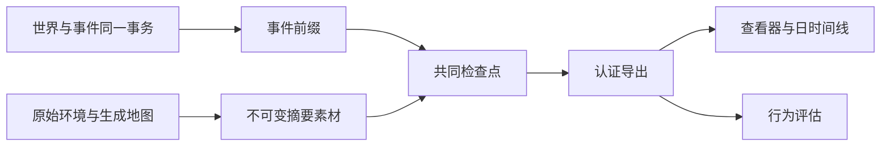
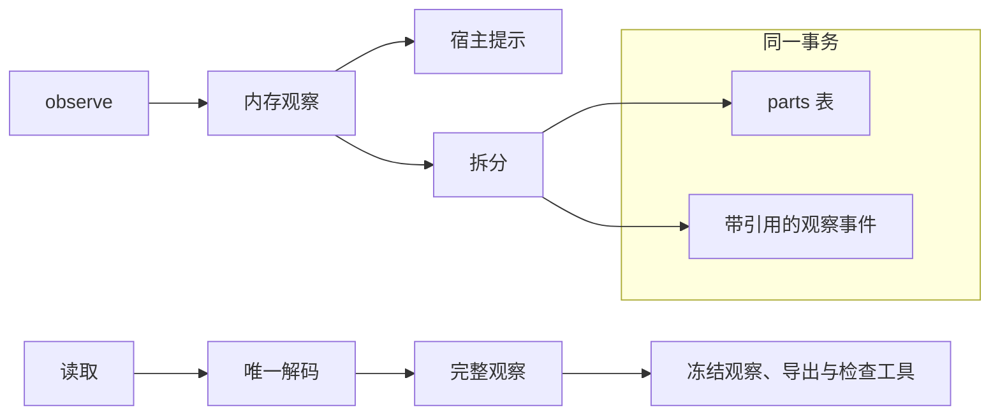
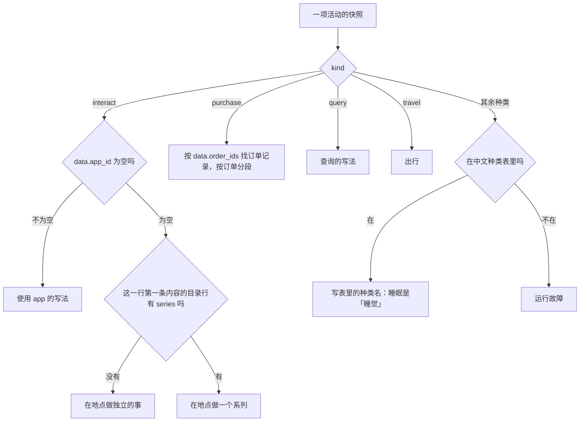

# WorldMock 产品设计说明书 — 记录引擎

## 权威事实与投影

运行的权威记录是按提交顺序保存的事件和共同世界状态。导出、查看器、记忆层与评估只消费这些事实，
不能根据模型自述、资金变化或活动名称补造内容、收货和世界事件。

查看器打开导出目录：在页面里从 events.jsonl 建索引，读导出清单、运行清单和冻结的目录素材，见「显示写法与检查工具」。

运行库只有环境 actor 一个写入者，写入分两种，每次都是一个 SQLite 事务。

- **一步世界推进**：版本恰好加一的新世界与至少一条因果事件。调用方同时交上这一步出发时的世界，存储先核对它与已提交
  世界的规范 JSON 逐字节相同，不同即以 `Engine world differs from the committed world` 拒绝；新世界在写入前已按加载口径
  复校。事件的 `state_version_before` 与 `state_version_after` 是推进前后的两个版本。
- **证据追加**：只写事件，不接收、不改写世界。观察、模型请求与响应、记忆更新、`decision_started` 与
  `action_requested`、`run_failed` 和零点计划失败时的模型证据都是证据追加，事件的前后版本都等于当前已提交版本。
  证据追加不能带资金变化；初始注资只属于创建世界的那一步推进。

检查点不改世界：调用方交上的世界必须与已提交世界逐字节相同，载荷只按规范 JSON 编码一次，`record_sha256` 是这份字节的
SHA-256，存储的正文是它的 zlib 流（见「冻结输入、检查点与分支」）。

写入者在内存里保存最近一次提交的世界的版本、时钟、账户与规范字节：第一次写入时从库里读一次，之后只在推进世界的事务
成功后换成新世界；最近事件的发生时刻每次按主键从库里取，不缓存。每个写事务提交前核对库里的世界版本仍是缓存的版本，
不同说明有别的写入者，以 `World state was changed outside this store` 拒绝并整体回滚。只读的打开者（导出、恢复时读取
父运行）不载入这份缓存，也就不为它解析世界。

## 事件与来源

事件信封携带运行、顺序、时间、人物、动作和活动身份，以及 `resource_changes`。
资金变化只允许信封字段，删除 data 内的重复账本。付款与收入支出必须引用真实两个账户并守恒。
当前活动种类只有 sleep、travel、interact、purchase、query。拒绝旧等待、工作、社交、消息与旧 app 活动快照。
活动快照只出现在环境写下、人物可见的事件里：受理、拒绝、动作结果、活动进度和环境事件。
人物有活动在进行时被业务拒绝，拒绝事件带着那一刻仍在进行的那项活动的快照；世界没有变，
导出把它当作这项活动的一个真实来源，不因此增加执行区间、内容消费或推送转换。
活动进度事件 `activity_progress` 里的 interact 快照不带 `data.played`，改带整数 `data.played_count`，等于这项活动到这一刻放完或做完的条数；
这一段放过或做过的那一条在正文的 `data.content` 里，所以进度事件的大小不随一次 app 使用放了多少条而增长。
受理、拒绝、动作结果、活动生命周期事件和运行截止时写下的截断快照（`environment_event`）里的快照，以及观察作为证据记下的进行中活动，照旧带完整的 `data.played`；世界状态只存完整列表。
`activities.jsonl` 取哪一份快照见「完整导出认证」。

callback_effect、callback_reminder、time_trigger、weather 使用闭合字段合同。
效果包含一项实际触发原因和完整类型化结果；收入支出方向与信封资金变化一致，未支付结果没有资金变化。
独立时间事实不能伪装成上游事件的附加效果，天气条件与速度系数必须来自固定世界天气表。

状态效果有三种正文：回调规则的增量 `state_delta`、收货把状态置为上限的 `reset_to_cap`，以及凭状态的地点内容开始时把状态减 1 的 `consume_on_start`。
`consume_on_start` 的 `data` 恰为 `{kind, type, rule_id, state, content_id, before, after}`：`kind` 为 `callback_effect`，`type` 为 `consume_on_start`，
`rule_id` 为 null，`state` 是状态名，`content_id` 是开始的那条内容，`before`、`after` 是减 1 前后的值，都不小于 0。
信封与另外两种状态效果相同：`environment_event`，来源 `environment`，可见性 `system`，`resource_changes` 为空，`caused_by` 恰一项，
是开始这件事的那次调用的受理 `action_result`。什么时候减见[模拟引擎](04-simulation-engine.md)「出行、内容与查询」。

唤醒原因写在共同身体结算、`decision_started` 和观察里，取值是[模拟引擎](04-simulation-engine.md)唤醒表里的名称。
每次睡醒的原因列表同时含 `planned_end` 与 `session_open`，质量报告和行为评估按原因名的计数各加一。

共同身体结算写成 `body_settlement`，带「结算前」`before`、「结算后」`after` 和这一笔的分录 `resource_flows`。对能量、睡眠不足、放松需要、社交需要四项，「结算后」等于「结算前」加上本记录该项的全部 `source` 分录、减去全部 `drain` 分录。这条记录上只有两类分录：共同结算的分录，和这次推进的不适脉冲。不适脉冲对着共同结算之后的身体计算，世界里加的是分录登记的同一个数额。同一秒的收货（到店购买完成、外卖送达、驿站取件）和地点内容的完成效果不进这条记录，只记在各自的事件上。`goods_received` 的 `applied` 等于该事件登记的分录数额之和，不用前后两个数相减；没有分录时是 `0.0`。业务拒绝带来的放松脉冲，分录记在这组拒绝的第一条 `action_result` 事件正文顶层的 `resource_flows` 上，`action_rejected` 不带；没有施加脉冲时不写这个键。

地点内容的完成效果（`completion_effects`，见[资源引擎](03-resource-engine.md)「app、内容与候选呈现」）证据记在这条内容做完的那条 `activity_progress` 上，不新增事件种类：
内容证据 `data.content` 的字段闭集含 `completion_effects`。这次推进没有做完内容、做完的内容没写 `completion_effects` 或是 app 内容时，它为 null；
做完了一条写了 `completion_effects` 的地点内容时，它是恰含 `food`、`relaxation_relief`、`social_relief` 三个键的对象，没有声明的成员为 null。

| 成员 | 证据 |
| --- | --- |
| `food` | `{tier, provided, applied, efficiency}`：`tier` 是档位名；`provided` 是档位的热量（整数）；`applied` 是这一笔实际登记的补能数额，到上限时为 0；`efficiency` 是这一笔用的食品利用率 |
| `relaxation_relief`、`social_relief` | `{tier, provided, applied}`：`provided` 是档位的量；`applied` 是实际减少的量，需要已为 0 时为 0 |

`applied` 一律取登记的分录数额，不用结算前后的值相减。每个实得不为 0 的成员一条分录，按 `food`、`relaxation_relief`、`social_relief` 的次序排在这条事件 `resource_flows` 的最前：
`food` 是 `energy_kcal` 的 `source`，`cause` 为 `settle:shared:energy_kcal`；两项缓解是 `relaxation_need`、`social_need` 的 `drain`，`cause` 为 `content:completion`。
下面任何一条不成立都是运行故障，先写英文错误日志，再抛 `IntegrityError("Activity completion effects must use the current location completion contract")`：
值为 null 或对象；为对象时键恰为三个成员、`data.content.completed` 为真、`data.content.app_id` 为 null；每个非空成员的键恰如上表、`tier` 在该成员的档位表内。

`memory_updated` 登记人物工作区已落盘的记忆，所有登记用同一组键：`operation`、`created_episode_ids`、
`merged_episode_ids`、`episodes`、四个文件身份、`consolidated`、`observation_event_id`、`verified_event_ids`、
`trigger`、`decision_id` 和 `reflection`。环境按 `observation_event_id` 是否为空分两路核对。

| 登记 | `observation_event_id` | `trigger` | `reflection` | 另外要求 |
| --- | --- | --- | --- | --- |
| 反思登记 | `null` | 恰为 `["reflection"]` | `{date, sleep_activity_id}`，由环境按 `due_reflection` 写入 | `due_reflection` 此刻非空；这次决策还没有观察；本人在这一时刻还没有登记过反思；`operation` 是 `append_episodes`；每条快照的来源都是 `reflection`；`verified_event_ids` 为空；`MEMORY.md` 的前后身份相等 |
| 步尾登记 | 本决策的冻结观察 | `[]` 或 `["activity_conclusion"]` | `null` | 观察属于本决策，事实窗口一致；快照里没有来源为 `reflection` 的条目 |

任一条不满足先记英文错误日志，再以 `ProtocolError("Memory update evidence is invalid")` 作为运行故障拒绝。
睡醒那一步最多有两个 `memory_updated`，先反思、后步尾，两类登记不出现在同一个事件里。

质量报告对每个 `reflection` 非空的记忆更新只凭事件独立重算四件事，任一不成立记一条 `memory_update_without_source`：
同一人物有一条 `activity_progress` 事件，快照是已完成的睡眠，结束时刻等于这次更新的发生时刻；
这是该人物在这个本地日（时区取运行清单的窗口时区）最早的一次睡醒；`reflection.date` 是这个本地日的前一天；
这次更新排在同一决策的观察之前，并且该人物在这一时刻只有这一条反思登记。
`reflection` 为空的更新照旧核对观察与事实窗口。观察不再带刚结束睡眠的私有键。

手机上的三类事由引擎写成四种环境事件：app 的开和关、进出地点、订单通知。
它们都是 `environment_event`，来源是环境，可见性是 `system`，不带资金变化，事件类型的闭集不变。
人物看不到它们：不进任何提示层、记忆、零点计划和就寝反思的输入，不能被回调规则订阅，不产生公开评估证据；
它们也不是决策机会，不新增唤醒原因，不改人物的下一次决策时刻。
人物从购买结果的 `channel` 读到实际的下单 app，从查询的答案读到是在哪个 app 里查的；来源是商品履约记录和查询活动，不是这四种事件。
恢复和重放读已提交的事件，不重写、不重抽。

| `data.kind` | `data` 恰为 | 何时写 | 起因 |
| --- | --- | --- | --- |
| `app_foreground` | `{kind, app_id, step, interval_start, interval_end}` | 一段前台区间关闭的那一秒；打开时不写，长度为 0 的区间不写 | 恰一项：所属活动受理的 `action_result` |
| `location_entered` | `{kind, session_id, location_id, entry_kind}` | 一段停留开始 | 随 `entry_kind` 而定，见下表 |
| `location_left` | `{kind, session_id, location_id}` | 人物出发，这段停留结束；运行截止不写 | 恰一项：受理这次出发的 `action_result` |
| `order_notification` | `{kind, app_id, order_ids, title, summary}` | 订单已下单、已发货、已送达各自发生的那一秒 | 恰一项，随标题而定，见[模拟引擎](04-simulation-engine.md)「购买、付款与收货」 |

`app_foreground` 的 `step` 是 `navigation`、`ordering`、`payment` 之一，`interval_end` 等于事件时刻、晚于 `interval_start`；
信封的 `activity_id` 是所属活动，导航是出行活动，下单和支付是购买活动。「前台」指手机上此刻开着的那个 app，同一时刻至多一个。
`order_notification` 的 `title` 是「订单已下单」「订单已发货」「订单已送达」之一，`order_ids` 是非空、按字符串升序、不重复的商品履约记录身份。
「支付成功」沿用 `payment_notification`，字段不变。

| `entry_kind` | 含义 | 起因 |
| --- | --- | --- |
| `run_start` | 运行开始时人物已在这个地点，不是一次真实的进入；随世界创建的首次提交写入，整次运行恰一条 | 空 |
| `arrival` | 出行按计划走完，到达目的地 | 恰一项：这趟出行走完那一秒的 `activity_progress` |
| `travel_ended_early` | 人物途中提前结束出行，回到出发地开始一段新停留 | 恰一项：这次 `conclude_activity` 的 `action_result` |

停留就是地点停留会话，`session_id` 是会话身份。路上不是停留，不写这两种事件；
到达时刻恰好等于运行截止时照常写 `location_entered`，截止时人物还在的那段停留没有离开事件。

模型请求与观察里的大表各只存一次，读出的证据与写入前相同：

- **模型证据**：模型调用逐次留证。
  - 请求事件 `model_request` 的 `data.request` 是实际发出的完整请求，消息、工具与参数原样。
  - 同一调用的响应或失败事件 `model_response` 的 `data.request` 恒为 null（键照常出现），`caused_by` 恰一项，指向它的请求事件。请求只存一次；零点计划的证据本就如此。其余键照旧：`phase`、`call_id`、`attempt`、`response`、`error`，响应带 `protocol_feedback` 时也照旧。
  - 环境登记请求时记下请求规范 JSON 的 sha256；登记响应或失败时，核对它带来的请求与之相同。比较按规范内容，内容相同、只是重新构造（例如跨进程传送后键的插入次序不同）的请求照常接受。
  - 不同说明请求在调用途中被改动：先写英文错误日志 `Model <phase> for call <call_id> carries a request that differs from its recorded request`，再抛 `ProtocolError("Model exchange request differs from its recorded request")`。这条响应不写入，运行按故障停下。
- **观察分件**：观察里七张随时间增长或几乎不变的表按内容单独存放一次，观察事件的正文只带它们的 sha256。存储形式如下表。

| 键 | 存储形式 |
| --- | --- |
| `activity_bindings` | 按行序，把所指活动开始时刻 `started_at` 的场景本地日期相同的相邻行归为一段，每段一个观察分件；正文存这些分件 sha256 的列表，次序即行序，没有行时是空列表 |
| `catalog_bindings`、`errand_item_bindings`、`known_activity_actions`、`locations`、`memory_layer`、`persona_views` | 整表一个观察分件，正文存一个 sha256 |
| 其余键（含 `todo_layer`、`goal_bindings`） | 照旧内联 |

- **观察分件的写入**：
  - 观察分件的正文是那张表或那一段行的规范 JSON 文本，sha256 按它的 UTF-8 字节计算；引用是 64 个小写十六进制字符的裸字符串，不是带标记的对象。
  - 观察分件存在运行库的 `parts` 表（`sha256` 主键、`body` 正文），只能新增，不能修改或删除；同一内容只存一次。
  - 观察与它的全部观察分件在同一事务写入：先登记分件（已有的同一分件不重写），再写观察；观察引用的每个分件都必须已在表中，否则整笔回滚。登记时正文的 sha256 与键不符报 `Observation part content does not match its sha256`，引用的分件不在表中报 `Observation part is missing`。
  - 每次观察都把全部分件重新编码、求摘要，不按日期缓存：过去某天的一段会因活动阶段变化、改称「（第二次）」或记忆层标注变化而改变。
  - 拆分不改动 `observe` 交给宿主的观察及其中任何容器；只给宿主的 `progress_layer`、`progress_meta` 不写入观察事件。要写入的观察缺少这七张表之一，报 `Observation lacks a table stored as a part`。
- **读取**：存储层读取任何事件都经同一个解码。
  - 观察的引用换回原表；换回前核对分件存在、正文的 sha256 与引用相同。
  - 不成立先写英文错误日志，再以 `IntegrityError` 拒绝，原因是 `Observation part is missing`、`Observation part content does not match its sha256` 或 `Stored observation part reference is invalid`。
  - 冻结观察、回看、名称解析与结算读到的观察，与写入前逐字节相同，键序也相同。
  - 没经过这个解码的读取拿到的是裸 sha256 字符串，按行取字段立即失败，不会静默读到别的内容。
  - 任何 SQL 条件只读信封字段和内联键，不读这七个键的内部。
  - 宿主照旧用 `observe` 返回的内存观察生成提示，存储形式不进入任何提示。
- **观察分件不是素材**：
  - 素材按 `AssetRef`（带模态与来源）引用，逐个文件落盘刷盘，在事务之外先发布，每次提交与恢复都重读复核，导出时逐个复制。
  - 观察分件是运行库里与观察同一事务的行，按裸 sha256 引用；导出时换回原表，不另成工件。
  - 两者不共用名称。

## 数字足迹

`app-usage.jsonl` 的事实共八种，共同字段是 `fact_kind`、`agent_id`、`activity_id`、`app_id`、`source_event_id`。

| `fact_kind` | 另带字段 | 来源 |
| --- | --- | --- |
| `app_use` | `segments`、`status` | 自带 app 的活动（人物点名使用的内容 app，和查询所在的 app）；引擎代为打开的 app 的 `app_foreground` 事件 |
| `content_consumed` | 内容身份、结算区间、位置、是否完成、推送身份 | 实际内容结算 |
| `push_delivered`、`push_opened`、`push_released` | 推送身份、内容身份、会话身份、时刻 | 推送的送达与实际转换 |
| `app_touch` | `occurred_at` | 回调规则 `footprint_chain` 的足迹；出行和付款不再写自动时间点 |
| `payment_notification` | `occurred_at`、`amount_fen`、`order_ids`、`title`、`summary` | `payment_notification` 事件 |
| `order_notification` | `occurred_at`、`order_ids`、`title`、`summary` | `order_notification` 事件；`activity_id` 为 null |

`app_use` 是 app 真实在前台的区间，分两种来源。自带 app 的活动，活动数据里有 `app_id`：人物点名使用的内容 app，区间是这项 interact 活动的正秒结算；
查询所在的 app，区间是这项 query 活动的执行区间，`app_id` 为空的查询没有 `app_use` 行，查询不写 `app_foreground`。
引擎代为打开的 app（导航、购买时下单的内容 app、支付 app；下单的内容 app 可以是人物在 `prefer` 里写的那个）由 `app_foreground` 投影：同一活动、同一 app 一行，字段与人物点名使用的行完全相同；
`segments` 是这一对活动与 app 的全部前台区间，按时间升序，首尾相接的并成一段；`status` 是所属活动在导出截止时的状态；
`source_event_id` 是最后一条贡献区间的 `app_foreground` 事件。
下游区分两种来源看 `activity_id` 在 `activities.jsonl` 里的 `activity_type`：`interact` 是人物点名使用，`query` 是查询所在的 app，`travel` 是导航，`purchase` 是下单或付款。
`app_use` 行排在文件最前，按各行第一条来源事件的先后排列；其后是其余事实，按事件先后。
app_touch、payment_notification 和 order_notification 是系统点事实，不拥有播放、停留或复看时长。
「支付成功」由抽到的支付 app 发；抽到直付时由下单的内容 app 发，到店且直付不发。三种订单通知都由下单的内容 app 发。
内容消费使用实际内容结算区间和当前内容身份，不能使用活动起止墙钟差计算，暂停时间不计入。
人物点名使用的内容 app 一条放完自动接下一条（见[模拟引擎](04-simulation-engine.md)「出行、内容与查询」），条与条之间是结算边界，前后两段首尾相接，
所以一次使用不论放了几条都只有一行 `app_use`，`segments` 只被暂停分开；每一条各有自己的进度事件、`content_consumed` 行和 `played` 经历，
一条被别的结算边界切成几段时照旧是几行。人物收尾结束的一次使用 `status` 是 `cancelled`；人读文字的终局写「结束使用」（见[模拟引擎](04-simulation-engine.md)「出行、内容与查询」），不改这个机器字段。

`location-stays.jsonl` 每段停留一行，由 `location_entered` 与 `location_left` 按 `session_id` 配对投影，按进入事件的先后排列。

| 字段 | 取值 | 含义 |
| --- | --- | --- |
| `agent_id` | 唯一人物 | 人物 |
| `session_id` | 停留会话身份，文件内唯一 | 这段停留；与推送事实的 `session_id` 是同一套身份 |
| `location_id` | 已登记地点 | 地点 |
| `entry_kind` | `run_start`、`arrival`、`travel_ended_early` 之一 | 这段停留怎样开始 |
| `entered_at` | 纪元秒；`run_start` 的那一行等于运行开始时刻 | 进入时刻 |
| `left_at` | 纪元秒或 null，不早于 `entered_at` | 离开时刻；导出截止时还在这里则为 null |
| `enter_source_event_id` | 一条 `location_entered` 事件 | 进入的来源 |
| `leave_source_event_id` | 一条 `location_left` 事件，`left_at` 为 null 时为 null | 离开的来源 |

购买投影保存实际订单商品、门店、平台、付款 app、数量、价格与履约事实。人物写的 `prefer` 原文只在 `action_requested` 事件的请求里，购买工件不为它加字段。
付款、到站与收货分开；收到的经历只能来自已提交的本人真实收货事件。地点内容的完成效果（含 `food` 补的能量）不是收货，不进购买投影，也不是「收到」这种已核验经历。
对象的显示名一律取自这次运行冻结的环境目录，不从观察记录里取；日时间线的写法见「显示写法与检查工具」。

## 显示写法与检查工具

查看器、导出的一天时间线、`scripts/inspect_run.py`、人物零点做计划时读到的「已核验经历」句，四处用同一套写法；
质量报告 `timeline_labels` 检查的是一天时间线的各行，跟着一天时间线走。写法是说明一项活动或一条手机事件是什么的那几个字，
不含时刻、状态和时长，这些由各处另写。Python 一侧的使用方都调用同一处实现，查看器是它的镜像。

### 写法总表

尖括号里是从冻结的环境目录取到的名称；「·」两侧各有一个半角空格；括号、冒号、分号、顿号都是全角；「×」是乘号。
「样例环境」指 `tests/fixtures/dataset-environment/`。

| 情形 | 格式 | 例子 | 样例环境的例子 |
| --- | --- | --- | --- |
| 用 app 看到一条内容 | 使用<app 名>《<标题>》 | 使用哔哩哔哩《散步装备准备》 | 使用哔哩哔哩《测试文章》 |
| 一次使用里连着看了两三条 | 使用<app 名>《<标题一>》《<标题二>》…… | —（查看器泳道把首尾相接的几次使用并成一行、不多于三条时也用这个格式，多于三条照下一行；见下文「查看器里的连续使用」） | 使用哔哩哔哩《测试剧集第一集》《测试剧集第二集》 |
| 一次使用里连着看了超过三条 | 使用<app 名>《<标题一>》《<标题二>》《<标题三>》等 <K> 条 | — | 使用抖音《测试短视频》《测试短视频二》《测试实况》等 4 条 |
| 在地点做一件独立的事 | 在<地点显示名>：<单元名> | 在淀山湖大道东渡悦来城公寓：早上洗漱 | 在家：测试休息 |
| 在地点做一个系列 | 在<地点显示名>：<系列名>《<集一>》《<集二>》…… | 在淀山湖大道东渡悦来城公寓：做晚饭《备菜做饭》《吃晚饭》《洗碗收拾厨房》 | 样例环境没有地点系列，测试在副本上加 |
| 购买，一张经 app 下单的订单 | 购买<商品列表>（经<app 名>下单） | 购买冰美式咖啡（经瑞幸咖啡下单） | 购买牛肉面（经美团下单） |
| 购买，到店 | 购买<商品列表>（到店） | 购买冰美式咖啡（到店） | 购买饭团、纸巾（到店） |
| 购买，一次分成几张订单 | 购买<第一张的商品列表>（……）；<第二张的商品列表>（……） | 购买冰美式咖啡（经瑞幸咖啡下单）；薯片（到店）（示意） | 购买牛肉面（经美团下单）；纸巾（到店） |
| 查询，有 app 在前台 | 查询<名称列表>（<app 名>） | 查询冰美式咖啡（瑞幸咖啡） | 查询食品（美团） |
| 查询，没有 app | 查询<名称列表> | — | 查询纸巾 |
| app 前台区间 | app 前台 · <app 名> · <步骤> | app 前台 · 淘宝闪购 · 下单 | app 前台 · 高德地图 · 导航 |
| 订单通知 | 订单通知 · <app 名> · <标题> | 订单通知 · 淘宝闪购 · 订单已送达 | 订单通知 · 美团 · 订单已下单 |
| 消费通知 | 消费通知 · <app 名> · 支付成功 | 消费通知 · 支付宝 · 支付成功 | 消费通知 · 微信 · 支付成功 |
| 出行 | <出行方式名>去<地点显示名> | — | 驾车去公司 |
| 睡眠 | 睡觉 | — | 睡觉 |

选哪一行看活动快照的 `kind` 和 `data.app_id`；在地点做的事再看这一行第一条内容的目录行：

没有专门写法的种类，写中文种类表 `ACTIVITY_KIND_LABELS` 里的种类名；不在这张表里的种类是运行故障。

### 各情形的细则

**标题怎样列。**

- 标题一律按内容身份 `content_id` 到冻结的环境目录里取，不读快照里随带的 `content_title`。
- 一条事件指向哪条内容：进度事件 `activity_progress` 的正文带着 `data.content` 时，取其中的 `content_id`，也就是这一段里真正放过或做过的那一条；
  事件没有这一项时（受理事件都没有），取活动快照的 `data.content_id`。一集做到头的那条进度事件，快照已经换成下一集，所以不能一律读快照。
- 一行覆盖几条事件，就按事件的先后把它们指向的内容依次列出，每条一个书名号，书名号之间不加任何字符；相邻两条是同一条内容（`content_id` 相同）时只写一次。
- 没看完、没做完的也照列，不标「未完」。一行覆盖哪些事件，四处各不相同，见「四处各自怎样写」。
- 去掉相邻重复之后多于三条时只写前三条，后接「等 K 条」，K 是去重之后的总条数，数字两侧各一个半角空格，例如「《一》《二》《三》等 12 条」；
  恰好三条及以下照列。用 app 和在地点做系列都一样。上限是 `display_wording` 的常量 `TITLE_LIST_LIMIT`（3），截断只由同一个公开函数 `title_list` 完成，
  人物结束句里的标题（见[人物](06-agent.md)「进度、待办与记忆」）也调用它，进度层结果的 `details.contents` 只列这么多行（见[模拟引擎](04-simulation-engine.md)「出行、内容与查询」），
  查看器的镜像与它一字不差。没写出来的各条仍逐条按身份取名，取不到照「取不到名称」处理。

**在地点做的事。**

- 地点取活动快照的 `location_id`，也就是开始这件事时所在的地点，写它的显示名：`name`，有 `branch_label` 时是「`name`（`branch_label`）」。
- 单元名是人物点名时写的名称：独立内容是它的标题，不再重复写书名号；系列是系列名（内容行的 `series.title`），先写系列名，再列这一行覆盖的各集，只覆盖一集时是「在家：做晚饭《吃晚饭》」。
- 是不是系列，看这一行第一条内容的目录行有没有 `series`；一项在地点做的活动里的各条内容同属一个单元。app 里的系列不写系列名，只列各集标题。

**购买。**

- 商品和渠道都取订单记录：按快照的 `data.order_ids` 找到这次购买的各条商品履约记录，读其中的 `goods_id` 和 `app_id`。不读人物在请求里写的 `prefer`，也不读活动名。
- 订单是一次购买里下单 app 相同的全部商品履约记录，到店买的记录合成一张到店订单。按订单分段：带下单 app 的订单按 `app_id` 升序，到店订单排在最后；
  段与段之间用「；」，「购买」两个字只在最前面写一次。同一个下单 app 上点了两家店仍是一张订单、一段。
- 段内的商品按 `goods_id` 升序，同一件商品买了几份合写成「名称×份数」，各项以「、」相连，与订单通知正文同一写法。
- 渠道：`app_id` 不为空写「（经<app 名>下单）」，为空写「（到店）」。只在 app 里卖的快递商品有下单 app，同样写「经<app 名>下单」。
- 余额不足而失败、被提前结束的购买照写同一句，状态由各处另写。

**查询。**

- 名称列表取查询活动私有数据的 `targets`（见[状态与序列化](09-io-formats.md)「世界、人物与活动」），按所写次序、已去重：商品项按 `goods_id` 写商品名，
  类别项写类别的中文名「零食」「食品」「饮料」「商品」，各项以「、」相连，不再排序。
- 查询活动的 `data.app_id` 不为空时在后面加「（<app 名>）」，为空时不写括号。
- 查询期间的 app 前台由这项查询活动自己带着，不是一条手机事件，没有「app 前台 · …… · 查询」这样的行，app 只出现在查询这一行里。

**手机事件。**

| 记录 | 写法 | 取值 |
| --- | --- | --- |
| `app_foreground` | app 前台 · <app 名> · <步骤> | 步骤的中文名：`navigation`「导航」、`ordering`「下单」、`payment`「付款」，闭集只有这三个 |
| `order_notification` | 订单通知 · <app 名> · <标题> | 标题取事件自带的 `title`：「订单已下单」「订单已发货」「订单已送达」 |
| `payment_notification` | 消费通知 · <app 名> · <标题> | 标题取事件自带的 `title`，恒为「支付成功」 |

app 名按事件的 `app_id` 取；功能 app 也在冻结的 app 目录里，所以取得到。直付时消费通知由下单的内容 app 发，写的就是它的名称。
查看器遇到这三个之外的步骤照原值显示，Python 一侧不为它另设分支。

**出行和睡眠。** 出行按快照的 `travel_method_id` 和 `destination_id` 取名，引擎自带的步行固定是 `walking`「步行」；睡眠写中文种类表里的「睡觉」。

### 四处各自怎样写

| 哪里 | 用到写法的行 | 一行覆盖哪些事件 | 写法前后还写什么 |
| --- | --- | --- | --- |
| 导出的一天时间线，以及质量报告 `timeline_labels` 检查的行 | 每行的「活动」一栏 | 同一活动首尾相接的结算段合成一行，覆盖这些段的进度事件。时间线不读受理事件。活动暂停后再恢复是两行，各列各的 | 起止、总时长、段数三栏 |
| `scripts/inspect_run.py` 的 `events` | `activity_progress` 行、`action_accepted` 行里的活动；`environment_event` 里的三种手机事件 | 一条事件，只有它指向的那一条内容 | 见下文「检查工具」 |
| 人物零点做计划时读到的「已核验经历」 | 内容经历句 | 一条内容推进经历，只有那一条内容（经历的 `content_id` 取自进度事件的 `data.content`） | 「<起>–<止> <写法>」，句子见[人物](06-agent.md)「进度、待办与记忆」 |
| 查看器 | 活动表的「目标」列、活动泳道的标签；时间线的「已受理」「活动段」行；「世界事件」行里的三种手机事件；「结果」行的订单段 | 活动表和泳道：一项活动的全部受理事件与进度事件，按事件序号；泳道里几次使用并成的一行，覆盖这一行各个执行段的进度事件。时间线的行：一条事件 | 见下文「查看器」 |

一段不间断、不跨零点的活动，时间线的行和查看器的活动表写出的是同一句。暂停后恢复、或跨过零点的活动，时间线分成几行、各列各的，查看器的活动表按活动只有一行，把各段的内容列全；
受理之后一秒都没有推进就结束的活动，时间线没有这一行，查看器的活动表仍写出受理时选中的那一条。
标题上限只在一行覆盖几条内容时起作用：时间线的一行在自动接续之下就是一整次使用，查看器的活动表和泳道也是；`inspect_run.py` 与经历句每行只有一条内容。

经历句交给写法的快照只有三项：`kind` 是 `interact`，`location_id` 是这项活动的地点，`data.app_id` 是经历的 `app_id`；内容序列只有经历的 `content_id` 一条。
一条内容被结算边界切成几段仍是几句，系列逐集一句。

### 名称的唯一来源

名称只有一个来源：这次运行冻结的环境目录。任何一处都不从观察记录里取名称。

| 素材名（`environment_assets` 的键） | 读哪些字段 | 得到什么 |
| --- | --- | --- |
| `catalog/app-catalog.jsonl` | `app_id`、`name` | 全部 app 的名称，内容 app 和功能 app 都在 |
| `catalog/content-catalog.jsonl` | `content_id`、`title`、`series.title` | 标题；单元名（有 `series` 取 `series.title`，否则等于标题） |
| `catalog/merchant-catalog.jsonl` | `goods_id`、`name` | 商品名 |
| `catalog/location.jsonl` | `location_id`、`name`、`branch_label` | 地点显示名 |
| `catalog/travel-method.jsonl`（可选，环境没有这份文件时清单里没有这个键） | `travel_method_id`、`name` | 出行方式名；步行不在文件里，固定为 `walking`「步行」 |

| 使用方 | 清单 | 素材 |
| --- | --- | --- |
| `scripts/render_day.py` 的命令行、`scripts/inspect_run.py` | 数据库所在运行目录的 `manifest.json` | 同一目录的 `assets/<sha256>` |
| 导出写时间线和质量报告 | 足迹库持有的运行清单 | 运行目录的 `assets/<sha256>` |
| 导出认证重算质量报告 | 导出清单的 `frozen_run_manifest` | 导出目录的 `assets/<sha256>`：导出复制了全部环境素材，只凭导出目录就能重算 |
| 零点计划的经历句 | 不回读文件 | 运行中的引擎用内存里的目录，它与冻结的素材是同一份字节 |
| 查看器 | 导出清单的 `frozen_run_manifest`；同一次拖入了运行目录时取运行目录的 `manifest.json`（内容相同） | 同一次拖入的 `assets/<sha256>` 文件 |

Python 一侧读冻结素材时沿用导出认证的读取：先核对素材名集合，再逐个按摘要定位并复核字节数与摘要，然后用登记环境时的同一套严格行模型解析各行。

### 取不到名称

Python 一侧的使用方都是要出结论的工具或人物的输入，取不到名称就是运行损坏，一律抛 `IntegrityError`，下表三句新的英文先写同文的错误日志；
查看器是容错的阅读工具，标出缺失。

| 情形 | Python 一侧 | 查看器 |
| --- | --- | --- |
| 身份不在冻结的环境目录里 | `Displayed object is not registered in the frozen environment: <kind> <identity>`，`<kind>` 是 `app`、`content`、`goods`、`location`、`travel_method` 之一 | 显示成「名称缺失（<身份>）」，同一个身份只写一次 `console.error('Missing recorded object name:', <身份>)` |
| 清单登记的素材文件不存在 | `Frozen environment asset is missing` | `console.error('Frozen catalog file is missing:', <素材名>)`，这一份目录按缺失处理；`environment_assets` 里没有四份必需目录之一的素材名时同样写这一句 |
| 素材的字节与清单不符 | `Frozen environment asset identity is invalid` | 只核对字节数：`console.error('Frozen catalog file size disagrees with the run manifest:', <素材名>)`，按缺失处理 |
| 素材名集合与清单不符 | `Frozen environment asset set is invalid`、`Frozen catalog file set is invalid` | 不检查 |
| 某一行不是合法的 JSON 对象，或不合当前的行模型 | 登记环境时的同一句英文原因，带文件名和行号 | 只要求每行能解析成 JSON 对象：`console.error('Frozen catalog file is unreadable:', <素材名>)`，按缺失处理；多出来的字段不管 |
| 购买活动的 `order_ids` 在订单记录里找不到 | `Purchase activity has no recorded order: <order_id>` | 这张订单的位置显示「名称缺失（<order_id>）」 |
| 活动种类没有专门的写法，也不在中文种类表里 | `Unsupported activity kind for display: <kind>` | 没有专门写法的种类在目标处一律显示「—」；类型列写种类标签，表里没有的写原值 |

Python 一侧取不到名称时：`render_day.py` 的命令行不写出时间线文件；导出不发布；导出认证失败；`inspect_run.py` 以该错误退出；零点计划是运行故障，运行停下并保留已确认的部分。

### 查看器

查看器不做认证，只打开导出目录。没有导出的运行（包括运行中和中途停下的）先用 `worldmock export` 导出，`--cutoff` 只导出到某个事件。
拖入导出目录，或拖入包含它的执行目录（运行目录一起读），也可在文件选择框里选中导出目录里的 `events.jsonl` 与 `manifest.json`
（要名称再选中 assets 里的文件）。

- **取得文件。** Chrome 的拖放入口使用 File System Access 的 `getAsFileSystemHandle()`，在 `drop` 回调首次等待之前
  同步取得全部文件与目录句柄的承诺，再一起等待；不再使用依赖目录 URL 的 `webkitGetAsEntry()`。
  目录通过 `values()` 递归枚举，文件通过 `getFile()` 按需取得；收集阶段不读事件文件或素材正文。
  单独选择文件仍消费文件选择框的 `File`；目录递归、清单相对路径、素材同名取先遇到的和人物 `MEMORY.md` 的读取规则相同。
  取得句柄、枚举目录或读取事件文件失败时，加载终止、清空半成品并显示英文原因和错误日志，不切换旧接口。
  这一入口采用 [Chrome 官方拖放用法](https://developer.chrome.com/docs/capabilities/web-apis/file-system-access#drag-and-drop-integration)；
  本地打开使用 `file:` 上下文，[安全上下文规范](https://www.w3.org/TR/secure-contexts/#is-origin-trustworthy)
  将该协议列为可被信任的来源，实际文件访问仍由浏览器对用户拖入的句柄授权。
- **认定导出。** 同一次拖入的 `manifest.json` 里，带 `frozen_run_manifest` 对象的那一份是导出清单，必须恰有一份，且带 `run_id`、
  `window.timezone` 与 `artifacts.events`；不读结构号，各版导出都能打开。`events.jsonl` 取导出清单所在目录下 `artifacts.events.path`
  指的文件。导出清单的 `frozen_run_manifest` 必须是 `run_id` 相同、带 `agent_ids` 的运行清单。只拖了 `footprints.sqlite`
  （或 `.sqlite3`、`.db`）而没有导出清单时，页面说明先导出。
- **运行身份与时区。** 都取导出清单：顶层的 `run_id` 与 `window.timezone`，不读世界状态，没有缺省时区。总览与顶栏的 run_id 是这个值；
  恢复链的导出写的是最后一段的运行。
- **页内索引。** 每次读 32 MiB（Perfetto 读大文件的分段），按换行分行，逐行严格按 UTF-8 解码并解析，写进页面里的 sql.js 内存库：
  `events(event_seq, event_id, body)` 与运行数据库同形；`event_lines(event_seq, offset, length)` 记每行在文件里的字节起点与长度
  （不含换行）；`world_state(singleton, version, body)` 在导出清单带最终存档时写入 `checkpoint.state` 一行，不完整导出没有这一行。
  行数必须等于 `artifacts.events.rows`。写完建 `events_type` 索引（`json_extract(body,'$.event_type'), event_seq`），与各视图按类型
  读取的写法相同。建索引时每过约 0.1 秒经一次消息投递让出页面（隐藏的标签页里计时器每秒至多唤醒一次，消息投递不受限），拖放区每读过
  一成写一行进度；同一时间只加载一份导出。
- **裁剪。** 三类大事件的 body 只留各视图批量读取的部分，其余事件写原行：

  | 事件 | 索引里的 body |
  | --- | --- |
  | observation | 信封全留；data 只留 `balance_fen`、`body`、`active_activities`、`calendar_context` |
  | model_request | 信封与 data 全留；`data.request.messages` 只留第一条 |
  | model_response | 信封与 data 全留，去掉 `data.request` |

  这张表只在 `tools/run-viewer-index.js` 维护一处，SQL 控制台的说明由它生成。
- **全文。** 时间线展开一行、「上下文」读请求与响应时，按 `event_lines` 的字节区间从 `events.jsonl` 读原行，与导出文件逐字节相同；
  读不到（文件被移走或改动）时在该处写读取失败和英文错误日志。
- **不完整导出。** 没有最终存档时，对象名称、运行输入警告和当地时刻照常；期末账户与世界状态版本显示「无 world_state」，
  没有地点会话，人物写「agent <编号>」。
- **人物总结。** `MEMORY.md` 只在同一次拖入了运行目录（`as2/agents/agent_<编号>/MEMORY.md`）时显示；记忆正文照常取自
  `memory_updated` 事件。
- **冻结目录。** 认定运行清单（拖入了运行目录的 `manifest.json` 时取它本身，否则取导出清单里的冻结副本）后，取 `environment_assets`
  里上表五个素材名的 `sha256` 和 `size_bytes`，在同一次拖入的文件里找到 `assets/<sha256>`（直接位于名为 `assets` 的目录下的文件按
  文件名记下句柄，顶层选中的、文件名恰为 64 位十六进制摘要的文件也记下，同名取先遇到的），核对字节数后逐行解析成 JSON 对象；
  不在浏览器里重算摘要，不接受另外拖入的环境数据集目录。文件选择框不限扩展名，素材文件没有扩展名。没有拖入 assets 时，app、内容、
  商品、地点、出行方式的名称显示为缺失；活动名、事务名、地点会话名是事件和世界状态自己带的文字，不受影响。
- **加载次序。** 固定为：清空上一份运行（索引库、名称表、订单表、缺失记录、各视图状态）；认定导出清单与 events.jsonl；建索引；
  读事件索引与摘要字段；认定运行清单，读目录文件建名称表；合并活动并算出连续使用；最后生成各行摘要文字，只算一次。
- **SQL 控制台。** 查询的是这个索引；说明写明三类 body 的裁剪、各留什么、`event_lines` 表、没有 checkpoints 与 artifacts 表，
  以及完整行在哪里读：`event_lines` 的字节区间、`sqlite3` 只读打开运行目录的 `footprints.sqlite`、`scripts/inspect_run.py`。
- **容量。** 30 天的导出（events.jsonl 1.92 GB）建成的索引约 260 MB。sql.js 把索引放在一个随写入按 1.125 倍增长的 ArrayBuffer
  里，Chrome 单个 ArrayBuffer 的上限约 2 GB，按每天约 7.4 MB 约 200 天到顶。

加载被拒绝的情形（英文原因显示在拖放区，并写同文错误日志）：

| 情形 | 原因 |
| --- | --- |
| 没有导出清单，拖入了数据库文件 | `<路径> is not opened directly: export the run with "worldmock export …" … and drop the export directory` |
| 没有导出清单 | `No export manifest was dropped: …` |
| 导出清单多于一份 | `More than one export manifest was dropped: …` |
| 导出清单缺字段 | `Export manifest lacks run_id, window.timezone or artifacts.events` |
| 冻结副本不是本运行的运行清单 | `Export manifest frozen_run_manifest is not the run manifest of run <run_id>` |
| 没有拖入 events.jsonl | `The export's events file was not dropped: <路径>` |
| 某行解不了 | `events.jsonl line <行号> could not be indexed: <原因>` |
| 文件被截断 | `events.jsonl does not end with a newline: the file is truncated` |
| 行数不符 | `events.jsonl holds <n> events but the export manifest lists <m>` |

种类标签「互动」「购买」「查询」「出行」「睡眠」留在活动表的「活动类型」列、图例和排序里；写法放在「目标」列、时间线和泳道。

| 位置 | 写什么 |
| --- | --- |
| 时间线「已受理」行 | 「已受理 · <写法> · 计划 <时长>」，例如「已受理 · 使用哔哩哔哩《散步装备准备》 · 计划 1分」 |
| 时间线「活动段」行 | 「活动段 · <写法> · <状态> · 已进行 <时长>」 |
| 活动泳道的标签、活动表的「目标」 | 写法 |
| 「结果」行的订单段 | 每条记录「 · 订单 <商品> ¥<金额>（经<app 名>下单）」或「（到店）」，有支付 app 再接「 · 支付 <名称>」 |
| 「世界事件」行 | 「世界事件 · <手机事件的写法>」 |
| 出行、睡眠的各行 | 照原格式，名称从目录取 |
| 地点会话表的成员 | 活动名 |

互动、购买、查询三种在时间线的受理行和活动段行里直接写写法，不再写「种类 · 目标」。

开始副活动的动作请求行写「<动作> · <名称、名称>」，`prefer` 不为 null 时在后面加「 · 想用 <人物所写的原文>」；它显示的是人物写的原文，实际渠道看受理行和结果行。
`interact` 在请求行里按工具取词：槽位 1 的开始工具写「做」，槽位 2 的开始工具写「使用」。「上下文」画面里工具层下钻的标签用同一张中文动作表：
`interact` 在 `app` 分组下是「使用」、在 `location` 分组下是「做」，`travel` 是「出行」，`sleep` 是「睡觉」，`purchase` 是「购买」，`query` 是「查询」（工具层没有查询的行，只用于动作请求行）；
目标类别、下钻正文和「整层原文」保持原始 JSON。

拖放区说明写「把 worldmock export 写出的导出目录拖到此处……对象名称取自导出目录 assets 里冻结的环境目录，没有 assets 时显示为
「名称缺失」……」（全文见 `tools/run-viewer.html` 拖放区）。有任何一份必需的目录文件没有读到时，总览在「运行输入警告」卡片旁显示
一张标题为「对象名称」的卡片，正文是「未读到这次运行冻结的环境目录（缺 <素材名，以「、」相连>），对象名称显示为「名称缺失（身份）」。
请把整个导出目录拖入：其中的 manifest.json 与 assets 目录都要在。」
目录文件都读到时不显示这张卡片。

### 查看器里的连续使用

一次 app 使用里一条接一条地放，本来就是一项活动；但一次使用停下（放完一条后没有能接的内容而停下，或被人物收尾结束）、
人物同一秒又打开同一个 app 时，手机前台没有断过，库里却是几项活动。查看器把这样的几次使用连起来显示。

- app 使用是种类为 `interact`、`data.app_id` 不为空的活动；在地点做的事、购买、查询、出行、睡眠和引擎代为打开的 app 前台都不参加。
- 执行段是一项活动真正在执行的一段时间：区间为正的进度事件的结算区间，同一项活动里首尾相接的并成一段，暂停留下空档。
- 连续使用是同一个人物、同一个 app 的 app 使用的若干执行段，一个接一个，后一段开始的那一秒正是前一段结束的那一秒，取尽可能长的一串；每个执行段恰好属于一条连续使用，不与别的段相接的执行段自成一条。
  两个整数秒原样比较，没有容差：隔一秒、两段重叠、换了 app 都不连；不同人物各算各的。
- 加载时对全库算一次：同一人物、同一 app 的执行段按开始时刻排好，并列时按结束时刻，再按这一段第一条进度事件的序号，从前往后逐段看；之后筛选、排序、翻页都不重算。
  跨零点仍是一条；运行在使用途中截止时，最后一段到最后一次结算为止。只有一段的连续使用照上文的写法显示。

两段及以上的连续使用在查看器三处这样写：

| 位置 | 写什么 |
| --- | --- |
| 活动泳道 | 有执行段同属一条两段及以上连续使用的几项 app 使用画在同一行，连带可以传递；行里每条连续使用一个条块，从它的开始画到它的结束。行的标签把这一行全部执行段放过的内容按先后接在 app 名之后：「使用<app 名>《标题》《标题》……」，相邻的同一条只写一次，多于三条时照「标题怎样列」只写前三条加「等 K 条」。条块的悬停文字是「<起>–<止> · <这一条连续使用的写法>」，两段及以上的再加「 · 连续使用，共 <n> 段」。行的位置按行里各项活动最早的开始时刻。其余 app 使用仍是自己一行、每个执行段一个条块。泳道上方的提示是「同一时间轴上的条块表示实际执行区间；空白表示尚无结算记录。同一个 app 首尾相接的几次使用画在同一行，连成一个条块。」 |
| 活动表 | 仍是每项活动一行，末尾多一列「连续使用」，不能点，不参加排序。这项活动有执行段属于一条两段及以上的连续使用时写「<整条的开始>–<整条的结束> · 第 <i> 段，共 <n> 段」，时刻是月/日 时:分，例如「09/28 20:19–09/28 20:43 · 第 1 段，共 3 段」；在同一条里占了几段时段号以「、」相连，例如「第 1、3 段，共 3 段」；执行段分属两条时两条都写，按先后以「；」相连，自成一条的那一段不写。其余活动这一格是「—」 |
| 时间线 | 一次 app 使用的第一个执行段不是所在连续使用的第一段时，开始它的那条受理行（带着这项活动的受理事件里序号最小的那一条）末尾加「 · 接续 <整条的开始> 起的连续使用」，时刻是月/日 时:分，例如「已受理 · 使用哔哩哔哩《家庭合照挑选》 · 计划 1分 · 接续 09/28 20:19 起的连续使用」。其余各行都不加字 |

只在查看器里合并：连续使用在显示时算出，不写进数据库和导出；导出里每次使用仍是自己的一行 `app_use`，同一个 app 首尾相接的行不合并，
导出的一天时间线和 `inspect_run.py` 不因它变化。查看器里其余数到或列出 app 使用的地方（活动数、分页、排序、图例、加载日志、行动统计、地点会话表、「一天」画面、「世界事件」里的 app 前台）都不变。

### 检查工具

`scripts/inspect_run.py <运行目录> <子命令>` 只读一次运行，有九个子命令：

| 子命令 | 打印什么 |
| --- | --- |
| `summary` | 运行身份、状态与各类事件的条数 |
| `events [--type] [--agent] [--tail] [--full]` | 一行一事件的事件流，可按类型和人物过滤；`--full` 打印全文 |
| `event <序号>` | 一条事件的全文 |
| `money` | 全部资金流水与期末余额 |
| `body [--agent]` | 观察里的身体轨迹：能量、睡眠不足、饥饿与困意分级 |
| `flows [--tail]` | 事件正文 `resource_flows` 里的分录 |
| `rerun` | 真实复验的八项指标，只报告，不作门禁 |
| `continuation [--topic] [--baseline <运行目录>]` | 逐决策的续接指标与合计（JSON）；`--baseline` 先核对两份清单，不可比即拒绝比较 |
| `workday --environment <环境目录>` | 工作量与作息偏离（JSON）；班次、住处、播报间隔与下班、到家时段取自完整环境输入，原文字节身份须等于运行清单 |

`event` 与 `events`（含 `--full` 和一行摘要）读到的观察先把观察分件换回原表（见「事件与来源」），与存储层解码的结果相同，打印的与写入时的观察一致。
分件缺失或摘要不符时以 `IntegrityError` 退出；观察里在分件键上带整表的旧运行库同样以 `Stored observation part reference is invalid` 退出，不为旧库留读取分支。
其余子命令不读观察分件。

时刻一律按运行清单的 `window.timezone` 显示，格式是 `%m-%d %H:%M:%S`，与运行这条命令的电脑的时区无关；`events` 里前台区间的起止用同一个时区。

`inspect_run.py` 的各子命令按事件序号窗口分页读库：每条语句至多读 256 条事件，读完即放开读锁，只读命令开始时已提交的
事件，运行中可以使用。`summary` 的各类条数走类型表达式索引、不读事件正文，次序与以前相同：条数多的在前，条数相同按
首条事件的序号；`money` 只取资金变化非空的事件。输出与以前逐字节相同。`render_day.py` 的订单记录经类型索引读取。

`events` 每行的前半段是「`[序号] 时刻 a人物 事件类型`」，后半段是摘要；「活动短语」是上文的写法，出行和睡眠写活动名：

| 事件 | 摘要 | 例 |
| --- | --- | --- |
| `action_accepted`，事件带活动快照 | `<活动短语> → <status>` | `使用哔哩哔哩《散步装备准备》 → in_progress`；`购买冰美式咖啡（经瑞幸咖啡下单） → in_progress` |
| `action_accepted`，事件不带活动快照（例如修订当日计划） | `<message> → <status>` | `Day plan revised → completed` |
| `action_rejected` | `<error_code>: <reason>`，原样不截断 | `ACTIVITY_PRECONDITION_UNMET: Place the order after arriving at a location.` |
| `memory_updated` | `<episodes 的条数> 条` | `2 条` |
| `action_requested` | `<tool_name> <request 的 JSON，前 80 个字符>` | |
| `activity_progress` | `<活动短语> → <status>` | |
| 三种手机事件 | 写法后照次序跟上起止或订单身份 | 「app 前台 · 美团 · 下单 <起> → <止>」「订单通知 · 美团 · 订单已下单 <order_ids，以空格相连>」「消费通知 · 支付宝 · 支付成功 <order_ids>」 |
| 其余事件类型 | 信封上的 `resource_changes` 非空时是它的 JSON（前 100 个字符），否则是正文 JSON（去掉 `request`、`response` 两个键，前 90 个字符） | 付了车费的出行受理结果显示资金变化 |

受理、拒绝、记忆、请求四种行直接取所列的键，不设回退；键不存在说明事件不是当前格式，照 `KeyError` 失败。停留进出的行写种类、地点与进入方式。

`rerun` 的「进食次数」在本人零食、食品、饮料收货的不同订单数上，加上 `data.content.completion_effects.food` 不为 null 的 `activity_progress` 事件条数，每条计一次，两个档位都算；
「首次进食前最低能量」与它读同一组进食时刻：每人每个本地日最早的一次进食，取收货与这些事件中较早的那个，事件取 `occurred_at`。

`scripts/render_day.py` 写出的时间线文件是 UTF-8、LF。它读整个运行库，所以在任何平台上与截止在最后一条事件的导出里
同名的时间线逐字节相同；截止更早的导出只投影截止前缀，见「完整导出认证」。

`render_day.py` 和 `inspect_run.py events` 用严格的行模型解析冻结的目录，读不了冻结的 app 目录里还带着已删除字段的旧运行：当前的行模型按未知字段拒绝这样的行，
不为旧运行留读取分支；查看器只要求目录文件每行是 JSON 对象，仍打得开这些运行。

## 冻结输入、检查点与分支

运行素材按原字节冻结 persona.toml、config.toml、catalog/manifest.json 和目录清单文件表登记的每个目录 JSONL，另外冻结生成的 map.json。
catalog/map.jsonl 是数据集声明的距离，按原字节冻结；map.json 是引擎生成的整张图，按规范 JSON 冻结，两者是不同的素材。
导出自查先读冻结的目录清单，再要求冻结素材的名字集合恰为上述四个固定名字加文件表里的每个 catalog/ 路径；
冻结清单的文件表必须包含全部必需文件、且不含必需与可选文件名以外的路径，目录摘要按文件表里的全部文件重算。
清单保存原始字节摘要、五项环境身份、实际模型元数据与非密模型参数。凭据正文不进入清单、事件或报告。

检查点绑定准确事件前缀、共同世界和人物工作区素材。
每个 AgentSociety2 步骤之后写一个共同检查点；检查点不更新、不删除，每一步都能恢复，恢复从失败的那一秒继续。
检查点表的一行是 `(checkpoint_id, body, record_sha256)`：`body` 是 zlib 流（RFC 1950，压缩级别 1，头两字节 `78 01`），
解压后恰为检查点载荷的规范 JSON 字节；`record_sha256` 是这些未压缩字节的 SHA-256。检查点记录、恢复分支写出的
`restored-checkpoint.json`、导出清单里的最终检查点和它的认证因此都与压缩无关。读取检查点先解压、再核对摘要：行不存在、
`body` 不是二进制、解不开或摘要不符，都报 `Checkpoint is missing or its record is damaged`。
人物工作区快照是 gzip 压缩（级别 6）的 POSIX tar，素材的 `media_type` 是 `application/gzip`，来源是 `{kind: workspace}`。
gzip 头部固定为 `1f 8b 08 00 00 00 00 00 00 ff`：修改时刻为 0、不写文件名、系统字节为 255。tar 与压缩前相同：只含普通文件，
按相对路径排序，权限 0600、修改时刻 0。同一工作区在任何时刻快照都得到同一素材。恢复先完整解压并核对 CRC 与长度，
解不开报 `Workspace snapshot archive is invalid`，再照下文核对成员后展开。导出与认证把快照当作按摘要和字节数核对的
素材，不打开它。
分支复制全部冻结环境素材和所需快照，
恢复前认证归档成员，拒绝绝对路径、符号链接、别名与覆盖已有目标文件。
人物工作区恢复后核验结构化卡片与用冻结的 persona.toml 重新构造出的卡片逐值相等，并核验模型身份，不接受旧结构或参数漂移。

分支按存储字节复制父库截止前缀。先按事件序号分页经唯一的行解码器逐条校验父事件，核对每行的序号、身份与正文一致，逐个
读取并核对每条事件引用的素材，同时记下前缀里出现的运行身份；`source_run_ids` 仍是这些运行身份加新运行身份的升序集合。
然后把父库以只读方式附加，在子库一个事务里复制观察分件、按事件顺序插入素材索引行（同一摘要只留第一条），再用
`INSERT … SELECT` 按序号复制事件行；提交后子库与父库前缀的条数和逐行摘要（序号、身份、正文）必须相同，否则报
`Branch event copy disagrees with the parent prefix`，分支不发布。父库只被读取，不被改写。子库的事件行就是父运行当时
写下并读过的字节。

分支清单带 `lineage`：父运行清单的 `lineage` 加一项，描述父运行这一段，按段先后排列；新建运行的 `lineage` 为空数组。
该项依次记：父运行身份 `run_id`；这一段的模拟起点 `simulated_from`（前一项的 `checkpoint_time`，父运行自己的 `lineage`
为空时是运行窗口起点）；分出所用检查点 `checkpoint_id`、`checkpoint_event_seq`、`checkpoint_time`；父运行在分出时的最后
事件 `last_event_seq`、`last_event_time`、`last_recorded_at`；丢弃的事件数 `discarded_events`（最后事件序号减检查点事件
序号）；结束原因 `end_reason` 与 `end_error`；分出时刻 `branched_at`（UTC 墙钟）。
结束原因取父运行这一段自己的（前一项检查点事件之后的）最后一条 `run_failed` 或 `run_ended`，`run_failed` 时 `end_error`
是它的 `data.error`，否则为 null；都没有（被结束进程或仍在运行）为 `no terminal event`。查询只走主键和人物类型索引；
父运行没有任何事件时报 `Run has no committed event`。
`source_run_ids` 仍是排好序的来源集合，顺序只由 `lineage` 表示。

## 完整导出认证

导出固定事件截止、摘要素材、活动、app 使用、购买、已核验经历、地点停留、日时间线及质量报告。
导出清单的结构号是 8。`artifacts` 的键恰为 `events`、`activities`、`verified_experiences`、`purchases`、`app_usage`、`location_stays`，
每个值是 `{path, rows, sha256}`，`location_stays` 的 `path` 是 `location-stays.jsonl`；
结构号不符报 `Export manifest is not a committed supported version`，键集不符报 `Export artifact set is invalid`。
app 的开关、订单通知和地点停留只进事件与这些工件，不进质量报告。
质量报告 `quality.json` 的结构号是 9。它的 `input_warnings.code_counts` 的键恰为运行输入警告码闭集的两个值
`CONTENT_EMPTY_WITH_MEDIA_TASTES` 与 `LOCATION_NAME_SUSPICIOUS`（见[配置](08-configuration.md)「校验与输入冻结」），
闭集之外的码只计入 `unrecognized_code_counts`。
质量报告的 `lineage` 节只读冻结清单：父运行各段 `parents`（身份、检查点、结束原因、错误、丢弃事件数、停机秒数 =
分出时刻减父运行最后一条事件的落盘时刻）、按结束原因的计数、停机总秒数与段数 `segment_count`；这一节是结构号升到 9
的原因。冻结清单的 `lineage` 不是数组时报 `Quality report manifest has no lineage`。它不计入
`transport_or_terminal_failures`，后者仍只数导出事件里失败阶段的模型证据。导出认证按已认证的事件重算整份质量报告并逐值比较，
结构号或任何一个键与当前代码算出的不同，都报 `Export quality report disagrees with authoritative events`。

质量报告的 `model_usage.by_call_class` 按调用类分列模型用量。一次调用的类只凭它的 `model_request` 事件判定，
不读响应事件里的请求副本；读的是事件的 `purpose` 与 `call_id`，以及请求里的 `purpose`、`extra_body`、各工具的
`function.name` 与各消息的 `role`：

| 类 | 请求形状 |
| --- | --- |
| `fresh_decision_turn` | 没有 purpose 的行动请求（工具含 `start_main_activity`、思考开启），消息恰为 system、user 两条 |
| `turn_with_history` | 同样的行动请求，消息角色序列不是恰好 system、user 两条；正常运行包括本次决策的后续回合及同一秒续接链 |
| `truncation_retry` | 没有 purpose，工具含 `start_main_activity`，`extra_body` 恰为关闭思考 `{"thinking": {"type": "disabled"}}`：截断之后的那一次重试 |
| `consolidation` | 没有 purpose，不带工具：记忆巩固，含反思阶段的那一次 |
| `reflection` | 没有 purpose，工具恰为 `submit_reflection`：就寝反思及其校验重试 |
| `plan_day` | purpose 为 `plan_day`：零点计划及其校验重试 |

六类按上表次序总是列出；请求形状不属于任何一类、或终态响应没有对应请求事件的调用归入 `unrecognized`，这一行只在出现时
列在最后。每行给出请求事件数、提供商响应数、已知 token（与 `model_usage.token_usage` 同一口径）、可计价响应数、
可计价响应的缓存命中输入、未命中输入与输出 token 合计、峰时响应数、峰时占比（峰时响应数除以可计价响应数，保留六位小数）
与估算成本；没有可计价响应时，按计价拆开的 token、峰时占比和估算成本为 null，峰时响应数为零。
各行请求事件数与提供商响应数之和等于 `model_usage` 顶层的同名计数。
这一节只读已认证事件，不改变任何事件或请求。

计价时段按 `pricing_snapshot.peak_utc`：UTC 周一至周五 01:00–04:00 与 06:00–10:00，按请求事件的 `recorded_at` 判定。
供应商在中国法定节假日不按峰时计价，质量报告不读节假日：落在工作日节假日的调用按峰时估价，估算成本偏高。

完整运行要求正常运行终态和成功最终共同检查点；时钟到达终点不能单独宣称完整。
活动保留全部实际来源，来源身份去重；活动时长来自正秒结算，暂停不计入。
`activities.jsonl` 每行是这项活动在截止范围里的最后一份快照，加上执行区间与来源。interact 活动的最后一份快照来自活动进度事件时，这一行带 `data.played_count`，
例如导出截止在运行中途、截止前最后一条带它快照的是进度事件；其余 interact 行带 `data.played`：终结的活动最后一份快照是终态结果或生命周期事件，
运行截止时还在进行或暂停的活动另有截断快照，所以完整运行导出的 interact 行都带 `data.played`。模型响应与失败事件的 `data.request` 为 null（见「事件与来源」）是结构号升到 8 的原因；导出清单顶层带 `lineage`（与冻结运行清单的 `lineage` 相等）也是升到 8 的原因。
`lineage` 不是数组或与冻结运行清单不同时报 `Export lineage disagrees with the frozen run manifest`。
导出经存储层的同一解码读取事件，`events.jsonl` 里的观察是换回原表的完整观察，每行自足；
`parts` 表不进导出，下游读者（含 LabelKit 与数据集工具）不解析引用。

导出按事件序号分页读取截止前缀：每页一条读语句、至多 256 条，读完即放开读锁，截止之后的事件一条不读。每条事件经
运行库唯一的行解码器按事件模型校验，照旧以规范 JSON 写成 `events.jsonl` 的一行，边写边算 SHA-256。六份工件、质量报告和日时间线都由
这同一遍读出的截止前缀算出；日时间线也只读截止前缀里的活动进度与订单记录：截止早于最后一条事件时，截止之后才结算的
段不进时间线。截止在最后一条事件时，导出与以前逐字节相同。

导出、导出认证和行为评估在内存里保留每条事件的**事后读取视图**：观察、模型请求、模型响应三类大事件去掉下表的庞大
载荷，其余事件原样。表外的键（包括以后新增的键）原样保留；`events.jsonl` 与运行库里的事件始终完整。表里的键没有一个
事后读取会读；新的质量指标或检查要读其中一个，先把它移出表。

| 事件类型 | 内存里去掉的 |
| --- | --- |
| 观察 `observation` | `activity_bindings`、`persona_views`、`tool_layer`、`interaction_bindings`、`catalog_bindings`、`memory_layer`、`goal_bindings`、`locations`；`errand_item_bindings` 里没有被任何 `errand_bindings` 行引用的商品行（不是对象、缺 `product_id` 或 `name`、`product_id` 不是字符串的行一律保留） |
| 模型请求 `model_request` | `request` 里每条消息的 `content` 与 `reasoning_content`，每个工具 `function` 的 `description` 与 `parameters` |
| 模型响应 `model_response` | 同上的 `request` 部分；`response.choices` 每一项的 `message` |

导出认证读 `events.jsonl` 两遍。第一遍只按字节算 SHA-256 和行数（按 `bytes.splitlines` 切行），不解析任何一行，
摘要不符报 `Export artifact hash is invalid`，行数不符报 `Export artifact row count is invalid`。第二遍逐行解析，先做活动
快照检查（退役种类、退役 `title` 字段），再按事件模型严格校验，然后只把事后读取视图留在内存；读完再算一次摘要，两遍
读到的字节不同同样报 `Export artifact hash is invalid`。其余检查与重算不变，读的是事后读取视图。认证返回导出清单与
活动行，不返回事件；事件条数取清单的 `artifacts.events.rows`。

认证重算投影与摘要、核对实际源事件、资金历史和最终余额、冻结原字节及目录摘要，
并验证当前活动槽位、本人收货与内容区间。重新计算摘要不能为伪造事实提供可信来源。
付款自查按订单归组：商品履约记录属于最终检查点里列出它的那个购买活动，同一次购买里下单 app（`app_id`）相同的记录是一张订单，
到店记录合成一张到店订单。每张已付款的订单恰有一条付款事件，它的购买活动、记录集合、金额、时刻、账户差额和受理来源都与这张订单一致；
一张订单不得只付一部分。两次购买走同一路线（店铺、收货地、下单 app、履约方式都相同）时各算各的，不并成一张订单。
到站取件通知的来源到站事件，起因恰为列出该记录的付款事件；本人在驿站领取的收货事件，起因是带着该记录领取后快照的取件动作结果。

手机记录的自查都只读已导出的事件、工件和最终检查点，任一不成立导出不发布。

| 检查 | 要求 | 不成立时的英文错误 |
| --- | --- | --- |
| 前台事件与订单通知的来源 | 字段闭集、系统可见、恰一个起因；前台区间为正且结束于事件时刻；通知的标题、正文和记录集合合法 | `System app event fields are outside the current contract`、`App foreground step or interval is invalid`、`Order notification text or order set is invalid` |
| 停留事件的来源 | 字段闭集、系统可见、起因个数与 `entry_kind` 相符 | `Location stay event fields or source are invalid` |
| 自动 `app_use` | 所属活动是出行或购买；`segments` 等于该活动该 app 全部前台区间合并的结果，每段落在所属活动真实执行的区间之内；`status` 等于所属活动的状态 | `Automatic app use disagrees with its foreground events` |
| 导航区间 | 所属活动是出行，步骤全为 `navigation`，一趟出行只有一个导航 app；不越出这趟出行，不与同一人物任何购买、查询或用 app 的活动的执行区间重叠 | `Navigation app use overlaps a side activity or leaves its trip` |
| 下单与支付区间 | 所属活动是购买；下单区间的 app 是该购买某张订单的下单 app，且全部早于第一个付款段；每张付款时长大于 0 的订单，付款段 10 至 20 秒，按订单键的顺序排在购买末尾、互不重叠，订单上的付款起止与对应的支付前台区间一致，购买被截断时区间止于购买结束 | `Purchase app use disagrees with its order phases` |
| 同一时刻只有一个 app 在前台 | 同一人物全部 `app_use` 区间互不重叠、长度为正，导航、下单、支付、查询所在的 app 与人物点名使用的 app 一起查 | `App use intervals overlap or have no positive duration` |
| 「支付成功」 | 每张已付款订单，支付 app 与下单 app 不全为空时恰一条；发送的 app 是支付 app，直付时是下单 app；金额、记录集合、时刻与起因和这张订单的付款事件一致 | `Payment notification count disagrees with actual payment`、`Payment notification disagrees with its actual purchase payment` |
| 订单已下单 | 每张带下单 app 的已付款订单恰一条，时刻等于付款时刻，app、记录集合与起因和这张订单一致；未付款的订单没有 | `Order notification count disagrees with actual payment, shipment or delivery`、`Order notification disagrees with its actual order event` |
| 订单已发货 | 每趟已付款的配送至多一条；发货时刻不晚于导出里最后一条事件的时刻时恰一条；时刻等于付款时刻加「到达排程的到期时刻减付款时刻」的十分之一，向上取整到秒 | 同上两句 |
| 订单已送达 | 每趟已送达的外卖配送恰一条，时刻等于送达时刻，起因是这一趟的到达事件；快递和到店没有 | 同上两句 |
| 冻结环境里的 app | 导航的 app 是绑定了该出行方式的功能 app，下单的 app 是内容 app，支付的 app 是绑定了购买的功能 app 或内容 app；「支付成功」的 app 同支付；订单通知的 app 是内容 app | `Foreground app disagrees with its frozen app role or binding`、`Payment notification disagrees with its frozen app`、`Order notification disagrees with its frozen content app` |
| 停留工件 | `location-stays.jsonl` 与由事件重新投影的结果逐行相同 | `Export location stays disagree with committed events` |
| 停留的先后 | 恰一行 `run_start` 且是第一行，进入时刻等于运行开始；各行按时间先后互不重叠，只有最后一行的离开时刻可以为 null | `Location stays overlap or are out of order` |
| 停留与出行 | 每个 `arrival` 对应一趟走完的出行：到达时刻、目的地相同，前一行的离开时刻和地点等于这趟出行的开始时刻和出发地；每个 `travel_ended_early` 的地点等于前一行的地点；每次离开对应一次被受理的出发 | `Location stay disagrees with its actual travel` |
| 停留与最终检查点 | 各行与检查点世界状态里的停留会话逐一对应：身份、地点、开始时刻相同；离开时刻非空时等于会话的结束时刻，为 null 的那一行对应结束于运行截止的会话 | `Location stays disagree with the final checkpoint` |
| 身体结算 | 每条 `body_settlement` 的「结算后」等于「结算前」逐项加减本事件的分录，只看能量、睡眠不足、放松需要、社交需要四项，容差 1e-9；越过上下界、四项之外的分录、别的主体的分录都算不成立 | `Body settlement after-state disagrees with its own resource flows` |

`app_touch` 只剩回调足迹：`rule_id` 是冻结的 `catalog/callbacks.jsonl` 里登记的一条回调规则的身份，`step` 只取 `browse` 或 `payment`；
没有冻结这份文件的运行不得有 `app_touch`。规则身份没有登记、或步骤不在这两个值之内，都报 `App touch step disagrees with its source`。
坏素材或投影拒绝发布，已有正确导出不被半成品覆盖。评估同样先认证输入。查看器不做认证，它怎样读导出目录和冻结的目录素材见「显示写法与检查工具」。

## 运行比对

两次运行是否给了人物同样的经历按记录比对。字段分类只在这里定义，`scripts/compare_runs.py` 照此实现：

质量报告的 `day_plan_metrics.<代码摘要>.external_constraints` 下，`source_event_ids`、
`other_rejections.source_event_ids` 与 `missing_evidence_event_ids` 由报告生成器按随机事件身份排序。
这三组引用映射到事件序号后重新排序再比较；保留重复项，缺项和指向别的事件仍算不同，未知引用仍报错。
其他引用列表保持原有顺序。

- **身份**：事件的 `event_id`、`caused_by` 与工具里声明的引用字段，映射到所指事件的序号；检查点身份映射到它的 `checkpoint_created` 事件的序号；运行身份映射到段次序。映射是双射，引用指向别的事件仍然算不同。动作、活动、决策、订单等复合身份含运行身份，照原文比较：它们也是随机流的键，比对的两次运行必须使用同样的运行身份。人物工作区 `MEMORY.md` 已核验经历行里的「来源事件」身份同样映射到事件序号；`memory_updated` 记下的 `MEMORY.md` 摘要（`memory_sha256`、`memory_before_sha256`）随这些身份变化，按首次出现的次序成双射比较，文件内容在每个比较的工作区快照里逐行比较。
- **壁钟**：只有事件顶层的 `recorded_at` 与 `wall_elapsed_ms`、人物工作区 AGENT.json 的 `initialized_at`、运行清单 `lineage` 各项的 `last_recorded_at` 与 `branched_at`、质量报告 `acceleration` 下的实测墙钟项、按记录时刻定峰谷的估价项与峰时计数、`lineage` 节的停机秒数。嵌套的同名字段是模拟时间（例如记忆层 `earlier_today[].recorded_at`），照常比较。
- **传输记录**：`model_response` 信封里的 `transport_attempts`（失败发送的壁钟毫秒数与传输错误），不进任何提示。
- **丢弃尾段**：`lineage` 各项描述父运行越过重启点走了多远、为何停下（`last_event_seq`、`last_event_time`、`discarded_events`、`end_reason`、`end_error`）及质量报告 `lineage` 节里对应的项。重放以拒绝重启点之后的第一次调用重现重启，来源那一段可能是被杀或传输失败，所以这几项在来源与重放之间本来就不同；丢弃尾段本身不比较。
- **运行位置与代码身份**：运行清单与人物工作区里的模型服务地址（`base_url`、`metadata_url`），人物工作区 AGENT.json 的 `workspace.root`（工作区所在目录），以及 `code_sha256`、`git_commit`、`git_dirty`。`config_sha256` 不屏蔽：去掉两项地址后按 config.toml 原文重算摘要，再比较。
- **其余一律是事实**，逐值比较。
- **记录形式**的变化只能用声明的重建规则对齐。规则只用于没有任何提示、决策、准入或导出路径读取的记录形式，每条写明所依据的读取者检索；观察、绑定、动作事件、结算事件、记忆写入、模型请求与世界事实不能重建、投影或过滤，也没有按事件种类过滤的规则。
  两侧记录形式相同时各按自己记下的形式读取（检查点行的 zlib 流、`application/gzip` 的工作区快照，见「冻结输入、检查点与分支」），不需要规则；一侧检查点行是文本、另一侧是 zlib 流而没有声明对应规则时拒绝比较，工作区快照的媒体类型不同照常报为不同。

模型证据是录音应答运行的录音带：`model_request.data.request` 与 `model_response.data.response` 完整保存提供商原文，含推理，不得裁剪。
