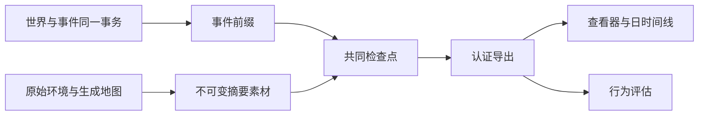

# WorldMock 产品设计说明书 — 记录引擎

## 权威事实与投影

运行的权威记录是按提交顺序保存的事件和共同世界状态。导出、查看器、记忆层与评估只消费这些事实，
不能根据模型自述、资金变化或活动名称补造内容、收货和世界事件。

## 事件与来源

事件信封携带运行、顺序、时间、人物、动作和活动身份，以及 `resource_changes`。
资金变化只允许信封字段，删除 data 内的重复账本。付款与收入支出必须引用真实两个账户并守恒。
当前活动种类只有 sleep、travel、interact、purchase。拒绝旧等待、工作、社交、消息与旧 app 活动快照。

callback_effect、callback_reminder、time_trigger、weather 使用闭合字段合同。
效果包含一项实际触发原因和完整类型化结果；收入支出方向与信封资金变化一致，未支付结果没有资金变化。
独立时间事实不能伪装成上游事件的附加效果，天气条件与速度系数必须来自固定世界天气表。

## 数字足迹

数字使用事实只保留 app_use、content_consumed、push_delivered、push_opened、push_released、app_touch 与 payment_notification 中实际适用的投影。
app_use 是人物真实使用区间；app_touch 和 payment_notification 是系统点事实，不拥有播放、停留或复看时长。
内容消费使用实际内容结算区间和当前内容身份，不能使用活动起止墙钟差计算，暂停时间不计入。
纯目录浏览只有真实 app 使用，未关联内容；使用冻结 app 内容索引与声明时长认证。

购买投影保存实际订单商品、门店、平台、付款 app、数量、价格与履约事实。
付款、到站与收货分开；收到的经历只能来自已提交的本人真实收货事件。
原始显示名由冻结输入与观察证据解析，人物日时间线使用实际动作与内容名称。

## 冻结输入、检查点与分支

运行素材完整冻结 persona.toml、config.toml、catalog/manifest.json、五份目录 JSONL 及生成的 map.json。
清单保存原始字节摘要、五项环境身份、实际模型元数据与非密模型参数。凭据正文不进入清单、事件或报告。

检查点绑定准确事件前缀、共同世界和人物工作区素材。分支复制全部冻结环境素材和所需快照，
恢复前认证归档成员，拒绝绝对路径、符号链接、别名与覆盖已有目标文件。
人物工作区恢复后核验完整画像卡片、节律和模型身份，不接受旧结构或参数漂移。

## 完整导出认证

导出固定事件截止、摘要素材、活动、app 使用、购买、已核验经历、日时间线及质量报告。
完整运行要求正常运行终态和成功最终共同检查点；时钟到达终点不能单独宣称完整。
活动保留全部实际来源，来源身份去重；活动时长来自正秒结算，暂停不计入。

认证重算投影与摘要、核对实际源事件、资金历史和最终余额、冻结原字节及目录摘要，
并验证当前活动名额、本人收货与内容区间。重新计算摘要不能为伪造事实提供可信来源。
坏素材或投影拒绝发布，已有正确导出不被半成品覆盖。查看器与评估同样先认证输入。
