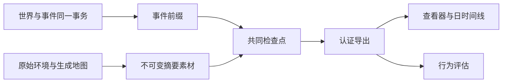

# WorldMock 产品设计说明书 — 记录引擎

## 权威事实与投影

运行的权威记录是按提交顺序保存的事件和共同世界状态。导出、查看器、记忆层与评估只消费这些事实，
不能根据模型自述、资金变化或活动名称补造内容、收货和世界事件。

## 事件与来源

事件信封携带运行、顺序、时间、人物、动作和活动身份，以及 `resource_changes`。
资金变化只允许信封字段，删除 data 内的重复账本。付款与收入支出必须引用真实两个账户并守恒。
当前活动种类只有 sleep、travel、interact、purchase。拒绝旧等待、工作、社交、消息与旧 app 活动快照。

callback_effect、callback_reminder、time_trigger、weather 使用闭合字段合同。
效果包含一项实际触发原因和完整类型化结果；收入支出方向与信封资金变化一致，未支付结果没有资金变化。
独立时间事实不能伪装成上游事件的附加效果，天气条件与速度系数必须来自固定世界天气表。

唤醒原因写在共同身体结算、`decision_started` 和观察里，取值是[模拟引擎](04-simulation-engine.md)唤醒表里的名称。
每次睡醒的原因列表同时含 `planned_end` 与 `session_open`，质量报告和行为评估按原因名的计数各加一。

`memory_updated` 登记人物工作区已落盘的记忆，所有登记用同一组键：`operation`、`created_episode_ids`、
`merged_episode_ids`、`episodes`、四个文件身份、`consolidated`、`observation_event_id`、`verified_event_ids`、
`trigger`、`decision_id` 和 `reflection`。环境按 `observation_event_id` 是否为空分两路核对。

| 登记 | `observation_event_id` | `trigger` | `reflection` | 另外要求 |
| --- | --- | --- | --- | --- |
| 反思登记 | `null` | 恰为 `["reflection"]` | `{date, sleep_activity_id}`，由环境按 `due_reflection` 写入 | `due_reflection` 此刻非空；这次决策还没有观察；本人在这一时刻还没有登记过反思；`operation` 是 `append_episodes`；每条快照的来源都是 `reflection`；`verified_event_ids` 为空；`MEMORY.md` 的前后身份相等 |
| 步尾登记 | 本决策的冻结观察 | `[]` 或 `["activity_conclusion"]` | `null` | 观察属于本决策，事实窗口一致；快照里没有来源为 `reflection` 的条目 |

任一条不满足先记英文错误日志，再以 `ProtocolError("Memory update evidence is invalid")` 作为运行故障拒绝。
睡醒那一步最多有两个 `memory_updated`，先反思、后步尾，两类登记不出现在同一个事件里。

质量报告对每个 `reflection` 非空的记忆更新只凭事件独立重算四件事，任一不成立记一条 `memory_update_without_source`：
同一人物有一条 `activity_progress` 事件，快照是已完成的睡眠，结束时刻等于这次更新的发生时刻；
这是该人物在这个本地日（时区取运行清单的窗口时区）最早的一次睡醒；`reflection.date` 是这个本地日的前一天；
这次更新排在同一决策的观察之前，并且该人物在这一时刻只有这一条反思登记。
`reflection` 为空的更新照旧核对观察与事实窗口。观察不再带刚结束睡眠的私有键。

## 数字足迹

数字使用事实只保留 app_use、content_consumed、push_delivered、push_opened、push_released、app_touch 与 payment_notification 中实际适用的投影。
app_use 是人物真实使用区间；app_touch 和 payment_notification 是系统点事实，不拥有播放、停留或复看时长。
内容消费使用实际内容结算区间和当前内容身份，不能使用活动起止墙钟差计算，暂停时间不计入。
纯目录浏览只有真实 app 使用，未关联内容；使用冻结 app 内容索引与声明时长认证。

购买投影保存实际订单商品、门店、平台、付款 app、数量、价格与履约事实。
付款、到站与收货分开；收到的经历只能来自已提交的本人真实收货事件。
原始显示名由冻结输入与观察证据解析，人物日时间线使用实际动作与内容名称。

## 冻结输入、检查点与分支

运行素材按原字节冻结 persona.toml、config.toml、catalog/manifest.json 和目录清单文件表登记的每个目录 JSONL，另外冻结生成的 map.json。
catalog/map.jsonl 是数据集声明的距离，按原字节冻结；map.json 是引擎生成的整张图，按规范 JSON 冻结，两者是不同的素材。
导出自查先读冻结的目录清单，再要求冻结素材的名字集合恰为上述四个固定名字加文件表里的每个 catalog/ 路径；
冻结清单的文件表必须包含全部必需文件、且不含必需与可选文件名以外的路径，目录摘要按文件表里的全部文件重算。
清单保存原始字节摘要、五项环境身份、实际模型元数据与非密模型参数。凭据正文不进入清单、事件或报告。

检查点绑定准确事件前缀、共同世界和人物工作区素材。分支复制全部冻结环境素材和所需快照，
恢复前认证归档成员，拒绝绝对路径、符号链接、别名与覆盖已有目标文件。
人物工作区恢复后核验完整画像卡片、节律和模型身份，不接受旧结构或参数漂移。

## 完整导出认证

导出固定事件截止、摘要素材、活动、app 使用、购买、已核验经历、日时间线及质量报告。
完整运行要求正常运行终态和成功最终共同检查点；时钟到达终点不能单独宣称完整。
活动保留全部实际来源，来源身份去重；活动时长来自正秒结算，暂停不计入。

认证重算投影与摘要、核对实际源事件、资金历史和最终余额、冻结原字节及目录摘要，
并验证当前活动槽位、本人收货与内容区间。重新计算摘要不能为伪造事实提供可信来源。
付款自查按订单归组：商品履约记录属于最终检查点里列出它的那个购买活动，同一次购买里下单 app（`app_id`）相同的记录是一张订单，
到店记录合成一张到店订单。每张已付款的订单恰有一条付款事件，它的购买活动、记录集合、金额、时刻、账户差额和受理来源都与这张订单一致；
一张订单不得只付一部分。两次购买走同一路线（店铺、收货地、下单 app、履约方式都相同）时各算各的，不并成一张订单。
到站取件通知的来源到站事件，起因恰为列出该记录的付款事件；本人在驿站领取的收货事件，起因是带着该记录领取后快照的取件动作结果。
坏素材或投影拒绝发布，已有正确导出不被半成品覆盖。查看器与评估同样先认证输入。
