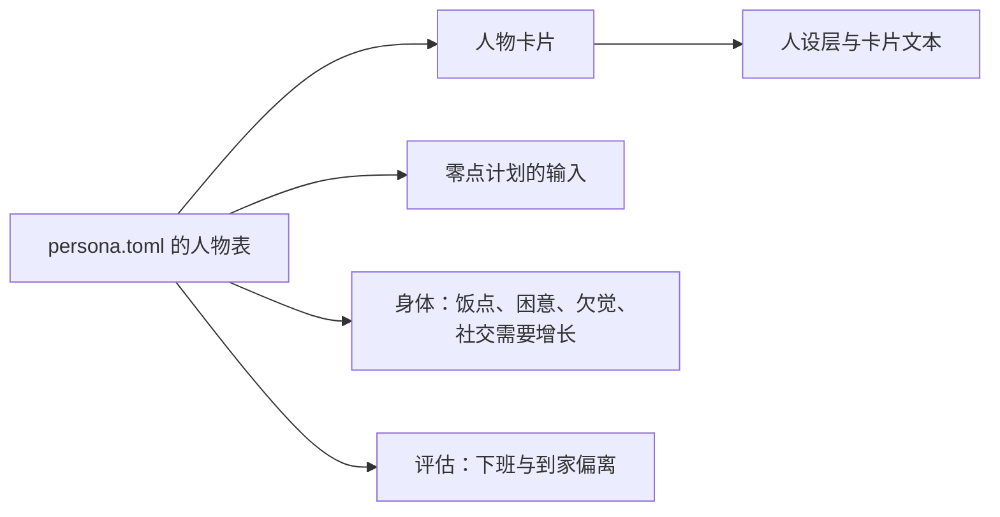
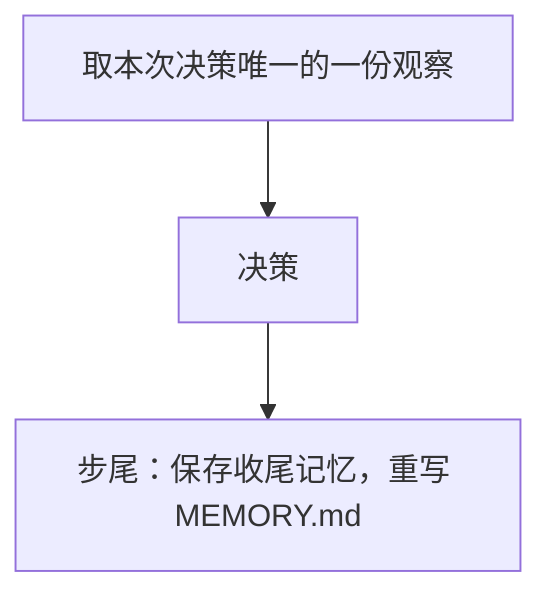

# WorldMock 产品设计说明书 — 人物

## 人物身份与画像

唯一人物来自严格 persona.toml。人物卡片是数据集输入：身份、关系、当前处境、作息、习惯、口味与应对方式
都由数据集作者按[配置](08-configuration.md#configuration-人物声明)的表直接填写。
引擎不读 `background_story` 来填卡片，新建运行不为人物发任何模型请求，也没有缺省值、取整、共识或互相迁就的步骤。
人设原字节摘要是人物输入身份，不使用故事正文摘要替代完整人设身份。

卡片逐字段照搬 persona.toml，不调用模型：身份、关系、当前处境、习惯、口味与应对方式原样进入；
起床、出门、午饭、晚饭、就寝五个必填时段和下班、到家两个可省略的时段各成为一个时间锚点，
没有写的下班、到家是 null，表示没有固定时刻；睡眠中点与每日睡眠需要原样进入。
小时数不取整、不平移、不对 24 取模：`[5.0, 7.0]` 的就寝、与晚饭重叠或早于晚饭的就寝、写成 25.5 的下班，卡片里存的就是这些数。
卡片不检查时间先后，也不检查时段之间的关系；取值只在加载 persona.toml 时按[配置](08-configuration.md#configuration-人物声明)检查一次。
社交需要每小时增长是 persona.toml 的 `social_need_growth_per_hour`，身体直接读它；引擎不给人物打大五分数。
旧 occupation、routine_preference、consumption_preference、risk_preference 顶层字段明确拒绝。

| 用途 | 读什么 |
| --- | --- |
| 人设层、卡片文本 | 由 persona.toml 构造的卡片 |
| 零点计划的人物段 | persona.toml 的姓名、`background_story`、健康习惯、社交风格与午饭、下班、到家、晚饭、就寝时段 |
| 身体：饭点加成、困意、欠觉、社交需要增长 | persona.toml |
| 评估：下班、到家偏离 | persona.toml |

新建运行把卡片的两份派生物写进人物工作区：结构化卡片 `persona_card_struct`（去掉当前处境）供人设层使用，
卡片文本 `persona_card` 供工作区 `MEMORY.md` 的「身份」段使用；日回顾的「人物卡片」输入由环境一侧从 persona.toml 构造（`render_card(persona_card(persona))`），与它逐字相同（见「进度、待办与记忆」的「日、月、年回顾」）。卡片文本是确定性中文渲染，最多 600 汉字，不截断：
加载 persona.toml 时就用整张表构造一次卡片文本，超出的人设表以 `PERSONA_INVALID` 拒绝，
所以 `worldmock validate` 通过的人设表在运行开始时一定写得出卡片；人设层用的字段都在卡片文本里，汉字数不会比它多。
恢复和重放不重新写卡片，只核对一条：工作区里的结构化卡片必须与用冻结的
persona.toml 重新构造出的卡片逐值相等，否则以 `IntegrityError("Restored persona card differs from persona.toml")` 停止。

人设层和卡片文本用同一个函数把小时数写成中文时刻：先取整到分钟再对一天取模，0 分不加，15 分写「一刻」，
30 分写「半」，45 分写「三刻」，其余写「几分」；时段写成「起点到终点」，睡眠需要写成十进制小时。
所以写成 24.5 的时刻显示「0点半」，25.5 显示「1点半」。
零点计划保持 `HH:MM–HH:MM`，分钟的取整规则相同，三处显示同一分钟；身体和评估用原值。

## 提示与工具

人物每次读取已提交世界的七层提示：system 是系统层；user 是六层组成的 JSON 数组，次序固定为人设层、记忆层、待办层、
工具层、环境层、进度层，即 [prompt_schemas.py](../../src/worldmock/agents/prompt/prompt_schemas.py) 的 `USER_LAYER_NAMES`。
这个次序让整次运行不变的部分在前、每次决策都变的部分在后：

| 层 | 什么时候变 |
| --- | --- |
| 人设层 | 整次运行不变 |
| 记忆层 | 「可查」整次运行不变；「近三天」只在零点变；「今天」每次决策在末尾追加一条，兜底触发时改写 |
| 待办层 | 付款完成（下单）、快递到站、送达或领取、暂停与恢复、个人事务变更、改计划，以及零点换上新的今日计划时变 |
| 工具层、环境层 | 每次决策都变 |
| 进度层 | 每次决策都变，排在最后 |

宿主按层名取层，不按位置；进度层必须是最后一层，不是时以 `RuntimeError("Progress layer must be the last user layer")` 停止。
只读问答的 user 是人设层与记忆层两层，取自最近一次生活决策保存的快照，尚无快照时是卡片人设层与空记忆层
（形状见[状态与序列化](09-io-formats.md)「提示层的机器形状」）。
容量浓缩只改进度层，人设层、记忆层、待办层、工具层与环境层不浓缩，记忆层的上限见「进度、待办与记忆」的「记忆层的形状、上限与兜底」。

地点行只显示 location_id 与 name 的私有绑定，不显示地点类型；工具层展示完整显示名和当前实际动作。
功能 app 不成为人物可选择对象；没有登记内容的内容 app 不是可打开的目标，只出现在 `callable_index.prefer_apps` 里。导航、下单与支付 app 的前台区间和通知不进入本人记忆；下单用的 app 写在购买结果的 `channel` 里，查询所在的 app 写在查询的答案里。

生活决策的原生工具共八个，开始工具的参数、槽位与受理见[模拟引擎](04-simulation-engine.md)。

| 工具 | 数量 | 成员 |
| --- | --- | --- |
| 请求工具 | 七个 | start_main_activity、start_side_activity、recall_task_summary、report_status、pause_activity、conclude_activity、revise_day_plan |
| 检索记忆 | 一个 | search_memory |

世界请求是请求工具里除 recall_task_summary 外的六个；recall_task_summary 与 search_memory 是只读查询，由 `LifeEnv.read_query` 当场回答。
search_memory 是人物唯一的记忆工具，见「进度、待办与记忆」的「检索记忆」。只读问答每个回合只开放 finish。
一次回复的工具调用只有三种合法形状，其余组合整批以 `TOOL_CALL_REQUIRED` 纠错，不登记任何世界请求。

| 批次形状 | 内容 |
| --- | --- |
| 只读查询 | 全部是只读工具，个数不限 |
| 一个世界请求 | 恰好一个调用 |
| 开始组 | 恰好两个调用，start_main_activity 与 start_side_activity 各一个，先后不限 |

同一个开始工具两次、开始工具与控制工具同批、世界请求与只读查询同批都不合法。
两条开始调用各自校验参数和名称，全部问题合并成一次纠错；全部通过后按回复中的先后依次登记，
`action_id` 为 `{decision_id}:action:{序号:04d}`（环境只受理这个形式，见[模拟引擎](04-simulation-engine.md)「原子性与恢复」），登记完本次决策结束。
最后回合和截断后的那次纠正沿用已有去只读查询规则，只开放世界请求，两个开始工具都在其中；
原生 tool_calls 是唯一可执行模型输出。人物请求不提供运行种子、截止时间、凭据、付款 app 或系统参数。

系统层用规则条目写明：各层写什么，进度层只写此刻还没了结的事；记忆层按饮食、工作、生活三类记已经过去的事，「今天」一次决策一条，提交后从下一次决策起可见，同一时刻接着的决策也一样，「核验」是环境确认的经过，「自述」是人物当时写下的话，五种前缀分别是收尾或暂停的总结、report_status 的进展、看法、想记住的事和回复正文，每条至多 120 字、写不下的地方以「…」结尾，当天条目太多时较早的条目只留核验或按小时合成计数行；过了零点每类当天的条目整理成一段回顾，「近三天」的饮食和生活取最近三天、工作取最近三个有工作的日子，回顾里的名称、时刻和价钱出自当时的记录，搭配和经过可能有误，是回忆而不是核验事实，「未整理」只说明那天这一类没整理出回顾；日子以零点为界，一件事在哪天结束就记在哪天；更早的事和今天条目的全文经 search_memory 按类别、时间和可选关键词去查，按名称回看任务或活动的进展用 recall_task_summary，一次决策至多查三次记忆；拿不准时可以先看记忆再定，记忆只说明过去发生了什么、人物当时怎么想，不替人物决定，照旧、重复还是换一换都可以；每次决策怎样结束，什么时候时钟停着、醒着时什么事会再请人物决策；两个开始工具各填什么，副工具填三项，`prefer` 照工具层 `prefer_apps` 列出的名称写；名称要写完整，`prefer` 只是意向、写得不准不返回候选；在地点做哪件事由人物点名；内容 app 打开后自动连续放，人物结束它才停，找不到能接的内容时这次使用停下、等人物收尾；用内容 app 只是看，买东西只有购买，不知道买什么先查询；两个槽位各放什么；睡眠怎样写；出发前要先结束什么；活动怎样收尾，查询做完自己结束；在地点做的事结束就算做完，只有暂停保留进度；暂停的活动怎样恢复；进度层的结果和「今天」里的核验是核验事实，自己写的总结、正文，记忆层的自述和回顾都只是想法和回忆，不改变世界事实，也不缩小人物此刻能做的事，想法变了就照现在的想法选；解饿只有两种办法，系列哪一集供一餐写在单元行的 `note` 或进行中活动的 `state` 里；今日计划是人物给自己定的打算，环境不判定完成与否，计划里有在工具层和拒绝原因中都看不到做法的事时，人物用 revise_day_plan 去掉它或改成做得到的；`available` 为 `true` 的动作单独提交一定受理，重复与先后环境不另加限制；个人事务只用于要买到或领取的商品，通话、家务之类没有商品的打算不记；正文写了就作为这次决策的自述，从下一次决策起记在记忆层「今天」里，思考只在同一时刻连续决策之间保留。规则文字只在系统层写一次，逐字原文只在代码里；工具说明只写用途与参数格式。
讲睡眠的条目写明分钟数的范围、就在当前地点睡且地点须能睡、睡着后到写的时长才再请人物决策、
提醒推送和送达都不叫醒、过去一天睡得太少时可能再多睡二十分钟到一小时，以及 sleep 行的 `note` 只供参考。
人物看不到睡过头的门槛、概率和抽取结果。
讲决策怎样结束的条目接着写明时间与再次决策：没有进行中的活动时世界时钟停着，人物在同一秒再做一次决策；
等待外卖或某个钟点的空当里，人物照常选此刻可做的事，例如工具层里能用的内容 app，没有「等待」这种活动。
醒着时会再请人物决策的事，按[模拟引擎](04-simulation-engine.md)「唤醒、日计划与个人事务」唤醒表里醒着时能命中的行逐一写成人话：
`planned_end` 是手上的事做完了，`delivery_arrival` 是买的东西送到或快递到站能领，`reminder_due` 是提醒到点，`app_push` 是有 app 推送，
`felt_band_change` 是身体感觉变了，`duty_boundary` 是到了上下班时刻或写明的休息时段开始、结束，
`progress_report_due` 与 `reconsideration_interval` 合成一件事做得久时中途隔一阵也请一次；
`no_active_activity` 与 `rejection_feedback` 由同一时刻接着决策那一句表达，`session_open` 由讲睡眠的条目表达；这些决策不打断正在进行的活动。
唤醒表增删行或改了某行能否叫醒睡着的人时，这段措辞照《模拟引擎》「唤醒、日计划与个人事务」跟着改：测试把唤醒表的每个名称对到系统层里说它的那一句，名称集合与唤醒表不一致就失败。

人设层只由人物卡片构建，键依次是 `layer`、`identity`、`rhythm`、`habits`、`tastes`、`coping`、`relationships`；`relationships` 按卡片顺序每人一行，键依次是 `person`（姓名或称谓）、`role`、`closeness`（很亲近、较亲近、一般、疏远之一）、`channels`，卡片以外的人不进人设层。人设层不含人物在运行中写下的任何东西，同一次运行里每个生活决策请求的人设层逐字节相同。收尾写下的关系看法与偏好（conclude_activity 逐项的 `views`）不进人设层：当天以「看法·对象：」写在那次收尾的记忆层「今天」条目里，过了零点只出现在回顾里；经 search_memory 查到的往日是回顾，只有按日期查到某一类「未整理」的那一天时，退回的原始条目里还有当时的「看法·对象：」；不另存带日期的看法列表。环境照旧从成功的收尾算出观察私有证据 `persona_views`，形状 `{relationships: [{person, view}], preferences: [{subject, preference, noted_on}]}`，同一对象取最后一条；它作为观察分件存储并随导出保留，不进任何提示层。宿主只读其中 `relationships` 的人物：这些人物与卡片关系名合起来是已知人物，收尾的 relationship 看法只能写已知人物，写别的名字按 `SUBJECT_NOT_KNOWN` 纠错。

只读问答的 system 是只读系统层，`role` 为「你是模拟世界中的一个人物，依据人设层与记忆层回答外部问题。」，四条规则依次写明：请求由人设层、记忆层与外部问题组成；记忆层的「核验」是环境核验的事实，「自述」和「回顾」是人物自己写下或整理的，未经核验；只依据人设层与记忆层回答，不能改变世界，也不写入记忆；回答完成后单独调用 finish。

工具层动作行固定八个字段，键序 `action, detail, available, reason, price, duration, quantity, note`，
紧凑渲染省略 `null`。`detail` 是调用里要照写的名称：出行行是出行方式名称，购买行和内容 app 行为 `null`，
地点上的 interact 行与 sleep 行见下表。
其他地点（目的地）的目标行下每种出行方式一行，`action` 恒为 `travel`：自带的步行在前，其余按 `travel_method_id` 升序，每个目的地列出全部方式，不轮转、不截断。
出行行的 `price` 是车费的人读写法（免费写「0 元」），`duration` 是按当刻天气算出的用时，`quantity` 为 `null`，`note` 是「轻松」或「费力」；余额不够付车费的方式照样列出并标为不可用。
私有绑定的出行行另带 `travel_method_id`，不进入公开工具层；紧凑渲染的分组键仍是目标类别与动作，全部目的地的出行行落在同一组里，还原后与完整工具层逐值相同。
同一个出行方式名称用于工具层的 `detail`、活动名、环境层路上的位置（键 `travel_method`）和到达句「<时刻> <出行方式名称>到了<地点显示名>」；步行写「步行」，其余写数据集起的名称。
每行的 `available` 与 `reason` 和受理用同一套检查，对只含这一行的一组求值，说明与拒绝原因一字不差。
所以 `available` 为 `true` 的行单独提交一定受理（开始组仍两项一起核验）；重复做同一件事、几件事谁先谁后，环境都不另加限制，
凡是限制都已经写在那一行的 `available` 与 `reason` 里，这是[概述](00-overview.md)「核心原则」里人物自主性的落实，系统层有一句讲它。
人物停留在某个地点时，该地点的目标行下为每个内容单元列一条 interact 行（凭状态而未开放的单元除外，见下文「在地点做的一件事」表），完整列出，不轮转、不截断，按单元键升序；
地点标了 `sleepable` 时 sleep 行排在其后。人在路上时不列任何地点的 interact 行，其他地点只列出行；没有单元的地点没有 interact 行。

工具层另有 `callable_index`，两个键。`goods` 是商品品类行，每行的 `category` 就是查询可以写进 `target` 的类别名；它只数地点侧的商品，按类别查询时还会展开只在 app 里卖的商品。`prefer_apps` 是全部下单 app 的完整名称，按 `app_id` 升序；它只取决于冻结目录，整次运行不变，不按此刻营业与否筛选，不轮转，不截断，不参加目标行分组，不进续接的变化比较，容量浓缩不删它；没有下单 app 的环境里是空数组。工具层没有查询的动作行，查询能不能开始在提交之后得知。

| 动作行 | `detail` | `duration` | `note` |
| --- | --- | --- | --- |
| 地点 interact | 单元名原文 | 此刻开始会做多久。能点名的行位置总是零，所以是这条内容的全长，系列是第一集的全长；剩余时长只出现在不可用的行上（正在做，或被本人暂停的活动占着） | 四种说法按「第几集、接着做、供一餐、供一份零食」的先后以「；」相连，都没有为 `null`。系列写「第 N 集，共 M 集」；没做完写「上次没做完，接着做」，只出现在不可用的行上；独立的一件事 `completion_effects.food` 为 `meal` 写「供一餐」，为 `snack` 写「供一份零食」；系列写「第 K 集供一餐」「第 K 集供一份零食」，K 是这个系列里 `food` 为该档位的全部集号，升序，多集以「、」相连，不随做到第几集而变。没有 `food` 的单元不写这两种说法 |
| sleep | `null` | `null` | 睡前提示 |
| 内容 app 的 interact | `null` | 见下表 | 见下表 |

睡前提示按观察时刻欠的觉 h 小时生成，只给半小时一档的时长，不给原值，睡多久由人物自己写。
h 小于 0.25 写「现在不欠觉」，大于 12 写「现在睡，12 小时以上才能补满」；其余取 `floor(h × 2 + 0.5)` 个半小时，
一个写「现在睡，约半小时能补满」，多个写「现在睡，约 X 小时能补满」。提示只取决于身体，这一行此刻不可用时照样显示。

| 在地点做的一件事 | 工具层该单元的行 | 另外出现在 |
| --- | --- | --- |
| 没做过、做完过，或上次被人物结束 | 可用，`duration` 为全长 | 无 |
| 正在做 | 当前地点的每条 interact 行都不可用，原因是槽位 1 被占 | 工具层的活动目标行，带 report_status、pause_activity、conclude_activity；系列在这一行的 `state` 里写正在做第几集、哪几集供一餐，见下文活动目标行的 `state` |
| 刚结束待收尾 | 每条 interact 行都不可用，原因是先收尾 | 工具层的活动目标行，带 conclude_activity |
| 被本人暂停的活动占着 | 该单元的行不可用，原因点名那项暂停的活动；其他单元的行不受影响 | 待办层 `paused_activities`，带 report_status（恢复）与 conclude_activity |
| 凭状态而未开放 | 不列出 | 无 |

凭状态、未开放的单元照写名称仍由受理拒绝，它不进名称候选，规则见[模拟引擎](04-simulation-engine.md)「出行、内容与查询」。
完成效果不改变列出：行的字段与时长和其他单元相同，`note` 只为 `food` 多出上表那两种说法；完成效果的两项缓解和完成效果的证据不进任何提示层，
完成效果体现在饥饿、放松与社交体感上。凭食材包状态（`reset_on_goods` 非空的食品状态）的内容，在开始结果与终结结果的内容摘要、
今天条目的核验行和零点计划输入的结束句里写出所用食材包和收到日期，运行开始以来还没收到过时写家里原有的食材；
`consumes_state`、状态的数值和 `consume_on_start` 事件本身仍不进任何提示层，写法见[模拟引擎](04-simulation-engine.md)「出行、内容与查询」。

活动目标行的 `state` 是这项活动的客观进度。用内容 app 的活动写「已用<时长>，放到第 K 条」，例如「已用约 25 分钟，放到第 14 条」：
时长是不含暂停的已用时间；K 是这项活动里放完的条数加上正放着的那一条，所以第一条还没放完时是 1，
放完一条后没有能接的内容、停下待收尾的活动（状态 `completed`）不再加。
其余活动写「已做<时长>」，进行中或暂停中再接「，还剩<时长>」，还剩的是计划时长减去已做时长，系列只算到正在做的这一集结束；睡过头的睡眠再接多睡了多久。
在地点做的系列进行中时，`state` 前面另写正在做的这一集：先写「第 N 集，共 M 集」，系列有集声明了 `food` 时接上与单元行 `note` 同一写法的
「第 K 集供一餐」「第 K 集供一份零食」，各段以「；」相连，再以「；」接客观进度，例如「第 2 集，共 3 集；第 2 集供一餐；已做约 35 分钟，还剩约 20 分钟」。
凭状态的系列做着时自己的单元行不列出，人物从这里读到正在做第几集、哪一集供一餐。
待办层暂停活动的 `progress` 和回看任务里的客观进度用同一个进度写法，不带系列这一段。

活动目标行里每个控制工具各带 `available` 与 `reason`，和受理用同一套判定，说明与拒绝原因一字不差。
用内容 app 的活动进行中时，暂停不看还剩多久，哪一次决策都可以暂停。在地点做的事离计划结束（系列是正在做的这一集）不足 180 秒时，它的 pause_activity 一行为不可用，
conclude_activity 一行不受影响；做完这一集还会接下一集时 `reason` 是
`<活动名> cannot be paused while its current episode ends in under three minutes; it then continues with the next episode.`，
否则是 `The activity <活动名> ends in under three minutes and cannot be paused.`。
恰好还剩 180 秒仍可暂停，整段不足 180 秒的在地点做的事从开始就不可暂停，规则与其余字段见[模拟引擎](04-simulation-engine.md)「动作、名称与并行」。
人物从这一行知道这条限制，系统层不为它新增句子。

登记了内容的内容 app 全部列出；没有登记内容的不列，名称只出现在 `prefer_apps` 里。app 的内容可以带前提，这一行的可用性、时长和推送说明都只在此刻合格的内容里算，合格内容与前提的判定见[模拟引擎](04-simulation-engine.md)。

| 内容 app 的情形 | `available` 与 `reason` | `duration` | `note` | 目标的 `state` |
| --- | --- | --- | --- | --- |
| 至少一条内容合格 | 按其余受理条件 | 此刻打开会先放一条已知的内容（会被钉住的推送内容，或最近没放完的合格内容）时写「先放的一条<这条的余量>」，例如「先放的一条约 12 分钟」；否则按每条写合格内容全长的最小值到最大值，两者相等写「每条<时长>」，例如「每条约 2 分钟」，不等写「每条<最小>–<最大>」，例如「每条约 5 分钟–约 40 分钟」 | 此刻打开会钉住某条推送时写「有推送：《标题》」，否则 `null` | `null` |
| 登记了内容但都不合格 | `false`；没有更早不成立的条件时，`reason` 写明要去的地点显示名和时段，今天没有时段时写之后七天里下次开放的那天，七天里都不开放也写明，与提交后的拒绝一字不差 | `null` | `null` | 有内容写了 `opens` 时，是这些内容按 `content_id` 升序各自的时间短语（与拒绝分句里的时间部分同一个函数），去重后以 `; or ` 相连，例如 `not available today (next available Mon 10-19 08:00–10:00, 17:00–20:00)`；没有内容写 `opens` 时 `null` |

`duration` 里先放的那一条，就是打开顺序会先挑的被钉住的推送或最近没放完的内容，与打开时的挑选是同一个判定；打开顺序与时间短语见[模拟引擎](04-simulation-engine.md)「出行、内容与查询」。
目标的 `state` 不看槽位、待收尾和同刻限制：槽位 2 被占、要先收尾时 `reason` 写的是那一条，`state` 照样写出开放时段。
「有推送」只在此刻打开会钉住那条推送时显示：推送指向的内容已不合格，或推送已经释放，都不显示。
系统层不为前提新增句子，`available` 为 `false` 的动作仍可提交，会按 `reason` 拒绝。

同秒续接在上一决策以一个世界请求或一个开始组结束时成链。链对象的 `tool_results` 按调用次序保存一条或两条
`{tool_call_id, result}`：`result` 是上一决策登记的那条请求最新的一条结果，与进度层带入记录的 `result` 同一个公开投影，不经进度层；
某条请求没有结果就断链。宿主为每个 `tool_call_id` 各追加一条 tool 消息，`changes` 与 `events` 只写在最后一条上。
重建的 assistant 消息带两个 `tool_calls` 时必须是两个开始工具各一个，并与登记的两条动作按次序同名，否则断链。

`changes` 相对于模型所见（链首快照依次叠加此前各 tool 消息的 `changes`）计算，键依次是 `targets`（工具层目标按名称的 `updated`
与 `removed`）、`memory`（`{"added": […]}`，记忆层「今天」末尾新增的条目，与「今天」里渲染的条目逐字节相同）、
`paused_activities` 与 `errands`（按名称的 `added` 与 `removed`）、`orders`（在途订单按订单标签的 `added` 与 `removed`）、
`day_plan` 与 `body`（整体替换）；没有改动的键不写。人设层与所在地点在链内不变，不进 `changes`。
上一决策的条目一提交就发布，链里的下一次决策经 `memory.added` 看到它。
模型所见的「今天」不是此刻「今天」的前缀时（兜底改写了早先的条目，见「进度、待办与记忆」），或在途订单里有两行标签相同时，
这次决策不续接，从新快照构造。`events` 是序号大于上一次观察的非记忆世界记录：app 推送、回调提醒、余额减少与个人事务提醒，
形状与进度层同类记录相同；送达、到站与办成是上一决策条目里的事实，不另列。

### 环境层

环境层的身体感觉使用[交换引擎](02-exchange-engine.md)的饥饿、困倦、放松需要与社交需要四项体感。
环境天气直接来自世界事实，模型只能据此叙述，不能写入天气；不使用关键词过滤或第二个模型判定天气真伪。

工作安排写在 `duty` 与 `tomorrow` 两个键里。本地日期按世界时钟和运行时区算，哪天上不上班、班次怎样只由 persona.toml 的 `work_schedule`
（`workplace`、`weekly` 与 `exceptions`）按[配置](08-configuration.md)「人物声明」的班次规则求出，不看运行日历，也不看人物在不在场。
`duty` 是观察时刻所在本地日的上班安排，没有写 `work_schedule` 时为 `null`；否则是闭合对象，键依次如下：

| 键 | 取值 |
| --- | --- |
| `day` | 「工作日」或「休息日」 |
| `hours` | 工作日是班次起止「HH:MM–HH:MM」；休息日为 `null` |
| `place` | 工作日是 `workplace` 写的地点显示名；休息日为 `null` |
| `breaks` | 工作日是各休息时段「HH:MM–HH:MM」，按声明次序；休息日为空数组 |
| `note` | 例外改了这一天上不上班时的一句说明，见下文；其余为 `null` |
| `status` | 工作日是「未到上班时间」「当班中」「休息时段」「已下班」之一，只由时钟与班次决定；休息日为 `null` |

`note` 只在当天写在 `exceptions` 里、并且例外定下的上班或休息与 `weekly` 对这个星期几的声明不同时才有，写法有两种：
`weekly` 这天有班次而例外是空数组时写「平常<星期几>上班，今天按工作安排休息」，`weekly` 这天没有班次而例外是一个班次时写「平常<星期几>休息，今天按工作安排上班」；
<星期几> 是「星期一」到「星期日」，例如「平常星期一上班，今天按工作安排休息」。其余情形一律为 `null`：当天没有例外；
例外与 `weekly` 同为上班或同为休息，即使时段或休息时段不同，当天的时段已经写在 `hours` 与 `breaks` 里。整份安排只有一个工作地点，例外不改变 `place`。
零点计划输入的「上班安排」是计划日期那一天的同一份字典，只是不带 `status`，见下文「零点计划」。

`tomorrow` 总是出现，排在 `duty` 之后，是环境层的最后一个键；它是闭合对象，键依次是 `date`、`weekday`、`day`：`date` 是观察时刻所在本地日的下一天，写成 `YYYY-MM-DD`；
`weekday` 是那一天的「星期一」到「星期日」；`day` 是按同一规则求出的那一天的「工作日」或「休息日」，没有写 `work_schedule` 时为 `null`。
明天只写这三项，不写时段和说明。同一秒里 `duty` 与 `tomorrow` 不变，也不进同秒续接的 `changes`：环境层只有体感进 `changes`。

### 零点计划

零点计划是运行时为缺当日计划的人物做的一次独立模型调用，不经人物，不是决策：零点推进之后先做日、月、年回顾（见「进度、待办与记忆」的
[日、月、年回顾](#agent-日月年回顾)），再做零点计划，最后判定这一秒的唤醒；新建运行和反事实分支在开始的检查点之后、普通恢复在初始化时，
也先补回顾、再做计划。
请求的系统消息是固定的中文模板，用户消息是下表输入的 JSON；只带一个严格工具 `submit_day_plan` 且必须调用，思考关闭，底层不重试，
输出上限见「宿主模型协议」。输出不合格时附回英文原因重试，次数是[配置](08-configuration.md)「模型配置与凭据」的 `day_plan_validation_max_retries`，用完是运行故障。

| 输入 | 内容 |
| --- | --- |
| 计划日期 | 生成时刻所在的本地日期 |
| 生成时刻 | 「M月D日 HH:MM（星期几）」，星期几与 `tomorrow` 同一张名称表 |
| 回顾时段 | 零点时是前一天 00:00 起到这次零点为止，不含这次零点那一秒；运行开始或恢复时是当天 00:00 起到生成时刻为止，不含生成时刻那一秒；时刻落在哪个本地日见[模拟引擎](04-simulation-engine.md#simulation-engine-归日)「归日」 |
| 人物 | 人物段，见「人物身份与画像」的表 |
| 上班安排 | 计划日期那一天的上班安排，与环境层 `duty` 同一份字典、带 `note`、不带 `status`；没有写 `work_schedule` 时为 `null` |
| 动作结果 | 回顾时段里本人已结算的公开动作结果、送达和结束的活动，写成 settled 句的完整写法（今天条目的核验另用短句，见「今天条目」） |
| 收尾记录 | 回顾时段里已受理的 conclude_activity 逐项写下的收尾说明与想记住的，标明是自己记下、未经核验的 |
| 个人事务 | 待办层里的个人事务，与待办层同一行、同一顺序 |
| 在途订单 | 本人的在途订单（已付款、还没收到，含已到驿站等本人领取的，见[模拟引擎](04-simulation-engine.md)「购买、付款与收货」），与待办层 `orders` 同一个函数选出：每条记录写商品、数量、预计送达与送到哪里，按预计送达的先后 |
| 上一天的目标 | 回顾时段结束于这次零点时，前一天计划最后一份快照里各条目标的意图与原文 |
| 已核验经历 | 回顾时段里已核验经历的句子，按时间先后，写法见「进度、待办与记忆」；请求达到上下文窗口的 85% 时从最早的一句起裁掉 |

零点计划只读这些，不读身体数值，也不列出目录里的地点、单元、app 与商品（目录只用来把身份写成名称）；计划里的事做不到时，由人物决策时照系统层的规则改计划。
模板写明的事项：依据上表的输入写今天的目标清单，记录里没有的事不编造；只调用一次 `submit_day_plan`，交齐零到八条按优先级排列、意图不重复的目标；
目标只写今天特别要做的事，每条不超过三百字，平常的作息习惯不列；`remind_time` 是晚于生成时刻、早于次日零点的本地钟点或 `null`，提醒只在醒着时到点请人物决策，
`around_time` 只是大概钟点，不触发提醒，正文尽量用上午、午饭后这类说法或先后关系说时段；个人事务已在待办里，不抄成目标，计划不替人物新建、办结或取消个人事务，目标办没办成也不由它判定；
这一天上不上班只看上班安排的 `day`，与星期几无关：休息日不安排通勤与打卡，工作日按 `hours` 与 `place` 上班；
班次是固定的世界事实，目标不能改变班次，当班时间里不安排离开工作地点，只有写明的休息时段可以。
模板的逐字原文只在代码里，与系统层一样。

## 进度、待办与记忆

进度层写此刻还没了结的事：占槽位的本人活动（进行中或待收尾）、上次决策之后新到的结果与消息、这段停留或路程里做完的查询和答案，
以及今天被拒绝的请求。内容短语统一使用实际已消费与总时长，跨容器恢复读取共享进度。
待办层写跨决策保留的事：暂停的活动、人物记下的个人事务、在途订单和今日计划；商品事务只按真实收到的数量累计。已经了结的事实、
自己写下的总结与回复正文都在记忆层「今天」里。

环境对一条开始请求先后写两条结果：受理时写第一条；活动终结时（自然做完、被人物结束、运行截止时截断，或失败）写第二条，`action_id` 仍是开始它的那条动作。
进度层对一条请求只显示最新的一条，所以活动做完之后人物读到的是第二条；凡是要让人物在活动做完后知道的事，都写在第二条里。
系列连播和内容 app 一条接一条地放都不写中间结果；暂停不产生第二条结果；控制请求和被拒的请求只有一条结果。名称被规整后受理的 `resolved` 和受理时的 `notes` 只写在第一条上。

| 活动 | 第一条结果的明细 | 第二条结果的明细 |
| --- | --- | --- |
| 用内容 app、在地点做事 | `planned`、`content`（开始的那一条内容） | `contents`，行多于三行时另有 `contents_omitted` |
| 购买 | `planned`、`purchases`（报价，行里有 `channel`） | `purchases`（已付或取消，行里有 `channel`） |
| 查询 | `planned` | `query` |
| 出行 | `planned` | `arrival` |
| 睡眠 | `planned` | 空 |

进度层每条记录的结果明细 `result.details` 是闭合对象，键恰为 `purchases`、`planned`、`content`、`contents`、`contents_omitted`、`query`、`arrival`、`recall`、`reason`、`next_step`、`fix`、`items`、`outcome`、`resolved`、`notes`、`errands`，全部可选，没列出的键一律不合格。
购买的每行键依次是 `product`、`quantity`、`channel`、`destination`、`expected_at`，最后是 `price` 或 `paid` 之一。
`contents` 至多列三行，多出的行数写在 `contents_omitted`「还有 N 条没列」里。
`content`、`contents` 的形状，`contents` 取哪几行、`contents_omitted` 何时写，见[模拟引擎](04-simulation-engine.md)「出行、内容与查询」；`channel` 见[模拟引擎](04-simulation-engine.md)「购买、付款与收货」。

查询的第二条结果 `details.query` 有两种形状；进度层里带第二条结果的查询只有查完的（进行中的查询带的是第一条结果，不写 `query`），人物读到的是查完的形状。查完的形状是 `app`、`scope`、`rows` 和可选的 `omitted`：

| 键 | 取值 |
| --- | --- |
| `app` | 这次在哪个 app 里查的：app 的完整名称，可以照抄进 `prefer`；这几分钟手机上没有 app 时为 null |
| `scope` | 「只列经这个 app 能买的」或「列出全部途径」；`app` 为 null 时一定是后者 |
| `rows` | 各行，次序与答案的机器形式相同 |
| `omitted` | 「还有 N 件没列」，N 是正整数；没列出的件数为 0 时不写这个键 |

`rows` 每行九个键都出现：

| 键 | 取值 |
| --- | --- |
| `product` | 商品的完整名称，可以照抄进购买的 `target` |
| `route` | 「到店」「外卖」「快递」，没有途径的行为 null；「到店」与购买结果 `channel` 里的「到店」是同一个词 |
| `store` | 地点的显示名，分店带全角括号；没有店的行为 null |
| `apps` | app 的完整名称组成的数组，次序同机器形式的 `app_ids` |
| `price` | 金额短语，例如「22 元」 |
| `delivery_fee` | 金额短语，例如「5 元」「0 元」，或 null |
| `expected_at` | 带时区的 ISO 8601 时刻，与购买明细的 `expected_at` 同一写法，快递行是到驿站的时刻；或 null |
| `now` | 「可以下单」或「不可下单」 |
| `reason` | 「不可下单」时是下面六句之一，「可以下单」时为 null |

六句不可下单的原因都是固定文字，花括号处填显示名：「这家店此刻已打烊」「你所在的{地点显示名}就卖这件商品，此刻购买只在所在地点到店完成，不从这家店送」「这家店没有上任何 app，要到店里买」「此刻没有营业的店卖这件商品」「上了这个 app、卖这件商品的店此刻都没有营业」「这个 app 里没有」。
没有查完的形状（提前结束或被截断）恰两个键：`app`，和 `state`「没有查完」，只在事件与导出里出现。进行中的第一条结果不写 `query`。
答案怎样算见[模拟引擎](04-simulation-engine.md)「出行、内容与查询」，机器形式见[状态与序列化](09-io-formats.md)「世界、人物与活动」。
答案作为带入记录留到这段停留结束；人物出发后这条记录离开进度层，记忆层「今天」只有「查完〈app〉·〈范围〉」一行摘要，答案进条目全文的「当时查到」，当天可用 search_memory 查「今天」。

### 进度层的下界与带入的记录

第 k 次决策的观察里，已发布界 P_k = max(C_{k−1}, B_D)：C_{k−1} 是上一次决策提交的末事件序号（「今天条目」小节），没有上一次决策时取 0；
B_D 是今天的零点界，即今天本地 00:00 之前最后一个事件的序号（[模拟引擎](04-simulation-engine.md#simulation-engine-归日)「归日」）。
序号不超过 P_k 的事件，要么已经写进「今天」的某一条，要么属于前一天。记忆层在同一次观察里求出 P_k 交给进度层，进度层不自己求 C_{k−1}。

上一次决策是「今天条目」小节所定义的最后一次决策（本人的世界请求按决策分组、按组内最小事件序号排序）。它的时刻是这次决策第一条世界请求的发生时刻，
它的观察是这次决策的观察里序号最大的一条。有上一次决策而读不到它的观察是完整性故障：写英文错误日志
`Previous decision <decision_id> has no observation`，以 `IntegrityError("Previous decision has no observation")` 停止。
没有上一次决策时观察序号取 0，计划提醒不设时刻下界。

进度层的 `events` 只由下表四种记录组成，每种只按自己那一行取舍；其余环境事件种类不进进度层：

| 记录 | `type` | 出现条件 |
| --- | --- | --- |
| 记忆事实：送达与到站、个人事务办成 | `delivery`（来自 `delivery_arrival`）、`errand_completed` | 来源事件人物可见，序号大于 P_k |
| 非记忆世界记录：app 推送、回调提醒、余额减少、个人事务提醒 | `app_push`（只取真推送了的）、`callback_reminder`、`balance_decreased`、`errand_reminder`（来自 `errand_reminded`） | 来源事件人物可见，序号大于上一次决策的观察序号与 B_D 中较大的一个 |
| 派生的计划提醒 | `plan_reminder` | 今日计划里已经提醒过、提醒时刻晚于上一次决策的时刻（没有上一次决策时不设下界）且不晚于此刻的目标，各一条 |
| 开始请求的记录 | `tool_call` | 只有下面的带入记录 |

非记忆世界记录以上一次决策的观察为界，所以上一次决策提交里产生的提醒与余额减少不会丢，出现在下一次决策里；序号不晚于那次观察的，上一次决策已经看到过。
计划提醒以时刻为界，同一秒链里的下一次决策不再看到上一次决策已经看到的提醒。

带入的记录不看任何下界，活动跨过零点、跨过一段停留或一段路都照样在。带入的有两种：
- 占槽位的本人活动（进行中或待收尾）各一条，不分种类：睡眠、出行、购买、查询、在地点做事与用内容 app 都算；
- 这段停留或路程里做完的本人查询各一条：查询做完（`completed`）、结束不早于这一段的开始、终态结果的序号大于这一段的事件序号下界。
  人物出发后这条记录离开进度层；提前结束、被截断的查询不在其中。查询不能在路上开始，出发前要先结束进行中的查询，所以做完的查询总在开始它的那段停留里。

记录是开始请求的原文与它最新的一条结果：请求按活动的 `origin_request_event_id`、第一条结果按活动的 `accepted_event_id` 按事件身份读出；
活动已结束时结果是终态结果，即开始动作在第一条结果之后的那条 `action_result`，它与活动终结在同一次提交里、发生时刻就是结束时刻，所以从结束那一秒读起。
已结束的活动读不到终态结果是完整性故障：写英文错误日志 `Ended activity <activity_id> has no terminal result`，
以 `IntegrityError("Ended activity has no terminal result")` 停止。记录的键依次为 `occurred_at`（请求时刻）、`type`（`tool_call`）、`tool`、`arguments`、`result`，
`result` 与同秒续接的 `tool_results` 是同一个公开投影（凭食材包状态的开始结果与完成结果带食材包句），记录不带 `self_note`。
暂停着的活动不占槽位，不带入，从暂停那一刻起离开进度层、只列在待办层；恢复后重新占槽位，重新带入。

一段停留或一段路各有一个事件序号下界：出发那次提交整体归出发前的停留，到达那次推进整体归路上那一段。
这个下界只用来判定这段停留或路程里做完的查询，以及同秒续接判定上一决策之后 session 换没换（「提示与工具」）。

控制请求（report_status、pause_activity、conclude_activity、revise_day_plan）、被拒的请求与已经收尾的活动的开始请求不在进度层：
它们的请求与结果都在上一次或更早的决策提交里，序号不超过 P_k，事实与自述在「今天」的条目里。进度层的记录都不带 `self_note`，
回复正文只在「今天」的「正文：」里。被拒的原因只在 `rejected_today`，它的取法、形状与上限不变，零点界与 B_D 是同一个函数求出的。

排列：按发生时刻（开始请求的记录取请求时刻，所以带入的记录排在前面），同一时刻推导记录在前，再按目标次序与最小来源序号。
层的键依次为 `layer`、`session_started_at`、`events`、`rejected_today`；`session_started_at` 是这段停留或路程的开始时刻。

进度层 `events` 的来源事件与「今天」各条目的来源事件按序号不相交，只有两处重叠：
1. 占槽位活动的带入记录与条目里关于这项活动的行：开始行只共用名称与开始时刻；待收尾的活动若在 P_k 之前结束，条目里另有它的结束行
   （购买另有购买行），与带入记录的终态结果是同一事实。
2. 做完的查询的带入记录与条目里的「查完〈app〉·〈范围〉」一行；答案只在带入记录与条目全文的「当时查到」里。

由此，进度层里序号不超过 P_k 的来源事件，只能是带入记录的来源，或上一次决策提交里产生的非记忆世界记录（序号落在上一次决策的观察序号与
C_{k−1} 之间）；后者不产生任何条目的行或项，所以两层仍按来源不相交。`rejected_today` 是当日拒绝的汇总，不在这一条之内。

### 待办层

待办层的键依次为 `layer`、`paused_activities`、`errands`、`orders`、`day_plan`。`orders` 列本人的在途订单：已付款、状态为 `pending` 或
`ready_for_pickup` 的商品履约记录（定义见[模拟引擎](04-simulation-engine.md)「购买、付款与收货」），与零点计划的「在途订单」由同一个函数选出，
按预计到达与订单身份升序。同商品、同购买时刻、同状态、同目的地、同预计到达的记录合成一行，份数是条数（一份商品一条记录）；
每行写订单标签、状态、送到的地点与预计到达。至多列 6 行：多出时只列前 6 行，末尾再加一行合成行「另有 N 笔在途」，N 是没列出的行数；
恰好 6 行时没有合成行。订单在付款完成那一刻进入 `orders`（外卖、快递），外卖送达、快递被领取时离开；快递到站时同一行的 `status`
由 `pending` 变成 `ready_for_pickup`。未付款的报价不在其中，它由进度层带入的购买记录表达。
行的机器形状见[状态与序列化](09-io-formats.md)「提示层的机器形状」。

### 记忆层的形状、上限与兜底

记忆层恰有四个键，次序固定：`layer`（常量「记忆层」）、`可查`、`近三天`、`今天`。键序就是构建顺序，记忆层只由
[layout.py](../../src/worldmock/simulation_engine/observation/memory/layout.py) 的 `assemble_layer` 构建，渲染时不排序；
机器形状见[状态与序列化](09-io-formats.md)「提示层的机器形状」。「近三天」见下文「近三天」，「今天」的条目见下文「今天条目」。

「可查」是 `{"最早日期": "YYYY-MM-DD"}`，最早日期是运行开始时刻 `start_time` 的场景本地日期。它整次运行不变：同一天里、跨过零点、
恢复与重放分支里都相同，因为分支从同一环境加载运行配置并核对配置摘要。只读问答尚无快照时的空记忆层里「可查」是空对象。

「今天」是当天已发布条目按决策次序的递推：当天第一次决策看到空列表；第 k 次决策看到第 k−1 次决策看到的列表（兜底改过的项保持改后的样子），
末尾接上第 k−1 次决策的条目。「今天」只在末尾追加，兜底是唯一的改写。递推只读当天已发布的条目和这次观察的「可查」与「近三天」，是它们的纯函数；
进程内缓存只是加速，换了存储对象（恢复、重放分支）、观察的本地日期变了、「可查」与「近三天」的渲染文本变了或已发布的条目比缓存记住的少时，
从当天第一条重新递推。所以恢复和重放从当天第一次决策起按同样的次序重算，得到的「今天」与原运行在同一次决策看到的逐字节相同。
观察里的「今天」各项是递推状态的深拷贝；零点收尾条目不是任何决策的条目，从不进「今天」。

上限：经 `render_layer_json` 渲染后的整个记忆层（含全部键名、引号、冒号、逗号和括号）按 Python `len` 至多 14,000 字，
约 8.9k token（按 0.638 token/字）；上限按字执行，不用 litellm 或任何 token 计数器。构建器在交出记忆层之前核对一次，超出时写英文错误日志
`Memory layer has <字数> characters, above its 14000-character budget`，再以 `RuntimeError("Memory layer exceeds 14000 characters")` 停止。
各部分自己的上限由生成它的一侧保证：「可查」恒为 21 字，「近三天」每格回顾至多 200 字、每类至多三格，「今天」每条核验加自述至多 120 字；
「今天」不单设上限，受合计约束。

兜底：为第 k 次决策把第 k−1 次决策的条目接到「今天」末尾以后，渲染出的记忆层严格大于 14,000 字时触发，恰好 14,000 字不触发。
一次触发按下表的次序逐项改写，每改一项就重新组装、重新量一次，至多 12,000 字时立即停止，后面的项和步骤都不再动：

| 次序 | 步骤 | 依次处理的项（每一轮都按列表次序从最早的一项起） | 改法 |
| --- | --- | --- | --- |
| 第一步前半 | 换掉已收尾活动的播报自述 | 只交了受理的 report_status、而它点名的每一项活动都已被当天已折入条目里受理的 conclude_activity 收尾的条目 | 「自述」换成 `["…"]` |
| 第一步后半 | 换掉其余播报自述 | 其余只交了受理的 report_status 的条目 | 「自述」换成 `["…"]` |
| 第二步 | 只留核验 | 其余条目（计数行除外） | 「自述」换成 `["…"]`；「时刻」「类别」「核验」不动 |
| 第三步 | 按小时合成计数行 | 本地小时（「时刻」的前两位）与类别串都相同的项组成的组，按组首项在列表中的先后 | 整组换成一行计数行，放在组首项的位置 |

- 「只交了受理的 report_status」指这次决策的世界请求恰是一个受理的 report_status；被拒的 report_status 归第二步。
  「已收尾」只看已折入的条目，不看此刻世界状态，所以冷缓存重算与原来逐字节一致；点名两项的播报只在两项都收尾时归入前半。
- 前三轮只改「自述」存在且不是 `["…"]` 的项，没有「自述」的项跳过；兜底从不给项新增「自述」，也从不改「核验」。「…」是 U+2026。
- 第三步的一组包含列表里本地小时与类别串都相同的全部项，不要求相邻；先前触发留下的计数行也是组员，条数按它的「条数」相加；
  只由一行计数行组成的组跳过，只有一条条目的组也合成。「工作」与「工作、饮食」是两个不同的类别串。
  计数行的形状见[状态与序列化](09-io-formats.md)「提示层的机器形状」。「核验」只在合成计数行时随整项消失，其余任何时候都不删除。
- 三步做完仍超过 12,000 字时保留做完以后的样子；此时仍超过 14,000 字，构建器按上限停止。
- 每次触发写一条英文警告日志 `Memory layer backstop rewrote today from <接上后字数> to <回落后字数> characters (target 12000)`；
  冷缓存重算会把同一次触发再写一遍。
- 兜底改过的项在当天后面的决策里保持改后的样子，两次触发之间「今天」照样只在末尾追加。触发的那次决策看到的「今天」不再以上一次决策看到的列表为前缀，
  它在同秒链里时断链、改用新快照，链的规则见「提示与工具」的同秒续接段落。只读问答快照保存兜底以后的记忆层；条目全文不受兜底影响。

记忆层不参与容量浓缩，容量浓缩从不替它削减字数。记忆层以观察键 `memory_layer` 整层存为一个观察分件，相同内容只存一次，
见[记录引擎](05-recording-engine.md)「事件与来源」；它随每次决策变化，所以几乎每次决策的观察都登记一个新的分件。

### 今天条目

每次决策恰好一条今天条目。决策是一个人物按 `decision_id` 分组的世界请求，组按组内最小事件序号排序；任何世界请求都结束一次决策，
包括 report_status、revise_day_plan 与被拒的请求，同秒链里的每次决策各算一次；只读查询（回看任务与检索记忆）不写世界请求，不算决策。
一次取数只算组内最小事件序号不超过它的截止序号的组：构建观察时截止序号是存储里最后一个事件的序号，只读检索时是冻结观察的事件序号。
条目只读已提交事件与冻结输入，不读世界状态，代码在 [entries.py](../../src/worldmock/simulation_engine/observation/memory/entries.py)。

模型看到的条目恰为 `{"时刻":"HH:MM","类别":"饮食","核验":[…],"自述":[…]}`：键依次是时刻、类别、核验、自述，核验或自述为空列表时这个键省略，
每条至少有其一。「时刻」是这次决策第一条世界请求发生时刻的场景本地 `HH:MM`，同秒链里的几次决策共用这一分钟。主请求是开始组里的
start_main_activity 那一条，否则是这次决策的第一条世界请求；主类别是主请求的类别。条目的「类别」串以主类别打头，其余是全部核验行（按行序）、
再全部自述项（按项序，含不渲染的 routine 记忆）的类别，按首次出现的次序以「、」相连；类别的取法见下文「记忆的类别」。

记号与界：
- 第 j 次决策的提交末序号 C_j 是这次决策的第一条 `action_result`（受理、拒绝或中止都写）所在提交的末事件序号；计入的决策没有任何结果是完整性故障
  `Decision world request has no committed result`。C_j 一经算出不再改变。
- D 日的零点界 B_D 是 D 日本地零点之前最后一个事件的序号，只经[模拟引擎](04-simulation-engine.md#simulation-engine-归日)「归日」的 `day_bound` 求出；
  一次提交不跨零点，所以零点界不分开一次提交。
- 第 k 次决策的条目窗口是序号落在 (max(C_{k−1}, B_D), C_k] 的本人事件（C_0 = 0）：它包括上一次决策之后时钟推进里结算的自然结束、送达和付款，
  也包括这次决策自己的请求与提交。
- 一次观察的已发布界 P = max(C_last, B_today)：C_last 是这次观察之前最后一次决策的 C（没有时为 0）。序号不超过 P 的事件要么已经写进今天的某条条目，
  要么属于前一天；P 由「今天」的取数函数一并给出，进度层怎样用它见「进度层的下界与带入的记录」。
- D 日的零点收尾条目的窗口是 (max(C_last(D), B_D), B_{D+1}]，C_last(D) 是 D 日最后一次决策的 C（没有决策时取 B_D）。于是每个序号大于 B_D、
  不超过 B_{D+1} 的事实恰好落进 D 日的一条条目：某次决策的条目，或零点收尾条目。

已结算事实：只读窗口里本人的事件，按下面四类产生核验行；模型证据、观察、`app_push`、`callback_reminder`、`balance_decreased`、`errand_reminded`、
`errand_progressed`、`goods_received`、`callback_effect`、可见性为 system 的环境事件等都不产生已结算事实的行。

| 类 | 来源 | 产生 |
| --- | --- | --- |
| 活动结束 | 本人活动的结束事件（带终态快照的最早事件）落在窗口里 | 查询活动以「已完成」结束时一行查完行；购买活动在同一窗口里有它那条开始请求的购买行时不产生行；其余一行结束行 |
| 购买 | `action_result` 的 `status` 是 completed，它属于本人一条开始请求（工具在 `START_TOOLS`），这条结果里这条动作自己下的订单（`placed_orders`，不含它在驿站领取后的快照）至少有一张已付款 | 每个这样的结果一行购买行，只写已付款的订单 |
| 送达 | 人物可见的 `delivery_arrival` 环境事件 | 本人订单里已送达的写一行送达行，到驿站待取的写一行待取行，送达行在前；别的状态是完整性故障 `Delivery arrival order status is not delivered or ready_for_pickup` |
| 办成 | 人物可见的 `errand_completed` 环境事件 | 一行办成行 |

活动的事实取本人 `action_result` 携带的活动快照（去掉标题字段后按活动状态读出），用序号不超过窗口上界的最后一份；活动终结时环境一定给原请求写一条带完整快照的结果，
它与结束事件在同一次提交，所以读到的是终态快照，读不到终态是完整性故障 `Ended activity has no terminal snapshot`。条目涉及的活动在窗口上界以内没有快照是
`Activity has no snapshot within the entry window`，活动的开始请求没有结果是 `Activity has no start result`。

本次决策自己的行：记这次决策的请求按登记次序为 R_1…R_n，各自的第一条结果为 F_i。F_i 是 accepted、in_progress 或 completed 时受理，rejected 时被拒；
同一决策有受理也有被拒是 `Decision results disagree`；F_i 是中止决策（`failed`、`DECISION_ROUND_ABORTED`）时是 `Aborted decision has no today entry`，
中止之后运行即失败，恢复从中止之前的检查点分支；其余状态是 `Decision result status cannot form a today entry`。
- 受理时：开始请求写一行开始行，活动身份取 F_i 的 `activity_id`，为空是 `Accepted start has no started activity`；pause_activity 每项一行暂停行加每项的总结；
  report_status 每项一项进展，不另写行，恢复暂停的活动也不另写行；conclude_activity 每项的总结、记住和看法，不另写行，被结束活动的结束行由活动结束一类产生；
  revise_day_plan 一行改计划行。三个控制请求另有个人事务变更行：窗口里由这条请求引起的 `errand_registered`、`errand_updated`、`errand_cancelled`，
  按事件序号每个事件一行。控制请求第 i 项连到结果 `data.data.activity_ids` 的第 i 个活动，项数与身份数不等是 `Control result activities disagree with its items`。
- 被拒时：一行被拒行，原因不写，只在进度层 `rejected_today`。
- 两种情况都有正文：R_1 写了 `self_note` 时一项正文。

行序：先是已结算事实，按来源事件序号升序，同一事件的几行里结束行按活动的（开始时刻，活动身份）升序、送达行在待取行之前；然后依次是暂停行（按项的次序）、
开始行、被拒行、个人事务变更行（按事件序号）、改计划行。兜底行只在一行核验也没有、可渲染的自述也一项没有时出现，是唯一的一行（只在受理的 report_status
或 conclude_activity 各项总结都是空白时，经校验的请求不会走到这里）。零点收尾条目是已结算事实，后接跨过零点行（按活动的（开始时刻，活动身份）升序）。

短名与标注：一项活动的短名是它冻结的 `name`（开始时由引擎命名，结束后不改名）去掉第一个「（M月D日 HH:MM 起）」后缀，再去掉开头的一个「进行」，
例如「进行处理消息与收尾（10月12日 08:34 起）」→「处理消息与收尾」；不读观察里带「（第二次）」的可见名称；冻结名称为空是 `Activity has no frozen name`。
条目里点名的活动是结束行、暂停行、开始行、跨过零点行、兜底行和总结、进展各项所指的活动（查完行与购买行不点名活动）。一项点名活动的标注是它的短名；
同一条目里另有一项点名活动的短名与它相同时，两项都用冻结的 `name` 原样作标注。标注在条目内固定，条目的各行和各项都用它。

时刻与数字的紧凑写法只在 [readable.py](../../src/worldmock/foundation/time/readable.py) 定义：条目里的时刻相对条目的日期写，与它同一本地日期写「HH:MM」，
前一天写「昨HH:MM」，其余日期（更早，或预计送达在它之后）写「M月D日HH:MM」，月、日不补零、中间没有空格，所以一条条目的文字整天不变；
金额写成至多两位小数、去掉末尾零的元数，紧接「元」（「18.3元」「17元」）；份数同样紧接「份」（「1份」「0.5份」）；句首加时刻时写时刻、一个空格，再接句子。

核验短句的写法逐字固定（〈起〉〈止〉是活动快照的开始与结束时刻按上面的写法）：

| 行 | 写法 | 例 |
| --- | --- | --- |
| 结束行 | 〈标注〉+ 空格 + 〈起〉–〈止〉+〈暂停段〉+〈终局段〉+〈标题段〉+〈食材段〉 | 「处理消息与收尾 08:34–08:54」「睡觉 昨22:08–07:48」「处理消息与收尾 11:54–12:13，提前结束」 |
| 〈暂停段〉 | 这项活动已恢复的各段暂停写「（暂停 a–b、c–d）」，「暂停」后一个空格，各段用「、」分开；没有时为空 | 「…（暂停 09:10–09:20）」 |
| 〈终局段〉 | 按终局说法：「到达」「按计划结束」「结束使用」为空；「提前结束」写「，提前结束」；「失败」写「，失败」；睡过头写「，多睡N分钟」，N 是多睡的秒数整除 60 | 「睡觉 昨23:00–07:42，多睡12分钟」 |
| 出行到达 | 出行活动已完成时，结束行的〈标注〉里第一个「前往」改成「到」 | 「驾车到练秋湖研发中心 08:03–08:33」 |
| 购买行 | 〈时刻前缀〉+「买」+〈商品段〉+「，」+〈共〉+〈金额〉+〈送达段〉 | 「买美式咖啡1份，18.3元，预计08:50送到练秋湖研发中心」「买公仔点心面（海鲜味）、高钙牛奶 10盒各1份，共21.76元，预计09:10送到练秋湖研发中心」 |
| 〈商品段〉 | 一张订单：「〈商品名〉〈份数〉」；两张以上且份数都是 1：各商品名用「、」相连后接「各1份」；其余：「〈商品名〉〈份数〉」各段用「、」相连。订单按结果里的次序 | 「柠檬茶1份」「牛肉面1份、薯片2份」 |
| 〈共〉〈金额〉 | 两张以上订单时写「共」；金额是各订单总价之和 | 「共21.76元」 |
| 〈送达段〉 | 有外卖或快递订单时：「，预计」+ 这些订单的预计送达按条目时刻写法写出后去重、按时刻升序以「、」相连 +「送到」+ 它们的目的地按订单次序首次出现去重以「、」相连；目的地是住处写「家」，否则写地点的显示名。全部到店时为空 | 「，预计08:25送到家」 |
| 〈时刻前缀〉 | 第一张订单的付款时刻写出后与条目「时刻」不同时，写那个时刻加一个空格；相同时为空 | 「08:36 买…」 |
| 送达行 | 〈时刻前缀〉+「送达」+ 本人已送达订单的商品名按事件里的次序去重以「、」相连 | 「送达美式咖啡」「送达公仔点心面（海鲜味）、高钙牛奶 10盒」 |
| 待取行 | 〈时刻前缀〉+ 本人待取订单的商品名（同上）+「已到取货点待取」 | 「平台笔记本已到取货点待取」 |
| 送达、待取的〈时刻前缀〉 | 事件的发生时刻写出后与条目「时刻」不同时写它加一个空格 | 「08:50 送达美式咖啡」 |
| 办成行 | 「办成「〈事务名〉」」 | 「办成「备好饮料」」 |
| 查完行 | 「查完」+〈app〉+「·」+〈范围〉+「：」+ N +「项可买」+〈未列〉+〈价段〉；这几分钟手机上没有 app 时写「查完」+〈范围〉+「：」…，没有「·」 | 「查完美团外卖·食品：20项可买（另160项未列），18–95元」 |
| 〈app〉〈范围〉 | app 是查询所在 app 的名称；范围是这项查询的短名去掉开头的「查询」 | 「美团外卖」「食品」 |
| N、〈未列〉、〈价段〉 | N 是答案里可买的行涉及的不同商品件数；有没列出的商品时〈未列〉写「（另M项未列）」；N > 0 时〈价段〉写「，」+ 最低价 +「–」+ 最高价 +「元」，两数按金额写法去掉末尾的「元」，相等时照写两遍；N = 0 时为空 | 「，18–95元」 |
| 暂停行 | 「暂停〈标注〉」 | 「暂停微信读书」 |
| 开始行 | 「开始」+ 各条开始请求开始的活动的标注，start_main_activity 那条在前，以「、」相连 | 「开始微信」「开始处理消息与收尾、购买美式咖啡」「开始查询食品」 |
| 被拒行 | 「被拒：」+ 各条请求的〈动作对象〉，start_main_activity 那条在前，以「、」相连 | 「被拒：查询盖浇饭」 |
| 〈动作对象〉 | 主工具出行：「前往」+ 目的地；主工具做事：「开始」+ 单元名；主工具睡觉：「睡觉」；副工具购买：「购买」+ 各项名称以「、」相连；副工具查询：「查询」+ 同上；副工具用 app：「开始」+ app 名；report_status：「播报」+ 各项所写活动名的短名以「、」相连；pause_activity：「暂停」+ 同上；conclude_activity：「收尾」+ 同上；revise_day_plan：「改今日计划」。所写名称照请求原文，短名的去法作用在原文上 | 「被拒：前往公司」「被拒：开始测试休息、购买牛肉面」「被拒：改今日计划」 |
| 个人事务变更行 | 新增写「新增个人事务「〈事务名〉」」，更新写「更新个人事务「〈事务名〉」」，取消写「取消个人事务「〈事务名〉」」 | 「新增个人事务「备好饮料」」 |
| 改计划行 | 「改了今日计划」 | — |
| 跨过零点行 | 〈起〉+ 空格 +「开始」+〈标注〉+「，跨过零点」，只在零点收尾条目里 | 「23:30 开始睡觉，跨过零点」「20:15 开始微信读书，跨过零点」 |
| 兜底行 | report_status：「播报」+ 各项活动的标注以「、」相连；conclude_activity：「收尾」+ 同上 | 「播报微信」「收尾早上洗漱」 |

只有用内容 app 与在地点做事的结束行有标题段，标题取活动快照里放完或做完的各条内容在冻结目录里的标题，按先后，不去重：

| 活动 | 短句的标题段 | 完整行的标题段 |
| --- | --- | --- |
| 在地点做的事 | 标题恰好一个且等于这项活动的短名时去掉；剩下的标题不多于 3 条时逐条写「《标题》」，多于 3 条时写前 3 条后接「等N条」，N 是剩下的标题总数；没有标题时为空 | 剩下的标题全部逐条写「《标题》」，不截 |
| 用内容 app | 有放完的标题时写第一个「《标题》」，多于一条时后接「等N条」，N 是放完的条数；没有时为空，没放完的那条不写 | 放完的标题全部逐条写，这项活动确有推进而没放完的内容再接「（《标题》未完）」 |

标题段不为空时在它前面加「，」接在〈终局段〉之后，例如「抖音 12:28–12:58，《豆角焖面｜面条铺在菜上焖熟》等15条」。
〈食材段〉只在这项活动开始时用掉食材包状态时出现，写「，」加所用食材包的短式，短式与另两种写法只在[模拟引擎](04-simulation-engine.md)「出行、内容与查询」的
三种写法表里定义，例如「做饭 11:30–12:40，《备菜做饭》《吃饭》《洗碗收拾厨房》，用10月10日收到的板栗烧鸡配清炒娃娃菜一人份食材包」；条目的完整行与去标题行也用短式。
每行有三种文字：短句进渲染形状，完整行进全文，去标题行给核验兜底用。结束行的完整行把短句的标题段换成完整行的标题段，去标题行没有标题段（连同它前面的「，」）；
其余各行三种文字相同。

核验本身超过 120 字时的兜底，记各行短句为 L_1…L_m：各行之和不超过 120 字时照写；否则换成各行的去标题行，和不超过 120 字时照写；
否则记尾行 T(N) 为「另N项…」，取最大的 1 ≤ p < m，使前 p 行去标题行之和加 T(m−p) 的长度不超过 120，写这 p 行再接 T(m−p)；
没有这样的 p 时，m = 1 写第一行去标题行的前 119 字再接「…」，m > 1 写第一行去标题行的前 (120 − len(T(m−1)) − 1) 字再接「…」，后接 T(m−1)。全文总是写全部完整行。

自述项按下表产生，文字照请求原文，不去首尾空白：

| 种类 | 来源 | 写法 |
| --- | --- | --- |
| 总结 | 受理的 pause_activity、conclude_activity 每项的 summary | 「〈标注〉：」+ summary |
| 进展 | 受理的 report_status 每项的 summary | 「进展·〈标注〉：」+ summary |
| 看法 | 受理的 conclude_activity 每项的 views | 「看法·」+ 对象 +「：」+ 看法 |
| 记住 | 同一项里 type 不是 routine 的普通记忆 | 「记住：」+ 记忆 |
| routine | 同一项里 type 是 routine 的普通记忆 | 「记住：」+ 记忆，只进全文，从不渲染 |
| 正文 | R_1 的 `self_note` | 「正文：」+ self_note |

`strip()` 之后为空的总结、记忆或看法不产生项；普通记忆与同一项的总结逐字相同时不产生项，渲染和全文里都没有。
自述项分四档：总结和进展、看法、记住（routine 在全文里也在这一档）、正文；同一档里按请求里的先后，先按项的次序，项内按记忆或看法的次序。渲染只取非 routine 的项。

120 字以内的取舍（规则 B）：每条只数「核验」「自述」各字符串的 `len` 之和，键名、引号、「时刻」「类别」不算。七个常量是上限 120 字、首轮每项 40 字、
整项给的上限 50 字、最少截给 8 字、标点回退至多 10 字、回补至多 3 遍、可截的标点「，。；！？、」。记核验已占 k 字、可渲染的自述项为 s_1…s_n，每项给定长度 g_i 初值为 0（0 表示省略）：
1. 截断：把 s 截成给定长度 g（2 ≤ g < len(s)）时取前 g − 1 字，其中最后一个可截标点在后一半、且舍去的字（含标点）不超过 10 个时退到它之前，再接「…」；g ≥ len(s) 时整项照写。
2. 第一轮：余量 R = 120 − k，按次序看每一项，h 是这一项不超过 50 字时的全长、否则 40；h ≤ R 时给 h 并从 R 减去；h > R 时 R ≥ 8 则给 R、R 归零，否则这一项省略；
   无论哪种，这一项之后的项都省略。
3. 第二轮：按次序给每个截过的项加 min(R, 还缺的字数)，R 相应减少。
4. 显示：按次序写出给了长度的项；有项省略而显示列表为空或最后一项不以「…」结尾时，末尾补一项「…」。
5. 标点回补：至多 3 遍，余量是 120 − k 减去显示列表之和，余量小于 2 或没有截过的项时停止，否则次序最前的截过的项给 min(全长, 截断后长度 + 余量)。
6. 收口：显示列表使合计超过 120 字时反复缩短次序最后的给了长度的项（缩到小于 2 时省略）；只剩补上的「…」时去掉它，自述为空。核验从不为补「…」缩短。

各类决策条目的组成（「已结算事实」指窗口里的已结算事实行，「正文」指 R_1 有 self_note 时的一项）：

| 决策 | 核验 | 自述 |
| --- | --- | --- |
| 收尾 | 已结算事实（含被结束活动的结束行）、个人事务变更行 | 各项总结、看法、记住，正文 |
| 只交 report_status | 个人事务变更行 | 各项「进展·〈标注〉：」，正文 |
| report_status，窗口里另有结算 | 已结算事实、个人事务变更行 | 进展，正文 |
| 只开始一项 | 「开始〈标注〉」 | — |
| 开始组 | 「开始A、B」 | — |
| 开始并带正文 | 开始行 | 「正文：…」 |
| 开始时窗口里有结算 | 已结算事实、开始行 | 正文 |
| 开始购买 | 「开始购买〈商品〉」 | 正文 |
| 开始查询 | 「开始查询〈范围〉」 | 正文 |
| 只有被拒请求 | 已结算事实、「被拒：…」 | 正文 |
| 暂停 | 已结算事实、各项「暂停〈标注〉」、个人事务变更行 | 各项总结，正文 |
| 改计划 | 已结算事实、「改了今日计划」 | 正文 |

全文：条目全文不渲染，供日回顾输入、检索「今天」和「未整理」时的退路使用，恰为 `{"时刻","类别","核验","当时查到","自述"}`，键依次如此，空列表的键省略；
核验是全部行的完整行（不经核验兜底），自述是全部项（含 routine 记忆、看法和正文，不经规则 B），当时查到是各查完行的答案按行序相连。每行查完行的答案：
第一项「〈时刻〉 在〈app〉查〈范围〉」（时刻是查询做完的时刻，没有 app 时写「〈时刻〉 查〈范围〉」），然后答案的每一行各一项「〈商品名〉 〈价钱〉」，
当时不可买的行后接「，当时不可买」，有没列出的商品时最后一项「另M项未列」。答案只进全文和进度层，从不进渲染形状。
一条条目的某一类部分只留类别等于这一类的行和项、所留查完行的答案，「类别」写这一类，这一类没有行和项时这一部分不存在；日回顾输入与按类别检索「今天」用同一切法。

零点收尾条目：D 日的零点收尾条目的行是它窗口里的已结算事实，再加零点时仍在进行的每项本人活动一行跨过零点行。仍在进行指零点前已开始、结束事件不存在或在 B_{D+1} 之后、
零点时没有暂停着（序号不超过 B_{D+1} 的暂停与恢复事件不存在，或最后一条是恢复）；零点前已结束、只等收尾的活动不算，暂停着的活动也不算。行里的〈起〉与〈标注〉取序号不超过 B_{D+1} 的最后一份快照。
没有任何行时 D 日没有零点收尾条目。它只有全文形状，「时刻」是「24:00」，没有自述，不经核验兜底和规则 B；它不是任何决策的条目，从不进「今天」，也从不进提示，
只进 D 日的日回顾输入和按日期检索「未整理」时的退路，排在 D 日各决策条目之后。例如 23:30 睡下以后、零点之前送达的外卖写「23:50 送达〈商品〉」（时刻前缀因与「24:00」不同而总在），
零点之后送达的记进 D+1 日第一次决策的条目；跨夜睡眠「睡觉 昨23:30–07:30」记在醒来那天收尾它的那次决策的条目里。
求 D 日的零点收尾条目和某一往日的全部条目时，调用方给出此刻，此刻早于 D+1 日本地零点是完整性故障 `Day entries requested before the day ended`；
前提按时钟判断，不按存储里最后一个事件。

发布、只追加与缓存：一次观察的「今天」条目是日期等于观察日期、C 不超过截止序号的各次决策的条目，按决策次序；第 k 次决策一提交，第 k 条就从第 k+1 次决策起可见，
包括同秒链里的下一次决策，第 k 次决策自己的观察里没有第 k 条。第 k 条的文字只依赖序号不超过 C_k 的事件和冻结目录，所以一经发布当天不再改变，只有记忆层的兜底改写早先的条目；
恢复和重放打开新的存储对象、缓存从空开始，按同样的规则重算，得到逐字节相同的条目。本人事件的增量缓存另存各动作的第一条结果、各次决策的 C、已建条目、各日零点界与零点收尾条目、
各活动的快照与食材包推导，只是加速，去掉缓存全量重算的结果逐字节相同。某一往日的全部条目是那天各次决策的条目按决策次序，最后接那天的零点收尾条目（有时）。

回看名称与回看去重：观察的活动绑定 `note_labels` 来自「今天」：这次观察渲染出的「今天」里每一项自述（兜底改写之后）只要有一个字符串以「〈标注〉：」或「进展·〈标注〉：」开头，
就把这个标注记到当天用它写过的活动名下，同名的不同活动都在内；`note_labels` 是标注到这些活动此刻可见名称的映射，标注等于可见名称的不记。
回看一项活动时，它最新的自述以整项照写的总结或进展（「L：」或「进展·L：」接自述原文，L 依次取短名与冻结名称）留在冻结观察的「今天」里时，回看结果只写这个标注与「已在记忆层」，
再接自述历史，不写地点、阶段和客观进度；被截断的项以「…」结尾，与自述不会逐字相等，所以只有整项照写的总结或进展才算「已在记忆层」。

记忆层只投影本人已提交的实际活动、真实收货和明确自述。导航、下单与支付 app 的前台区间，支付通知与订单通知，
地点停留记录，回调点事实与系统账本不是人物消费记忆，也不进进度层和其余提示层；人物从购买结果的 `channel` 知道下单的 app，今天条目与零点计划的购买句不写渠道。
检索记忆（search_memory）与回看任务只读：不推进时间、不写事件，只读本次决策冻结观察所在序号及以前的事件；查商品是一项活动，见[模拟引擎](04-simulation-engine.md)「出行、内容与查询」。
零点计划输入里「已核验经历」的内容经历句，先写起止时刻，再写这项活动的写法，例如「9月28日 19:52–9月28日 19:53 使用哔哩哔哩《散步装备准备》」；写法取[记录引擎](05-recording-engine.md)「显示写法与检查工具」的表。到达句、收货句不变。
主观快照必须对应当前可见身体、目标、个人事务或环境证据，真实经历必须引用本人合法源事件。

删除自然语言目标自动进展、自动完成字段与奖励；计划仍由人物明确修改和提醒控制。

### 记忆的类别

人物的记忆按饮食、工作、生活三类整理，次序固定；这个次序也是「近三天」的键序、回顾输入与输出的类别次序和检索按类别分组的次序。
闭集只在 `worldmock.state.model.memory` 的 `MEMORY_CATEGORIES` 定义一处。类别由代码从冻结目录、人物声明和已提交事件推导
（`simulation_engine/observation/memory/categories.py`），不由模型标注，不读世界状态，同样的输入得到同样的类别。
条目、行与项的类别是派生值，不存进人物与活动的状态，也不写进任何事件正文（回顾事件按类别键存放各类回顾，见「日、月、年回顾」）；
零点计划目标的 `intent_kind` 与活动的 `plan_goal_intent_kind` 都不用。

推导只读这些冻结输入：

| 输入 | 定义 |
| --- | --- |
| 食品状态 | 定义只在[模拟引擎](04-simulation-engine.md)「出行、内容与查询」，这里不另写 |
| 食品商品 | 类别是 meal、snack、drink 的商品，以及某个食品状态的 `reset_on_goods` 里的商品；食材包因此是食品商品，洗衣液不是 |
| 单元 | 与在地点做事列出的单元同一口径：不属于系列的地点内容自成一个单元，系列是它的全部各集 |
| 食品单元 | 其中某一集写了 `completion_effects.food`，或单元凭的状态是食品状态；整套做饭（包括只洗碗、不补能的那一集）是同一个食品单元 |
| 班次地点类型 | 工作安排里班次地点的地点类型；没有工作安排时没有 |

一项活动的类别按活动快照里开始那一刻的时刻、地点和开始内容判定，逐条看下表，第一条命中即为结果；每条只对写明的活动种类适用。
日期是开始时刻的本地日期，那天有班次即工作日，与环境层 `duty` 和零点计划「上班安排」同一判定；地点取开始时的地点，出行另看目的地。
interact 活动的开始内容是放完的第一条，没放完任何一条时是活动正在放的那一条；自动接续换了内容，类别不变。
购买的商品取这项活动开始结果里它自己下的订单的商品。只用开始时就定下、此后不变的字段，所以同一项活动的任何一份快照得到同一类别。

| 规则 | 适用 | 命中条件 | 结果 |
| --- | --- | --- | --- |
| 0 | 用内容 app、在地点做事 | 开始内容写了 `memory_category`；用内容 app 时，开始内容没写而 app 行写了 | 写的值 |
| 1 | 睡眠 | 恒命中，包括在班次地点午睡 | 生活 |
| 2 | 购买 | 恒命中 | 任一件商品是食品商品为饮食，否则生活 |
| 2 | 查询 | 恒命中 | 任一目标是 meal、snack、drink 类别或食品商品为饮食，否则生活；答案不参与 |
| 3 | 在地点做事 | 开始内容属于食品单元 | 饮食 |
| 4 | 出行 | 工作日，在住处与班次地点之间（任一方向） | 工作 |
| 5 | 在地点做事 | 工作日，并且在班次地点开始（不论几点），或者不在住处、开始时刻当班中（不含未到上班时间、写明的休息时段和已下班） | 工作 |
| 6 | 用内容 app | 恒命中 | 开始内容的前提 `location_kinds` 含班次地点类型时为工作，否则为生活 |
| 7 | 其余 | 恒命中 | 生活 |

规则 0 对内容 app 先看内容行、再看 app 行，对地点内容只看内容行；睡眠、出行没有内容行，购买与查询所在或下单的 app 行也不参与。
规则 3 先于规则 5；规则 5 先看地点再看时钟，上班前在班次地点做的事按地点归工作，在家做的事不经规则 5 归工作。

| 情形 | 结果 |
| --- | --- |
| 包 0001 的吃午饭（在研发中心、没有食品信号，饭在收货时补能） | 没有覆盖时规则 5 为工作；包 0001 给它写「饮食」覆盖，规则 0 为饮食 |
| 在班次地点午睡 | 规则 1，生活 |
| 休息时段或在岗时段在工位刷 app | 规则 6，生活（规则 6 不看时段） |
| 钉钉「上班打卡」「下班打卡」（前提要求研发中心） | 规则 6，工作 |
| 食材包、咖啡 | 规则 2，饮食 |
| 做菜视频、电话（app 内容） | 规则 6，生活 |
| 整套做饭（含洗碗那一集）、同事聚餐 | 规则 3，饮食 |
| 工作日从家去公司、从公司回家 | 规则 4，工作 |
| 休息日去公司；工作日从公司去午饭店 | 规则 7，生活 |
| 销售在岗时段在客户处做的事 | 规则 5，工作 |
| 在岗时段在家做的事 | 不经规则 5：食品单元里的事规则 3 为饮食，其余规则 7 为生活（除非写了覆盖） |
| 在班次地点、在岗时段做食品单元里的事 | 规则 3 先于规则 5，饮食 |
| 23:30 开始、跨过零点的活动 | 按开始那一刻判定，跨零点不改类别 |
| 没有工作安排的人物 | 规则 4、5 不可能命中，规则 6 只给出生活；只有规则 0 能给出工作 |

商品、查询与个人事务：一组商品里任一件是食品商品即饮食，否则生活，一次购买、送达或收货里既有食品又有非食品时归饮食；
查询的类别从开始就由目标定下，「开始查询」那一条与「查完」那一条同一类别；个人事务的办成、新增、更新与取消按事务的商品判定。

被拒的请求没有开始活动，按能对上的目录行判定。「对上」一律按名称经 `channel_key` 相等比较（去掉全部空白、不分大小写）；
被拒的出行与在地点做事按请求的时刻取日期与班次。

| 被拒的请求 | 类别 |
| --- | --- |
| revise_day_plan、report_status、pause_activity、conclude_activity | 生活（控制请求的目标是活动名，不是目录行） |
| 睡觉 | 生活（规则 1） |
| 出行 | 目的地的显示名对上时，出发地取这次决策唯一一条观察里的位置，按规则 4 判定；对不上或不命中为生活 |
| 在地点做事 | 地点的显示名与单元名都对上时，以单元第一条内容、这个地点和请求的时刻依次按规则 0、3、5 判定；对不上或都不命中为生活 |
| 用内容 app | app 名对上时取 app 行的类别：写了覆盖取覆盖，否则这个 app 有一条内容的前提要求班次地点类型即工作，否则生活；对不上为生活 |
| 购买、查询 | 对目标的每个名称逐个判定，任一个为饮食即饮食：对上商品类别名的，看那个类别是不是 meal、snack、drink；对上商品名的，看它是不是食品商品；都对不上时，名称原文含下面的十二个字词之一，或含某件食品商品的名称，即为饮食，否则生活 |

十二个字词是三个食品类别的中文名加九个字词：食品、零食、饮料、饭、菜、面、餐、食、饮、咖啡、奶、茶。

今天条目的每一行、每一项各有自己的类别，按类别切分条目（回顾的输入、按类别检索「今天」）只用这些逐行逐项的类别：

| 核验行 | 类别 |
| --- | --- |
| 活动结束句：按计划结束、其他终局、起止跨日、暂停区间、出行到达、系列与 app 标题、做饭用的食材包 | 那项活动的类别 |
| 购买行（一次购买一行） | 这一行所写已付款各订单的商品，不是购买活动全部订单的商品 |
| 送达行；待取行 | 这一行所写各订单的商品 |
| 查完〈app〉·〈范围〉，以及全文里「当时查到」的各行 | 那项查询活动的类别 |
| 办成、新增、更新、取消个人事务 | 事务的商品 |
| 暂停〈短名〉 | 被暂停活动的类别 |
| 开始〈短名〉，开始组的一行 | 这一行第一项活动的类别；开始组取槽位 1 那一项 |
| 被拒：〈动作〉〈对象〉 | 这一行所写第一个被拒请求的类别 |
| 改了今日计划 | 生活 |
| HH:MM 开始〈短名〉，跨过零点（只在零点收尾条目里） | 那项活动的类别 |
| 播报〈短名〉、收尾〈短名〉（核验兜底） | 这次请求第一项所点名活动的类别 |

| 自述项 | 类别 |
| --- | --- |
| 「〈短名〉：」收尾或暂停的总结 | 这个控制项所点名活动的类别（受理结果里与这一项同位的活动身份） |
| 「进展·〈短名〉：」 | 同上 |
| 「看法·〈对象或人〉：」，包括关系方面的看法 | 同一控制项所点名活动的类别，不另设「关系」 |
| 「记住：」与只进全文的 routine 记忆 | 同一控制项所点名活动的类别 |
| 「正文：」 | 本次决策主请求的类别 |

被拒的控制请求只有被拒行与正文，两者都是生活。一行或一项点名的活动读不到快照，或请求的类别要取的活动没有读到，都是完整性故障。

主请求：开始组里是 start_main_activity 那一条，否则是这次决策的第一条世界请求。一条请求的类别：开始了活动的取那项活动的类别，
受理的控制请求取第一项所点名活动的类别，被拒时按上面被拒请求的规则，改计划为生活。
条目的「类别」串以主请求的类别打头，其余是这一条全文里全部核验行（按行序）、再全部自述项（按项序）的类别，按首次出现的次序以「、」相连，
例如「工作、饮食」。串在全文上算一次：规则 B 整项省略的项、不渲染的 routine 记忆也计入，渲染的条目与全文用同一串，所以同一条目的串当天不变。
零点收尾条目没有主请求，串只由它各行的类别按首次出现的次序组成。

工作类的启用：人物没有工作安排、目录也没有任何内容行或 app 行写「工作」覆盖时，工作类不启用，只有饮食、生活两类；
这时任何行和项都不归工作，「近三天」没有「工作」键，也不生成工作类的回顾。

目录覆盖字段 `memory_category` 的取值、写法与校验见[资源引擎](03-resource-engine.md#resource-engine-环境目录文件)「环境目录文件」。

### 近三天

记忆层的「近三天」按类别放每类最近三天的日回顾，记今天（这次观察的本地日期）为 T：
饮食和生活取日历上的前三天 T−3、T−2、T−1，不论那几天有没有记录；工作取日期早于 T 的「有工作记录的日子」里最晚的三个，不足三个时有几个取几个，
不设回看上限，长假之后仍能看到假前最后三个工作日（例如 9 月 28 日到 10 月 28 日的运行里，10 月 8 日的工作格是 9 月 28、29、30 日，饮食和生活格是 10 月 5、6、7 日）。
「有工作记录的日子」是那天日回顾的工作类有回顾或未整理的日子；那天工作类没有任何条目时这一类不写回顾、也不算未整理，所以二者等价于那天至少有一条工作类的行或项。
「近三天」只读已登记的日回顾。

一天一类有三种情形：有回顾、未整理（回顾的校验重试用尽、没能写出）、没有记录。没有记录的那一格省略，不写任何占位；另两种情形各一种格子：

| 情形 | 饮食格、生活格 | 工作格 |
| --- | --- | --- |
| 有回顾 | `{"日期":"2026-10-09","星期":"星期五","回顾":"……"}` | `{"日期":"2026-10-09","星期":"星期五","安排":"工作日","回顾":"……"}` |
| 未整理 | `{"日期":"2026-10-09","星期":"星期五","回顾":null,"未整理":true}` | `{"日期":"2026-10-09","星期":"星期五","安排":"工作日","回顾":null,"未整理":true}` |

省略与未整理是两回事：前者表示那天这一类没有事，后者表示有事但回顾没整理出来。键序即上表的书写次序：日期、星期、（安排、）回顾、（未整理）；
「日期」是 YYYY-MM-DD，「星期」是那天的中文星期名，与零点计划和环境层同一张名称表；工作格的「安排」是那天按工作安排当班时写「工作日」、否则写「休息日」，
人物没有工作安排（只因覆盖启用了工作类）时写「休息日」，与环境层 `duty` 的 `day` 同一判定。回顾正文原样放入，不裁剪（至多 200 字由生成时的校验保证）。

整块是一个对象：键是启用的类别，按饮食、工作、生活的次序，值是这一类按日期从早到晚的格子列表，没有格子时是空列表；工作类不启用时没有「工作」键。
「近三天」只依赖 T 和日期早于 T 的日回顾，前一天的日回顾在新一天第一次决策之前就已登记，所以同一天里每次观察的「近三天」逐字节相同，只在零点变化；
「今天」的递推依赖这一点。每次运行和每个分支在头三天只有部分格子：运行开始那天三类都是空列表。分支继承检查点之前的回顾，检查点之后经过的零点在分支里重新生成，
所以分支的「近三天」与原运行在同一时刻相同，只要那几天的回顾相同。机器形状见[状态与序列化](09-io-formats.md)「提示层的机器形状」。

### 日、月、年回顾

回顾是运行时在零点为每个人物做的独立模型调用，不经人物，不是决策，不读写人物工作区与记忆运行时，不写观察、决策开始或记忆更新。
三级各自成期：日回顾的期是一个本地日，月回顾是一个日历月，年回顾是一个日历年。零点边界（不是运行终点）的推进提交之后依次做
日回顾、月回顾、年回顾、零点计划，最后判定这一秒的唤醒；月初零点的月回顾读的是刚登记的上个月最后一天的日回顾，年初零点的年回顾读的是
刚登记的十二月月回顾。新建运行与反事实分支开始的检查点之后、普通恢复的初始化里按同一次序补做；运行到终点时都不做，所以运行的最后一天
没有日回顾，终点恰在零点时那个零点不生成任何一级回顾。决策轮进行中从不做回顾。

**哪些期次要生成。** 一期有没有回顾只看有没有它的登记事件，不新增世界字段。记今天为 T、本运行库第一条事件的本地日期为 F：
日回顾的候选是日历上的 T−1、T−2、T−3，与从 T−1 往前看到 F 为止最先遇到的三个工作类有输入的日子，两组取并集、剔除早于 F 的日子、
按日期先后处理，这就是「近三天」的日期规则；正常运行里零点只找到 T−1 一天，恢复时补齐此前缺回顾、仍在近三天里的日子。
月回顾的候选是上一个日历月，年回顾是上一个日历年，每次都看这一个候选。已登记的期次跳过；三类都没有输入的期次不调用模型、不写事件，
只在进程内记下「不需要」：日回顾是那天没有任何条目，月回顾是那个月没有一条日回顾带回顾或未整理的类，年回顾同理看月回顾。
已结束的日子、月份与年份不会再变，进程内的这些判定从不失效；同一进程里没有新登记、没有跨过零点时，再做一次不重新构建任何条目。

**输入。** 用户消息是下表输入的紧凑 JSON（不排序，键按下表次序），三个类别键用中文名，工具参数与事件用英文键 `food`、`work`、`life`。
一次调用的输入行在三类之间连续编号，先饮食、再工作、后生活，类内按时间先后：日回顾为 n1、n2…，月回顾为 d1…，年回顾为 m1…；
编号只在这一次调用里有效。

| 级 | 输入 |
| --- | --- |
| 日回顾 | 「人物卡片」：环境一侧用 `render_card(persona_card(persona))` 从 persona.toml 构造，与新建运行写进工作区 profile 的 `persona_card` 逐字相同；三类各一个列表：那天的全部条目（各次决策的条目按决策次序，最后是「时刻」为 `24:00` 的零点收尾条目）里类别串含这一类的，各取这一类的部分（按「今天条目」的切法，只留这一类的核验行、当时查到和自述项），一条一行；一行的键依次是编号、时刻、核验、当时查到、自述，空列表的键省略，内容是条目全文，不截断。一条条目类别串含两类时在两类各出一行。不给前几天的回顾，也不给日期 |
| 月回顾 | 三类各 `{"日回顾":[…],"次数统计":[…]}`：那个月每一条已登记的日回顾按日期先后，这一类有回顾时写 `{编号, 日期, 回顾}`，未整理时写 `{编号, 日期, "未整理": true}`，这一天这一类没有输入时不出行；不给人物卡片与月份 |
| 年回顾 | 三类各 `{"月回顾":[…],"次数统计":[…]}`：那一年每一条已登记的月回顾按月份先后，写 `{编号, 月份, 回顾}` 或 `{编号, 月份, "未整理": true}`；不给人物卡片与年份 |

没有输入的类写空列表（月、年回顾写两项都为空的对象）。「未整理」的行也是输入。工作类不启用时（见「记忆的类别」）没有行或项归工作，
三级的「工作」都没有行，模型必须给 `work` 写 null，事件的工作类恒为 null、从不进 `fallback`。
次数统计只给月回顾与年回顾，由代码从区间内（月的每一天或年的每一天，按[模拟引擎](04-simulation-engine.md#simulation-engine-归日)「归日」）的事件算出：
饮食类是收到的 meal、snack、drink 商品各计一次，以及结束了的、用了食材包的活动所用的食材包各计一次（食材包按做饭计，收货不另计）；
工作类、生活类是结束了的、终态为完成或人物收尾、判给这一类的本人活动按短名各计一次（失败的与运行截止截断的不计）。一行写成
「〈名称〉 N 次」，名称与数字、数字与「次」之间各一个半角空格，按次数从多到少、次数相同按首次计入的事件先后；行为空的类写空列表。

**请求。** 系统消息是这一级的中文固定模板，逐字原文只在代码里（与系统层一样）：它要求每类写一段第一人称的话（日回顾不超过 200 字、
月回顾 800 字、年回顾 2000 字），先写经过、以核验为准，再写自述里的看法、习惯和打算，在 refs 里写所依据的记录编号，名字、时刻、
价钱、数量、日期与月份只写输入里出现过的，不补造经过、看法或别人说的话；某一类没有输入时写 null。请求只带一个严格工具
`submit_memory_digest` 且必须调用，参数是 `food`、`work`、`life` 三个键，各为 `{text, refs}` 或 null；思考关闭，底层不重试，
输出上限见「宿主模型协议」。整次请求连同输出预留超过上下文窗口的 85% 是运行故障，输入不裁剪。

**校验。** 一次尝试先查整个响应：恰一个 choice、没有在输出上限处截断、恰一个 `submit_memory_digest` 调用、参数符合 Schema；第一处不合
就是这次尝试的错误，这次不接受任何类。之后按饮食、工作、生活逐类查：没有输入的类必须是 null；此前的尝试已接受的类跳过；其余类为 null
时要求重写，否则跑下面全部守卫，一条问题都没有才接受这一段。正文按「。」「！」「？」切句，末尾没有这三个标点的剩余也算一句，半角的
`!`、`?` 不切句。名称指目录里商品、内容、系列、app 与地点的名称，只查三个字以上的。

| 守卫 | 规则 |
| --- | --- |
| 正文 | 去掉首尾空白后非空；字数不超过这一级的上限；含中文；不含八位以上的十六进制串（与收尾记忆同一条规则） |
| 依据 | refs 非空，每个编号都是这一类某一行的编号 |
| 名称 | 正文写到的每个名称，这一类的输入里都有；人物卡片不属于任何一类的输入 |
| 饮食核验名称（日回顾） | 饮食正文写到的商品名都出自饮食的核验行，只在「当时查到」或自述里出现的不算 |
| 饮食覆盖（日回顾） | 饮食正文写出当天收到、出现在饮食核验里的每样吃的喝的，以及当天做饭用的、出现在饮食核验里的食材包 |
| 做饭那一句（日回顾） | 含「做饭」的句子里写到的食材包只能是当天做饭用的那份 |
| 数字 | 正文的每个阿拉伯数字都按完整写法（日期、月份、M月D日、时刻、金额、带单位的数量，其余数字串各算一个）原样出自这一类的输入，不做任何规范化；写法对输入的每个字符串分别提取 |
| 数字同条 | 写到名称的句子里，每个数字都要与这句的某个名称出自这一类的同一条输入 |
| 次数照抄（月、年回顾） | 「N 次」只能出现在照抄整行的次数统计里 |

一次尝试的全部问题按类别、再按上表次序用 `"; "` 接成英文错误，写进这次响应的证据，并附回下一次请求。附回时在原始请求的消息之后接一条
纠正消息（前次响应、错误与固定指令），每次重试都基于原始请求。尝试次数是[配置](08-configuration.md)「模型配置与凭据」的
`reflection_validation_max_retries` 加一；一类通过就记下，之后的尝试只对仍未通过的类报错。用尽时运行继续：有输入而从未通过的类记为
null 并列入 `fallback`（「近三天」与检索据此写「未整理」），已通过的类照常登记，同时写一条错误日志。每次请求与响应都留模型证据
（`purpose` 为 `memory_digest`），每次调用写一条运维记录 `MEMORY_DIGEST_CALL`。传输、鉴权或配置失败时先提交已有的请求、响应与失败证据，
再以运行故障停下，这一期不登记。

**结果。** 一期通过或用尽后登记一条 `memory_digest_generated`，与这一期的模型证据同一次提交，世界除版本外不变；字段与校验见
[记录引擎](05-recording-engine.md)「事件与来源」。恢复、重放与导出只读事件，已登记的回顾从不重新生成；分支继承检查点及以前的回顾，
检查点之后经过的零点在分支里重新生成。

回顾是整理出来的回忆，不是核验事实：环境从不读回顾来结算、核验或限制任何请求，读回顾的只有记忆层的「近三天」、检索、下一级回顾的
输入与分析工具。回顾里的名称和数字只由上面的守卫保证出自输入；守卫拦不住的错误（不带名称和数字的错误叙述、各自都在输入里但搭配错了的
名称、汉字写的数）照样留在正文里。

### 检索记忆

search_memory 是人物唯一的记忆工具，参数模型是 `SearchMemoryRequest`（[state/interaction/requests.py](../../src/worldmock/state/interaction/requests.py)），回答在 [observation/memory/search.py](../../src/worldmock/simulation_engine/observation/memory/search.py)。三个参数都必填：

| 参数 | 取值 |
| --- | --- |
| `category` | 「饮食」「工作」「生活」「全部」之一 |
| `time` | 下表九种写法之一，Schema 只用 `pattern` 校验形状 |
| `keyword` | 字符串或 null；不为 null 时去掉首尾空白后至多 40 字、按空白拆开至多 4 个词、不能只有空白 |

关键词的三条上限不进 Schema（DeepSeek strict 拒绝 `maxLength`），由本地校验执行，不成立时经现行参数纠错以 `ARGUMENTS_INVALID` 回给模型，路径指到 `keyword`；校验不改写关键词。

记今天为冻结观察时刻的本地日期，此刻为它的本地 `HH:MM`。时间只认 ASCII 数字的完整写法，检查次序是：写法与日历、钟点成立，不晚于今天或此刻，区间不反向，区间不超过 31 天；报第一条不成立的。

| `time` | 含义 | 成立条件 |
| --- | --- | --- |
| `今天` | 今天 00:00 到此刻 | 恒成立 |
| `今天 HH:MM` | 今天这一分钟 | 钟点成立且不晚于此刻 |
| `今天 A~B` | 今天 A 到 min(B, 此刻) | A、B 都成立，A 不晚于此刻，A 不晚于 B |
| `全部` | 全部日子 | 恒成立，必须带关键词 |
| `YYYY-MM-DD`（今天） | 与「今天」相同 | 日期成立 |
| `YYYY-MM-DD`（往日） | 那一天 | 日期成立 |
| `YYYY-MM-DD~YYYY-MM-DD` | 首日到末日，两端都含 | 两个日期都成立，首日不晚于今天，首日不晚于末日，`(末日 − 首日).days + 1 ≤ 31` |
| `YYYY-MM` | 该月 1 日到月末 | 月份 01–12，年份 1–9999，该月 1 日不晚于今天 |
| `YYYY` | 该年 1 月 1 日到 12 月 31 日 | 年份 1–9999，1 月 1 日不晚于今天 |

区间、月与年的末日可以晚于今天。它们包含今天时，往日部分只到昨天，今天既不算「未整理」也不进 `未列出`；首日就是今天的区间没有往日部分，结果为空。

**取什么。** 今天条目是截止序号（冻结观察的 `event_seq`）及以前已发布的条目，本次决策自己的条目还没发布；取它们的全文（「今天条目」的全文形状，含「当时查到」与 routine 记忆），按时刻段筛选。指定类别时只取类别串含这一类的条目，并按「今天条目」的切法只留这一类的行和项，「类别」写这一类；类别为「全部」时取完整全文。回顾取截止序号及以前的回顾事件（「日、月、年回顾」）：某类有正文是这一期这一类的回顾，在 `fallback` 里是「未整理」，两者都不是就是这一期这一类没有记录；没有事件的期次等同于没有任何回顾。

| `time` | 不带关键词 | 带关键词 |
| --- | --- | --- |
| 今天的三种写法与今天的日期 | 时刻段内的今天条目 | 其中匹配的今天条目 |
| 往日的 `YYYY-MM-DD` | 各类：有日回顾给 `{日期, 类别, 回顾}`；「未整理」给那天这一类的全部原始条目（含零点收尾条目，按这一类切分）；没有记录不给 | 匹配的日回顾；「未整理」的类只给匹配的原始条目，一条都不匹配就不给 |
| 日期区间 | 往日部分每天每类的日单元 | 往日部分里匹配的日回顾；「未整理」的日子只进 `未列出` |
| `YYYY-MM` | 该月各类的月单元 | 该月往日部分里匹配的日回顾与月回顾；「未整理」的日子只进 `未列出` |
| `YYYY` | 该年各类的年单元 | 该年往日部分里匹配的日、月、年回顾；「未整理」的日子只进 `未列出` |
| `全部` | `MEMORY_KEYWORD_REQUIRED` | 全部今天条目里匹配的，加全部日、月、年回顾里匹配的；「未整理」的日子只进 `未列出` |

日单元：有日回顾给整项，「未整理」只进 `未列出`，没有记录不给。月单元：该月有月回顾事件时，这一类有正文给 `{月份, 类别, 回顾}`，「未整理」换成该月往日部分这一类的日单元，没有记录不给；该月没有月回顾事件（当月或这一期没有压过）时给该月往日部分这一类的日单元。年单元同理：有年回顾事件时给 `{年份, 类别, 回顾}` 或换成各月这一类的月单元，没有年回顾事件时给各月的月单元。月回顾或年回顾「未整理」只换成下一级，自身不进 `未列出`。整类都没有记录（例如没有工作安排的人物的工作类）就自然不出现。
单日、区间、月或年这一期的末日早于「可查」的最早日期时，不取任何单元，直接返回空结果、空的 `未列出` 并另带 `最早日期`；末日不早于最早日期的照常取，最早日期之前的日子自然没有内容。

**关键词匹配。** 关键词按空白拆词（含全角空格），每个词经 `casefold` 后都是单元文字经 `casefold` 后的子串才算匹配。回顾的文字是正文；条目的文字是（切分后）核验、当时查到、自述各字符串以换行相接，词不跨字符串拼接，键名、时刻、类别与日期不参与匹配；指定类别时先切分、后匹配。

**上限与次序。** 一次结果里放进去的回顾正文与条目字符串的字数之和不超过 6,400（`MEMORY_SEARCH_RESULT_CHARS`）；键名、时刻、类别、日期、月份、年份不计，项数不设上限。次序从新到旧：今天条目在全部往日之前，最晚发布的在前；往日按这一期的末日从新到旧（日回顾是那天，月回顾是月末，年回顾是 12 月 31 日），末日相同时日回顾、月回顾、年回顾依次，再按类别次序；「未整理」的日子按它那天的日回顾排位。按日期查时整项（各类的日回顾）排在「未整理」的原始条目之前，原始条目按时刻从晚到早（零点收尾条目 `24:00` 最先），时刻相同的按条目次序倒排。按这个次序逐个装填，遇到第一个放不下的就停：此后的整项都进 `未列出`，按日期查的原始条目从放不下的那一条起逐条进 `未列出`；不跳过它去放更旧更小的项。

| 未列出的项 | 标签 | 原因 |
| --- | --- | --- |
| 今天条目 | `今天 HH:MM` | 上限 |
| 日回顾、月回顾、年回顾 | `YYYY-MM-DD 类别`、`YYYY-MM 类别`、`YYYY 类别` | 上限 |
| 区间、月、年与全部里「未整理」的一天 | `YYYY-MM-DD 类别（未整理，按日期单独查）` | 未整理 |
| 按日期查放不下的原始条目 | `YYYY-MM-DD HH:MM 类别`（零点收尾条目写 `24:00`） | 按日放不下 |

`未列出` 按装填次序排列，相同的标签只留第一个。`未列出` 非空时另有 `提示`：原因「上限」写「范围太大，换更短的时间、指定类别或加关键词」，「未整理」写「未整理的日子按日期单独查」，「按日放不下」写「加关键词缩小范围」，按这个次序以「；」相接，每句一次；按日期查只会出现最后一句。

**结果形状。** 顶层键依次是 `类别`、`时间`、`关键词`、`结果`、`未列出`；`未列出` 非空时其后有 `提示`，早于最早日期的空结果在 `未列出` 之后有 `最早日期`（值与「可查」相同，这时没有 `提示`）。前三个键原样照抄请求，时刻段截到此刻时 `时间` 仍写原文；`未列出` 恒存在；没有 `result` 键，所以同秒续接把检索的 tool 消息认作非续接消息。`结果` 的组织方式：

| 情形 | `结果` |
| --- | --- |
| 指定类别 | 按装填次序的列表（全部时间时今天条目在前、往日在后） |
| 类别「全部」、时间是今天 | 今天条目的列表，不分组，每条一次 |
| 类别「全部」、时间是单日、区间、月或年 | 按饮食、工作、生活分组的对象，只列有项的类别 |
| 类别「全部」、时间「全部」 | 同上，另在最前面加 `今天`（有匹配的今天条目时） |

没有任何项时列表为 `[]`、分组对象为 `{}`。结果项：今天条目是全文形状；日、月、年回顾分别是 `{日期, 类别, 回顾}`、`{月份, 类别, 回顾}`、`{年份, 类别, 回顾}`，分组里也保留「类别」；「未整理」的一天是 `{日期, 类别, "未整理": true, 条目}`，条目是放入的原始条目（按这一类切分）。tool 消息正文是结果的紧凑 JSON。

**错误。** 三个错误码都写成只读查询的五字段 `{error_code, reason, fix, items, unmet}`，`unmet` 恒为空；默认原因与改法在 [guidance.py](../../src/worldmock/simulation_engine/observation/wording/guidance.py) 的 `_DEFAULT_REASONS`、`_DEFAULT_FIXES`，五字段由同一个 `query_rejection` 生成。

| 码 | 何时 | 谁回答 |
| --- | --- | --- |
| `MEMORY_TIME_INVALID` | 上表任一成立条件不成立；原因写明是哪一条，明细指向 `time` | 环境 |
| `MEMORY_KEYWORD_REQUIRED` | 时间「全部」而关键词为 null；明细指向 `keyword` | 环境 |
| `MEMORY_SEARCH_LIMIT` | 本次决策已派发三次检索；改法是「本次决策已查过三次记忆，请依据现有信息决定」 | LifeAgent，不送环境 |

每次决策至多派发三次检索（`MEMORY_SEARCHES_PER_DECISION`），计数在每次决策开始时清零：通过宿主参数校验、到达派发的调用各算一次，被环境拒绝的也算；参数错误没有派发，不算；同一次回复里的多个检索按先后派发，第 4 个及以后各得一条 `MEMORY_SEARCH_LIMIT`。这个计数是协议护栏，不是回合上界，工具 Schema 不随次数变化。回答带 `error_code` 时宿主把明细路径改写到实际调用位置。

**只读。** 检索由 `LifeEnv.read_query` 交给生活引擎的 `search_memory`，只读冻结观察（它的 `event_seq` 是截止序号，`occurred_at` 是此刻）、截止序号及以前的事件与冻结输入，不读世界状态；不写事件、不改世界、不推进时间、不写人物记忆。同一份事件、同一截止序号与同一请求的回答逐字节相同，重新打开运行后也相同。结果里没有事件身份、决策身份、回顾的来源与依据身份或十六进制串，回顾只给正文。

## 宿主模型协议

原生 AgentSociety2 客户端承载生成模型调用。实际服务元数据提供总上下文容量和输出上限；
发送前上下文适配及输出上限均使用冻结实际元数据，没有静态模型容量表。
人物一次决策每个模型回合的输出上限是引擎固定的 16,000 与实际服务输出上限中较小的一个，思考与回答共用；只读问答与截断后的那次重试用同一个数，零点计划与回顾各用自己的 8,000。这个数是引擎固定值，不在 `config.toml` 里。
普通失败和传输失败只消耗对应的一种预算；计数用尽后传输失败与限流停放重发同一请求，规则见[配置](08-configuration.md)「模型配置与凭据」；身份或参数错误立即失败。
每次模型往来的响应与失败证据在信封 `data` 顶层带 `transport_attempts`：这次调用在结果之前失败的每一次发送，按顺序各一项
`{attempt, error, failed_after_ms, wait_ms}`，依次是发送序号、根因异常链（只有类型名）、距第一次发送的毫秒数、到下一次
发送的等待毫秒数（结束调用的那次为 null）。一次就成功时是空数组；请求证据不带它，带了以
`Model request evidence must not carry transport attempts` 拒绝，字段或序号不对以 `Model exchange transport attempts are invalid` 拒绝。
它不进 `response`，所以后续提示从已保存响应重建的内容（同秒续接、自述、进度层的被拒记录）与没有断网时逐字相同。零点计划的
响应与失败证据同样带它。
协议纠错与输出截断纠正均与 dispatcher 重试分别计数。截断的错误日志只在真实出现截断回合时写。
所有身份、预算和卡片在工作区与运行清单冻结，恢复必须逐项一致。

人物的一步按观察、决策、步尾三段进行，一次决策恰有一份冻结观察。
冻结观察是存储层解码后的已提交观察（见[记录引擎](05-recording-engine.md)「事件与来源」的观察分件）。
它与 `observe` 交给宿主的观察，去掉只给宿主的 `progress_layer`、`progress_meta`，以及 `observe` 之后附上的
`observation_event_id` 与同秒续接 `continuation` 之后，规范 JSON 逐字节相同。宿主只用内存里的观察生成提示。

步尾保存这次收尾写下的主观条目并重写 `MEMORY.md`，有变化时登记一条 `memory_updated`（见[记录引擎](05-recording-engine.md)「事件与来源」）。
人物一侧的记忆不调用模型：没有按条数或重要度触发的记忆巩固，也没有睡醒时的就寝反思，主观摘要从不更新，`MEMORY.md` 的「人物自述（未经核验）」一段恒为「暂无人物自述。」。
LifeAgent 交给 AgentSociety2 记忆运行时的模型调用入口只会以 `WorldMock memory runtime does not call the model` 失败。
锁定的 AgentSociety2 仍向步尾传 `sleep_boundary`，LifeAgent 不覆写取值钩子，这个值恒为假且没有读者。
往日的整理由环境在零点生成的回顾承担（见「进度、待办与记忆」的「日、月、年回顾」）。
