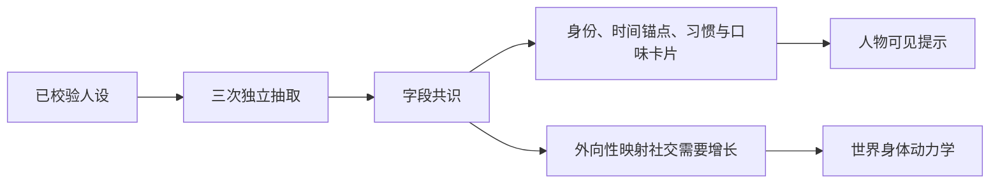
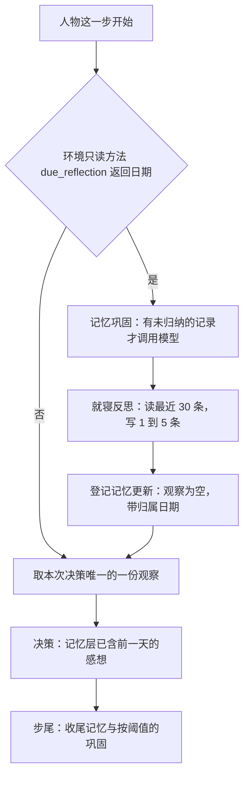

# WorldMock 产品设计说明书 — 人物

## 人物身份与画像

唯一人物来自严格 persona.toml。人设原字节摘要是画像输入身份，不使用故事正文摘要替代完整人设身份。
画像的实际服务、模型容量与重试预算来自[运行配置](08-configuration.md)。

画像抽取使用真实配置客户端；每次结构错误纠正是新的逻辑请求，服务失败由 dispatcher 的两种独立预算处理。
三次一致性抽取不算传输或普通重试。纯编译函数只消费已校验人设和实际抽取共识结果，确定性装配卡片与动力学。
卡片包括身份、关系、当前处境、时间锚点、习惯、口味与应对方式；确定性中文渲染最多 600 汉字。
旧 occupation、routine_preference、consumption_preference、risk_preference 字段明确拒绝。

大五分数只用于世界侧动力学。当前只映射外向性到社交需要每小时增长：
`0.06 + 0.04 × ((score - 4) / 3)`，按 0.01 步长取值并限于 0.02 至 0.10。
删除情绪、健康行为奖励、聊天接受率及消息回复倾向的旧映射；分数和系数不进入人物提示。

人设声明的七个作息值（午饭、晚饭、下班、到家、就寝五个时段，睡眠中点和每日睡眠需要，取值范围见
[配置](08-configuration.md#configuration-人物声明)）原样写进卡片，不取整；没有声明的值保持模型读出的结果。
模型读出的值只在抽取入口取整：时段到半小时，长度不到半小时的时段向外取整，睡眠中点与睡眠需要到一刻钟；
卡片模型自身不检查格点，只检查范围、起点小于终点、跨度不超过 12 小时和时间先后。
声明的时段按午饭、下班、到家、晚饭、就寝的次序反复尝试写入，直到没有时段能再落下；就寝起点小于它前面的时间时按次日存，
卡片里起点和终点都加 24，加完终点不得超过 30。写不进卡片的时段保留卡片原值并记 `CARD_FIELD_CONFLICT`
（`reason` 固定为 `anchor_order`），运行照常进行；这是唯一的例外：人设层、卡片文本和评估读卡片里的值，
零点计划和身体仍读声明值。写不进卡片有两种情形：声明的时段与模型读出的时间排不进同一天；
就寝按次日存时终点越过次日 06:00（例如 `[5.9, 7.0]`），这样的声明能通过加载但进不了卡片。
卡片值确实改变的字段各记一条 `CARD_FIELD_OVERRIDDEN`。
同一份声明再写一次卡片不变；恢复运行时据此核对，比较的是未取整的值。

人设层和卡片文本用同一个函数把小时数写成中文时刻：先取整到分钟再对一天取模，0 分不加，15 分写「一刻」，
30 分写「半」，45 分写「三刻」，其余写「几分」；时段写成「起点到终点」，睡眠需要写成十进制小时。
零点计划保持 `HH:MM–HH:MM`，分钟的取整规则相同，三处显示同一分钟；身体和评估用原值。
编译产物的结构版本是 5，其他版本直接拒绝；抽取提示版本仍是 `card-v4`。

## 提示与工具

人物每次读取已提交世界的七层提示：系统层、工具层、人设层、记忆层、待办层、环境层、进度层。
地点行只显示 location_id 与 name 的私有绑定，不显示地点类型；工具层展示完整显示名和当前实际动作。
功能 app 不成为人物可选择对象，自动系统触点不进入本人记忆。

生活决策的原生工具共十一个，开始工具的参数、槽位与受理见[模拟引擎](04-simulation-engine.md)。

| 工具 | 数量 | 成员 |
| --- | --- | --- |
| 请求工具 | 七个 | start_main_activity、start_side_activity、recall_task_summary、report_status、pause_activity、conclude_activity、revise_day_plan |
| 记忆查询 | 三个 | memory_recent、memory_search、memory_time_range |
| 环境查询 | 一个 | query_world |

世界请求是请求工具里除 recall_task_summary 外的六个；recall_task_summary、记忆查询和 query_world 只读。
一次回复的工具调用只有三种合法形状，其余组合整批以 `TOOL_CALL_REQUIRED` 纠错，不登记任何世界请求。

| 批次形状 | 内容 |
| --- | --- |
| 只读查询 | 全部是只读工具，个数不限 |
| 一个世界请求 | 恰好一个调用 |
| 开始组 | 恰好两个调用，start_main_activity 与 start_side_activity 各一个，先后不限 |

同一个开始工具两次、开始工具与控制工具同批、世界请求与只读查询同批都不合法。
两条开始调用各自校验参数和名称，全部问题合并成一次纠错；全部通过后按回复中的先后依次登记，
`action_id` 为 `{decision_id}:action:{序号:04d}`，登记完本次决策结束。
最后回合和截断后的那次纠正沿用已有去查询规则，只开放世界请求，两个开始工具都在其中；
原生 tool_calls 是唯一可执行模型输出。人物请求不提供运行种子、截止时间、凭据、付款 app 或系统参数。

系统层用规则条目写明每次决策怎样结束、两个开始工具各填什么、名称要写完整、在地点做哪件事由人物点名、
两个槽位各放什么、睡眠怎样写以及暂停的活动怎样恢复；规则文字只在系统层写一次，工具说明只写用途与参数格式。
讲睡眠的条目写明分钟数的范围、就在当前地点睡且地点须能睡、睡着后到写的时长才再请人物决策、
提醒推送和送达都不叫醒、过去一天睡得太少时可能再多睡二十分钟到一小时，以及 sleep 行的 `note` 只供参考。
人物看不到睡过头的门槛、概率和抽取结果。

工具层动作行固定八个字段，键序 `action, detail, available, reason, price, duration, quantity, note`，
紧凑渲染省略 `null`。`detail` 是调用里要照写的名称：出行行是出行方式名称，购买行和内容 app 行为 `null`，
地点上的 interact 行与 sleep 行见下表。
每行的 `available` 与 `reason` 和受理用同一套检查，对只含这一行的一组求值，说明与拒绝原因一字不差。
人物停留在某个地点时，该地点的目标行下为每个内容单元列一条 interact 行，完整列出，不轮转、不截断，按单元键升序；
地点标了 `sleepable` 时 sleep 行排在其后。人在路上时不列任何地点的 interact 行，其他地点只列出行，
query_world 查到的也是如此；没有单元的地点没有 interact 行。

| 动作行 | `detail` | `duration` | `note` |
| --- | --- | --- | --- |
| 地点 interact | 单元名原文 | 此刻开始会做多久：没做完的内容是剩余时长，系列是下一集的时长 | 系列写「第 N 集，共 M 集」，没做完写「上次没做完，接着做」，两者都有以「；」相连，都没有为 `null` |
| sleep | `null` | `null` | 睡前提示 |

睡前提示按观察时刻欠的觉 h 小时生成，只给半小时一档的时长，不给原值，睡多久由人物自己写。
h 小于 0.25 写「现在不欠觉」，大于 12 写「现在睡，12 小时以上才能补满」；其余取 `floor(h × 2 + 0.5)` 个半小时，
一个写「现在睡，约半小时能补满」，多个写「现在睡，约 X 小时能补满」。提示只取决于身体，这一行此刻不可用时照样显示。

| 在地点做的一件事 | 工具层该单元的行 | 另外出现在 |
| --- | --- | --- |
| 没做过，或做完过 | 可用 | 无 |
| 上次没做完且已收尾 | 可用，`duration` 为剩余时长，`note` 含「上次没做完，接着做」 | 无 |
| 正在做 | 当前地点的每条 interact 行都不可用，原因是槽位 1 被占 | 工具层的活动目标行，带 report_status、pause_activity、conclude_activity |
| 刚结束待收尾 | 每条 interact 行都不可用，原因是先收尾 | 工具层的活动目标行，带 conclude_activity |
| 被本人暂停的活动占着 | 该单元的行不可用，原因点名那项暂停的活动；其他单元的行不受影响 | 待办层 `paused_activities`，带 report_status（恢复）与 conclude_activity |

同秒续接在上一决策以一个世界请求或一个开始组结束时成链。链对象的 `tool_results` 按调用次序保存一条或两条
`{tool_call_id, result}`，宿主为每个 `tool_call_id` 各追加一条 tool 消息，`changes` 与 `events` 只写在最后一条上。
重建的 assistant 消息带两个 `tool_calls` 时必须是两个开始工具各一个，并与登记的两条动作按次序同名，否则断链。

环境层的身体感觉使用[交换引擎](02-exchange-engine.md)的饥饿、困倦、放松需要与社交需要四项体感。
环境天气直接来自世界事实，模型只能据此叙述，不能写入天气；不使用关键词过滤或第二个模型判定天气真伪。

## 进度、待办与记忆

进度层展示实际活动结算、暂停、计划结束和真实收货。内容短语统一使用实际已消费与总时长，
跨容器恢复读取共享进度；纯目录浏览不伪装成内容消费或等待经历。
待办区分暂停活动、已结束待收尾活动和人物记下的个人事务，商品事务只按真实收到的数量累计。

记忆层只投影本人已提交的实际活动、真实收货和明确自述。自动导航 app、支付通知、回调点事实与系统账本
不是人物消费记忆。查询只读，不推进时间或产生新事实。
主观快照必须对应当前可见身体、目标、个人事务或环境证据，真实经历必须引用本人合法源事件。

就寝反思是人物一侧的一次独立模型调用：读人物最近 30 条自己写下的记录，写出 1 到 5 条感想存进记忆。
它每个本地日只在当天第一次睡醒时做一次，回顾前一天，做完才做这一天的第一次决策。
睡醒指本人的一段睡眠在自己的计划结束时结束，被运行终点截断的睡眠不算；本地日按运行时区的零点分，
恰在 00:00:00 的时刻属于新的一天。判定是一个只读世界状态的函数，按次序看三件事，都成立才触发：

| 次序 | 条件 | 不成立的例子 |
| --- | --- | --- |
| 1 | 这一秒还没有提交过一轮决策（`last_decision_time` 不等于当前时刻） | 睡醒那一秒的第二次决策 |
| 2 | 本人有一段已完成的睡眠，结束时刻恰是当前时刻 | 运行开始；睡眠被运行终点截断 |
| 3 | 本人没有另一段已完成的睡眠结束在同一个本地日 | 当天午睡醒来 |

触发时给出归属日期和所属睡眠：归属日期是睡醒所在本地日的前一天，不看这段睡眠多长、几点入睡、在哪睡。
通宵之后下午补的一小觉若是当天第一次睡醒也触发；整天没睡的那天没有反思，下一次睡醒时读到的最近 30 条记录一并回顾。
初始化不反思。人物的记忆里一条记录都没有时不调用模型，这一天就没有反思，当天之后的睡醒也不补。

记忆层把登记了归属日期的感想放进 `earlier_days` 里那个日期的条目，形状是 `{"activity": null, "text": 感想}`，
仍只显示日期早于今天的条目，所以感想从登记后的第一次决策起就显示，直到被 8000 字符窗口裁掉；裁剪先删最旧日期的感想。
一个本地日至多一次反思，每个日期下至多 5 条感想。写入点含 `reflection` 而没有归属日期的记忆更新以
`IntegrityError("Bedtime reflection has no filing date")` 拒绝。
反思与人物自述分开记录，不能根据自述补造活动、目标进展、付款或世界天气。
删除自然语言目标自动进展、自动完成字段与奖励；计划仍由人物明确修改和提醒控制。

## 宿主模型协议

原生 AgentSociety2 客户端承载生成模型调用。实际服务元数据提供总上下文容量和输出上限；
发送前上下文适配及输出上限均使用冻结实际元数据，没有静态模型容量表。
普通失败和传输失败只消耗对应的一种预算，底层隐式重试关闭；身份或参数错误立即失败。
协议纠错、输出截断纠正、三次抽取共识均与 dispatcher 重试分别计数。
所有身份、预算和卡片在工作区与运行清单冻结，恢复必须逐项一致。

人物的一步按反思阶段、观察、决策、步尾四段进行，一次决策恰有一份冻结观察。

反思阶段先在有未归纳的记录时做一次记忆巩固，原因文字为 `daily reflection`，再做就寝反思；
这个阶段不重写 `MEMORY.md`，巩固出的摘要由同一步的步尾照常渲染。步尾不再反思，也不再因睡眠而强制巩固，
小睡醒来不巩固；锁定的 AgentSociety2 仍向步尾传 `sleep_boundary`，LifeAgent 不覆写取值钩子，这个值恒为假且没有读者。
反思阶段的模型调用身份是 `{decision_id}:reflection:{序号四位}:attempt:1`，序号从 0001 起，
不占用也不重置决策的模型回合计数，所以不消耗回合上限，也不与决策回合的调用身份重复；请求与响应照常逐次留证。
这些请求只带 `submit_reflection` 或不带工具，不是行动请求，不触发 `decision_started`，也不会被读成世界请求的自述。
反思输出在校验重试耗尽后仍不合合同是运行故障：这一步抛出，决策轮中止，不写入任何感想。
