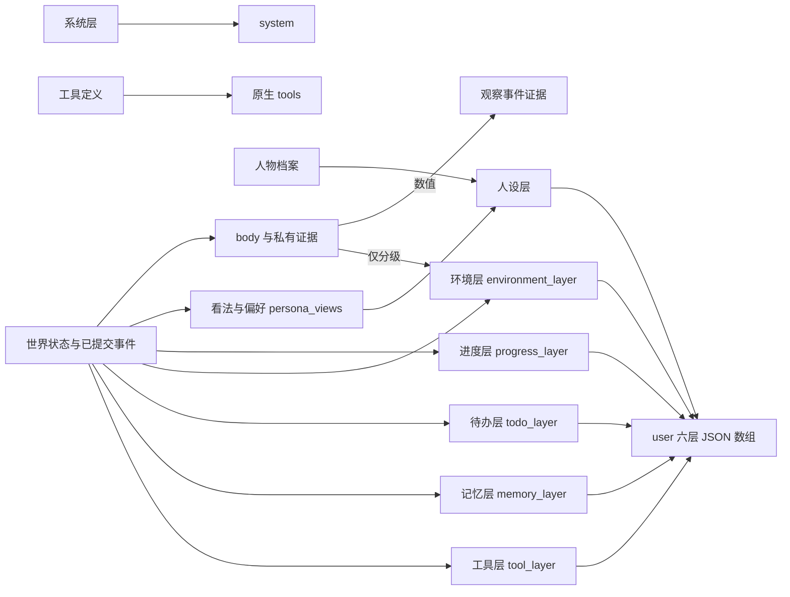

<a name="agent"></a>
# WorldMock 产品设计说明书 — 人物

<a name="agent-职责与边界"></a>
## 职责与边界

人物根据画像、记忆和当前观察选择行动，向环境提交严格请求，并记录自己的解释。
世界事实由环境结算，人物自述不能替代活动进度、交易和已核验经历。
本章维护画像、记忆、模型请求、七层提示及查询和纠错；活动规则在模拟引擎，持久记录在记录引擎。

<a name="agent-人格与卡片字段"></a>
## 人格与卡片字段

| 字段 | 类型 | 说明 |
| --- | --- | --- |
| `background_story` | str | 人物背景故事；正式人物的作息、消费与风险倾向写在各自的背景里并由卡片承载，场景显式声明的作息字段优先（见下文「场景作息覆盖」） |
| `PersonaCard` | 编译产物 | 由 `background_story` 确定性渲染出的结构化人物卡片 |
| `persona_card_struct` | 人物 `profile` 中的卡片结构化字段 | 新建运行时另存（经场景作息覆盖后的 `PersonaCard` 去掉 `situation` 的 JSON 形式），恢复时校验结构并核对作息与场景声明一致；宿主据此渲染人设层 |
| 卡片长度 | - | 卡片以人设层 JSON 进入实际模型请求（见「七层字段」）；600 汉字上限只约束卡片派生的字段 |
| 删除字段 | - | `occupation`, `routine_preference`, `consumption_preference`, `risk_preference` 模板字段与 `entertainment_preferences` 随机浮点删除 |

| `PersonaCard` 字段 | 类型 | 说明 |
| --- | --- | --- |
| `identity` | `Identity` | 身份：`age` 取 16–100，`occupation` 不超过 20 字，`living_arrangement` 不超过 30 字 |
| `relationships` | `Relationship[]`，1–4 条 | 关系：`name_or_appellation` 不超过 12 字、`role` 不超过 12 字、`intimacy` 取 0–30 整数、`channels` 取 1–3 项非空文本 |
| `situation` | `Situation` | 当下处境：`busy_this_week`（本周在忙什么）与 `cares_about`（在意什么），各不超过 60 字；卡片编译照旧，不进提示 |
| `time_anchors` | `TimeAnchors` | 时间锚点：`wake`、`leave_home`、`lunch`、`dinner`、`bedtime` 五个时间窗口，按起点排列为起床 ≤ 出门 ≤ 午餐 ≤ 晚餐 ≤ 就寝；递增序列后的回绕小值构造时确定性 +24 归一为次日锚点（1.0→25.0，落在字段值里），归一后仍不单调的（同日乱序，如 8→7）拒绝；另有必填、可为 null、无缺省的 `leave_work`、`arrive_home` 两个窗口（null 表示没有固定时刻或故事未提及，不读映射表缺省）：两者不进入回绕归一的名字元组，也不进入五锚点的全序校验；`leave_work` 非空时出门起点 ≤ 下班起点，两者都非空时下班起点 ≤ 到家起点，`leave_work` 为 null 而 `arrive_home` 非空时出门起点 ≤ 到家起点，任一非空时其起点 ≤ 归一后的就寝起点，与午餐、晚餐不设先后；不支持跨午夜的下班与到家（窗口终点须不晚于当日 24 点，与场景窗口的 0 ≤ 起点 < 终点 ≤ 24 同一口径；就寝回绕到次日时起点不晚于就寝而越过 24 点的同样不合格）；`lunch`、`leave_work`、`arrive_home`、`dinner`、`bedtime` 在场景显式声明时取场景窗口，落不下的槽保留卡片值（见下文「场景作息覆盖」） |
| `chronotype_midsleep` | 浮点，小时 | 时型（自由日睡眠中点），取 [0, 24)，吸附 0.25 小时格点；场景显式声明时取场景值（量化到同一格点，24 点写成 0 点） |
| `sleep_need_hours` | 浮点，小时 | 睡眠需要，取 7.0–9.0，吸附 0.25 小时格点，默认 7.5；场景显式声明时取场景值（量化到同一格点） |
| `habits` | `HabitSignature[]`，至多 5 条 | 习惯签名：`trigger` 不超过 30 字、`response` 不超过 40 字、`time_window` |
| `coping` | 文本 | 应对方式（压力时做什么），不超过 60 字 |

时间窗口（`TimeWindow`）取自午夜起的小时数，半开区间：`start_hour` 取 [0, 30)，`end_hour` 取 (0, 30]，两者吸附 0.5 小时格点，跨度不超过 12 小时。就寝窗口允许跨午夜：`end_hour` 可大于 24（如 23–25 表示到次日 01:00）；锚点回绕归一后 `start_hour` 亦可大于 24（25 表示次日 01:00），上限为次日 06:00 地平线（30 小时）。这些字段属于人物作息，不构成当日目标的时间计划。

**场景作息覆盖**（[模拟引擎](04-simulation-engine.md)）。场景人物显式声明的作息字段覆盖卡片的抽取值，身体结算、零点计划与每轮人设层因此对这些字段读同一组值（人设层取量化到卡片格点的值，落不下而保留卡片值的槽除外）；未声明的字段仍取卡片值。只覆盖场景文档里显式写出且非空的
`chronotype_midsleep`、`sleep_need_hours`、`lunch_window`、`leave_work_window`、`arrive_home_window`、`dinner_window`、`bedtime_window` 七个字段（按场景人物的已声明字段判定，覆盖作用在加载所得的场景人物上），分别写进卡片的
`chronotype_midsleep`、`sleep_need_hours` 与 `time_anchors.lunch`、`leave_work`、`arrive_home`、`dinner`、`bedtime` 五个窗口槽；取值量化到卡片格点（中点与睡眠需要 0.25 小时，窗口 0.5 小时）。窗口覆盖后经回绕归一、起点非递减的顺序校验与下班、到家的顺序约束重建锚点，
按落槽顺序（午餐、下班、到家、晚餐、就寝）反复尝试直到没有槽能再落下；落不下（顺序冲突）或量化后写不成合法窗口的槽保留卡片值（下班、到家槽的卡片值可以是 null）并记 `CARD_FIELD_CONFLICT`，每处实际改变卡片值的覆盖记 `CARD_FIELD_OVERRIDDEN`（见「运行输入警告」）；卡片槽为 null 而场景窗口落下时同样记 `CARD_FIELD_OVERRIDDEN`，`card_value` 为 null。
覆盖与冲突规则对五个窗口槽一体适用，覆盖不降级任何卡片锚点：例如场景声明的就寝早于卡片的到家时，冲突记在 `bedtime_window` 上，就寝槽保留卡片值，卡片的到家不变。
`leave_work_window`、`arrive_home_window` 是场景人物的可选字段，与午餐、晚餐窗口同单位同校验（`0 ≤ 起点 < 末端 ≤ 24`），两者都声明时下班起点不晚于到家起点（起点相等可以），
场景模型不核对它们与午餐、晚餐、就寝的先后。
覆盖结果是不动点：对覆盖后的卡片再覆盖一次不改任何值，恢复时据此核对 `persona_card_struct` 与场景声明一致。`validate` 与新建运行调用同一个覆盖函数。

编译产物（`CompiledPersona`）除卡片外还包含 `big_five`（大五五维各取 1–7 整数）、`world_dynamics`（大五到世界层动力学参数）、`source`（`background_story` 指纹、抽取模型、提示版本，以及三次一致性的运行次数与逐字段平均众数占比）、`schema_version` 与 `warnings`。抽取提示版本为 `card-v3`，卡片结构版本为 3；旧结构化卡片因缺 `leave_work`、`arrive_home` 两个必填键被拒。
抽取载荷另有独立顶层键 `work_anchors: {leave_work, arrive_home}`，恰好这两个键，各为 `"HH:MM-HH:MM"` 窗口或 null（不是对象、键集不符或值写不成窗口是格式错误，照常走解析重试），单独取共识，下班锚点的摇摆不连带改变其余五个锚点；
故事写明固定的下班或到家时刻才填，没有固定工作地点、时间不固定、落在次日或未提及写 null，不推测，也不读映射表缺省（两键为 null 时保持 null）。
新锚点不满足顺序约束或越过当日午夜（见上表 `time_anchors`）时按固定顺序降级为 null：先核 `leave_work`（对出门与就寝），再核 `arrive_home`（对仍有效的下班或出门，以及就寝）；
卡片校验器与降级共用同一函数（`profile.models.settle_work_anchors`），所以校验器接受恰好等于降级不改变任何值。单次采样只为放行校验而降级，不写回载荷，也不触发解析重试；
共识对原始的 `work_anchors` 取众数；降级说明只在共识后的最终卡片上生成，每个被置空的锚点一条，按核对顺序；不因此让整张卡片编译失败。
降级说明取固定英文格式 `work_anchor_demoted: <原因>`，原因为 `leave_work start <s> is outside leave_home <low>..bedtime <high>` 或
`arrive_home start <s> is outside <leave_work 或 leave_home> <low>..bedtime <high>`（下界取仍有效的下班，下班为 null 时取出门），先后合格而窗口终点越过当日 24 点时为
`<leave_work 或 arrive_home> window <s>..<e> runs past midnight`（每个锚点只取一条，先后不合格时取前两种之一；数值为窗口起点、终点的小时数，按最短写法，
如 `work_anchor_demoted: leave_work start 7 is outside leave_home 8..bedtime 23`）；抽取结果的只读字段 `demotion_notes` 承载它们，
编译产物的 `warnings` 把它们接在一致性警告（`field_agreement_below_two_thirds: [...]`，没有时省略）之后，经 `PERSONA_AGREEMENT_LOW` 逐条透传（见「运行输入警告」）。
就寝锚点表示开始就寝的短窗口，不表示整夜睡眠；解析重试携带上一轮的具体校验错误，仍使用原有重试次数和严格结构校验。出现 `occupation`、`routine_preference`、`consumption_preference`、`risk_preference` 四个已删除模板字段的旧档案明确报错，不静默兼容。

| `CompiledPersona` 附属字段 | 字段面 |
| --- | --- |
| `schema_version` | 固定 3 |
| `big_five` | `openness`、`conscientiousness`、`extraversion`、`agreeableness`、`neuroticism`，各取 1–7 整数 |
| `source` | `background_story_sha256`（指纹，64 位小写十六进制）、`model`、`prompt_version`，以及 `consensus`（`runs` 不小于 1、`agreement` 取 0–1） |
| `warnings` | 文本数组，默认为空 |

| `world_dynamics` 参数 | 类型 | 说明 |
| --- | --- | --- |
| `mood_pulse_amplitude` | 浮点 [0, 1] | 情绪脉冲幅度 |
| `mood_halflife_minutes` | 浮点 [10, 180] | 情绪半衰期，分钟 |
| `social_need_growth_per_hour` | 浮点 (0, 0.5] | 社交需要每小时增长率 |
| `conversation_relief_per_hour` | 浮点 [0, 1] | 交谈每小时缓解量 |
| `diversity_weight` | 浮点 [0, 1] | 内部评分器多样性权重 |
| `invitation_acceptance` | 浮点 [0, 1] | 接受邀约倾向 |
| `reply_tendency` | 浮点 [0, 1] | 回复消息倾向 |
| `present_preference` | 浮点 [0, 1] | 内部评分器现时偏好 |

大五分数、九参数与任何权重不进入模型提示。

人设层（字段见「七层字段」）由宿主用 `persona_card_struct`、人物姓名与场景联系人渲染，环境只下发由事件派生的看法与偏好
（观察私有键 `persona_views`）。卡片结构版本为 3；`render_card` 在 `leave_work`、`arrive_home` 非空时于作息句「需睡<N>小时」之后、句号之前按此顺序各追加一个分句「；下班<窗口>」「；到家<窗口>」（计入六百汉字预算），两者都为 null 时输出与此前逐字节相同，输入的卡片先经场景作息覆盖（见上文「场景作息覆盖」），
渲染文本 `persona_card` 与 `persona_card_struct` 都取覆盖后的卡片；冻结恢复另核对卡片作息与场景声明一致。没有结构化卡片的人物，
卡片派生的字段只填姓名，其余为 `null` 或 `[]`；场景联系人与看法、偏好照常呈现。卡片关系与场景联系人按名称精确合并（卡片 `name_or_appellation` 等于联系人称谓 `salutation`），对不上的各占一项；
只来自场景联系人的项 `closeness` 为 `null`、`channels` 为 `[]`，场景联系人的亲密度与渠道仍不进提示；只凭看法出现的已知人物
（不在卡片与场景联系人中的同世界人物）另占一项，`role`、`closeness` 为 `null`、`channels` 为 `[]`，不填编造的值。`view` 与 `preferences`
只来自成功的 `conclude_activity` 各项的 `views`（经 `control_items` 读出，`about` 即存储的 `subject`），同一对象按事件顺序取最后一条，存储仍只追加；这两类条目只在人设层出现，
不进记忆层，也从进度层该调用的参数中略去。购买本身不写偏好。

`tastes` 保留为卡片散文；人物口味不生成数值权重或候选排序参数。覆盖率目标使用习惯关键词、食品名、全部 app 名。

<a name="agent-画像编译"></a>
## 画像编译

画像编译从 `background_story` 产出结构化人物卡片 `PersonaCard`（类型名；主观归纳请求里的字段名是 `persona_card`，
两者与中文正文所说的「人物卡片」是同一产物），抽取沿用三次一致性口径。新建运行时卡片的结构化字段另存进人物 `profile` 的
`persona_card_struct`，恢复时校验；宿主用它与人物姓名、场景联系人渲染人设层 JSON 进入提示。卡片编译、三次一致性与冻结恢复不变；
`render_card` 的输入先经场景作息覆盖（见下），下班、到家锚点各自非空时画像文本各追加一个分句并计入 600 汉字预算，二者都为 null 时输出与修订前逐字节相同；
人设层 `rhythm` 在 `lunch` 与 `dinner` 之间增 `leave_work`、`arrive_home` 两键；600 汉字上限只约束卡片派生的字段；当下处境 `situation` 不进提示。卡片必须承载：身份（年龄、职业、居住方式）、关系（姓名或称谓、角色、
亲密度、渠道）、当下处境（本周在忙什么、在意什么）、时间锚点（起床、出门、午餐、晚餐、就寝窗口，另有可为空的下班、到家窗口）、
时型中点 `chronotype_midsleep`、睡眠需要 `sleep_need_hours`、习惯签名（触发—反应—时段三元组）、
口味（内容题材、饮食喜好、常用媒介）与压力时的应对方式。字段的名称、类型与取值范围只在
`docs/design/09-io-formats.md`「人格与卡片字段」定义。
下班与到家只在故事写明固定时刻时才填，没有固定工作地点、时间不固定、落在次日或未提及为 null，不取映射表缺省；
二者由抽取载荷的独立顶层键 `work_anchors` 单独取共识，不连带改变其余五个锚点，不进入回绕归一与五锚点全序。
另设顺序约束：下班非空时出门起点 ≤ 下班起点，两者都非空时下班起点 ≤ 到家起点，下班为 null 而到家非空时出门起点 ≤ 到家起点，
任一非空时其起点 ≤ 归一后的就寝起点，与午餐、晚餐不设先后，不支持跨午夜的下班与到家。
新锚点不满足顺序约束时按固定顺序降级为 null（先核下班，再核到家），不让整张卡片编译失败：单次采样只为放行校验而降级，不写回载荷，
也不触发解析重试（格式错误仍走重试）；共识对原始的 `work_anchors` 取众数；降级说明只在共识后的最终卡片上生成，每个被置空的锚点一条。
降级说明作为画像编译警告经 `PERSONA_AGREEMENT_LOW` 进入运行输入警告（该码泛指画像编译留下的警告，警告码闭集为六个）。
编译产物的卡片结构版本为 3、抽取提示版本 `card-v3`，缺少必填键的卡片被拒。

作息、消费与风险倾向记录在各自的 `background_story` 中，由卡片承载，场景显式声明的作息字段优先：场景人物显式声明的
`chronotype_midsleep`、`sleep_need_hours`、`lunch_window`、`leave_work_window`、`arrive_home_window`、`dinner_window`、`bedtime_window`
（下班与到家两者都声明时下班起点不晚于到家起点）覆盖卡片的抽取值（按卡片格点量化；覆盖后锚点乱序时
冲突的那一槽保留卡片值），未声明的字段仍取卡片值，每处覆盖与冲突各记一条输入警告；
覆盖与冲突规则不变并一体适用于下班、到家两个新槽：场景声明的窗口落下后违反顺序约束，或量化后写不成合法窗口时，
该槽保留卡片值（新槽的卡片值可以是 null）并记 `CARD_FIELD_CONFLICT`；卡片槽为 null 时同样可被场景声明覆盖并照常记警告，
警告码仍为 `CARD_FIELD_OVERRIDDEN`、`CARD_FIELD_CONFLICT`，只扩 `details.field` 的取值；`persona_card_struct` 保存覆盖后的值，身体结算、零点计划与每轮人设层
读同一组作息（[模拟引擎](04-simulation-engine.md)）。
零点计划的人物输入另增「下班时段」「到家时段」，只取场景声明、未声明省略；只来自卡片的下班与到家时刻同起床、出门一样不进零点计划的结构化输入。
这些是 `experiment_assumption`，不宣称来自旧数据中未提供的个体特征，也不规定行动时刻、数量或必须完成的日程。
场景按人物另行声明的工作安排（`work_schedule`：工作地点、每周班次、日期例外与休息时段，可为 null）不属于这组作息字段：
它是场景声明、环境求值的事实，每轮在环境层 `duty` 呈现，今日计划与工作提交都改不了它；环境不因它新增任何拒绝，班内离岗照常受理，
只由行为评估度量。零点计划生成的当日目标不是
日程脚本，不给固定的“先吃饭再工作”行为脚本。模型选择和提示使用 AS2 现有配置，正式运行固定端点、模型版本
与参数。

**大五只进入世界层动力学**：神经质决定情绪脉冲幅度与半衰期，外向性决定社交需要增长率与交谈缓解量，
开放性决定内部评分器的多样性权重，宜人性决定接受邀约与回复消息的倾向，尽责性决定内部评分器的现时偏好。
大五分数、九参数与权重不进提示。

**画像与行为**：`tastes` 保留卡片散文，人物结合此刻需要自主决定；不生成 `taste_weights`、注意力先验或食品排序参数。习惯签名与压力应对继续进入人设层，不把一段偏好描述当作世界准入条件。

覆盖率目标由登记目录确定：习惯反应对动作名与地点显示名按关键词匹配，饮食喜好对 meal、snack、drink 商品名匹配，媒体对全部动作名作双向子串匹配、对全部 app 名作精确匹配。内容没有分类标签。
不读取内容题材或手机配置，不把 app 名子串当作习惯反应命中；`missing[].kind` 仅 `habit_response`、`food_preference`、`media`。阈值 `0.8` 不变，报告缺项、可执行比例与实际目标集，运行低覆盖只警告。

运行输入警告闭集为 `CONTENT_EMPTY_WITH_MEDIA_TASTES`、`COVERAGE_BELOW_THRESHOLD`、`CARD_FIELD_OVERRIDDEN`、`CARD_FIELD_CONFLICT`、`PERSONA_AGREEMENT_LOW`、`LOCATION_NAME_SUSPICIOUS`。
无媒体内容警告指没有任何 app 绑定内容，`details={media, habits}`，没有 `card_content_genres`。作息覆盖、冲突与编译一致性仍报告实际原值；坐标状地点名字是质量警告，不改变登记准入。
没有口味权重、游戏权重或配送路线警告。警告冻结在 `input_warnings`，恢复继承不重算，运行只警告；`validate` 覆盖率低于 `0.8` 仍失败。

依据：Fleeson 2001 与 Mischel–Shoda CAPS 说明单日行为由情境与 if-then 签名决定，特质只解释小部分方差；
Roenneberg 的 MCTQ 以自由日睡眠中点度量时型。

人物有媒体口味但没有任何内容带非空 app_ids 时发出 `CONTENT_EMPTY_WITH_MEDIA_TASTES`。

<a name="agent-人物卡片覆盖率产出"></a>
## 人物卡片覆盖率产出

人物卡片覆盖率校验把人物卡片的习惯反应与口味条目逐个映射到世界里实际可执行的目标或条目，防止卡片写了世界里没有的东西。

| 项 | 合同 |
| --- | --- |
| 产出文件 | `persona_coverage.json`，默认写在场景文件同目录，可由参数改写路径 |
| 触发命令 | `worldmock validate` 与 `worldmock profile validate` 使用同一登记目录目标集，判定前写报告；新建运行低覆盖只警告 |
| 可执行比例阈值 | 0.8；任一人物低于阈值即校验失败并列出缺失项，文件在判定之前照常写出（该人物 `passed` 为假）；新建运行低于阈值只警告，不失败 |
| 文件结构版本 | 1 |
| 匹配规则 | 习惯和食品按关键词匹配；媒体对全部动作名作双向子串匹配、对全部 app 名作精确匹配，无内容题材或手机配置 |

下列为全部条目命中时的产出示例（`passed` 为真、`missing` 为空）；未命中的条目列在 `missing`，比例低于阈值的人物 `passed` 为假。

```json
{
  "schema_version": 1,
  "scenario_id": "string",
  "threshold": 0.8,
  "agents": [
    {
      "agent_id": 1,
      "schema_version": 1,
      "total_items": 12,
      "covered_items": 12,
      "executable_ratio": 1.0,
      "passed": true,
      "missing": []
    }
  ]
}
```

| 逐人物报告字段 | 说明 |
| --- | --- |
| `agent_id` | 人物编号，与逐人物报告的其他字段平级展开 |
| `total_items` | 参与校验的条目数，即习惯反应与食品与媒体散文条目之和 |
| `covered_items` | 命中世界可执行目标的条目数 |
| `executable_ratio` | 可执行比例，保留四位小数；无条目时为 1.0 |
| `passed` | 比例是否达到阈值 |
| `missing` | 未命中的条目，每条含 `kind` 与 `value`；失败时随错误消息与返回值列出 |

覆盖率目标由登记目录确定：习惯反应对动作名与地点显示名按关键词匹配，饮食喜好对 meal、snack、drink 商品名匹配，媒体对全部动作名作双向子串匹配、对全部 app 名作精确匹配。内容不分类。
不读取内容题材或手机配置，不把 app 名子串当作习惯反应命中；`missing[].kind` 仅 `habit_response`、`food_preference`、`media`。阈值 `0.8` 不变，报告缺项、可执行比例与实际目标集，运行低覆盖只警告。

<a name="agent-运行输入警告"></a>
### 运行输入警告

| 警告码 | `details` |
| --- | --- |
| `CONTENT_EMPTY_WITH_MEDIA_TASTES` | `media`、`habits` |
| `COVERAGE_BELOW_THRESHOLD` | `executable_ratio`、`threshold`、`total_items`、`covered_items`、`missing` |
| `CARD_FIELD_OVERRIDDEN` | `field`、`card_value`、`scenario_value`、`applied_value` |
| `CARD_FIELD_CONFLICT` | `field`、`card_value`、`scenario_value`、`reason` |
| `PERSONA_AGREEMENT_LOW` | `compiler_warning` |
| `LOCATION_NAME_SUSPICIOUS` | `location_id`、`name`、`patterns` |

警告形状为 `{code, agent_id, message, details}`，场景级地点警告的 `agent_id=null`。每条写 warn 操作日志，查看器读取实际清单；`null` 表示未计算，空列表表示没有警告。

`CONTENT_EMPTY_WITH_MEDIA_TASTES` 在没有任何内容带非空 `app_ids` 时发出。

<a name="agent-记忆合同"></a>
## 记忆合同

记忆随 `conclude_activity.items[].memories` 写入，允许空数组：没有值得记录的新事件时不写记忆，AS2 运行时不以空列表为错误。
播报与暂停不带记忆。三个控制请求里的个人事务变更（`errands`）不是记忆写入点：不写入 AS2、不产生 `memory_updated`、
不计入待巩固条数与重要度累计；同一请求里的 `memories` 仍按既有规则由宿主在登记时写入，二者落地规则不同
。条数上限与字段面见 [记忆字段](06-agent.md#agent-记忆字段)。

**写入规则**：

- 每条记忆的 `text` 使用人物语言，不得包含事件标识、请求哈希或任意十六进制身份；无 `refs`，来源由系统登记
- 人物只写感受、打算、偏好、关系等主观文字；`event`、`observation` 不再是 WorldMock 可写类型，闭集见 [记忆字段](06-agent.md#agent-记忆字段)；
  系统层第 6 条引导人物只记以后做决定用得上的新情况，人设层已有的作息与待办层已有的事务不再记；以后要买到、拿到或吃掉的具体东西记成个人事务，
  其他需要延续的打算写进 `pause_activity` 或 `conclude_activity` 的 summary（`report_status` 的 summary 不进记忆层，只留到本段停留或路程结束）。
  这是提示引导，宿主不做语义拒绝，七类类型闭集不变
- relationship、preference 两类记忆必须带 `subject`（写的是谁或什么），其他类型的 `subject` 为 `null`；relationship 的 `subject`
  须是已知人物（卡片关系名、联系人姓名或称谓、同世界人物名）。`subject` 只在 WorldMock 的请求与事件中，写入 AS2 前去掉
- 这两类记忆只在人设层出现：成功的 `conclude_activity` 中带 `subject` 的条目按对象取事件顺序最后一条，原地更新人设层关系的 `view`
  与 `preferences`，存储仍只追加；它们不进记忆层，也从进度层该调用的参数中略去。购买本身不写偏好
- 写入前按 bigram Jaccard ≥ 0.6 与最近 24 小时的同类型记忆合并；合并只增加计数与最近时刻，不重复追加文本

**主观巩固触发**为三选一：`importance` 自上次巩固起累计到 3.0；待巩固记忆满 10 条；人物入睡后的第一个边界。
单条 preference 类型记忆不触发主观归纳更新；每步事实视图刷新不重置这些计数。

**主观归纳**（阈值巩固）保留：传入 `persona_card` 和主观 episode，使用人物语言，不含示例身份或地点编号；
模型只更新单独持久的主观归纳，不能直接改写长期记忆文件的身份和已核验经历区段。
`MEMORY.md` 每步从冻结画像、当前观察事实窗口和主观归纳确定性装配；它与归纳摘要都不再进入人物决策提示。

**记忆层**取代提示中的主观归纳、最近条目窗口与已核验经历句子：构建提示时由环境从已提交事件与世界状态派生，
不新增持久状态，构建结果随观察事件保存。`earlier_today` 为今天已结束的每个 session 一条 `{recorded_at, settled, self_notes}`，
`earlier_days` 为起源于该日且此刻仍未了结的事项加上归属该日的就寝反思。`settled` 是系统写的确定性句子；
`self_notes` 取本 session 内成功的 `pause_activity`、`conclude_activity` 写下的 summary 与记忆原文，按活动名标注。
请求里的 `errands` 不进 `self_notes`；个人事务不进记忆层、不占 8000 字符窗口，记忆层不为它写 `settled` 句：
未完成事务的完整行只在待办层，提醒到点与环境确认办成各在当段进度层留一条只写事务名称的记录（`errand_reminder`、`errand_completed`），
取消的事务只从待办层消失。
记忆层 JSON 不超过 8000 字符。句式、零点分区、未了结的判定与窗口删减顺序见[人物](06-agent.md)；
完成事实的来源与恢复见[模拟引擎](04-simulation-engine.md)。

**反思**：就寝后的巩固同时执行一次反思，由三个问题引导；没有可反思的主观记忆时不调用模型。
模型必须恰好调用一次严格工具 `submit_reflection`（`tool_choice="required"`，思考关闭，请求不带 `purpose`）提交一至五条 `reflection` 主观洞见；
`message.content` 不读取，自由文本、其他工具与多次调用都不接受。每条为 `{insight, refs}`：`insight` 与收尾记忆同一文字校验
（至多一千字符、不含八位以上十六进制串），`refs` 引用支持它的记忆身份，非空、条内不重复且全部取自本次输入的记忆身份。
该引用是记忆运行时后台调用对 AS2 条目身份的内部引用
（`docs/design/04-simulation-engine.md`「发给模型的内容不含内部身份」所列例外），不进人物决策提示。
`submit_reflection` 不属于人物工具面，不进 `tool_schema_sha256`；反思文案由 WorldMock 自持并逐字登记在 `docs/design/09-io-formats.md`「请求组成」，
与工具 Schema 一同由 `code_sha256` 绑定。
反思仍只写 `reflection`，不产出关系与偏好；反思不登记、不办成、不取消个人事务，也不把没有结算结果的事写成已完成，
反思里想到的事由人物在其后的播报、暂停或收尾时登记；它归属「睡眠开始时刻前推 6 小时」的本地日期，进入记忆层 `earlier_days`。
输出不合合同是协议违约，不是业务拒绝：按与零点计划同形的有界校验重试处理，附回英文校验错误重新请求，首次之外至多三次
（连同首次至多四次模型调用，另设独立常量），与传输重试分开计数；每次尝试是 AS2 记忆调度下的一次独立模型调用，
请求与响应照常留证并各自计入模型用量，校验错误随下一次请求的附回消息留证，不覆写 AS2 的记忆调度；耗尽即运行故障，
最后一次错误写进故障原因，本轮中止，不写入任何洞见、不登记 `memory_updated`、不降级为空反思。
这是 Generative Agents 反思机制的直接借用。

**足迹的关系**：沿用 AS2 的主观记忆检索和归纳能力，每条记忆补充来源事件与形成时刻；每次决策实际检索的主观记忆都留存下来，
不只留最后一份长期记忆文件。记忆没有提到某次观看，不代表那次观看没有发生：原始数字足迹始终保留，
已核验经历仅从该事件库投影。系统登记的来源不证明人物自由文字属实。
`memory_updated` 只在实际主观条目写入或长期记忆视图变化后保存：操作类型、新建与合并的 episode
身份、同一批 `{id,type,text,epistemic_status=subjective}` 快照、当轮观察身份、事实来源身份、
写入前后视图摘要以及写入后条目和状态文件摘要必须一同留证。多件食品来自同一结算事件时，
事实仍逐件展示，但来源事件身份只保留首次出现的一次；记录校验拒绝重复身份和观察窗口之外的来源。
准确字段与质量重算见[记录引擎设计](05-recording-engine.md#recording-engine-已核验经历与主观记忆)。

<a name="agent-dreaming-边界"></a>
### dreaming 边界

人物运行中的记忆影响后续行为，LabelKit 离线生成的 dreaming 是后续训练材料，默认不自动写回仍在运行的人物。
dreaming 的任务取值、每份材料必须携带的字段与分支绑定见 `docs/design/09-io-formats.md`「反事实与重演字段」。
推演改变行动或世界条件时建立新分支；仅由模型想象的结果标明假设，经过环境执行的结果标明重新仿真。

<a name="agent-记忆字段"></a>
## 记忆字段

人物在决策中只在结束活动时写记忆：`conclude_activity` 每项的 `memories`（普通记忆）与 `views`（看法与偏好）是关于该项活动的
记忆，全部项合计零至八条；宿主经 `control_items` 读出后按项展平（每项先 `memories`、后 `views`），`views` 写成与旧形状逐字节相同的
带 `subject` 的记忆，写入 AS2 前去掉 `subject`。此外只有就寝反思与阈值巩固。三个控制工具的请求级 `errands` 不是记忆写入点：
不写入主观记忆，不产生 `memory_updated`。所有模型写入、反思及 memory_* 查询结果都是
人物自述，持久记录和结果固定 epistemic_status=subjective；系统登记的来源不赋予正文客观事实地位。

| 字段 | 类型及合同 |
| --- | --- |
| type | commitment、relationship、preference、goal、conflict、resolution、identity、routine、reflection；请求里 `memories[].type` 取其中除 relationship、preference 外的七类，这两类写在 `views` |
| importance | 零至一浮点数 |
| keywords | 至多十二项文本关键词 |
| text | 非空、至多一千字符的人物语言，不包含八位以上十六进制身份 |
| source | 由系统按写入点固定为 `activity_conclusion`（结束活动）或 `reflection`（就寝反思），与 `memory_updated.data.trigger` 同一组取值；表示形成来源，不表示事实已核验，模型不填 |
| epistemic_status | 固定 subjective；由严格人物输入与持久运行时共同保证 |
| subject | 存储形状的对象字段，`str \| null`：由 `views[].about` 供给（请求里叫 `about`、存储里叫 `subject`，两个名字指同一件事），`type` 为 relationship、preference 时必有；普通记忆为 null；relationship 的对象须是已知人物（卡片关系名、联系人姓名或称谓、同世界人物名），否则宿主按协议错误纠正（`SUBJECT_NOT_KNOWN`）。只在 WorldMock 的请求事件与经 `control_items` 的读取中，写入 AS2 前剥掉 |

记忆不带 `refs`，来源由系统登记：`conclude_activity` 的 `action_result.data.memory_sources` 为私有字段
`[{task, activity_id, session_id, verified_event_ids}]`，模型不填、不选任何身份。`conclude_activity` 登记后
结算被拒时，其记忆仍作为人物自述保留，来源标为该动作，但不呈现（不进记忆层与人设层）；同一请求的 `errands` 变更随拒绝一并
不生效（记忆在登记时由宿主写入，事务变更只在受理时生效，二者落地规则不同）。

WorldMock 删除模型可写 event、observation 类型。主观自由文字不得成为已核验经历、完成事实章节或客观指标的依据，
也不能改变任何世界事实：当日目标文字与活动自述随人物状态保存，只用于呈现；个人事务的名称、备注与取消原因同此（见「个人事务」）。
memory_* 只查询主观 episodes，每条只返回 {type, text, time, epistemic_status}，
不含条目身份，并明确返回其性质；生活决策与只读问答只开放 `memory_recent`、`memory_search`、`memory_time_range`；
已结算的事实来自记忆层 `settled` 与进度层，不另建事实检索框架。

持久 episode 保留 id、agent_id、tick、tick_duration_sec、step_index、time、step_count、
merge_count。近二十四小时同类型 bigram Jaccard 不低于 0.6 时合并，更新计数与形成时刻，
不重复追加文本。记忆更新区分新增与合并，合法合并旧身份不是重复落库。
完整 MemoryUpdateEvidence 及 memory_updated 字段、主观快照和四个内容哈希由
[记录引擎设计](05-recording-engine.md#recording-engine-已核验经历与主观记忆)唯一维护。

主观巩固触发保持 importance 累计三、待巩固十条、入睡后的第一个边界三选一；结束活动写入的条目计入待巩固条数与
重要度累计，就寝反思的条目不计（由 WorldMock 记忆运行时自行判定，不改 AS2）。阈值巩固的新条目只以 {type, text, time} 交给模型（另带人物卡片文本与当前主观归纳）。
阈值巩固保留，主观归纳单独持久保存，但不再进入提示；模型不能直接重写完整 MEMORY.md。刷新视图不重置主观巩固计数。

提示中的身份与关系、偏好由人设层承载，事实与人物自述由记忆层承载；主观归纳、最近条目窗口与已核验经历句子不再作为提示块。
记忆层在构建提示时由环境从已提交事件与世界状态派生，不新增持久状态，构建结果随观察事件保存，导出的就是模型所见：

- **session 与归属。** session 由出发、到达、到达被拒、途中结束出行、实验截止切换；一个 session 的记录区间是「前一边界提交的末事件序号，
  到本边界提交的末事件序号」。一次提交是事件序号连续、`state_version_before` 与 `state_version_after` 都相同的一组事件（推进版本的提交之后
  同版本追加的观察与模型证据不属于它）；边界提交由参照点识别：运行开始的首个 session 下界为 0，到达（含到达被拒）取该 session 开始时刻的
  首个事件所在的提交，由决策引起的切换（出发、途中结束出行）取 `SessionState.opened_by_action_id` 那条动作首个结果所在的提交。
  出发请求整体归旧 session，到达那一秒的收尾调用归新 session，路程中收到的消息、送达与发出的消息归路程 session；进度层下界取同一区间，
  同一事件只在两层之一出现。条目是派生视图，不新增工具或模型总结请求，不为 session 建档。
- **`settled`。** 只收人物可见、状态为 `completed` 或 `in_progress`、且不是重放的结果与世界事件，句式由共享模块生成（金额按元，
  份数至多两位小数，时长用人读短语，跨日加「M月D日」）：瞬时世界请求（购买、发消息）各一句，下单句带回应的消息与收货人；
  在本 session 结束的活动每项一句（起止含暂停区间、终局、实际经过时长）：活动按它结束的提交归属（带该活动终态快照的最早事件
  所在的提交），到达时结束的出行归路程 session，实验截止截断的活动归最后一段，之后的 `conclude_activity` 本身不另写句子；
  收到直接消息（全文）、邮件（主题）、送达各一句；`work_completed` 写「HH:MM 完成「<内容标题>」」。不写失败的请求、记忆查询、回看、`report_status`、暂停与恢复、`revise_day_plan`、
  提醒、个人事务的新增、更新、取消、推进、办成与提醒（`errand_*` 事件，其中 `errand_completed`、`errand_reminded` 虽为人物
  可见也不写句）、身体结算、交谈邀请与其他层的当前状态；购买句只由订单生成，未完成的浏览不产生购买句。
- **`self_notes`。** 取本 session 区间内成功的 `pause_activity`、`conclude_activity` 请求经 `control_items` 读出的各项 `items[]`：
  `summary` 与普通记忆 `memories[].text`，按 `activity_name` 标注（条目内不重名时去掉开始时刻后缀）；`views`、`report_status` 的
  summary、请求级 `errands`、回复正文与被拒请求的内容都不进入。
- **零点与未了结。** 零点不切断 session，按当前时刻的本地日期分区：`earlier_today` 取结束时刻落在今天的已结束 session；
  `earlier_days[d]` 为起源于 d 且此刻仍未了结的事项加归属 d 的就寝反思，空日期不出现；归属今天的反思（如白天小睡之后）当天不出现，次日起在 `earlier_days` 中出现。未了结按此刻判断：订单为本人状态 pending；
  直接消息为收到之后没有成功 `send_message` 回复发件人（通话不算回复）。已了结的旧事项自动消失。
- **窗口。** 记忆层 JSON 不超过 8000 字符；超出时依次删去最旧日期的反思，再把最旧的今日条目缩成只剩未了结的 `settled` 句；
  未了结事项与最近一个 session 的条目永不删去；仍超出时写英文日志，交给整次请求的 85% 阈值处理。记录本身不删除：更早的 summary 可按活动名（记忆层
  `self_notes` 所写的活动名即可）用 `recall_task_summary` 回看，结束活动写下的记忆与反思可用记忆查询取得。

就寝反思经唯一严格工具 `submit_reflection` 提交（请求与文案见「请求组成」，参数与重试见「生成参数」），一至五条，
上限五条由 WorldMock 的 `MEMORY_REFLECTION_MAX_INSIGHTS` 定义；响应须恰好一次 `submit_reflection` 调用，`message.content` 不读取，
自由文本、其他工具、多次调用都不接受；每条 `refs` 非空、元素非空白、条内不重复，且全部属于本次输入的记忆身份，
不同洞见可以引用同一条记忆（引用属系统内部，不进人物决策提示）；`insight` 与上表 `text` 同一校验
（至多一千字符、不含八位以上十六进制串，同一函数）。通过后的条目固定 type=reflection、importance=0.8、keywords=[]、
source=reflection、epistemic_status=subjective，不产出 relationship、preference。没有可反思的主观记忆时不调用模型；
输出不合合同不写入任何洞见、不登记 `memory_updated`、不降级为空反思。这些新增身份进入同次更新证据。
宿主覆写 AS2 的记忆快照记录，为反思条目加来源，引擎据此识别：由含 `wake_from_sleep` 的那一轮找到刚结束的睡眠，反思的归属日期取
「睡眠开始时刻前推 6 小时」的本地日期，归入记忆层该日的 `earlier_days`。
空 memories 合法；无任何变化可以没有更新事件，实际摘要或反思变化必须记录。
写盘失败不报告成功。事件、哈希及来源截止的记录格式见
[记录引擎设计](05-recording-engine.md)，行为与恢复验收见
[模拟引擎](04-simulation-engine.md)。

app 使用的已结算事实句按实际 `played[]` 写「用<app>看了《A》《B》（《C》看了一部分）」，不把完整摘要或推送到达说成已经消费；跨 app 共享的内容游标属于世界事实。

settled 的订单句为「HH:MM 购买<商品> 1 份，付 N 元」；线上在购买前加「经<购物 app>」，并附「，预计 HH:MM 送到<地点>」，有支付 app 时在金额后加「（<支付 app>）」。关联回应消息与收货人的既有括注保留；没有「吃了…」「丢弃…」「把…给了…」句子。

<a name="agent-观察投影字段"></a>
## 观察投影字段

引擎在每个观察边界装配一棵观察字典，供宿主构造七层请求：原生 `tools` 放工具定义（整次运行不变），system 放系统层 JSON，
user 放工具层、人设层、记忆层、待办层、环境层、进度层六个对象组成的 JSON 数组。观察字典分三部分：环境构建的层数据、
只进事件证据的 `body` 数值与私有证据、只供宿主与环境解析名称的私有绑定与事件级工具支持行；后两部分不进入提示。
允许公开的错误明细 items.expected 不在评估证据禁键之列；禁止的是评估答案的具体路径。

工具层列出登记动作，每个支持的 app 各有独立可用行；内容身份与全局进度留在私有证据中。真实开始结果为 `details.content{action, app, title, summary, duration, pushed}`。当前会话的推送必须同时匹配 app 与动作，事件保留动作名称和完整摘要。工作完成为本人 `work_content_completed`，不公开内部内容身份。各层内容归属与唯一出现规则如下。

<a name="agent-七层字段"></a>
### 七层字段


| 请求位置 | 层 | 来源 | 保存 |
| --- | --- | --- | --- |
| 原生 `tools` | 工具定义 | 宿主常量：七个世界请求工具、两个世界查询工具与三个记忆查询工具，共 12 个（见「请求组成」） | 实际请求 |
| system | 系统层 | 宿主常量，全文见「请求组成」 | 实际请求 |
| user 第 1 项 | 工具层 | 观察键 `tool_layer` | 观察事件 |
| user 第 2 项 | 人设层 | 宿主由人物档案、人物姓名与场景联系人渲染（见「人格与卡片字段」），看法与偏好取私有观察键 `persona_views` | 观察事件保存 `persona_views`；整层在实际请求 |
| user 第 3 项 | 记忆层 | 观察键 `memory_layer`，由环境从已提交事件与世界状态派生（见「记忆字段」） | 观察事件 |
| user 第 4 项 | 待办层 | 观察键 `todo_layer` | 观察事件 |
| user 第 5 项 | 环境层 | 观察键 `environment_layer` | 观察事件 |
| user 第 6 项 | 进度层 | 观察键 `progress_layer`，只交给宿主，不写入观察事件 | 观察事件只存来源事件引用 `progress_event_ids`（调用记录的来源是 `action_requested` 与 `action_result`，记忆查询记录的来源是私有的 `model_request`、`model_response`，个人事务两种记录的来源是人物可见的 `environment_event`（`data.kind` 为 `errand_reminded`、`errand_completed`），来源事件计入 `progress_event_ids`）；完整 JSON 在实际请求 |

观察字典不再有 `scene`、`facts` 与 `recent_action_results`。每项信息在整个请求中只有一处完整内容，其他位置只用名称引用
（唯一出现原则，见[人物的唯一出现原则](06-agent.md#agent-唯一出现原则)）。

通用格式：

- 每层都是 JSON 对象，首键为 `layer`，取固定的中文层名；键序固定，按紧凑形式序列化（不转义非 ASCII 字符，分隔符不带空格）。
- 时刻字段（`*_at`、`observed_at`、`recorded_at`、`session_started_at`、`until_at`、`paused_at`、`occurred_at`）为带场景时区偏移、
  精确到秒的 ISO 8601（如 `2026-09-28T10:33:00+08:00`）；`date` 与 `noted_on` 为场景本地日期 `YYYY-MM-DD`；`remind_time` 为 `HH:MM`，
  与 `revise_day_plan` 同名同形。
- 数量、价格与时长写成人读短语，数字与单位之间一个空格，不给原始秒数或以分为单位的整数：时长「不到 1 分钟」「约 12 分钟」「约 1.5 小时」
  （一小时及以上取到半小时）；金额「32 元」「32.5 元」；份数「0.25 份」「1 份」（金额与份数至多两位小数）；个数「90 个」（工具层可调用索引的
  品类计数）。短语里的时刻用场景本地 `HH:MM`，
  与观察日期不同的加「M月D日」。
- 没有内容的列表写 `[]`，允许为空的写 `null`，不填编造的值。
- 名称沿用现行的唯一可读标签：交互对象标签须唯一，活动名重名时追加「（第二次）」。
- 人物写下的内容（`self_note`、`self_notes`、人设层的看法与偏好、待办层个人事务的文字）是否经核验，由系统层规则统一说明，各字段不逐条标注。

**完整冻结工具观察** `{layer, targets, callable_index}`：targets 是当前呈现的目标；callable_index 只列完整查询品类与应用名称，不是目标，不占候选呈现名额。

| 字段 | 含义 |
| --- | --- |
| name | 唯一可读名称；动作使用登记名称 |
| kind | location、product、action、person、contact、self、activity |
| phase | 活动为「进行中」或「刚结束」，其他为 null |
| state | 真实在场、商品类别热量或活动实际进度；无内容写 null |
| actions | 每项 action、way、app、available、reason、price、duration、quantity、note；无 app 行的 app 为 null；活动目标为空数组 |
| tools | 活动依序列 report_status、pause_activity、conclude_activity；人物和联系人列 send_message；其他为空 |
| last_report | 工作与学习活动可带最近一次真实播报注记，未播报时省略 |

动作时长展示调用只读内容选择资格：有匹配推送或未完成内容时显示其余量，否则显示合格内容全长范围；不抽样、不改世界、全局进度、推送或随机状态。动作每个 app 分别判定可用性，原因与宿主、环境受理同源。原生出行只显示真实图路线与规则代价；驾车还要求拥有汽车且可用天数覆盖实际日期。

商品目标按商品身份合并各门店供给；每个购物 app 独立列可用行，现场无 app 行要求真实门店在场。购买一项一件，订单受理时付款，预计时间来自同一报价，超过一天显示到驿站时刻并要求本人领取。没有持有物目标、食品进食或使用工具。

所有登记动作均可按名提交，不因呈现窗口裁剪失去资格；分配工作内容只归本人，地点不符、耗尽、app 不支持或资源冲突仍显示实际原因，不代选其他动作。callable_index 恰为 goods、navigation_apps、payment_apps、query_categories：goods 按公开品类给 count 与至多三个 examples；导航与支付列表给登记 app 名；query_categories 按完整冻结集合填写可查询标签与数量。

进行中与刚结束活动在工具层控制，暂停活动只在待办层。结束未收尾活动仍占名额；当前有待收尾活动时先逐项 conclude_activity。to 的候选与商品收货人来自实际人物和本人联系人，不能通过名称拼接制造人或消息。

**人设层**（宿主渲染；来源、合并与原地更新见「人格与卡片字段」）：

| 字段 | 含义 |
| --- | --- |
| `identity` | `{name, age, occupation, living_arrangement}` |
| `rhythm` | 起床、出门、午餐、下班、到家、晚餐、就寝窗口与睡眠中点、睡眠需要：`{wake, leave_home, lunch, leave_work, arrive_home, dinner, bedtime, sleep_midpoint, sleep_need}`，键序固定，均为可读短语（刻钟也要写对），其中 `leave_work`、`arrive_home` 在卡片没有该锚点时为 `null`；取经场景作息覆盖后的卡片：场景显式声明的作息字段优先于抽取值（见「人格与卡片字段」的场景作息覆盖）；没有结构化卡片时为 `null`。场景声明的工作安排不在本层重述，只在环境层 `duty` |
| `habits` | 至多五条 `{trigger, response, time_window}` |
| `tastes` | `{content_genres, food_preferences, media}` 或 `null` |
| `coping` | 压力时的应对方式，或 `null` |
| `relationships[]` | `{person, role, closeness, channels, view}`：`role` 是关系说法，只凭看法出现的已知人物为 `null`；`closeness` 取「很亲近」「较亲近」「一般」「疏远」或 `null`；`view` 是人物对此人的最新看法，没有时为 `null` |
| `preferences[]` | 人物写下的偏好 `{subject, preference, noted_on}`，`noted_on` 为写下的本地日期 |

**记忆层**（环境派生；写法、零点与窗口见「记忆字段」）：

| 字段 | 含义 |
| --- | --- |
| `earlier_days[]` | `{date, settled, self_notes}`：起源于该日且此刻仍未了结的事实，加上归属该日的就寝反思；空日期不出现 |
| `earlier_today[]` | `{recorded_at, settled, self_notes}`：今天已结束的每个 session 一条，`recorded_at` 为 session 结束时刻；没有可保留的内容就不出现 |
| `settled` | 系统写的确定性句子（文本数组） |
| `self_notes` | `[{activity, text}]`：pause、conclude 写下的 summary 与记忆原文，按活动名标注；就寝反思的 `activity` 为 `null` |

**待办层**：

| 字段 | 含义 |
| --- | --- |
| `paused_activities[]` | 按暂停时刻从老到新（同刻按事件顺序）：`name`、`paused_at`、`place`（只能回这里恢复）、`progress`（客观进度短句，来自真实动作秒数或内容位置）、`tools[]`（`report_status` 表示恢复，`conclude_activity` 表示结束，各带 `available`、`reason`；恢复按受理的次序判定：人在别处时标不可用，原因点名地点，名额被进行中与待收尾的活动占满时标不可用，原因与 `SESSION_LIMIT_EXCEEDED` 同文） |
| `errands[]` | 本人未完成的个人事务，必填，没有时为 `[]`，键序在 `paused_activities` 之后、`day_plan` 之前（待办层键序为 `layer, paused_activities, errands, day_plan`），按记下的时刻与事务身份排序，至多八条；每行 `{name, done_when, progress, memo, remind_time, noted_on}`：`name` 为人物起的名称；`done_when` 只写「取得<商品名> N 份」；`progress` 只写「已取得 N 份」，尚无进展写 0 份（数量写法复用份量短语）；`memo` 为人物写的备注，可为 `null`；`remind_time` 为尚未提醒的钟点 `HH:MM`，没有或已提醒为 `null`；`noted_on` 为记下的本地日期。行内不含内部身份、状态枚举与可用性；办成或取消的事务不再列出；个人事务不进记忆层、不占记忆层的字符窗口，记忆层不为它写 `settled` 句，见「个人事务」 |
| `day_plan` | `null` 或 `{date, goals[{intent_kind, goal, progressed, remind_time, around_time}]}`（`around_time` 写`HH:MM`或 `null`），见「当日目标请求」 |

个人事务唯一出现的口径：在每次请求的六层快照内，事务的完整行只在待办层，别处只以名称引用（进度层 `errand_reminder`、
`errand_completed` 两种记录与结果 `details.errands` 回执的 `errand` 键）。三处照原始证据回显所写内容的位置不在此列（与 `views` 的
现行处理相同）：同秒续接中上一决策原样带回的调用参数与 tool 消息里的改动、进度层 `rejected_today` 的所写与受理写法、被拒结果明细
里的所写内容。

**环境层**：

| 字段 | 含义 |
| --- | --- |
| `observed_at` | 当前观察时刻 |
| `body` | 五项体感分级 `{appetite, sleepiness, entertainment, social, mood}`，取值就是 `body.levels` 的分级文字（见「体感与动机证据」）；数值不进提示 |
| `location` | `{session_kind, name, place_type, fixed_rules}`：`session_kind` 取 `stay`、`transit`；`name` 停留时为地点名，路程中为路段标签（「去<目的地>的路上」）；`place_type` 停留时为场所类型的中文标签，路程中为出行方式（「步行」「驾车」）；`fixed_rules` 为场所的固定规则，取本轮有效菜单排除的动作的可读说法（每个排除的动作一句「这里不能<说法>」），菜单全开时为 `[]`；路程中有效菜单仍按出发地解析（[模拟引擎](04-simulation-engine.md)），`fixed_rules` 取同一菜单，与工具层一致 |
| `duty` | 今天的上班安排，必填可空，键序在 `location` 之后，由环境按场景「工作安排声明」与世界时钟对此刻所在的本地日求值（停留与路程中同样求值）：人物没有工作安排为 `null`；当日不当班为 `{"day": "休息日", "hours": null, "place": null, "breaks": [], "status": null}`；当日当班为 `{"day": "工作日", "hours": "09:00–18:00", "place": "<工作地点名>", "breaks": ["12:00–13:30"], "status": "<状态>"}`，`hours` 与 `breaks` 写「HH:MM–HH:MM」（连接号为 U+2013，分钟补零，1440 写作 `24:00`），`place` 为工作地点的显示名。`status` 闭集为「未到上班时间」「当班中」「休息时段」「已下班」，只由时钟与班次决定，不含人物在不在场：早于班次开始为「未到上班时间」，到班次结束及以后为「已下班」，落在某个休息时段的半开区间内为「休息时段」，其余为「当班中」。键与值不含内部身份；人设层、待办层、工具层与零点计划目标都不重述，宿主不渲染人物档案里的工作安排 |

**进度层** `{layer, session_started_at, events, rejected_today}`：`session_started_at` 为当前 session 的开始时刻；`events` 是本 session 的有序记录，
按 `occurred_at` 排列，同一时刻由提醒推导的 `plan_reminder` 在前，事件记录按事件序号在后。JSON 部分写到构造本请求快照的那一刻：续接链的快照在链首决策时构造，此后同秒发生的事
只经续接消息出现（见「思考回传」）；不续接的请求写到此刻。每条记录以 `occurred_at`、`type` 开头：

| `type` | 内容字段 | 含义 |
| --- | --- | --- |
| `tool_call` | `tool`、`arguments`、`result`，可选 `self_note` | 一次世界请求连同公开结果；回复正文为空时没有 `self_note` 键。记忆查询的 `result` 只写条数（`details.episodes`）；三个控制工具的参数经 `control_items` 按现行形状写出，`conclude_activity` 的参数略去 `views`（看法与偏好），三个控制工具的参数都略去请求级 `errands`（回执在 `result.details.errands`） |
| `message_arrival` | `sender`、`kind`（`direct`、`chat_invite`、`mail`），`text`，或 `subject` 与 `body` | 直接消息与交谈邀请带全文 `text`（交谈邀请的全文后接回应方式「，对<发起人>选择交谈即接受」，见[模拟引擎](04-simulation-engine.md)「交谈」）；邮件到达即带 `subject` 与完整 `body`，`sender` 为 `null` |
| `delivery` | `order`、`status`、`message` | 直送订单归付款人；驿站订单到站后归实际模拟收货人。`status` 取 `pending`、`ready_for_pickup`、`delivered`；到站只提示前往驿站领取，领取后才有收货事实。联系人没有 `goods_received` |
| `app_push` | `app`、`action`、`title`、`summary` | 当前地点会话内送达的 app 内容推送；不含内容分类，完整摘要最多 200 个 Unicode 字符 |
| `work_completed` | `topic` | 本人物分配的工作内容首次完成；只写内容可读标题 |
| `plan_reminder` | `goal` | 当日目标的提醒到时；提醒时刻本身只在待办层 |
| `errand_reminder` | `errand` | 个人事务的提醒到点（由 `errand_reminded` 派生），只写事务名称；提醒时刻本身只在待办层，交付后待办层该行的 `remind_time` 为 `null` |
| `errand_completed` | `errand` | 环境按结算证据确认事务办成（由同名事件派生），只写事务名称；随后该事务从待办层消失；取消的事务只从待办层消失，没有记录 |
| `condensed` | `until_at`、`lines` | 预算浓缩产生的折叠记录，`lines` 为 `settled` 写法的句子（见「可见期与提示预算」） |

- **session 下界。** 运行开始为 0；到达取该 session 的开始时刻；由决策引起的切换（出发、途中结束出行）取引起切换的那条结果的事件序号
  （`SessionState.opened_by_action_id`）。这些参照点识别边界提交，下界是边界提交的末事件序号（一次提交是序号连续、
  `state_version_before` 与 `state_version_after` 都相同的一组事件，与记忆层「session 与归属」同一区间，同一事件只在两层之一出现）。
  结果游标及其文本嗅探已删除。
- **提醒**由提醒写入时刻推导，不新增事件类型。个人事务与分配工作内容完成记录由人物可见的 `environment_event`
  （`errand_reminded`、`errand_completed`）派生，不由状态推导（事务可能在同一 session 内办成并被移出状态）；事件类型闭集不变。
  它们按所在提交归属 session：落在开启新 session 的那次提交里的办成或提醒归旧 session，不出现在新 session 的进度层，这时办成由
  事务从待办层消失与同一提交的购买、送达句体现。
- **业务拒绝**照常记录，带 `error_code` 与 `details` 中的原因、改法、下一步与逐项明细（`message` 就是原因，见「活动受理拒绝码」的拒绝结构）；
  协议纠错回合不记录。调用与结果合为一条记录，不给模型任何调用编号。
- **直接消息**以全文进入进度层，「已读」指全文已经呈现。睡眠中不「已读」：人物在睡时，结算边界的判定段与决策轮提交都不把
  消息记为已读，睡眠中送达的消息保持未读，也不施加阅读效果；醒来后的第一个边界（睡眠在该边界结束，人物已不在睡）才记已读，
  每条社交需要 −0.05、情绪 +0.1，该边界同时以 `message_arrival` 提供决策机会（[模拟引擎](04-simulation-engine.md)）。

`tool_call.result` 的公开字段为 `occurred_at`、`status`（`ActionStatus` 取值）、`error_code`（没有时为 `null`）、`message` 与 `details`
（恒写，没有新事实时为 `{}`）。统一动作开始结果带实际内容；结果在本 session 内一直留在进度层，session 结束后按「记忆字段」写入记忆层
`settled`；同一秒接着决策时，同一投影另作为续接 tool 消息的 `result`。`details` 只放本次新产生的可读事实，不复述参数，
不含内部身份与资源账户，键取下列闭集（按动作适用者出现）：

| 键 | 形状 |
| --- | --- |
| `purchases` | `[{product, quantity, paid, destination, expected_at, recipient, request}]`：商品、份数、实际付款、送达地点与预计时刻（`expected_at` 为带时区 ISO 8601）、收货人与关联消息名（不关联为 `null`） |
| `content` | `{action, app, title, summary, duration, pushed}`，action/app 是实际动作与可空应用名，duration 是本条余量的人读时长 |
| `outcome` | `[{activity, outcome}]`：收尾活动名与环境实际终局「完成」「提前结束」或「失败」，自述不改变终局 |
| `planned` | `[{name, duration}]`：受理的计划时长，活动名与人读时长；`report_status` 恢复暂停的活动时为恢复后的计划时长 |
| `errands` | `[{errand, change}]`：三个控制工具受理时的个人事务变更回执，`errand` 为事务名称（新增为所写的名称，更新与取消为待办层里的名称），`change` 为「新增」「更新」「取消」，顺序同请求；成功结果恒带，没有变更时为 `[]`；请求被拒时没有该键 |
| `arrival` | `{place, access}`：到达地点与「进入」或「没能进去」 |
| `reason`、`next_step` | 业务拒绝的一句原因（结果的 `message` 与它相同）与可读的下一步（要先处理的活动名、要去的地点名或做法；没有可读的下一步时 `next_step` 为 `null`） |
| `fix` | 业务拒绝的一句改法：怎样改这次请求；没有可照做的改法时为 `null`（与 `reason`、`next_step` 一起恒写） |
| `items` | 每次拒绝均给具体位置明细 `[{path, written, error_code, allowed_values, expected, why, candidates}]`；有限枚举完整返回，无枚举时[]并说明expected；候选为完整{tool,arguments,note}，不超过三条 |
| `resolved` | 受理时的名称归一 `[{written, as}]`：人物写的原文与解析出的写法（名称与 `to`、`answering` 按无损归一，方式按归一与同义闭集表；指名购买写的名称记为解析出的完整标签）；没有归一时没有该键 |
| `notes` | 受理附带的说明（字符串列表），英文来源约束说明、指名购买按「购买」定下的方式与按明确 app 与最早送达选定的门店；没有时没有该键 |
| `linked_orders` | `[{order, expected_at}]`：`REQUEST_ALREADY_HANDLED` 时已关联的订单与预计送达时刻（带时区 ISO 8601） |

**即时回看查询返回**仅在模型工具交换中保存，不是世界结果或进度 events 字段。首键 `kind` 取 `goal`、`activity`；目标给 `{kind, goal, intent_kind, progressed}`；活动给 `{kind, name, place, phase, objective_progress, progress_note}`
（`place` 为活动最近所属会话的说法，`phase` 取「进行中」「已暂停」「刚结束」「已收尾」「已结束」，`objective_progress` 与活动目标的客观进度同一短语）；
没有自述时不写 `progress_note`；自述照原文，是否经核验由系统层规则统一说明，不逐条标注。
即时查询中，回看的 summary 仍在记忆层时结果只写 `{kind, activity, progress_note}`：`activity` 是它在记忆层 `self_notes` 中的活动名，`progress_note` 为「已在记忆层」，
不写其他回看事实。
动作、事件、订单、商品、供给、会话、活动、路线、报价版本和账户身份不进入模型结果。

原始观察与结算证据保留食品、店铺、app 与订单身份及比较行。模型投影保留固定菜单与实际到手价，
同一事实在本次结果中避免重复呈现。

观察私有证据 `verified_experiences` 保留：本人在该观察事件之前已提交的最近五条已核验经历，按 event_seq 正序，
每项包含 kind、agent_id、activity_id、source_event_id、event_seq、occurred_at 和种类载荷。它只作记忆写入等证据，
不写成句子进入提示；模型不能写入它，来源与事件正文由[记录引擎设计](05-recording-engine.md)维护。

事件级工具支持行必须包含 `interaction_menu`，字段形状就是当前人物有效的 `InteractionMenu`。
它与该观察一起冻结并进入观察事件证据，供工具层、本地决策校验和宿主派发共用；
不把所有人物或地点的原始声明送入当前人物的 user 消息。地点变化只影响下一次观察。

旧观察字段的去向（`scene`、`facts` 整体删除）：

| 旧字段 | 新位置 |
| --- | --- |
| `current_time` | 环境层 `observed_at` |
| `location`、`felt` | 环境层 `location`、`body` |
| `people_here`、`reachable_places`、`routes`、`products`、`inventory`、`interactive_objects`、`tasks`、`current_activities`、`just_ended` | 工具层目标：`interactive_objects[].actions[].note` 拆成 `reason` 与 `note`，另加 `price`、`duration`、`quantity`；「正在做」「刚结束」改为活动目标的 `phase` 与 `state`；`completion_outlook` 改为任务目标的 `contract.outlook`；`energy`、`delivery_eta`、`effort` 改由目标的 `state` 与动作的 `price`、`duration`、`note` 表达 |
| `paused_activities` | 待办层 `paused_activities`（加 `paused_at`、`place`、`tools`） |
| `day_plan` | 待办层 `day_plan` |
| `contacts` | 人设层 `relationships`；发消息的对象是人物目标 |
| `inbox` | 直接消息与交谈邀请为进度层 `message_arrival`（全文）；邮件到达后为 `message_arrival`（主题与完整正文恰一次） |
| `progress.results`、`progress.alarms` | 进度层 `tool_call.result`、`plan_reminder`；分配工作内容首次完成写 `work_completed` |

删除、不再进入提示：`just_now`、`inbox_head`、`inbox_has_older_unread`、`todos_summary`、`local_food_summary`、`precondition_hints`、
`same_moment_note`、`drive_summary`、`experiences`、`progress.sessions`、`current_epoch`，以及任务的 `new_material_chars`、`required_skill`、
`minimum_skill`。同刻上一轮的结果在进度层该调用的结果中（同一秒续接时随 tool 消息返回），受限只由工具层 `available`、`reason` 表达。

<a name="agent-工具交互公开投影"></a>
### 工具交互公开投影

完整冻结观察保持上述 targets 和私有绑定；发给模型的工具层为 `{layer, groups, callable_index}`。
groups 每项为 `{kind, action, way, shared, targets}`，同类同动作方式的共同公开字段只写一次。
只省略 null 与空集合，false、零价格、零值和控制工具逐值保留，解组后与公开目标一致。
进度层 `rejected_today` 至多八条 `{written, why, times, last, accepted_as}`，why 至多六十字符；
从当日本人协议反馈和拒绝事实派生，跨会话保留，次日本地日清空呈现窗口，原始审计完整保存。

`query_world` 六键全部必填：`name`、`way`、`category`、`app`、`available_only`、`offset`。
四个筛选至少一个非 null；app 是已登记应用的公开名称，按用途匹配真实购物、导航或动作绑定。
全部筛选取交集，先筛选再按名称及稳定身份排序、分页；商品只出现一次，不展开成门店或取得方式。
`available_only=true` 使用所选 app 与方式的同源可用性，结果不改变人物、目录、随机状态或呈现窗口。
返回恰含 `{matches, total_count, next_offset}`；offset 是严格非负 JSON 整数，等于总数返回空末页，超过总数明确报错。
`matches` 是冻结公开目标的紧凑投影，只含 `name`、`kind`、`phase`、`state`、活动的 `last_report`、`actions`、`tools`。
动作投影保留 `action`、`way`、`available`、`reason`、`app`、`price`、`duration`、`quantity`、`note`，
不公开内部身份、未到邮件正文或可点名的内容。动作候选、app 与类别筛选沿当前目录判定，不猜名称或填补字段。
下一页沿同一冻结观察保持筛选，提交 `next_offset`；末页为 null，全集可完整遍历。

查询参数错误的顶层与明细码都是 `ARGUMENTS_INVALID`，所有独立筛选错误一次汇总。
未知 app 的明细定位 `app`，expected 为 `null or a known app name is required.`，allowed_values 为空；候选给出完整六键请求。
请求按冻结观察被拒时，reason 为 `World query arguments violate the frozen public contract.`，
fix 为 `Correct all listed arguments before submitting the query again.`。
宿主整批纠错的 fix 为 `Correct all reported errors and resubmit the entire batch.`，路径绑定真实调用下标。
方式与品类的 allowed_values 来自公开 callable_index，offset 范围在合法筛选后计算；合法无匹配返回空页，不自动放宽。
全部查询只保存真实模型工具交换，不登记进度事件或活动；邮件正文到达时在进度层仅出现一次。

<a name="agent-七层-schema"></a>
### 七层 Schema
七层 Schema 的机器可读形式是 `src/worldmock/life/prompt_schemas.py` 中的 Python 常量（JSON Schema 2020-12），由运行清单的
`code_sha256` 覆盖；提示指纹 `prompt_sha256` 绑定两份系统层与各层 Schema。
发送前不做逐层 Schema 校验，测试用它校验各层构建器的输出。
`prompt_sha256` 与 `tool_schema_sha256`（见「模型身份」）都在新建运行时计算，不钉常量。
统一动作、六键查询、显式 app 与支付 app，以及闹钟修改原生工具 Schema；十八条系统规则与七层公开形状修改提示指纹。

| 常量或函数 | 内容 |
| --- | --- |
| `SYSTEM_LAYER_SCHEMA`、`TOOL_LAYER_SCHEMA`、`PERSONA_LAYER_SCHEMA`、`MEMORY_LAYER_SCHEMA`、`TODO_LAYER_SCHEMA`、`ENVIRONMENT_LAYER_SCHEMA`、`PROGRESS_LAYER_SCHEMA` | 七层各自的 Schema，形状见「七层字段」 |
| `TOOL_DEFINITION_SCHEMA` | 原生工具定义的一项，`function.strict` 恒为 `true` |
| `life.callable_index.MAX_EXAMPLES` | 工具层可调用索引每个品类至多给出的示例名数 3（Schema 直接读取该生产常量）；索引的 Schema 在 `TOOL_LAYER_SCHEMA` 内，随它进入提示指纹 |
| `USER_LAYER_NAMES` | user 数组的层序：工具层、人设层、记忆层、待办层、环境层、进度层 |
| `LAYER_SCHEMAS` | 层名（含系统层）到 Schema 的映射 |
| `validate_layer(layer)` | 按 `layer` 取 Schema 校验一层，不合规时抛出 `ValueError` |

Schema 固定的闭集与格式：

| 位置 | 闭集或格式 |
| --- | --- |
| `layer` | `系统层`、`工具层`、`人设层`、`记忆层`、`待办层`、`环境层`、`进度层` |
| 工具层 `targets[].kind` | `location`、`product`、`action`、`person`、`contact`、`self`、`activity` |
| 工具层 `targets[].phase` | `进行中`、`刚结束`；非活动目标为 `null` |
| 工具层 `actions[].action` | `travel`、`interact`、`obtain`、`sleep` |
| 工具层 `actions[].way` | `步行`、`驾车`、`睡觉`、`等待`、`购买`、`进行`、`领取`；每行另有必填可空 `app` |
| 工具层与待办层 `tools[].tool` | `report_status`、`pause_activity`、`conclude_activity`、`send_message`；待办项只有 `report_status`（恢复）与 `conclude_activity`（结束） |
| 工具层 `last_report` | 只在工作活动目标出现；无播报时省略 |
| 工具层 `callable_index` | 恰为 `goods`、`navigation_apps`、`payment_apps`、`query_categories`；goods 每项为 category、count、examples（至多三个），导航与支付为登记名称数组，query_categories 每项为 category 与完整集合的非负整数 count |
| 人设层 | `rhythm` 为 `null` 或恰好九键 `wake`、`leave_home`、`lunch`、`leave_work`、`arrive_home`、`dinner`、`bedtime`、`sleep_midpoint`、`sleep_need`，其中 `leave_work`、`arrive_home` 可为 `null`；`habits` 至多五条；`relationships[]` 为 `{person, role, closeness, channels, view}`；`preferences[]` 为 `{subject, preference, noted_on}` |
| 记忆层 `self_notes[]` | `{activity, text}` |
| 待办层 `errands[]` | 必填（键序在 `paused_activities` 与 `day_plan` 之间），至多八条；每项恰好六键 `name`、`done_when`、`progress`、`memo`、`remind_time`、`noted_on`：`memo` 为非空文本或 `null`，`remind_time` 为 `HH:MM` 或 `null`，`noted_on` 为日期 |
| 待办层 `day_plan.goals[]` | 至多八条；`intent_kind` 取「当日目标请求」的十一种意图；五键 `intent_kind`、`goal`、`progressed`、`remind_time`、`around_time` 必填 |
| 环境层 `body` | 恰好五键：`appetite` 取 不饿、有点想吃、饿、很饿、饿得难受、饿得发慌；`sleepiness` 取 清醒、有点乏、困、很困、撑不住；`entertainment` 取 不闷、有点想放松、很想放松；`social` 取 不想找人、想和人说说话、有点孤单；`mood` 取 很烦、有点烦、平静、挺好、很开心 |
| 环境层 `location.session_kind` | `stay`、`transit` |
| 环境层 `duty` | 必填，`null` 或恰好五键 `day`、`hours`、`place`、`breaks`、`status`：`day` 取 工作日、休息日；`hours`、`place` 为文本或 `null`；`breaks` 为文本数组；`status` 取 未到上班时间、当班中、休息时段、已下班 或 `null`。`day` 为休息日时 `hours`、`place`、`status` 为 `null` 且 `breaks` 为空数组，为工作日时 `hours`、`place` 为文本且 `status` 取四种之一（`prompt_schemas.DUTY_DAYS`、`DUTY_STATUSES` 直接导入 `life.work_schedule` 同名常量） |
| 进度层 `events[].type` | `tool_call`、`message_arrival`、`delivery`、`app_push`、`work_completed`、`plan_reminder`、`errand_reminder`、`errand_completed`、`condensed`；work_completed 的 topic 是本人分配内容的真实标题，app_push 必含实际 action |
| 进度层 `message_arrival.kind` | `direct`、`chat_invite`、`mail` |
| 进度层 `delivery.status` | `pending`、`ready_for_pickup`、`delivered` |
| 进度层 `tool_call.result.status` | `ActionStatus` 取值 |
| 时刻与日期 | 时刻 `^\d{4}-\d{2}-\d{2}T\d{2}:\d{2}:\d{2}[+-]\d{2}:\d{2}$`；日期 `^\d{4}-\d{2}-\d{2}$`；`remind_time` 为 `HH:MM` 或 `null`；待办层 `around_time` 为 `HH:MM` 或 `null` |

动作 Schema 使用 `targets[].kind=action`，逐项方式包含必填可空 app；app_push 保留动作与完整摘要，details.content 为封闭六字段 action、app、title、summary、duration、pushed。本人分配内容完成投影为 work_content_completed，工作播报注记使用 last_report。

<a name="agent-活动控制行"></a>
### 活动控制行

观察顶层 `active_activities` 是稳定按 started_at、activity_id 排序的活动控制列表，无活动时为空列表。
删除 active_activity 与人物 current_activity_id，不接受单项/列表双形状。
WorldState.activities 是唯一活动事实源；人物另外持久保存 body_settled_at 及
已实际交付的当前威胁 delivered_warning_signatures。状态、资源及时间不变量见
[模拟引擎](04-simulation-engine.md)。

每项恰好八键；人物按本轮可读活动名播报、暂停、恢复与结束，名称经私有 `activity_bindings` 解析为活动身份；内部 data 不直接复制进提示。

| 字段 | 说明 |
| --- | --- |
| `activity_id` | 本人活动的不透明身份 |
| `kind` | ActivityKind 枚举值 |
| `status` | `active_activities` 一组恒为 active，仅从活动表实际 ACTIVE 项取得；`pending_conclusions` 一组为实际终态 |
| `title` | 统一动作取登记动作名称并按实际选择附 app；当前内容消费按真实 title 说明。等待、睡眠与出行没有内容对象，为 null |
| `progress` | 中文进度短语，与工具层活动目标的 `state`、待办层暂停项的 `progress` 同源 |
| `elapsed_seconds` | 已执行整数秒 |
| `planned_duration_seconds` | 计划整数秒 |
| `data` | 独立深拷贝；ACTION 保留真实动作、app、内容与实际游标，公开层只取封闭投影字段 |

观察顶层 `pending_conclusions` 另列待收尾活动的控制行（状态为 `completed`、`failed` 或 `cancelled` 且
`concluded_at` 为空的活动；`truncated` 不收尾），字段同上八键，按同一顺序排序，只接受 `conclude_activity`。
`paused_activities` 仍提供暂停活动的完整记录及 remaining_duration_seconds；恢复不查能量。
每项按独立生命周期控制；
不从列表第一项猜测目标，不隐式暂停未点名活动，缺失或非法控制结构明确失败。
进行中与刚结束的活动各是工具层的一个活动目标（`phase` 为「进行中」或「刚结束」，`state` 为客观进度，刚结束时写终态原因），
暂停的活动只在待办层；活动集合逐项呈现，不能把其中一项描述为人物的全部活动。
观察 `occupied_resources` 是这些 ACTIVE 显式资源声明的排序并集（占用名按[模拟引擎](04-simulation-engine.md)「并行准入」的占用闭集为 `wait`、`travel`、`talk`、`use_app`、`entertainment`、`work_study`、`exercise`、`daily_care`）；不另存状态。
候选与环境准入按同一注册表资源交集判定；工具层目标与原生工具不按占用剪裁，冲突的动作照常列出，标 `available=false`
并以同一原因写 `reason`，选了由环境以 `RESOURCE_CONFLICT` 业务拒绝。

组合启动结果 data.activities 提供各独立活动记录，顶层 activity_id 为 null；data.activity_results 与请求逐项对应。瞬时的取得（到店、远程下单）与持续活动同一请求时，data.activities 只含开始的活动，取得一项的逐项结果是它的订单结果，订单另汇总到 data.orders；没有活动开始（到店与远程下单各一项）时结果为 `completed`。
单项动作仍引用它自己的 activity_id。组合请求只在全部子活动终结后产生一次动作聚合终态，
各子活动此前的完成或取消留在自身 activity_progress；完整聚合规则见特性规格。

<a name="agent-体感与动机证据"></a>
### 体感与动机证据

`body` 分两组：`levels` 是进入提示的体感分级短语，恰好五键 `appetite`、`sleepiness`、`entertainment`、`social`、`mood`，
原样成为环境层 `body`；`values` 是只进事件的数值，含 `appetite`、`sleepiness`、`entertainment_need`、`social_need`、`mood_valence`、`sleep_pressure`、`energy_kcal`、`sleep_deficit_hours`。内部动机评分器已退役，不计算也不写 `motivation_internal`；人物选择只来自七层请求。

食品目标显示类别与固定每份热量，正餐候选以 `category=meal` 判定；画像散文不产生候选数值权重。食品利用效率从 `BODY_CONSTANTS.food_efficiency_curve` 读取，足迹保存收货的 provided、applied 与 efficiency；食品效率在收货当秒取值。

<a name="agent-可见期与提示预算"></a>
### 可见期与提示预算

| 量 | 值 |
| --- | --- |
| 本 session 的调用结果 | 在本 session 内持续保留在进度层，不按条数截断 |
| 完整模型请求容量 | 每次发送前计数原生 `tools`、系统层、六层 JSON、续接消息（含回传的 `reasoning_content`）与预留输出 |
| 进度层浓缩阈值 | 完整请求达到所用模型上下文窗口的 85% |
| 记忆层窗口 | 记忆层 JSON 不超过 8000 字符，删减顺序见「记忆字段」 |
| 人物卡片汉字上限 | 600，只约束卡片派生的字段 |

完整请求达到阈值时依次处理，每步之后重新计数：

- 提前结束本秒续接：本次请求改为从新快照构造，此前的思考不再出现（见「思考回传」）；
- 从旧到新去掉未受保护记录的 `self_note`；
- 把最旧一段未受保护、已有结果的记录折成一条 `condensed` 记录，`lines` 为这些记录的 `settled` 写法句子；紧挨在这一段之前的 `condensed` 记录并入这次折叠，仍达阈值时再折下一段；`errand_completed` 记录折成一句只含时刻与事务名的句子「HH:MM 办成「<事务名>」」（跨日加日期；这句只用于进度层折叠，记忆层与零点计划输入不写），`errand_reminder` 与当日目标提醒同等对待，折叠后不留句。

始终完整保留（受保护）的是：工具层的进行中与刚结束活动、待办层的暂停活动、未了结订单相关的记录、上次请求之后的新记录。
工具层、人设层、待办层与环境层不浓缩；待办层的 `errands` 至多八条，由请求校验的上限保证（见「个人事务」），不靠浓缩。
记忆层只受自身 8000 字符窗口约束。不静默删减。仍达到阈值或超过输入额度时按容量故障停止，
并按系统层、工具定义、各 user 层、续接消息、预留输出分层记录 token 用量与英文错误日志。
固定菜单不依赖供给可见期；真实请求仍按容量边界失败关闭。

`app_push` 是未受保护的进度记录，仍按同一预算折叠；记录保留完整摘要，不截成 20 字符。推送送达和实际打开、内容推进分别留证，通知本身不算已消费。

<a name="agent-候选与呈现合同"></a>
### 候选与呈现合同

候选管线只处理商品；动作完整声明按登记名称稳定列出，人物、地点与活动依据真实世界状态加入工具层。商品候选使用 goods_id 身份，同商品在多个门店共享一个目标，不按门店扩展为多个购买对象。候选生成、资格、排序、轮转和 last_presented_at 保持原有确定性边界；公开查询的完整集合独立于当前呈现窗口。

商品可用性由现场门店或人物所选购物 app 的真实门店绑定决定；动作按类别、方式、内容、分配、地点和占用决定。不读库存、营业或资格声明，不以画像散文裁掉真实可行选项。动作与 app 不进入商品候选轮转。

<a name="agent-候选对象与来源"></a>
### 候选对象与来源

<a name="agent-排除原因码"></a>
### 排除原因码

商品候选的窗口与排序排除记录保持英文原因码、人物与对象身份及确定性来源；不把展示遗漏当作永久不可调用。目录动作完整声明，不再生成生活活动窗口或地点类排除；地点和内容前置条件由工具行 available/reason 与受理共同判定。商品没有营业、库存或下架排除，人物偏好只影响选择，不创建世界事实。

<a name="agent-排序键与游标"></a>
### 排序键与游标

| 量 | 字段 | 说明 |
| --- | --- | --- |
| 排序键 | `relevance`（整数）、`tiebreak`（冻结场景、人物、本地日期、对象标识的哈希决胜键） | 按相关度降序与稳定决胜键得到全序；无 `taste_weight` 或 `attention_prior` |
| 相关度 | `relevance` | 只取人物自己的事实与目录事实，三项相加：目录 `time_window` 覆盖此刻 +2；条目属于当日未推进目标的活动家族 +2（家族取推进判定的同一张意图 → 活动家族表；目标取该秒开始时的今日计划，同一秒内修订计划或推进目标从下一秒起才计入，同一秒各轮的呈现窗口因此不变）；人设层习惯签名的反应文本包含条目名或品类（逐字、不分大小写）+1（反应文本冻结在运行清单 `persona_habit_responses`）。不设「今天已做过」「在家务类」加减分，也不设例行名额 |
| 游标 | `cursor` | 上一页返回的稳定游标；首屏显式为 `null`，后续原样传回，不解析内部结构 |
| 排序键版本 | `order_key_version` | 排序键口径的版本号，现为 2（加相关度、决胜键改哈希），只参与游标的身份；升版使在途游标失效 |

游标身份由（冻结目录摘要、世界状态版本、`order_key_version`、游标）四项决定。游标只承载上一页最后一条的完整排序键，不承载轮转偏移。

<a name="agent-下推返回体"></a>
### 下推返回体

返回真实商品身份、公开类别、固定价格及实际可用购买 app；工具层把同一商品的多个门店供给合并成一个目标，每个 app 的行仍独立判定。下推游标与商品候选呈现、轮转同源，不能改变完整查询集合。动作、导航与支付 app 的真实登记名称从目录直接投影。

<a name="agent-场景常量"></a>
### 场景常量

候选常量只约束商品呈现窗口、排序与轮转；食品热量、商品效果、动作类别 MET、娱乐与社交缓解、每单配送费和驾车补充规则归系统常数。环境只维护真实商品、动作、内容、app、地点与人物声明，不提供改变执行规则的权重或回退配置。

<a name="agent-派生量字段"></a>
### 派生量字段

presentation_state 保存人物与商品身份的 last_presented_at（UTC epoch 秒）。同商品使用 goods_id，不含门店身份；动作不参与候选轮转。世界状态保存真实 content_progress 和活动游标；派生展示只读这些状态，不写新的消费、完成轮数或随机抽取。

<a name="agent-地点类词表"></a>
### 地点类词表

LocationKind 包含 home、office、park、fitness、restaurant、cafe、convenience_store、supermarket、gas_station、parcel_station。加油站只售燃油，驿站没有商品；现场领取不创建活动。

| 地点类型 | `PLACE_KIND_ENVIRONMENTS` 派生的活动环境 |
| --- | --- |
| `home` | `home` |
| `office` | `office` |
| `park` | `outdoor` |
| `fitness` | `fitness` |
| `restaurant`、`cafe`、`convenience_store`、`supermarket` | `venue` |

地点只声明 `kind`，不再自行声明活动环境。场景菜单键显式覆盖全部 `LocationKind`。

<a name="agent-禁止进入提示的字段"></a>
### 禁止进入提示的字段

观察字典中不得进入提示的字面键：`world_state_version`、`end_time`、`affordance_contract`、
`interaction_menu`、`interaction_menus_by_location_kind`、`observation_event_id`、`interaction_bindings`、
`goal_bindings`、`activity_bindings`、`session_bindings`、`message_bindings`、`person_bindings`、
`errand_bindings`、`errand_item_bindings`、`home_location_id`、`persona_views`、`progress_meta`、
`progress_event_ids`、`presented_message_ids`、`continuation`、`world_query_bindings`、`world_query_page_size`、
`world_query_channels`、`motivation_hints`、`activity_snapshot`、`activities`、`agent_id`、`activity_id`、
`source_event_id`、`event_seq`、`product_id`、`location_id`、`destination_id`、`content_id`、`app_id`、
`push_id`、`goods_id`、`payment_app_id`、`navigation_app_id`、`store_id`、`errand_id`、
`profile.motivation`、`profile.entertainment_preferences`、`action_id`、`event_id`、`session_id`、`task_id`、
`trip_id`、`path`、`order_id`、`message_id`、`contact_id`、`accounts`、`account_id`、`balance_account_id`、
`balance_fen`、`resource_changes`、`energy_kcal`、`sleep_pressure`、`sleep_deficit_hours`、`chronotype_midsleep`、
`sleep_need_hours`、`reference_id`、`reference_assessments`、`oracle`、`reference_assessment`、`oracle_path`、`input_path`。
宿主渲染系统层、六层 JSON 与续接工具消息时逐键递归校验，并拒绝一切以 `_sha256` 结尾的键。
普通可见文本、分级体感、金额和时长短语可以公开；原生工具配对身份只留在工具交换协议。

实际读者使用 interaction_bindings、catalog_bindings、person_bindings、message_bindings、activity_bindings、goal_bindings、errand_bindings、errand_item_bindings、world_query_bindings、world_query_page_size 等私有字段完成名称、路由和只读资格校验。六层投影只公开可填写的真实名称、分级体感、实际时长和金额短语、推送摘要与本人核验结果；narration 的禁止字段表递归阻止内部身份、数值身体、评审 oracle 和所有以 _sha256 结尾的键。

原生 tools 的 schema 不含逐轮动态名称枚举；tool_call_id 仅用于原生工具配对，仍保留。memory 查询结果只提供既有文本与时间，不暴露存储或评审身份。完整活动快照与 ACTION 十一键 data 只用于恢复核对和证据消费者，不能整体复制进提示。当前世界结构 11 没有库存、食用、给予、配方、主题累计或旧来源字段；恢复只读取当前字段。

<a name="agent-唯一出现原则"></a>
## 唯一出现原则

每项信息在整个模型请求中只有一处完整内容，其他位置只用名称引用。原生 `tools` 也是请求的一部分。

| 信息 | 唯一位置 | 不再出现的位置 |
| --- | --- | --- |
| 世界交互规则；登记与结果的区别 | 系统层 `rules` | 工具 description、身份前言、「怎样过一天」 |
| 工具名称与参数定义 | 原生 `tools` | 工具层 JSON |
| 目标、动作、方式、条件、价格、耗时、数量；在场的人；持有物（含他处持有物） | 公开工具层的 `groups`；冻结观察保留 `targets` | 场景、事实清单、环境层 |
| 工作主题、目标、已做与还需工时 | 工具层 task 目标的四键 `contract` | 待办层、完成记录、活动的客观进度 |
| 进行中与刚结束活动的客观进度 | 工具层 activity 目标的 `state` | 进度层、环境层 |
| 暂停活动的地点、进度与可用的控制工具 | 待办层 | 工具层、进度层、记忆层 |
| 今日目标与提醒时刻 | 待办层 `day_plan` | 目标提醒事件只写目标名 |
| 人物记下的个人事务（名称、要办成什么、已办到哪、备注、提醒钟点、登记日期） | 待办层 `errands`（六层快照内事务的完整行只在这里） | 记忆层（不写 `settled` 句，不进 `self_notes`）、进度层 `tool_call.arguments`（三个控制工具的请求级 `errands` 略去）；别处只以名称引用：进度层 `errand_reminder`、`errand_completed` 记录与成功结果 `details.errands` 回执的 `errand` 键；系统不把事务抄进 `day_plan` 目标行。三处照原始证据回显所写内容的位置不在此列：同秒续接中上一决策原样带回的调用参数与 tool 消息的 `changes.errands`、当天操作备忘 `rejected_today` 的所写与受理写法、被拒结果明细里的所写内容（与 `views` 的现行处理相同） |
| 身份、作息、习惯、口味、关系与偏好的当前看法 | 人设层 | 系统层、记忆层、进度层中 `conclude_activity` 的参数 |
| 体感分级；所在地点或路程的静态信息 | 环境层 | 场景 |
| 今天的上班安排（是否当班、班次起止、工作地点名、休息时段与此刻状态） | 环境层 `duty` | 人设层、待办层、工具层、今日计划目标行；宿主不渲染人物档案里的工作安排 |
| 本 session 的调用与结果、世界事件；在途订单 | 进度层 JSON；链首之后同秒发生的在续接消息 | 记忆层（session 结束后才迁入） |
| 更早 session 与更早日期；跨日未了结的订单与消息 | 记忆层 | 进度层 |
| 人物写下的 summary | 本 session 内是进度层中该调用的参数；session 结束后是记忆层 `self_notes` | 待办层、目标行 |
| 回复正文 | 进度层中对应调用的 `self_note`，只到本 session 结束 | 记忆层 |
| 思考 | 本秒续接消息中 assistant 的 `reasoning_content` | 七层中的任何一层 |
| 邮件正文 | 阅读动作的结果 | 到达事件、工具层 |
| 记忆查询返回的条目 | 本秒续接消息中的 tool 消息 | 不登记进度层事件 |
| 回看的 summary | 仍在记忆层时不重复，结果只写「已在记忆层」与活动名；不在时写入回看结果 | — |

app 名称列在工具层，本 session 推送在进度层呈现；选择 app 后才取得内容。
工作主题的目标和已做工时只在工具层四键 `contract` 中完整呈现；播报是人物叙述，不能改变累计。

<a name="agent-决策-回复正文与思考"></a>
## 决策、回复正文与思考

<a name="agent-单一行动阶段"></a>
### 单一行动阶段

- **删除决策自述阶段。** 删除 LifeAgent 对自述钩子的覆写后，AS2 基类钩子返回 `None`
  （`vendor/agentsociety2/packages/agentsociety2/agentsociety2/agent/base/agent_runtime.py::AgentRuntimeMixin.prelude_decision_statement_request`、`vendor/agentsociety2/packages/agentsociety2/agentsociety2/agent/base/agent_runtime.py::AgentRuntimeMixin._run_prelude_decision_statement`），锁定的 AS2 不改。
  一次决策只有一个行动阶段，可以先做只读查询，也可能有协议纠错回合；世界请求登记即结束本次决策。
- **生成参数**沿用接口合同生成参数表的行动行（thinking 开启、`tool_choice=auto`、`max_tokens=8000`）。输出在思考阶段用尽而截断
  （`finish_reason=length` 且正文为空）时，丢弃截断的回合，改发错误码 `OUTPUT_TRUNCATED` 的结构化纠错（相同纠错替换、不叠加），
  并以关闭思考、`tool_choice=required`、`max_tokens` 不变的请求重试一次；只有这一次重试这样发送，`reasoning_effort` 仍不发送；
  上限保持 8000。
- **回合预算**：每次决策至多 16 个回合（`MAX_REACT_TURNS`），全部归行动阶段；为世界请求保留 1 个回合，剩余不少于 2 个时才开放全部只读查询。
  预算 JSON 与低预算提示不再追加到 system（`custom/agents/life_agent.py::LifeAgent._model_request`、
  `custom/agents/life_agent.py::LifeAgent._prepare_life_action_state`）；耗尽时的处理不变。
- **`decision_started`** 在本次决策的首个行动请求（`phase=request`、带生活工具、thinking 开启、无 `purpose`）与该请求同批提交，排在请求之前；
  `data` 为闭集 `{round_id, round_order, world_state_version, wake_reasons}`。引擎直驱路径的兜底写入保留。
- **登记后不追加任何 tool 消息**；`ActionReceipt` 仍在宿主侧完整保存，用于审计与幂等。记忆查询的结果只序列化一次
  （现行在 observation 与 data 两处重复，`custom/agents/life_agent.py`）。

<a name="agent-回复正文"></a>
### 回复正文

- 提交世界请求那一次回复的非空正文，写入 `action_requested.data.self_note`；只做只读查询的回复，其正文随续接消息保留，折叠后不再出现。
- 不要求、不重问、不代写；进度层中对应调用带 `self_note`，只到本 session 结束，不进入记忆。
- 交付时，`self_note` 作为实际请求的一部分进入动作与意图窗口，并进入 dreaming 输入。

<a name="agent-同秒续接"></a>
### 同秒续接

**成链条件**：同一人物在同一模拟秒内的相邻两次决策，同一 session；两者之间没有反事实干预；此前各 assistant 回合都带非空
`reasoning_content`；上一决策以恰好一个世界请求结束。条件不满足即断链，下一次请求从新快照构造，进度层写到此刻，此前的思考不再出现。

**缓冲来源**（〔#28〕）：环境从模型证据重建上一决策的末次请求与响应，在观察事件提交后挂到观察返回体的私有键上交给宿主；
不另存、不导出，并加入禁止渲染的键表。普通恢复同样可以续接；反事实分支一律断链（〔#29〕）。

**消息布局**：决策 k+1 的消息 = 决策 k 末次请求的全部消息（system、链首快照 user、此前各原生回合，含全部只读查询与纠错回合）
＋ 决策 k 的最终 assistant 消息（`reasoning_content`、`content`、`tool_calls`）＋ 一条对应其世界请求 `tool_call_id` 的 tool 消息。
续接本身不改变原生 `tools`。

**tool 消息**（〔#27〕）是一个 JSON 对象，空键省略：

| 键 | 内容 |
| --- | --- |
| `result` | 该世界请求的公开结果，与进度层 `tool_call.result` 同一投影 |
| `changes` | 相对于模型当前所见（链首快照依次叠加此前各 `changes`）的改动：`targets` 的 `updated`（完整目标对象）与 `removed`（名称）；`paused_activities` 的 `added` 与 `removed`；`errands` 的 `added`（新增或内容有变的完整行）与 `removed`（名称）；`day_plan` 整体替换；`body` 整体替换；`relationships`、`preferences` 的更新项。以最新为准 |
| `events` | 链首快照之后同秒发生、且不是本结果的进度层事件，例如他人同秒发来的消息（带全文）；个人事务的 `errand_reminder`、`errand_completed` 有来源事件，同秒发生时在这里出现，每条只出现一次（办成的事务另在 `changes.errands.removed` 列名称） |

记忆层、`location` 与环境层 `duty` 在链内不会改变：它们只随时间推进或 session 切换而变，而这两者都会断链。

**折叠**：不需要单独的转换步骤。时间推进后，进度层从事件重建：调用来自 `action_requested`，结果来自 `action_result`，
`self_note` 来自 `action_requested.data.self_note`；思考从不读取，纠错回合丢弃。

**上界**：链长不超过同刻上限加受限轮（交谈对方结束另加的轮次照旧计入），每次决策另受 16 个回合约束。名称类拒绝不计同刻轮数
（每人每秒至多 2 次不计，名称类拒绝规则），链长上界相应至多另加这 2 次。

**协议自检**：发送前检查续接链中每个 assistant 都带 `reasoning_content`；缺失就断链。本次决策内缺失时以明确的英文错误失败。

**开关**：运行参数 `same_second_continuation`（缺省开），冻结进清单 `stages.action` 与人物配置，恢复与重放继承父清单的值，
不能覆盖。关闭时每次决策都从新快照构造请求，只用于对比运行。

<a name="agent-只读问答"></a>
### 只读问答

system 为只读系统层；user 为人设层与记忆层两个对象组成的 JSON 数组，外部问题作为其后一条 user 消息原样给出。
两层取自最近一次生活决策保存在人物工作区的快照（〔#38〕），运行开始后尚无决策时记忆层的两个列表都为空。工具只有 `memory_recent`、
`memory_search`、`memory_time_range` 与只读 `finish`；不写世界与记忆，不产生决策事件。

<a name="agent-删除与去重"></a>
### 删除与去重

| 旧内容 | 处理 |
| --- | --- |
| 身份前言与「怎样过一天」 | 删除；世界规则只在系统层写一次，身份只在人设层 |
| 工具 description 中的协议与阶段规则、`_ACTION_PROTOCOL` | 移入系统层；description 只写用途；数值上限由 Schema 与本地校验报错 |
| 场景与事实清单（可达地点、路线、商品、库存、在场的人、交互对象、工作主题、联系人、收件箱） | 按唯一出现原则分入各层 |
| `just_now`、`inbox_head`、`inbox_has_older_unread`、`todos_summary`、`local_food_summary`、`precondition_hints`、`same_moment_note`、`drive_summary`、`experiences`、`progress.sessions`、`current_epoch` | 删除 |
| 人物卡片里的当下处境 `situation` | 不进提示；卡片编译照旧 |
| 主观归纳、最近条目窗口、已核验经历句子 | 删除提示块；私有 `verified_experiences` 证据保留（记忆写入证据依赖它） |
| 决策自述阶段与「你刚才心里想的是」 | 删除 |
| 登记确认 | 删除（从未发给模型） |
| 预算附录、低预算提示 | 不再追加到 system |
| `memory_step_range`、`memory_tick_range` | 生活决策不再开放（〔#37〕）：提示中没有步号与秒数坐标 |
| 任务的 `new_material_chars`、`required_skill`、`minimum_skill` | 删除这些内部参数；技能不足的已知任务保留合同和准确不可用原因 |

<a name="agent-进度与记忆的更新"></a>
## 进度与记忆的更新

<a name="agent-session-与记忆条目"></a>
### session 与记忆条目

- **边界。** session 由出发、到达、到达被拒、途中结束出行、实验截止切换（`src/worldmock/life/session_actions.py`、`src/worldmock/life/engine.py`、
  `src/worldmock/life/session_actions.py`、`src/worldmock/life/engine.py`）。会话切换仍不写事件；记忆条目按边界所在的提交识别。
- **归属。** 一个 session 的记录区间是「前一边界提交的末事件序号，到本边界提交的末事件序号」，同一提交按 `state_version_after` 聚合：
  出发请求整体归旧 session；到达那一秒的收尾调用归新 session；路程中收到的消息、送达与发出的消息归路程 session。
- **不新增工具或模型总结请求，不为 session 建档。** 条目是派生视图；会话本身仍不写总结。

<a name="agent-settled-的写法"></a>
### `settled` 的写法

只收人物可见、状态为 `completed` 或 `in_progress`、且不是重放的结果与世界事件。句式由共享模块生成（同时替换 `src/worldmock/life/day_plan_inputs.py::_conclusion_records.completed`
与 `src/worldmock/life/projection.py` 的旧句式），金额按元，份数至多两位小数，时长用人读短语，跨日加「M月D日」。

| 来源 | 句式 |
| --- | --- |
| 瞬时世界请求（购买、发消息） | 购买句为「HH:MM 购买<商品> 1 份，付 N 元」；线上在购买前加「经<购物 app>」，并附「，预计 HH:MM 送到<地点>」，有支付 app 时在金额后加「（<支付 app>）」。关联回应消息与收货人的括注不变。发消息仍写全文 |
| 在本 session 结束的活动 | 每项一句：起止（含暂停区间）、终局（按计划、提前结束、到达、对方结束、失败）、app 内容接触或工作主题的实际秒数；工作句不写效率、提交或评审 |
| 世界事件 | 收到直接消息（全文）、邮件（主题）、送达与工作主题首次完成，各一句 |

不写：失败的请求、记忆查询、回看、`report_status`、暂停与恢复（仍暂停的在待办层）、`revise_day_plan`、提醒与身体结算，
个人事务的新增、更新、取消、进展、完成与提醒（`errand_completed`、`errand_reminded` 虽是人物可见的事件，也不写句；未完成的在待办层，办成所依据的订单与收货照常各写各的句子）、
其他层的当前状态（未读、待收货）。购买句只由订单生成；app 使用只按真实内容接触写句。

没有「吃了…」「丢弃…」「把…给了…」三种句子；收货事实只来自 goods_received。

<a name="agent-self_notes"></a>
### `self_notes`

取本 session 区间内成功的 `pause_activity`、`conclude_activity` 请求中各项的 `summary` 与 `memories[].text`，按该项的 `activity_name` 标注
（请求只接受带 `items[]` 与请求级 `errands` 的当前形状，缺 `errands` 键的旧控制请求是完整性故障，旧平行数组不再读取）；
条目内不重名时去掉开始时刻后缀。看法与偏好（`views`，存储为带 `subject` 的 relationship、preference 记忆），请求级 `errands` 的文字（名称、备注与取消原因），`report_status` 的 summary，回复正文与被拒请求的内容都不进入。
被拒的 `conclude_activity` 写下的记忆照旧存入主观记忆（所属现行合同的存储规则不变），只是不呈现。
个人事务变更不是记忆写入点，不写入主观记忆，也不产生 `memory_updated`；同一请求里的 `memories` 仍按既有规则由宿主写入。

<a name="agent-零点-反思与未了结"></a>
### 零点、反思与未了结

- **零点不切断 session**，也不需要钩子：按当前时刻的本地日期分区。`earlier_today` 取结束时刻落在今天的已结束 session。
- **`earlier_days[d]`** = 起源于 d 且此刻仍未了结的事项 ＋ 归属 d 的就寝反思；空日期不出现。未了结按此刻判断：
  订单为本人状态 `pending` 或 `ready`；直接消息为收到之后没有成功 `send_message` 回复发件人（通话不算回复）。已了结的旧事项自动消失。
- **反思归属**（〔#34〕）：由含 `wake_from_sleep` 的那一轮找到刚结束的睡眠，归属日期取「睡眠开始时刻前推 6 小时」的本地日期。
  宿主覆写 AS2 的记忆快照记录，为反思条目加来源，引擎据此识别。

<a name="agent-窗口"></a>
### 窗口

- 记忆层 JSON 不超过 8000 字符（新常量）。超出时依次删去最旧日期的反思、再把最旧的今日条目缩成只剩未了结的 settled 句；
  未了结事项与最近一个 session 的条目永不删去。仍超出时写英文日志，交给整次请求的 85% 阈值处理。
- 记录不删除。更早的 summary 可按活动名用 `recall_task_summary` 回看；结束活动写下的记忆与反思可用记忆查询取得。
- 阈值巩固保留（〔#36〕），它的摘要不再进提示。

<a name="agent-人物决策提示与生成参数"></a>
## 人物决策提示与生成参数

每次提供决策机会时只有一个行动阶段：行动循环可以先做记忆查询，也可能有协议纠错回合；决策就是人物所选的世界请求（工具调用），
登记即结束本次决策，不向模型发送登记确认。正常无查询无纠错只需一次请求。回复正文可以为空，不要求、不重问、不代写；
提交世界请求那一次回复的非空正文写入 `action_requested.data.self_note`（没有正文为 null），作为该调用的 `self_note` 在进度层
保留到本 session 结束，不进入记忆。`decision_started` 在本次决策的首个行动请求时与该请求同批写入、排在其前，不带自述
（字段见[记录引擎设计](05-recording-engine.md)）。
每次请求都经同一证据路径保存完整请求与响应。请求模板与生成参数在本节定义，七层请求与同秒续接的行为归
[人物](06-agent.md)，登记与结果通道的约束归 [人物](06-agent.md)，
其他人物行为归 `docs/design/06-agent.md`。

<a name="agent-请求组成"></a>
### 请求组成
| 阶段 | 消息 | 工具 |
| --- | --- | --- |
| 行动 | system 为生活决策系统层 JSON；user 为工具层、人设层、记忆层、待办层、环境层、进度层六个对象组成的 JSON 数组（见「七层字段」）；同一秒续接时其后依次追加原生 assistant 与 tool 消息（见「思考回传」） | 原生 `tools`：七个世界请求工具、两个世界查询工具（见「人物工具与管理接口」）与记忆查询 `memory_recent`、`memory_search`、`memory_time_range`，共 12 个，整次运行不变；例外只有本次决策只剩最后一个回合与截断重试（见「回合预算」）时去掉全部查询工具；世界请求登记即结束本次决策，没有 `finish` |
| 只读问答 | system 为只读系统层 JSON；user 为人设层与记忆层两个对象组成的 JSON 数组，外部问题作为其后一条 user 消息原样给出 | `memory_recent`、`memory_search`、`memory_time_range`（最后一个回合与截断重试去掉）与只读 `finish` |
| 零点计划 | system 为零点计划的中文模板；user 为一份 JSON 输入（见下文） | 唯一严格工具 `submit_day_plan`，`tool_choice=required` |
| 就寝反思 | system 为反思的英文文案（下文逐字）；user 为记忆运行时给出的输入记忆（带记忆身份） | 唯一严格工具 `submit_reflection`，`tool_choice=required` |

生活决策不开放 `memory_step_range`、`memory_tick_range`：提示中没有步号与秒数坐标。工具 description 只写用途，不含协议与阶段规则；
参数 Schema 的字段级说明只写格式与来源，是参数 Schema 的一部分，不是 description（见「人物工具与管理接口」）；
数值上限由 Schema 与本地校验报错。只读问答的人设层与记忆层取自最近一次生活决策保存在人物工作区的快照，运行开始后尚无决策时
记忆层的两个列表都为空；只读问答不写世界与记忆，不产生决策事件。

system 是一份固定的系统层 JSON：键依次为 `layer`、`role`、`rules`，紧凑序列化（不转义非 ASCII 字符，分隔符不带空格），
整次运行逐字节不变，由提示指纹绑定。`rules` 每条只写一次机制，不要求人物每次写正文；工具 description 不重复这些规则。
身份前言、只读前言与「怎样过一天」已删除：世界规则只在系统层写一次，身份只在人设层。生活决策的系统层全文如下
（为便于阅读缩进展示，各字符串逐字相同）：

```json
{
  "layer": "系统层",
  "role": "你是模拟世界中的一个人物，依据人设层选择下一步行动；世界的时间、状态与结算由环境负责。",
  "rules": [
    "请求由七层组成：本层是交互规则；工具层列出此刻可操作的目标，以及各目标的动作、条件与代价；人设层是你是谁；记忆层是此前各段停留、路程与更早日期中已经发生的事；待办层是暂停的活动、还没办完的个人事务与今日计划；环境层是此刻的身体感受、所在地点与今天的上班安排；进度层是本段停留或路程中已经发生的事。",
    "每次决策恰好提交一个世界请求：start_activity、report_status、pause_activity、conclude_activity、revise_day_plan、send_message、set_alarm 之一；提交前可以查询自己的记忆、回看任务或查询已知世界。只读查询可以同批，世界请求单独提交。",
    "世界请求提交后只是登记；环境结算后，结果写进进度层，同一时刻接着决策时，结果随工具结果返回。说打算做或说已经做过，都不等于做了。",
    "进度层的结果与记忆层的 settled 是环境核验的事实；self_note、self_notes 以及人设层的看法与偏好是你自己写下的，未经核验。待办层个人事务的文字是你自己记下的，办没办成由环境按实际结算确认，自己说办完了不算；办成或取消的事务不再列在待办层。消息只核验了对方这样说过，说已经做了、正在赶来，都不等于发生了。",
    "回复正文可以留空；写了会作为该次调用的 self_note 保留到本段停留或路程结束，不进入记忆。",
    "思考只在同一时刻的连续决策之间保留，时间推进后丢弃。以后要买到或拿到的具体东西，在 report_status、pause_activity 或 conclude_activity 的 errands 里记成个人事务，它一直留在待办层，到提醒时刻只提醒一次，不会叫醒睡着的你；其他需要延续的打算写进 pause_activity 或 conclude_activity 的 summary，report_status 的 summary 只留到本段停留或路程结束。想记住的事只记以后做决定用得上的新情况，人设层已有的作息和待办层已有的事务不再记。",
    "时间只在你有进行中的活动时推进；没有进行中的活动时，同一时刻会继续请你决策。等待与睡觉也是活动。醒着时，等待与出行一般要做满工具层写的时长才会再请你决策；其他动作自己没有时长，做多久由这次拿到的内容决定：工具层写的是大概要多久，开始的结果里写明这次是哪一条、有多长，这一条做完活动就结束并请你决策，只有娱乐类的会自己接着下一条，直到你停下。做得久的中途隔一阵也会请一次；自己下的单送到或到站可领、提醒或闹钟到点、有人找你、有 app 推送、到了定下的上下班时刻、写明的休息时段开始或结束，到时也会请你决策，手上的活动照常进行，哪一次想停都可以结束。所以空下来不必干等，像平常人那样照自己的习惯做点别的，刷刷手机、看点东西、收拾一下都算，不用等闷了才做；等待只留给几分钟内就有事请你决策的时候。",
    "你可以同时做两件事。环境只拦同一种的两件：工具层里类别相同的动作算一种，写着「持续使用手机 app」的动作不论类别另算一种，等待、出行各算一种。不同种的两件环境不拦，但没拦不等于做得到，做不做得到由你照常理判断：边做家务边听、边走边聊，做得到；两只手都占着的事，比如洗漱、洗碗、打扫，配不了拿着手机看；你自己觉得别扭的组合就不要一起做，一件做完再做另一件。开车时只能再和人说话，睡觉时不做别的。手上有一件在进行时，轮到你决策就可以再开始一件，原来那件照常进行。同时进行的最多两项，刚结束还没收尾的也算，暂停的不算，恢复暂停的活动要有空位；活动一结束，同一时刻先用 conclude_activity 收尾，再做别的。",
    "出发前先结束或暂停手上的活动，交谈与通话不能暂停；路上开始的活动不能暂停，到达时与出行一起结束，再逐项收尾。",
    "暂停的活动只能回到原来的地点恢复，用 report_status 点名即恢复；在别处可以直接结束。",
    "工具层列出的动作都可以提交；available 为 false 的会被拒绝，原因就是 reason 所写，照着调整即可。",
    "名称照工具层、待办层中的写法填写；商品、地点都可以直接写名称，即使此刻没有展示；写得不准时会返回最接近的候选，不会替你改。出行、睡觉、等待、购买、领取以外的事都是工具层里的动作，做哪一条内容由环境定，你只选动作和它列出的 app，开始的结果里会写明这次是哪一条。这段停留或路程里收到推送后，用那个 app 开始推送所属的动作，先做的是推送的内容，不开始也可以。",
    "start_activity 一项一个对象，写 target、way、app、to、pay_app，用不上的写 null；方式决定动作。出行：target 写地点，way 写步行或驾车，app 可以写一个导航 app，不用导航就写 null。购买：target 写商品，way 写购买，一项一件；人在店里买，app 写 null，pay_app 可以写一个支付 app，写 null 就是不经 app 付款；网上买，app 写购物 app，pay_app 写这个购物 app 能用的一个支付 app，由环境安排门店送来；to 写 null 是自己收，给别人买就写对方实名。工具层里的动作：target 写动作名，way 写进行，动作列了 app 就在 app 写其中一个，没列就写 null；社交类的动作在 to 写对方实名，其他动作 to 写 null。睡觉与等待 target 写自己。替别人办事时用 answering 关联未回复消息。驿站领取 target 写地点里的驿站，way 写领取，app、to、pay_app 都写 null；要本人到场，领取不保存库存。",
    "人设层的作息和习惯是你平常的过法：到了平常的钟点、在平常的地方，就照平常做；今日计划写明今天与平常不同的安排时，按计划；身体的感觉没到更强的一档，就不为它改作息。人设层没写作息，或者今天不在平常的环境里，就按身体的感觉来。作息里的钟点，和今日计划目标文字里的钟点、around_time，都只是大概的时候，到时不一定会请你决策：差不多到了就做，早一点晚一点都算照常，不为凑钟点干等；和人约好的事宁早勿晚，非准点不可的要靠目标的提醒时刻。环境层写了上班安排的日子，那是定下的安排，不是习惯：今日计划改不了它，手上的工作交了也还在班上，写明的休息时段和工作要求去别处的外出除外。",
    "你会饿、会困、会累，饿着或困着做事会慢，走路比坐车更费力。东西买到手或直送收到就算用掉；长途先到驿站，只通知领取，本人到场领取后才算收到：吃的喝的当场算吃了，别的东西当场算用了，没有另外吃或用的一步，也存不下来。只是「有点想吃」时，正餐留到平常的饭点前后吃，离饭点还早可以买点喝的或零食；到了「饿」，离平常饭点一小时以内可以提前下单，更早就先买点东西垫一下；到了「很饿」或更饿，别等饭点，马上买吃的。在路上的、这里能买的、能送到这里的都算；下单的东西要送到才算吃上。每个饭点的正餐只吃一次，提前吃过的那顿就算吃过了。",
    "晚上照人设层作息里的就寝时间去睡（没写就寝时间，就困了再睡）：有点乏、困是睡前的常态，还没到就寝时间就照常过晚上，到了就可以睡，不用撑到某个钟点；很困或撑不住了可以提前，精神还好也可以晚些。想在某个时刻起来，可以用 set_alarm 设置一次闹钟，也可以给今日计划的目标写上提醒时刻；睡着时只有提醒、闹钟或睡够了才会醒，早睡也就早醒。",
    "安排给你的工作要在要求的地点做，做哪一项由环境安排，按实际做的时间计进度：播报时用自己的话写这段做了什么、做到哪里；写的进度不改变已做的时间，一项做满它的时长环境会结束这次活动，做完的不再安排。",
    "花钱量力而行；有人找你时，按你们的关系与当时的情况回应。联系人只能发消息或通过工具层列出的社交动作远程交流，不会来到你身边；文字交流只记录话题与实际用时，具体聊天内容和进展由你播报，不会自动生成对方回复。"
  ]
}
```

生活系统层恰有十八条规则，取实际 `LIFE_SYSTEM_LAYER` 的值；模型请求、文档与提示指纹使用同一内容。

只读问答的系统层全文：

```json
{
  "layer": "系统层",
  "role": "你是模拟世界中的一个人物，依据人设层与记忆层回答外部问题。",
  "rules": [
    "请求由人设层、记忆层与外部问题组成。",
    "记忆层的 settled 是环境核验的事实，self_notes 与人设层的看法、偏好是你自己写下的，未经核验。",
    "只能查询自己的记忆，不能改变世界，也不写入记忆。",
    "回答完成后单独调用 finish。"
  ]
}
```

每次决策只向环境读取一次观察；六层 user 只构造一次，在本次决策的各回合与同一秒的续接链内逐字节固定。
宿主 observations 随工具调用增长，其中的完整审计记录不再整体序列化进提示；实际模型消息以原生 assistant/tool 配对承载
本次决策的交互历史（记忆查询与协议纠错回合），同一秒的前序决策按「思考回传」续接。

零点计划是运行时的后台请求，调用方式同联系人回复：不在决策机会中发出，不调用人物，不读写人物工作区与记忆运行时，
不含记忆摘要。规格输入中的「人物卡片与场景的人物背景原文」按如下口径取：人物卡片取场景声明的人物档案（名字、背景原文、
健康习惯、社交风格与作息窗口）；编译后的卡片只存于人物工作区，零点计划不读工作区。
请求由中文模板（system）、一份 JSON 输入（user）与唯一严格工具 `submit_day_plan`
组成，生成参数见「生成参数」；模板、Schema 与参数是模块常量（`src/worldmock/life/day_planning.py`），由运行清单的
`code_sha256` 覆盖。user 输入的键如下：

| 键 | 内容 |
| --- | --- |
| `计划日期`、`生成时刻`、`回顾时段` | 场景本地日期（即写入 `plan_submitted_dates` 的值）、生成时刻（带星期）与回顾时段的起止 |
| `人物` | 人物卡片，取场景声明的人物档案：名字、背景原文 `background_story`、健康习惯、社交风格与作息窗口（午饭、下班、到家、晚饭、就寝时段；`下班时段`、`到家时段` 取场景人物的 `leave_work_window`、`arrive_home_window`）；未声明的项省略。编译后的卡片只存于人物工作区，零点计划不读工作区；只来自卡片的下班与到家时刻同起床、出门一样，不进入零点计划的结构化输入 |
| `上班安排` | 计划日期当天的上班安排，与环境层 `duty` 同源、不含 `status`：当班日为 `{day: "工作日", hours, place, breaks}`（`hours` 与 `breaks` 写「HH:MM–HH:MM」，`place` 为工作地点名），当日不当班为 `{day: "休息日", hours: null, place: null, breaks: []}`；人物没有工作安排为 `null`。按 `计划日期` 所指的本地日求值，零点边界上即新开始的一日 |
| `已核验经历` | 回顾时段内本人已核验经历的确定性句子，按时间顺序；句式与记忆层 `settled` 共用同一模块：时刻为场景本地 `HH:MM`，跨日加「M月D日」，金额按元，份数至多两位小数，时长用人读短语 |
| `动作结果` | 回顾时段内本人已结算的公开动作结果写成的句子：消息送达、订单受理（带预计送达或取货地点）、配送送达与已结束活动 |
| `收尾记录` | 回顾时段内已受理的 `conclude_activity` 请求记下的逐项 `{时间, 活动, 收尾说明, 想记住的, 说明}`（被拒与重放的请求不列）；`想记住的` 是该项记忆与看法的文字（经 `control_items` 读出，先 `memories` 后 `views`），`说明` 恒为「你自己记下的，未经核验」 |
| `待办任务`、`收件箱`、`在途订单`、`联系人` | 此刻已分配且未完成的工作内容（每行 `{主题, 目标, 已做}`，主题是内容标题，目标和已做是实际时长）、收件箱（发件人、摘要、是否已读、时间）、本人待交付的订单（商品、数量、预计送达、送达地点）与联系人（称呼、关系）；`待办任务` 只指分配工作内容 |
| `个人事务` | 本人此刻未完成的个人事务，只读，键序在 `待办任务` 之后、`收件箱` 之前：每条 `{名称, 要办成什么, 已办到哪, 备注, 提醒时刻}`，与待办层 `errands` 同一行构造、同一顺序（`提醒时刻` 为尚未提醒的钟点，没有或已提醒为 null），不含内部身份与记下的日期，不登记来源事件；零点计划对事务不创建、不更改、不终结 |
| `上一天的目标` | 零点边界上刚结束这一日计划的最后一份快照（含末段推进）：每条目标的意图、文字与是否已推进 |

回顾时段在零点边界是刚结束的本地日（前一日 00:00 至本次零点，结束于本次零点的经历区间属于刚结束的这一日），
在启动路径是生成时刻所在本地日中生成时刻之前的部分（起点恰为零点时为空）。输入不含身体数值、交互对象、私有绑定、未到期的预排事件、
人物的主观记忆库与任何内部身份；来源由系统登记（`day_plan_generated.data.source_event_ids`），模型不填身份。
整次请求按 token 计数，达到所用模型窗口 85% 时先裁掉较早的经历句子，仍超限按容量故障处理（运行故障）。

零点计划的中文模板（system）：

```text
你要为一个人写出他这一天的当日目标清单。用户消息是一份 JSON，只含世界已经记下的事实：人物档案与背景原文、当天的上班安排、
回顾时段里已核验的经历、他本人已结算的动作结果、他收尾时自己记下的话（未经核验，只代表他的想法），
以及此刻他能看到的待办任务、还没办完的个人事务、收件箱、在途订单、联系人和上一天目标的推进情况。
按下面的规矩写：
一、写零到八条目标，按优先级从高到低排列；每条从给定的意图里选一个，同一意图只写一条。
二、goal 用一句中文写他打算做什么，可以写粗略的时段和要提前做的准备，不超过三百字；记录里没有的事不要编造。
三、remind_time 是到点提醒他或叫醒他的时刻，取当天本地时间 HH:MM，必须晚于生成时刻、早于当天结束：要按时起床的填起床的时刻，
出门去上班、上课、接人、赴约这类要按时到的事填该出门的时刻，一条目标里有几件就填最早的；只是打算在某个时段做的事填 null，几点去睡也不设提醒。他收尾时写明了第二天几点起床或几点出门的，就给对应的目标定这个时刻的提醒。
四、只调用一次 submit_day_plan，提交完整清单。
五、人物档案与背景里天天如此的事（睡觉、起床、上下班、吃饭、休息、每天的消遣）不写成目标；只写今天与平常不同的安排（写清楚哪里不同）、要办的事，以及照第三条要提醒的事。清单可以很短。
六、每条目标都写大致时刻 around_time：他打算在当天几点前后做这件事，取当天本地时间 HH:MM，只知道大致时段的写时段的中点；
大致时刻只表示大概在那前后，不是开始的钟点，也不会提醒他，需要提醒的照第三条填 remind_time；goal 里只给和人约好的事写钟点，其余只写上午、午饭后这样的时段或先后。
七、个人事务已经记在待办里，不必照抄成目标；今天打算去办的，可以写一条目标说明什么时候办。
八、输入里有上班安排的日子，目标不要安排在上班时间离开上班地点，写明的休息时段和工作要求去别处的外出除外。
```

输出 Schema：`submit_day_plan` 声明 `strict=true`，参数是 `PlanDayRequest` 的严格 Schema
`{goals: [{intent_kind, goal, remind_time, around_time}]}`，四键必填（`intent_kind` 取十一种意图闭集，`remind_time`、`around_time` 为 `HH:MM` 或 null），
没有记忆字段；条数零至八、意图唯一、文字长度与提醒时刻（晚于生成时刻、早于次日零点）由本地校验执行，大致时刻只校验格式，同「当日目标请求」。

就寝反思是记忆运行时在就寝边界发出的后台请求（见「记忆字段」）：没有可反思的主观记忆时不调用模型；请求不带 `purpose`，
思考由 AS2 记忆调度关闭。文案、Schema 与参数是模块常量（`src/worldmock/agents/life_reflection.py`），只由 `code_sha256` 绑定：
`submit_reflection` 不属于人物工具面、不进 `tool_schema_sha256`，文案不进 `prompt_sha256`，与 `submit_day_plan` 同一处理。

就寝反思的 system 文案（逐字）：

```text
Reflect on a simulated person's recent memories.

Answer three questions about the person, drawing only on the supplied
episodes:
1. 最近一段时间，哪些人和事对这个人影响最大？
2. 这个人对自己、对身边的人有了哪些新的认识？
3. 接下来这个人最应该关心或改变什么？

Call submit_reflection exactly once with one to five insights. Each insight
is one first-person sentence in the person's language, and refs lists the ids
of the supplied episodes that support it. Do not write episode ids or long
digit strings inside the insight text. These insights are subjective; do not
present them as verified world facts.

Reflection does not register, finish or cancel errands. The supplied episodes are the person's own notes, not verified results; do not state as a fact that something was obtained, eaten or finished.
```

输出 Schema：`submit_reflection` 声明 `strict=true`，参数为 `{insights: [{insight, refs}]}`，两层对象全部属性必填、封闭，
Schema 内联生成，不含 `$ref`、`$defs`，也不在生成后改写；条数、引用与正文由本地校验执行（见「记忆字段」），
失败处理见「生成参数」。

<a name="agent-工具返回通道"></a>
### 工具返回通道
| 返回语义 | 宿主证据 | 人物模型可见内容 |
| --- | --- | --- |
| 生活动作登记 | 完整 `ActionReceipt`，含请求身份与哈希，用于审计与幂等 | 无：登记即结束本次决策，登记后不追加任何 tool 消息，登记确认与登记回执都不回给模型 |
| 即时查询 | 查询输入与公开输出保存为模型工具交换证据 | recall_task_summary、query_world 和记忆查询直接 tool 返回；不登记世界 action_result 或进度 events，不迁入人物记忆，不计同刻轮数；仍消耗模型回合 |
| 已结算世界结果 | 完整动作结算事件 | 进度层该调用的公开结果投影，在本 session 内持续保留；同一秒接着决策时另作为续接 tool 消息的 `result`；不在提交时提前回流 |
| 协议纠错 | model_response 保存 error 与完整 protocol_feedback；解析入口保留 loc 和本轮工具面 | 英文 error_code/reason/fix/items/unmet/instruction；每条items含真实path、written、allowed_values、expected、why、完整candidates。不执行任何调用，不登记世界，消耗一次模型回合；无调用时作为user纠错，同秒前缀保持 |

原生工具配对身份不属于内部世界身份，不能为删除句柄而删除 `tool_call_id`：同一秒续接时，
tool 消息对应上一决策世界请求的 `tool_call_id`。
登记回执在 observation 与 data 两处均不得进入模型正文。

执行位置：`recall_task_summary` 经宿主只读 RPC `read_query` 送到环境 actor 并等待真实结果；`query_world` 由宿主在本次
冻结观察上本地求值，`LifeEnv.read_query` 的 `query_world` 分支是同一组纯函数的第二入口：受理时两入口对同一观察、同一请求的
结果逐值相等，拒绝时两入口给出同一份校验报告（见「人物工具与管理接口」的 `read_query` 行）。

协议纠错正文由 `LifeAgent` 覆写 AS2 的 `_protocol_feedback_content` 生成（锁定提交不改，`src/worldmock/agents/life_feedback.py`）；
截断回合由覆写的 `_parse_react_responses` 判定，纠错进入消息历史的方式由覆写的 `_append_react_protocol_feedback` 决定
（`src/worldmock/agents/life_truncation.py`，见「回合预算」）。
错误码取宿主闭集（`worldmock.life.error_contract.HOST_ERROR_CODES`，十六码）；全部入口逐项报告可独立判定的参数、名称与业务错误，不依赖英语错误串转成位置。
表末四码是失败阶段码，只标出失败发生的阶段与调用位置，不虚构参数或执行结果，不是对请求参数的协议纠错
（`MEMORY_QUERY_FAILED` 是失败的查询结果，其余三码不回给模型）：

| 错误码 | 何时 |
| --- | --- |
| `ARGUMENTS_NOT_JSON` | 工具参数不是可解析的 JSON 对象；解析失败时原因写出所在的行与列 |
| `ARGUMENTS_INVALID` | 参数形状不符合工具的参数定义（缺字段、多字段、类型、格式、界限、取值闭集与请求模型自己的校验），原因按字段逐条写，明细写参数名与所写的原文；items为空、超过两项或项内字段不合法；修订今日计划超过八条、意图重复（逐条定位，见「当日目标请求」）或重交已推进的目标；三个控制工具请求级 `errands` 的缺键、类型、枚举、交叉约束、长度、单次条数、两条新增同名或同一事务被两条更新或取消点名（`path` 完整到 `errands[j].<键>`，`expected` 给类型与格式，上限写在 `why`），以及只读冻结观察私有绑定即可判定的状态相关情形（新增的名称与已有未完成事务或同请求较早一条新增归一后相同、结果种类与商品都与它们相同、新增后未完成数超过 8，均按扣除本请求取消之后的未完成集合判定），`why` 写明冲突的事务名或上限（见「个人事务」） |
| `TOOL_CALL_REQUIRED` | 回复没有可执行的工具调用：没有工具调用、工具调用缺少名称或编号、调用了这次没有提供的工具、一次回复含多个世界请求、世界请求与别的工具同时调用、本次决策已登记过世界请求，或只读问答的 `finish` 没有单独调用 |
| `TOO_MANY_TARGETS` | `start_activity` 的目标超过两个 |
| `NAME_NOT_FOUND` | 名称在本轮冻结观察中无损归一后找不到（见「请求模型的闭集与字面边界」）：`start_activity` 的对象（本轮列出的对象、目录绑定与冻结地点表；`obtain` 以到店、远程下单或「购买」写的其余名称交给指名购买）、控制工具的活动名、`recall_task_summary` 的 `task_name`、`send_message` 的收件人；`start_activity` 的候选按所选方式对应的类别和相似度给出（此刻可行的在前），其余名称参数的原因写出最接近的几个名称；`errands[]` 更新与取消的 `name` 找不到时在 `allowed_values` 列本人全部未完成事务名（至多 8 个，此刻的有限集合），新增的 `item` 解析不到商品时最接近的至多三个商品名写在 `why`、不把全量商品名放进 `allowed_values`，两者都不带 `candidates`、不替换 |
| `NAME_AMBIGUOUS` | 名称无损归一后对应不止一个对象（如两项活动去掉开始时刻后同名）：`start_activity` 的候选为这些对象写成的可照填请求，其余名称参数的原因列出这些完整名称；`errands[]` 的 `name`、`item` 对应不止一个时同上处理（`name` 在 `allowed_values` 列全部未完成事务名，`item` 在 `why` 列对应的商品名），不带 `candidates` |
| `WAY_NOT_OFFERED` | 对象不支持所写方式（闭集方式解析也没有唯一命中）；定位到 items 中该项的 way，allowed_values 返回该对象合法方式，候选使用完整新请求；内部映射动作不在当前菜单同样拒绝 |
| `ROUTE_FIELDS_INVALID` | `app`、`to`、`pay_app` 或 `answering` 与动作、方式不相配（「请求模型的闭集与字面边界」的合法组合）；`to` 写的名称不是任何人物时不纠正，由环境以 `RECIPIENT_NOT_FOUND` 拒绝 |
| `SUBJECT_NOT_KNOWN` | 看法对象不是已知人物；path 精确到 tool_calls 中该调用的 arguments.items、views 元素及 about，不因活动名错误而漏报；名称非静态枚举，allowed_values=[]，expected 说明已知人物要求 |
| `OUTPUT_TRUNCATED` | 输出在思考阶段用尽、尚未调用工具：回复 `finish_reason=length`、正文为空且没有工具调用（原因「输出在思考阶段用尽，尚未调用工具」，改法「只调用一个工具」）；证据中的协议错误串为「OUTPUT_TRUNCATED: <英文说明>」，处理见「回合预算」 |
| `MODEL_SERVICE_FAILED` | 模型服务在取得响应之前失败：记在该次模型证据的失败阶段（`phase` 为 `failure` 的 `model_response`，其 `protocol_feedback` 带本码），定位到 `tool_calls`；原始传输异常照常上抛并终止本次决策，不解析异常文字 |
| `EVIDENCE_WRITE_FAILED` | 模型证据写入失败：定位到 `tool_calls`，立即以运行故障上抛，不继续模型调用或世界操作 |
| `MEMORY_QUERY_FAILED` | 记忆查询在检索时失败：以失败的 tool 结果回给模型，定位到 `tool_calls` 中该调用，可在剩余回合内重试 |
| `TOOL_SERVICE_FAILED` | 工具服务在取得结果之前失败：先写一条带完整异常链的英文 error 日志（见「运行诊断输出」），再定位到 `tool_calls` 中该调用、以运行故障上抛，不声称失败的调用已执行 |

<a name="agent-回合预算"></a>
### 回合预算
每次决策至多 16 个回合（`max_react_turns`），全部归行动阶段，世界查询、记忆查询、协议纠错回合与世界请求共用：为世界请求保留 1 个回合，
剩余回合（含本回合）不少于 2 且本回合不是截断重试时才开放所有查询；只剩最后一个回合或本回合是截断重试（见下文「截断回合」）时原生 `tools`
去掉全部查询工具，只给世界请求工具（只读问答只给只读 `finish`）。预算 JSON 与低预算提示不再追加到 system。
只读问答（`readonly`）为只读 `finish` 保留 1 个回合。剩余回合不足以完成本阶段时明确终止本次决策，不发注定失败的请求。
单次决策的回合预算与同刻的跨决策预算（受限轮与 `decision_budget_exhausted`，见「动作状态与动作结果」）分开计，前者耗尽时的处理不变。

**截断回合。** 回复 `finish_reason=length`、正文为空且没有工具调用（思考用尽了同时覆盖思考与输出的 `max_tokens`）时，该回合丢弃，
不进入后续请求（思考只留在模型证据中），纠错为 `OUTPUT_TRUNCATED`（见「工具返回通道」）。紧接着的一次请求是截断重试（参数见「生成参数」），
同样消耗一个回合，只开放世界请求（只读问答为只读 `finish`），不开放任何查询；重试的回复被纠错时该回合同样丢弃。没有工具调用的回复
与这两种回合的纠错作为一条 user 消息接在历史末尾，本次决策中已有的相同纠错去掉（替换、不叠加），同一秒续接链的前缀不动。
重试仍没有工具调用时，此后的请求照常开启思考、不再重试，按本节预算处理，耗尽仍无登记的世界请求即人物决策失败；之后的请求再截断，
另按本段重试一次。

<a name="agent-生成参数"></a>
### 生成参数
| 阶段 | `thinking` | `temperature` | `max_tokens` | `tool_choice` | `tools` |
| --- | --- | --- | --- | --- | --- |
| 行动 | `enabled` | 不发送 | 8000 | `auto` | 原生生活工具 |
| 只读问答 | `enabled` | 不发送 | 8000 | `auto` | 三个记忆工具与只读 `finish` |
| 截断重试（行动与只读问答） | `disabled` | 不发送 | 8000（不变） | `required` | 行动只保留七个世界请求工具，只读问答只保留只读 `finish`；不含任何查询 |
| 联系人回复 | `disabled` | 不发送 | 8000 | 不发送 | 不发送 |
| 零点计划 | `disabled` | 不发送 | 8000 | `required` | 单个 `submit_day_plan` 工具 |
| 就寝反思 | `disabled`（由 AS2 记忆调度固定） | 不发送 | 不发送 | `required` | 单个 `submit_reflection` 工具 |
| 画像抽取 | `disabled` | 0.3 | 8000 | 不发送 | 不发送 |

`thinking` 经请求的扩展体发送。联系人回复、零点计划、就寝反思与画像抽取关闭思考；行动阶段开启思考，
使用 `tool_choice=auto`，模型未产出工具调用时由 ReAct 协议纠错回合处理，输出在思考阶段用尽（截断）时按「回合预算」丢弃该回合并重试一次。
只读问答与行动经 LifeAgent 同一个请求入口发送，生成参数与行动相同，发送前同样按整次请求计数。
零点计划与就寝反思关闭思考，使用 `tool_choice=required`。各阶段不发送 OpenRouter 的 `reasoning` 扩展参数。

截断重试只在截断之后的那一次请求发送，按状态而不是按请求种类判定：本次决策的消息历史以截断纠错结尾，且产生这次截断的请求开启了思考
（重试自己再截断时不再重试）；行动与只读问答经同一请求入口，判定相同，其余请求（含只读问答）的参数不变。思考模式拒收
`tool_choice=required`（HTTP 400 "Thinking mode does not support this tool_choice"），关闭思考后可用，所以重试与零点计划同为
关闭思考加 `required`；DeepSeek 没有独立的思考预算，这是限制思考并强制给出结果的唯一办法。`max_tokens` 仍为 8000，`reasoning_effort`
仍不发送；重试参数是代码常量（`src/worldmock/agents/life_truncation.py`，由 `code_sha256` 覆盖），阶段身份 `action` 的键不变。

零点计划与联系人回复一样使用独立客户端：模型与端点取运行清单的模型身份并逐项核对，客户端 `max_retries=0`，
不流式输出。输出不合法（JSON、条数、意图唯一性、文字长度、`remind_time` 的格式或时刻有误）时，在原请求之后追加
一条 user 消息附回英文错误（JSON 键 `PREVIOUS_INVALID_RESPONSE`、`VALIDATION_ERROR`、`INSTRUCTION`）重试，
首次请求之外至多 3 次。这是零点计划自有的校验重试计数，数值与「模型身份」的 `transport_max_retries` 相同，
但分开计数，不借用传输预算；瞬时传输失败与联系人回复一样另用调度器的传输预算。校验重试或传输重试耗尽即运行故障，
保留请求、响应与错误证据，不用空计划或丢弃字段兜底。零点计划的参数不进运行清单的阶段键。

就寝反思的输出不合合同（不是恰好一次 `submit_reflection` 调用，或条数、引用、正文校验失败）是协议违约，不是业务拒绝，
取与零点计划同形的有界校验重试：在原始消息之后追加一条 user 消息，带上一次不合法的工具调用（JSON 键
`PREVIOUS_INVALID_RESPONSE`，只回显各工具调用的名称与参数，没有工具调用时为空列表）、英文校验错误（`VALIDATION_ERROR`）
与重新提交的指令（`INSTRUCTION`），总是基于原始消息、不逐次累积；首次请求之外至多 3 次（连同首次至多四次模型调用），
用独立常量，数值与零点计划的校验重试相同，与传输重试分开计数。
每次尝试是 AS2 记忆调度下的一次独立模型调用，请求与响应照常留证并各自计入模型用量，校验错误随下一次请求的附回消息留证，
不覆写 AS2 的记忆调度；传输失败原样上抛，不进校验重试。耗尽即运行故障，本轮中止，最后一次错误写进运行故障原因，
不写入任何洞见、不登记 `memory_updated`、不降级为空反思。就寝反思的参数不进运行清单的阶段键。
附回消息的正文是按键排序的紧凑 JSON；`INSTRUCTION` 为 `Return a complete new submit_reflection tool call using the unchanged schema.`，
`VALIDATION_ERROR` 是一行英文：不是恰好一次工具调用为 `response must contain exactly one submit_reflection tool call`，调用了别的工具为
`the only tool call must be submit_reflection`，参数不是 JSON 字符串为 `submit_reflection arguments must be a JSON string`，请求模型的校验错误
逐条写成 `<位置>: <原因>` 并以 `; ` 相连（条数不在一至五条为 `insights: Value error, Reflection must contain one to five insights`，引用为空、
空白或条内重复为 `insights.<下标>.refs: Value error, Reflection references must be nonempty and unique`），引用了本次输入之外的记忆身份为
`insights.<下标>.refs: memory ids <身份列表> are not among the supplied episodes`。

模型请求证据按 `data.purpose` 区分：闭集只有零点计划的 `plan_day`；人物决策、记忆巩固与就寝反思的请求不带 `purpose`。
交付窗口、决策 token 统计与行为指标的决策请求排除带 `purpose` 的请求，质量报告的 `model_usage` 仍计入它们；
记忆巩固与就寝反思也不带 `purpose`，凡以「不带 `purpose` 且带工具」筛选行动请求的读者一律按工具中有 `start_activity` 判定，
不把只带 `submit_reflection` 的就寝反思计入。
人物请求之中，行动请求按「不带 `purpose`、`tools` 中有生活工具 `start_activity`、thinking 开启」识别，写入 `decision_started`、
进度层取最近一次行动请求（存储侧同义 SQL）、同秒续接取上一决策的行动请求与 `scripts/inspect_run.py` 的逐决策统计共用这一判定；
行为指标的决策 token 中位数与观察重复门禁不看 thinking（截断重试照计），另计不带工具的记忆巩固请求，带工具的请求只在工具中有
`start_activity` 时计入（口径见 `docs/design/01-architecture.md`「协议门禁」与「报告项」）。
记忆巩固的模型调用不带工具，就寝反思只带 `submit_reflection` 且关闭思考，只读问答的工具中没有生活工具，
因此都可与行动请求区分，反思请求不产生 `decision_started`。
截断重试的请求关闭思考，按这一判定不是行动请求；它总在本次决策的截断回合之后，`decision_started` 仍随首个行动请求写入。
交付窗口选取决策提示不用这一判定：取该动作之前最后一份不带 `purpose` 的请求，并核对其工具含该动作的工具名，
不满足是完整性故障，不回退到更早的请求；截断重试请求照此被选中，就寝反思请求晚于动作登记、不会被选中。

<a name="agent-模型身份"></a>
### 模型身份

| 键 | 值 |
| --- | --- |
| `provider` | `openai_compatible` |
| `base_url` | `https://api.deepseek.com/beta`；DeepSeek 的 strict 端点：探针（`scripts/probe_deepseek_strict.py`）实测主站不执行函数的 `strict` 声明，`/beta` 在请求时校验 strict 函数的 Schema（不合规的 Schema 返回 400），输出取值不保证受约束（关闭思考时枚举仍可能越界），本地严格校验仍是权威 |
| `requested_model` | `deepseek-flash` |
| `max_retries` | 0；非传输错误不在客户端内重试 |
| `transport_max_retries` | 3；仿真调度器独立的瞬时传输重试预算 |
| `max_react_turns` | 16；记忆查询、工具纠错与世界请求共享的有限预算，全部归行动阶段（见「回合预算」） |
| 工具声明 | 每个函数声明 `strict=true` |
| `reasoning_effort` | 不发送 |

运行凭据来自唯一私密文件 `~/.config/worldmock/deepseek.env`，schema 仅允许 `DEEPSEEK_NODE_KEYS` 一个键：值为逗号分隔的至少一个非空密钥段，读取时逐段去除首尾空白、按出现顺序去重后以逗号连接传给仿真 LLM 与 CODER 角色；拒绝符号链接、未知键、空值与空段。多把密钥在 LiteLLM Router 中按 deployment 负载分摊。

仿真调度器按 LiteLLM 的连接、超时、内部服务错误与服务暂不可用异常类型识别瞬时传输失败；
每次逻辑请求最多额外尝试三次，依次退避 2、4、8 秒。传输预算与 `max_retries` 独立计数，
认证、无效参数、协议与业务错误不得借用剩余传输预算；任一对应预算耗尽立即报告真实总尝试次数。
LiteLLM Router 自身不重试，不启用备用模型；全部尝试保留同一逻辑请求的参数。
`transport_max_retries` 与 `max_react_turns` 冻结在阶段运行身份（运行清单键 `stage_model_identity`，取代 `two_stage_model_identity`）内，
缺失或篡改都拒绝。
恢复人物工作区时，实际 config.json 也必须显式包含整数 `max_react_turns=16`，
与清单一致；缺失、类型错误或错值均在恢复执行前拒绝，不使用 Agent 默认预算。
此传输策略适用于仿真 LLMClient；画像抽取使用独立 requests 客户端，当前仍使用凭据池首把，
不属于运行阶段 Router 的分摊与传输重试范围。

阶段键恰为 `action`：值为 `{thinking: "enabled", tool_choice: "auto", max_tokens: 8000, same_second_continuation}`。
逐阶段参数、重试次数、模型身份、提示指纹与工具 Schema 指纹一起冻结进运行清单，
运行中不变更；`validate` 复核该身份一致，不一致即拒绝新运行。提示指纹 `prompt_sha256` 绑定两份系统层与七层 Schema，工具 Schema 指纹
`tool_schema_sha256` 绑定原生工具定义，二者随七层模板、只写用途的 description 与显式 `app`、`to`、`pay_app` 重钉。新建、打开既有运行（含从工作区加载）、
恢复、反事实重放与 `validate` 五个入口经同一校验拒绝阶段中含 `decision_statement` 或 `work_review` 的清单，不提供别名或迁移；恢复与重放继承父清单的
`same_second_continuation`，不能覆盖。同一校验要求阶段身份的 `base_url` 是上表的 strict 端点，冻结在主站 `https://api.deepseek.com` 的清单
（端点切换之前建立的运行）因此不能再打开、恢复或重放。显式无模型身份的引擎直驱路径不生成替代模型身份。
运行清单 `schema_version` 为 2：新建运行的清单另带 `input_warnings`，即创建运行时计算的运行输入警告（条目形状与警告码闭集见「运行输入警告」），
按闭集形状校验后冻结，恢复与重放随父清单继承、不重算；引擎直驱建立的运行没有计算警告，该键为 `null`。警告只记录，不参与恢复比对，也不使运行失败。
新建运行的清单另带 `persona_habit_responses`：编译卡片（经场景作息覆盖后）的习惯签名反应文本，人物编号（字符串）→ 文本列表（按卡片顺序；没有卡片的人物不出现），供候选排序的相关度使用（见「排序键与游标」）；冻结时校验形状，恢复与重放随父清单继承，引擎直驱建立的运行为 `null`。

运行清单结构 `4`，唯一环境身份为 `environment_identity{environment_id, environment_version, rules_version, catalog_content_sha256, map_sha256}`，替代旧地图、品类契约和交换规则独立身份键。打开、恢复与重放核对五字段，不符以 `IntegrityError("Runtime environment identity mismatch")` 拒绝。阶段键现行闭集为 `{action}`。

`code_sha256` 额外覆盖 `src/worldmock/data/` 下每个文件，包规则字节不会由环境清单另存哈希。

<a name="agent-思考回传"></a>
### 思考回传
思考只在同一秒的连续决策中按提供商协议原样回传：本次决策内与同一秒续接链中的每个 assistant 工具消息必须完整回传模型给出的
`reasoning_content`，与 `content`、`tool_calls` 一起进入后续带工具的请求；时间推进后丢弃，思考不进入七层中的任何一层。
被拒绝的工具调用整批不执行，在现有 ReAct 剩余回合内把协议错误反馈给模型自行重新提交。
截断回合的思考随该回合丢弃，只留在模型证据中，不回传（见「回合预算」）。截断重试关闭思考，回复没有 `reasoning_content`，不伪造、不回传：
重试给出的世界请求结束本次决策，同一秒的下一次决策按无思考回合断链（见下文成链条件）；重试被纠错时该回合同样不留在历史中，
所以本次决策此后带思考的请求里没有缺思考的 assistant。

**成链条件。** 同一人物在同一模拟秒内的相邻两次决策，同一 session；两者之间没有反事实干预；此前各 assistant 回合都带非空
`reasoning_content`；上一决策以恰好一个世界请求结束。条件不满足即断链：下一次请求从新快照构造，进度层写到此刻，此前的思考不再出现。

**缓冲来源。** 环境从模型证据重建上一决策的末次请求与响应，在观察事件提交后挂到观察返回体的私有键 `continuation` 上交给宿主
（不满足成链条件、证据缺失、上一世界请求的结果记录缺失或开关关闭时为 null）；不另存、不导出，并在禁止进入提示的键表中。普通恢复同样可以续接；
反事实分支在分支起点一律断链（上一观察属于父运行，或上一决策之后发生过反事实干预），分支内此后同一秒的相邻决策照常成链。

**消息布局。** 决策 k+1 的消息 = 决策 k 末次请求的全部消息（system、链首快照 user、此前各原生回合，含记忆查询与纠错回合）
＋ 决策 k 的最终 assistant 消息（`reasoning_content`、`content`、`tool_calls`）＋ 一条对应其世界请求 `tool_call_id` 的 tool 消息。
链首快照 user 逐字节不变，续接本身不改变原生 `tools`。

**tool 消息**的 `content` 是一个紧凑 JSON 对象，键依次为 `result`、`changes`、`events`，空键省略；不含登记确认与内部身份：

| 键 | 内容 |
| --- | --- |
| `result` | 该世界请求的公开结果，与进度层 `tool_call.result` 同一投影 |
| `changes` | 相对于模型当前所见（链首快照依次叠加此前各 `changes`）的改动：`targets` 的 `updated`（完整目标对象）与 `removed`（名称）；`paused_activities` 的 `added`（新增或内容有变的完整暂停项）与 `removed`（名称）；`errands` 的 `added`（新增或内容有变的完整事务行）与 `removed`（办成或取消的事务名称）；`day_plan` 整体替换；`body` 整体替换；`relationships`、`preferences` 的更新项。以最新为准 |
| `events` | 上一决策的观察之后同秒发生、且不是本结果的进度层记录（不含调用记录，也不含截止与提醒推导的记录；个人事务的 `errand_reminder`、`errand_completed` 两种记录有来源事件，属于本键，同秒办成的事务在此出现一次），例如他人同秒发来的消息（带全文）；链首之后的每条记录只在一条 tool 消息中出现一次 |

记忆层与环境层 `location`、`duty` 在链内不会改变：前两者只随时间推进或 session 切换而变，`duty` 只由世界时钟与场景班次决定，
而时间推进与 session 切换都会断链；`duty` 不进 `changes`，时钟推进后的请求从新快照整体给出 `duty`。

**折叠。** 时间推进后，进度层从事件重建：调用来自 `action_requested`，结果来自 `action_result`，`self_note` 来自
`action_requested.data.self_note`；思考从不读取，纠错回合丢弃；记忆查询返回的条目只在本秒续接消息中，折叠后只留条数。

**上界与自检。** 链长不超过同刻上限加受限轮（交谈对方结束另加的轮次照旧计入），每次决策另受 16 个回合约束；名称类拒绝每人每秒前 2 次
不计同刻轮数（见「活动受理拒绝码」），链长上界相应至多另加这 2 次。发送前检查续接链中
每个 assistant 都带 `reasoning_content`，缺失就断链；带续接链的请求中本次决策内的 assistant 缺思考时以明确的英文错误失败。

**开关。** 运行参数 `same_second_continuation`（缺省开；新建运行由 `worldmock run --same-second-continuation on|off` 给出）
冻结进运行清单的 `stages.action` 与人物配置（LifeAgent profile 的 `same_second_continuation`），恢复与重放继承父清单的值，
不能覆盖；恢复时人物配置与父清单不符即以完整性错误拒绝。清单没有阶段身份的引擎直驱路径按缺省开。
关闭时每次决策都从新快照构造请求，只用于对比运行；两臂对比用只读子命令 `scripts/inspect_run.py continuation`
（见[记录引擎设计「调试工具」](05-recording-engine.md#recording-engine-调试工具)）。

<a name="agent-当日目标请求"></a>
## 当日目标请求

零点后台 `plan_day` 与人物 `revise_day_plan` 使用同一严格 `{goals: [...]}` 请求。请求字段、意图闭集、修订合并、实际推进与提醒统一见[模拟引擎的当日目标与生命周期](04-simulation-engine.md#simulation-engine-当日目标与生命周期)。人物层只呈现环境给出的目标与真实推进状态，不根据文字认定完成。

<a name="agent-容量-浓缩与遗忘"></a>
## 容量、浓缩与遗忘

<a name="agent-发送前-token-计数与进度浓缩"></a>
### 发送前 token 计数与进度浓缩

每次实际模型请求，包括行动和只读调用，在发送前按所选模型的上下文窗口计数。
计数对象是完整请求：原生 `tools`、系统层、各 user 层 JSON、续接消息（含回传的 `reasoning_content`）、
已发生的原生消息与工具返回，加上本次预留的最大输出 token。
不能用某一层的字符数代替整次请求 token 数，也不能假定选用模型一定有
256k 窗口；模型窗口与输出能力须在运行前从实际所用模型的权威元数据确定。
完整请求计数及达到阈值后浓缩的分界可参考
[Claude 官方上下文说明](https://platform.claude.com/docs/en/build-with-claude/context-windows)与
[阈值浓缩说明](https://platform.claude.com/docs/en/build-with-claude/compaction-threshold)；
85% 容量阈值与浓缩顺序是本项目的固定规则，不依赖某供应商专用接口。

当上述总数达到上下文窗口的 **85%** 时依次处理（[人物](06-agent.md)）：
先提前结束本秒续接，本次请求改为从新快照构造，思考不再出现；再从旧到新去掉未受保护记录的 `self_note`；
再把最旧一段未受保护、已有结果的记录折成一条 `condensed` 记录，其 `lines` 为 settled 写法的句子。
个人事务的 `errand_completed` 记录折成一句只含时刻与事务名的句子；`errand_reminder` 与当日目标提醒同等对待，折叠后不留句。
工具层的进行中与刚结束活动、待办层的暂停活动、未了结订单相关的记录与上次请求之后的新记录始终完整保留。
工具层、人设层、待办层与环境层不浓缩，记忆层只受自身 8000 字符窗口约束。合并前后均不让模型产生新的事实。
浓缩不改 `WorldState.sessions`、`WorldState.activities`、原始事件、人物目标或记忆。
每步后重新计算整次请求；若最终仍达到 **85%**，或超过模型输入额度，
以**容量故障**停止该次请求，按系统层、工具定义、各 user 层、续接消息、预留输出分层记录 token 用量与英文错误日志，
不静默删减。
旧 user 40000 字符、system 3000 字符、scene 800 汉字的独立致命容量闸门废止；
人物自述 500 字符等领域字段限额继续生效。
模型返回的实际 token 用量用于校核预估器；下一次请求仍须先完成全量计数。

<a name="agent-午夜浓缩"></a>
### 午夜浓缩

模拟时钟跨过当日 `day_end_seconds` 时，仍执行既定记忆巩固与目标单句更新；巩固保留，其摘要不进提示。
记忆层按场景本地日期分区，零点不切断 session：`earlier_today` 取结束时刻落在今天的已结束 session，
`earlier_days` 只保留起源于该日且此刻仍未了结的事项与归属该日的就寝反思，已了结的旧事项自动消失。
个人事务不在当日计划里：零点置空当日计划与 `revise_day_plan` 的整表替换都不改动它，零点计划的输入只读它；未完成的事务跨零点原样留在待办层，
不进记忆层、不占 8000 字符窗口，记忆层不为它写 `settled` 句，记忆层「未了结事项」的口径不变。
午夜处理与上述 **85% 发送前浓缩**是两个不同触发条件，均不得改写客观结算、已核验证据或原始事件。

<a name="agent-遗忘是派生视图-不是销毁"></a>
### 遗忘是派生视图，不是销毁

记忆层上限 **8000 字符**（新常量）由构建提示时的窗口实现，**不删任何记录**：超出时依次删去最旧日期的反思、
再把最旧的今日条目缩成只剩未了结的 settled 句；未了结事项与最近一个 session 的条目永不删去；仍超出时写英文日志，
交给整次请求的 85% 阈值处理。

- `episodes.jsonl` 只追加，`episode_counter == len(records)` 不变；
- `episodes_sha256` 证据链不变；
- 记忆层由环境从已提交事件与世界状态派生，模型写下的内容只进入 `self_notes`，不能改写 `settled`；
- 更早的 summary 可按活动名（记忆层 `self_notes` 所写的活动名即可）用 `recall_task_summary` 回看，结束活动写下的记忆与反思可用记忆查询取得。

<a name="agent-操作备忘与紧凑提示"></a>
## 操作备忘与紧凑提示

<a name="agent-当日操作备忘"></a>
### 当日操作备忘

进度层增加 rejected_today，从持久化 model_response 的 protocol_feedback 与 action_rejected 证据派生。
字段为 written、why、times、last、accepted_as；按同一参数位置及写法汇总，后续受理记录更新 accepted_as。
至多八条，最近使用优先，why 使用英文、每条至多六十字符；完整原文仍留审计证据，不能删原始证据来缩短提示。
跨模拟时刻与会话保留，下一本地日清空呈现窗口；不写人物记忆、不新增检查点状态。
备忘只记录实际拒绝，不能把人物自述或查询空结果当失败。

<a name="agent-无损分组"></a>
### 无损分组

完整冻结观察保留 targets、actions、tools、contract 和私有绑定；紧凑格式只发生在提示与公开 changes 的渲染。
公开工具层使用 groups 与 callable_index；每组为 kind、action、way、shared、targets。
按现有类别和相同动作方式分组，shared 只承载整组逐值相同的公开字段，targets 保存名称和各自不同的字段。
没有 start_activity 动作的控制对象使用 action=null、way=null，仍保留 tools 和状态。
解组按名称合并动作及一致元信息，冲突元信息视为渲染错误，不从另一组随意选值。
只省略 null 和空集合；false、零价格、零剩余、明确的未知原因不能因为真假值检查而丢失。
共同不可用原因及 changes 中相同原因的出现、解除可以合并，但每个受影响对象必须仍可恢复。
名称、可用性、原因、价格、份量、时长、任务合同、资格和控制工具信息逐值守恒。
同秒续接链首前缀仍逐字节稳定；工具层计入总提示容量，不通过裁掉名称绕过容量门禁。

<a name="agent-作息补全与工作安排"></a>
## 作息补全与工作安排

<a name="agent-下班与到家锚点"></a>
### 下班与到家锚点

- `TimeAnchors` 增 `leave_work`、`arrive_home`，类型为可空窗口、必填无缺省；null 统一表示「没有固定时刻或故事未提及」。
- 两者不进入回绕归一的名字元组，也不进入五锚点的全序校验（否则 null 会让归一整体放弃）。另设顺序约束：`leave_work` 非空时出门起点 ≤ 下班起点；两者都非空时下班起点 ≤ 到家起点；`leave_work` 为 null 而 `arrive_home` 非空时出门起点 ≤ 到家起点；任一非空时其起点 ≤ 归一后的就寝起点；与午餐、晚餐不设先后。不支持跨午夜的下班与到家。
- **抽取。** 抽取载荷新增独立顶层键 `work_anchors: {leave_work, arrive_home}`，单独取共识，下班锚点的摇摆不连带改变其余五个锚点。提示补一句：故事写明固定的下班或到家时刻才填；没有固定工作地点、时间不固定、落在次日或未提及写 null，不要推测。
- **不设缺省。** 两键为 null 时保持 null，不读映射表缺省；`src/worldmock/data/persona-mapping.toml` 不改。
- **降级而不失败。** 新锚点不满足顺序约束时按固定顺序降级为 null：先核 `leave_work`（对出门与就寝），再核 `arrive_home`（对仍有效的下班或出门，以及就寝）。单次采样只为放行校验而降级，不写回载荷，也不触发解析重试（格式错误仍走重试）；共识对原始的 `work_anchors` 取众数；降级说明只在共识后的最终卡片上生成，每个被置空的锚点一条。不得因此让整张卡片编译失败。
- **降级说明的出口。** 抽取结果增一个承载说明的只读字段，编译警告把它接在一致性警告之后。画像编译警告进运行输入警告的唯一通道是 `PERSONA_AGREEMENT_LOW`：该码改为泛指「画像编译留下的警告」，消息不再预设原因是一致性偏低，`details.compiler_warning` 带原文；警告码使用运行输入警告闭集。
- 编译产物的卡片结构版本为 3，抽取提示版本 `card-v3`；缺少必填键的卡片被拒。
- 人设层 `rhythm` 键序为 `wake, leave_home, lunch, leave_work, arrive_home, dinner, bedtime, sleep_midpoint, sleep_need`，两个新键可为 null。画像文本对 `leave_work`、`arrive_home` 各自非空时各追加一个分句，都为 null 时不追加分句；追加分句计入六百汉字预算。

<a name="agent-场景作息覆盖"></a>
### 场景作息覆盖

人物配置增可选的 `leave_work_window`、`arrive_home_window`（与午餐、晚餐窗口同单位同校验；两者都声明时下班起点不晚于到家起点）。
场景作息覆盖的字段由五项扩为七项，窗口槽由三个扩为五个；沿用 `CARD_FIELD_OVERRIDDEN`、`CARD_FIELD_CONFLICT`，只扩 `details.field` 的取值，警告码使用运行输入警告闭集。
覆盖与冲突规则不变并一体适用于新槽：场景声明的窗口落下后违反顺序约束，或量化后写不成合法窗口时，该槽保留卡片值（新槽的卡片值可以是 null）并记 `CARD_FIELD_CONFLICT`。卡片槽为 null 时覆盖与告警都要能处理，覆盖结果仍是不动点。
零点计划的人物输入增「下班时段」「到家时段」，取场景字段、未声明省略。只来自卡片的下班与到家时刻同起床、出门一样，不进入零点计划的结构化输入；要让零点计划拿到它，由数据集在场景里声明。

<a name="agent-工作安排声明"></a>
### 工作安排声明

工作安排的场景字段、日期规则与准入校验统一见[配置](08-configuration.md#configuration-工作安排声明-2)。人物只读取环境求值后的 `duty`；计划与主观理由不能改变安排。

<a name="agent-环境层-duty"></a>
### 环境层 `duty`

环境层在 `location` 之后增必填可空键 `duty`，由环境按场景与世界时钟求值；人设层、待办层、工具层与零点计划目标都不重述，宿主不渲染人物档案里的工作安排。

| 情形 | 取值 |
| --- | --- |
| 人物没有工作安排 | `null` |
| 当日不当班 | `{"day": "休息日", "hours": null, "place": null, "breaks": [], "status": null}` |
| 当日当班 | `{"day": "工作日", "hours": "09:00–18:00", "place": "<工作地点名>", "breaks": ["12:00–13:30"], "status": "<状态>"}` |

`status` 闭集：「未到上班时间」「当班中」「休息时段」「已下班」，只由时钟与班次决定，不含人物在不在场。键与值不含内部身份。
同秒续接内时钟不动，`duty` 与所在地点一样在链内不变，不进 `changes`；时钟推进后的请求从新快照整体给出它。

<a name="agent-效力-呈现事实-不新增拒绝"></a>
### 效力：呈现事实，不新增拒绝

`duty` 呈现工作事实，不改变人物选择权。安排不会产生一般动作拒绝，班次内离岗由行为评估度量。班次边界的唤醒规则见[模拟引擎](04-simulation-engine.md#simulation-engine-决策节律-结算边界与唤醒条件分离)。

<a name="agent-系统层第-1-14-条与零点计划模板"></a>
### 系统层第 1、14 条与零点计划模板

系统提示与零点计划模板见[请求组成](#agent-请求组成)。

<a name="agent-与工作主题的边界"></a>
### 与工作主题的边界

工作安排提供 `duty`、班次与工作地点；有分配主题的人物必须声明工作安排，主题的要求地点就是
`work_schedule.workplace_location_id`。班次本身不增加一般动作拒绝，也不生成主题开放时刻。

工作主题从运行开始可见。开始与恢复仍按地点、主题剩余上限、名额与占用判定；班前已经在工作地点可以开始，
班后仍可继续未完成主题。未完成只表示真实累计工作秒数尚未达到目标工时，没有提交、截止、材料或评审状态。
