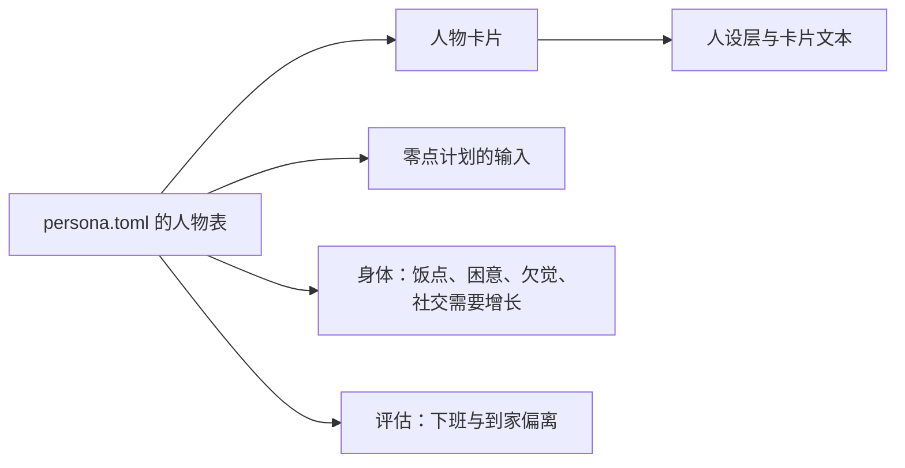
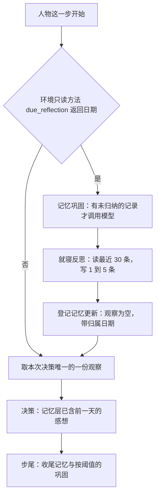

# WorldMock 产品设计说明书 — 人物

## 人物身份与画像

唯一人物来自严格 persona.toml。人物卡片是数据集输入：身份、关系、当前处境、作息、习惯、口味与应对方式
都由数据集作者按[配置](08-configuration.md#configuration-人物声明)的表直接填写。
引擎不读 `background_story` 来填卡片，新建运行不为人物发任何模型请求，也没有缺省值、取整、共识或互相迁就的步骤。
人设原字节摘要是人物输入身份，不使用故事正文摘要替代完整人设身份。

卡片逐字段照搬 persona.toml，不调用模型：身份、关系、当前处境、习惯、口味与应对方式原样进入；
起床、出门、午饭、晚饭、就寝五个必填时段和下班、到家两个可省略的时段各成为一个时间锚点，
没有写的下班、到家是 null，表示没有固定时刻；睡眠中点与每日睡眠需要原样进入。
小时数不取整、不平移、不对 24 取模：`[5.0, 7.0]` 的就寝、与晚饭重叠或早于晚饭的就寝、写成 25.5 的下班，卡片里存的就是这些数。
卡片不检查时间先后，也不检查时段之间的关系；取值只在加载 persona.toml 时按[配置](08-configuration.md#configuration-人物声明)检查一次。
社交需要每小时增长是 persona.toml 的 `social_need_growth_per_hour`，身体直接读它；引擎不给人物打大五分数。
旧 occupation、routine_preference、consumption_preference、risk_preference 顶层字段明确拒绝。

| 用途 | 读什么 |
| --- | --- |
| 人设层、卡片文本 | 由 persona.toml 构造的卡片 |
| 零点计划的人物段 | persona.toml 的姓名、`background_story`、健康习惯、社交风格与午饭、下班、到家、晚饭、就寝时段 |
| 身体：饭点加成、困意、欠觉、社交需要增长 | persona.toml |
| 评估：下班、到家偏离 | persona.toml |

新建运行把卡片的两份派生物写进人物工作区：结构化卡片 `persona_card_struct`（去掉当前处境）供人设层使用，
卡片文本 `persona_card` 供记忆巩固与就寝反思使用。卡片文本是确定性中文渲染，最多 600 汉字，不截断：
加载 persona.toml 时就用整张表构造一次卡片文本，超出的人设表以 `PERSONA_INVALID` 拒绝，
所以 `worldmock validate` 通过的人设表在运行开始时一定写得出卡片；人设层用的字段都在卡片文本里，汉字数不会比它多。
恢复和重放不重新写卡片，只核对一条：工作区里的结构化卡片必须与用冻结的
persona.toml 重新构造出的卡片逐值相等，否则以 `IntegrityError("Restored persona card differs from persona.toml")` 停止。

人设层和卡片文本用同一个函数把小时数写成中文时刻：先取整到分钟再对一天取模，0 分不加，15 分写「一刻」，
30 分写「半」，45 分写「三刻」，其余写「几分」；时段写成「起点到终点」，睡眠需要写成十进制小时。
所以写成 24.5 的时刻显示「0点半」，25.5 显示「1点半」。
零点计划保持 `HH:MM–HH:MM`，分钟的取整规则相同，三处显示同一分钟；身体和评估用原值。

## 提示与工具

人物每次读取已提交世界的七层提示：系统层、工具层、人设层、记忆层、待办层、环境层、进度层。
地点行只显示 location_id 与 name 的私有绑定，不显示地点类型；工具层展示完整显示名和当前实际动作。
功能 app 不成为人物可选择对象；没有登记内容的内容 app 不是可打开的目标，只出现在 `callable_index.prefer_apps` 里。导航、下单与支付 app 的前台区间和通知不进入本人记忆；下单用的 app 写在购买结果的 `channel` 里，查询所在的 app 写在查询的答案里。

生活决策的原生工具共十个，开始工具的参数、槽位与受理见[模拟引擎](04-simulation-engine.md)。

| 工具 | 数量 | 成员 |
| --- | --- | --- |
| 请求工具 | 七个 | start_main_activity、start_side_activity、recall_task_summary、report_status、pause_activity、conclude_activity、revise_day_plan |
| 记忆查询 | 三个 | memory_recent、memory_search、memory_time_range |

世界请求是请求工具里除 recall_task_summary 外的六个；recall_task_summary 和记忆查询只读。
一次回复的工具调用只有三种合法形状，其余组合整批以 `TOOL_CALL_REQUIRED` 纠错，不登记任何世界请求。

| 批次形状 | 内容 |
| --- | --- |
| 只读查询 | 全部是只读工具，个数不限 |
| 一个世界请求 | 恰好一个调用 |
| 开始组 | 恰好两个调用，start_main_activity 与 start_side_activity 各一个，先后不限 |

同一个开始工具两次、开始工具与控制工具同批、世界请求与只读查询同批都不合法。
两条开始调用各自校验参数和名称，全部问题合并成一次纠错；全部通过后按回复中的先后依次登记，
`action_id` 为 `{decision_id}:action:{序号:04d}`，登记完本次决策结束。
最后回合和截断后的那次纠正沿用已有去只读查询规则，只开放世界请求，两个开始工具都在其中；
原生 tool_calls 是唯一可执行模型输出。人物请求不提供运行种子、截止时间、凭据、付款 app 或系统参数。

系统层用规则条目写明：每次决策怎样结束；两个开始工具各填什么，副工具填三项，`prefer` 照工具层 `prefer_apps` 列出的名称写；名称要写完整，`prefer` 只是意向、写得不准不返回候选；在地点做哪件事由人物点名；用内容 app 只是看，买东西只有购买，不知道买什么先查询；两个槽位各放什么；睡眠怎样写；出发前要先结束什么；活动怎样收尾，查询做完自己结束；在地点做的事结束就算做完，只有暂停保留进度；暂停的活动怎样恢复；解饿只有两种办法。规则文字只在系统层写一次，逐字原文只在代码里；工具说明只写用途与参数格式。
讲睡眠的条目写明分钟数的范围、就在当前地点睡且地点须能睡、睡着后到写的时长才再请人物决策、
提醒推送和送达都不叫醒、过去一天睡得太少时可能再多睡二十分钟到一小时，以及 sleep 行的 `note` 只供参考。
人物看不到睡过头的门槛、概率和抽取结果。

工具层动作行固定八个字段，键序 `action, detail, available, reason, price, duration, quantity, note`，
紧凑渲染省略 `null`。`detail` 是调用里要照写的名称：出行行是出行方式名称，购买行和内容 app 行为 `null`，
地点上的 interact 行与 sleep 行见下表。
其他地点（目的地）的目标行下每种出行方式一行，`action` 恒为 `travel`：自带的步行在前，其余按 `travel_method_id` 升序，每个目的地列出全部方式，不轮转、不截断。
出行行的 `price` 是车费的人读写法（免费写「0 元」），`duration` 是按当刻天气算出的用时，`quantity` 为 `null`，`note` 是「轻松」或「费力」；余额不够付车费的方式照样列出并标为不可用。
私有绑定的出行行另带 `travel_method_id`，不进入公开工具层；紧凑渲染的分组键仍是目标类别与动作，全部目的地的出行行落在同一组里，还原后与完整工具层逐值相同。
同一个出行方式名称用于工具层的 `detail`、活动名、环境层路上的位置（键 `travel_method`）和到达句「<时刻> <出行方式名称>到了<地点显示名>」；步行写「步行」，其余写数据集起的名称。
每行的 `available` 与 `reason` 和受理用同一套检查，对只含这一行的一组求值，说明与拒绝原因一字不差。
人物停留在某个地点时，该地点的目标行下为每个内容单元列一条 interact 行（凭状态而未开放的单元除外，见下文「在地点做的一件事」表），完整列出，不轮转、不截断，按单元键升序；
地点标了 `sleepable` 时 sleep 行排在其后。人在路上时不列任何地点的 interact 行，其他地点只列出行；没有单元的地点没有 interact 行。

工具层另有 `callable_index`，两个键。`goods` 是商品品类行，每行的 `category` 就是查询可以写进 `target` 的类别名；它只数地点侧的商品，按类别查询时还会展开只在 app 里卖的商品。`prefer_apps` 是全部下单 app 的完整名称，按 `app_id` 升序；它只取决于冻结目录，整次运行不变，不按此刻营业与否筛选，不轮转，不截断，不参加目标行分组，不进续接的变化比较，容量浓缩不删它；没有下单 app 的环境里是空数组。工具层没有查询的动作行，查询能不能开始在提交之后得知。

| 动作行 | `detail` | `duration` | `note` |
| --- | --- | --- | --- |
| 地点 interact | 单元名原文 | 此刻开始会做多久。能点名的行位置总是零，所以是这条内容的全长，系列是第一集的全长；剩余时长只出现在不可用的行上（正在做，或被本人暂停的活动占着） | 四种说法按「第几集、接着做、供一餐、供一份零食」的先后以「；」相连，都没有为 `null`。系列写「第 N 集，共 M 集」；没做完写「上次没做完，接着做」，只出现在不可用的行上；独立的一件事 `completion_effects.food` 为 `meal` 写「供一餐」，为 `snack` 写「供一份零食」；系列写「第 K 集供一餐」「第 K 集供一份零食」，K 是这个系列里 `food` 为该档位的全部集号，升序，多集以「、」相连，不随做到第几集而变。没有 `food` 的单元不写这两种说法 |
| sleep | `null` | `null` | 睡前提示 |
| 内容 app 的 interact | `null` | 见下表 | 见下表 |

睡前提示按观察时刻欠的觉 h 小时生成，只给半小时一档的时长，不给原值，睡多久由人物自己写。
h 小于 0.25 写「现在不欠觉」，大于 12 写「现在睡，12 小时以上才能补满」；其余取 `floor(h × 2 + 0.5)` 个半小时，
一个写「现在睡，约半小时能补满」，多个写「现在睡，约 X 小时能补满」。提示只取决于身体，这一行此刻不可用时照样显示。

| 在地点做的一件事 | 工具层该单元的行 | 另外出现在 |
| --- | --- | --- |
| 没做过、做完过，或上次被人物结束 | 可用，`duration` 为全长 | 无 |
| 正在做 | 当前地点的每条 interact 行都不可用，原因是槽位 1 被占 | 工具层的活动目标行，带 report_status、pause_activity、conclude_activity |
| 刚结束待收尾 | 每条 interact 行都不可用，原因是先收尾 | 工具层的活动目标行，带 conclude_activity |
| 被本人暂停的活动占着 | 该单元的行不可用，原因点名那项暂停的活动；其他单元的行不受影响 | 待办层 `paused_activities`，带 report_status（恢复）与 conclude_activity |
| 凭状态而未开放 | 不列出 | 无 |

凭状态、未开放的单元照写名称仍由受理拒绝，它不进名称候选，规则见[模拟引擎](04-simulation-engine.md)「出行、内容与查询」。
完成效果不改变列出：行的字段与时长和其他单元相同，`note` 只为 `food` 多出上表那两种说法；完成效果的两项缓解、`consumes_state`、回调状态的数值、
`consume_on_start` 事件和完成效果的证据都不进任何提示层，完成效果体现在饥饿、放松与社交体感上。

活动目标行里每个控制工具各带 `available` 与 `reason`，和受理用同一套判定，说明与拒绝原因一字不差。
进行中的活动离计划结束不足 180 秒时，它的 pause_activity 一行为不可用，`reason` 是
`The activity <活动名> ends in under three minutes and cannot be paused.`，conclude_activity 一行不受影响；
恰好还剩 180 秒仍可暂停，整段不足 180 秒的活动从开始就不可暂停，规则见[模拟引擎](04-simulation-engine.md)。
人物从这一行知道这条限制，系统层不为它新增句子。

登记了内容的内容 app 全部列出；没有登记内容的不列，名称只出现在 `prefer_apps` 里。app 的内容可以带前提，这一行的可用性、时长和推送说明都只在此刻合格的内容里算，合格内容与前提的判定见[模拟引擎](04-simulation-engine.md)。

| 内容 app 的情形 | `available` 与 `reason` | `duration` | `note` |
| --- | --- | --- | --- |
| 至少一条内容合格 | 按其余受理条件 | 会被钉住的推送内容或最近没做完的合格内容的余量；否则合格内容全长的最小值到最大值 | 此刻打开会钉住某条推送时写「有推送：《标题》」，否则 `null` |
| 登记了内容但都不合格 | `false`；`reason` 写明要去的地点显示名和当天的时段，与提交后的拒绝一字不差 | `null` | `null` |

「有推送」只在此刻打开会钉住那条推送时显示：推送指向的内容已不合格，或推送已经释放，都不显示。
系统层不为前提新增句子，`available` 为 `false` 的动作仍可提交，会按 `reason` 拒绝。

同秒续接在上一决策以一个世界请求或一个开始组结束时成链。链对象的 `tool_results` 按调用次序保存一条或两条
`{tool_call_id, result}`，宿主为每个 `tool_call_id` 各追加一条 tool 消息，`changes` 与 `events` 只写在最后一条上。
重建的 assistant 消息带两个 `tool_calls` 时必须是两个开始工具各一个，并与登记的两条动作按次序同名，否则断链。

环境层的身体感觉使用[交换引擎](02-exchange-engine.md)的饥饿、困倦、放松需要与社交需要四项体感。
环境天气直接来自世界事实，模型只能据此叙述，不能写入天气；不使用关键词过滤或第二个模型判定天气真伪。

## 进度、待办与记忆

进度层展示实际活动结算、暂停、计划结束和真实收货。内容短语统一使用实际已消费与总时长，
跨容器恢复读取共享进度。
待办区分暂停活动、已结束待收尾活动和人物记下的个人事务，商品事务只按真实收到的数量累计。

环境对一条开始请求先后写两条结果：受理时写第一条；活动终结时（自然做完、被人物结束、运行截止时截断，或失败）写第二条，`action_id` 仍是开始它的那条动作。
进度层对一条请求只显示最新的一条，所以活动做完之后人物读到的是第二条；凡是要让人物在活动做完后知道的事，都写在第二条里。
系列连播不写中间结果；暂停不产生第二条结果；控制请求和被拒的请求只有一条结果。名称被规整后受理的 `resolved` 和受理时的 `notes` 只写在第一条上。

| 活动 | 第一条结果的明细 | 第二条结果的明细 |
| --- | --- | --- |
| 用内容 app、在地点做事 | `planned`、`content`（开始的那一条内容） | `contents` |
| 购买 | `planned`、`purchases`（报价，行里有 `channel`） | `purchases`（已付或取消，行里有 `channel`） |
| 查询 | `planned` | `query` |
| 出行 | `planned` | `arrival` |
| 睡眠 | `planned` | 空 |

进度层每条记录的结果明细 `result.details` 是闭合对象，键恰为 `purchases`、`planned`、`content`、`contents`、`query`、`arrival`、`recall`、`reason`、`next_step`、`fix`、`items`、`outcome`、`resolved`、`notes`、`errands`，全部可选，没列出的键一律不合格。
购买的每行键依次是 `product`、`quantity`、`channel`、`destination`、`expected_at`，最后是 `price` 或 `paid` 之一。
`content`、`contents` 的形状见[模拟引擎](04-simulation-engine.md)「出行、内容与查询」，`channel` 见[模拟引擎](04-simulation-engine.md)「购买、付款与收货」。

人物读到的查询答案是第二条结果的 `details.query`，有两种形状。查完的形状是 `app`、`scope`、`rows` 和可选的 `omitted`：

| 键 | 取值 |
| --- | --- |
| `app` | 这次在哪个 app 里查的：app 的完整名称，可以照抄进 `prefer`；这几分钟手机上没有 app 时为 null |
| `scope` | 「只列经这个 app 能买的」或「列出全部途径」；`app` 为 null 时一定是后者 |
| `rows` | 各行，次序与答案的机器形式相同 |
| `omitted` | 「还有 N 件没列」，N 是正整数；没列出的件数为 0 时不写这个键 |

`rows` 每行九个键都出现：

| 键 | 取值 |
| --- | --- |
| `product` | 商品的完整名称，可以照抄进购买的 `target` |
| `route` | 「到店」「外卖」「快递」，没有途径的行为 null；「到店」与购买结果 `channel` 里的「到店」是同一个词 |
| `store` | 地点的显示名，分店带全角括号；没有店的行为 null |
| `apps` | app 的完整名称组成的数组，次序同机器形式的 `app_ids` |
| `price` | 金额短语，例如「22 元」 |
| `delivery_fee` | 金额短语，例如「5 元」「0 元」，或 null |
| `expected_at` | 带时区的 ISO 8601 时刻，与购买明细的 `expected_at` 同一写法，快递行是到驿站的时刻；或 null |
| `now` | 「可以下单」或「不可下单」 |
| `reason` | 「不可下单」时是下面六句之一，「可以下单」时为 null |

六句不可下单的原因都是固定文字，花括号处填显示名：「这家店此刻已打烊」「你所在的{地点显示名}就卖这件商品，此刻购买只在所在地点到店完成，不从这家店送」「这家店没有上任何 app，要到店里买」「此刻没有营业的店卖这件商品」「上了这个 app、卖这件商品的店此刻都没有营业」「这个 app 里没有」。
没有查完的形状（提前结束或被截断）恰两个键：`app`，和 `state`「没有查完」。进行中的第一条结果不写 `query`。
答案怎样算见[模拟引擎](04-simulation-engine.md)「出行、内容与查询」，机器形式见[状态与序列化](09-io-formats.md)「世界、人物与活动」。
答案和进度层的其他记录一样，留到这段停留结束；人物出发后这条记录离开进度层，记忆层只留这项活动的结束句，不带答案。

进度层按段记：一段停留，或一段路。每段有一个事件序号的下界：出发那次提交整体归出发前的停留，到达那次推进整体归路上那一段。
用内容 app 或在地点做事的开始请求，它的记录出现在这项活动仍在进行、或在其中结束的每一段里，叫带入的记录。判定只读当前世界和本段已经在读的事件，三条都成立才带入：
活动是本人的 interact 活动；本段下界之后没有开始它的那条请求；它此刻进行中，或本段下界之后有它的第二条结果。
带入的记录形状与本段的记录相同：请求原文，结果取本段里的第二条、没有就取第一条，不带 `self_note`，排在本段最前。
出行、购买的记录不带入；暂停着的活动不带入，从暂停那一刻起离开这一段的进度层、只列在待办层，恢复后重新带入。活动恰在到达那一秒做完时，第二条结果算在路上那一段，到达后的停留里不带入。

在地点做的事提前结束后，记忆层的结束句不写「（《某某》未完）」那半句，做到头的各集标题照写；用内容 app 的结束句照旧写这半句。

记忆层只投影本人已提交的实际活动、真实收货和明确自述。导航、下单与支付 app 的前台区间，支付通知与订单通知，
地点停留记录，回调点事实与系统账本不是人物消费记忆，也不进进度层和其余提示层；人物从购买结果的 `channel` 知道下单的 app，记忆层与零点计划的购买句不写渠道。
记忆查询与回看任务只读，不推进时间或产生新事实；查商品是一项活动，见[模拟引擎](04-simulation-engine.md)「出行、内容与查询」。
零点计划输入里「已核验经历」的内容经历句，先写起止时刻，再写这项活动的写法，例如「9月28日 19:52–9月28日 19:53 使用哔哩哔哩《散步装备准备》」；写法取[记录引擎](05-recording-engine.md)「显示写法与检查工具」的表。到达句、收货句不变。
主观快照必须对应当前可见身体、目标、个人事务或环境证据，真实经历必须引用本人合法源事件。

就寝反思是人物一侧的一次独立模型调用：读人物最近 30 条自己写下的记录，写出 1 到 5 条感想存进记忆。
它每个本地日只在当天第一次睡醒时做一次，回顾前一天，做完才做这一天的第一次决策。
睡醒指本人的一段睡眠在自己的计划结束时结束，被运行终点截断的睡眠不算；本地日按运行时区的零点分，
恰在 00:00:00 的时刻属于新的一天。判定是一个只读世界状态的函数，按次序看三件事，都成立才触发：

| 次序 | 条件 | 不成立的例子 |
| --- | --- | --- |
| 1 | 这一秒还没有提交过一轮决策（`last_decision_time` 不等于当前时刻） | 睡醒那一秒的第二次决策 |
| 2 | 本人有一段已完成的睡眠，结束时刻恰是当前时刻 | 运行开始；睡眠被运行终点截断 |
| 3 | 本人没有另一段已完成的睡眠结束在同一个本地日 | 当天午睡醒来 |

触发时给出归属日期和所属睡眠：归属日期是睡醒所在本地日的前一天，不看这段睡眠多长、几点入睡、在哪睡。
通宵之后下午补的一小觉若是当天第一次睡醒也触发；整天没睡的那天没有反思，下一次睡醒时读到的最近 30 条记录一并回顾。
初始化不反思。人物的记忆里一条记录都没有时不调用模型，这一天就没有反思，当天之后的睡醒也不补。

记忆层把登记了归属日期的感想放进 `earlier_days` 里那个日期的条目，形状是 `{"activity": null, "text": 感想}`，
仍只显示日期早于今天的条目，所以感想从登记后的第一次决策起就显示，直到被 8000 字符窗口裁掉；裁剪先删最旧日期的感想。
一个本地日至多一次反思，每个日期下至多 5 条感想。写入点含 `reflection` 而没有归属日期的记忆更新以
`IntegrityError("Bedtime reflection has no filing date")` 拒绝。
反思与人物自述分开记录，不能根据自述补造活动、目标进展、付款或世界天气。
删除自然语言目标自动进展、自动完成字段与奖励；计划仍由人物明确修改和提醒控制。

## 宿主模型协议

原生 AgentSociety2 客户端承载生成模型调用。实际服务元数据提供总上下文容量和输出上限；
发送前上下文适配及输出上限均使用冻结实际元数据，没有静态模型容量表。
人物一次决策每个模型回合的输出上限是引擎固定的 16,000 与实际服务输出上限中较小的一个，思考与回答共用；只读问答、截断后的那次重试、记忆巩固与就寝反思用同一个数，零点计划用自己的 8,000。这个数是引擎固定值，不在 `config.toml` 里。
普通失败和传输失败只消耗对应的一种预算，底层隐式重试关闭；身份或参数错误立即失败。
协议纠错与输出截断纠正均与 dispatcher 重试分别计数。截断的错误日志只在真实出现截断回合时写。
所有身份、预算和卡片在工作区与运行清单冻结，恢复必须逐项一致。

人物的一步按反思阶段、观察、决策、步尾四段进行，一次决策恰有一份冻结观察。

反思阶段先在有未归纳的记录时做一次记忆巩固，原因文字为 `daily reflection`，再做就寝反思；
这个阶段不重写 `MEMORY.md`，巩固出的摘要由同一步的步尾照常渲染；它只登记来源为就寝反思的条目，
感想被存储并进人物此前自己写下的相似记录时，这一次没有可登记的感想。步尾同样只登记来源不是就寝反思的条目，
收尾记忆被并进此前相似的感想时不作为收尾条目登记。步尾不再反思，也不再因睡眠而强制巩固，
小睡醒来不巩固；锁定的 AgentSociety2 仍向步尾传 `sleep_boundary`，LifeAgent 不覆写取值钩子，这个值恒为假且没有读者。
反思阶段的模型调用身份是 `{decision_id}:reflection:{序号四位}:attempt:1`，序号从 0001 起，
不占用也不重置决策的模型回合计数，所以不消耗回合上限，也不与决策回合的调用身份重复；请求与响应照常逐次留证。
这些请求只带 `submit_reflection` 或不带工具，不是行动请求，不触发 `decision_started`，也不会被读成世界请求的自述。
反思输出在校验重试耗尽后仍不合合同是运行故障：这一步抛出，决策轮中止，不写入任何感想。
