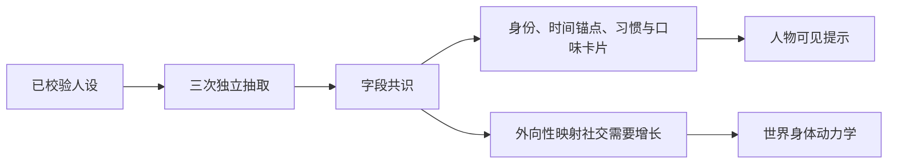

# WorldMock 产品设计说明书 — 人物

## 人物身份与画像

唯一人物来自严格 persona.toml。人设原字节摘要是画像输入身份，不使用故事正文摘要替代完整人设身份。
画像的实际服务、模型容量与重试预算来自[运行配置](08-configuration.md)。

画像抽取使用真实配置客户端；每次结构错误纠正是新的逻辑请求，服务失败由 dispatcher 的两种独立预算处理。
三次一致性抽取不算传输或普通重试。纯编译函数只消费已校验人设和实际抽取共识结果，确定性装配卡片与动力学。
卡片包括身份、关系、当前处境、时间锚点、习惯、口味与应对方式；确定性中文渲染最多 600 汉字。
旧 occupation、routine_preference、consumption_preference、risk_preference 字段明确拒绝。

大五分数只用于世界侧动力学。当前只映射外向性到社交需要每小时增长：
`0.06 + 0.04 × ((score - 4) / 3)`，按 0.01 步长取值并限于 0.02 至 0.10。
删除情绪、健康行为奖励、聊天接受率及消息回复倾向的旧映射；分数和系数不进入人物提示。

人设声明的七个作息值（午饭、晚饭、下班、到家、就寝五个时段，睡眠中点和每日睡眠需要，取值范围见
[配置](08-configuration.md#configuration-人物声明)）原样写进卡片，不取整；没有声明的值保持模型读出的结果。
模型读出的值只在抽取入口取整：时段到半小时，长度不到半小时的时段向外取整，睡眠中点与睡眠需要到一刻钟；
卡片模型自身不检查格点，只检查范围、起点小于终点、跨度不超过 12 小时和时间先后。
声明的时段按午饭、下班、到家、晚饭、就寝的次序反复尝试写入，直到没有时段能再落下；就寝起点小于它前面的时间时按次日存，
卡片里起点和终点都加 24，加完终点不得超过 30。写不进卡片的时段保留卡片原值并记 `CARD_FIELD_CONFLICT`
（`reason` 固定为 `anchor_order`），运行照常进行；这是唯一的例外：人设层、卡片文本和评估读卡片里的值，
零点计划和身体仍读声明值。写不进卡片有两种情形：声明的时段与模型读出的时间排不进同一天；
就寝按次日存时终点越过次日 06:00（例如 `[5.9, 7.0]`），这样的声明能通过加载但进不了卡片。
卡片值确实改变的字段各记一条 `CARD_FIELD_OVERRIDDEN`。
同一份声明再写一次卡片不变；恢复运行时据此核对，比较的是未取整的值。

人设层和卡片文本用同一个函数把小时数写成中文时刻：先取整到分钟再对一天取模，0 分不加，15 分写「一刻」，
30 分写「半」，45 分写「三刻」，其余写「几分」；时段写成「起点到终点」，睡眠需要写成十进制小时。
零点计划保持 `HH:MM–HH:MM`，分钟的取整规则相同，三处显示同一分钟；身体和评估用原值。
编译产物的结构版本是 5，其他版本直接拒绝；抽取提示版本仍是 `card-v4`。

## 提示与工具

人物每次读取已提交世界的七层提示：系统、人设、身体、进度、待办、环境、记忆。
地点行只显示 location_id 与 name 的私有绑定，不显示地点类型；工具展示完整显示名和当前实际动作。
功能 app 不成为人物可选择对象，自动系统触点不进入本人记忆。

环境工具为 start_activity、report_status、pause_activity、conclude_activity、revise_day_plan、
recall_task_summary；query_world 是只读环境查询。原生宿主的记忆查询独立保留。
最后回合和截断后的那次纠正沿用已有去查询规则，原生 tool_calls 是唯一可执行模型输出。
人物请求不提供运行种子、截止时间、凭据、付款 app 或系统参数。

身体层使用[交换引擎](02-exchange-engine.md)的饥饿、困倦、放松需要与社交需要四项体感。
环境天气直接来自世界事实，模型只能据此叙述，不能写入天气；不使用关键词过滤或第二个模型判定天气真伪。

## 进度、待办与记忆

进度层展示实际活动结算、暂停、计划结束和真实收货。内容短语统一使用实际已消费与总时长，
跨容器恢复读取共享进度；纯目录浏览不伪装成内容消费或等待经历。
待办区分暂停活动、已结束待收尾活动和人物记下的个人事务，商品事务只按真实收到的数量累计。

记忆层只投影本人已提交的实际活动、真实收货和明确自述。自动导航 app、支付通知、回调点事实与系统账本
不是人物消费记忆。查询只读，不推进时间或产生新事实。
主观快照必须对应当前可见身体、目标、个人事务或环境证据，真实经历必须引用本人合法源事件。

就寝反思只由当轮刚按计划结束的睡眠触发。初始化不反思，旧睡眠不为新反思提供依据。
反思与人物自述分开记录，不能根据自述补造活动、目标进展、付款或世界天气。
删除自然语言目标自动进展、自动完成字段与奖励；计划仍由人物明确修改和提醒控制。

## 宿主模型协议

原生 AgentSociety2 客户端承载生成模型调用。实际服务元数据提供总上下文容量和输出上限；
发送前上下文适配及输出上限均使用冻结实际元数据，没有静态模型容量表。
普通失败和传输失败只消耗对应的一种预算，底层隐式重试关闭；身份或参数错误立即失败。
协议纠错、输出截断纠正、三次抽取共识均与 dispatcher 重试分别计数。
所有身份、预算和卡片在工作区与运行清单冻结，恢复必须逐项一致。
