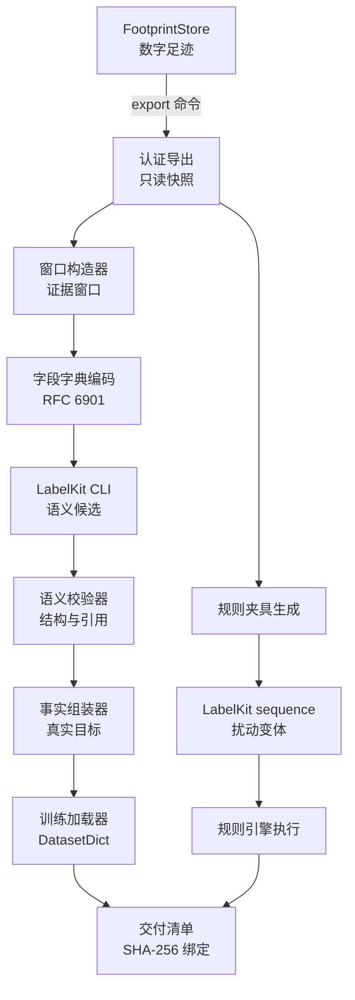
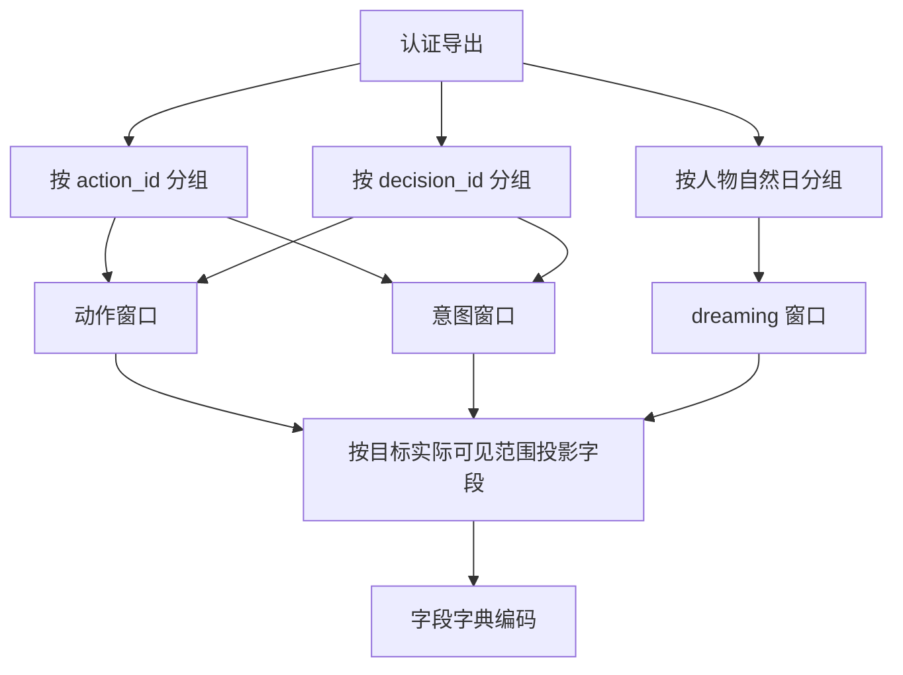
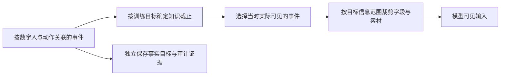
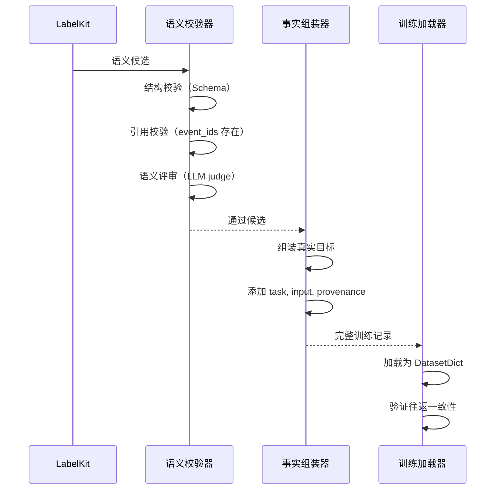
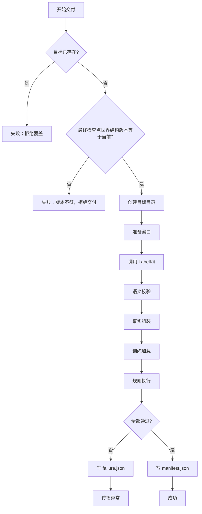
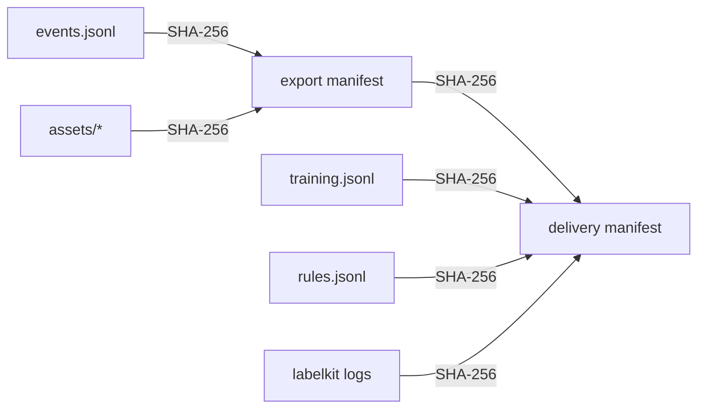
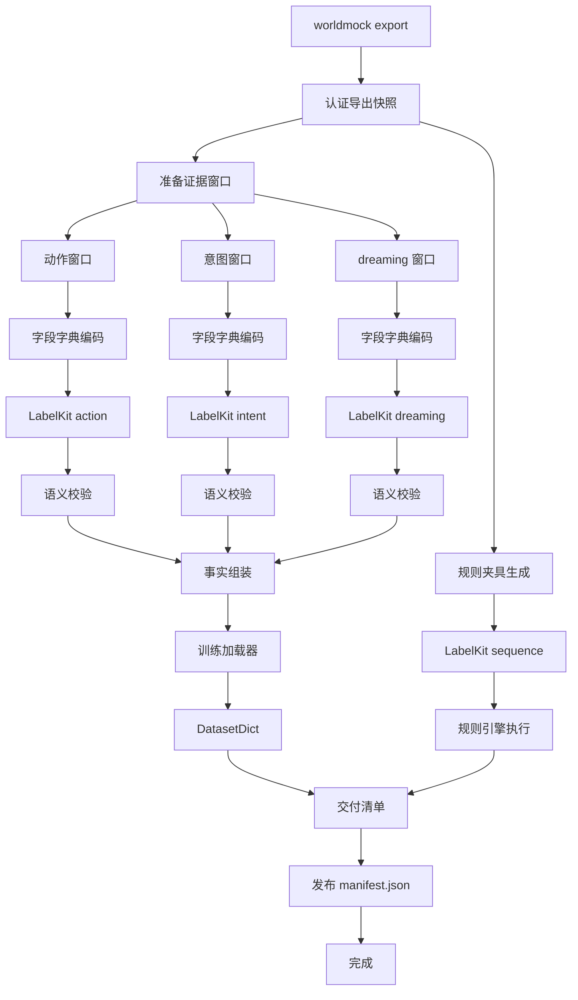

# WorldMock 产品设计说明书 — 数据交付

> **状态**：DRAFT；按人物 Prompt 规格修订，修订部分已实现（证据见[人物 Prompt 验收记录](../dev/persona-prompt-verification.md)）；按一日运行保真规格同步（一日运行保真 DL1），已实现；按[个人事务与工作安排规格](../dev/SPEC-errands-workday.md)分阶段同步（[实施计划](../dev/research/errands-workday-implementation-plan.md) D6 作业），已随代码落地到阶段 1–4  
> **工具交互修订**：按[工具交互规格](../dev/SPEC-tool-interaction.md)冻结本次设计；本次修订已实现，历史验收不覆盖新的请求、查询与错误证据。
> **日期**：2026-10-03
> **版本**：v1.13
> **目标读者**：算法工程师、开发工程师

## 1. 模块概述

### 1.1 职责与边界

数据交付模块（Delivery）负责将数字足迹转换为 LabelKit 训练数据与规则夹具，是 WorldMock 与外部数据消费者的唯一边界。

**职责**：
- 从认证导出构造证据窗口（动作、意图、dreaming）
- 字段字典编码：无损压缩重复证据字段
- 调用独立 LabelKit CLI 生成语义候选
- 组装事实目标：真实动作、时间、来源
- 执行真实训练加载器与规则引擎校验
- 发布原子性交付清单：绑定全部输入输出文件

**边界**：
- 不读取运行中数据库（只消费认证导出快照）
- 不修改原始事件（导出保持只读）
- 不自动裁剪输入（超限明确失败）
- 不补造校验失败结果（失败即失败）
- 不单独交付未完整产物（发布清单前全部校验通过）

### 1.2 与其他模块的关系



### 1.3 核心设计原则

| 原则 | 含义 | 体现 |
| --- | --- | --- |
| **只读快照** | LabelKit 永不读取运行中数据 | 导出是认证的不可变快照 |
| **原子性发布** | 全部校验通过才写成功清单 | 失败写 failure.json 并传播异常 |
| **事实权威** | 真实动作时间来自环境 | LabelKit 只生成语义候选 |
| **来源关联** | 每个样本绑定事件与运行 | 支持溯源与连通组划分 |
| **fail-fast** | 超限或不一致立即失败 | 不静默截断，不补造结果 |

## 2. 接收记录引擎导出

记录引擎负责固定截止、事件与素材导出、共同检查点和导出完整性认证，
格式与发布流程统一见[记录引擎的固定截止导出](05-recording-engine.md#固定截止导出)。
交付模块只消费认证快照；不完整导出用于诊断，不能进入正式交付。
交付先核对导出最终检查点的 `state.schema_version` 等于当前 `WORLD_SCHEMA_VERSION`（9），不符即拒绝，不构造窗口；世界结构 8 的导出按版本不符拒绝。
交付不再重新渲染已存观察：窗口按观察事件中保存的层数据与实际请求投影，旧结构的观察不能按新形状解释。交付清单 `schema_version` 为 2。

工具交互产物按已验收阶段认证实际身份：任务阶段发布场景结构 4，供给价格形状变化时发布地图结构 3、品类与规则绑定 3及新目录。
错误接口、查询和提示派生不会强制所有数据升版；工具交互各阶段的世界结构为 8。后续目录内容改动另发版本，不改写已发布身份。
交付必须核对认证导出中实际冻结的上述身份、代码、输入和两个提示指纹，不通过同世界结构版本来放行旧接口产物。
两份种子地图分别追溯其原场景种子与类别声明哈希，不能在交付阶段改价、补货或合成缺失通知。

[个人事务与工作安排规格](../dev/SPEC-errands-workday.md)的产物同样按阶段认证实际身份：阶段 2 世界结构 9、质量报告结构 4，
工具模板与提示两个指纹随之变化；阶段 3 场景结构 5、卡片结构 3，提示指纹与仓库三份场景的 `scenario_sha256` 随之变化；
阶段 4 只变工具模板指纹与代码身份。
交付核对认证导出中实际冻结的身份，不以旧世界结构的导出放行。

交付从下面的证据窗口开始，训练记录和规则夹具属于 LabelKit 加工产物。

## 3. 证据窗口

### 3.1 三类窗口

| 窗口类型 | 知识截止 | 边界 | 用途 |
| --- | --- | --- | --- |
| **动作窗口** | 动作请求前最后观察 | `action_requested` 事件前 | 训练下一动作预测 |
| **意图窗口** | 动作结果已可见 | 包含可见结果事件 | 训练意图识别 |
| **dreaming 窗口** | 人物自然日结束 | 按当日 00:00-23:59 | 训练经验归纳与反思 |

### 3.2 窗口构造流程



### 3.3 动作窗口提取规则

动作窗口读取目标动作前实际发送给该人物模型的请求作为 prompt（选取规则见下表「实际 prompt」行），
包含当时的 system、user、工具定义与消息历史；同秒续接的请求另含本秒前序决策的原生 assistant 与 tool 消息。
不能从结构化观察推测人设层或记忆层。
人物请求中的 `start_activity.items[]` 原样保留每项 `target`、`way`、`from`、`to`，不新增或推测 `actions`，不读取旧平行数组。
实际请求内的 `query_world`、`recall_task_summary` 和记忆查询的模型与 tool 交换原样保留（`query_world` 的六键请求含 `from`、
`available_only`，筛选后的合法空页照原样留证），
但它们不生成世界请求或活动，不能作为动作窗口的目标动作或 `target.outcomes` 中的执行结果。
查询成功返回的 `matches` 不再逐项附候选；两种查询参数错误里的候选 `{tool, arguments, note}`（换了 `from` 的完整 `query_world` 请求，
或把渠道称呼从 `name` 移到 `from` 的完整请求）和完整位置数组 `path`、`allowed_values`、`expected` 是当时可见的反馈，
不能改写成已接受、已付款或已完成；错误输出保持英文，中文对象名称保留原文。
意图窗口沿用这一真实请求，并可包含截止前已经发生且实际可见的动作与结果。
原请求事件身份和 canonical 摘要进入来源索引；请求缺失、跨人物、跨决策或与目标动作不匹配时失败。
同一窗口的事件必须归属同一数字人，并满足知识截止。私有事件与字段的边界遵循
[交付规格](../dev/SPEC-labelkit-delivery.md)和[记录引擎设计](05-recording-engine.md)「来源与可见性」。



| 检查层次 | 规则 |
| --- | --- |
| 事件可见性 | 动作与意图输入排除私有事件集（模型请求、模型响应、记忆更新与 `decision_started`，`PRIVATE_EVENTS`）；回复正文 `self_note` 作为实际请求的一部分进入动作与意图输入，并进入 dreaming 输入；`conclude_activity` 各项的 `memories` 与 `views` 属记忆写入，意图与 `dreaming` 输入中控制工具请求事件的投影经 `control_items` 只留每项的 `activity_name` 与 `summary`（实际请求原文照原样保留，见 3.4 节），投影恒不带请求级的 `errands`（与 `items[].memories`、`items[].views` 同等对待：投影函数签名不变，由用例逐项守住而不是靠白名单遗漏，投影写进新字典，原事件不被原地修改） |
| 身体字段可见性 | 同一观察中，体感分级可供数字人理解处境；`body.values` 和 `motivation_internal` 只保留在内部证据中 |
| 结算字段可见性 | `body_settlement` 等内部身体变化不能因所在事件标为 `agent` 就整体复制到输入；只提供当时实际呈现的结果 |
| 实际 prompt | 只从本人行动阶段的 `model_request` 提取模型可见消息与工具：取同人物、同决策、目标动作之前最后一份 `phase=request`、不带 `purpose` 的请求，并核对其 `tools` 含该动作的工具名；不满足是完整性故障，不回退到更早的请求（截断后关闭思考、`tool_choice=required` 的重试请求照此被选中）；就寝反思请求只带 `submit_reflection`、晚于动作登记，不会被选中，含反思的决策其窗口 prompt 仍是行动请求；同秒续接中本秒前序 assistant 的 `reasoning_content` 作为实际请求的一部分原样保留（[接口合同「窗口声明与字段字典编码」](../CONTRACTS.md#窗口声明与字段字典编码)），窗口的其他事件与目标不额外混入；私有工作评审请求、响应及 reasoning 不进输入或目标；零点计划的请求带 `purpose="plan_day"`，不作窗口 prompt |
| 前置状态 | 当观察已经出现在窗口事件中，只保留前置观察引用，不复制整份 `events[0].data` |
| 目标结果 | 只收该动作公开结算事实；私有 `model_request`、`model_response` 和记忆更新不得成为 `target.outcomes`；动作窗口的目标保留完整请求（含 `conclude_activity` 各项的 `memories`、`views` 与三个控制工具请求级的 `errands`）；六种个人事务事件（`errand_registered`、`errand_updated`、`errand_cancelled`、`errand_progressed`、`errand_completed`、`errand_reminded`）的决策与动作身份都为空，只经 `caused_by` 关联，不属于任何动作或决策的分组，不进入任何窗口的 `target.outcomes`，他人动作触发的办成事件也不落进对方决策的分组；人物可见的 `errand_completed`、`errand_reminded` 作为进度层来源展开或作为 dreaming 窗口事件出现时，`environment_event` 在输入侧的公开投影仍为空对象；记忆更新事件仍不进 `target.outcomes` |
| 查询证据 | 世界查询与任务回看的真实交换可在实际 prompt 中出现；不得把查询命中、候选请求或拒绝备忘投影为已执行世界动作；只读工具无需动作结算事件 |
| 来源关联 | 裁剪后的输入保留原事件引用，完整事实与内部数值仍可用于审计；不得据此向模型补充隐藏状态 |

事件的 `visibility` 标记不能代替字段级投影。进入 LabelKit 的具体信息范围以训练目标为准，
不得默认下游设备能够读到内部身体数值。投影后的内容再进行字段字典编码，不能靠编码隐藏敏感字段。

窗口构造以公开字段投影和实际 prompt 来源双重核验：结构化观察中即使保存了菜单、
内部身份或可供性合同，也不能把原始 `data` 整棵复制进训练输入。
测试必须证明禁用字段、重复前置状态和私有工作评审请求均不泄漏，且人设层、记忆层、环境层与所选实际请求一致。

### 地图与门店供给的证据窗口

购买动作按供给身份绑定门店、卖方和当时报价，同时保留商品身份供已交付物品及消费解释。
地点发现的筛选、实际结果和后续选择按真实事件先后进入窗口，不用当前地图目录补写历史查询结果。
只纳入人物实际收到的路线、营业、资格、报价和供给库存，隐藏库存、未呈现供给、未来报价及未来营业声明不进入训练输入。
真实地点来源与供给假设分别保留；地图版本、摘要、逐来源许可及通知从认证导出传递到交付清单。
来源完整只证明可追溯，公开交付的许可适用仍按具体来源、组合与使用方式判断。


### 3.4 dreaming 窗口提取规则

离线 Dreaming 由数据交付负责：从认证导出构造经历窗口，通过 LabelKit 生成经历归纳、反思或假设推演。
材料按场景时区与人物自然日组织，保留来源事件和知识截止，不混入未来经历；
dreaming 读回复正文 `self_note` 与实际请求中的层 JSON，不再读决策自述与 `scene`；排除的私有事件与动作、意图任务相同
（`DREAMING_PRIVATE_EVENTS` 等于私有事件集）。窗口内每个动作请求取同人物、同决策、动作前最后一份不带 `purpose` 的实际请求（与动作窗口
同一选取规则与 prompt 权威，见 3.3「实际 prompt」行），把其首个 user 的六层 JSON 连同该动作请求的事件身份写入 `input.decision_layers`（`[{action_event_id, layers}]`），
请求事件身份与层 JSON 的 canonical SHA-256 写入 `provenance.decision_layer_sources`（`[{event_id, sha256}]`），请求事件也进入
`provenance.source_event_ids`；实际请求缺失或首个 user 不是层序正确的六层 JSON 时明确失败（字段见
[接口合同「窗口声明与字段字典编码」](../CONTRACTS.md#窗口声明与字段字典编码)）。窗口事件中三个控制工具的动作请求经 `control_items`
读出，只接受现行 `items` 形状，投影只留每项的 `activity_name` 与 `summary`，裁去 `items[].memories` 与 `items[].views`，也恒不带请求级的 `errands`；
旧控制形状不读取、不迁移，缺 `errands` 键的控制请求同样按旧形状以完整性故障拒绝，认证来源不满足当前工具与提示身份时拒绝交付。
`decision_layers` 是模型实际收到的原文，照原样保留，其中可以含有进度层参数或记忆层 `self_notes` 里的常规收尾记忆原文，待办层也照原样含未完成的个人事务。
重演分支的 dreaming 窗口按同一规则附上层 JSON。生成结果默认不写回运行中的人物。
零点计划的模型交换与 `day_plan_generated` 登记（系统可见）不进任何窗口；个人事务的 `errand_registered`、`errand_updated`、
`errand_cancelled`、`errand_progressed` 同为系统可见，不作 dreaming 窗口事件；`errand_completed` 与 `errand_reminded` 为人物可见，
作为当日事件进入 dreaming 窗口、公开投影为空对象；就寝反思的模型交换属私有事件集。零点及其后的事件归入新一日。

| 结果 | 证据与标记 |
| --- | --- |
| 经历归纳或反思 | 引用已发生且符合知识截止的经历；归纳结果不改变原始事实 |
| 模型想象的反事实 | 明确假设，使用原世界证据；`world_kind=observed`、`environment_replay=null` |
| 实际重新仿真的反事实 | 父检查点、新分支、干预、实际结果与最终检查点均通过认证，才可标为 `world_kind=resimulated` |

需要真实反事实结果时，由[模拟引擎执行明确的反事实运行](04-simulation-engine.md#9-恢复与反事实运行编排)，
记录引擎保存分支并认证导出。交付通过 `deliver --replay-export` 消费完成的分支；
父检查点前历史、分支身份、干预摘要和可见来源必须对应，生成文本或分支文件名不能代替实际执行证据。
字段定义见[反事实与重演字段](../CONTRACTS.md#反事实与重演字段)。

```python
def _dream_windows(events: list[dict], manifest: dict) -> list[dict]:
    """按人物自然日构造 dreaming 窗口
    
    每个窗口包含：
    - 当日全部人物可见事件（DREAMING_PRIVATE_EVENTS 等于私有事件集）
    - action_requested 中的 self_note（人物自述，未经核验）
    - 实际行动请求中的层 JSON：input.decision_layers，来源写 provenance.decision_layer_sources
    """
    by_agent_day = defaultdict(list)
    for event in events:
        if event["agent_id"]:
            day = datetime.fromisoformat(event["occurred_at"]).date()
            by_agent_day[(event["agent_id"], day)].append(event)
    
    windows = []
    for (agent_id, day), day_events in by_agent_day.items():
        # 只取人物可见事件，并过滤 dreaming 不可见的私有事件
        visible = [e for e in day_events
                   if e["visibility"] == "agent"
                   and e["event_type"] not in DREAMING_PRIVATE_EVENTS]
        window = _record("dreaming", visible, {}, manifest, {})
        windows.append(window)
    
    return windows
```

## 4. 字段字典编码

### 4.1 编码目标

重复出现的证据字段值（如同一窗口内多次观察中没有变化的记忆层、待办层）占用大量字节，字段字典编码通过 RFC 6901 JSON Pointer 实现无损压缩。

**编码原则**：
- 只在单个窗口内共享字段值
- 使用 canonical JSON 字节计算收益
- 收益不足时保留原值、清空字典
- 解码后必须字节相同

### 4.2 编码示例

候选只取窗口内 `observation` 事件 `data` 的顶层字段（观察只提供原样保存的工具层、待办层、环境层与记忆层，见 3.3 节）；
同字段同完整值出现两次以上、且按 canonical JSON 字节计算有收益时才进字典。下例是同一窗口内两次观察的记忆层没有变化：

**原始输入**（两次观察的 `memory_layer` 相同）：
```json
{
  "events": [
    {"event_id": "e1", "event_type": "observation",
     "data": {"memory_layer": {"layer": "记忆层", "earlier_days": [], "earlier_today": [{"recorded_at": "2026-01-05T08:40:00+08:00", "settled": ["07:30 收到王磊的消息：帮我带份早饭"], "self_notes": []}]}}},
    {"event_id": "e4", "event_type": "observation",
     "data": {"memory_layer": {"layer": "记忆层", "earlier_days": [], "earlier_today": [{"recorded_at": "2026-01-05T08:40:00+08:00", "settled": ["07:30 收到王磊的消息：帮我带份早饭"], "self_notes": []}]}}}
  ]
}
```

**编码后**：
```json
{
  "events": [
    {"event_id": "e1", "event_type": "observation",
     "data": {"memory_layer": {"value_pointer": "/observation_value_dictionary/0/value"}}},
    {"event_id": "e4", "event_type": "observation",
     "data": {"memory_layer": {"value_pointer": "/observation_value_dictionary/0/value"}}}
  ],
  "observation_value_encoding": {
    "kind": "rfc6901_field_dictionary",
    "schema_version": 1,
    "standard": "RFC 6901",
    "rule": "Each observation data field whose value is an object containing only value_pointer is replaced by the complete value at that RFC 6901 pointer in this input.",
    "decoded_input_sha256": "abc123..."
  },
  "observation_value_dictionary": [
    {
      "field": "memory_layer",
      "sha256": "def456...",
      "value": {"layer": "记忆层", "earlier_days": [], "earlier_today": [{"recorded_at": "2026-01-05T08:40:00+08:00", "settled": ["07:30 收到王磊的消息：帮我带份早饭"], "self_notes": []}]}
    }
  ]
}
```

字典项的 `sha256` 是 `[field, value]` 的 canonical 摘要；没有可共享的值时编码声明照写、字典为空数组，字段保留原值。

### 4.3 编码算法

```python
def encode_model_input(input_data: dict) -> dict:
    """为一个完整逻辑窗口生成确定性模型输入表示
    
    1. 收集候选：遍历 observation 事件 data 的顶层字段值
    2. 计算收益：重复值总字节 vs 字典项 + 指针总字节
    3. 选择有利：只共享收益为正的字段值
    4. 渲染编码：替换为 value_pointer
    5. 验证往返：decode 后必须与原输入 canonical JSON 相同
    """
    candidates = _collect_candidates(input_data)
    selected = _select_profitable_candidates(candidates)
    encoded = _render_encoding(input_data, candidates, selected)
    
    # 收益不足时保留原值：编码声明照写，字典为空数组，字段不替换
    literal = _render_encoding(input_data, candidates, ())
    if len(canonical_json(encoded)) >= len(canonical_json(literal)):
        encoded = literal
    
    # 验证往返
    decoded = decode_model_input(encoded)
    assert canonical_json(decoded) == canonical_json(input_data)
    
    return encoded
```

### 4.4 解码校验

```python
def decode_model_input(encoded: dict) -> dict:
    """严格解析单跳字段引用并恢复完整逻辑窗口
    
    校验规则：
    - 字典项摘要必须匹配
    - 指针只能出现在 events[].data 字段
    - 不允许嵌套引用
    - 所有字典项必须被使用
    - 解码后摘要必须匹配 decoded_input_sha256
    """
    dictionary = encoded["observation_value_dictionary"]
    result = copy.deepcopy(encoded)
    used = set()
    
    for event in result["events"]:
        for field, value in event["data"].items():
            if isinstance(value, dict) and "value_pointer" in value:
                # 解析 /observation_value_dictionary/N/value
                index = _parse_pointer(value["value_pointer"])
                entry = dictionary[index]
                
                # 校验摘要
                actual_sha256 = hashlib.sha256(canonical_json(entry["value"]).encode()).hexdigest()
                if actual_sha256 != entry["value_sha256"]:
                    raise IntegrityError("Dictionary entry digest mismatch")
                
                event["data"][field] = entry["value"]
                used.add(index)
    
    # 校验所有字典项被使用
    if used != set(range(len(dictionary))):
        raise IntegrityError("Unused dictionary entries")
    
    result.pop("observation_value_encoding")
    result.pop("observation_value_dictionary")
    
    return result
```

## 5. LabelKit 集成

### 5.1 项目配置结构

```
labelkit-projects/
├── config.toml            # 全局配置：LLM、并发、超时
├── action.toml            # 动作任务配置
├── intent.toml            # 意图任务配置
├── dreaming.toml          # dreaming 任务配置
├── rules.toml             # 规则夹具生成配置
├── schemas/               # JSON Schema 定义
├── data/                  # 输入数据（运行时生成）
└── out/                   # 输出结果（运行时生成）
```

### 5.2 config.toml 示例

```toml
schema_version = 1

[tool]
log_level = "info"
log_format = "text"

[llm.default]
provider = "openai_compatible"
base_url = "https://api.deepseek.com"
model = "deepseek-flash"
api_key_env = "DEEPSEEK_API_KEY"
max_concurrency = 12
timeout_s = 180
max_output_tokens = 131072
context_window = 1000000
temperature = 0.3

[llm.judge]
provider = "openai_compatible"
base_url = "https://api.deepseek.com"
model = "deepseek-flash"
api_key_env = "DEEPSEEK_API_KEY"
max_concurrency = 12
timeout_s = 360
temperature = 0.0
thinking = "enabled"
```

### 5.3 任务配置示例（action.toml）

```toml
schema_version = 1

[run]
input = "./data/action.jsonl"
output = "./out/action.jsonl"
modality = "text"
mode = "process"
batch_size = 16

[input]
text_field = "input"

[dedup]
enabled = false

[annotate]
enabled = true
llm = "default"
instruction = """
根据动作发生前的可见历史，归纳此时的需求与不确定性。
不能知道尚未发生的下一动作，不猜测隐藏结果。
代码负责真实下一动作和参数。
仅输出 target 中的 claims、intent_candidates 和 uncertainty。
"""

[verify]
enabled = true
llm = "judge"
policy = "repair"
max_repair_rounds = 3

[trace]
enabled = true
channels = ["llm", "verify", "schema"]
content = "full"
```

### 5.4 调用流程

```python
def run_labelkit(task: str, workspace: Path, project_root: Path) -> dict:
    """调用独立 LabelKit CLI，凭据只通过环境变量传递
    
    :param task: 任务名（action/intent/dreaming/rules）
    :param workspace: 工作目录（含 config.toml 和任务 toml）
    :param project_root: 项目根目录
    :return: 执行回执（退出码、耗时、配置哈希）
    """
    # 按平台取 LabelKit 独立环境里的入口
    binary = (project_root / "vendor/labelkit/.venv/Scripts/labelkit.exe" if os.name == "nt"
              else project_root / "vendor/labelkit/.venv/bin/labelkit")
    command = [
        str(binary), "run",
        "--config", str(workspace / "config.toml"),
        "--project", str(workspace / f"{task}.toml"),
        "--strict", "--console", "plain"
    ]
    
    # 加载凭据：凭据文件只有 DEEPSEEK_NODE_KEYS，取逗号分隔的第一段作为子进程的 DEEPSEEK_API_KEY
    credentials = dotenv_values(Path.home() / ".config/worldmock/deepseek.env")
    pool = credentials.get("DEEPSEEK_NODE_KEYS")
    first_key = pool.split(",")[0].strip() if isinstance(pool, str) else ""
    if not first_key:
        raise IntegrityError("DEEPSEEK_NODE_KEYS is required for LabelKit delivery")
    environment = dict(os.environ)
    environment["DEEPSEEK_API_KEY"] = first_key
    
    # 执行
    started = time.monotonic()
    result = subprocess.run(command, env=environment, check=False)
    
    if result.returncode != 0:
        raise IntegrityError(f"LabelKit {task} exited with status {result.returncode}")
    
    # 返回回执
    return {
        "exit_code": result.returncode,
        "wall_seconds": round(time.monotonic() - started, 3),
        "project_sha256": hashlib.sha256((workspace / f"{task}.toml").read_bytes()).hexdigest(),
        "config_sha256": hashlib.sha256((workspace / "config.toml").read_bytes()).hexdigest()
    }
```

## 6. 事实组装与校验

### 6.1 语义候选结构

LabelKit 只生成待标注的语义候选，不包含真实动作与来源：

```json
{
  "target": {
    "claims": [
      {
        "text": "数字人的观察中显示饥饿体感为“饿”",
        "kind": "fact",
        "evidence_event_ids": ["obs_123"]
      }
    ],
    "intent_candidates": ["satisfy_hunger", "continue_work", "unknown"],
    "uncertainty": "无法确定是否会立即进食或继续工作"
  }
}
```

### 6.2 事实组装流程

上述示例要求 `obs_123` 的实际可见内容包含“饿”这一体感分级。
准确身体数值属于世界事实；交付时按[记录引擎设计](05-recording-engine.md)「来源与可见性」裁剪，
不得把环境内部能量数值或派生分数补成数字人已知的事实。



### 6.3 事实组装实现

```python
def attach_facts(candidate: dict, window: dict) -> dict:
    """评审通过后组装真实动作、时间与来源字段
    
    :param candidate: LabelKit 输出的语义候选
    :param window: 原始证据窗口（含 facts 字段）
    :return: 完整训练记录
    """
    facts = window["facts"]
    request = facts["request"]  # action_requested 事件
    
    record = {
        "task": window["task"],
        "input": window["input"],  # 编码后的证据窗口
        "target": {
            **candidate["target"],  # 语义候选
            "action": request["data"]["tool_name"],  # 真实动作名
            "parameters": request["data"]["request"],  # 真实参数
            "timestamp": request["occurred_at"]  # 真实时间
        },
        "provenance": {
            "run_id": window["provenance"]["run_id"],
            "agent_id": window["provenance"]["agent_id"],
            "source_event_ids": window["provenance"]["source_event_ids"],
            "source_group_id": window["provenance"]["source_group_id"]
        }
    }
    
    return record
```

### 6.4 语义校验规则

```python
def validate_annotation(candidate: dict, window: dict) -> tuple[bool, list[str]]:
    """校验语义候选的结构与引用
    
    :return: (是否通过, 失败原因列表)
    """
    errors = []
    
    # 结构校验
    if not isinstance(candidate.get("target"), dict):
        errors.append("Missing target object")
    
    target = candidate["target"]
    
    # claims 上限
    if len(target.get("claims", [])) > 32:
        errors.append(f"Too many claims: {len(target['claims'])} > 32")
    
    # 引用校验
    allowed = set(window["input"]["allowed_evidence_event_ids"])
    for claim in target.get("claims", []):
        for event_id in claim.get("evidence_event_ids", []):
            if event_id not in allowed:
                errors.append(f"Claim references unknown event: {event_id}")
    
    # intent_candidates 上限与去重
    candidates = target.get("intent_candidates", [])
    if len(candidates) > 8:
        errors.append(f"Too many intent candidates: {len(candidates)} > 8")
    if len(candidates) != len(set(candidates)):
        errors.append("Duplicate intent candidates")
    
    return len(errors) == 0, errors
```

## 7. 发布协议

### 7.1 deliver 命令

```python
def deliver(
    export_dir: Path,
    destination: Path,
    project_root: Path,
    replay_exports: tuple[Path, ...] = ()
) -> dict:
    """执行完整交付流程，全部校验通过才发布成功清单
    
    :param export_dir: 认证导出目录
    :param destination: 交付目标目录（不得已存在）
    :param project_root: 项目根目录（含 labelkit-projects/）
    :param replay_exports: 反事实分支导出（可选）
    :return: 交付清单
    :raises IntegrityError: 任何环节失败
    """
    if destination.exists():
        raise IntegrityError("Delivery destination already exists")
    _require_current_world_schema(export_dir)  # 最终检查点 state.schema_version 必须等于 WORLD_SCHEMA_VERSION
    
    # 构造窗口
    windows = prepare_windows(export_dir)
    for replay_dir in replay_exports:
        windows["dreaming"].extend(replay_windows(export_dir, replay_dir))
    
    destination.mkdir(parents=True)
    
    try:
        # 执行交付
        manifest = _execute_delivery(windows, destination, project_root)
        
        # 绑定来源
        manifest["source_export"] = _export_reference(export_dir)
        manifest["replay_exports"] = [_export_reference(p) for p in replay_exports]
        
        # 文件清单
        manifest["files"] = _file_inventory(destination)
        
        # 发布成功清单
        atomic_write(destination / "manifest.json", canonical_json(manifest))
        
        return manifest
    
    except Exception as error:
        # 失败时写 failure.json 并传播异常
        logging.exception("Dataset delivery failed before publication")
        failure = {"status": "failed", "error_type": type(error).__name__}
        atomic_write(destination / "failure.json", canonical_json(failure))
        raise
```

### 7.2 原子性保证



**原子性规则**：
- 成功清单（`manifest.json`）最后写入
- 失败立即写 `failure.json` 并中止
- 已存在目标拒绝执行（防止覆盖）
- 部分产物不单独交付

### 7.3 manifest.json 结构

下列片段展示原有清单组织，不是完整 Schema。地图与门店供给特性的清单还必须保留认证来源导出中
冻结的地图集合身份、版本、摘要、逐来源许可及通知，不能仅留下商品名称或生成文本中的署名。

```json
{
  "schema_version": 2,
  "committed": true,
  "run_id": "run_20260920_001",
  "source_group_id": "group_001",
  "source_export": {
    "path": "/absolute/path/to/export",
    "manifest_sha256": "abc123..."
  },
  "replay_exports": [
    {"path": "/path/to/replay", "manifest_sha256": "def456..."}
  ],
  "artifacts": {
    "training": {"path": "training.jsonl", "row_count": 1234, "sha256": "..."},
    "rules": {"path": "rules.jsonl", "row_count": 56, "sha256": "..."}
  },
  "labelkit": {
    "action": {"exit_code": 0, "wall_seconds": 45.2, "project_sha256": "...", "trace_sha256": "..."},
    "intent": {"exit_code": 0, "wall_seconds": 38.1, "project_sha256": "...", "trace_sha256": "..."},
    "dreaming": {"exit_code": 0, "wall_seconds": 52.3, "project_sha256": "...", "trace_sha256": "..."},
    "rules": {"exit_code": 0, "wall_seconds": 12.1, "project_sha256": "..."}
  },
  "training_receipt": {
    "dataset_info": {...},
    "split_info": {...}
  },
  "rule_results": [
    {"fixture_id": "f1", "passed": true, "actual": "...", "expected": "..."}
  ],
  "semantic_review": {
    "method": "LabelKit separate verify calls",
    "same_model_bias": true
  },
  "files": {
    "training.jsonl": {"size_bytes": 12345, "sha256": "..."},
    "manifest.json": {"size_bytes": 6789, "sha256": "..."}
  }
}
```

### 7.4 文件清单绑定

```python
def _file_inventory(directory: Path) -> dict:
    """最终清单绑定所有加工输入、输出、评审及消费者文件
    
    :return: {相对路径: {size_bytes, sha256}}
    :raises IntegrityError: 发现符号链接
    """
    files = {}
    for path in sorted(directory.rglob("*")):
        if path.is_symlink():
            raise IntegrityError("Delivery contains a symbolic file")
        if path.is_file():
            raw = path.read_bytes()
            files[path.relative_to(directory).as_posix()] = {
                "size_bytes": len(raw),
                "sha256": hashlib.sha256(raw).hexdigest()
            }
    return files
```

## 8. 来源关联

### 8.1 provenance 字段

每个训练记录携带完整来源链：

```json
{
  "provenance": {
    "run_id": "run_20260920_001",
    "agent_id": "agent_alice",
    "source_event_ids": ["e1", "e2", "e3"],
    "source_group_id": "group_001",
    "window_id": "action_e1_abc123"
  }
}
```

| 字段 | 说明 |
| --- | --- |
| `run_id` | 运行唯一标识 |
| `agent_id` | 人物唯一标识 |
| `source_event_ids` | 证据事件列表 |
| `source_group_id` | 来源连通组 |
| `window_id` | 窗口唯一标识 |

### 8.2 来源连通组

**连通组规则**：
- 同一活动的多次动作属于同一组
- 同一人物同一天的 dreaming 属于同一组
- 跨活动的意图可引用多个组

**数据划分约束**：
```python
def split_by_source_group(records: list[dict], splits: dict[str, float]) -> dict:
    """按来源连通组划分数据集，防止泄漏
    
    :param splits: {"train": 0.8, "val": 0.1, "test": 0.1}
    :return: {"train": [...], "val": [...], "test": [...]}
    """
    by_group = defaultdict(list)
    for record in records:
        group_id = record["provenance"]["source_group_id"]
        by_group[group_id].append(record)
    
    # 整组划分
    groups = list(by_group.keys())
    random.shuffle(groups)
    
    train_count = int(len(groups) * splits["train"])
    val_count = int(len(groups) * splits["val"])
    
    train_groups = groups[:train_count]
    val_groups = groups[train_count:train_count + val_count]
    test_groups = groups[train_count + val_count:]
    
    return {
        "train": [r for g in train_groups for r in by_group[g]],
        "val": [r for g in val_groups for r in by_group[g]],
        "test": [r for g in test_groups for r in by_group[g]]
    }
```

### 8.3 素材引用

```json
{
  "event_id": "e1",
  "event_type": "activity_progress",
  "data": {},
  "artifact_refs": [
    {
      "sha256": "abc123...",
      "size_bytes": 4096,
      "media_type": "text/plain",
      "source": {"kind": "file"}
    }
  ]
}
```

**素材溯源**：
- 每个素材按 SHA-256 存储在 `assets/`
- 事件引用素材摘要，不直接嵌入内容
- 导出时展开为实际证据
- 相同内容去重存储

## 9. 质量保证

### 9.1 完整性校验清单

工具交互新增交付行为已实现，必须经真实`items[]`请求、只读查询批次和英文结构化错误的端到端行为测试，
按错误接口、任务、供给价格、料理、查询、操作备忘与紧凑呈现分别完成生产到交付的证据闭环，
在每个固定阶段身份上可单独复验，不能用某阶段收据认证后续未实现行为；版本与门禁见[工具交互特性门禁](../VERIFICATION.md#工具交互特性门禁)。
并以独立变异检验查询计成世界动作、旧候选读取、遗漏错误位置、跨人物任务泄漏及错误发布身份放行。
验收按[工具交互特性门禁](../VERIFICATION.md#工具交互特性门禁)登记，历史交付通过不证明新规则已生效。

个人事务与工作安排的交付行为须经带 `errands` 的真实控制请求端到端验证：意图与 dreaming 投影逐项不含 `memories`、`views` 与
`errands`，原事件不被原地修改，动作目标保留完整请求；事务事件不带决策与动作身份，他人动作触发的办成事件不落进对方决策的分组；
缺 `errands` 的旧控制请求被拒；含事务提醒与办成记录的导出能构造动作、意图与 dreaming 三类窗口；含就寝反思的决策其窗口 prompt
仍是行动请求。并以独立变异检验「意图或 dreaming 投影带出请求级 `errands`」「交付投影只裁首项」「投影原地修改原事件」
「提醒与办成事件写成系统可见」。验收按[个人事务与工作安排规格「验收台账」](../dev/SPEC-errands-workday.md#验收台账)的「交付边界」「严格反思」行登记。

| 校验项 | 时机 | 失败行为 |
| --- | --- | --- |
| 目标不存在 | deliver 开始 | 拒绝执行 |
| 最终检查点世界结构版本 | deliver 开始（准备窗口前） | 抛出 IntegrityError，不构造窗口 |
| 导出认证 | prepare_windows | 抛出 IntegrityError |
| 跨人物分组 | 窗口构造 | 拒绝证据分组 |
| 编码往返 | encode_model_input | 断言失败 |
| LabelKit 退出码 | run_labelkit | 抛出 IntegrityError |
| 语义候选结构 | validate_annotation | 记录错误并拒绝 |
| 引用事件存在 | validate_annotation | 记录错误并拒绝 |
| 训练加载往返 | load_training | 抛出异常 |
| 规则执行一致 | execute_fixture | 记录结果 |
| 文件清单 | _file_inventory | 拒绝符号链接 |

### 9.2 SHA-256 哈希链



**哈希绑定规则**：
- 导出清单绑定事件流与素材哈希
- 交付清单绑定导出清单哈希
- 交付清单绑定全部产物文件哈希
- 任何文件修改导致清单校验失败

### 9.3 字段验证

```python
def validate_training_record(record: dict) -> list[str]:
    """验证训练记录字段完整性与类型
    
    :return: 错误列表（空列表表示通过）
    """
    errors = []
    
    # 必需顶层字段
    for field in ["task", "input", "target", "provenance"]:
        if field not in record:
            errors.append(f"Missing required field: {field}")
    
    # task 取值
    if record.get("task") not in {"action", "intent", "dreaming"}:
        errors.append(f"Invalid task: {record.get('task')}")
    
    # input 必须是对象
    if not isinstance(record.get("input"), dict):
        errors.append("input must be an object")
    
    # target 必须包含 action 或 claims
    target = record.get("target", {})
    if "action" not in target and "claims" not in target:
        errors.append("target must contain action or claims")
    
    # provenance 必需字段
    prov = record.get("provenance", {})
    for field in ["run_id", "agent_id", "source_event_ids", "source_group_id"]:
        if field not in prov:
            errors.append(f"provenance missing: {field}")
    
    return errors
```

### 9.4 数据加载验证

```python
def load_training(records: list[dict], output: Path) -> tuple[DatasetDict, dict]:
    """加载为真实 DatasetDict 并验证往返一致性
    
    :return: (DatasetDict, 加载回执)
    """
    # 按连通组划分
    splits = split_by_source_group(records, {"train": 0.8, "val": 0.1, "test": 0.1})
    
    # 创建 Dataset
    dataset_dict = DatasetDict({
        split_name: Dataset.from_list(rows)
        for split_name, rows in splits.items()
    })
    
    # 保存到磁盘
    dataset_dict.save_to_disk(output)
    
    # 重新加载验证
    reloaded = DatasetDict.load_from_disk(output)
    
    # 验证行数守恒
    for split_name in splits.keys():
        if len(reloaded[split_name]) != len(dataset_dict[split_name]):
            raise IntegrityError(f"Row count mismatch after reload: {split_name}")
    
    receipt = {
        "dataset_info": {
            "total_rows": sum(len(ds) for ds in dataset_dict.values()),
            "splits": {name: len(ds) for name, ds in dataset_dict.items()}
        },
        "split_info": {
            name: {"row_count": len(ds), "features": list(ds.features.keys())}
            for name, ds in dataset_dict.items()
        }
    }
    
    return dataset_dict, receipt
```

## 10. 端到端流程图



## 版本历史

| 版本 | 日期 | 修订内容 |
| --- | --- | --- |
| v1.0 | 2026-09-20 | 初版：模块概述、导出流程、证据窗口、字段字典编码、LabelKit 集成、事实组装、发布协议、来源关联、质量保证、端到端流程 |
| v1.1 | 2026-09-20 | 身体事实示例改为实际可见的体感分级，明确内部数值的交付边界 |
| v1.2 | 2026-09-20 | 足迹导出的流程与格式归入记录引擎，本文从认证快照的消费开始 |
| v1.3 | 2026-09-24 | 按时间与能量规格：意图与 dreaming 输入裁去 `conclude_activity.memories`，动作目标保留完整请求；零点计划的请求与登记不进窗口，零点起归入新一日；观察中不得整棵复制的内容由能量可行性改为内部身份（旧导出另含能量可行性） |
| v1.4 | 2026-09-25 | 按时间与能量规格第九章：交付先核对导出最终检查点的世界结构版本，不符即拒绝，不构造窗口 |
| v1.5 | 2026-09-26 | 按时间与能量规格阶段 7 文档一致性核对：dreaming 窗口示意代码补人物可见性过滤，与零点计划登记等系统可见事件不进窗口一致 |
| v1.6 | 2026-09-27 | 按人物 Prompt 七层规格（人物 Prompt 台账 E6-1–E6-7，E6-2、E6-7 为阶段 1 同批作业）：文件头注明修订部分待实现；交付不再用当前代码的场景渲染重建已存观察，按层数据与实际请求投影，世界结构版本门禁为 8，交付清单 `schema_version` 为 2（7.3 示例同步）；动作窗口的续接请求含本秒前序决策的消息；事件可见性删决策自述，`self_note` 随实际请求进入动作与意图输入并进入 dreaming 输入；实际 prompt 行写明续接 assistant 的 `reasoning_content` 原样保留、其他事件与目标不额外混入；「人物卡片、记忆与场景」改为人设层、记忆层、环境层；dreaming 读 `self_note` 与层 JSON，`DREAMING_PRIVATE_EVENTS` 等于私有事件集 |
| v1.7 | 2026-09-28 | 人物 Prompt 七层规格实现后文档（人物 Prompt 台账 E6-8 与阶段 8 核对）：「4.2 编码示例」改用现存的观察字段（两次观察相同的 `memory_layer`），编码声明与字典项的键按代码（`schema_version`、`standard`、`field`、`sha256`），4.1 与 4.3 随之改（收益不足时照写声明、字典为空）；dreaming 窗口写明 `input.decision_layers` 与 `provenance.decision_layer_sources`、缺少层 JSON 时失败、重演分支同样附层 JSON，裁去记忆只作用于动作请求事件的投影；事件可见性写明私有事件集含 `decision_started`；文件头注明修订部分已实现 |
| v1.8 | 2026-09-29 | 按[一日运行保真规格](../dev/SPEC-dayrun-fidelity.md)同步（一日运行保真 DL1，随阶段 5 的代码落地，按 `34a41ee` 核对）：「dreaming 窗口提取规则」与意图窗口中三个控制工具的请求经 `control_items` 读出，只留每项的 `activity_name` 与 `summary`，裁去 `items[].memories` 与 `items[].views`（旧形状读出后同样只留这两项），动作窗口与实际请求原文照原样保留；文件头补修订说明，日期改写 |
| v1.9 | 2026-10-01 | 工具交互交付设计冻结并已实现：`items[]`原样保留，回看与世界查询交换不是目标动作或执行结果，英文错误及完整位置和候选原样留证；核对场景 4、地图 3、目录 5.0、品类绑定 3、世界 8及两份种子地图来源，禁止交付补造通知或供给，新增行为与变异验收 |
| v1.10 | 2026-10-03 | 按[个人事务与工作安排规格](../dev/SPEC-errands-workday.md)同步（实施计划 D6 作业，阶段 1，按 `a1f680b` 核对）：窗口 prompt 取动作之前最后一份不带 `purpose` 的请求并核对其工具含该动作的工具名，不满足是完整性故障、不回退到更早的请求，截断重试请求照此被选中，含反思的决策仍取行动请求（照现行实现表述，不是新行为），3.3 首句与 3.4 中「最后一次实际行动请求」的说法随之改为指向这条选取规则；顺带更正 5.4、6.3、8.3 三处示例与现行实现不符之处（LabelKit 入口按平台取、凭据取 `DEEPSEEK_NODE_KEYS` 的第一段，动作参数读 `action_requested.data.request`，素材引用在事件顶层 `artifact_refs`）；文件头补同步说明，日期改写；版本表改为末行最新 |
| v1.11 | 2026-10-03 | 按[个人事务与工作安排规格](../dev/SPEC-errands-workday.md)同步（实施计划 D6 作业，阶段 2，按 `d09d574` 核对）：世界结构版本门禁改 9，世界结构 8 的导出按版本不符拒绝；发布身份段注明工具交互各阶段的世界结构为 8，补本规格阶段 2 的世界结构 9、质量报告结构 4 与两个指纹的变化；意图与 dreaming 投影恒不带请求级 `errands`，缺 `errands` 的控制请求按旧形状拒绝，动作目标保留完整请求；六种事务事件不带决策与动作身份、不进任何窗口的 `target.outcomes`，人物可见的办成与提醒事件作为进度来源或 dreaming 窗口事件出现时公开投影为空对象，系统可见的其余四种不进 dreaming 窗口；9.1 补本规格交付边界的验收说明。与实施计划作业 D6-08 原文不一致处按规格 2.7、2.9 与现行实现写：三种请求触发的事务事件不带动作身份，不属于该动作的结果 |
| v1.12 | 2026-10-03 | 按[个人事务与工作安排规格](../dev/SPEC-errands-workday.md)同步（实施计划 D6 作业，阶段 4，阶段 4 与阶段 2 并行开发，在阶段 2 之后并入）：查询六键、返回不再附候选与两种查询参数错误的候选（「3.3 动作窗口提取规则」）；「2. 接收记录引擎导出」该规格产物按阶段认证身份的段落在阶段 2 一句之后补阶段 4 一句（只变工具模板指纹与代码身份），该段自成一段；文件头状态改为已落地阶段 1、2 与阶段 4 |
| v1.13 | 2026-10-03 | 按[个人事务与工作安排规格](../dev/SPEC-errands-workday.md)同步（实施计划 D6 作业，阶段 3，按 `56451b4` 核对）：「2. 接收记录引擎导出」该规格产物按阶段认证身份的段落在阶段 2 一句与阶段 4 一句之间补阶段 3 的场景结构 5、卡片结构 3，提示指纹与仓库三份场景的 `scenario_sha256` 随之变化；交付的窗口、投影与门禁不因阶段 3 改变；文件头状态改为已落地阶段 1–4（阶段 3 在自己的分支上开发，在阶段 2、4 之后并入），版本改写 |

---

**背书**：

- LabelKit v1.21 接口规范
- RFC 6901 JSON Pointer 标准
- Hugging Face Datasets 库 `save_to_disk` / `load_from_disk` API
- 数据划分按来源连通组防止泄漏（标准机器学习实践）
