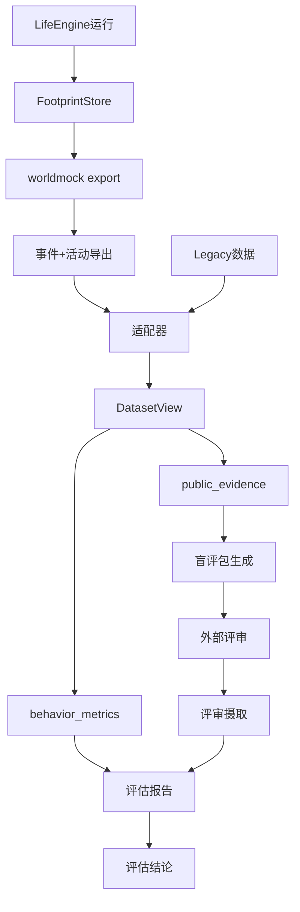
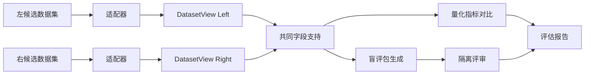
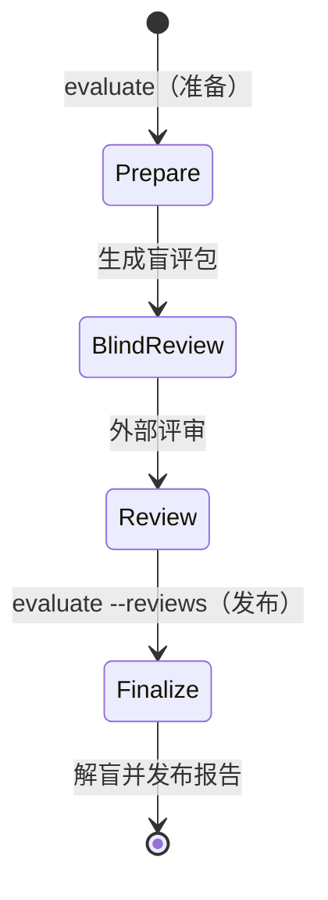
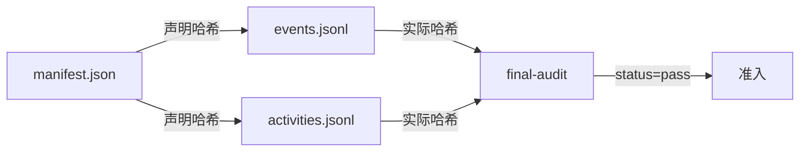

<a name="evaluation-worldmock-产品设计说明书-行为评估"></a>
# WorldMock 产品设计说明书 — 行为评估

> 2026-10-07：按[资源与规则引擎简化规格](../dev/SPEC-resource-and-rule-simplification.md#spec-rrs-资源与规则引擎简化开发规格)同步阶段 7 的记录、导出、交付与评估合同。

> 2026-10-07：按[资源与规则引擎简化规格](../dev/SPEC-resource-and-rule-simplification.md#spec-rrs-资源与规则引擎简化开发规格)同步阶段 5 的按实际工作秒数计算的报告项。

> 按[资源与规则引擎简化规格](../dev/SPEC-resource-and-rule-simplification.md#spec-rrs-资源与规则引擎简化开发规格)修订「门店选择与供给假设的比较边界」（阶段 3）。

> **状态**：DRAFT；按人物 Prompt 规格修订，修订部分已实现（证据见[人物 Prompt 验收记录](../archive/persona-prompt/persona-prompt-verification.md)）；按一日运行保真规格同步（一日运行保真 EV1），已实现；按[个人事务与工作安排规格](../dev/SPEC-as2-integration.md#errands-workday-运行修复入库)分阶段同步（[实施计划](../archive/errands-workday/errands-workday-implementation-plan.md) D7 作业），已随代码落地到阶段 1–4<br>
> **工具交互修订**：按[工具交互规格](../dev/SPEC-life-runtime.md#tool-interaction-工具请求)冻结本次设计；本次修订已实现，既有验收不覆盖新行为。
> **让「等待」成为例外修订**：按[让「等待」成为例外规格](../dev/SPEC-idle-fillers.md#spec-idle-fillers-让等待成为例外开发规格)修订「2.1 协议门禁（Gates）」「2.2 报告项（Reports）」（阶段 1）。
> **日期**：2026-10-08
> **版本**：v1.18
> **目标读者**：算法工程师、开发工程师

<a name="design-07-evaluation-共享规则与可重建环境修订"></a>
## 共享规则与可重建环境修订

按[共享规则与可重建环境规格](../dev/SPEC-shared-rules-and-rebuildable-env.md)修订；验收结果独立记录。

质量、行为、目标和工作负荷使用同一整数结算区间校验；质量、行为和工作负荷共用共同身体筛选。适配器每行事件只解析一次。统一动作按实际快照中的固定类别映射，社交按明确通信方式记录；外部证据缺类别仍记 unknown、unclassified 或缺证，不猜测进度。主观记忆快照校验与记录侧相同，合法反思不作为重复经历错误。

工程覆盖门禁复用唯一 full runner：收集、选择、完成回执与覆盖摘要绑定同一运行身份，
选择、收集与完成节点的全局多重集精确一致且无重复；全量节点的三阶段必须完整且全部通过。
旧绿色文件、未知阶段结果、跳过或缺失证据均拒绝，分支百分之八十五和公共接口零缺口阈值不变。

<a name="evaluation-模块概述"></a>
## 1. 模块概述

<a name="evaluation-职责与边界"></a>
### 1.1 职责与边界

行为评估模块（`worldmock.evaluation`）负责：

**职责**：
- 从两套认证数据集提取公开结构证据
- 计算行为多样性、时间分配等量化指标
- 生成隔离盲评包并校验评审收据
- 按统计方法对比两个数据集的行为分布
- 生成固定输入可复现的评估报告

**边界**：
- 不负责生成数据（由 LifeEngine + FootprintStore 承担）
- 不负责数据修复（由外部适配器承担）
- 不负责模型评审调用（由独立评审会话承担）
- 不推断缺失字段（缺失即标为不可用）
- 不把合成数据当作人类真值

资金守恒与身体资源变化是否符合规则，按[运行时规格](../dev/SPEC-life-runtime.md#spec-life-runtime-特性规格lifeenv-运行时行为与结算规则)和
[记录引擎设计](05-recording-engine.md#recording-engine-worldmock-产品设计说明书-记录引擎)确定性核验；行为合理性评分不能代替这些结算检查。

**评估的目的与限制**：

本模块的唯一目的是**对比两套数字足迹的行为合理性**，结论边界严格限定为 `comparative_plausibility_only`：

- ✅ 允许：报告哪个候选在某维度更符合公开人类活动特性
- ✅ 允许：报告模型评审更偏好哪个候选
- ❌ 禁止：声称已经目标人群实证验证
- ❌ 禁止：把模型评审称作真人评审
- ❌ 禁止：把两套合成数据当作人类真值

<a name="evaluation-与其他模块的关系"></a>
### 1.2 与其他模块的关系



<a name="evaluation-核心设计原则"></a>
### 1.3 核心设计原则

| 原则 | 含义 | 体现 |
| --- | --- | --- |
| **确定性可复现** | 固定输入产生逐字节相同输出 | 固定种子、排序稳定、无时间戳依赖 |
| **Fail-Closed** | 证据缺失时门禁不通过 | `decision_offered` 缺失 → 静默边界门禁失败 |
| **不推断缺失** | 缺字段标为 `null`，不猜测 | ACTION 缺合法 category → 计入 `unclassified` |
| **来源可追溯** | 保留原始事件指针 | `PublicEvidence.source_event_ids` |
| **结论边界明确** | 不声称已验证人类真实性 | `result_status: comparative_plausibility_only` |

<a name="evaluation-指标定义"></a>
## 2. 指标定义

<a name="evaluation-协议门禁gates"></a>
### 2.1 协议门禁（Gates）

协议门禁由 `behavior_metrics_report` 计算，证据缺失时 `pass=false`（fail-closed）。

| 门禁键 | 判定对象 | 比较 | 阈值 | 失败含义 |
| --- | --- | --- | --- | --- |
| `observation_repetition` | 同一 user 文本（人物决策请求中的每条 user 消息）出现于不同续接链请求中的最大数目：续接链按（人物，模拟秒）划分，链内复用链首 user（含同一决策内重发）只计一次，跨秒重复仍计为重复；排除带 `purpose="plan_day"` 的系统请求；带工具的请求只在工具中有 `start_activity` 时计入，只带 `submit_reflection` 的就寝反思及其校验重试不计（附回消息不带时刻与人物内容，不是观察），不带工具的记忆巩固照计 | `==` | 1 | 观察被重复序列化 |
| `silent_boundary_ratio` | 每人唯一共同身体结算的清醒边界中 `decision_offered=false` 的占比；同刻轮次不写共同身体结算，不进分母 | `>=` | 0.5 | 静默续行边界占比过低：提供决策的边界过密 |
| `memory_repetition_ratio` | 同类型记忆两两 bigram Jaccard ≥ 0.6 的对数占比 | `<=` | 0.2 | 记忆内容重复 |
| `memory_md_identity_residue` | 调用方传入的各人物工作区 `MEMORY.md` 文本命中示例身份的人物数（`MEMORY.md` 不再进人物提示，门禁仍检查它） | `==` | 0 | 示例身份残留 |

**背书**：门禁阈值来自 `docs/VERIFICATION.md#verification-worldmock-验收标准` §协议门禁，源码为唯一依据。

认证导出必须通过质量报告结构 6 的结构与重算检查：

| 质量键 | 必须由真实事实重算的内容 |
| --- | --- |
| `content_contact` | `by_app`、`by_action`、`repeat_watch`；重看只在本轮开始前已完成至少一轮时计数 |
| `app_pushes` | `pushed`、`opened_in_session`、`consumed_pinned`、`released_by_completion`、`expired_with_session`、`outside_window_violations`；按唯一 `push_id` 和真实 session 转换计数 |
| `work_topics` | `topics`、`completed`、`worked_seconds_by_topic`、`reports`；topics 计冻结分配的内容数，completed 计实际首次完成；工时按实际消费区间累计，不计暂停或自述 |

`model_usage.by_purpose` 不含 `work_review`，`conversion_efficiency` 不含 `work`。这些键属于认证质量报告，
不能用缺失值、模型文字或当前状态猜测；执行结果取实际门禁回执。
<a name="evaluation-报告项reports"></a>
### 2.2 报告项（Reports）

报告项只进报告，不参与放行。并行活动的各自时长允许重叠，人的经过时间取区间并集；
食品多样性只取本人实际 `goods_received` 中 `meal`、`snack`、`drink` 的收货事实；用餐目标只取其中正餐收货。付款、在途或驿站待领取订单均不算收货，不推导独立进食区间。
记忆重复率只比较明确主观 episodes，不把其文字作为客观完成事实。

| 报告项键 | 说明 | 目标参照 |
| --- | --- | --- |
| `decision_prompt_token_median` | 决策 prompt token 中位数：每个 `phase=request`、不带 `purpose` 的人物决策 `model_request` 计一个值；行动请求含同秒续接与截断重试，不带工具的记忆巩固计入，只带 `submit_reflection` 的就寝反思及校验重试不计；排除 `purpose="plan_day"` | 15000（对照值） |
| `effective_autonomous_decision_rate` | 最终动作非 continue/等待的占比；continue 与等待算被动，等待按结果活动 `kind=wait` 判定；只做结束、暂停或修订的控制轮单列 | 无固定阈值 |
| `wake_reason_distribution` | 各唤醒原因计数，分两份：边界取共同身体结算，决策轮取 `decision_started` | 覆盖所有唤醒类型 |
| `wait_minutes` | 本人真实等待活动的实际区间累计分钟 | 只报告，不设占比上限 |
| `unknown_wait_minutes` | 未有可核验原因的等待活动实际区间累计分钟 | 不根据自由叙述推断目的 |
| `content_contact_minutes` | 实际动作内容消费区间累计分钟 | 不把等待或开始播放计为已接触 |
| `early_arrival_minutes` | 早于开门时间到达的分钟 | 最小化 |
| `sleep_schedule` | 就寝/起床时刻与时长 | 人物卡片就寝窗口（场景声明的 `bedtime_window` 优先） |
| `meal_diversity` | Simpson 集中度与 24h 重复率 | 低集中度、低重复 |
| `activity_distribution` | 当前四种活动与五个动作类别的日时间分布及参照 JS 距离；`wait` 计休息、`travel` 计通勤，`action` 按类别计娱乐、工作、社交、运动或家务；用餐与个人卫生参照分钟没有模拟活动对应物 | 2018 年全国时间利用调查 |
| `persona_distinguishability` | 留一最近邻人物识别准确率 | ≥3 次运行、≥2 人 |
| `social` | 交谈/通话分钟、消息数 | 人物社交需求 |
| `habitual_consistency` | 同人物地点与本地小时的活动家族一致率 | 只报告情境重复性，不识别心理习惯 |
| `deliberate_goals` | 曾登记的非例行意图目标中的家族实际推进率，保留丢弃条目；推进口径与模拟引擎相同（同家族、登记后的正时长结算，带大致时刻的目标还须在其前后 90 分钟内进行）；例行意图（睡眠、晨间例程、通勤、用餐）的目标照常判定，另计 `routine_goals`，不入推进比例；登记来源为零点计划的 `day_plan_generated` 与修订结果 | 只报告，外部参照未接入时为 null |
| `external_constraints` | 去重后的外部约束受阻与动作接受率；引导性拒绝码 `ACTIVITY_PRECONDITION_UNMET`、`ACTIVITY_CONCLUSION_REQUIRED`、`SESSION_LIMIT_EXCEEDED` 计入 `other_rejections`；外部约束闭集不含 `PICKUP_LOCATION_REQUIRED` 与工作地点、技能不符 | 受阻次数为零是运行质量门禁，正确拒绝不等于引擎缺陷 |
| `workload` | 只统计有工作安排的人物与当班日；给出 `shift_seconds`、`at_workplace_seconds`、`work_activity_seconds`、`idle_at_workplace_seconds`、`break_seconds`、`declared_exception_seconds`、`absence_seconds`、`early_leave_seconds`。工作活动秒数取班次内非失败工作活动的实际区间，没有有效工时、效率折扣或任务外出；声明例外只含休息时段 | 只报告，不设阈值，不与下表「就业工作 460 分钟」比较 |
| `routine_deviation` | `agents` 按人物编号给 `days`，观察窗覆盖的每个本地日一行（含不当班日）：`left_workplace_at`（当天最后一次从工作地点出发的本地时刻）与它对场景班次结束的 `leave_vs_shift_end_minutes`、对下班窗口的 `leave_vs_window_minutes`；`arrived_home_at`（其后当天首次到家，当天没有离开工作地点时取当天最后一次到家）与它对到家窗口的 `arrive_home_vs_window_minutes`（偏离分钟，早于窗口为负、晚于为正、窗口内为零；参照或时刻为 null 时该项为 null）；`asleep_at_shift_start`、`asleep_at_shift_end` 单独标注班次两端人物是否在睡（不当班日、没有工作安排或该时刻不在观察窗内时为 null）；`evidence_event_ids` 给离开与到家的证据事件身份。参照是场景班次与覆盖后的作息窗口（结构化卡片的下班、到家锚点），不是当日计划，不读 `day_plan_generated` 或计划字段；容差 `tolerance_seconds` 等于播报间隔，是没有班次边界唤醒的运行里清醒且有进行中活动的人物在班次结束后首个决策机会的滞后上界；同一份评估代码读修订前后两臂的导出，这个定义对两臂都成立；它只写进报告，不作用于偏离值。没有工作安排的人物其离开工作地点一项为 null | 只报告，不设阈值 |

`workload` 与 `routine_deviation` 需要事件之外的输入，经 `behavior_metrics_report` 唯一新增的可选打包参数 `workday`（`WorkdayInputs`：
各人物的工作安排、住处、覆盖后的下班与到家窗口，以及播报间隔；由 `workload_metrics.workday_inputs` 从场景文档与
结构化卡片打包，不解析提示文本）传入，所以只在行为评估的 `reports`，不进 `quality.json`，运行清单不升版，报告自带的结构标识
`behavior-metrics-2`。没有打包输入时两项为 null 并写一条说明，事件里出现而输入里没有的人物两项都为 null 并写说明，说明沿用本模块的中文惯例；
产出入口是 `scripts/inspect_run.py workday --scenario <场景文件>`（见[记录引擎设计「调试工具」](05-recording-engine.md#recording-engine-调试工具)），
口径见[个人事务与工作安排规格](../VERIFICATION.md#errands-workday-度量与下游-行为评估) 6.2。

同秒续接轮的思考 token（`reasoning_tokens`，缺失时报字符数，两者不混算）与缓存命中由 `scripts/inspect_run.py continuation`
逐决策报告（链位置、请求数、协议错误与 400、计价成本、话题命中与按订单去重后的重复下单），`--baseline` 先核对两臂清单只差续接开关，
输出字段见[记录引擎设计「调试工具」](05-recording-engine.md#recording-engine-调试工具)；只报告，不参与放行。
输出截断（提供商回复 `finish_reason=length`）的次数、按用途分列、浪费的输出 token 与其中的思考 token 计入 `quality.json` 的
`truncations` 一节（字段见[记录引擎设计「质量报告」](05-recording-engine.md#recording-engine-质量报告)）；行动决策的截断率以其中 `decision` 的次数除以
`model_usage.by_purpose` 中 `decision` 的 `provider_responses`（`decision` 组是不带 `purpose` 的全部请求，与决策 prompt token 中位数
同一口径，含记忆巩固与就寝反思），只报告，不参与放行。
个人事务与收尾记忆的只报告项计入 `quality.json` 的 `errand_metrics` 与 `conclusion_memories` 两节（字段见
[记录引擎设计「质量报告」](05-recording-engine.md#recording-engine-质量报告)）：事务以记下过的不同事务数 `registered_count` 为分母，按运行与事务身份
统计、可跨本地日，不使用任何当日目标指标的键名、不写进 `day_plan_metrics`，也不并入 3.3 所说的习惯、外部约束、刻意目标三层；
`deliberate_goals` 的名称、分母与分组键不变，`memory_repetition_ratio` 门禁的口径与阈值不变。只报告，不参与放行。

工具交互特性的行为报告由已提交请求、纠错、拒绝与结算事实生成：记录世界查询与任务回看的次数、
名称与参数拒绝跨不同模拟时刻的重复次数，以及分配工作内容的实际消费、播报与完成情况。
只读查询不作为世界请求、活动或同刻决策轮统计，但含查询的模型回复本身计入模型请求、token 与十六回合预算。
查询结果只存在于模型与 tool 交换证据，不生成进度层 `events`，不能按动作结算或完成计算。
查询成本另由 `scripts/inspect_run.py queries` 按运行只读报告（口径见[记录引擎设计「调试工具」](05-recording-engine.md#recording-engine-调试工具)），打印
`{run_id, calls, failures, returned_chars, filtered_calls, empty_after_filter, model_calls_to_purchase, reflection_retries}`：查询调用数、
失败数、返回字符数、带筛选（`app` 或 `available_only`）的调用数、筛选后为空的次数、从首次查询到购买结算的模型调用数，以及反思校验
重试次数（工具只有 `submit_reflection` 且带附回消息的模型请求数）；口径取已落库的模型工具交换证据，对照运行同时报告协议错误
（取 `continuation` 报告，本子命令不另设键），降低返回量不能以购买失败为代价。
错误接口、任务、供给价格、料理、查询、操作备忘与紧凑呈现按独立端到端阶段留下行为与变异收据，
见[工具交互特性门禁](../VERIFICATION.md#verification-工具交互特性门禁)；不同阶段身份分别报告，不能混成同一源码的已实现评估结论。
分配工作内容只在指定工作地点执行，完成后不再分配；剩余不足一分钟仍可按实际秒数完成，不设置技能、截止、预约或通知等待。
报价只按构建后冻结的实际供给报告，不能把同商品不同门店重复计成商品多样性，也不能把查询命中计成已获得对象。
上述行为指标只报告，不追加没有依据的运行质量阈值；请求、错误位置与合法值、任务时序及紧凑呈现等价性
以工具交互规格的行为测试与变异测试确定性验收。

**2018 年全国时间利用调查参照**（城镇/工作日口径，居民均值）：

| 活动类别 | 参照时长（分钟） |
| --- | ---: |
| 睡觉休息 | 553 |
| 个人卫生护理 | 50 |
| 用餐 | 104 |
| 就业工作 | 460 |
| 交通 | 44 |
| 社会交往 | 21 |
| 健身锻炼 | 41 |
| 屏幕娱乐（看电视 100 + 休闲 65） | 165 |
| 无参照（休息 + 家务） | 0 |

**口径约定**：
- 外出(outing)并入通勤(commute)
- wait 计入休息(rest)
- 活动时长按原生活动与 ACTION 快照中的真实类别归类，不为商品收货构造用餐时长；食品多样性按本人食品收货订单计算
- 参照的看电视与休闲娱乐合并为屏幕娱乐 165m
- 休息与家务无参照项，并入无参照桶


<a name="evaluation-指标计算公式"></a>
### 2.3 指标计算公式

<a name="evaluation-simpson-集中度"></a>
#### Simpson 集中度

$$
C = \sum_{i=1}^{n} \left( \frac{count_i}{total} \right)^2
$$

其中 $count_i$ 为第 $i$ 个 `goods_id` 的本人食品收货订单数，$total$ 为本人食品收货订单总数；食品包含 `meal`、`snack`、`drink`。同一订单只计一次，值越高越集中。

<a name="evaluation-小时重复率"></a>
#### 24 小时重复率

$$
R = \frac{\text{与前 24h 本人已收货商品重复的食品收货订单数}}{\text{本人食品收货订单总数}}
$$

<a name="evaluation-js-距离"></a>
#### JS 距离

$$
D_{JS}(P \| Q) = \sqrt{JSD(P \| Q)}
$$

其中 $JSD$ 为 Jensen-Shannon 散度：

$$
JSD(P \| Q) = \frac{1}{2} D_{KL}(P \| M) + \frac{1}{2} D_{KL}(Q \| M), \quad M = \frac{1}{2}(P + Q)
$$

$D_{KL}$ 为 Kullback-Leibler 散度（log2 口径）。

<a name="evaluation-bigram-jaccard-相似度"></a>
#### Bigram Jaccard 相似度

$$
J(A, B) = \frac{|A \cap B|}{|A \cup B|}
$$

其中 $A$、$B$ 为两段文本的字符 bigram 集合。

<a name="evaluation-留一最近邻准确率"></a>
#### 留一最近邻准确率

对于每个 $(run_i, agent_j)$：
1. 计算其活动分布向量 $\mathbf{v}_{ij}$（十类家族的归一化比例）
2. 在所有其他运行中找最近邻（L1 距离最小）
3. 若最近邻的 agent 身份匹配，则正确

$$
Accuracy = \frac{\text{正确识别次数}}{\text{总向量数}}
$$

<a name="evaluation-对比协议"></a>
## 3. 对比协议

<a name="evaluation-三层数据模型"></a>
### 3.1 三层数据模型

评估使用三个层级的共同数据模型：

| 层级 | 必需字段 | 统计用途 |
| --- | --- | --- |
| **证据事件** | `occurred_at`, `category`, `interaction`, `object_type`, `state` | 完整性、渠道覆盖、时间检查 |
| **活动** | `started_at`, `ended_at`, `category`, `status`, `segments` | 节律、时长、转换、因果 |
| **自然日** | `date`, `calendar_class`, 活动向量 | 配对比较、自助法 |

<a name="evaluation-证据事件publicevidence"></a>
#### 证据事件（PublicEvidence）

```python
@dataclass(frozen=True)
class PublicEvidence:
    occurred_at: datetime
    category: str
    interaction: str
    object_type: str
    state: str | None
    object_key: str | None
    attributes: Mapping[str, str]
    source_event_ids: tuple[str, ...]
```

公开证据只取认证源事件能证明的闭集值。当前 WorldMock 统一动作按快照类别映射 interaction，社交按明确 voice/text 记录 call/chat；
有 app 的动作才是数字交互，设备由实际使用方式的 `MANNER_DEVICE` 得到：`phone` 计手机，`other` 是其他设备，未绑定 app 的动作是线下。内容完成和推送状态来自 `app-usage.jsonl` 与对应来源事件，不按名称推断设备或完成。
出行证据的 `object_type="route"`，`object_key` 取活动的 `trip_id`，路径、方式与到达状态必须由真实活动和
结算事件证明。工作证据按真实 `content_id` 与 `work_content_completed` 表示内容累计及完成，不构造任务评审或截止事实。
无法映射的类别使用 `unknown`，缺失字段保留为缺失，不按名称或相邻时刻补值。

<a name="evaluation-活动activitysession"></a>
#### 活动（ActivitySession）

代码名 `ActivitySession` 沿用，与地点会话无关。WorldMock 适配器只接受认证导出的当前活动行，
LabelKit 适配器只接受其真实上游会话格式；两条来源分支不是旧 WorldMock 格式的兼容读取。

```python
@dataclass(frozen=True)
class ActivitySession:
    activity_id: str
    person_id: str
    category: str
    started_at: datetime
    ended_at: datetime
    elapsed_seconds: float
    status: str
    channels: tuple[str, ...]
    application_category: str | None
    duration_kind: str
    official_domains: tuple[str, ...]
    caused_by: tuple[str, ...]
    source_pointer: str
    source_channels: tuple[str, ...]
```

`elapsed_seconds` 逐字取冻结活动行并与认证事件核对，不用 `ended_at - started_at` 把暂停空档算进活动。
占用格和盲评区间由规范 `EvidenceEvent` 中 `activity_progress.data.interval_start`、`interval_end` 的实际推进区间
构造；相同 `activity_id` 的多段推进保持同一活动身份。`ActivitySession` 不保存或重建 `segments` 字段。

<a name="evaluation-适配器职责"></a>
### 3.2 适配器职责

适配器把两个真实上游格式转换为共同模型，来源分支显式分开：

- LabelKit 适配器读取 `actionInfo` 与 `stream`，用 `owner_sequence_id` 建立序列关系；声明只证明声明，
  不能证明订单、到达、内容完成或其他业务终态。
- WorldMock 适配器只读取导出清单 4 的 `events`、`activities`、`purchases` 与 `app_usage`，并核对来源事件指针。
  `start_activity.items[]` 逐项绑定结果中的当前活动快照；`report_status`、`pause_activity` 与
  `conclude_activity` 按 `items[].activity_name` 绑定当前活动身份。
- 数字交互只由实际带 app 的 action 活动与内容进度投影；推送的交付、打开、内容消费和完成释放分别取六种 app 使用事实。
  出行对象键只取 `trip_id`，订单、付款和履约保持三种独立状态，工作累计取真实分配内容的消费与完成事件。
- `recall_task_summary` 与 `query_world` 是查询证据，不投影成活动或世界状态变化。

一个原始事件可以产生多条共同证据，但每条都保留来源事件指针。无法映射的类别写 `unknown`，一方不支持的
字段保持缺失；适配器拒绝已退役的 WorldMock 请求形状和游戏、目录浏览、任务评审字段，不设置兼容读取。


<a name="evaluation-两个数据集对比"></a>
### 3.3 两个数据集对比



**共同字段支持**（`public_fields_by_category`）：

按 `(category, field)` 求交集，只在双方都支持的字段上计算指标。

示例：
```json
{
  "purchase": ["interaction", "object_type", "state", "fulfillment_mode"],
  "work": ["interaction", "object_type", "state"],
  "travel": ["interaction", "object_type", "travel_mode"]
}
```

三层事件口径与缺证据规则统一见 [当日目标规格](../dev/SPEC-day-plan-goals.md#spec-day-plan-goals-三层度量与质量导出)。
纯事件统计由行为评估和生产质量导出共同调用，各层按最终规格的分组键隔离：
目标按人物日归属，习惯跨不同本地日比较，外部约束按运行与动作去重。

<a name="evaluation-盲评流程"></a>
## 4. 盲评流程

<a name="evaluation-盲评包生成"></a>
### 4.1 盲评包生成

```python
def create_review_material(
    left: DatasetView,
    right: DatasetView,
    support: Mapping[str, Any],
    scenario: EvaluationScenario,
) -> ReviewMaterial
```

**输入**：
- `left`, `right`: 两个候选的 DatasetView
- `support`: 共同字段支持掩码
- `scenario`: 评审场景（窗口、维度、种子、评审者数量）

**输出**：
- `index`: 公开索引（`blind-review-pack.json`）
- `packets`: 隔离评审包（每个评审者一个）
- `key`: 独立解盲键（`unblinding-key.json`）

**评审单元选择**：

覆盖每个周块（默认 7 天）、特殊日期及每周哈希选择的普通日：

```python
for block in date_blocks(scenario):
    items.append(("week", block))  # 整周
    items.extend(("special_day", [d]) for d in special_dates(block))
    for calendar_class in ("regular_workday", "ordinary_weekend"):
        candidates = [d for d in block if scenario.calendar_class(d) == calendar_class]
        if candidates:
            chosen = hashed_choice(candidates, scenario.seed, block_start, calendar_class)
            items.append((calendar_class, [chosen]))
```

**左右随机**：

每个评审槽和单元确定性随机左右顺序：

```python
def swap_sides(seed: str, slot: str, item_id: str) -> bool:
    digest = hashlib.sha256(f"{seed}:{slot}:{item_id}".encode()).digest()
    return bool(digest[0] & 1)
```

**匿名对象引用**：

使用 keyed HMAC 生成匿名引用，候选与评审槽隔离、同侧跨日稳定：

```python
def masked_ref(mask: EvidenceMask, object_type: str, object_key: str) -> str:
    key = hmac_key(mask.seed, mask.reviewer_slot)
    message = f"{mask.candidate_namespace}\0{object_type}\0{object_key}"
    return "object-" + hmac.new(key, message.encode(), "sha256").hexdigest()
```

<a name="evaluation-六维可判定性"></a>
### 4.2 六维可判定性

每个评审单元声明六个维度的可判定性：

| 维度 | 可判定条件 | 原因码 |
| --- | --- | --- |
| `temporal_plausibility` | 双方都有活动时间线 | `both_sides_have_observed_activity_timing` |
| `causal_continuity` | 双方都有对象状态变化 | `both_sides_have_observed_object_state_changes` |
| `persona_consistency` | 双方都有活动时间线 | `coarse_shared_profile_and_both_activity_timelines` |
| `long_term_consequences` | 多日且双方都有跨日对象状态变化 | `both_sides_have_cross_day_object_state_changes` |
| `routine_and_variation` | 多日且双方都有活动覆盖 | `multi_day_activity_coverage_on_both_sides` |
| `missing_expected_activity` | 完整声明日期和日历类别 | `complete_declared_days_and_calendar_classes` |

**强制执行**：
- `judgeable=false` 的维度必须选择 `unjudgeable`
- 单侧证据更丰富不代表更真实

<a name="evaluation-评审收据校验"></a>
### 4.3 评审收据校验

```python
def ingest_reviews(
    review_paths: Sequence[Path],
    prepared_root: Path,
    scenario: EvaluationScenario,
) -> JsonObject
```

**校验项**：
1. 索引与解盲键的身份一致性
2. 每个隔离包的哈希、字段闭集
3. 评审记录的身份绑定
4. 逐单元逐维度完整性
5. 可判定性与选择的一致性

**拒绝项**：
- 包内出现 `model`、`provider`、`path`、`run_id` 等身份字段
- `judgeable=false` 的维度选择了非 `unjudgeable`
- 评审槽不匹配、哈希不一致
- 维度不完整或选择超出闭集

<a name="evaluation-解盲与汇总"></a>
### 4.4 解盲与汇总

**偏好汇总**（`_preference_summary`）：

分维度统计 `left_candidate`、`right_candidate`、`tie`、`unjudgeable` 的计数和占比。

**周块置信区间**（`_preference_interval`）：

以自然周块为重抽样单位，bootstrap 10000 次，报告 95% 区间：

```python
def preference_difference(values: Sequence[str]) -> float | None:
    judged = [v for v in values if v != "unjudgeable"]
    if not judged:
        return None
    left = sum(v == "left_candidate" for v in judged)
    right = sum(v == "right_candidate" for v in judged)
    return (left - right) / len(judged)
```

**一致性**（Krippendorff's alpha）：

使用成熟 `krippendorff` 包计算 nominal alpha，`unjudgeable` 作为缺失值：

$$
\alpha = 1 - \frac{D_o}{D_e}
$$

其中 $D_o$ 为观测到的不一致，$D_e$ 为期望的不一致。

**评审者依赖披露**：

报告同模型会话分组，避免把它们称为独立真人：

```json
{
  "model_review_count": 3,
  "human_review_count": 0,
  "same_model_session_groups": {
    "deepseek:deepseek-reasoner": ["session-1", "session-2", "session-3"]
  },
  "disclosure": "Model sessions sharing a provider and model may be statistically correlated."
}
```

<a name="evaluation-评估流程"></a>
## 5. 评估流程

<a name="evaluation-两阶段执行"></a>
### 5.1 两阶段执行



**阶段一：准备**（`evaluate`，不带 `--reviews`）

```bash
worldmock evaluate \
  --legacy legacy-root/ \
  --worldmock worldmock-export/ \
  --scenario ../WorldMock-Dataset/environment/zhangjiang-baseline/scenarios/evaluation.json \
  --output evaluation-output/
```

`--legacy`、`--worldmock`、`--scenario` 三项必填；有匹配的真人轨迹时另加 `--human-reference`。

输出：
- `blind-review-pack.json`（公开索引）
- `review-packets/reviewer-{01..N}.json`（隔离包）
- `unblinding-key.json`（独立解盲键）
- `metrics.json`（量化指标）
- `mapping-report.json`（适配报告）

**阶段二：定稿**（`evaluate --reviews`）

```bash
worldmock evaluate \
  --output evaluation-output/ \
  --reviews review-session-*.json
```

这一阶段只接受 `--output` 与 `--reviews`，同时带阶段一的输入参数即以英文错误拒绝。

输入：
- `evaluation-output/`（阶段一的输出）
- `--reviews`（评审收据，每个评审者一个）

输出：
- `review-results.json`（解盲偏好与一致性）
- `report.md`（完整评估报告）
- `charts/`（图表）

<a name="evaluation-输入认证"></a>
### 5.2 输入认证

**左右候选必需文件**：
- `manifest.json`（交付清单）
- `events.jsonl`（事件导出）
- `activities.jsonl`（活动导出）
- `final-audit.json`（审计收据，`status=pass`）

**校验链**：



**拒绝条件**：
- 哈希不一致
- `final-audit.json` 的 `status != "pass"`
- 窗口不匹配（`window_start`、`window_end`）
- 事件 `occurred_at` 超出窗口
- `run_id` 或 `code_sha256` 缺失

<a name="evaluation-统计方法"></a>
## 6. 统计方法

<a name="evaluation-分布对比"></a>
### 6.1 分布对比

**活动时长分布**：

使用 JS 距离对比两个候选与参照的活动分布：

```python
def js_distance(p: list[float], q: list[float]) -> float:
    """计算两个分布的 JS 距离（log2 口径）"""
    p_norm = [x / sum(p) for x in p]
    q_norm = [x / sum(q) for x in q]
    divergence = 0.0
    for pi, qi in zip(p_norm, q_norm):
        m = (pi + qi) / 2.0
        if pi > 0 and m > 0:
            divergence += 0.5 * pi * math.log2(pi / m)
        if qi > 0 and m > 0:
            divergence += 0.5 * qi * math.log2(qi / m)
    return math.sqrt(divergence)
```

**节律相似度**：

将自然日活动向量投影到 10 分钟格，计算欧氏距离矩阵，报告日间距离分布。

<a name="evaluation-显著性检验"></a>
### 6.2 显著性检验

**Bootstrap 置信区间**：

固定种子执行 10000 次重抽样，报告 95% 区间：

```python
def bootstrap_ci(data: np.ndarray, statistic, seed: int, n_boot: int = 10000):
    rng = np.random.default_rng(seed)
    indices = rng.integers(0, len(data), size=(n_boot, len(data)))
    bootstrap_stats = [statistic(data[idx]) for idx in indices]
    return np.quantile(bootstrap_stats, [0.025, 0.975])
```

**重抽样单位**：

正式 84 天以十二个完整自然周为配对重抽样单位，不把事件行当独立样本。

<a name="evaluation-相似度度量"></a>
### 6.3 相似度度量

**Jaccard 相似度**（记忆重复检测）：

$$
J(A, B) = \frac{|A \cap B|}{|A \cup B|}
$$

**L1 距离**（人物识别）：

$$
d_{L1}(\mathbf{p}, \mathbf{q}) = \sum_{i=1}^{n} |p_i - q_i|
$$

**KL 散度**（分布对比，仅用于 JS 散度计算）：

$$
D_{KL}(P \| Q) = \sum_{i} p_i \log_2 \frac{p_i}{q_i}
$$

<a name="evaluation-结论边界"></a>
## 7. 结论边界

<a name="evaluation-四种结果状态"></a>
### 7.1 四种结果状态

| `result_status` | 含义 | 允许的结论 |
| --- | --- | --- |
| `invalid_input` | 哈希、行数、模式、时间窗或审计链失败 | 只报告输入错误 |
| `not_comparable` | 人物、日历、粒度或共享可观察字段不足 | 只报告不可比较原因 |
| `comparative_plausibility_only` | 两套合成数据可比较，但没有匹配真人轨迹 | 报告差异、官方聚合对齐维度和模型评审偏好 |
| `human_reference_comparison` | 匹配真人轨迹通过同一适配和可比性检查 | 可以按预先声明的判定规则报告胜者或无结论 |

<a name="evaluation-本次结论边界"></a>
### 7.2 本次结论边界

**本次评估状态**：`comparative_plausibility_only`

原因：
- 既有对照数据真实存在（DeepSeek 十二周基线）
- 没有匹配的真人微观轨迹
- 两套合成数据自身不能构成人类真值

**允许表述**：
- ✅ "候选 A 在工作时长维度更接近 2018 年全国时间利用调查的城镇居民均值"
- ✅ "三个模型评审会话中，2 个偏好候选 B，1 个选择 tie"
- ✅ "候选 B 的 Simpson 集中度为 0.42，低于候选 A 的 0.68，显示更高的商品多样性"

**禁止表述**：
- ❌ "候选 A 已通过目标人群实证验证"
- ❌ "真人评审一致认为候选 B 更真实"
- ❌ "候选 A 完全符合上海张江白领的真实行为"

<a name="evaluation-门店选择与供给假设的比较边界"></a>
### 门店选择与供给假设的比较边界

环境身份、发布图、商品菜单、app 绑定、完整运输时长与规则版本不同，必须记录为不同实验条件。同类型店铺菜单相同，同一商品跨店同价；比较条件是距离、实际收货等待和固定每单配送费。
食品多样性按本人食品收货的 `goods_id`，门店归属按 `(store_id, goods_id)`；实际订单金额按真实订单件数和配送费核验，单价不能替代账本总额。付款、配送到达与实际收货分别核验：长途到站只进入 `ready_for_pickup`，本人在站零秒领取后才写 `goods_received` 并施加效果，没有持有或独立进食事实。
真实地点与商品名称不证明真实价格或路网，价格、边长和店铺明示运输时长是合成输入。报告人物实际看到的信息、明确选择的 app、付款与收货，不预设近店或外卖必胜，也不继承旧目录的验收数字。详细收货边界见[请求字段与结算检查](../CONTRACTS.md#contracts-request-settlement)。

<a name="evaluation-外部参照限制"></a>
### 7.3 外部参照限制

**2018 年全国时间利用调查**：

- 样本规模：约 10.7 万人
- 采集时间：2024 年 5 月（工作日 + 周末日）
- 公开粒度：全国、城镇、年龄段的边际聚合值
- **限制**：没有"上海城镇 18-59 岁白领"的交叉微观数据

因此只能报告"更符合公开聚合特性"，不能声称"符合目标人群真实分布"。

<a name="evaluation-报告生成"></a>
## 8. 报告生成

<a name="evaluation-报告结构"></a>
### 8.1 报告结构

```markdown
# WorldMock 行为评估报告

## 1. 执行摘要
- 评估状态：comparative_plausibility_only
- 左候选：{dataset_id}
- 右候选：{dataset_id}
- 评审者：3 个隔离模型会话

## 2. 输入认证
- 左候选：manifest + audit 通过
- 右候选：manifest + audit 通过
- 窗口：2026-01-05 至 2026-03-30（84 天）

## 3. 适配报告
- 证据事件：左 16,320，右 15,487
- 活动：左 4,380，右 4,102
- 共同字段支持：{category: [fields]}

## 4. 量化指标对比
### 4.1 协议门禁
- observation_repetition（按续接链计）: 左 pass, 右 pass
- silent_boundary_ratio: 左 0.62 (pass), 右 0.48 (fail)
- memory_repetition_ratio: 左 0.08 (pass), 右 0.15 (pass)
- memory_md_identity_residue（检查 MEMORY.md）: 左 0 (pass), 右 0 (pass)

### 4.2 活动分布
- JS 距离（vs 参照）：左 0.245, 右 0.198
- 睡眠：左 530m, 右 560m（参照 553m）
- 工作：左 480m, 右 420m（参照 460m）
- ...

### 4.3 行为多样性
- Simpson 集中度：左 0.68, 右 0.42
- 24h 重复率：左 0.35, 右 0.22
- ...

## 5. 盲评结果
### 5.1 偏好汇总
- temporal_plausibility: 左 12, 右 18, tie 5
- causal_continuity: 左 10, 右 20, tie 3
- ...

### 5.2 置信区间
- temporal_plausibility: [-0.25, -0.05]（偏好右候选）
- ...

### 5.3 一致性
- Krippendorff's alpha: 0.42（moderate agreement）
- 评审者依赖：3 个同源模型会话

## 6. 结论
- 量化指标：右候选在 6/10 维度更接近参照
- 模型评审：右候选在 4/6 维度获得偏好
- 结论状态：comparative_plausibility_only
- 限制：没有匹配真人轨迹，不声称已验证目标人群
```

<a name="evaluation-图表"></a>
### 8.2 图表

**活动分布雷达图**：

```python
import matplotlib.pyplot as plt
import numpy as np

categories = list(ACTIVITY_FAMILY_ORDER)
left_values = [...]
right_values = [...]
reference_values = [...]

angles = np.linspace(0, 2 * np.pi, len(categories), endpoint=False).tolist()
left_values += left_values[:1]
right_values += right_values[:1]
reference_values += reference_values[:1]
angles += angles[:1]

fig, ax = plt.subplots(figsize=(8, 8), subplot_kw=dict(projection='polar'))
ax.plot(angles, left_values, 'o-', linewidth=2, label='Left')
ax.plot(angles, right_values, 's-', linewidth=2, label='Right')
ax.plot(angles, reference_values, '^--', linewidth=1, label='Reference')
ax.set_xticks(angles[:-1])
ax.set_xticklabels(categories)
ax.legend(loc='upper right')
plt.savefig('activity-distribution-radar.png')
```

**偏好热图**：

```python
import seaborn as sns

dimensions = scenario.review_dimensions
reviewers = ["reviewer-01", "reviewer-02", "reviewer-03"]
choices = [[...], [...], [...]]  # left=0, right=1, tie=2, unjudgeable=nan

sns.heatmap(choices, xticklabels=dimensions, yticklabels=reviewers,
            cmap='RdYlBu_r', center=1, vmin=0, vmax=2)
plt.savefig('review-preference-heatmap.png')
```

<a name="evaluation-解读指南"></a>
### 8.3 解读指南

报告末尾附带解读指南：

**如何阅读量化指标**：
- 门禁 `pass=false` 表示证据缺失或不符合协议
- JS 距离越小表示与参照越接近
- Simpson 集中度越低表示多样性越高

**如何阅读盲评结果**：
- `left`/`right`/`tie` 表示偏好
- `unjudgeable` 表示证据不足以判定
- 置信区间不跨 0 时表示有方向性偏好
- alpha < 0.4 表示一致性较低

**结论边界**：
- 本次评估为 `comparative_plausibility_only`
- 不声称已验证目标人群真实性
- 模型评审不等同于真人评审


<a name="design-evaluation-current-responsibility"></a>
## 分层工程验证与证据状态


三层共用完整收集集合，标准层包括外部执行；全量包括突变和完整日，并检查回执节点集合恰等于预收集集合。测试分层是工程入口，不改变人物质量、协议、真实十二周、隔离盲评或交付门禁。实际耗时及超目标提醒登记，不把少选或跳过用例当作性能改进。

<a name="evaluation-版本历史"></a>
## 版本历史

| 版本 | 日期 | 修订内容 |
| --- | --- | --- |
| v1.0 | 2026-09-20 | 初版：模块概述、指标定义、对比协议、盲评流程、评估流程、统计方法、结论边界、报告生成 |
| v1.1 | 2026-09-20 | 区分行为合理性评估与资源结算的确定性核验 |
| v1.2 | 2026-09-24 | 按时间与能量规格：决策统计排除零点计划请求，被动轮与控制轮分列，唤醒原因分边界与决策轮两份；目标登记来源改为零点计划与修订；引导性拒绝计入 `other_rejections`；consume 用餐口径对齐源码；「活动会话」改称「活动」并删未实现字段；适配器按动词与方式配对、控制工具逐活动投影 |
| v1.3 | 2026-09-25 | 按时间与能量规格阶段 1：观察重复门禁改按 `decision_id` 计，同一决策内重发只计一次；静默边界占比注明同刻轮次不写共同身体结算、不进分母 |
| v1.4 | 2026-09-25 | 按时间与能量规格阶段 5：观察重复门禁排除带 `purpose` 的系统请求，除工作验收外也排除零点计划 `purpose="plan_day"` 的请求 |
| v1.5 | 2026-09-27 | 按人物 Prompt 七层规格（人物 Prompt 台账 E7-1–E7-5，E7-2 为阶段 1、E7-4 为阶段 2、E7-3 与 E7-5 为阶段 3 同批作业）：文件头注明修订部分待实现；观察重复门禁按（人物，模拟秒）的续接链计，链内复用链首 user 合法，跨秒重复仍失败；示例身份残留改为检查记忆层 JSON；决策 prompt token 中位数按单次行动请求（含续接）计，续接轮的思考 token 与缓存命中由 `inspect_run continuation` 只报告；报告结构示例随之标注 |
| v1.6 | 2026-09-28 | 人物 Prompt 七层规格实现后文档：按最终代码核对，`memory_md_identity_residue` 仍检查调用方传入的 `MEMORY.md` 文本（冻结时误写为记忆层 JSON，改回），`observation_repetition` 与 `decision_prompt_token_median` 按不带 `purpose` 的全部请求计，`scripts/inspect_run.py continuation` 补报告项、`--baseline` 核对与输出字段链接；报告结构示例同步；文件头注明修订部分已实现 |
| v1.7 | 2026-09-29 | 按[一日运行保真规格](../dev/SPEC-life-runtime.md#dayrun-fidelity-身体与需要)同步（一日运行保真 EV1，随阶段 2、5 的代码落地，按 `34a41ee` 核对）：「报告项」`deliberate_goals` 的家族推进率只计非例行意图，带大致时刻的目标只认其前后 90 分钟内进行的活动，例行意图另计；作息参照写明场景声明的 `bedtime_window` 优先；输出截断计入 `quality.json` 的 `truncations`，截断率的分母写明 `decision` 组口径；「适配器职责」控制工具按请求的 `items[].activity_name` 逐活动投影（旧运行为 `task[]`，活动身份取结果逐项回报的 `activity_ids`）；文件头补修订说明，日期改写 |
| v1.8 | 2026-10-01 | 工具交互设计冻结并已实现：公共证据改用`items[]`与真实绑定解析，任务回看和世界查询不作为世界请求或活动，错误留精确位置与合法值；报告跨时刻重复拒绝、普通工作通知至开工及预约例外；新行为须经行为与变异测试，不追加无依据阈值 |
| v1.9 | 2026-10-03 | 按[个人事务与工作安排规格](../dev/SPEC-as2-integration.md#errands-workday-运行修复入库)同步（实施计划 D7 作业，阶段 1，按 `a1f680b` 核对）：阶段 1 的四项运行修复不改变本文的指标与门禁；顺带把 5.1 的命令行参数改为实际的 `--legacy`、`--worldmock`、`--scenario`、`--output`、`--reviews`（另有可选的 `--human-reference`），两个阶段按是否带 `--reviews` 区分，没有 `--phase` 参数；文件头补同步说明，日期改写；版本表改为末行最新 |
| v1.10 | 2026-10-03 | 按[个人事务与工作安排规格](../dev/SPEC-as2-integration.md#errands-workday-运行修复入库)阶段 1 的独立复核修订（规格 1.1「身份与判定」）：协议门禁 `observation_repetition` 与报告项 `decision_prompt_token_median` 的输入改为带工具的请求只在工具中有 `start_activity` 时计入，只带 `submit_reflection` 的就寝反思及其校验重试不计，不带工具的记忆巩固与截断重试照计；原口径下两次同类反思校验失败的附回消息在两条续接链里逐字相同，正确运行的门禁会取 2。门禁键名、比较符与阈值不变；更正 v1.9 行「阶段 1 的四项运行修复不改变本文的指标与门禁」 |
| v1.11 | 2026-10-03 | 按[个人事务与工作安排规格](../dev/SPEC-as2-integration.md#errands-workday-运行修复入库)同步（实施计划 D7 作业，阶段 2，按 `d09d574` 核对）：「2.2 报告项」写明个人事务与收尾记忆两组只报告项计入 `quality.json` 的 `errand_metrics` 与 `conclusion_memories`，以记下过的不同事务数为分母，不复用当日目标指标的名称与分母、不并入三层，`deliberate_goals` 与 `memory_repetition_ratio` 门禁不变；文件头的阶段号改为 2。实施计划把阶段 2 记为 v1.10，该号已由阶段 1 的独立复核修订占用，顺延为 v1.11 |
| v1.12 | 2026-10-03 | 按[个人事务与工作安排规格](../dev/SPEC-as2-integration.md#errands-workday-运行修复入库)同步（实施计划 D7 作业，阶段 4，阶段 4 与阶段 2 并行开发，在阶段 2 之后并入）：「2.2 报告项」工具交互行为报告段补查询成本由 `queries` 子命令只报告（规格 6.3 的八个键，含反思校验重试次数），口径引记录引擎设计「调试工具」；文件头状态改为已落地阶段 1、2 与阶段 4 |
| v1.13 | 2026-10-03 | 按[个人事务与工作安排规格](../dev/SPEC-as2-integration.md#errands-workday-运行修复入库)同步（实施计划 D7 作业，阶段 3，按 `56451b4` 核对）：「2.2 报告项」增 `workload` 与 `routine_deviation` 两行，写明十个键（规格的八项另把声明例外拆成休息时段与任务外出两项）、按观察窗截取、不当班日不产生班次、任务外出含直接回工作地点的一程、早退口径，逐日偏离的键、参照（场景班次与覆盖后的作息窗口，不是当日计划）与班次两端在睡的标注，容差等于播报间隔、写进报告而不作用于偏离值；输入经 `behavior_metrics_report` 唯一新增的可选打包参数 `workday` 传入，不进 `quality.json`，结构标识 `behavior-metrics-1` 不变，说明为中文，产出入口为 `inspect_run` 的 `workday` 子命令；文件头状态改为已落地阶段 1–4（阶段 3 在自己的分支上开发，在阶段 2、4 之后并入），版本改写 |
| v1.14 | 2026-10-04 | 按[个人事务与工作安排规格](../dev/SPEC-as2-integration.md#errands-workday-运行修复入库)阶段 3 的复核更正（规格 4.5「含预约任务」与 6.2 的输入「任务的预约与要求地点」）：「2.2 报告项」`workload` 写明任务外出的起算——普通任务从开放时刻，预约任务从约定开始那一天的当地零点（赴约前去往约定地点的路上与提前到达的等候也算，不等约定开始），都到首次付款结清为止；原实现只从约定开始算起，约定开始前出发赴约被记成缺勤与早退。键名与其余口径不变；文件头的日期、版本改写 |
| 环境数据归属 | 2026-10-05 | 按环境数据归属规格同步双仓职责、包内通用规则与显式环境路径；场景结构 6、必填标题和冻结活动效果按正文说明，最终验收另记实际收据 |
| `2026-10-05-layering-and-test-tiers` | 2026-10-05 | 当前职责对象与依赖方向、五项行为正文归属、固定历史来源和稳定引用；业务与持久合同保持不变 |
| 共享规则与可重建环境 | 2026-10-05 | 同步规则归属、源码重建与验收合同 |
| 共享门禁独立复核 | 2026-10-05 | 同次运行与覆盖摘要绑定、节点多重集和三阶段完成条件，既有覆盖阈值不变 |
| `2026-10-05-idle-fillers-c` | 2026-10-05 | 按[让「等待」成为例外规格](../dev/SPEC-idle-fillers.md#spec-idle-fillers-让等待成为例外开发规格)阶段 1 同步：「2.1 协议门禁」`silent_boundary_ratio` 的失败含义更正为静默续行边界占比过低、提供决策的边界过密，口径与阈值不变；「2.2 报告项」`routine_deviation` 的容差定义改为等于播报间隔、是没有班次边界唤醒的运行里清醒且有进行中活动的人物在班次结束后首个决策机会的滞后上界，同一份评估代码读修订前后两臂的导出时对两臂都成立，只写进报告、不作用于偏离值，键与取值不变；版本表去掉隔开末三行的空行；文件头增该规格修订行，版本改为 v1.16 |
| 环境归属与等待行为整合 | 2026-10-06 | 保留已实施的班次唤醒、系统层与零点计划文本；现行场景结构 6 与显式数据仓输入，完整日核验实际工件，历史两份证明不改；跨平台方案仍未实施 |
| `2026-10-06-rrs-store` | 2026-10-07 | 食品、店铺 app 来源、固定价格与单订单结算；类别消费、六个输入警告和目录覆盖率，删除本阶段退役正文 |
| `2026-10-06-rrs-work` | 2026-10-07 | 同步按实际工作秒数计算的报告项，版本号不变 |
| `2026-10-06-rrs-record` | 2026-10-07 | 阶段 7：当前 app、出行和工作主题证据，冻结活动行与真实推进区间；版本保持 v1.17 |
| `2026-10-08-acs-close` | 2026-10-08 | 商品收货按 goods_id 与真实订单计数，付款、到站与领取分开；统一动作类别与实际设备映射，不构造持有或进食事实。 |
