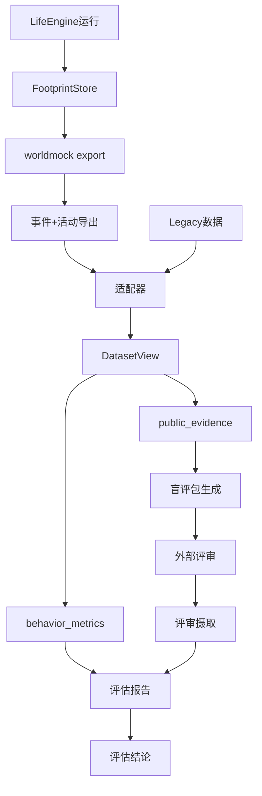
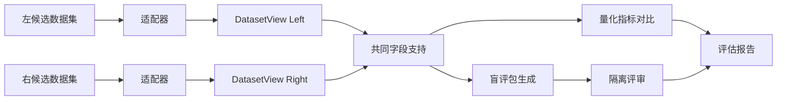
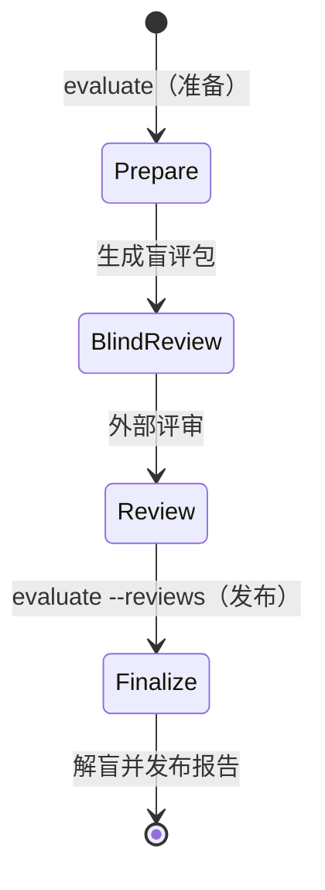
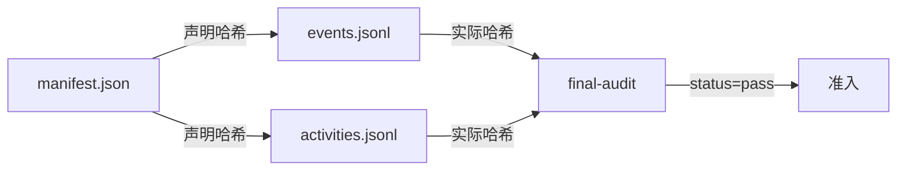
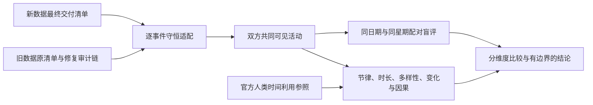

<a name="evaluation"></a>
# WorldMock 产品设计说明书 — 行为评估

<a name="evaluation-模块概述"></a>
## 模块概述

<a name="evaluation-职责与边界"></a>
### 职责与边界

行为评估模块（`worldmock.evaluation`）负责：

**职责**：
- 从两套认证数据集提取公开结构证据
- 计算行为多样性、时间分配等量化指标
- 生成隔离盲评包并校验评审收据
- 按统计方法对比两个数据集的行为分布
- 生成固定输入可复现的评估报告

**边界**：
- 不负责生成数据（由 LifeEngine + FootprintStore 承担）
- 不负责数据修复（由外部适配器承担）
- 不负责模型评审调用（由独立评审会话承担）
- 不推断缺失字段（缺失即标为不可用）
- 不把合成数据当作人类真值

资金守恒与身体资源变化是否符合规则，按[模拟引擎](04-simulation-engine.md)和
[记录引擎设计](05-recording-engine.md)确定性核验；行为合理性评分不能代替这些结算检查。

**评估的目的与限制**：

本模块的唯一目的是**对比两套数字足迹的行为合理性**，结论边界严格限定为 `comparative_plausibility_only`：

- ✅ 允许：报告哪个候选在某维度更符合公开人类活动特性
- ✅ 允许：报告模型评审更偏好哪个候选
- ❌ 禁止：声称已经目标人群实证验证
- ❌ 禁止：把模型评审称作真人评审
- ❌ 禁止：把两套合成数据当作人类真值

<a name="evaluation-与其他模块的关系"></a>
### 与其他模块的关系



<a name="evaluation-核心设计原则"></a>
### 核心设计原则

| 原则 | 含义 | 体现 |
| --- | --- | --- |
| **确定性可复现** | 固定输入产生逐字节相同输出 | 固定种子、排序稳定、无时间戳依赖 |
| **Fail-Closed** | 证据缺失时门禁不通过 | `decision_offered` 缺失 → 静默边界门禁失败 |
| **不推断缺失** | 缺字段标为 `null`，不猜测 | ACTION 缺合法 category → 计入 `unclassified` |
| **来源可追溯** | 保留原始事件指针 | `PublicEvidence.source_event_ids` |
| **结论边界明确** | 不声称已验证人类真实性 | `result_status: comparative_plausibility_only` |

<a name="evaluation-指标定义"></a>
## 指标定义

<a name="evaluation-协议门禁-gates"></a>
### 协议门禁（Gates）

协议门禁由 `behavior_metrics_report` 计算，证据缺失时 `pass=false`（fail-closed）。

| 门禁键 | 判定对象 | 比较 | 阈值 | 失败含义 |
| --- | --- | --- | --- | --- |
| `observation_repetition` | 同一 user 文本（人物决策请求中的每条 user 消息）出现于不同续接链请求中的最大数目：续接链按（人物，模拟秒）划分，链内复用链首 user（含同一决策内重发）只计一次，跨秒重复仍计为重复；排除带 `purpose="plan_day"` 的系统请求；带工具的请求只在工具中有 `start_activity` 时计入，只带 `submit_reflection` 的就寝反思及其校验重试不计（附回消息不带时刻与人物内容，不是观察），不带工具的记忆巩固照计 | `==` | 1 | 观察被重复序列化 |
| `silent_boundary_ratio` | 每人唯一共同身体结算的清醒边界中 `decision_offered=false` 的占比；同刻轮次不写共同身体结算，不进分母 | `>=` | 0.5 | 静默续行边界占比过低：提供决策的边界过密 |
| `memory_repetition_ratio` | 同类型记忆两两 bigram Jaccard ≥ 0.6 的对数占比 | `<=` | 0.2 | 记忆内容重复 |
| `memory_md_identity_residue` | 调用方传入的各人物工作区 `MEMORY.md` 文本命中示例身份的人物数（`MEMORY.md` 不再进人物提示，门禁仍检查它） | `==` | 0 | 示例身份残留 |

**背书**：门禁阈值来自 `docs/design/01-architecture.md` §协议门禁，源码为唯一依据。

认证导出必须通过质量报告结构 6 的结构与重算检查：

| 质量键 | 必须由真实事实重算的内容 |
| --- | --- |
| `content_contact` | `by_app`、`by_action`、`repeat_watch`；重看只在本轮开始前已完成至少一轮时计数 |
| `app_pushes` | `pushed`、`opened_in_session`、`consumed_pinned`、`released_by_completion`、`expired_with_session`、`outside_window_violations`；按唯一 `push_id` 和真实 session 转换计数 |
| `work_topics` | `topics`、`completed`、`worked_seconds_by_topic`、`reports`；topics 计冻结分配的内容数，completed 计实际首次完成；工时按实际消费区间累计，不计暂停或自述 |

`model_usage.by_purpose` 不含 `work_review`，`conversion_efficiency` 不含 `work`。这些键属于认证质量报告，
不能用缺失值、模型文字或当前状态猜测；执行结果取实际门禁回执。
<a name="evaluation-报告项-reports"></a>
### 报告项（Reports）

报告项只进报告，不参与放行。并行活动的各自时长允许重叠，人的经过时间取区间并集；
食品多样性只取本人实际 `goods_received` 中 `meal`、`snack`、`drink` 的收货事实；用餐目标只取其中正餐收货。付款、在途或驿站待领取订单均不算收货，不推导独立进食区间。
记忆重复率只比较明确主观 episodes，不把其文字作为客观完成事实。

| 报告项键 | 说明 | 目标参照 |
| --- | --- | --- |
| `decision_prompt_token_median` | 决策 prompt token 中位数：每个 `phase=request`、不带 `purpose` 的人物决策 `model_request` 计一个值；行动请求含同秒续接与截断重试，不带工具的记忆巩固计入，只带 `submit_reflection` 的就寝反思及校验重试不计；排除 `purpose="plan_day"` | 15000（对照值） |
| `effective_autonomous_decision_rate` | 最终动作非 continue/等待的占比；continue 与等待算被动，等待按结果活动 `kind=wait` 判定；只做结束、暂停或修订的控制轮单列 | 无固定阈值 |
| `wake_reason_distribution` | 各唤醒原因计数，分两份：边界取共同身体结算，决策轮取 `decision_started` | 覆盖所有唤醒类型 |
| `wait_minutes` | 本人真实等待活动的实际区间累计分钟 | 只报告，不设占比上限 |
| `unknown_wait_minutes` | 未有可核验原因的等待活动实际区间累计分钟 | 不根据自由叙述推断目的 |
| `content_contact_minutes` | 实际动作内容消费区间累计分钟 | 不把等待或开始播放计为已接触 |
| `early_arrival_minutes` | 早于开门时间到达的分钟 | 最小化 |
| `sleep_schedule` | 就寝/起床时刻与时长 | 人物卡片就寝窗口（场景声明的 `bedtime_window` 优先） |
| `meal_diversity` | Simpson 集中度与 24h 重复率 | 低集中度、低重复 |
| `activity_distribution` | 当前四种活动与五个动作类别的日时间分布及参照 JS 距离；`wait` 计休息、`travel` 计通勤，`action` 按类别计娱乐、工作、社交、运动或家务；用餐与个人卫生参照分钟没有模拟活动对应物 | 2018 年全国时间利用调查 |
| `persona_distinguishability` | 留一最近邻人物识别准确率 | ≥3 次运行、≥2 人 |
| `social` | 交谈/通话分钟、消息数 | 人物社交需求 |
| `habitual_consistency` | 同人物地点与本地小时的活动家族一致率 | 只报告情境重复性，不识别心理习惯 |
| `deliberate_goals` | 曾登记的非例行意图目标中的家族实际推进率，保留丢弃条目；推进口径与模拟引擎相同（同家族、登记后的正时长结算，带大致时刻的目标还须在其前后 90 分钟内进行）；例行意图（睡眠、晨间例程、通勤、用餐）的目标照常判定，另计 `routine_goals`，不入推进比例；登记来源为零点计划的 `day_plan_generated` 与修订结果 | 只报告，外部参照未接入时为 null |
| `external_constraints` | 去重后的外部约束受阻与动作接受率；引导性拒绝码 `ACTIVITY_PRECONDITION_UNMET`、`ACTIVITY_CONCLUSION_REQUIRED`、`SESSION_LIMIT_EXCEEDED` 计入 `other_rejections`；外部约束闭集不含 `PICKUP_LOCATION_REQUIRED` 与工作地点、技能不符 | 受阻次数为零是运行质量门禁，正确拒绝不等于引擎缺陷 |
| `workload` | 只统计有工作安排的人物与当班日；给出 `shift_seconds`、`at_workplace_seconds`、`work_activity_seconds`、`idle_at_workplace_seconds`、`break_seconds`、`declared_exception_seconds`、`absence_seconds`、`early_leave_seconds`。工作活动秒数取班次内非失败工作活动的实际区间，没有有效工时、效率折扣或任务外出；声明例外只含休息时段 | 只报告，不设阈值，不与下表「就业工作 460 分钟」比较 |
| `routine_deviation` | `agents` 按人物编号给 `days`，观察窗覆盖的每个本地日一行（含不当班日）：`left_workplace_at`（当天最后一次从工作地点出发的本地时刻）与它对场景班次结束的 `leave_vs_shift_end_minutes`、对下班窗口的 `leave_vs_window_minutes`；`arrived_home_at`（其后当天首次到家，当天没有离开工作地点时取当天最后一次到家）与它对到家窗口的 `arrive_home_vs_window_minutes`（偏离分钟，早于窗口为负、晚于为正、窗口内为零；参照或时刻为 null 时该项为 null）；`asleep_at_shift_start`、`asleep_at_shift_end` 单独标注班次两端人物是否在睡（不当班日、没有工作安排或该时刻不在观察窗内时为 null）；`evidence_event_ids` 给离开与到家的证据事件身份。参照是场景班次与覆盖后的作息窗口（结构化卡片的下班、到家锚点），不是当日计划，不读 `day_plan_generated` 或计划字段；容差 `tolerance_seconds` 等于播报间隔，是没有班次边界唤醒的运行里清醒且有进行中活动的人物在班次结束后首个决策机会的滞后上界；同一份评估代码读修订前后两臂的导出，这个定义对两臂都成立；它只写进报告，不作用于偏离值。没有工作安排的人物其离开工作地点一项为 null | 只报告，不设阈值 |

`workload` 与 `routine_deviation` 需要事件之外的输入，经 `behavior_metrics_report` 唯一新增的可选打包参数 `workday`（`WorkdayInputs`：
各人物的工作安排、住处、覆盖后的下班与到家窗口，以及播报间隔；由 `workload_metrics.workday_inputs` 从场景文档与
结构化卡片打包，不解析提示文本）传入，所以只在行为评估的 `reports`，不进 `quality.json`，运行清单不升版，报告自带的结构标识
`behavior-metrics-2`。没有打包输入时两项为 null 并写一条说明，事件里出现而输入里没有的人物两项都为 null 并写说明，说明沿用本模块的中文惯例；
产出入口是 `scripts/inspect_run.py workday --scenario <场景文件>`（见[记录引擎设计「调试工具」](05-recording-engine.md#recording-engine-调试工具)），
口径见[总体架构](01-architecture.md)。

同秒续接轮的思考 token（`reasoning_tokens`，缺失时报字符数，两者不混算）与缓存命中由 `scripts/inspect_run.py continuation`
逐决策报告（链位置、请求数、协议错误与 400、计价成本、话题命中与按订单去重后的重复下单），`--baseline` 先核对两臂清单只差续接开关，
输出字段见[记录引擎设计「调试工具」](05-recording-engine.md#recording-engine-调试工具)；只报告，不参与放行。
输出截断（提供商回复 `finish_reason=length`）的次数、按用途分列、浪费的输出 token 与其中的思考 token 计入 `quality.json` 的
`truncations` 一节（字段见[记录引擎设计「质量报告」](05-recording-engine.md#recording-engine-质量报告)）；行动决策的截断率以其中 `decision` 的次数除以
`model_usage.by_purpose` 中 `decision` 的 `provider_responses`（`decision` 组是不带 `purpose` 的全部请求，与决策 prompt token 中位数
同一口径，含记忆巩固与就寝反思），只报告，不参与放行。
个人事务与收尾记忆的只报告项计入 `quality.json` 的 `errand_metrics` 与 `conclusion_memories` 两节（字段见
[记录引擎设计「质量报告」](05-recording-engine.md#recording-engine-质量报告)）：事务以记下过的不同事务数 `registered_count` 为分母，按运行与事务身份
统计、可跨本地日，不使用任何当日目标指标的键名、不写进 `day_plan_metrics`，也不并入 3.3 所说的习惯、外部约束、刻意目标三层；
`deliberate_goals` 的名称、分母与分组键不变，`memory_repetition_ratio` 门禁的口径与阈值不变。只报告，不参与放行。

工具交互特性的行为报告由已提交请求、纠错、拒绝与结算事实生成：记录世界查询与任务回看的次数、
名称与参数拒绝跨不同模拟时刻的重复次数，以及分配工作内容的实际消费、播报与完成情况。
只读查询不作为世界请求、活动或同刻决策轮统计，但含查询的模型回复本身计入模型请求、token 与十六回合预算。
查询结果只存在于模型与 tool 交换证据，不生成进度层 `events`，不能按动作结算或完成计算。
查询成本另由 `scripts/inspect_run.py queries` 按运行只读报告（口径见[记录引擎设计「调试工具」](05-recording-engine.md#recording-engine-调试工具)），打印
`{run_id, calls, failures, returned_chars, filtered_calls, empty_after_filter, model_calls_to_purchase, reflection_retries}`：查询调用数、
失败数、返回字符数、带筛选（`app` 或 `available_only`）的调用数、筛选后为空的次数、从首次查询到购买结算的模型调用数，以及反思校验
重试次数（工具只有 `submit_reflection` 且带附回消息的模型请求数）；口径取已落库的模型工具交换证据，对照运行同时报告协议错误
（取 `continuation` 报告，本子命令不另设键），降低返回量不能以购买失败为代价。
错误接口、任务、供给价格、料理、查询、操作备忘与紧凑呈现通过实际行为测试和有效源码变异验证。
评估结论必须绑定实际源码与运行身份，不能合并不同身份的结果来声称同一版本通过。
分配工作内容只在指定工作地点执行，完成后不再分配；剩余不足一分钟仍可按实际秒数完成，不设置技能、截止、预约或通知等待。
报价只按构建后冻结的实际供给报告，不能把同商品不同门店重复计成商品多样性，也不能把查询命中计成已获得对象。
上述行为指标只报告，不追加没有依据的运行质量阈值；请求、错误位置与合法值、任务时序及紧凑呈现等价性
由当前行为测试与变异测试确定性验证。

**2018 年全国时间利用调查参照**（城镇/工作日口径，居民均值）：

| 活动类别 | 参照时长（分钟） |
| --- | ---: |
| 睡觉休息 | 553 |
| 个人卫生护理 | 50 |
| 用餐 | 104 |
| 就业工作 | 460 |
| 交通 | 44 |
| 社会交往 | 21 |
| 健身锻炼 | 41 |
| 屏幕娱乐（看电视 100 + 休闲 65） | 165 |
| 无参照（休息 + 家务） | 0 |

**口径约定**：
- 外出(outing)并入通勤(commute)
- wait 计入休息(rest)
- 活动时长按原生活动与 ACTION 快照中的真实类别归类，不为商品收货构造用餐时长；食品多样性按本人食品收货订单计算
- 参照的看电视与休闲娱乐合并为屏幕娱乐 165m
- 休息与家务无参照项，并入无参照桶

<a name="evaluation-指标计算公式"></a>
### 指标计算公式

<a name="evaluation-simpson-集中度"></a>
#### Simpson 集中度

$$
C = \sum_{i=1}^{n} \left( \frac{count_i}{total} \right)^2
$$

其中 $count_i$ 为第 $i$ 个 `goods_id` 的本人食品收货订单数，$total$ 为本人食品收货订单总数；食品包含 `meal`、`snack`、`drink`。同一订单只计一次，值越高越集中。

<a name="evaluation-小时重复率"></a>
#### 小时重复率

$$
R = \frac{\text{与前 24h 本人已收货商品重复的食品收货订单数}}{\text{本人食品收货订单总数}}
$$

<a name="evaluation-js-距离"></a>
#### JS 距离

$$
D_{JS}(P \| Q) = \sqrt{JSD(P \| Q)}
$$

其中 $JSD$ 为 Jensen-Shannon 散度：

$$
JSD(P \| Q) = \frac{1}{2} D_{KL}(P \| M) + \frac{1}{2} D_{KL}(Q \| M), \quad M = \frac{1}{2}(P + Q)
$$

$D_{KL}$ 为 Kullback-Leibler 散度（log2 口径）。

<a name="evaluation-bigram-jaccard-相似度"></a>
#### Bigram Jaccard 相似度

$$
J(A, B) = \frac{|A \cap B|}{|A \cup B|}
$$

其中 $A$、$B$ 为两段文本的字符 bigram 集合。

<a name="evaluation-留一最近邻准确率"></a>
#### 留一最近邻准确率

对于每个 $(run_i, agent_j)$：
- 计算其活动分布向量 $\mathbf{v}_{ij}$（十类家族的归一化比例）
- 在所有其他运行中找最近邻（L1 距离最小）
- 若最近邻的 agent 身份匹配，则正确

$$
Accuracy = \frac{\text{正确识别次数}}{\text{总向量数}}
$$

<a name="evaluation-对比协议"></a>
## 对比协议

<a name="evaluation-三层数据模型"></a>
### 三层数据模型

评估使用三个层级的共同数据模型：

| 层级 | 必需字段 | 统计用途 |
| --- | --- | --- |
| **证据事件** | `occurred_at`, `category`, `interaction`, `object_type`, `state` | 完整性、渠道覆盖、时间检查 |
| **活动** | `started_at`, `ended_at`, `category`, `status`, `segments` | 节律、时长、转换、因果 |
| **自然日** | `date`, `calendar_class`, 活动向量 | 配对比较、自助法 |

<a name="evaluation-证据事件-publicevidence"></a>
#### 证据事件（PublicEvidence）

```python
@dataclass(frozen=True)
class PublicEvidence:
    occurred_at: datetime
    category: str
    interaction: str
    object_type: str
    state: str | None
    object_key: str | None
    attributes: Mapping[str, str]
    source_event_ids: tuple[str, ...]
```

公开证据只取认证源事件能证明的闭集值。当前 WorldMock 统一动作按快照类别映射 interaction，社交按明确 voice/text 记录 call/chat；
有 app 的动作才是数字交互，设备由实际使用方式的 `MANNER_DEVICE` 得到：`phone` 计手机，`other` 是其他设备，未绑定 app 的动作是线下。内容完成和推送状态来自 `app-usage.jsonl` 与对应来源事件，不按名称推断设备或完成。
出行证据的 `object_type="route"`，`object_key` 取活动的 `trip_id`，路径、方式与到达状态必须由真实活动和
结算事件证明。工作证据按真实 `content_id` 与 `work_content_completed` 表示内容累计及完成，不构造任务评审或截止事实。
无法映射的类别使用 `unknown`，缺失字段保留为缺失，不按名称或相邻时刻补值。

<a name="evaluation-活动-activitysession"></a>
#### 活动（ActivitySession）

代码名 `ActivitySession` 沿用，与地点会话无关。WorldMock 适配器只接受认证导出的当前活动行，
LabelKit 适配器只接受其真实上游会话格式；两条来源分支不是旧 WorldMock 格式的兼容读取。

```python
@dataclass(frozen=True)
class ActivitySession:
    activity_id: str
    person_id: str
    category: str
    started_at: datetime
    ended_at: datetime
    elapsed_seconds: float
    status: str
    channels: tuple[str, ...]
    application_category: str | None
    duration_kind: str
    official_domains: tuple[str, ...]
    caused_by: tuple[str, ...]
    source_pointer: str
    source_channels: tuple[str, ...]
```

`elapsed_seconds` 逐字取冻结活动行并与认证事件核对，不用 `ended_at - started_at` 把暂停空档算进活动。
占用格和盲评区间由规范 `EvidenceEvent` 中 `activity_progress.data.interval_start`、`interval_end` 的实际推进区间
构造；相同 `activity_id` 的多段推进保持同一活动身份。`ActivitySession` 不保存或重建 `segments` 字段。

<a name="evaluation-适配器职责"></a>
### 适配器职责

适配器把两个真实上游格式转换为共同模型，来源分支显式分开：

- LabelKit 适配器读取 `actionInfo` 与 `stream`，用 `owner_sequence_id` 建立序列关系；声明只证明声明，
  不能证明订单、到达、内容完成或其他业务终态。
- WorldMock 适配器只读取导出清单 4 的 `events`、`activities`、`purchases` 与 `app_usage`，并核对来源事件指针。
  `start_activity.items[]` 逐项绑定结果中的当前活动快照；`report_status`、`pause_activity` 与
  `conclude_activity` 按 `items[].activity_name` 绑定当前活动身份。
- 数字交互只由实际带 app 的 action 活动与内容进度投影；推送的交付、打开、内容消费和完成释放分别取六种 app 使用事实。
  出行对象键只取 `trip_id`，订单、付款和履约保持三种独立状态，工作累计取真实分配内容的消费与完成事件。
- `recall_task_summary` 与 `query_world` 是查询证据，不投影成活动或世界状态变化。

一个原始事件可以产生多条共同证据，但每条都保留来源事件指针。无法映射的类别写 `unknown`，一方不支持的
字段保持缺失；适配器拒绝已退役的 WorldMock 请求形状和游戏、目录浏览、任务评审字段，不设置兼容读取。

<a name="evaluation-两个数据集对比"></a>
### 两个数据集对比



**共同字段支持**（`public_fields_by_category`）：

按 `(category, field)` 求交集，只在双方都支持的字段上计算指标。

示例：
```json
{
  "purchase": ["interaction", "object_type", "state", "fulfillment_mode"],
  "work": ["interaction", "object_type", "state"],
  "travel": ["interaction", "object_type", "travel_mode"]
}
```

三层事件口径与缺证据规则统一见 [当日目标规格](#evaluation-三层度量与质量导出)。
纯事件统计由行为评估和生产质量导出共同调用，各层按最终规格的分组键隔离：
目标按人物日归属，习惯跨不同本地日比较，外部约束按运行与动作去重。

<a name="evaluation-盲评流程"></a>
## 盲评流程

<a name="evaluation-盲评包生成"></a>
### 盲评包生成

```python
def create_review_material(
    left: DatasetView,
    right: DatasetView,
    support: Mapping[str, Any],
    scenario: EvaluationScenario,
) -> ReviewMaterial
```

**输入**：
- `left`, `right`: 两个候选的 DatasetView
- `support`: 共同字段支持掩码
- `scenario`: 评审场景（窗口、维度、种子、评审者数量）

**输出**：
- `index`: 公开索引（`blind-review-pack.json`）
- `packets`: 隔离评审包（每个评审者一个）
- `key`: 独立解盲键（`unblinding-key.json`）

**评审单元选择**：

覆盖每个周块（默认 7 天）、特殊日期及每周哈希选择的普通日：

```python
for block in date_blocks(scenario):
    items.append(("week", block))  # 整周
    items.extend(("special_day", [d]) for d in special_dates(block))
    for calendar_class in ("regular_workday", "ordinary_weekend"):
        candidates = [d for d in block if scenario.calendar_class(d) == calendar_class]
        if candidates:
            chosen = hashed_choice(candidates, scenario.seed, block_start, calendar_class)
            items.append((calendar_class, [chosen]))
```

**左右随机**：

每个评审槽和单元确定性随机左右顺序：

```python
def swap_sides(seed: str, slot: str, item_id: str) -> bool:
    digest = hashlib.sha256(f"{seed}:{slot}:{item_id}".encode()).digest()
    return bool(digest[0] & 1)
```

**匿名对象引用**：

使用 keyed HMAC 生成匿名引用，候选与评审槽隔离、同侧跨日稳定：

```python
def masked_ref(mask: EvidenceMask, object_type: str, object_key: str) -> str:
    key = hmac_key(mask.seed, mask.reviewer_slot)
    message = f"{mask.candidate_namespace}\0{object_type}\0{object_key}"
    return "object-" + hmac.new(key, message.encode(), "sha256").hexdigest()
```

<a name="evaluation-六维可判定性"></a>
### 六维可判定性

每个评审单元声明六个维度的可判定性：

| 维度 | 可判定条件 | 原因码 |
| --- | --- | --- |
| `temporal_plausibility` | 双方都有活动时间线 | `both_sides_have_observed_activity_timing` |
| `causal_continuity` | 双方都有对象状态变化 | `both_sides_have_observed_object_state_changes` |
| `persona_consistency` | 双方都有活动时间线 | `coarse_shared_profile_and_both_activity_timelines` |
| `long_term_consequences` | 多日且双方都有跨日对象状态变化 | `both_sides_have_cross_day_object_state_changes` |
| `routine_and_variation` | 多日且双方都有活动覆盖 | `multi_day_activity_coverage_on_both_sides` |
| `missing_expected_activity` | 完整声明日期和日历类别 | `complete_declared_days_and_calendar_classes` |

**强制执行**：
- `judgeable=false` 的维度必须选择 `unjudgeable`
- 单侧证据更丰富不代表更真实

<a name="evaluation-评审收据校验"></a>
### 评审收据校验

```python
def ingest_reviews(
    review_paths: Sequence[Path],
    prepared_root: Path,
    scenario: EvaluationScenario,
) -> JsonObject
```

**校验项**：
- 索引与解盲键的身份一致性
- 每个隔离包的哈希、字段闭集
- 评审记录的身份绑定
- 逐单元逐维度完整性
- 可判定性与选择的一致性

**拒绝项**：
- 包内出现 `model`、`provider`、`path`、`run_id` 等身份字段
- `judgeable=false` 的维度选择了非 `unjudgeable`
- 评审槽不匹配、哈希不一致
- 维度不完整或选择超出闭集

<a name="evaluation-解盲与汇总"></a>
### 解盲与汇总

**偏好汇总**（`_preference_summary`）：

分维度统计 `left_candidate`、`right_candidate`、`tie`、`unjudgeable` 的计数和占比。

**周块置信区间**（`_preference_interval`）：

以自然周块为重抽样单位，bootstrap 10000 次，报告 95% 区间：

```python
def preference_difference(values: Sequence[str]) -> float | None:
    judged = [v for v in values if v != "unjudgeable"]
    if not judged:
        return None
    left = sum(v == "left_candidate" for v in judged)
    right = sum(v == "right_candidate" for v in judged)
    return (left - right) / len(judged)
```

**一致性**（Krippendorff's alpha）：

使用成熟 `krippendorff` 包计算 nominal alpha，`unjudgeable` 作为缺失值：

$$
\alpha = 1 - \frac{D_o}{D_e}
$$

其中 $D_o$ 为观测到的不一致，$D_e$ 为期望的不一致。

**评审者依赖披露**：

报告同模型会话分组，避免把它们称为独立真人：

```json
{
  "model_review_count": 3,
  "human_review_count": 0,
  "same_model_session_groups": {
    "deepseek:deepseek-reasoner": ["session-1", "session-2", "session-3"]
  },
  "disclosure": "Model sessions sharing a provider and model may be statistically correlated."
}
```

<a name="evaluation-评估流程"></a>
## 评估流程

<a name="evaluation-两阶段执行"></a>
### 两阶段执行



**阶段一：准备**（`evaluate`，不带 `--reviews`）

```bash
worldmock evaluate \
  --legacy legacy-root/ \
  --worldmock worldmock-export/ \
  --scenario ../WorldMock-Dataset/environment/zhangjiang-baseline/scenarios/evaluation.json \
  --output evaluation-output/
```

`--legacy`、`--worldmock`、`--scenario` 三项必填；有匹配的真人轨迹时另加 `--human-reference`。

输出：
- `blind-review-pack.json`（公开索引）
- `review-packets/reviewer-{01..N}.json`（隔离包）
- `unblinding-key.json`（独立解盲键）
- `metrics.json`（量化指标）
- `mapping-report.json`（适配报告）

**阶段二：定稿**（`evaluate --reviews`）

```bash
worldmock evaluate \
  --output evaluation-output/ \
  --reviews review-session-*.json
```

这一阶段只接受 `--output` 与 `--reviews`，同时带阶段一的输入参数即以英文错误拒绝。

输入：
- `evaluation-output/`
- `--reviews`（评审收据，每个评审者一个）

输出：
- `review-results.json`（解盲偏好与一致性）
- `report.md`（完整评估报告）
- `charts/`（图表）

<a name="evaluation-输入认证"></a>
### 输入认证

**左右候选必需文件**：
- `manifest.json`（交付清单）
- `events.jsonl`（事件导出）
- `activities.jsonl`（活动导出）
- `final-audit.json`（审计收据，`status=pass`）

**校验链**：



**拒绝条件**：
- 哈希不一致
- `final-audit.json` 的 `status != "pass"`
- 窗口不匹配（`window_start`、`window_end`）
- 事件 `occurred_at` 超出窗口
- `run_id` 或 `code_sha256` 缺失

<a name="evaluation-统计方法"></a>
## 统计方法

<a name="evaluation-分布对比"></a>
### 分布对比

**活动时长分布**：

使用 JS 距离对比两个候选与参照的活动分布：

```python
def js_distance(p: list[float], q: list[float]) -> float:
    """计算两个分布的 JS 距离（log2 口径）"""
    p_norm = [x / sum(p) for x in p]
    q_norm = [x / sum(q) for x in q]
    divergence = 0.0
    for pi, qi in zip(p_norm, q_norm):
        m = (pi + qi) / 2.0
        if pi > 0 and m > 0:
            divergence += 0.5 * pi * math.log2(pi / m)
        if qi > 0 and m > 0:
            divergence += 0.5 * qi * math.log2(qi / m)
    return math.sqrt(divergence)
```

**节律相似度**：

将自然日活动向量投影到 10 分钟格，计算欧氏距离矩阵，报告日间距离分布。

<a name="evaluation-显著性检验"></a>
### 显著性检验

**Bootstrap 置信区间**：

固定种子执行 10000 次重抽样，报告 95% 区间：

```python
def bootstrap_ci(data: np.ndarray, statistic, seed: int, n_boot: int = 10000):
    rng = np.random.default_rng(seed)
    indices = rng.integers(0, len(data), size=(n_boot, len(data)))
    bootstrap_stats = [statistic(data[idx]) for idx in indices]
    return np.quantile(bootstrap_stats, [0.025, 0.975])
```

**重抽样单位**：

完整自然周是配对重抽样单位；十二周实验使用十二个自然周，不把事件行当独立样本。

<a name="evaluation-相似度度量"></a>
### 相似度度量

**Jaccard 相似度**（记忆重复检测）：

$$
J(A, B) = \frac{|A \cap B|}{|A \cup B|}
$$

**L1 距离**（人物识别）：

$$
d_{L1}(\mathbf{p}, \mathbf{q}) = \sum_{i=1}^{n} |p_i - q_i|
$$

**KL 散度**（分布对比，仅用于 JS 散度计算）：

$$
D_{KL}(P \| Q) = \sum_{i} p_i \log_2 \frac{p_i}{q_i}
$$

<a name="evaluation-结论边界"></a>
## 结论边界

<a name="evaluation-四种结果状态"></a>
### 四种结果状态

| `result_status` | 含义 | 允许的结论 |
| --- | --- | --- |
| `invalid_input` | 哈希、行数、模式、时间窗或审计链失败 | 只报告输入错误 |
| `not_comparable` | 人物、日历、粒度或共享可观察字段不足 | 只报告不可比较原因 |
| `comparative_plausibility_only` | 两套合成数据可比较，但没有匹配真人轨迹 | 报告差异、官方聚合对齐维度和模型评审偏好 |
| `human_reference_comparison` | 匹配真人轨迹通过同一适配和可比性检查 | 可以按预先声明的判定规则报告胜者或无结论 |

<a name="evaluation-本次结论边界"></a>
### 结论表述边界

结论由输入身份、共同观察覆盖和参照材料决定，不能在设计文档中预先声明某次执行成功。
两套合成数据可以支持相对合理性比较，不能独自证明与真实人群相似。
报告可指出某个时长维度接近匹配的官方聚合值，或说明模型评审偏好；不能把模型会话称为独立真人评审。
具体实验的人物、日期、候选身份、评审结果和未完成项保存在相应实验记录。

<a name="evaluation-门店选择与供给假设的比较边界"></a>
### 门店选择与供给假设的比较边界

环境身份、发布图、商品菜单、app 绑定、完整运输时长与规则版本不同，必须记录为不同实验条件。同类型店铺菜单相同，同一商品跨店同价；比较条件是距离、实际收货等待和固定每单配送费。
食品多样性按本人食品收货的 `goods_id`，门店归属按 `(store_id, goods_id)`；实际订单金额按真实订单件数和配送费核验，单价不能替代账本总额。付款、配送到达与实际收货分别核验：长途到站只进入 `ready_for_pickup`，本人在站零秒领取后才写 `goods_received` 并施加效果，没有持有或独立进食事实。
真实地点与商品名称不证明真实价格或路网，价格、边长和店铺明示运输时长是合成输入。报告人物实际看到的信息、明确选择的 app、付款与收货，不预设近店或外卖必胜，也不继承旧目录的验收数字。详细收货边界见[请求字段与结算检查](04-simulation-engine.md#simulation-engine-请求字段与结算检查)。

<a name="evaluation-外部参照限制"></a>
### 外部参照限制

**2018 年全国时间利用调查**：

- 样本规模：约 10.7 万人
- 采集时间：2024 年 5 月（工作日 + 周末日）
- 公开粒度：全国、城镇、年龄段的边际聚合值
- **限制**：没有"上海城镇 18-59 岁白领"的交叉微观数据

因此只能报告"更符合公开聚合特性"，不能声称"符合目标人群真实分布"。

<a name="evaluation-报告生成"></a>
## 报告生成

<a name="evaluation-报告结构"></a>
### 报告结构

```markdown
# WorldMock 行为评估报告

## 1. 执行摘要
- 评估状态：comparative_plausibility_only
- 左候选：{dataset_id}
- 右候选：{dataset_id}
- 评审者：3 个隔离模型会话

## 2. 输入认证
- 左候选：manifest + audit 通过
- 右候选：manifest + audit 通过
- 窗口：2026-01-05 至 2026-03-30（84 天）

## 3. 适配报告
- 证据事件：左 16,320，右 15,487
- 活动：左 4,380，右 4,102
- 共同字段支持：{category: [fields]}

## 4. 量化指标对比
### 4.1 协议门禁
- observation_repetition（按续接链计）: 左 pass, 右 pass
- silent_boundary_ratio: 左 0.62 (pass), 右 0.48 (fail)
- memory_repetition_ratio: 左 0.08 (pass), 右 0.15 (pass)
- memory_md_identity_residue（检查 MEMORY.md）: 左 0 (pass), 右 0 (pass)

### 4.2 活动分布
- JS 距离（vs 参照）：左 0.245, 右 0.198
- 睡眠：左 530m, 右 560m（参照 553m）
- 工作：左 480m, 右 420m（参照 460m）
- ...

### 4.3 行为多样性
- Simpson 集中度：左 0.68, 右 0.42
- 24h 重复率：左 0.35, 右 0.22
- ...

## 5. 盲评结果
### 5.1 偏好汇总
- temporal_plausibility: 左 12, 右 18, tie 5
- causal_continuity: 左 10, 右 20, tie 3
- ...

### 5.2 置信区间
- temporal_plausibility: [-0.25, -0.05]（偏好右候选）
- ...

### 5.3 一致性
- Krippendorff's alpha: 0.42（moderate agreement）
- 评审者依赖：3 个同源模型会话

## 6. 结论
- 量化指标：右候选在 6/10 维度更接近参照
- 模型评审：右候选在 4/6 维度获得偏好
- 结论状态：comparative_plausibility_only
- 限制：没有匹配真人轨迹，不声称已验证目标人群
```

<a name="evaluation-图表"></a>
### 图表

**活动分布雷达图**：

```python
import matplotlib.pyplot as plt
import numpy as np

categories = list(ACTIVITY_FAMILY_ORDER)
left_values = [...]
right_values = [...]
reference_values = [...]

angles = np.linspace(0, 2 * np.pi, len(categories), endpoint=False).tolist()
left_values += left_values[:1]
right_values += right_values[:1]
reference_values += reference_values[:1]
angles += angles[:1]

fig, ax = plt.subplots(figsize=(8, 8), subplot_kw=dict(projection='polar'))
ax.plot(angles, left_values, 'o-', linewidth=2, label='Left')
ax.plot(angles, right_values, 's-', linewidth=2, label='Right')
ax.plot(angles, reference_values, '^--', linewidth=1, label='Reference')
ax.set_xticks(angles[:-1])
ax.set_xticklabels(categories)
ax.legend(loc='upper right')
plt.savefig('activity-distribution-radar.png')
```

**偏好热图**：

```python
import seaborn as sns

dimensions = scenario.review_dimensions
reviewers = ["reviewer-01", "reviewer-02", "reviewer-03"]
choices = [[...], [...], [...]]  # left=0, right=1, tie=2, unjudgeable=nan

sns.heatmap(choices, xticklabels=dimensions, yticklabels=reviewers,
            cmap='RdYlBu_r', center=1, vmin=0, vmax=2)
plt.savefig('review-preference-heatmap.png')
```

<a name="evaluation-解读指南"></a>
### 解读指南

报告末尾附带解读指南：

**如何阅读量化指标**：
- 门禁 `pass=false` 表示证据缺失或不符合协议
- JS 距离越小表示与参照越接近
- Simpson 集中度越低表示多样性越高

**如何阅读盲评结果**：
- `left`/`right`/`tie` 表示偏好
- `unjudgeable` 表示证据不足以判定
- 置信区间不跨 0 时表示有方向性偏好
- alpha < 0.4 表示一致性较低

**结论边界**：
- 缺少匹配真人微观轨迹时，只能得出 `comparative_plausibility_only`
- 不声称已验证目标人群真实性
- 模型评审不等同于真人评审

<a name="evaluation-三层度量与质量导出"></a>
## 三层度量与质量导出

三层分别输出，不再输出 `plan_actual_deviation`，不能把人物遵守自己叙述当作真实性证据。
行为评估 `reports` 另增的 `workload` 与 `routine_deviation`不属于三层，也不是被删除的偏离分钟指标的恢复：
`routine_deviation` 的参照是覆盖后的作息窗口或场景班次，不是当日计划，不使用 `plan_actual_deviation` 及其字段名，只报告，不进 `quality.json`。
指标按代码摘要分组，各层使用下文指定的运行、人物、动作或情境键；目标按本地日归属，
习惯在同一运行的不同本地日间比较。结果必须确定性，缺样本返回 null 并注明。

| 层 | 度量与证据 | 判定 |
| --- | --- | --- |
| 习惯 | 相同人物、地点、本地小时的已结算活动家族一致率；至少两个不同本地日才有可比较情境，按每个活动首次正时长结算取样 | 只报告；这是情境重复性代理，不声称识别心理习惯 |
| 外部结构 | 动作终态的外部约束受阻次数与成功率；仅计下方冻结错误码闭集中的营业、地点/路线与工作约束拒绝，幂等重放不重复计数 | 受阻次数必须为零；正确拒绝仍是该次运行的受阻证据，不叫引擎校验缺陷 |
| 刻意目标 | 全部成功登记的目标中有真实推进证据的比例，按初始优先级分组，保留未推进的丢弃条目与分母 | 只报告；命名为目标推进率，不叫文字目标完成率 |

目标无外部实测分布时参照值为 null 并说明未接入，不编造兑现阈值；
「低优先级更少兑现」「失败更可能丢弃」仅为未来可验证的预期，不能强制生成行为。

三层报告必须实际进入 `worldmock export` 生成的 `quality.json`，同时供既有行为评估入口使用。
不借此新增其他行为门禁或改写无关记忆协议。外部约束错误码闭集、输出字段与无样本规则由
下面的输出合同冻结，接口合同和验证文档只按职责引用。

<a name="evaluation-度量输出合同"></a>
### 度量输出合同

运行事件表不重复存代码摘要；质量导出从冻结 manifest 的 `code_sha256` 向统计输入注入同源身份，
行为评估输入按自带摘要分组，缺失时明确归入 `code_sha256_unreported`。

新增纯事件模块 `src/worldmock/evaluation/goal_metrics.py`，提供
`day_plan_metrics(events, timezone)`，由行为评估与质量导出共同调用。
`quality.json.day_plan_metrics` 按代码摘要分组，每组有 `habitual_consistency`、
`external_constraints`、`deliberate_goals` 和 `gates.external_constraint_block_count`。
既有行为评估将三层放入 `reports`，将相同约束门禁放入 `gates`；不把既有其他协议门禁强接进质量导出。
`day_plan_metrics` 的键集与分母不因个人事务改变：当前质量报告结构 6 中的 `errand_metrics`、`conclusion_memories` 是与它并列的顶层分组；
`errand_metrics` 以有新增事件的不同事务数（`registered_count`）为分母，两个分组都不使用 `goal_count`、`progressed_count`、`family_progress_rate`
等当日目标指标的键名，不以目标数为分母，也不写进 `day_plan_metrics`；没有样本时整组为 null。

- `habitual_consistency` 按 `(run_id, agent_id, location_id, 本地小时)` 分组。
  来源为活动快照中的地点与每项活动首次正时长结算；以该区间的 `interval_start` 定本地日和小时，
  每活动只取一个样本。
  至少覆盖两个不同本地日才计算同情境家族一致率，分子为同家族有序样本对，分母为全部有序样本对。
  总值按可比样本对加权；输出 `consistency_rate`、`comparable_pair_count`、`groups` 与 `missing_samples`。
  习惯统计沿用既有评估的活动家族聚合口径，映射如下；目标推进则按接口合同中的实际活动令牌匹配，
  不用这一统计聚合去证明目标。未知活动快照类别不进入有效样本。

  | 当前活动种类或 ACTION 类别 | 评估活动家族 |
  | --- | --- |
  | sleep | sleep |
  | travel | commute |
  | wait | rest |
  | action：work_study | work |
  | action：entertainment | entertainment |
  | action：social | social |
  | action：daily_care | chore |
  | action：exercise | exercise |

- `deliberate_goals` 回放零点计划的登记事件（`day_plan_generated`）、修订结果与活动推进后的清单；推进判定与环境同一口径
  （含 `around_time` 前后 90 分钟的窗口，见「实际推进与情绪」）。例行意图 `ROUTINE_INTENT_KINDS`（睡眠、晨间例程、通勤、用餐）的目标
  照常判定与记录，另计一行；推进比例只计非例行意图的目标（一日运行保真规格 2.3、8.2）。
  用首次登记事件与意图区别目标实例；完全相同的未推进条目保留实例；只改 `remind_time` 或只改 `around_time` 的条目保留原实例，
  不产生新实例，也不记为丢弃；文字改变或删除使旧实例成为 `discarded`，再加入产生新实例。
  推进必须关联真实正时长结算事件和 `progress_activity_id`，不能相信孤立的状态字段。
  输出 `per_agent_day`（键含 run_id）、`summary`、`reference=null` 和口径说明；
  每组保留 `goals`（首次优先级、登记及推进事件、pending/progressed/discarded）、
  `goal_count`、`progressed_count`、`discarded_count`、`family_progress_rate`、`by_priority`。
  空目标分母为零且比率为 null。
- `external_constraints` 从 `action_rejected` 及动作终态按 `(run_id, action_id)` 去重；
  外部约束错误码闭集只保留营业、到达准入与路线：`MERCHANT_CLOSED`、`MERCHANT_OPENING_UNKNOWN`、
  `LOCATION_ACCESS_DENIED`、
  `FROZEN_ROUTE_NOT_FOUND`、`ROUTE_UNREACHABLE`、`ROUTE_INFORMATION_UNKNOWN`、
  `DELIVERY_ROUTE_NOT_FOUND`、`DELIVERY_ROUTE_UNREACHABLE`、`DELIVERY_ROUTE_INFORMATION_UNKNOWN`。
  引导性拒绝码 `ACTIVITY_PRECONDITION_UNMET`、`ACTIVITY_CONCLUSION_REQUIRED`、`SESSION_LIMIT_EXCEEDED`
  与其他协议或参数拒绝列为 `other_rejections`，不冒充外部约束。
  输出 `block_count`、`by_error_code`、`source_event_ids`、`evidence_complete`、
  `observed_action_acceptance_rate`。接受率的分母为有确定终态的唯一动作，分子为其中未被拒绝的动作；
  无动作时为 null。拒绝缺 action_id 或 error_code 时证据不完整，门禁 value=null、pass=false；
  完整且无外部受阻时门禁 value=0、pass=true。仅正当业务拒绝不表示软件实现缺陷。

活动快照需保存生活活动目录 `category`，用于真实家族核验；不是从目标文字推测品类。
`render_day` 展示实际活动时间线，目标指标按真实目标与活动证据计算。

<a name="evaluation-真实性结论的通过条件"></a>
## 真实性结论的通过条件

评估实现统一位于 `worldmock.evaluation`，对外入口为 `worldmock evaluate`（准备与定稿两个阶段）。
工具接受明确声明的完整时间窗口；具体日期由评估输入指定。十二周是实验设置，不是所有调用的固定时长。



适配保留的层次依次为证据事件、活动（评估代码名 `ActivitySession`，与地点会话无关）与自然日，每条原始事件恰好映射一次。不把一项活动里的多个屏幕帧当成多个生活行为，
不把没有记录直接认定为睡眠。缺失渠道与未知类别进入明确的支持掩码和覆盖分母，不能计为零质量，更不能自动补齐。
WorldMock 内部模型思考、私有记忆与隐藏身体值不进入共同评分或盲评。

盲评每侧同时提供活动区间和公开结构证据，分别保留时长统计与即时状态事实。公开证据只含时间、活动类别、交互、
对象类型、已证实状态、匿名对象引用和双方共同支持的闭集属性。共同支持按「类别 × 字段」求交集，
逐侧报告实际存在数和适用数；某行缺字段保留缺失，不能填造取值。订单、付款、交付、邮件到达与阅读等状态
必须由对应结构事件证明。商品效果由实际收货事件证明，付款与收货分别核验，不推定食品持有或额外进食活动；活动时长与公开证据按当前动作类别和实际使用方式分类。
活动控制后的状态读取真实活动快照；app 使用读取 `app_use` 与 `content_consumed` 的实际位置和完成状态，
推送漏斗读取交付、打开、消费绑定、完成释放及 session 到期事实。动作回执只证明该次请求执行结果。
`work_content_completed` 只证明本人指派内容的实际消费首次达到时长；播报与工资仍各由独立事实证明。旧数据的 `actionInfo` 只证明声明的行动，
不能直接证明导航已经到达或订单已经提交。会话标识只证明属于同一会话，不能当作真实订单、内容或跨日对象的身份；
没有对象身份就不制造因果链。

原文、品牌、应用名、商品名、地点名、坐标、原始身份、裸摘要及任何私有事件均不进入盲评包。
对象引用使用冻结种子派生密钥的 HMAC，包含真实候选、评审会话、对象类型和已证实对象身份；
同一候选在同一评审包跨日期稳定，候选之间与评审会话之间隔离，左右随机交换不改变引用。
共享人物只声明三项已经核实的事实：单人、白领、所在时区；评审不能从该粗画像推断消费偏好等未共享事实。

| 结论项 | 规则 |
| --- | --- |
| 六维可判定性 | 每个评审单元声明六维可判定性，并在导入评审时强制执行；缺少证据的维度必须选择 `unjudgeable` |
| 行动与后果 | 需要公开的真实对象状态变化 |
| 长期结果 | 需要多日范围和真实跨日对象证据；订单、消息、app 推送 session、全局内容进度和工作主题累计发生真实状态变化才算，重复访问同一路线或地点仅证明重复活动 |
| 证据替代 | 重复屏幕或时间相邻的类别不能替代对象链；单侧提供较丰富的链只说明可观测性差异，不自动获得真实性优势 |
| 节律与例行 | 时间节律、例行与变化、缺失活动和粗画像一致性分别依据活动覆盖、重复与日历范围决定是否可判定 |
| 身份不合法 | 返回 `invalid_input` |
| 共同观察不足 | 返回 `not_comparable` |
| 硬错误 | 存在有证据支持的因果硬错误时，该候选不能被宣布为优胜者；另一方不会因此自动获得人类真实性证明 |
| 冲突与互有优劣 | 量化与盲评冲突、维度互有优劣或区间不足时，明确报告混合结果，不强行选胜者 |
| 缺少人类参照 | 没有匹配的人类微观参照时结果状态为 `comparative_plausibility_only`，仍必须完成本次指标和盲评比较，说明哪些活动特性更合理、各自缺陷和证据局限，不能声称已经验证目标人群的人类相似度 |

必需指标为星期小时节律、工作日/周末差异、活动数量与时长分布、有限样本修正爆发性、相邻间隔相关、
类别熵与有效类别数、类别转换、十分钟活动向量的日间距离及跨周漂移、因果与资源连续性。
统计报告逐维度输出原值、适用日/周、缺失原因与置信区间，不合成一个任意加权总分。
完整自然周是配对重抽样单位；十二周实验使用十二个自然周，固定种子执行 10000 次，报告 95% 区间；不把事件行当独立样本。

盲评包覆盖输入窗口内全部自然周和特殊日期；每周在对应日期存在时，分别按日期哈希选择一个普通工作日和普通周末日，
左右顺序随机。春节整周等不存在普通日期的情况明确记录缺失，不伪造日历类别。
包内只保留共享可见内容，不出现模型、provider、文件路径、运行标识或解盲 key。
同模型的不同会话不能称为独立真人，同源模型相关性必须在报告中说明。工具也接受真实人工评审记录，
计算偏好、无法判断比例及 Krippendorff's alpha，不能把可靠性不足包装成确定胜者。

评估产物包括输入与因果校验、映射报告、`metrics.json`、官方参照、盲评包、独立解盲 key、评审记录、图表和 `report.md`。
固定输入哈希、配置和随机种子时，确定性统计与抽样逐字节相同；模型评审原始响应作为证据保存，不承诺重新调用逐字一致。

<a name="evaluation-重放与外部调用边界"></a>
## 重放与外部调用边界

重放只能复原已经记录下来的结果；再次调用模型时，模型不一定给出相同选择。
本设计不对同一外部服务调用承诺恰好一次，也不以重新调用模型冒充精确重放。恢复与重放的协议与证据见 `docs/design/05-recording-engine.md`「重放与重新调用的区别」。
