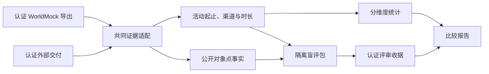

# WorldMock 产品设计说明书 — 行为评估

## 模块概述

### 职责与边界

评估认证两个候选的输入，再比较实际活动节律、数量、时长与公开对象状态变化。
来源认证、资金守恒、直接因果与静默边界检查继续执行。模型文字不能替代结算事实。
没有匹配的人类微观参照时，结果限定为 `comparative_plausibility_only`。

## 指标定义

### 协议门禁

保留观察重复、清醒共同身体边界的静默比例、主观记忆重复与示例身份残留门禁。
证据缺失不能当作通过，事实认证按[记录引擎](05-recording-engine.md)重算。

### 行为报告

`behavior-metrics-3` 报告实际内容消费、人物经过时间、睡眠、唤醒、早到、食品多样性、
外部约束、班次出勤与作息偏离。经过时间使用实际区间并集，跨槽并行不重复计算。
内容接触只取实际正向播放；纯目录展示、推送和系统应用足迹不算消费。
食品样本只取本人实际 `snack`、`meal` 收货；付款和待领取订单不算收货。

外部约束按运行与动作身份去重，统计营业关闭、购买或出行资金不足、配送未到期、
包裹未就绪和 app 内容前提不满足的真实拒绝；同一动作的拒绝与结果只计一次，重放不增加次数。
拒绝按动作计数、不按开始组合并：一个被拒的开始组有两条调用时计两条被拒动作。
协议参数、名称和活动控制纠错单列为 `other_rejections`。缺少动作身份或拒绝码时证据不完整，
受阻门禁为未知并不通过，不能把缺证据或已删除的约束当成零。

工作输入从冻结环境的 `persona.toml`、`config.toml` 和覆盖后的结构化人物卡打包。
`AgentWorkday` 保存工作安排、住处、实际工作地点以及下班和到家窗口。
下班和到家窗口取卡片里未取整的值，换成当天的时刻时截到整秒。
报告保留 `shift_seconds`、`at_workplace_seconds`、`break_seconds`、`declared_exception_seconds`、
`absence_seconds`、`early_leave_seconds`，不从内容、应用或地点推断工作活动。
作息偏离只比较真实离开工作地点、到家和睡眠时刻，不读取日计划。

删除等待、被动决策、社交分类、活动家族分布、人物类别识别、习惯一致性和自动目标推进指标。
删除类别熵、转换、按类别爆发性、十分钟类别向量距离与对应真人分类参照。
不保留恒空或恒零占位。

## 对比协议

### 共同证据

`EvidenceEvent` 保留实际动作、时间、渠道、直接因果、资源变化与原事件指针。
`ActivitySession` 保存实际启动动作、区间、累计秒数、状态、观察渠道和时长语义。
外部交付的原始标签保留在其输入与适配来源中，不要求 WorldMock 增加内容类别。
WorldMock 累计秒数必须与认证推进区间一致，暂停空档不能算活动。
`DayRecord` 保存完整声明自然日、日历类别、实际活动身份和渠道，不生成类别向量。

### 认证与适配

WorldMock 只接受当前认证导出；先校验全部事件前缀，再投影活动。
包含退役活动种类时统一报 `Activity snapshot uses a retired activity kind`，
其他不在当前闭集中的种类报 `Activity type is outside the current closed set`。
公开动作类别直接取请求与活动的 `action`：购买、睡眠和 interact 取请求所写的动作；
出行取活动记下的出行动作，被拒而没有活动的出行请求按所写的出行方式名称对应。不从内容标题反解。
外部适配保留其真实设备信息与原始事件来源，不补造 WorldMock 设备字段。

### 公开点事实

| 实际事实 | 公开证据 |
| --- | --- |
| 四种出行动作 | 实际动作、`travel`、真实 `trip_id` 对应的路线对象 |
| 出行方式 | 步行与驾车保留，公共交通投影为 `transit`，打车投影为 `driving` |
| 内容交互 | `interact` 与真实内容对象；消费与完成只取真实正向推进 |
| 纯目录浏览 | `interact` 与实际应用对象，不伪造内容对象 |
| 活动控制 | 报告、暂停、结束只取实际控制结果和状态 |
| 购买 | 每张实际订单独立生成订单点事实 |
| 付款 | 只认真实 `purchase_payment`；银行卡直付同样保留 |
| 到站、送达与收货 | 真实订单、到站或收货事实，各自独立 |

睡眠开始、系统足迹、消费推送、回调效果和余额提示不增加公开点事实。
删除 WorldMock 通话、聊天、人物对象、邮件与工作指派映射；公开闭集不含 `call`、`chat`、`person`。
`goods_category` 只允许商品目录的四类。

### 共同观察范围

活动比较按双方实际渠道和相同的时长语义判断。
公开字段交集按真实 `object_type` 判断，逐侧保存存在数和适用分母。
缺字段保留缺失，不以工作、娱乐、运动等内容类别筛掉真实活动。
渠道或时长语义不足时明确给出 `not_comparable` 或缺失原因。

### 长期统计

`evaluation-metrics-2` 只保留星期小时节律、普通工作日与周末差异、每日活动数量和可比时长分布。
完整自然周为配对重抽样单位，使用配置中的重复次数输出百分位置信区间。
统计不合成任意加权总分，单方因果硬错误只取消该候选优胜资格，不自动证明另一方真实。

## 盲评与随机性

`blind-review-packet-2` 将活动区间和公开点事实分别保存。
活动行严格为 `{action, start, end, status, location}`；购买与纯目录浏览同样保留真实区间。
完成前取消仍保留区间，但不产生成功付款或收货事实。
地点和对象使用匿名引用，不包含原始身份、品牌、应用名、文件路径或私有模型证据。
旧包标识以 `blind review packet schema is invalid` 拒绝；带同伴或分类字段的活动行以
`blind review activity timeline schema is invalid` 拒绝，错误类型为 `invalid_review`。

每个评审槽覆盖自然周、特殊日以及普通工作日和周末样本；不存在可选日期时记录缺失。
六个评审维度逐项声明可判定性，导入收据时证据不足的维度必须选择 `unjudgeable`。
对象引用在同候选同评审槽跨日稳定，候选与评审槽之间隔离，左右交换不会改变引用。

评估只读已认证 WorldMock 检查点的非空 `random_state`。
缺失报 `WorldMock checkpoint random_state is missing`，类型为 `invalid_input`。
`bootstrap.seed` 与 `review.seed` 删除，旧配置键直接拒绝。
所有带键随机流的键名与位数在[配置设计](08-configuration.md)维护。
统计自举、日期抽样、左右交换和匿名引用共同使用该冻结随机根，私有解盲键保存随机根供独立收据导入。
公开包不包含随机根、运行身份或解盲键。

## 重放与外部调用边界

固定认证输入与配置时，统计和盲评包逐字节可复现。
模型评审原始响应作为证据保存，再次调用外部模型不承诺给出相同响应。
恢复和重放的证据边界由[记录引擎](05-recording-engine.md)维护。
