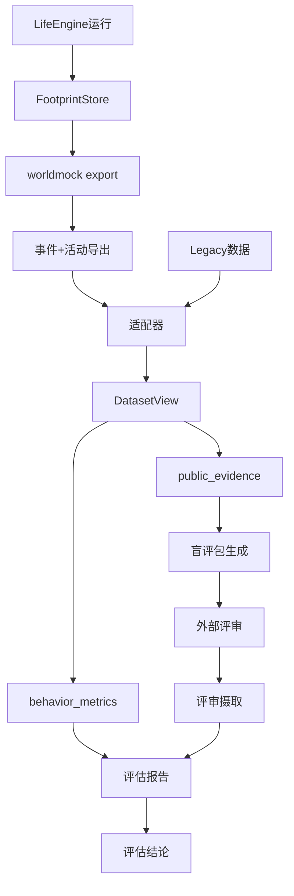
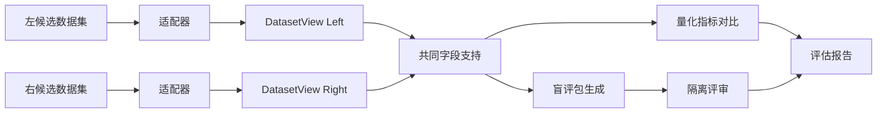
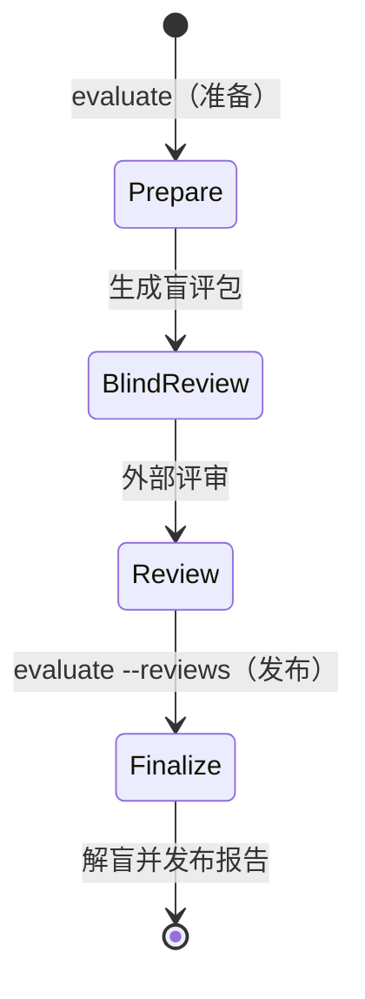
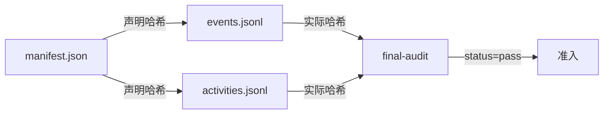

# WorldMock 产品设计说明书 — 行为评估

> **状态**：DRAFT；按人物 Prompt 规格修订，修订部分已实现（证据见[人物 Prompt 验收记录](../dev/persona-prompt-verification.md)）；按一日运行保真规格同步（一日运行保真 EV1），已实现；按[个人事务与工作安排规格](../dev/SPEC-errands-workday.md)分阶段同步（[实施计划](../dev/research/errands-workday-implementation-plan.md) D7 作业），已随代码落地到阶段 3  
> **工具交互修订**：按[工具交互规格](../dev/SPEC-tool-interaction.md)冻结本次设计；本次修订已实现，既有验收不覆盖新行为。
> **日期**：2026-10-04
> **版本**：v1.13
> **目标读者**：算法工程师、开发工程师

## 1. 模块概述

### 1.1 职责与边界

行为评估模块（`worldmock.evaluation`）负责：

**职责**：
- 从两套认证数据集提取公开结构证据
- 计算行为多样性、时间分配等量化指标
- 生成隔离盲评包并校验评审收据
- 按统计方法对比两个数据集的行为分布
- 生成固定输入可复现的评估报告

**边界**：
- 不负责生成数据（由 LifeEngine + FootprintStore 承担）
- 不负责数据修复（由外部适配器承担）
- 不负责模型评审调用（由独立评审会话承担）
- 不推断缺失字段（缺失即标为不可用）
- 不把合成数据当作人类真值

资金守恒与身体资源变化是否符合规则，按[运行时规格](../dev/SPEC-life-runtime.md)和
[记录引擎设计](05-recording-engine.md)确定性核验；行为合理性评分不能代替这些结算检查。

**评估的目的与限制**：

本模块的唯一目的是**对比两套数字足迹的行为合理性**，结论边界严格限定为 `comparative_plausibility_only`：

- ✅ 允许：报告哪个候选在某维度更符合公开人类活动特性
- ✅ 允许：报告模型评审更偏好哪个候选
- ❌ 禁止：声称已经目标人群实证验证
- ❌ 禁止：把模型评审称作真人评审
- ❌ 禁止：把两套合成数据当作人类真值

### 1.2 与其他模块的关系



### 1.3 核心设计原则

| 原则 | 含义 | 体现 |
| --- | --- | --- |
| **确定性可复现** | 固定输入产生逐字节相同输出 | 固定种子、排序稳定、无时间戳依赖 |
| **Fail-Closed** | 证据缺失时门禁不通过 | `decision_offered` 缺失 → 静默边界门禁失败 |
| **不推断缺失** | 缺字段标为 `null`，不猜测 | lifestyle 缺 family → 计入 `unclassified` |
| **来源可追溯** | 保留原始事件指针 | `PublicEvidence.source_event_ids` |
| **结论边界明确** | 不声称已验证人类真实性 | `result_status: comparative_plausibility_only` |

## 2. 指标定义

### 2.1 协议门禁（Gates）

协议门禁由 `behavior_metrics_report` 计算，证据缺失时 `pass=false`（fail-closed）。

| 门禁键 | 判定对象 | 比较 | 阈值 | 失败含义 |
| --- | --- | --- | --- | --- |
| `observation_repetition` | 同一 user 文本（人物决策请求中的每条 user 消息）出现于不同续接链请求中的最大数目：续接链按（人物，模拟秒）划分，链内复用链首 user（含同一决策内重发）只计一次，跨秒重复仍计为重复；排除带 `purpose` 的系统请求，即 `purpose="work_review"` 与 `purpose="plan_day"`；带工具的请求只在工具中有 `start_activity` 时计入，只带 `submit_reflection` 的就寝反思及其校验重试不计（附回消息不带时刻与人物内容，不是观察），不带工具的记忆巩固照计 | `==` | 1 | 观察被重复序列化 |
| `silent_boundary_ratio` | 每人唯一共同身体结算的清醒边界中 `decision_offered=false` 的占比；同刻轮次不写共同身体结算，不进分母 | `>=` | 0.5 | 人物决策机会不足 |
| `memory_repetition_ratio` | 同类型记忆两两 bigram Jaccard ≥ 0.6 的对数占比 | `<=` | 0.2 | 记忆内容重复 |
| `memory_md_identity_residue` | 调用方传入的各人物工作区 `MEMORY.md` 文本命中示例身份的人物数（`MEMORY.md` 不再进人物提示，门禁仍检查它） | `==` | 0 | 示例身份残留 |

**背书**：门禁阈值来自 `docs/VERIFICATION.md` §协议门禁，源码为唯一依据。

### 2.2 报告项（Reports）

报告项只进报告，不参与放行。并行活动的各自时长允许重叠，人的经过时间取区间并集；
用餐指标仅消费 eat 正实际进度，按活动身份去重，购买或受理不算吃过。
记忆重复率只比较明确主观 episodes，不把其文字作为客观完成事实。

| 报告项键 | 说明 | 目标参照 |
| --- | --- | --- |
| `decision_prompt_token_median` | 决策 prompt token 中位数：每个 `phase=request`、不带 `purpose` 的人物决策 `model_request` 计一个值（行动请求含同秒续接与截断重试的请求；不带工具的记忆巩固请求一并计入；带工具的请求只在工具中有 `start_activity` 时计入，就寝反思及其校验重试不计），排除 `purpose="work_review"` 与 `purpose="plan_day"` 的请求 | 15000（对照值） |
| `effective_autonomous_decision_rate` | 最终动作非 continue/等待的占比；continue 与等待算被动，等待按结果活动 `kind=wait` 判定；只做结束、暂停或修订的控制轮单列 | 无固定阈值 |
| `wake_reason_distribution` | 各唤醒原因计数，分两份：边界取共同身体结算，决策轮取 `decision_started` | 覆盖所有唤醒类型 |
| `wait_minutes` | 本人真实等待活动的实际区间累计分钟 | 只报告，不设占比上限 |
| `unknown_wait_minutes` | 未有可核验原因的等待活动实际区间累计分钟 | 不根据自由叙述推断目的 |
| `content_contact_minutes` | 实际 watch 播放活动的执行区间累计分钟 | 不把等待或开始播放计为已接触 |
| `early_arrival_minutes` | 早于开门时间到达的分钟 | 最小化 |
| `sleep_schedule` | 就寝/起床时刻与时长 | 人物卡片就寝窗口（场景声明的 `bedtime_window` 优先） |
| `meal_diversity` | Simpson 集中度与 24h 重复率 | 低集中度、低重复 |
| `activity_distribution` | 十类活动日时间分布与参照 JS 距离 | 2018 年全国时间利用调查 |
| `persona_distinguishability` | 留一最近邻人物识别准确率 | ≥3 次运行、≥2 人 |
| `social` | 交谈/通话分钟、消息数 | 人物社交需求 |
| `habitual_consistency` | 同人物地点与本地小时的活动家族一致率 | 只报告情境重复性，不识别心理习惯 |
| `deliberate_goals` | 曾登记的非例行意图目标中的家族实际推进率，保留丢弃条目；推进口径与模拟引擎相同（同家族、登记后的正时长结算，带大致时刻的目标还须在其前后 90 分钟内进行）；例行意图（睡眠、晨间例程、通勤、用餐）的目标照常判定，另计 `routine_goals`，不入推进比例；登记来源为零点计划的 `day_plan_generated` 与修订结果 | 只报告，外部参照未接入时为 null |
| `external_constraints` | 去重后的外部约束受阻与动作接受率；引导性拒绝码 `ACTIVITY_PRECONDITION_UNMET`、`ACTIVITY_CONCLUSION_REQUIRED`、`SESSION_LIMIT_EXCEEDED` 计入 `other_rejections`；外部约束闭集不含 `PICKUP_LOCATION_REQUIRED` 与工作地点、技能不符 | 受阻次数为零是运行质量门禁，正确拒绝不等于引擎缺陷 |
| `workload` | 只统计有工作安排的人物与当班日：不当班的日子不产生班次，不计入任何一项；班次按人物的观察窗（共同身体结算区间的最早起点到最晚终点）截取。`agents` 按人物编号给十个量在各当班日上的合计：`shift_seconds`（班次秒数）、`at_workplace_seconds`（班次内在工作地点、不在路上的秒数）、`work_activity_seconds`（班次内进行工作活动的秒数）、`effective_work_seconds`（工作进度区间落在班次内的时长乘该区间的工作效率，沿用工作结算的有效工时口径，六位小数）、`idle_at_workplace_seconds`（在工作地点而没有工作活动）、`declared_exception_seconds`（声明例外，等于班次内声明的休息时段 `break_seconds`（人在哪里都算）与任务外出 `task_outing_seconds` 之和）、`absence_seconds`（班次内不在工作地点且不属声明例外）、`early_leave_seconds`（班次内最后一次从工作地点出发，此后班次结束前没有回到工作地点，且出发不在休息时段内、目的地不是本人已开放且未结清的任务要求地点时，为出发到班次结束的秒数，否则为 0）。任务外出只算休息时段之外、本人已开放且未结清的工作任务的要求地点（不是工作地点，含预约任务）：去那里的路上、在那里的时间，以及从那里直接回工作地点的一程；普通任务从开放时刻（最早的本人通知）算起，预约任务从约定开始那一天的当地零点算起（赴约前去往约定地点的路上与提前到达的等候也算，不等约定开始），都到首次付款结清为止；当日不当班不是例外，没有班次。在休息时段内离开工作地点不算早退，休息结束后仍不在工作地点的时间计缺勤。所在地点只由出行事件重建，没有工作安排的人物不进 `agents`；从事件与场景工作安排重算，班内离岗不另写事件 | 只报告，不设阈值，不与下表「就业工作 460 分钟」比较 |
| `routine_deviation` | `agents` 按人物编号给 `days`，观察窗覆盖的每个本地日一行（含不当班日）：`left_workplace_at`（当天最后一次从工作地点出发的本地时刻）与它对场景班次结束的 `leave_vs_shift_end_minutes`、对下班窗口的 `leave_vs_window_minutes`；`arrived_home_at`（其后当天首次到家，当天没有离开工作地点时取当天最后一次到家）与它对到家窗口的 `arrive_home_vs_window_minutes`（偏离分钟，早于窗口为负、晚于为正、窗口内为零；参照或时刻为 null 时该项为 null）；`asleep_at_shift_start`、`asleep_at_shift_end` 单独标注班次两端人物是否在睡（不当班日、没有工作安排或该时刻不在观察窗内时为 null）；`evidence_event_ids` 给离开与到家的证据事件身份。参照是场景班次与覆盖后的作息窗口（结构化卡片的下班、到家锚点），不是当日计划，不读 `day_plan_generated` 或计划字段；容差 `tolerance_seconds` 等于播报间隔，写进报告、不作用于偏离值；没有工作安排的人物其离开工作地点一项为 null | 只报告，不设阈值 |

`workload` 与 `routine_deviation` 需要事件之外的输入，经 `behavior_metrics_report` 唯一新增的可选打包参数 `workday`（`WorkdayInputs`：
各人物的工作安排、本人任务的预约与要求地点、住处、覆盖后的下班与到家窗口，以及播报间隔；由 `workload_metrics.workday_inputs` 从场景文档与
结构化卡片打包，不解析提示文本）传入，所以只在行为评估的 `reports`，不进 `quality.json`，运行清单不升版，报告自带的结构标识
`behavior-metrics-1` 不变。没有打包输入时两项为 null 并写一条说明，事件里出现而输入里没有的人物两项都为 null 并写说明，说明沿用本模块的中文惯例；
产出入口是 `scripts/inspect_run.py workday --scenario <场景文件>`（见[记录引擎设计「调试工具」](05-recording-engine.md#调试工具)），
口径见[个人事务与工作安排规格](../dev/SPEC-errands-workday.md#62-行为评估) 6.2。

同秒续接轮的思考 token（`reasoning_tokens`，缺失时报字符数，两者不混算）与缓存命中由 `scripts/inspect_run.py continuation`
逐决策报告（链位置、请求数、协议错误与 400、计价成本、话题命中与按订单去重后的重复下单），`--baseline` 先核对两臂清单只差续接开关，
输出字段见[记录引擎设计「调试工具」](05-recording-engine.md#调试工具)；只报告，不参与放行。
输出截断（提供商回复 `finish_reason=length`）的次数、按用途分列、浪费的输出 token 与其中的思考 token 计入 `quality.json` 的
`truncations` 一节（字段见[记录引擎设计「质量报告」](05-recording-engine.md#质量报告)）；行动决策的截断率以其中 `decision` 的次数除以
`model_usage.by_purpose` 中 `decision` 的 `provider_responses`（`decision` 组是不带 `purpose` 的全部请求，与决策 prompt token 中位数
同一口径，含记忆巩固与就寝反思），只报告，不参与放行。

工具交互特性的行为报告由已提交请求、纠错、拒绝与结算事实生成：记录世界查询与任务回看的次数、
名称与参数拒绝跨不同模拟时刻的重复次数，以及普通工作收件至开工的经过时间。
只读查询不作为世界请求、活动或同刻决策轮统计，但含查询的模型回复本身计入模型请求、token 与十六回合预算。
查询结果只存在于模型与 tool 交换证据，不生成进度层 `events`，不能按动作结算或完成计算。
错误接口、任务、供给价格、料理、查询、操作备忘与紧凑呈现按独立端到端阶段留下行为与变异收据，
见[工具交互特性门禁](../VERIFICATION.md#工具交互特性门禁)；不同阶段身份分别报告，不能混成同一源码的已实现评估结论。
普通工作因地点、技能或真实截止被拒，与无理由延迟开放分别报告；预约活动的通知至约定开始时间不算错误等待。
报价只按构建后冻结的实际供给报告，不能把同商品不同门店重复计成商品多样性，也不能把查询命中计成已获得对象。
上述行为指标只报告，不追加没有依据的运行质量阈值；请求、错误位置与合法值、任务时序及紧凑呈现等价性
以工具交互规格的行为测试与变异测试确定性验收。

**2018 年全国时间利用调查参照**（城镇/工作日口径，居民均值）：

| 活动类别 | 参照时长（分钟） |
| --- | ---: |
| 睡觉休息 | 553 |
| 个人卫生护理 | 50 |
| 用餐 | 104 |
| 就业工作 | 460 |
| 交通 | 44 |
| 社会交往 | 21 |
| 健身锻炼 | 41 |
| 屏幕娱乐（看电视 100 + 休闲 65） | 165 |
| 无参照（休息 + 家务） | 0 |

**口径约定**：
- 外出(outing)并入通勤(commute)
- wait 计入休息(rest)
- consume 仅在有 eat 正实际进度时计入用餐；use 模式未归类
- 参照的看电视与休闲娱乐合并为屏幕娱乐 165m
- 休息与家务无参照项，并入无参照桶

### 2.3 指标计算公式

#### Simpson 集中度

$$
C = \sum_{i=1}^{n} \left( \frac{count_i}{total} \right)^2
$$

其中 $count_i$ 为第 $i$ 个商品的消费次数，$total$ 为总消费次数。值越高越集中。

#### 24 小时重复率

$$
R = \frac{\text{与前 24h 内已食商品重复的进食次数}}{\text{总进食次数}}
$$

#### JS 距离

$$
D_{JS}(P \| Q) = \sqrt{JSD(P \| Q)}
$$

其中 $JSD$ 为 Jensen-Shannon 散度：

$$
JSD(P \| Q) = \frac{1}{2} D_{KL}(P \| M) + \frac{1}{2} D_{KL}(Q \| M), \quad M = \frac{1}{2}(P + Q)
$$

$D_{KL}$ 为 Kullback-Leibler 散度（log2 口径）。

#### Bigram Jaccard 相似度

$$
J(A, B) = \frac{|A \cap B|}{|A \cup B|}
$$

其中 $A$、$B$ 为两段文本的字符 bigram 集合。

#### 留一最近邻准确率

对于每个 $(run_i, agent_j)$：
1. 计算其活动分布向量 $\mathbf{v}_{ij}$（十类家族的归一化比例）
2. 在所有其他运行中找最近邻（L1 距离最小）
3. 若最近邻的 agent 身份匹配，则正确

$$
Accuracy = \frac{\text{正确识别次数}}{\text{总向量数}}
$$

## 3. 对比协议

### 3.1 三层数据模型

评估使用三个层级的共同数据模型：

| 层级 | 必需字段 | 统计用途 |
| --- | --- | --- |
| **证据事件** | `occurred_at`, `category`, `interaction`, `object_type`, `state` | 完整性、渠道覆盖、时间检查 |
| **活动** | `started_at`, `ended_at`, `category`, `status`, `segments` | 节律、时长、转换、因果 |
| **自然日** | `date`, `calendar_class`, 活动向量 | 配对比较、自助法 |

#### 证据事件（PublicEvidence）

```python
@dataclass(frozen=True)
class PublicEvidence:
    """公开结构证据，剥离原文和私有身份"""
    occurred_at: datetime
    category: str  # 活动类别（闭集）
    interaction: str  # 交互类型（闭集）
    object_type: str  # 对象类型（闭集）
    state: str | None  # 状态（闭集或 None）
    object_key: str | None  # 匿名对象引用
    attributes: Mapping[str, str]  # 额外闭集属性
    source_event_ids: tuple[str, ...]  # 原始事件指针
    session_key: str | None  # 会话标识（用于折叠重复）
```

**闭集公开值**：

- `interaction`: order, travel, check_in, view, play, consume, notify, arrive, ...
- `object_type`: order, route, workplace, content, game, product, task, message, ...
- `state`: requested, started, completed, received, paid, delivered, cancelled, failed, ...

#### 活动（ActivitySession）

代码名 `ActivitySession` 沿用，与地点会话无关。

```python
@dataclass(frozen=True)
class ActivitySession:
    """一项活动，可能跨多个时间段"""
    activity_id: str
    started_at: datetime
    ended_at: datetime
    category: str  # 活动类别（十类闭集）
    status: str  # 终态：completed, interrupted, ongoing
    segments: tuple[tuple[datetime, datetime], ...] | None  # 分段区间
```

**十类活动家族**：
`sleep`, `morning_routine`, `commute`, `work`, `meal`, `rest`, `entertainment`, `social`, `chore`, `exercise`

### 3.2 适配器职责

适配器负责将来源数据（Legacy 或 WorldMock）转换为共同模型：

**Legacy 适配器**（`labelkit_public_evidence`）：
- 读取 `actionInfo`（声明）和 `stream` 事件（结构事实）
- 使用 `owner_sequence_id` 建立事件到序列的连接
- 投影 `appUsageEvent`、`screenMemoryEvent`、`notificationEvent` 等
- **不推断业务终态**：`actionInfo` 只证明声明，不证明完成

**WorldMock 适配器**（`worldmock_public_evidence`）：
- 读取 `action_requested`、`action_result`、`environment_event`
- 使用 `action_id` 回链请求与结果
- `start_activity.items[]` 的每项含可读 `target`、`way`、`from`、`to`；请求不再含 `actions[]` 或旧平行数组。
  内部动作从冻结绑定和结果事实解析，不能仅从方式的文字猜测；细分交互取结果中
  活动快照的 `kind`；同一请求启动两项活动时，按结果中对应顺序的 `data.activities[]` 快照投影两项证据，
  不把另一项动作的结果或付款记到本项
- `report_status`、`pause_activity`、`conclude_activity` 按请求的 `items[].activity_name` 逐活动投影，
  活动身份取结果逐项回报的 `activity_ids`；从真实活动快照读取对象身份、状态和交通方式；结束状态取活动的实际终态（完成、失败或已取消）
- 区分订单、付款、履约三个独立状态
- `recall_task_summary` 与 `query_world` 只作为查询证据，不投影活动或世界请求；查询失败按英文 `items[].path`、
  `allowed_values` 和 `expected` 留证，查询结果不得代替真实受理或完成。

**不变量**：
- 一个原始事件可产生多条共同证据：双活动分别成条，实际付款另成条；每条保留来源事件指针
- 无法映射的类别使用 `unknown`，不猜测
- 一方不支持的字段标为 `null`，不填造

### 3.3 两个数据集对比



**共同字段支持**（`public_fields_by_category`）：

按 `(category, field)` 求交集，只在双方都支持的字段上计算指标。

示例：
```json
{
  "purchase": ["interaction", "object_type", "state", "fulfillment_mode"],
  "work": ["interaction", "object_type", "state"],
  "travel": ["interaction", "object_type", "travel_mode"]
}
```

三层事件口径与缺证据规则统一见 [当日目标规格](../dev/SPEC-day-plan-goals.md#三层度量与质量导出)。
纯事件统计由行为评估和生产质量导出共同调用，各层按最终规格的分组键隔离：
目标按人物日归属，习惯跨不同本地日比较，外部约束按运行与动作去重。

## 4. 盲评流程

### 4.1 盲评包生成

```python
def create_review_material(
    left: DatasetView,
    right: DatasetView,
    support: Mapping[str, Any],
    scenario: EvaluationScenario,
) -> ReviewMaterial
```

**输入**：
- `left`, `right`: 两个候选的 DatasetView
- `support`: 共同字段支持掩码
- `scenario`: 评审场景（窗口、维度、种子、评审者数量）

**输出**：
- `index`: 公开索引（`blind-review-pack.json`）
- `packets`: 隔离评审包（每个评审者一个）
- `key`: 独立解盲键（`unblinding-key.json`）

**评审单元选择**：

覆盖每个周块（默认 7 天）、特殊日期及每周哈希选择的普通日：

```python
for block in date_blocks(scenario):
    items.append(("week", block))  # 整周
    items.extend(("special_day", [d]) for d in special_dates(block))
    for calendar_class in ("regular_workday", "ordinary_weekend"):
        candidates = [d for d in block if scenario.calendar_class(d) == calendar_class]
        if candidates:
            chosen = hashed_choice(candidates, scenario.seed, block_start, calendar_class)
            items.append((calendar_class, [chosen]))
```

**左右随机**：

每个评审槽和单元确定性随机左右顺序：

```python
def swap_sides(seed: str, slot: str, item_id: str) -> bool:
    digest = hashlib.sha256(f"{seed}:{slot}:{item_id}".encode()).digest()
    return bool(digest[0] & 1)
```

**匿名对象引用**：

使用 keyed HMAC 生成匿名引用，候选与评审槽隔离、同侧跨日稳定：

```python
def masked_ref(mask: EvidenceMask, object_type: str, object_key: str) -> str:
    key = hmac_key(mask.seed, mask.reviewer_slot)
    message = f"{mask.candidate_namespace}\0{object_type}\0{object_key}"
    return "object-" + hmac.new(key, message.encode(), "sha256").hexdigest()
```

### 4.2 六维可判定性

每个评审单元声明六个维度的可判定性：

| 维度 | 可判定条件 | 原因码 |
| --- | --- | --- |
| `temporal_plausibility` | 双方都有活动时间线 | `both_sides_have_observed_activity_timing` |
| `causal_continuity` | 双方都有对象状态变化 | `both_sides_have_observed_object_state_changes` |
| `persona_consistency` | 双方都有活动时间线 | `coarse_shared_profile_and_both_activity_timelines` |
| `long_term_consequences` | 多日且双方都有跨日对象状态变化 | `both_sides_have_cross_day_object_state_changes` |
| `routine_and_variation` | 多日且双方都有活动覆盖 | `multi_day_activity_coverage_on_both_sides` |
| `missing_expected_activity` | 完整声明日期和日历类别 | `complete_declared_days_and_calendar_classes` |

**强制执行**：
- `judgeable=false` 的维度必须选择 `unjudgeable`
- 单侧证据更丰富不代表更真实

### 4.3 评审收据校验

```python
def ingest_reviews(
    review_paths: Sequence[Path],
    prepared_root: Path,
    scenario: EvaluationScenario,
) -> JsonObject
```

**校验项**：
1. 索引与解盲键的身份一致性
2. 每个隔离包的哈希、字段闭集
3. 评审记录的身份绑定
4. 逐单元逐维度完整性
5. 可判定性与选择的一致性

**拒绝项**：
- 包内出现 `model`、`provider`、`path`、`run_id` 等身份字段
- `judgeable=false` 的维度选择了非 `unjudgeable`
- 评审槽不匹配、哈希不一致
- 维度不完整或选择超出闭集

### 4.4 解盲与汇总

**偏好汇总**（`_preference_summary`）：

分维度统计 `left_candidate`、`right_candidate`、`tie`、`unjudgeable` 的计数和占比。

**周块置信区间**（`_preference_interval`）：

以自然周块为重抽样单位，bootstrap 10000 次，报告 95% 区间：

```python
def preference_difference(values: Sequence[str]) -> float | None:
    judged = [v for v in values if v != "unjudgeable"]
    if not judged:
        return None
    left = sum(v == "left_candidate" for v in judged)
    right = sum(v == "right_candidate" for v in judged)
    return (left - right) / len(judged)
```

**一致性**（Krippendorff's alpha）：

使用成熟 `krippendorff` 包计算 nominal alpha，`unjudgeable` 作为缺失值：

$$
\alpha = 1 - \frac{D_o}{D_e}
$$

其中 $D_o$ 为观测到的不一致，$D_e$ 为期望的不一致。

**评审者依赖披露**：

报告同模型会话分组，避免把它们称为独立真人：

```json
{
  "model_review_count": 3,
  "human_review_count": 0,
  "same_model_session_groups": {
    "deepseek:deepseek-reasoner": ["session-1", "session-2", "session-3"]
  },
  "disclosure": "Model sessions sharing a provider and model may be statistically correlated."
}
```

## 5. 评估流程

### 5.1 两阶段执行



**阶段一：准备**（`evaluate`，不带 `--reviews`）

```bash
worldmock evaluate \
  --legacy legacy-root/ \
  --worldmock worldmock-export/ \
  --scenario scenarios/evaluation.json \
  --output evaluation-output/
```

`--legacy`、`--worldmock`、`--scenario` 三项必填；有匹配的真人轨迹时另加 `--human-reference`。

输出：
- `blind-review-pack.json`（公开索引）
- `review-packets/reviewer-{01..N}.json`（隔离包）
- `unblinding-key.json`（独立解盲键）
- `metrics.json`（量化指标）
- `mapping-report.json`（适配报告）

**阶段二：定稿**（`evaluate --reviews`）

```bash
worldmock evaluate \
  --output evaluation-output/ \
  --reviews review-session-*.json
```

这一阶段只接受 `--output` 与 `--reviews`，同时带阶段一的输入参数即以英文错误拒绝。

输入：
- `evaluation-output/`（阶段一的输出）
- `--reviews`（评审收据，每个评审者一个）

输出：
- `review-results.json`（解盲偏好与一致性）
- `report.md`（完整评估报告）
- `charts/`（图表）

### 5.2 输入认证

**左右候选必需文件**：
- `manifest.json`（交付清单）
- `events.jsonl`（事件导出）
- `activities.jsonl`（活动导出）
- `final-audit.json`（审计收据，`status=pass`）

**校验链**：



**拒绝条件**：
- 哈希不一致
- `final-audit.json` 的 `status != "pass"`
- 窗口不匹配（`window_start`、`window_end`）
- 事件 `occurred_at` 超出窗口
- `run_id` 或 `code_sha256` 缺失

## 6. 统计方法

### 6.1 分布对比

**活动时长分布**：

使用 JS 距离对比两个候选与参照的活动分布：

```python
def js_distance(p: list[float], q: list[float]) -> float:
    """计算两个分布的 JS 距离（log2 口径）"""
    p_norm = [x / sum(p) for x in p]
    q_norm = [x / sum(q) for x in q]
    divergence = 0.0
    for pi, qi in zip(p_norm, q_norm):
        m = (pi + qi) / 2.0
        if pi > 0 and m > 0:
            divergence += 0.5 * pi * math.log2(pi / m)
        if qi > 0 and m > 0:
            divergence += 0.5 * qi * math.log2(qi / m)
    return math.sqrt(divergence)
```

**节律相似度**：

将自然日活动向量投影到 10 分钟格，计算欧氏距离矩阵，报告日间距离分布。

### 6.2 显著性检验

**Bootstrap 置信区间**：

固定种子执行 10000 次重抽样，报告 95% 区间：

```python
def bootstrap_ci(data: np.ndarray, statistic, seed: int, n_boot: int = 10000):
    rng = np.random.default_rng(seed)
    indices = rng.integers(0, len(data), size=(n_boot, len(data)))
    bootstrap_stats = [statistic(data[idx]) for idx in indices]
    return np.quantile(bootstrap_stats, [0.025, 0.975])
```

**重抽样单位**：

正式 84 天以十二个完整自然周为配对重抽样单位，不把事件行当独立样本。

### 6.3 相似度度量

**Jaccard 相似度**（记忆重复检测）：

$$
J(A, B) = \frac{|A \cap B|}{|A \cup B|}
$$

**L1 距离**（人物识别）：

$$
d_{L1}(\mathbf{p}, \mathbf{q}) = \sum_{i=1}^{n} |p_i - q_i|
$$

**KL 散度**（分布对比，仅用于 JS 散度计算）：

$$
D_{KL}(P \| Q) = \sum_{i} p_i \log_2 \frac{p_i}{q_i}
$$

## 7. 结论边界

### 7.1 四种结果状态

| `result_status` | 含义 | 允许的结论 |
| --- | --- | --- |
| `invalid_input` | 哈希、行数、模式、时间窗或审计链失败 | 只报告输入错误 |
| `not_comparable` | 人物、日历、粒度或共享可观察字段不足 | 只报告不可比较原因 |
| `comparative_plausibility_only` | 两套合成数据可比较，但没有匹配真人轨迹 | 报告差异、官方聚合对齐维度和模型评审偏好 |
| `human_reference_comparison` | 匹配真人轨迹通过同一适配和可比性检查 | 可以按预先声明的判定规则报告胜者或无结论 |

### 7.2 本次结论边界

**本次评估状态**：`comparative_plausibility_only`

原因：
- 既有对照数据真实存在（DeepSeek 十二周基线）
- 没有匹配的真人微观轨迹
- 两套合成数据自身不能构成人类真值

**允许表述**：
- ✅ "候选 A 在工作时长维度更接近 2018 年全国时间利用调查的城镇居民均值"
- ✅ "三个模型评审会话中，2 个偏好候选 B，1 个选择 tie"
- ✅ "候选 B 的 Simpson 集中度为 0.42，低于候选 A 的 0.68，显示更高的商品多样性"

**禁止表述**：
- ❌ "候选 A 已通过目标人群实证验证"
- ❌ "真人评审一致认为候选 B 更真实"
- ❌ "候选 A 完全符合上海张江白领的真实行为"

### 门店选择与供给假设的比较边界

地图集合、供给假设、营业声明、路线方式来源和运行身份不同，须作为不同实验条件记录。
品类契约、购买配对系数和计价口径也属于比较条件；原始报价与实际付款分别统计，
单份比较金额不能代替按真实数量计算的订单行金额。各特性旧目录身份和验收数字不能拼接成新组合的通过证据。
商品多样性按 `product_id`，门店供给选择按 `supply_id`，不能把同一商品的两家门店当作两种商品。
近店较贵、远店较便宜的验收检查人物实际获得比较事实与选择记录，不预设必须选择哪家。
到达后闭店或售罄产生的旅行与失败都是真实模拟事实，不能从时间和费用统计删除。
张江真实地点加显式供给假设，只支持该假设场景下的行为结论，不能宣称复现当地真实零售需求。
二百二十份按方式命名的路线材料不等于步行/驾车均通过来源核验；最终报告引用实际准入和修复证据。


### 7.3 外部参照限制

**2018 年全国时间利用调查**：

- 样本规模：约 10.7 万人
- 采集时间：2024 年 5 月（工作日 + 周末日）
- 公开粒度：全国、城镇、年龄段的边际聚合值
- **限制**：没有"上海城镇 18-59 岁白领"的交叉微观数据

因此只能报告"更符合公开聚合特性"，不能声称"符合目标人群真实分布"。

## 8. 报告生成

### 8.1 报告结构

```markdown
# WorldMock 行为评估报告

## 1. 执行摘要
- 评估状态：comparative_plausibility_only
- 左候选：{dataset_id}
- 右候选：{dataset_id}
- 评审者：3 个隔离模型会话

## 2. 输入认证
- 左候选：manifest + audit 通过
- 右候选：manifest + audit 通过
- 窗口：2026-01-05 至 2026-03-30（84 天）

## 3. 适配报告
- 证据事件：左 16,320，右 15,487
- 活动：左 4,380，右 4,102
- 共同字段支持：{category: [fields]}

## 4. 量化指标对比
### 4.1 协议门禁
- observation_repetition（按续接链计）: 左 pass, 右 pass
- silent_boundary_ratio: 左 0.62 (pass), 右 0.48 (fail)
- memory_repetition_ratio: 左 0.08 (pass), 右 0.15 (pass)
- memory_md_identity_residue（检查 MEMORY.md）: 左 0 (pass), 右 0 (pass)

### 4.2 活动分布
- JS 距离（vs 参照）：左 0.245, 右 0.198
- 睡眠：左 530m, 右 560m（参照 553m）
- 工作：左 480m, 右 420m（参照 460m）
- ...

### 4.3 行为多样性
- Simpson 集中度：左 0.68, 右 0.42
- 24h 重复率：左 0.35, 右 0.22
- ...

## 5. 盲评结果
### 5.1 偏好汇总
- temporal_plausibility: 左 12, 右 18, tie 5
- causal_continuity: 左 10, 右 20, tie 3
- ...

### 5.2 置信区间
- temporal_plausibility: [-0.25, -0.05]（偏好右候选）
- ...

### 5.3 一致性
- Krippendorff's alpha: 0.42（moderate agreement）
- 评审者依赖：3 个同源模型会话

## 6. 结论
- 量化指标：右候选在 6/10 维度更接近参照
- 模型评审：右候选在 4/6 维度获得偏好
- 结论状态：comparative_plausibility_only
- 限制：没有匹配真人轨迹，不声称已验证目标人群
```

### 8.2 图表

**活动分布雷达图**：

```python
import matplotlib.pyplot as plt
import numpy as np

categories = list(ACTIVITY_FAMILY_ORDER)
left_values = [...]
right_values = [...]
reference_values = [...]

angles = np.linspace(0, 2 * np.pi, len(categories), endpoint=False).tolist()
left_values += left_values[:1]
right_values += right_values[:1]
reference_values += reference_values[:1]
angles += angles[:1]

fig, ax = plt.subplots(figsize=(8, 8), subplot_kw=dict(projection='polar'))
ax.plot(angles, left_values, 'o-', linewidth=2, label='Left')
ax.plot(angles, right_values, 's-', linewidth=2, label='Right')
ax.plot(angles, reference_values, '^--', linewidth=1, label='Reference')
ax.set_xticks(angles[:-1])
ax.set_xticklabels(categories)
ax.legend(loc='upper right')
plt.savefig('activity-distribution-radar.png')
```

**偏好热图**：

```python
import seaborn as sns

dimensions = scenario.review_dimensions
reviewers = ["reviewer-01", "reviewer-02", "reviewer-03"]
choices = [[...], [...], [...]]  # left=0, right=1, tie=2, unjudgeable=nan

sns.heatmap(choices, xticklabels=dimensions, yticklabels=reviewers,
            cmap='RdYlBu_r', center=1, vmin=0, vmax=2)
plt.savefig('review-preference-heatmap.png')
```

### 8.3 解读指南

报告末尾附带解读指南：

**如何阅读量化指标**：
- 门禁 `pass=false` 表示证据缺失或不符合协议
- JS 距离越小表示与参照越接近
- Simpson 集中度越低表示多样性越高

**如何阅读盲评结果**：
- `left`/`right`/`tie` 表示偏好
- `unjudgeable` 表示证据不足以判定
- 置信区间不跨 0 时表示有方向性偏好
- alpha < 0.4 表示一致性较低

**结论边界**：
- 本次评估为 `comparative_plausibility_only`
- 不声称已验证目标人群真实性
- 模型评审不等同于真人评审

## 版本历史

| 版本 | 日期 | 修订内容 |
| --- | --- | --- |
| v1.0 | 2026-09-20 | 初版：模块概述、指标定义、对比协议、盲评流程、评估流程、统计方法、结论边界、报告生成 |
| v1.1 | 2026-09-20 | 区分行为合理性评估与资源结算的确定性核验 |
| v1.2 | 2026-09-24 | 按时间与能量规格：决策统计排除零点计划请求，被动轮与控制轮分列，唤醒原因分边界与决策轮两份；目标登记来源改为零点计划与修订；引导性拒绝计入 `other_rejections`；consume 用餐口径对齐源码；「活动会话」改称「活动」并删未实现字段；适配器按动词与方式配对、控制工具逐活动投影 |
| v1.3 | 2026-09-25 | 按时间与能量规格阶段 1：观察重复门禁改按 `decision_id` 计，同一决策内重发只计一次；静默边界占比注明同刻轮次不写共同身体结算、不进分母 |
| v1.4 | 2026-09-25 | 按时间与能量规格阶段 5：观察重复门禁排除带 `purpose` 的系统请求，除工作验收外也排除零点计划 `purpose="plan_day"` 的请求 |
| v1.5 | 2026-09-27 | 按人物 Prompt 七层规格（人物 Prompt 台账 E7-1–E7-5，E7-2 为阶段 1、E7-4 为阶段 2、E7-3 与 E7-5 为阶段 3 同批作业）：文件头注明修订部分待实现；观察重复门禁按（人物，模拟秒）的续接链计，链内复用链首 user 合法，跨秒重复仍失败；示例身份残留改为检查记忆层 JSON；决策 prompt token 中位数按单次行动请求（含续接）计，续接轮的思考 token 与缓存命中由 `inspect_run continuation` 只报告；报告结构示例随之标注 |
| v1.6 | 2026-09-28 | 人物 Prompt 七层规格实现后文档：按最终代码核对，`memory_md_identity_residue` 仍检查调用方传入的 `MEMORY.md` 文本（冻结时误写为记忆层 JSON，改回），`observation_repetition` 与 `decision_prompt_token_median` 按不带 `purpose` 的全部请求计，`scripts/inspect_run.py continuation` 补报告项、`--baseline` 核对与输出字段链接；报告结构示例同步；文件头注明修订部分已实现 |
| v1.7 | 2026-09-29 | 按[一日运行保真规格](../dev/SPEC-dayrun-fidelity.md)同步（一日运行保真 EV1，随阶段 2、5 的代码落地，按 `34a41ee` 核对）：「报告项」`deliberate_goals` 的家族推进率只计非例行意图，带大致时刻的目标只认其前后 90 分钟内进行的活动，例行意图另计；作息参照写明场景声明的 `bedtime_window` 优先；输出截断计入 `quality.json` 的 `truncations`，截断率的分母写明 `decision` 组口径；「适配器职责」控制工具按请求的 `items[].activity_name` 逐活动投影（旧运行为 `task[]`，活动身份取结果逐项回报的 `activity_ids`）；文件头补修订说明，日期改写 |
| v1.8 | 2026-10-01 | 工具交互设计冻结并已实现：公共证据改用`items[]`与真实绑定解析，任务回看和世界查询不作为世界请求或活动，错误留精确位置与合法值；报告跨时刻重复拒绝、普通工作通知至开工及预约例外；新行为须经行为与变异测试，不追加无依据阈值 |
| v1.9 | 2026-10-03 | 按[个人事务与工作安排规格](../dev/SPEC-errands-workday.md)同步（实施计划 D7 作业，阶段 1，按 `a1f680b` 核对）：阶段 1 的四项运行修复不改变本文的指标与门禁；顺带把 5.1 的命令行参数改为实际的 `--legacy`、`--worldmock`、`--scenario`、`--output`、`--reviews`（另有可选的 `--human-reference`），两个阶段按是否带 `--reviews` 区分，没有 `--phase` 参数；文件头补同步说明，日期改写；版本表改为末行最新 |
| v1.10 | 2026-10-03 | 按[个人事务与工作安排规格](../dev/SPEC-errands-workday.md)阶段 1 的独立复核修订（规格 1.1「身份与判定」）：协议门禁 `observation_repetition` 与报告项 `decision_prompt_token_median` 的输入改为带工具的请求只在工具中有 `start_activity` 时计入，只带 `submit_reflection` 的就寝反思及其校验重试不计，不带工具的记忆巩固与截断重试照计；原口径下两次同类反思校验失败的附回消息在两条续接链里逐字相同，正确运行的门禁会取 2。门禁键名、比较符与阈值不变；更正 v1.9 行「阶段 1 的四项运行修复不改变本文的指标与门禁」 |
| v1.12 | 2026-10-03 | 按[个人事务与工作安排规格](../dev/SPEC-errands-workday.md)同步（实施计划 D7 作业，阶段 3，按 `56451b4` 核对）：「2.2 报告项」增 `workload` 与 `routine_deviation` 两行，写明十个键（规格的八项另把声明例外拆成休息时段与任务外出两项）、按观察窗截取、不当班日不产生班次、任务外出含直接回工作地点的一程、早退口径，逐日偏离的键、参照（场景班次与覆盖后的作息窗口，不是当日计划）与班次两端在睡的标注，容差等于播报间隔、写进报告而不作用于偏离值；输入经 `behavior_metrics_report` 唯一新增的可选打包参数 `workday` 传入，不进 `quality.json`，结构标识 `behavior-metrics-1` 不变，说明为中文，产出入口为 `inspect_run` 的 `workday` 子命令；文件头的阶段号、版本改写 |
| v1.13 | 2026-10-04 | 按[个人事务与工作安排规格](../dev/SPEC-errands-workday.md)阶段 3 的复核更正（规格 4.5「含预约任务」与 6.2 的输入「任务的预约与要求地点」）：「2.2 报告项」`workload` 写明任务外出的起算——普通任务从开放时刻，预约任务从约定开始那一天的当地零点（赴约前去往约定地点的路上与提前到达的等候也算，不等约定开始），都到首次付款结清为止；原实现只从约定开始算起，约定开始前出发赴约被记成缺勤与早退。键名与其余口径不变；文件头的日期、版本改写 |
