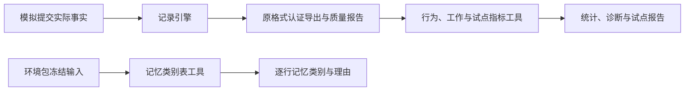

# WorldMock 产品设计说明书 — 行为分析工具

## 模块概述

### 职责与边界

`tools/analysis/behavior/metrics.py`、`workday.py`、`tools/analysis/memory_pilot.py` 与 `tools/analysis/memory_categories.py`
做确定性分析：前三者只读已记录事实，`memory_categories.py` 只读一个环境包的冻结输入；四者都不推进世界、不写入人物、不调用模型服务。
独立候选比较、真人参照、盲评和 evaluate 命令已删除。
工具使用记录引擎的约束与事务统计；记录引擎不反向导入工具。

认证导出继续包含原有 `quality.json`。其生成、摘要和逐值重算仍由记录引擎完成，
外部约束、个人事务、收尾记忆及成本等字段都保持原合同。完整性认证和工具分析分工见[记录引擎](05-recording-engine.md)。

## 指标定义

### 协议门禁

保留观察重复、清醒共同身体边界的静默比例、主观记忆重复与示例身份残留门禁。
证据缺失不能当作通过，事实认证按[记录引擎](05-recording-engine.md)重算。

### 行为报告

`behavior-metrics-4` 报告实际内容消费、人物经过时间、睡眠、唤醒、早到、食品多样性、
外部约束、班次出勤与作息偏离。经过时间使用实际区间并集，跨槽并行不重复计算。
内容接触只取实际正向播放；查询、推送和系统应用足迹不算消费。
食品样本只取本人实际 `snack`、`meal` 收货；付款和待领取订单不算收货。地点内容做完时的完成效果不算用餐收货，不计入食品样本。

作息偏离 `routine_deviation` 之后是两项回顾报告，只读 `memory_digest_generated` 事件，只报告、不进门禁，
`behavior-metrics-4` 标识不变：

- `memory_digest_repetition`（`digest_repetition(events)`）：同一人物、同一类别键（`food`、`work`、`life`）相邻两个日历日
  都有非空日回顾时成一对，字符 bigram Jaccard 不小于 0.6 的为相似。输出 `{pairs, similar_pairs, ratio}`，
  `ratio` 是相似对占全部对的比例（六位小数），没有对时为 `null`。
- `memory_digest_identity_residue`（`digest_identity_residue(events)`）：日、月、年各级回顾每类正文小写后命中
  示例身份标记 `MEMORY_IDENTITY_MARKERS` 的「类·期」。输出 `{hits, matches}`，`hits` 是命中的「类·期」数，
  `matches` 每项 `{agent_id, tier, period, category, markers}`，标记按字典序。

外部约束按运行与动作身份去重，统计营业关闭、购买或出行资金不足、配送未到期、
包裹未就绪和 app 内容前提不满足的真实拒绝；同一动作的拒绝与结果只计一次。
拒绝按动作计数、不按开始组合并：一个被拒的开始组有两条调用时计两条被拒动作。
协议参数、名称和活动控制纠错单列为 `other_rejections`。缺少动作身份或拒绝码时证据不完整，
受阻门禁为未知并不通过，不能把缺证据或已删除的约束当成零。

工作输入从冻结环境的 `persona.toml` 和 `config.toml` 打包，不读人物工作区。
`AgentWorkday` 保存工作安排、住处、实际工作地点以及下班和到家窗口。
下班和到家窗口取 `persona.toml` 的 `leave_work_window` 与 `arrive_home_window` 原值，没有写的那一项偏离为空。
窗口按钟面读，与人设层显示的时刻相同：起点减去整数个 24 小时落进 0 到 24，终点减去同样多的小时，
所以 `[25.0, 25.5]` 是每天的 01:00 到 01:30，`[23.5, 24.5]` 是 23:30 到次日 00:30；换成时刻时截到整秒。
一次离开或到家，与它所在本地日的前一天、当天、次日这三次窗口里离它最近的一次比较：
落在窗口内偏离为 0，早于起点为负，晚于终点为正；两次一样近时取较早的那一次。
对 `[25.0, 25.5]`，凌晨 01:10 离开的偏离是 0，前一晚 23:50 离开是 −70 分钟。
报告保留 `shift_seconds`、`at_workplace_seconds`、`break_seconds`、`declared_exception_seconds`、
`absence_seconds`、`early_leave_seconds`，不从内容、应用或地点推断工作活动。
作息偏离只比较真实离开工作地点、到家和睡眠时刻，不读取日计划。

睡眠报告 `sleep_schedule` 从活动进度事件收集每段睡眠，开始取快照的开始时刻，结束取各事件区间终点的最大值，并分成三类。

| `category` | 判定 | 计入 |
| --- | --- | --- |
| `unfinished` | 没有任何一条进度快照的状态是 `completed`，例如运行终点时还在睡的那一段 | 两边都不计 |
| `bedtime` | 实际时长不少于 180 分钟（10800 秒），睡过头多睡的那段算在内 | `summary` |
| `nap` | 其余已结束的睡眠 | `naps` |

`sessions` 逐段列出全部有效睡眠并带 `category`。`summary` 只统计就寝睡眠：就寝与起床时刻的中位数、
四位小数的平均时长 `mean_duration_hours` 和段数 `session_count`；没有就寝睡眠时为 `null`，
并在说明里写「没有睡满 180 分钟的睡眠，就寝与起床时刻无法计算」。`naps` 给出小睡次数 `count` 和平均时长
`mean_duration_hours`，次数为 0 时平均时长为 `null`。
不到 180 分钟的夜间睡眠记为小睡，那一夜没有就寝时刻；午后补觉睡满 180 分钟记为一次就寝；
一夜分两段、每段都满 180 分钟记两次就寝。

就寝时刻的中位数 `median_bed_minutes_of_day` 以 06:00 为一天的起点：把每段就寝睡眠的开始时刻换成自本地零点起的分钟 m，
平移成 `(m − 360) mod 1440`，取中位数（偶数个时取中间两个的平均），再平移回 `(中位数 + 360) mod 1440`。
23:50、00:10、23:40、00:20 四晚因此算出 00:00，而不是 12:00。起床时刻的中位数不平移。
已知后果：分界从零点挪到了 06:00，就寝落在 06:00 两侧的人（例如 05:50 和 06:10 各一晚）会算出 18:00；
这样的就寝很少见，照此接受。

删除等待、被动决策、社交分类、活动家族分布、人物类别识别、习惯一致性和自动目标推进指标。
删除类别熵、转换、按类别爆发性、十分钟类别向量距离与对应真人分类参照。
不保留恒空或恒零占位。

## 分层记忆试点指标

`tools/analysis/memory_pilot.py` 从一次单人运行的认证导出确定性计算分层记忆试点的 M1–M12、检查项与回顾对照表；
怎样运行见[手册](../manual/evaluation.md)「计算分层记忆试点指标」。真实模型试点的规程不属于本工具，工具只计算。
命令行是 `python -m tools.analysis.memory_pilot --export DIR [--output FILE]`：没有 `--output` 时把报告写到标准输出；
给了时文件必须不存在，否则拒绝 `Output file already exists: {path}`；写出报告后返回 0。

### 输入

- 输入是 `worldmock export` 的输出目录。`load_export` 先调用 `validate_export` 认证导出，再读任何文件：事件的字节摘要与行数
  （`artifacts.events.rows`）、逐行严格校验、冻结环境素材在内的全部素材的字节数与摘要、各投影以及质量报告与权威事件一致，
  都由认证核对（[记录引擎](05-recording-engine.md)「完整导出认证」）；认证失败时它抛出的 `IntegrityError` 原样上抛，工具不重复这些
  核对。认证之后只读 `manifest.json`、`events.jsonl`、`purchases.jsonl`、`quality.json` 与 `assets/<sha256>`；不读运行目录和人物
  工作区，除 `--output` 指定的报告外不写任何文件。
- 只接收当前代码写出的导出：认证用当前代码重算质量报告（质量版本 10）并与 `quality.json` 逐字节比较，旧代码写出的导出通不过认证，
  工具不另查版本号。分层记忆提案的两次基线运行 V、B（质量版本 9、目录格式 5）因此不能作为输入。试点报告与 V、B 并列时只取提案
  第四章「试点指标」表与 P0 一条里写出数字的项：M2 0% 与 2 次，M3 21/134，M4 3/4，M5 0.4 次/天与 100% 为空，M6 取提案第二章
  写出的各层大小，M7 0.336，M8 $0.338，M12 5/18 与 B 0/17，措辞回声 V 60/406。提案表里 M1 写作「P0 测」，不在旧运行上计算：
  试点报告里 M1 只在 `lm-variety-*` 与 `lm-baseline-*` 之间比较，并写明「无 V、B 基线」。
- 只接收单人运行：`frozen_run_manifest.agent_ids` 恰有一个编号，否则拒绝
  `memory_pilot reads single-person exports; the export has {n} agents`。
- 事件：`events.jsonl` 逐行解析为 JSON 对象（认证已逐行校验），按 `event_seq` 升序使用；导出的观察事件已由生产解码器换回分件，
  `data.memory_layer` 等层直接可读。
- 冻结目录：`frozen_run_manifest.environment_assets` 必须登记 `catalog/merchant-catalog.jsonl`、`catalog/content-catalog.jsonl`、
  `catalog/app-catalog.jsonl` 与 `catalog/location.jsonl`，按这个次序核对，缺一即拒绝
  `Frozen environment asset {name} is missing from the export`。工具按登记的 `sha256` 读 `assets/<sha256>`（字节数与摘要已由认证
  核对）里的商品目录、内容目录，以及登记了时的 `catalog/callbacks.jsonl`，各行直接解析为对象，不经目录加载器（不核对格式号，
  也不做准入）；没有指标用到 app 目录与地点目录，这两份只要求登记。
- 时区与日子：时区取清单的 `window.timezone`，`local(t)` 是事件时刻 `t`（`occurred_at`，UTC 秒）在该时区的本地日期。运行日取清单的
  `daily_coverage`（导出按 `window_days` 把 `window.start` 到 `window.end`，即最后一条导出事件的时刻，沿本地零点切出的本地日期，
  含不足一天的最后一天），第 `i` 个运行日的序号为 `i`（从 1 起）。回顾日是除最后一个运行日以外的运行日：最后一个运行日之后的零点
  要么是运行终点、要么不在导出窗口里，都没有它的日回顾。
- 错误：工具自己查出的输入问题抛 `EvaluationError("memory_pilot_input", <英文句子>)`；认证失败是 `validate_export` 抛出的
  `IntegrityError`（`WorldMockError` 的子类）。两种异常构造时都已写错误日志；命令行捕获二者后返回 1，不另写日志。
- 模块只导入标准库、`tools.analysis.errors`、`tools.analysis.behavior.metrics`、`validate_export`、`WorldMockError` 与
  `worldmock.state` 下的共享取值；导入后不加载 `worldmock.simulation_engine`、`worldmock.agents`、`worldmock.runtime` 与 `custom`
  下的任何模块，所以 M11 在结构上独立于运行时的回顾守卫。回顾类别键 `food`、`work`、`life` 到饮食、工作、生活的对照
  `DIGEST_KEYS` 是回顾事件的形状，在本模块另写。

### 共用的口径

| 名词 | 定义 |
| --- | --- |
| 决策 `d` | 一条 `decision_started`：`decision_id`、时刻 `t_d`、日期 `D_d = local(t_d)` |
| 决策的回合请求 | `decision_id == d` 且 `data.purpose` 缺失或为 null 的 `model_request`，按 `event_seq` 排列；对应的 `model_response` 按 `caused_by` 找到 |
| 首个请求、新快照、续接 | 回合请求里 `event_seq` 最小的一条；它的 `messages` 恰为两条时是新快照，多于两条时是续接 |
| 回合数 | 回合请求 `call_id` 里 `:model:NNNN:` 的不同 `NNNN` 的个数（截断重试是同一回合） |
| 决策的观察 `O_d` | `decision_id == d` 的 `observation` 事件 |
| 世界请求、受理与结果 | `decision_id == d` 的 `action_requested`；它的受理是 `caused_by` 含它的 `action_accepted`（活动快照为 `data.activity`）；它的结果是 `caused_by` 含它的 `action_result` 中 `event_seq` 最小的一条，凡说「结果为 completed」都只看这一条的 `data.status`；被拒是 `caused_by` 含它的 `action_rejected` |
| 提交末序号 `C_j` | 决策 `j` 的 `action_result` 中 `event_seq` 最小的一条记为 `s`，`C_j` 是从 `s` 起 `state_version_before` 与 `state_version_after` 都与 `s` 相同的连续事件里最大的 `event_seq`（与 `store.commit_last_seq` 同一算法）；没有 `action_result` 的决策没有 `C_j` |
| 检索结果项 | `search_memory` 成功结果的「结果」为列表时取它的各项；为对象时按键序取各值（都是列表）的各项依次接起来 |
| 模型文字 `T_d` | 各回合响应 `data.response.choices[0].message` 的 `reasoning_content`、`content`，以及每个 `tool_calls[].function.arguments`：能解析成对象时，`items` 列表里每一项去掉 `views` 后各自紧凑序列化，其余键组成的对象紧凑序列化；解析不了时用原文。按响应次序以换行连接 |
| 请求文字 `R_d` | 各回合请求全部消息的字符串 `content`、`reasoning_content` 与 `tool_calls[].function.arguments`，按请求和消息次序以换行连接 |
| 思考文字 `RS_d` | 各回合响应的 `reasoning_content`，以换行连接 |
| 总结文字 `S_d` | 决策里 `tool_name` 为 `conclude_activity`、`pause_activity`、`report_status` 的世界请求 `request.items[].summary`，以换行连接 |
| 已了结的看法 | 结果为 completed 的 `conclude_activity` 请求里各 `items[].views[]`，带 `about`、`type`、`text`；看法的日期是该请求 `occurred_at` 的本地日期 |
| 活动的自述 | 结果为 completed 的 `conclude_activity`、`pause_activity`、`report_status`：结果 `data.data.activity_ids[i]` 是哪项活动，请求第 `i` 项的 `summary`、`views[].text`、`memories[].text` 就是那项活动的自述 |
| 食品商品 | `category` 为 `meal`、`snack`、`drink` 的商品 |
| 食品状态 | `callbacks.jsonl` 里带 `state` 的行，且某条内容行 `consumes_state` 等于它、同时 `completion_effects.food` 非空（与[模拟引擎](04-simulation-engine.md)「出行、内容与查询」的 `Catalog.food_states()` 同义）。按 M11 的独立性要求在冻结目录行上另算，不导入目录模型 |
| 食材包 | 食品状态 `reset_on_goods` 里的商品 |
| 做饭活动 | 一条 `callback_effect` 环境事件，`type` 为 `consume_on_start`、`state` 是 `reset_on_goods` 非空的食品状态；它 `caused_by[0]` 所指事件的 `activity_id` 就是这项活动。所用食材包是同一 `state` 在它之前最近一条 `type` 为 `reset_to_cap` 的 `callback_effect` 的 `goods_id`，收到日是那条事件的本地日期；之前没有重置时为「家里原有的食材」。结束时刻取该活动的**结束事件**：`activity_progress`、`environment_event`、`action_result` 里带该活动终态快照（`status` 为 `completed`、`cancelled`、`failed`、`truncated`）的最早一条，快照在 `data.activity`，终态 `action_result` 的还可在 `data.data.activities` 里。时钟推进里结束的是 `activity_progress`；收尾取消的是 `activity_concluded`、实验截止截断的是 `activity_truncated` 环境事件，这两种结束没有进入终态的 `activity_progress`。观察的「今天」按同一事件放活动的结束句，本工具在事件行上另算，不导入运行时 |
| 规范化 `norm(s)` | NFKC 后删去正则 `[\s\W_的了]` 匹配的字符 |
| 最长公共子串 `lcs(a, b)` | `a` 的子串里同时是 `b` 的子串的最长长度 |
| 八字回声 | 文本 `x` 的某个连续 8 字窗口出现在文本 `y` 里（`ECHO_LENGTH = 8`） |
| 句 | 回顾正文按「。」「！」「？」切开，每段连同结尾的标点算一句，最后不带标点的一段也算一句 |
| 餐次时段 | `MEAL_PERIODS`：早饭 [04:00, 10:30)，午饭 [10:30, 14:30)，晚饭 [16:30, 22:00)，本地时刻，左闭右开，与人物无关 |

**菜名词表**（M1、M2、M11 共用）按长度降序、同长按字典序排列、去重：
- 全部食品商品名；
- 全部食材包名，以及食材包的菜名：名字去掉结尾的「一人份食材包」（没有则去掉结尾的「食材包」）后按「配」切开，长度不小于 2 的各段；
- 食品内容（`completion_effects.food` 非空，或 `consumes_state` 是食品状态）的 `summary` 里，第一个「比如」或「例如」之后、
  到第一个「，」「。」「；」「…」之前的文字，按「、」「和」「或」切开，长度不小于 2 的各段。

在一段文字里**认菜名**：从左到右扫描，每个位置取以它开头的最长词表项，取到就跳过这一项的长度，取不到前进一字。商品名、食材包名
在别处单独认取时同样按「最长、不重叠」扫描，词表换成对应的名称集合。

**比例**一律写成 `{numerator, denominator, value}`，`value = round(numerator / denominator, 4)`，分母为 0 时为 null。
**分段比例**写成 `{all, days_1_3, days_4_plus}`，三段各自累计分子分母；某条记录归第几天按各指标写明的日期取运行日序号。
**统计量**写成 `{n, median, p90, max}`：值升序排列，第 `q` 分位取下标 `(n−1)·q` 处的线性插值，中位数即 `q = 0.5`，均保留一位小数；
`n = 0` 时其余三项为 null。报告里的时刻写成本地 `YYYY-MM-DD HH:MM`，日期写成 ISO `YYYY-MM-DD`。

### M1–M12

**M1 往日引用**（按决策日期分段）。
- 饮食决策：决策的某个受理活动是下面之一。查询：`data.targets` 里有 `category` 为 `meal`、`snack`、`drink` 的类别目标，或
  `goods_id` 是食品商品或食材包的商品目标；购买：`data.order_ids` 在 `purchases.jsonl` 里对应的商品有食品商品或食材包；做饭：
  在地点做的事（不带 `app_id` 的 `interact`），`data.content_id` 的内容 `consumes_state` 是 `reset_on_goods` 非空的食品状态。
  查询和购买只算 `t_d` 落在午饭或晚饭时段里的；做饭不限时段。
- 往日文字：`O_d.data.memory_layer` 里「近三天」各类各格的「回顾」字符串；以及本决策里每次 `search_memory` 成功结果的检索结果项中，
  带「日期」「月份」或「年份」键的项的「回顾」，和「未整理」项「条目」里的全部字符串。今天的条目不是往日文字。
- 往日名称是往日文字里认出的菜名。往日日期是往日文字所属格或结果项的「日期」值，每个日期 `D` 写成 `YYYY-MM-DD`、`M月D日`
  （不补零）、`MM-DD` 三种。
- 分子是 `RS_d + "\n" + S_d` 含任一往日名称或任一种往日日期写法的饮食决策；分母是饮食决策。模型的正文与工具参数不看：
  请求参数里的商品名本来就会写，不能当作引用。
- 输出 `{by_day, periods, decisions}`：`by_day` 是每个运行日到比例；`decisions` 按决策次序每项
  `{decision_id, time, kinds, past_names, past_dates, mentioned}`，`kinds` 按 `query`、`purchase`、`cooking` 的次序取，
  `past_names` 按出现次序去重，`past_dates` 升序。

**M2 晚饭命名**（按做饭活动的结束日期计）。
- 命名：所用食材包不是「家里原有的食材」的做饭活动，记它的结束事件（「做饭活动」一行）序号为 `e`、本地日期为 `D`。取 `D_j == D` 且 `C_j ≥ e` 的决策中最早的一次为 `k`（结束句写在第 `k` 条条目里，从第 `k+1` 次决策起可见）；`D` 里在
  `k` 之后还有决策时，这项活动进分母；没有这样的 `k`，或 `k` 是 `D` 的最后一次决策时不进分母。分母里的活动，那一天该人物最后一条
  观察的「今天」里，有条目的某个「核验」字符串包含 `，用{M}月{D}日收到的{食材包名}`（月日取收到日，不补零）的是分子。
- 对不上：所用食材包不是「家里原有的食材」的做饭活动，它的自述里认出的菜名中有一个不是该食材包名子串的，记一次；用家里原有的
  食材时不计。
- 输出 `{named, mismatches, activities}`：`named` 是比例；`activities` 按做饭次序列出全部做饭活动，每项
  `{activity_id, name, ended_at, kit, received_on, line_named, mismatched_dishes}`：`name` 是最近一份活动快照里的名称，`ended_at`
  是结束时刻（还没结束时为 null），`kit` 是所用食材包名或「家里原有的食材」，`received_on` 是收到日（家里原有的食材时为 null），
  `line_named` 在不进分母时为 null，`mismatched_dishes` 是对不上的菜名（按次序去重）。

**M3 往日可见**（按观察日期分段）。
- 分母：日期 `D` 的序号不小于 2 的观察，且 `D−1` 有日回顾事件（`tier == "day"`、`period == D−1`），其中 `digests.food` 非空或
  `"food"` 在 `fallback` 里。前一天没有饮食记录时那一格按规定省略，那天的观察不进分母；缺回顾事件另由检查项
  `one_day_digest_per_day` 拦下。
- 分子：其中 `data.memory_layer` 的「近三天」「饮食」列表有「日期」为 `D−1` 的一格，且这一格「回顾」是非空字符串或「未整理」为 true。
- 输出 `{by_day, periods, unsorted}`：`by_day` 是每个运行日到比例；`unsorted` 是分子里这一格为「未整理」的观察数。

**M4 午饭重复**。
- 工作日：该日期第一条观察的 `data.environment_layer.duty.day` 为「工作日」。
- 午饭：`purchases.jsonl` 里 `fact_kind == "purchase"`、`category == "meal"`、`created_at` 落在工作日午饭时段的行，份数取 `quantity`。
- 重复：同一 `goods_id` 在 `D−3`、`D−2`、`D−1` 任一天有 `fact_kind == "purchase"` 的行（`D` 是这次午饭的本地日期）。
- 输出 `{workday_lunch_portions, repeated_portions, value, most_frequent, lunches}`：`value` 是重复份数占午饭份数的比值（四位小数，
  没有午饭时为 null）；`most_frequent` 是份数最多的商品 `{name, portions}`（同份数取最先出现的；没有午饭时为 null）；`lunches` 按
  购买次序每项 `{time, name, portions, repeat}`。

**M5 检索**（按决策日期计）。
- 检索调用：回合响应 `tool_calls` 里 `function.name == "search_memory"` 的调用；它的回答是此后同一决策回合请求里 `role == "tool"`、
  `tool_call_id` 等于调用身份的第一条消息。
- 归类：回答内容解析出带 `error_code` 的对象时，`MEMORY_SEARCH_LIMIT`（一次决策的第四次检索）计为碰到上限，其余错误码计为校验错误；
  响应事件 `data.error` 非空的调用也计为校验错误；没有回答、也没有协议错误的计为未回答；其余为成功。成功结果按「检索结果项」至少
  取出一项的为非空；成功结果的「提示」含「范围太大」或「加关键词缩小范围」（装填时碰到字数上限或按日放不下）计为碰到字数上限。
  参数 `time` 以「今天」开头的调用计为查「今天」。
- 只读核对：每次检索调用所在响应与同一决策下一条回合请求之间，`event_type` 不是 `model_request`、`model_response` 的事件数，
  各次相加；之后没有回合请求的检索不计。
- 输出 `{calls, today_calls, by_day, succeeded, non_empty, validation_errors, error_codes, limit_refusals, capped_results, unanswered,
  non_model_events_between}`：`non_empty`（分母是成功数）与 `validation_errors`（分母是调用数）是比例；`by_day` 是每个运行日
  （升序）到 `{calls, today_calls}`；`error_codes` 是错误码（升序）到次数；`limit_refusals`、`capped_results`、`unanswered` 是次数。

**M6 体量**。
- 层大小：新快照首个请求的 user 消息解析为层数组，按各层的 `"layer"` 名取层（与层序无关），每层的大小是
  `len(json.dumps(层, ensure_ascii=False, separators=(",", ":")))`；记忆层另取「可查」「近三天」「今天」三个值各自的紧凑序列化
  长度，键名为「记忆层·可查」「记忆层·近三天」「记忆层·今天」；另计 `system`（system 消息内容）、`user`（user 消息内容）、
  `tools`（`tools` 的紧凑序列化）的长度。`layers` 是这些键（按首次出现的次序）到统计量。续接请求的首个 user 是链首旧层，不量。
- `memory_layer_by_observation`：每条观察 `data.memory_layer` 的紧凑序列化长度的统计量。
- `fallback_rewrites`：一条观察的「今天」列表不以同一本地日上一条观察的「今天」列表开头（按条目紧凑序列化逐条比较）的观察数，
  即记忆层兜底的触发次数；当天第一条观察不比较。
- `persona_layer_identical`：新快照首个请求里人设层与第一条新快照的人设层逐字节相同的比例。
- `token_ratio`：相邻两条新快照首个请求（按 `event_seq`）之差做无截距最小二乘，`Δprompt_tokens ≈ Σ w_k·Δc_k`。`prompt_tokens` 取该
  请求对应响应的 `data.response.usage.prompt_tokens`，相邻两条有一条没有整数 `prompt_tokens` 时这一对不计（不把隔开的两条接成
  一对）；`c_k` 是整份请求文字（system 内容、user 内容、`tools` 的紧凑序列化）里六类字符的个数：汉字（U+3400–U+4DBF、
  U+4E00–U+9FFF、U+F900–U+FAFF）、ASCII 字母、ASCII 数字、空格、其余可打印 ASCII（U+0021–U+007E）、其余字符。用正规方程加部分
  主元的高斯消元求解；差分对少于 12 对或主元绝对值小于 1e-9 时 `weights` 与 `memory_layer_tokens_per_char` 为 null。
  `memory_layer_tokens_per_char = Σ w_k·n_k / Σ n_k`，`n_k` 是全部新快照首个请求里记忆层紧凑序列化的六类字符数。输出
  `{pairs, weights, memory_layer_tokens_per_char, reference, reference_range, within_range}`：`pairs` 是差分对数；`weights` 是
  `han`、`ascii_letter`、`ascii_digit`、`space`、`ascii_other`、`other` 六类到权重，保留四位；比值保留三位；`reference` 为 0.638，
  `reference_range` 为 `[0.630, 0.645]`；`within_range` 是比值是否落在区间里（含两端），比值为
  null 时为 null。
- 输出 `{layers, memory_layer_by_observation, fallback_rewrites, persona_layer_identical, token_ratio}`。

**M7 缓存**。读 `quality.json` 的 `model_usage.by_call_class`。`fresh_decision_turn` 一行 `priced_tokens` 的
`cache_hit_input_tokens / (cache_hit_input_tokens + cache_miss_input_tokens)` 为命中率。输出
`{fresh_decision_turn: {hit_tokens, miss_tokens, value}, by_call_class: {调用类: 命中率}}`，命中率保留四位；`priced_tokens` 为
null 的类命中率为 null（`fresh_decision_turn` 的两个 token 数同为 null），两项输入 token 都为 0 时命中率也为 null。

**M8 费用**。一律按冻结的峰时价：取 `quality.json` 的 `model_usage.pricing_snapshot.peak`，每个调用类的费用为
`(hit·cache_hit_input + miss·cache_miss_input + out·output) / 1,000,000`，`priced_tokens` 为 null 的类记 0。除以运行日数得每模拟日
费用。输出 `{days, per_day_usd, by_call_class: {调用类: 每日美元}, complete}`，`days` 是运行日数，美元保留六位小数，`complete` 照抄
`model_usage.estimated_cost.complete`。

**M9 护栏**。
- 每天决策数：按决策日期计数，`decisions_per_day` 是每个运行日（升序）到决策数；带宽 `decision_band` 为 `[81×0.85, 81×1.15]`
  （两位小数）；不在带宽内的日子列入 `days_outside_band`。
- 拒绝：`rejections` 是 `action_rejected` 事件数；上限 `rejection_limit = 2 × 6 × 运行日数 / 5`（四位小数；基线 6 次出自 5 天的运行）。
- 回合：每次决策的回合数；`exhausted` 是回合数达到 `frozen_run_manifest.stage_model_identity.max_react_turns` 的决策数；`p99`
  （一位小数）、`max` 只报告；回合数不少于 6 的决策逐个列出 `{decision_id, time, turns}`。
- `run_failures` 是 `run_failed` 事件数。`capacity_compressions` 是首个 user 消息的进度层里带 `"type": "condensed"` 记录的回合请求数
  （容量处理的折叠一步）。容量处理的第 0 步「提前结束本秒续接」把链前缀换成新快照，不留下自己的记录，在事件里与其他断链（非前缀、
  链中缺思考）无法区分，不单独计数；同秒链里改用新快照的决策数另报 `chain.fresh_followups`。
- 同秒链：`same_second_followups` 是时刻与上一次决策相同的决策数；`continuations` 是其中首个请求为续接的数；
  `fresh_followups = same_second_followups − continuations`，只报告。对每次续接决策，取首个请求最后一条 `role == "tool"` 消息内容里
  的 `changes`：`changes.memory.added`（缺失视为空列表）接在上一次决策观察的「今天」之后必须等于本决策观察的「今天」（逐条按键
  排序的紧凑序列化相等：导出的事件是键已排序的规范 JSON，tool 消息保持渲染键序），不等记一次 `append_violations`；`changes` 含 `relationships` 或 `preferences` 键记一次 `persona_deltas`。
- 刚了结又重新开始：一项活动的结束事件（「做饭活动」一行的口径，含收尾取消与截断）落在上一次决策的观察事件与本决策的观察事件
  之间（两端都不含），本决策受理的某项活动与它目标相同，即在 `restarted` 里列出 `{decision_id, time, target}`。目标按受理快照
  （结束的一方按结束事件里的终态快照）的事件身份取，不解析活动名：用内容 app 为 `["app", app_id]`；在地点做的事为 `["content", 系列标题或 content_id]`；购买为 `["purchase", 商品身份升序]`；查询为
  `["query", app_id, 目标的类别或商品身份升序]`；出行为 `["travel", destination_id]`；睡眠为 `["sleep"]`。
- 输出 `{decisions_per_day, decision_band, days_outside_band, rejections, rejection_limit, turns, run_failures,
  capacity_compressions, chain, restarted}`，`turns` 为 `{max_react_turns, p99, max, exhausted, six_or_more}`，`chain` 为
  `{same_second_followups, continuations, fresh_followups, append_violations, persona_deltas}`。

**M10 回顾**。
- 回顾事件：`environment_event` 且 `data.kind == "memory_digest_generated"`；回顾请求：`data.purpose == "memory_digest"` 的
  `model_request`，`call_id` 形如 `memory-digest:{agent}:{tier}:{period}:attempt:{n}`。
- `calls_by_day` 是本地日期（ISO，升序，只列有回顾请求的日子）到 `{day, month, year}`，按请求的 `call_id` 里的 `tier` 计数，三键都在。
  `periods` 恒为 `{day, month, year}`，回顾事件按 `tier` 计数，三键都在，没有事件的级别为 0。`expected` 恒为 `{month, year}`：月回顾为
  序号不小于 2 的运行日里「日」为 1 的日子数，年回顾为其中「月」也为 1 的日子数。`retries` 是每个 `(tier, period)` 的请求数减一之和。
- `fallback`：比例只数日回顾：分母是 `tier == "day"` 的回顾事件里非空或在 `fallback` 里的「类·日」数，分子是其中在 `fallback` 里的。
  比例对象另加键 `cells`，值为全部级别落到 fallback 的 `[{tier, period, category}]`，按 tier（day、month、year）、period、类别
  （food、work、life）次序。
- `guard_discards`：读回顾的 `model_response` 中 `data.phase == "response"` 且 `data.error` 非空的；`phase == "failure"` 的传输失败
  证据不计。计数单位是「一次响应里的一类」：同一响应、同一类别键被同一守卫报了几条问题都只计一次。分类如下：
  - `data.error` 等于 `response must contain exactly one choice`、`response must contain exactly one submit_memory_digest tool call`、
    `the only tool call must be submit_memory_digest`、`submit_memory_digest arguments must be a JSON string` 之一时计入 `response`；
    等于 `memory digest output was truncated at max_tokens` 时计入 `truncated`；这两项按响应计一次。
  - 否则 `data.error` 不以 `digests.` 开头时是参数结构错误（`schema_feedback(error, "arguments")` 给出），计入 `schema`，按响应计一次。
  - 否则用 `re.split(r"; (?=digests\.)", error)` 切成逐条问题（守卫文字里的「; the {tier} digest limit」「; missing:」后面不接
    `digests.`，不会被切开）。每条问题按下一项的次序逐个模板 `re.fullmatch`，第一个匹配的模板就是它的守卫；类别键取
    `re.match(r"digests\.(food|work|life)", 问题)` 的组。模板由问题文字转成：`{key}` 换成 `(food|work|life)`，`{tier}` 换成
    `(day|month|year)`，其余 `{…}` 占位换成 `(.+)`，其余字符经 `re.escape` 按字面。
  - 模板次序、守卫名与问题文字（回顾输出校验写进 `error` 的原文）：先是两条空值检查 `text_without_input`
    （`digests.{key} must be null: the input has no {key} records`）、`null_with_input`
    （`digests.{key} must not be null: the input has {key} records`），然后是回顾输出校验的十三个守卫（各守卫的含义见
    [人物](06-agent.md)「日、月、年回顾」），依次 `text_empty`（`digests.{key}.text must not be empty`）、`text_length`
    （`digests.{key}.text has {len(text)} characters; the {tier} digest limit is {limit}`）、`chinese`
    （`digests.{key}.text must contain Chinese`）、`hex_identity`（`digests.{key}.text contains a hexadecimal identifier`）、
    `refs_empty`（`digests.{key}.refs must cite at least one record number`）、`refs_category`
    （`digests.{key}.refs: {ref} is not a {key} record number`）、`names`
    （`digests.{key}: the name {name} does not appear in the {key} input`）、`food_verified_names`
    （`digests.food: the goods name {name} does not appear in the food verified lines`）、`food_coverage`
    （`digests.food must name every food received and every meal kit cooked that day; missing: {names}`）、`cooking_sentence`
    （`digests.food: the sentence about 做饭 names {kit}, but the meal kit cooked that day was {used}`）、`numbers`
    （`digests.{key}: {token} does not appear in the {key} input`）、`numbers_same_record`
    （`digests.{key}: {token} does not appear in the same input record as a name in its sentence`）、`count_lines`
    （`digests.{key}: the count {token} must be copied with its whole count line`）。`names` 排在 `numbers` 之前，
    所以「the name …」的问题不会被 `numbers` 的 `(.+)` 收走。
  - 没有任何模板匹配的问题计入 `unrecognized`，按问题条数计，并写英文错误日志 `Memory digest error {call_id} matches no guard`。
  - 输出是守卫名到次数，十九个键按 `response`、`truncated`、`schema`、上面十五个模板、`unrecognized` 的次序全部列出，没有的为 0。
- `cited`：非空的日回顾格中被引用的比例；月、年回顾的段落不是日回顾格。被引用指：某次决策的观察「近三天」里有这一格（同类、同日期），
  或它的 `search_memory` 成功结果的检索结果项里有这一格（同「类别」、同「日期」），并且这段回顾正文有一个 8 字窗口出现在该决策的
  `T_d` 里。
- `view_coverage`：读每个日回顾 `attempt:1` 请求里按类别分开的输入条目，各类「自述」里以「看法·」开头的项，「看法·」与第一个「：」
  之间是对象；每一「类·日」的对象去重，分母是对象数之和，分子是出现在那一格回顾正文里的对象数之和，正文为 null 的格对象都计为未写到。
- `statistics_copy_violations`：月、年回顾每类正文里每一处匹配 `\d+ ?次` 的文字，若不是该类输入统计行中某一行在正文里出现时的结尾，
  记一次。
- `day_digest_problems`：有决策的回顾日中没有日回顾事件的日期数，加上同一 `(tier, period)` 有多于一条回顾事件的组数；
  `missing_day_digests` 列出前者的日期（升序），`duplicate_digests` 列出后者 `[{tier, period, events}]`（按 tier、period）。
- `retired_calls`：`quality.json` `by_call_class` 里 `consolidation` 与 `reflection` 两行 `request_events` 之和。
- `repetition`、`identity_residue`：调用行为工具的 `digest_repetition(events)`、`digest_identity_residue(events)`（见「行为报告」）。
- 输出 `{calls_by_day, periods, expected, retries, fallback, guard_discards, cited, view_coverage, statistics_copy_violations,
  day_digest_problems, missing_day_digests, duplicate_digests, retired_calls, repetition, identity_residue}`。

**M11 回顾保真**。只用事件、`purchases.jsonl` 和冻结目录独立重算，不读回顾的输入，不调用运行时守卫。按回顾日 `D` 计。
- `F(D)`：本地日期为 `D` 的 `goods_received` 环境事件里食品商品的名字，加上结束日期为 `D` 的做饭活动所用食材包的名字（「家里原有
  的食材」不计），按次序去重。
- ① 覆盖：分母是满足下面之一的回顾日：`F(D)` 非空；或 `D` 的日回顾事件里 `digests.food` 非空、或 `"food"` 在它的 `fallback` 里（当天
  有饮食核验）。分子是其中饮食日回顾非空、且 `F(D)` 每个名字都是正文子串的（`F(D)` 为空时只要饮食日回顾非空）。`food_fallback` 的
  分母相同，分子是其中 `"food"` 在 `fallback` 里的；`coverage_plus_fallback` 是比例：分子为 `coverage` 与 `food_fallback` 两者分子
  之和，分母为二者共同的分母（两个各自舍入的值相加会得到 0.9999 或 1.0001，所以不相加）。
- ② 做饭错配：饮食日回顾每一句含「做饭」的句子里认出的每个食材包名，不是结束日期为 `D` 的做饭活动所用食材包的，记一次。
- ③ 餐次错配：每一句含「早饭」「午饭」「晚饭」之一的句子里认出的每个食品商品名，若该商品在 `D` 的 `goods_received` 时刻没有一个
  落在句中任一餐次的时段里，记一次。
- ④ 外来菜名：饮食日回顾正文里认出的每个菜名，若不是 `N(D)` 中任一名字的子串，记一次。`N(D)` 是 `D` 当天 `purchases.jsonl` 购买行
  （`fact_kind == "purchase"`）的商品名、`goods_received` 的商品名，以及结束日期为 `D` 的做饭活动所用食材包名。
- 输出 `{coverage, food_fallback, coverage_plus_fallback, cooking_mismatches, meal_mismatches, foreign_dishes, days}`：前三项是比例，
  其后三项是 ②③④ 在全部回顾日的次数之和；`days` 列出 ① 分母里的回顾日，每项
  `{date, expected, missing, fallback, cooking_mismatch, meal_mismatch, foreign}`：`expected` 是 `F(D)`，`missing` 是其中不是正文
  子串的名字，`fallback` 是 `"food"` 在不在 `fallback` 里，其后三项是这一天 ②③④ 记下的名字（按句与扫描次序，不去重）。

**M12 表态食品回购率**。只用事件、`purchases.jsonl` 和冻结目录。
- 购买：`fact_kind == "purchase"`、商品是食品商品或食材包、本地日期不是第一个运行日的行，一行算一次。
- 点名：看法对象 `s = norm(about)`、商品名 `g = norm(name)`。`len(s) < 3` 不点名；全部目录商品名规范化后，等于 `s`、或在 `len(s) ≥ 4`
  时包含 `s` 或被 `s` 包含的，多于 2 件时不点名；否则 `s == g`，或 `len(s) ≥ 4` 且 `s` 含 `g` 或 `g` 含 `s`，即点名。
- 分子：被日期早于购买日期的已了结 `preference` 看法点名过的购买。
- 卡片：第一条新快照首个请求的人设层紧凑序列化，规范化后为 `card`；`lcs(g, card) ≥ min(4, len(g))` 时商品在卡片上。年龄：购买日期
  减去点名它的最晚一条看法的日期，1–3 天为 `"1-3"`，4 天及以上为 `"4+"`。
- 看法依赖（旁证）：决策 `d` 依赖更早日子的看法，是指存在一条日期早于 `D_d` 的已了结看法（`preference` 或 `relationship`），满足下面
  之一：点名（`mention`）——`norm(about)` 长度不小于 2，是 `norm(T_d)` 的子串，不是 `norm(R_d)` 的子串；回声（`echo`）——看法
  `text` 有一个 8 字窗口出现在 `T_d` 里、不出现在 `R_d` 里。一条看法两者都满足时记作点名。
- 输出 `{purchases, endorsed, on_card, not_on_card, age, rows, earlier_view_reliance}`：`purchases` 是购买数；`endorsed` 是比例
  （分母为购买数）；`on_card`、`not_on_card` 分别是被点名且在、不在卡片上的购买占购买数的比例；`age` 为 `{"1-3": n, "4+": n}`；`rows`
  按购买次序每项 `{time, goods, on_card, endorsed_by: [{about, date}]}`；`earlier_view_reliance` 为 `{decisions, relying, value, rows}`：
  `decisions` 是决策总数，`relying` 是依赖的决策数，`value` 是二者之比（四位小数，没有决策时为 null），`rows` 每项
  `{decision_id, time, views: [{about, date, by}]}`，`by` 取 `mention`、`echo`。

### 报告与检查项

报告的顶层键依次为 `schema_version`（`"memory-pilot-1"`）、`run_id`、`window`（照抄导出清单的 `window`）、`agent_id`、`days`（ISO 日期
列表）、`metrics`（键 `M1`…`M12`，依次）、`checks`、`digest_review`，序列化为 `json.dumps(report, ensure_ascii=False, indent=2) + "\n"`；
同一导出两次计算逐字节相同。

`checks` 每项 `{name, path, comparison, threshold, value, pass}`，`value` 是报告里 `path` 处的值，为 null 时 `pass` 为 null。阈值全部取自
分层记忆提案对最终形态写出的数值；其中 `progress_layer_median`、`progress_layer_p90` 两项在提案 P1 验收里标为「估计值，P0 校准」，
本工具不在旧运行上校准（旧运行不能作为输入），两项照表中数值判定。`days_outside_band`、`restarted` 两项的 `value` 写列表长度；
`rejections`、`month_digests` 两项的 `threshold` 写报告里对应的数。比较浮点数时按报告里已经舍入的值比较。

| name | path | 比较 | 阈值 | 提案出处 |
| --- | --- | --- | --- | --- |
| `cooking_lines_name_the_kit` | `M2.named.value` | `==` | 1.0 | M2「要求 100%」；P1「凡是有重置的做饭结束句，都带食材包名」 |
| `yesterday_food_cell_visible` | `M3.periods.all.value` | `==` | 1.0 | M3「要求 100%」 |
| `search_validation_errors` | `M5.validation_errors.value` | `<=` | 0.05 | P1 试点 |
| `search_non_empty` | `M5.non_empty.value` | `>=` | 0.70 | P1 试点 |
| `search_is_read_only` | `M5.non_model_events_between` | `==` | 0 | P1 验收「检索与下一次请求之间除了模型事件没有别的事件」 |
| `memory_layer_budget` | `M6.memory_layer_by_observation.max` | `<=` | 14000 | P1 验收 |
| `progress_layer_median` | `M6.layers.进度层.median` | `<=` | 3000 | P1 验收 |
| `progress_layer_p90` | `M6.layers.进度层.p90` | `<=` | 7000 | P1 验收 |
| `user_message_median` | `M6.layers.user.median` | `<=` | 22000 | P2 验收 |
| `persona_layer_stable` | `M6.persona_layer_identical.value` | `==` | 1.0 | P2 验收 |
| `fresh_turn_cache_hit` | `M7.fresh_decision_turn.value` | `>=` | 0.55 | M7、P2 验收 |
| `cost_per_day` | `M8.per_day_usd` | `<=` | 0.22 | P2 验收 |
| `decisions_per_day_band` | `M9.days_outside_band` 的长度 | `==` | 0 | M9 |
| `rejections` | `M9.rejections` | `<=` | `M9.rejection_limit` | M9 |
| `turns_exhausted` | `M9.turns.exhausted` | `==` | 0 | M9 |
| `run_failures` | `M9.run_failures` | `==` | 0 | M9 |
| `capacity_compressions` | `M9.capacity_compressions` | `==` | 0 | M9 |
| `no_restarted_activities` | `M9.restarted` 的长度 | `==` | 0 | P1 验收「刚了结的活动没有被重复开始」；M9 |
| `chain_append_only` | `M9.chain.append_violations` | `==` | 0 | M9、P1 验收 |
| `chain_without_persona_delta` | `M9.chain.persona_deltas` | `==` | 0 | P2 验收 |
| `digest_fallback_share` | `M10.fallback.value` | `<=` | 0.10 | P1 验收 |
| `one_day_digest_per_day` | `M10.day_digest_problems` | `==` | 0 | P1 验收 |
| `retired_calls` | `M10.retired_calls` | `==` | 0 | P1 验收 |
| `month_digests` | `M10.periods.month` | `==` | `M10.expected.month` | P3 验收 |
| `statistics_copied` | `M10.statistics_copy_violations` | `==` | 0 | P3 验收 |
| `food_coverage_partition` | `M11.coverage_plus_fallback.value` | `==` | 1.0 | M11 ① |
| `cooking_mismatch` | `M11.cooking_mismatches` | `==` | 0 | M11 ② |

`digest_review` 是试点报告附的「每天的回顾和当天核验的对照表」：每条日回顾事件按 `period` 升序，每个类别按饮食、工作、生活一行
`{date, category, digest, status, verified}`。`status` 取 `written`（正文非空）、`unsorted`（null 且在 `fallback` 里）、`no_records`
（null 且不在）；`verified` 是该日回顾 `attempt:1` 请求里这一类输入条目的全部「核验」字符串，按输入次序，`no_records` 时为空列表。
回顾请求（`digest_review`、`view_coverage` 与 `statistics_copy_violations` 读的 `attempt:1` 请求）取不到按类别分开的输入条目与
统计行时报 `Memory digest request {call_id} does not hold the category entries`。

## 记忆类别表

`tools/analysis/memory_categories.py` 为一个环境包列出每条内容行与 app 行推导出的记忆类别、命中的规则编号与理由，供包作者核对推导
是否合意；怎样运行见[手册](../manual/resources.md#resources-检查内容行的记忆类别)。类别与规则编号全部照抄
`worldmock.simulation_engine.observation.memory.categories` 的 `category_book` 与 `row_categories`，规则本身只在
[人物](06-agent.md#agent-记忆的类别)「记忆的类别」里写，这里不重复；工具不写任何类别判定，只加名称、目录字段与理由文字。
命令行是 `python -m tools.analysis.memory_categories --package DIR [--output FILE]`：没有 `--output` 时把类别表写到标准输出；给了时
文件必须不存在，否则以 `EvaluationError("memory_categories_input", …)` 拒绝 `Output file already exists: {path}`；写出后返回 0。

- 输入是一个环境包目录（含 `catalog/`、`persona.toml` 与 `config.toml`），经 `load_environment` 加载并准入；模型元数据取
  `config.toml` 写明的模型名、元数据地址与上下文容量，输出上限记为同一个数，不访问模型服务。加载失败时 `load_environment` 抛出的
  `WorldMockError` 构造时已写错误日志，命令行捕获它与 `EvaluationError` 后返回 1，不另写日志。
- 班次地点类型 `workplace_kind` 是人设工作安排里班次地点的地点类型，没有工作安排时为 null，这时不会出现规则 5 与工作类的规则 6。
- `rows` 照 `row_categories` 的次序：内容行按 `content_id` 升序，然后 app 行按 `app_id` 升序。每行
  `{row, id, name, location_kinds, app_ids, category, rule, reason}`：`row`（`content` 或 `app`）、`id`、`category`、`rule` 照抄推导；
  `name` 取内容的 `title` 或 app 的 `name`；内容行的 `location_kinds`、`app_ids` 照抄目录行（列表），app 行这两项为空列表。
  目录行没有时刻，所以静态推导里地点内容只经规则 0、3、5（只看班次地点类型）、7，app 内容与 app 行只经规则 0、6。
- 理由按 (行种类, 规则, 类别) 取模块常量 `ROW_REASONS` 的固定文字，`{workplace_kind}` 换成班次地点类型；规则 5 依赖开始时刻的
  条件写在理由里。规则 0 的三个类别各占一键，`ROW_REASONS` 共十三个键，恰是静态推导能给出的全部组合：

| 行种类 | 规则 | 类别 | 理由 |
| --- | --- | --- | --- |
| 内容或 app | 0 | 任一 | 目录行写了 memory_category |
| 内容 | 3 | 饮食 | 属于食品单元：同一单元有一集写了 completion_effects.food，或凭的是食品状态 |
| 内容 | 5 | 工作 | 在班次地点类型 {workplace_kind}：工作日在班次地点开始时归工作，休息日归生活 |
| 内容 | 7 | 生活 | 其余归生活；工作日在岗时段内（不含休息时段）在家以外的地点开始时归工作（规则 5） |
| 内容 | 6 | 工作 | 前提要求班次地点类型 {workplace_kind} |
| 内容 | 6 | 生活 | app 内容不要求班次地点，归生活 |
| app | 6 | 工作 | 有一条内容的前提要求班次地点类型 {workplace_kind} |
| app | 6 | 生活 | 没有内容要求班次地点，归生活 |

- 输出 `{schema_version: "memory-categories-1", environment_id, environment_version, workplace_kind, rows}`，`environment_id` 与
  `environment_version` 照抄包的目录清单；序列化为 `json.dumps(table, ensure_ascii=False, indent=2) + "\n"`，同一个包两次输出
  逐字节相同。
