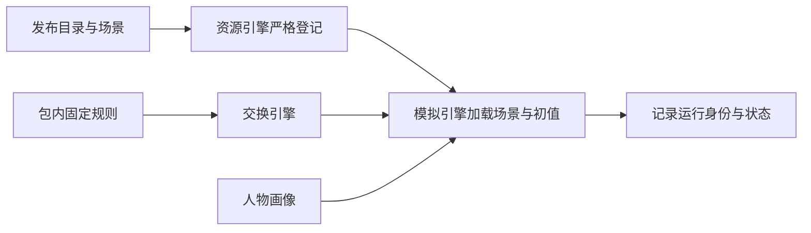

<a name="configuration"></a>
# WorldMock 产品设计说明书 — 配置

<a name="configuration-模块概述"></a>
## 模块概述

<a name="configuration-职责与边界"></a>
### 职责与边界

配置只选择环境与人物、声明场景节律和初值；分类、类别效果、收货效果与算子由 WorldMock 固定。
数据仓发布 app、地点、商品、动作、内容、图与清单。场景结构 8 引用发布目录，不引用语料，不带规则副本或人物动机参数。
字段与准入要求以[场景合同](09-io-formats.md)为准。

<a name="configuration-与其他模块的关系"></a>
### 与其他模块的关系



<a name="configuration-核心设计原则"></a>
### 核心设计原则

| 原则 | 含义 | 体现 |
| --- | --- | --- |
| **显式版本** | 配置文件携带版本号 | 场景使用整数 `schema_version`，具体约束由场景模型定义 |
| **Fail-Closed** | 未识别字段拒绝启动 | 拼写错误不会被静默忽略 |
| **溯源分类** | 参数注明来源 | 分类与字段见[资源引擎的来源分类](03-resource-engine.md) |
| **确定性加载** | 相同配置产生相同行为 | 禁止运行时随机化 |
| **凭证隔离** | 敏感信息不进版本控制 | 凭证位于 `~/.config/worldmock/` |

<a name="configuration-配置层级与加载顺序"></a>
## 配置层级与加载顺序

<a name="configuration-配置层级"></a>
### 配置层级

| 输入 | 内容 |
| --- | --- |
| WorldMock 包 | 闭集、类别与使用方式表、固定常数、算子、可供性注册表、人物映射 |
| 环境目录 | app 用途与支付绑定、地点、商品、动作、内容、发布图与清单 |
| 场景结构 8 | 环境钉、人物与工作内容分配、时区与运行时间、账户身体初值、工作安排、菜单、消息与日历 |
| 模型凭证 | 用户指定环境变量文件；凭证不进入足迹 |

人物画像映射与场景节律仍有各自配置入口；它们不能覆盖类别规则或交换公式。

<a name="configuration-加载与校验"></a>
### 加载与校验

加载先核对目录格式 2、六文件身份与规则版本 2，再严格加载场景结构 8。
目录模型拒绝未知字段，绑定、供给表、内容下限与发布图在登记时校验；场景工作分配执行四个 `WORK_*` 检查。
引擎不读取语料，也不检查环境规则副本。校验通过只证明输入有效，完整运行验收另有证据。

<a name="configuration-参数归属"></a>
### 参数归属

| 参数 | 归属 |
| --- | --- |
| app、地点、商品、动作、内容与绑定 | WorldMock-Dataset 登记目录 |
| 价格、内容时长、集数、店铺完整运输时长 | WorldMock-Dataset；取值与可空条件由唯一目录合同约束 |
| 类别、使用方式、MET、效果与供给表 | WorldMock 固定规则 |
| 身体初值、账户、运行时间、节律与菜单 | 场景 |
| 工作 | 目录工作与学习内容，加人物 `work_content_ids` 和 `work_schedule` |
| 人物差异、作息覆盖与编译映射 | 人物画像和场景既有合同 |

没有初始商品持有或人物动机配置。

<a name="configuration-场景配置文件"></a>
## 场景配置文件

<a name="configuration-文件位置与合同"></a>
### 文件位置与合同

环境发布在数据仓决定的目录，根下只有 `catalog/` 与 `scenarios/`。
场景结构 8 保留场景标识、时区、起止时刻、种子、决策与播报节律、候选呈现参数、
`environment`、账户、身体初值、地点选择、交互菜单、人物画像与作息、消息、日历、账单与薪资。
人物工作分配使用 `work_content_ids`；每个人物显式声明 `owns_car` 与 `initial_driving_days`，无车时初始天数必须为零。没有 `corpus_root`、`content_manifest_sha256`、
`initial_inventory`、`lifestyle_activities`、`work_topic_ids` 或 `motivation`。
完整字段表见[场景结构 8](#configuration-场景字段与分配内容)。

<a name="configuration-交互菜单声明"></a>
### 交互菜单声明

`allowed_actions` 只取 `travel_to`、`sleep`、`wait`、`purchase`、`do`、`collect_parcel` 六项，并必须包含保护项 `wait` 与 `sleep`。地点菜单键完整覆盖十种 `LocationKind`，包括加油站与驿站；领取是零秒系统行为，不新增活动种类或占用。
地点类型菜单与人物菜单按既有交集求值；未知动作与缺保护项在加载时拒绝。
菜单不新增执行器、类别或占用，也不能覆盖包内规则。

<a name="configuration-地图引用与门店供给初值"></a>
### 地图引用与门店供给初值

场景从已登记地点中选择 `locations[]`，整张发布图仍用于路线查询。
商品菜单由目录绑定与固定供给表生成，同类型店铺同菜单；场景不写门店库存、报价或初始商品持有。
每个已选店铺必须有 `merchant:<location_id>` 账户，否则以 `MERCHANT_ACCOUNT_MISSING` 拒绝。

<a name="configuration-身体资源初值"></a>
### 身体资源初值

场景保留 `mass_kg`、`initial_energy_kcal`、`initial_sleep_debt_hours`、`initial_entertainment_need`。
身体常数、食品利用曲线、能量上限与类别 MET 由 WorldMock 固定，场景不能覆盖。
人物余额使用正确定义的整数分初值；没有初始商品库存或替代字段。

<a name="configuration-人物差异与衍生体感"></a>
### 人物差异与衍生体感

人物的 `chronotype_midsleep`、`sleep_need_hours`、`lunch_window`、`dinner_window`
分别驱动睡眠节律、睡眠不足累积和饥饿体感的餐时项；完整约束引用
[人物档案合同](06-agent.md#agent-人格与卡片字段) 与 `AgentConfig`。
可选的 `leave_work_window`、`arrive_home_window` 与午餐、晚餐窗口同单位同校验，两者都声明时下班起点不晚于到家起点；
它们不驱动身体结算。
场景显式声明的这四个字段与 `bedtime_window`、`leave_work_window`、`arrive_home_window` 也覆盖画像编译从背景故事抽取的卡片值（场景优先，
[模拟引擎](04-simulation-engine.md)）：人设层、卡片渲染文本与冻结的结构化卡片取覆盖后的值，
身体结算、零点计划与每轮人设层读同一组值；未声明的字段仍取卡片值（下班与到家的卡片值可为 null：故事没写固定时刻时保持
null，不读映射表缺省），AgentConfig 的缺省值不进卡片。
零点计划的人物输入另有「下班时段」「到家时段」，只取场景字段、未声明省略；只来自卡片的下班与到家时刻不进零点计划的结构化输入。
覆盖量化到卡片格点，覆盖后锚点乱序的槽保留卡片值；下班与到家不进五锚点的全序与回绕归一，另有顺序约束：
`leave_work` 非空时出门起点 ≤ 下班起点，两者都非空时下班起点 ≤ 到家起点，`leave_work` 为 null 而 `arrive_home` 非空时
出门起点 ≤ 到家起点，任一非空时其起点 ≤ 归一后的就寝起点，与午餐、晚餐不设先后。
新槽沿用同一规则：场景窗口落下后违反顺序约束，或量化后写不成合法窗口时，该槽保留卡片值（新槽的卡片值可以是 null，
此时 `details.card_value` 为 null）并记 `CARD_FIELD_CONFLICT`；卡片槽为 null 时覆盖与告警照常处理，覆盖结果仍是不动点。
场景声明的五锚点窗口也可能因卡片抽取的下班或到家锚点而成为冲突（例如场景就寝起点早于卡片的到家起点，冲突记在 `bedtime_window` 上），在场景里一并声明
这两个窗口即可避免。每处覆盖与冲突都记运行输入警告
（`CARD_FIELD_OVERRIDDEN`、`CARD_FIELD_CONFLICT`，只扩 `details.field` 的取值，警告码闭集为六个，
见[接口合同「运行输入警告」](06-agent.md#agent-运行输入警告)）。

初始睡眠压力按惯常起床时刻反推。饥饿与困意由资源、时刻和人物参数派生，
场景不另存可自由改写的饥饿条或疲劳条；身体变化与体感的执行边界见
[模拟引擎](04-simulation-engine.md)。人物余额使用 `initial_balance_fen`，单位为整数分。

食品利用效率由 `BODY_CONSTANTS.food_efficiency_curve` 唯一维护，在收货当秒结算时生效。画像口味保留散文，不构成人物参数；作息和身体初值仍按冻结字段与场景覆盖规则读取，不增加缓解下限。

人物不带内部动机评分参数；选择只来自七层请求，体感与作息覆盖保持既有算法。

<a name="configuration-工作安排声明"></a>
### 工作安排声明

人物以 `work_content_ids` 分配 `work_study` 类别的目录内容，引用必须已登记且不得重复。
分配内容的动作不得是 `offline_assisted`；同一工作内容只能分配给一个人物。
有分配内容的人物必须声明 `work_schedule`（`WORK_SCHEDULE_REQUIRED`）；
声明排班的人物至少分配一条内容（`WORK_CONTENT_REQUIRED`）。
分配内容的 `duration_seconds` 之和不得少于运行起止区间内的排班秒数（`WORK_CONTENT_INSUFFICIENT`）；
引用不存在、不是工作与学习类别、重复分配或方式不合要求，以 `WORK_CONTENT_UNKNOWN` 拒绝。
工作地点取 `work_schedule.workplace_location_id`，分配的工作内容只能在该地点进行；从运行开始可做，班次不改变内容可见性。

每周班次、日期例外、休息时段与卡片作息覆盖仍沿用既有 `work_schedule` 合同。

<a name="configuration-规则来源与配置边界"></a>
### 规则来源与配置边界

分类、类别效果、收货效果、常数与算子只定义在 `worldmock.exchange`。
包内规则文件是版本 2 可供性注册表和人物映射，内部动机规则文件退役；环境没有规则副本。
`runtime_code_sha256` 另外哈希 `src/worldmock/data/` 下每个文件，目录不重复存储规则哈希。

<a name="configuration-资源目录引用"></a>
## 资源目录引用

| 文件 | 内容 |
| --- | --- |
| `manifest.json` | `format_version: 2`、环境标识与版本、`rules_version: 2`、六个文件的路径/哈希/字节数、`catalog_content_sha256` |
| `apps.json` | `app_id`、真实 `name`、`purposes`、`payment_app_ids`；用途与绑定列表去重并排序 |
| `locations.json` | `location_id`、`name`、可选 `branch_label`、`kind`、`app_ids`、必填可空 `shipping_seconds`；非店铺与加油站运输时长必须为 null，驿站不绑定 app |
| `goods.json` | `goods_id`、`name`、六个固定类别之一、正整数 `price_fen`、`store_ids` 列表或 `"all"`；燃油只绑定加油站 |
| `actions.json` | `action_id`、`name`、`description`、五个固定类别之一、`app_ids`、必填可空 `manner` 与 `communication_mode`；绑定 app 的社交明示 text 或 voice，其他为 null |
| `contents.json` | `content_id`、`action_id`、`title`、摘要与来源、`duration_seconds`、`app_ids`、可选 `series` |
| `map.json` | 地图结构 1、种子、生成器规则版本 1、节点与规范无向边 |

内容必须绑定恰好一个动作；动作可以不绑定 app。动作的 `app_ids` 非空时，`manner` 必须是一种固定使用方式，
每条内容的 `app_ids` 是该动作 app 集合的非空子集；动作没有 app 时，`manner` 为 null、内容 app 集合为空。
每个动作及每个动作与 app 的组合至少有一条内容。空集合从不表示全部 app。
内容 `duration_seconds` 是正整数且不小于 60 秒；动作不登记时长、时间窗、场所或效果。
内容不登记分类；环境维护动作名称、说明及其内容。
系列以 `(action_id, series.title)` 识别，各集具有相同动作与 app 集合，集数为唯一的正整数。

商品绑定店铺，店铺绑定购物 app。`GOODS_CATEGORY_STORE_KINDS` 固定类型可供给的类别，
`"all"` 展开到全部可供给该类别的店铺；显式绑定列表去重排序，同类型店铺同菜单。
购物用途存在当且仅当至少一家店铺绑定该 app；支付绑定非空当且仅当有购物用途，
绑定目标具有支付用途，允许绑定自己。导航与支付 app 可以没有内容；app 必须有用途或动作绑定。

<a name="configuration-语料引用"></a>
## 语料引用

场景不引用语料根或语料清单。语料整理、来源记录与目录生成归数据仓，
引擎只加载清单中的目录对象；内容摘要来源见[目录合同](09-io-formats.md)。

<a name="configuration-规则配置入口"></a>
## 规则配置入口

固定规则从包读取。可供性类别、占用与身体数值不是场景可调项，修改须发布 WorldMock 并提高 `RULES_VERSION`。
人物映射继续使用包内 `persona-mapping.toml`，场景保留既有节律、人物与初值字段；内部动机评分没有配置入口。

<a name="configuration-模型凭证"></a>
## 模型凭证

<a name="configuration-凭证文件位置"></a>
### 凭证文件位置

模型 API 凭证存储在用户主目录，**禁止进入版本控制**：

```
~/.config/worldmock/
└── deepseek.env
```

<a name="configuration-格式与加载边界"></a>
### 格式与加载边界

当前运行凭据仅允许 `DEEPSEEK_NODE_KEYS`，填写至少一把非空密钥，多把用逗号分隔；
正式接口见[模型凭据合同](06-agent.md#agent-模型身份)，
填写示例和权限设置见[运行配置手册](../manual/runtime.md#runtime-填写模型凭据)。

[运行启动器](../../src/worldmock/runtime.py)拒绝缺失文件、符号链接、未知键、空值和空密钥段，
逐段去除首尾空白并按出现顺序去重后，把密钥池交给 LiteLLM Router 分摊请求。
`0600` 是推荐权限，当前加载器没有权限位强制检查，也没有密钥长度大于 20 的检查。
画像抽取与模拟启动的凭据读取顺序不同，详见手册；不在此处保留与实际实现不同的加载伪代码。

<a name="configuration-配置验证"></a>
## 配置验证

<a name="configuration-validate-命令"></a>
### validate 命令

```bash
uv run worldmock validate --scenario examples/environment/scenarios/single-person.json --environment-root examples/environment
uv run worldmock validate --environment examples/environment
```

路径是用户明确指定的外部环境。环境校验登记目录、重生成比对地图、加载所有场景；
成功结果为 `{valid, environment_id, environment_version, scenarios}`，不列语料条目数，也不检查规则副本。

<a name="configuration-校验清单"></a>
### 校验清单

- 目录格式与规则版本、清单六文件集合及字节身份。
- 对象标识排序、名称唯一、用途与支付绑定、动作通信方式、内容绑定与最小时长。
- 六类商品与固定店铺供给表、同类型菜单、运输时长、图连通与重生成一致。
- 场景结构 8、环境钉、人物地点与账户、十种地点菜单、六项菜单权限及保护项。
- 人物显式汽车归属与初始驾驶天数；需要长途履约时，家庭最近驿站必须由场景选中。
- 工作内容引用、唯一分配、工作地点、至少一条内容及排班时长供给。

不校验语料清单、规则副本或商品库存初值。

<a name="configuration-校验报告"></a>
### 校验报告

`validate --environment` 成功输出 `{valid, environment_id, environment_version, scenarios}`。
`validate --scenario` 输出场景校验结果与运行输入警告，不输出 `corpus_entries`。
错误保留稳定码、英文原因与定位信息，不以跳过对象或替代输入取得成功。

<a name="configuration-错误分类与提示"></a>
### 错误分类与提示

| 错误类别 | 处理 |
| --- | --- |
| 目录与包资源身份 | 拒绝缺文件、额外文件、哈希漂移、规则版本与环境钉不一致 |
| 对象字段与绑定 | 严格模型和登记码拒绝未知字段、非法数字、用途和绑定关系 |
| 场景与工作内容 | 按场景结构、引用、菜单、账户及四个 `WORK_*` 码拒绝 |
| 模型凭证与服务 | 按既有凭证与服务故障合同记录并传播错误 |

完整登记码见[注册校验与错误](03-resource-engine.md#resource-engine-注册校验与错误)。

<a name="configuration-配置版本与运行绑定"></a>
## 配置版本与运行绑定

现行身份是目录格式 2、`RULES_VERSION = 2`、场景结构 8、世界结构 11、运行清单 4。
运行、检查点与恢复使用五字段 `environment_identity`：`environment_id`、`environment_version`、
`rules_version`、`catalog_content_sha256`、`map_sha256`。
规则文件只从引擎包读取，环境不发布副本，也不添加规则哈希；`code_sha256` 额外覆盖 `src/worldmock/data/` 下每个文件。
旧格式与旧结构号直接拒绝，不迁移、不双读。

<a name="configuration-工作安排声明-2"></a>
## 工作安排声明

场景人物配置具有必填可空字段
`work_schedule`：键必须显式写出，`null` 表示这个人物没有任何在岗语义；分配了任一 `work_content_ids` 的人物必须声明非空工作安排，
且分配内容的工作地点就是该安排的 `workplace_location_id`。非空安排为 `{workplace_location_id, weekly, exceptions}`，
三键都必填、没有缺省，班次 `{starts, ends, breaks}` 的三键同样必填（没有休息时段写 `[]`），未知键拒绝。形状示例：

```json
{
  "workplace_location_id": "office",
  "weekly": {
    "0": {"starts": 540, "ends": 1080, "breaks": [[720, 810]]},
    "1": {"starts": 540, "ends": 1080, "breaks": [[720, 810]]},
    "2": {"starts": 540, "ends": 1080, "breaks": [[720, 810]]},
    "3": {"starts": 540, "ends": 1080, "breaks": [[720, 810]]},
    "4": {"starts": 540, "ends": 1080, "breaks": [[720, 810]]},
    "5": null,
    "6": null
  },
  "exceptions": {"2026-02-14": {"starts": 540, "ends": 1080, "breaks": []}, "2026-02-17": null}
}
```

示例只示意形状（工作地点 `office` 只是写法）；完整声明须覆盖场景日历里落在时间窗内的全部特殊日（见下文交叉核对）。

| 字段 | 约束 |
| --- | --- |
| `workplace_location_id` | 非空，工作地点的 `location_id`，必须是场景所选地点；提示与零点计划输入只写它的显示名 |
| `weekly` | 七天全写，键为 `"0".."6"`（周一为 `"0"`），值为当日班次或 `null`（当日不当班） |
| `exceptions` | 键为规范的 ISO 日期，值为当日班次或 `null`；按日期覆盖每周声明（日期例外优先） |
| 班次 | `starts`、`ends` 为自当地零点起的整数分钟，班次同日：`0 ≤ starts < ends ≤ 1440`；`breaks` 为 `[[起, 止], …]`，每段落在班次内、升序、互不重叠；区间一律半开 |

时刻以场景本地日的分钟表示。不从星期推断、不从任务分布推断班次，不带时区字段（复用场景唯一的
`timezone`）。校验的落点：班次与安排的形状错误由场景模型的校验器拒绝（英文原因 `work shift must satisfy 0 <= starts < ends <= 1440`、
`work shift breaks must lie within the shift`、`work shift breaks must be ascending and must not overlap`、
`work_schedule weekly must declare all seven weekdays`、`work_schedule exception dates must use canonical ISO format`）；
跨引用在场景加载（`load_runtime_scenario`）的世界准入之后核对，任一不满足即以 `IntegrityError` 拒绝加载，顶层英文明细以
`Work schedules are not admissible:` 起头，逐条写明人物、日期与字段（先列工作地点、再列日历，各按人物编号与日期升序）：

- 工作地点是场景所选地点；
- 与场景日历 `calendar` 交叉核对：补班日（`makeup_work_dates`）必须有班次，春节（`spring_festival_dates`）、病假（`sick_leave_date`）、
  事假日（`personal_leave_date`）必须不当班；加班机会日（`overtime_opportunity_dates`）不要求班次，聚餐日同样不作要求。
  交叉核对只对落在场景时间窗内的日历日期执行（不早于开始时刻的当地日期，且该日当地零点早于结束时刻），时间窗外的例外日期
  不拒绝；场景日历是场景级的，病假、事假日对所有声明了班次的人物同时生效。

场景结构为 8，字段必须显式写出；没有工作安排时明确写 `null`。旧输入按版本拒绝。

**效力与边界。** 工作安排是场景声明、环境求值的事实，不是人物的习惯：零点计划、`revise_day_plan` 与分配的工作内容累计都不改变它，
分配内容完成后 `duty` 仍是「当班中」；每轮只在环境层 `duty` 呈现（见「七层字段」），零点计划的输入另有计划日期当天的
`上班安排`（见「请求组成」）。环境不因它新增任何拒绝，出行照常列出、照常受理；班内离岗由行为评估的工作负荷与作息偏离指标
从事件与场景重算，不另写事件，不新增输入警告码。班次与休息时段的起止是唤醒原因（`shift_start`、`shift_end`、`break_start`、
`break_end` 四个成员）：只给清醒的人物在该时刻一次决策机会，不结束任何活动，不进入睡眠允许集合，不写事件，也不新增进度层记录；
通常表现为环境层 `duty.status` 的变化，首尾相接的休息时段没有可见变化；闭集、触发条件与候选口径不在本文件，见
[模拟引擎](04-simulation-engine.md#simulation-engine-决策节律-结算边界与唤醒条件分离)。声明的例外只有班次内休息时段；
当日不当班不产生班次，模型写的理由不构成例外。例外只影响指标口径，不影响受理。分配的工作内容自运行开始可见，
人物在工作地点即可开始或恢复；工作安排不改变主题累计的准入或剩余工时上限。

<a name="configuration-场景字段与分配内容"></a>
## 场景字段与分配内容

- 场景字段：`scenario_id`、`timezone`、`start_at`、`end_at`、`random_seed`、`activity_feedback_seconds`、`reconsideration_interval_seconds`、`idle_reconsideration_interval_seconds`、`progress_report_interval_seconds`、`max_same_moment_decisions`、`candidate_presentation_limit`、`candidate_pool_limit`、`rotation_quota_ratio`、`rotation_stale_seconds`、`environment{environment_id, environment_version}`、`accounts[]{account_id, money_fen, role}`（角色 `merchant:<location_id>`，每个已选的 `STORE_KINDS` 地点一个；`employer:*`、`transport:service`、`external:scenario`）、`body{mass_kg, initial_energy_kcal, initial_sleep_debt_hours, initial_entertainment_need}`、`locations[]{location_id}`、`interaction_menus_by_location_kind`（键为十个 `LocationKind`）、`messages[]`、`calendar`、`bills[]`、`payrolls[]`；`agents[]` 的 `agent_id`、`name`、`background_story`、`health_habits`、`social_style`、`trait_source_kind`、`home_location_id`、`initial_balance_fen`、`interaction_menu`、`work_schedule`、`chronotype_midsleep`、`sleep_need_hours`、`lunch_window`、`dinner_window`、`leave_work_window`、`arrive_home_window`、`bedtime_window`、`contacts[]{contact_id, salutation, relation, closeness, channels, reply_policy, receive_location_id}`。
- 版本与强制字段：`schema_version: 8`；agents[].owns_car、initial_driving_days 必填；`agents[].work_content_ids: [content_id]`（无重复的非空标识，默认空；与 `work_schedule` 同有同无）；`interaction_menus_by_location_kind` 与 `agents[].interaction_menu` 的 `allowed_actions` 取自 `START_ACTIVITY_ACTIONS`，必须保留 `wait`、`sleep`。
- 运行视图：`RuntimeScenario` 使用 `goods`、`actions`；`BodyConfig.activity_met` 与 `entertainment_relief_per_hour`（单个娱乐类别速率）只是包常数的投影，不再并入环境条目。人物卡片的覆盖目标（`CoverageTargets`）由登记目录确定，不读语料：`habit_response_keywords` 取动作名与地点显示名，`food_kinds` 取类别为 `meal`、`snack`、`drink` 的商品名，`action_names`（全部登记动作名），媒体偏好对动作名作双向子串匹配或对 `app_names`（全部登记 app 名）作精确匹配；运行输入警告 `CONTENT_EMPTY_WITH_MEDIA_TASTES` 在没有任何内容带非空 `app_ids` 时发出。旧结构在每个入口直接拒绝。

<a name="configuration-汽车与配送初值"></a>
## 汽车与配送初值

人物的 `owns_car` 为必填布尔值，`initial_driving_days` 为必填非负严格整数；无汽车时初始天数必须为零。
汽车归属只读场景，不从人物背景推断。运行后的扣减与加油由模拟引擎维护。
长途配送要求人物有家庭地址，且场景选择发布图中离家庭地址最近的驿站；同距离按地点标识排序。
环境、地点、人物和场景的字段不能互相暗中补值；无效输入在启动前明确拒绝。
