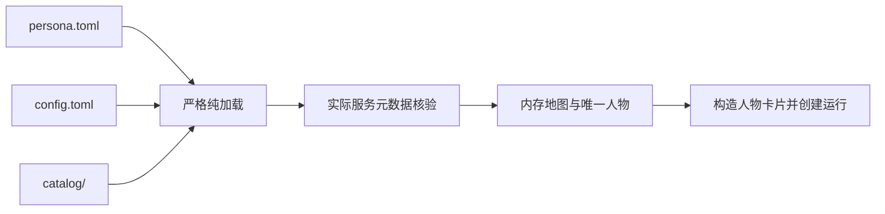

# WorldMock 产品设计说明书 — 配置

## 职责与边界

一份环境包描述一个世界、一个人物和一次运行。根级 `persona.toml` 是唯一人物来源，
`config.toml` 是唯一运行配置来源。目录格式归[资源引擎](03-resource-engine.md)，
运行行为归[模拟引擎](04-simulation-engine.md)，输入身份与恢复归[I/O 格式](09-io-formats.md)。

`persona.toml` 与 `config.toml` 都使用 `schema_version = 2`，写其他值的文件直接拒绝，
没有读取旧格式的分支；两份文件都是 UTF-8 无 BOM、只用 LF。
文件、编码、解析、类型、未知字段、范围与卡片文本超长的失败在创建世界和运行资产前拒绝。
输入按原字节冻结 SHA-256，不规范化后计算。纯加载不请求生成模型、不创建资产。
所有输入失败以英文记录，人物输入使用 `PERSONA_INVALID`，运行配置使用 `RUN_CONFIG_INVALID`。
地点引用使用资源引擎规定的登记码。

## 人物声明

`persona.toml` 是一张由数据集作者直接填写的表：除了人物的初值和工作安排，它还带着完整的人物卡片。
引擎不从 `background_story` 推出任何字段，没有缺省值；标「必填」的键缺一个就拒绝加载。

| 字段 | 必填 | 规则 |
| --- | --- | --- |
| `schema_version` | 必填 | 严格整数 `2` |
| `agent_id`、`name` | 必填 | 唯一人物，正严格整数身份与非空白姓名 |
| `background_story` | 必填 | 非空文字；零点计划原样读它，引擎不从中抽取任何字段，不限最短长度 |
| `health_habits`、`social_style` | 可省略 | 生活习惯与社交风格散文，零点计划原样读 |
| `home_location`、`initial_location` | 必填 | 目录中实际地点的完整显示名；住处必须标为住宿地点，起点可与住处不同 |
| `initial_balance_fen` | 必填 | 非负严格整数分 |
| `initial_relaxation_need`、`initial_social_need` | 必填 | 有限数，范围 `[0,1]` |
| `social_need_growth_per_hour` | 必填 | 有限数，范围 `[0.02,0.10]`；清醒时社交需要每小时的自然增长 |
| `chronotype_midsleep` | 必填 | 有限数，`0 ≤ 值 < 24`；自由日的睡眠中点，困意的昼夜阈值用它 |
| `sleep_need_hours` | 必填 | 有限数，`7 ≤ 值 ≤ 9`；每天需要睡多久，欠觉公式用它 |
| `wake_window`、`leave_home_window`、`lunch_window`、`dinner_window`、`bedtime_window` | 必填 | 时段，见下文；起床、出门、午饭、晚饭、开始就寝 |
| `leave_work_window`、`arrive_home_window` | 可省略 | 时段；不写表示没有固定的下班或到家时刻，与 `work_schedule` 写没写无关 |
| `coping` | 必填 | 压力时做什么，1 到 60 个字符 |
| `identity` | 必填 | 表：`age` 严格整数 16 到 100，`occupation` 1 到 20 个字符，`living_arrangement` 1 到 30 个字符 |
| `situation` | 必填 | 表：`busy_this_week`、`cares_about` 各 1 到 60 个字符 |
| `relationships` | 必填 | 数组，0 到 4 项；每项 `name_or_appellation`、`role` 各 1 到 12 个字符，`intimacy` 严格整数 0 到 30，`channels` 是 1 到 3 项非空白文字 |
| `habits` | 必填 | 数组，0 到 5 项；每项 `trigger` 1 到 30 个字符，`response` 1 到 40 个字符，`time_window` 是时段 |
| `tastes` | 必填 | 表：`content_genres` 至多 6 项，`food_preferences` 至多 6 项，`media` 至多 4 项，每项是非空白文字 |
| `body` | 必填 | `mass_kg`、`initial_energy_kcal`、`initial_sleep_debt_hours`；有限合法初值，能量不超过系统上限 |
| `work_schedule` | 可省略 | `workplace` 为完整地点显示名，`weekly` 为班次，`exceptions` 为日期覆盖 |

时段写成两个数的数组 `[起点, 终点]`，单位是自午夜起的小时，18.25 就是 18:15；不要求落在任何格点上，也不要求是整分钟。
每个时段只检查一条：恰好两个有限数，起点小于终点。越过午夜的时刻可以写成大于 24 的小时数，
人物看到的是钟面时刻（24.5 显示为 0 点半）。时段之间不做任何先后或重叠检查，也没有 24 小时或 30 小时的上界和跨度上限：
`bedtime_window = [5.0, 7.0]`、早于或压着晚饭的就寝、`leave_work_window = [25.0, 25.5]` 都能加载，并照写的样子显示给人物。
`channels` 写平时怎样联系这个人，例如「电话」「微信」「见面」；用词由数据集决定，引擎不设闭集，每项只要求是非空白文字，
重复的词也原样保留。关系在卡片文本里写成「渠道、渠道联系」，所以至少写一项；至多三项是提示容量依赖的条数上限。
数组可以为空的只有 `relationships`、`habits` 和 `tastes` 的三个数组，空数组也必须写出来。

保留的检查只有表的格式和计算要用的：类型、必填、数值范围（睡眠中点、睡眠需要、社交需要增长是公式的定义域，
亲密度是分档的定义域，年龄限在 16 到 100）、提示容量依赖的条数与字数上限和卡片文本的 600 汉字上限，以及时段的那一条。
条数与字数上限各管一个字段，合起来仍可能超过 600 汉字，口味数组里的词也没有单独的字数上限；
所以加载时用整张表构造一次卡片文本并数汉字，超过 600 就拒绝。这一步是纯计算，不调用模型，
文本怎样组成见[人物](06-agent.md)「人物身份与画像」。饭点加成按钟面读时段，对任何合格的时段都有定义，
所以不为它另加范围检查，见[交换引擎](02-exchange-engine.md)「身体共同结算」。

未知字段、类型不符、缺少必填字段、取值越界和卡片文本超长在加载时以 `PERSONA_INVALID` 拒绝，`path` 为 `persona.toml`，
`reason` 先写出错字段的点分路径，没有改法字段。路径只由字段名、表的键和数组下标组成，
例如 `work_schedule.exceptions.2026-01-05`：

| 情形 | `reason` |
| --- | --- |
| 缺少必填字段 | `<字段> is required`，例如 `identity.age is required` |
| 未知字段 | `<字段> is not a persona.toml field` |
| 时段不合格 | `<字段>: must be two finite hours with start < end`，习惯的时段写成 `habits.0.time_window` |
| 其余类型或取值错误 | `<字段>: <英文说明>`；`schema_version = 1` 得到 `schema_version: Input should be 2` |
| 初始能量超过系统上限 | `initial energy exceeds maximum energy` |
| 卡片文本超过 600 汉字 | `persona card render exceeds budget: <汉字数> hanzi > 600 (input-side problem, not truncated)`，不带字段路径 |

一次只报告第一处，卡片文本的长度在各字段都合格之后才数。文件本身读不出来（缺失、不是 UTF-8 无 BOM 与 LF、不是合法 TOML）时用文件级的原因，不带字段路径；
顶层出现已删除的旧模板字段时原因是 `legacy template fields are deleted, merge them into the card: [...]`。
卡片怎样由这些字段构造和怎样显示归[人物](06-agent.md)「人物身份与画像」。

人物不声明联系人、邮件、账单、工资、工作内容指派、车辆归属、专用燃油初值或种子。
删除 `entertainment_need` 与 `mood_valence` 的两套心理初值；身体结算与体感规则归交换引擎。
旧模板字段在人物解析入口明确拒绝，不接受纯文本或任意映射画像输入。

工作班次沿用日内分钟 `starts`、`ends`、`breaks`，半开且不跨日，休息时段在班次内、升序、不重叠。
`weekly` 使用星期键 `"0"` 至 `"6"`，未声明的日子不当班；`exceptions` 使用规范 ISO 日期，
声明一个班次覆盖当天，空数组表示休息。TOML 不使用 null，也不增加独立休息日配置。
排班与运行日历按现行特殊日期规则核对，不从内容推断人物是否在岗。

## 运行配置

| 字段 | 规则 |
| --- | --- |
| `schema_version` | 必填，严格整数 `2`；写其他值以 `RUN_CONFIG_INVALID` 拒绝，原因是 `schema_version: Input should be 2`，没有写时原因是 `schema_version is required` |
| `seed` | 唯一严格整数种子，不限整数范围；所有随机流由它派生 |
| `timezone` | 有效 IANA 时区 |
| `start_time`、`stop_time` | TOML 原生带偏移日期时间；按自身偏移整点，偏移与时区一致，停止晚于开始 |
| `activity_feedback_seconds` | 现行身体与活动结算间隔 |
| `reconsideration_interval_seconds` | 唯一常规重估间隔，不再区分空闲与承诺 |
| `progress_report_interval_seconds` | 活动进展播报间隔 |
| 候选呈现与轮转 | 只保留实际消费者使用的参数；删除 `candidate_pool_limit` |
| `calendar` | 现行特殊日期声明；不保留场景副本 |
| `model` | 唯一模型表，见下节 |

删除场景、环境钉、第二份目录路径、评估种子及 `max_same_moment_decisions`。
同刻决策固定三轮普通轮加三轮受限轮，耗尽即失败；规则只在模拟引擎维护。

## 模型配置与凭据

模型身份与调用预算集中于 `[model]`，不由不可覆盖源码常量决定。

| 字段 | 必填或默认、范围 |
| --- | --- |
| `provider` | 必填，实际协议身份 `openai_compatible` |
| `base_url`、`requested_model` | 必填，实际服务端点与精确模型身份 |
| `api_key_env` | 必填，进程环境变量名称；缺失或空值失败，不寻找凭据文件 |
| `metadata_url` | 必填，同一模型服务的显式元数据接口 |
| `context_window` | 必填严格整数，至少 `262144`，声明最低上下文要求 |
| `max_retries` | 默认 `0`，严格整数 `0–10`，可重试非传输服务拒绝 |
| `transport_max_retries` | 默认 `3`，严格整数 `0–10`，连接、超时与服务暂不可用 |
| `max_react_turns` | 默认 `16`，严格整数 `1–64`，宿主模型回合预算 |
| `reflection_validation_max_retries` | 默认 `3`，严格整数 `0–5`，反思输出校验重试 |
| `day_plan_validation_max_retries` | 默认 `3`，严格整数 `0–5`，日计划输出校验重试 |

`[model]` 的键只有上表这些：人物卡片不经模型，没有给它用的校验预算，写 `persona_validation_max_retries` 就是未知字段，
与其他未知字段一样以 `RUN_CONFIG_INVALID` 拒绝。
凭据值不进入文件、清单、提示或日志。两类服务重试由同一个 dispatcher 循环计数，
每次失败只消耗一类预算，总尝试至多 `1 + max_retries + transport_max_retries`；
底层隐式重试关闭，鉴权与参数错误立即失败。输出纠正是新的逻辑请求，各自受同一预算约束。
耗尽后失败，不合成成功或跳过模拟时间。

## 权威上下文核验

只读取实际服务元数据，按 `requested_model` 精确匹配唯一 `data[].id`，要求严格正整数
`context_window` 与 `max_output_tokens`。总容量不得低于声明，输出上限不得超过总容量。
元数据缺失、身份不存在或能力不足直接失败，不使用社区表、静态模型表或估算。
接口位于 `model_endpoint`，token 计数继续使用已有 LiteLLM 能力。

纯环境校验允许只读元数据 HTTP，不发生成请求。新运行冻结核验值与来源；恢复核对实际服务容量，
纯重放读取冻结结果。发送容量与浓缩阈值取已核验实际总容量，预留输出满足服务输出上限。

## 校验与输入冻结

`validate --environment ROOT` 汇总独立可检查输入的 `{path,code,reason}`，失败非零退出。
登记失败的 `reason` 是固定英文原因后接一个空格和详情，没有详情时只有固定原因；
行号、实际路径、地点对和更短路线等详情都经这一处到达作者。
成功只返回 `valid`、`environment_id`、`environment_version`。
新建运行在纯加载成功后由 `persona.toml` 直接构造人物卡片，不调用模型；恢复和重放核对工作区里的卡片与冻结的
`persona.toml` 一致，见[人物](06-agent.md)「人物身份与画像」。命令行没有单独的人物卡片命令。
运行输入警告有两种，新建运行时算出、冻结进运行清单的 `input_warnings`、计入质量报告并各写一条运维日志，不使运行失败：
没有任何 app 绑定内容而人物写了媒体口味或带「看、刷、听」的习惯（`CONTENT_EMPTY_WITH_MEDIA_TASTES`），
以及地点显示名带坐标或标识形态（`LOCATION_NAME_SUSPICIOUS`）。警告条目的形状是 `{code, agent_id, message, details}`，
警告码是这两个值的闭集，闭集之外的码在写入清单时拒绝。
两份 TOML 不进入目录清单和目录摘要，各自身份在运行清单冻结。
改变任何原字节后使用新运行目录；恢复、重放与跨臂比较核对这些身份。

## 唯一种子与随机键

配置的 `seed` 是唯一随机种子；保持 `random_state = sha256(f"random:{seed}")` 与 `random_seed = seed`。
所有随机流使用 `random_stream(random_state, key)`，不推进持久随机态；候选按身份升序。
禁止墙钟、事件 UUID、`hash()`、集合迭代序及独立评估种子参与派生。

| 用途 | 稳定键与取值 |
| --- | --- |
| 地图 | `map`，抽取六十四位整数作地图种子；同一个地图种子用于随机树、额外边抽取和边长，声明边不消耗随机数 |
| 天气 | `weather:{local_date}` |
| 睡过头 | `oversleep:{action_id}`，`action_id` 是开始这段睡眠的那条动作；只在这段睡眠开始的时刻往回 24 小时的睡眠合计（不含这段睡眠自己）不足四小时时取流，先抽一位，抽中再抽二十至六十的整数分钟，两端都能取到；每段睡眠只抽一次 |
| 购买总时长 | `purchase-duration:{action_id}`，六十至三百整数秒，一次请求只抽一次；实际购买时长取它与各张订单付款时长合计中较大的一个 |
| 支付段时长 | `payment-duration:{action_id}:{payment_order_key}`，每张订单十至二十整数秒，在内容 app 里直付也抽；只有到店订单抽到直付时为零，不抽取 |
| 购买功能 app | `function-app:{action_id}:{payment_order_key}`，每张订单抽一次，排序候选与唯一 null 等概率选择 |
| 出行功能 app | `function-app:{activity_id}`，候选是绑定了这次出行方式的功能 app 按身份升序，等概率选择，不增加 null；没有候选就没有导航记录 |
| 导航回到前台 | `navigation-return:{travel_activity_id}:{side_activity_id}`，路上一项槽位 2 活动停止执行时抽一位，抽到 1 导航回到前台；每项槽位 2 活动一个键，没有导航候选的出行不抽 |
| 下单 app | 店铺商品用 `order-app:{store_id}:{local_date}`，先确定店铺，同一家店同一本地日的商品抽到同一个 app；绑定在 app 上的商品用 `order-app:{goods_id}:courier:{local_date}` |
| 快递天数 | `courier-days:{goods_id}:{app_id}:{local_date}`，二、三、四、五天等概率 |
| 快递费 | `courier-fee:{goods_id}:{app_id}`，零或五百分等概率，跨日期稳定 |
| 内容选择 | `{activity_id}:{draw_index}`，只用于内容 app；在地点点名内容单元不抽随机数 |
| 回调链 | `callback:{rule_id}:{anchor}:{step_index}`，步骤下标从零开始 |
| 指标自举 | `bootstrap-metric:{name}`，抽取六十四位整数供 NumPy |
| 评审自举 | `bootstrap-review:{dimension}`，抽取六十四位整数供 NumPy |
| 评审日期 | `review-day:{block_start}:{calendar_class}`，使用 `randrange` |
| 盲评交换 | `review-swap:{slot}:{item_id}`，抽取一位 |
| 盲评掩码 | `review-mask:{reviewer_slot}`，抽取二百五十六位，以大端序写三十二字节 |

`group_key` 是 `[store_id,destination_id,app_id,fulfillment]` 的规范 JSON，是配送组的键，运费按它合并。
`payment_order_key` 是 `[app_id]` 的规范 JSON，序列化方式与 `group_key` 相同，是订单的键，付款按它抽取和结算：
带下单 app 的订单形如 `["meituan"]`，到店订单是 `[null]`；订单一律按这个字符串升序处理，`[null]` 排在所有带下单 app 的订单之后。
订单不新增持久字段，也不新增身份，由购买活动列出的商品履约记录和记录上的 `app_id` 得出。
预览只使用已知商品、店铺、app 与日期，不提前分配动作身份；受理冻结同一报价，恢复不得重抽。
商家选择按 `(总价款和配送费, 店铺到收货地点的最短距离, 店铺身份)` 取最小值，不随机选择远程店铺：
同价时选最近的店，同距取较小的店铺身份；配送时长随距离只增不减，最近的店也最早送达，两家店折算到同一秒送达时仍选距离更短的一家。
同组全部商品配送策略为零才免配送费，否则整组只收五百分。

普通推送事件身份为 `push-{agent_id}-{local_date}T{HH}`；时间事件为 `time-{key}-{due_at}`，
同一键同一绝对秒一次，夏令时不同绝对秒分别登记。天气使用 `weather-{local_date}`，
起始日只初始化事实；日历使用 `calendar-{local_date}`。到达排程按一趟配送登记：
一趟配送是同一个配送组里预计到达时刻相同的已付款外卖或快递记录，身份是 `delivery-{这一趟里 order_id 最小的记录}`，按字符串比较。
每趟配送另有一条发货通知排程，身份是 `shipped-{order_id}`，取同一条记录；排程序号先分给各趟的发货排程，再分给各趟的到达排程。

回调受理锚点为 `{action_id}:0`，一条动作只开始一项活动；按日动作效果用 `{origin_action_id}:{local_date}`；
预排事件使用其 `scheduled_id`；推进唤醒类别用 `wake:{agent_id}:{current_time}`；
同刻唤醒类别用 `wake:{action_id}`，开始组取第一条动作的身份。阈值触发沿用造成越阈的锚点，不触发级联。
回调效果与资金账本原因均为 `callback:{rule_id}:{anchor}`，`caused_by` 必须指向真实触发事件。

评估从已认证 WorldMock 检查点读取非空字符串 `random_state`，缺失时抛出
`EvaluationError("invalid_input", "WorldMock checkpoint random_state is missing")`。
只读重放不得引入另外的种子；测试的字节签名可规范化壁钟、UUID 和运行路径，但不得改变生产随机键。
