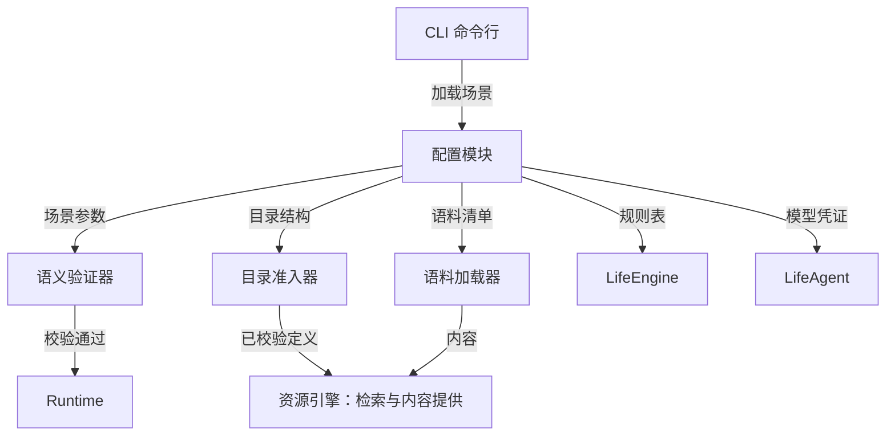
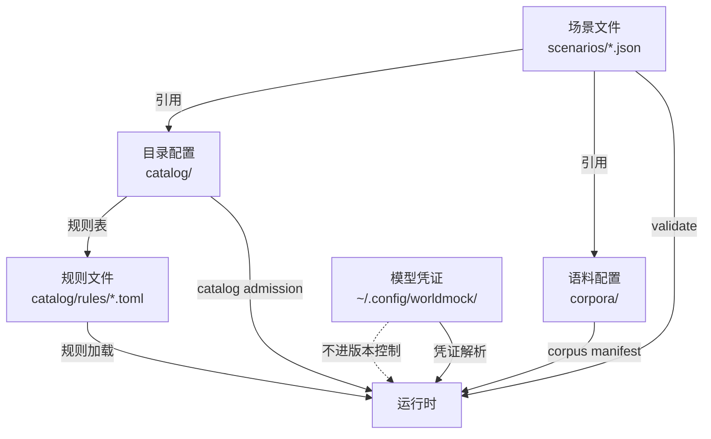
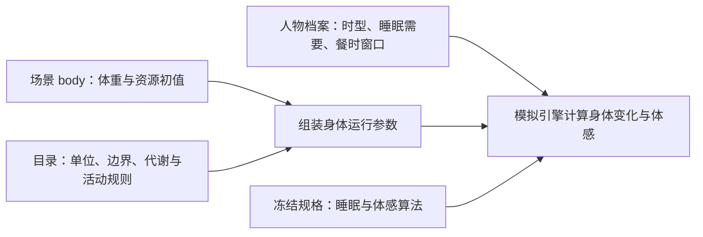

<a name="configuration-worldmock-产品设计说明书-配置规格"></a>
# WorldMock 产品设计说明书 — 配置规格

> **状态**：DRAFT；按人物 Prompt 规格修订，修订部分已实现（证据见[人物 Prompt 验收记录](../archive/persona-prompt/persona-prompt-verification.md)）；按一日运行保真规格同步（一日运行保真 CF1），已实现；按[个人事务与工作安排规格](../dev/SPEC-as2-integration.md#errands-workday-运行修复入库)分阶段同步（[实施计划](../archive/errands-workday/errands-workday-implementation-plan.md) D8 作业），已随代码落地到阶段 1–4<br>
> **日期**：2026-10-05
> **版本**：v1.19\
> **工具交互修订**：地点完整供给、构建价格范围、任务可用类型与请求形状设计已冻结，已实现；本次生产验收单独记录；以[工具交互规格](../dev/SPEC-life-runtime.md#tool-interaction-工具请求)为本次合同。
> **目标读者**：算法工程师、开发工程师、实验设计者

配置文件的编写步骤和可复制示例见[用户配置手册](../manual/README.md#readme-用户配置手册)。本文维护配置职责与设计边界。

<a name="design-08-configuration-共享规则与可重建环境修订"></a>
## 共享规则与可重建环境修订

按[共享规则与可重建环境规格](../dev/SPEC-shared-rules-and-rebuildable-env.md)修订；验收结果独立记录。

环境引导只提供 release/dev、wheelhouse 和显式 uv 安装选择，不增加场景配置层。收据绑定 Python、依赖锁、AS2 与 LabelKit 身份及缺失部件，全部项目路径相对仓库。release 缺 Node 或 LabelKit 失败；dev 可明确跳过相关检查，但不能取得完整放行。


<a name="design-configuration-current-responsibility"></a>
## 冻结输入与可重建测试

运行身份只从场景 JSON 读取人物身份、时间窗和时区，不为生成身份完整装配世界。生产新建与恢复仍执行实际冻结输入校验，不增加生产缓存或运行配置。
测试工厂缓存以实际文件相对路径和真实字节为键，复制可变分支，只共享递归验证的不可变输入；临时场景和修改后的输入不使用正式缓存。场景副本使用相对资源引用，跨卷通过复制资源保持可重建，不保存机器绝对路径。

测试运行摘要还绑定实际读取的源码、测试、设计、依赖锁、补丁、场景与语料、根 `.gitattributes`，
以及交付工程 `labelkit-projects` 的配置、hooks 和 schemas；该工程的 data、out 和 `__pycache__`
不纳入输入，自动生成的计时与覆盖报告保留现有排除范围。
收集、worker 选择、完成回执和覆盖数据摘要必须属于同一运行，不能借同输入的旧绿色证据放行。

<a name="configuration-版本历史"></a>
## 版本历史

| 版本 | 日期 | 作者 | 说明 |
| --- | --- | --- | --- |
| v1.0 | 2026-09-20 | Claude | 初版：配置层级、场景文件、目录结构、语料配置、规则配置、凭证管理、校验机制 |
| v1.1 | 2026-09-20 | Codex | 身体初值、资源目录和规则来源对齐实际输入，明确已有实现差异 |
| v1.2 | 2026-09-20 | Codex | 资源、内容和语料设计归入资源引擎；配置仅保留场景引用与初值 |
| v1.3 | 2026-09-20 | Codex | 增加地点类与人物交互菜单声明、失败关闭校验和场景身份边界；删除会被误读为实测收据的固定校验示例 |
| v1.4 | 2026-09-21 | Codex | 接入用户配置手册，对齐模型凭据的实际检查边界，删除过时加载伪代码 |
| v1.5 | 2026-09-21 | Codex | 合并当日目标的双重估间隔及已冻结密钥池合同，统一手册与运行校验边界 |
| v1.6 | 2026-09-24 | Claude | 按时间与能量规格：交互菜单取内部标准动作，人物所选动词与方式映射后判定，途中按出发地菜单解析并由出行方式收窄；同时开始两项须两个名额空闲，按注册表占用与准入事实判定，能量不参与；初始睡眠压力按惯常起床时刻反推 |
| v1.7 | 2026-09-25 | Claude | 世界状态结构版本改为 7（时间与能量规格第九章），旧检查点以版本不符拒绝 |
| v1.8 | 2026-09-25 | Claude | 按时间与能量规格阶段 1：进行中的等待不算在手承诺；新增同刻决策上限 `max_same_moment_decisions`（缺省 3），`activity_feedback_seconds` 下限改为 60；含旧键 `max_consecutive_rejections` 的场景按未知字段拒绝；世界状态保存同刻计数与按人物暂存的呈现留痕 |
| v1.9 | 2026-09-25 | Claude | 按时间与能量规格阶段 3：世界状态保存地点会话与活动的收尾、播报锚点和会话归属 |
| v1.10 | 2026-09-25 | Claude | 按时间与能量规格阶段 5：目标条目只接收必填可空的 `remind_time`（场景本地 `HH:MM`），不接收时长或其他调度参数，当日目标由零点计划生成；世界状态保存当日计划与提醒（`remind_at`、`reminded_at`）及已生成计划的日期 `plan_submitted_dates` |
| v1.11 | 2026-09-27 | Claude | 按人物 Prompt 七层规格（人物 Prompt 台账 E8-1–E8-3，E8-2 为阶段 1、4 同批作业）：文件头注明修订部分待实现；世界状态结构版本改为 8，旧检查点（含版本 7）以版本不符拒绝，另存会话 `opened_by_action_id`、活动 `paused_at` 与开吃份量、订单收货人与请求关联、联系人持有与发件箱；场景联系人可填可空的 `receive_location_id`；「7.2 格式与加载边界」的凭据链接改指接口合同「模型身份」 |
| v1.12 | 2026-09-28 | Claude | 人物 Prompt 七层规格实现后文档：文件头注明修订部分已实现；联系人 `receive_location_id` 须为场景声明的地点，与同世界人物重复的联系人为 `null`；写明同秒续接开关是运行参数（`worldmock run --same-second-continuation on\|off`）而不是场景字段 |
| v1.13 | 2026-09-29 | Claude | 按[一日运行保真规格](../dev/SPEC-life-runtime.md#dayrun-fidelity-身体与需要)同步（一日运行保真 CF1，随阶段 1–3、5 的代码落地，按 `e377669` 核对）：目标条目字段增 `around_time`，世界状态的计划目标增 `around_at`；场景层身体实例字段 `entertainment_relief_preference_floor`（缺省 0.5，取值 (0, 1)）；地图结构 2 与可选 `branch_label`，显示名规则与加载校验（地点 `kind` 属于环境层地点类型表、可见标签唯一，否则加载时拒绝）；场景显式声明的作息字段覆盖卡片抽取值；场景可选钉定手机配置 `phone_simulation_config` 与其摘要，购买渠道由它派生（称呼、成员门店与准入），渠道准入违规在加载时以 `IntegrityError` 拒绝，手机配置核验失败时加载照常、不派生渠道并写 warning 日志；校验清单与错误分类补加载拒绝、渠道准入与运行输入警告；文件头补修订说明，日期改写 |
| v1.14 | 2026-10-01 | Codex | 工具交互设计冻结并已实现：目录5.0、契约与规则绑定3、场景4、地图3，世界8保留；逐店真实供给和定位价格、必填可空预约、原料配方、items活动请求、中文购买偏好、null本人、偏移查询与具体英文错误 |
| v1.15 | 2026-10-03 | Claude | 按[个人事务与工作安排规格](../dev/SPEC-as2-integration.md#errands-workday-运行修复入库)同步（实施计划 D8 作业，阶段 1，按 `a1f680b` 核对）：阶段 1 的四项运行修复不改变任何配置字段与结构版本；顺带更正 3.3 中「场景 `schema_version` 仍为 3」的过时说法，改为指向 3.1 的发布目标表；文件头补同步说明，日期改写；版本表改为末行最新 |
| v1.16 | 2026-10-03 | Claude | 按[个人事务与工作安排规格](../dev/SPEC-as2-integration.md#errands-workday-运行修复入库)同步（实施计划 D8 作业，阶段 2，按 `d09d574` 核对）：发布目标表的世界状态结构改为 9，旧检查点（含版本 8）以版本不符拒绝，另存每个人物的未完成个人事务 `errands`；3.1 写明未完成的个人事务不算在手承诺，不改变重估间隔与闭店预警；阶段 2 不改变任何场景字段与场景结构；文件头阶段号改到阶段 2 |
| v1.17 | 2026-10-03 | Claude | 按[个人事务与工作安排规格](../dev/SPEC-as2-integration.md#errands-workday-运行修复入库)同步（实施计划 D8 作业，阶段 4，阶段 4 与阶段 2 并行开发，在阶段 2 之后并入）：「地图引用与门店供给初值」`query_world` 六键（增 `from`、`available_only`，旧四键请求按缺字段拒绝，`from` 与购买同一解析、写错时给查询参数错误与至多三条完整请求候选），筛选先于切页，返回不再附候选；不新增任何配置字段，场景与世界结构版本不变；文件头状态改为已落地阶段 1、2 与阶段 4 |
| v1.18 | 2026-10-03 | Claude | 按[个人事务与工作安排规格](../dev/SPEC-as2-integration.md#errands-workday-运行修复入库)同步（实施计划 D8 作业，阶段 3，按 `56451b4` 核对）：生活场景结构 5，人物必填可空的 `work_schedule`（新增「工作安排声明」小节，校验清单增「工作安排」行：形状错误由场景模型拒绝，工作地点与场景日历由加载检查核对），可选的下班与到家窗口并入场景作息覆盖（七字段）与顺序约束，新槽冲突时保留卡片值（可为 null）并记 `CARD_FIELD_CONFLICT`；运行输入警告的画像编译一项泛指编译留下的警告；工作安排进入场景身份；发布目标表的世界状态结构照阶段 2 为 9；文件头状态改为已落地阶段 1–4（阶段 3 在自己的分支上开发，在阶段 2、4 之后并入） |
| 共享规则与可重建环境 | 2026-10-05 | | 同步规则归属、源码重建与验收合同 |
| `2026-10-05-layering-and-test-tiers` | 2026-10-05 | | 当前职责对象与依赖方向、五项行为正文归属、固定历史来源和稳定引用；业务与持久合同保持不变 |
| 共享门禁独立复核 | 2026-10-05 | Codex | 冻结真实读取的换行规则与交付工程输入，排除实际输出和缓存，同次证据身份一致 |

<a name="configuration-模块概述"></a>
## 1. 模块概述

<a name="configuration-职责与边界"></a>
### 1.1 职责与边界

配置负责定义一次实验的人物、时间、地点类与人物交互菜单、初值、资源与语料版本引用，以及模型凭证。
资源、内容和语料的定义与发布统一见[资源引擎设计](03-resource-engine.md#resource-engine-worldmock-产品设计说明书-资源引擎)。

**职责**：
- 定义场景参数（人物、时间窗口、地点、交互菜单、工作安排、初始状态）
- 绑定资源目录版本与语料清单哈希
- 选择场景参数，并引用资源引擎和交换引擎的规则
- 提供模型凭证的安全存储与加载机制
- 校验配置完整性与一致性

**边界**：
- 不负责运行时状态维护（由 LifeEngine 承担）
- 不负责内容检索与呈现（由资源引擎承担）
- 不负责配置热更新（配置在运行前加载，运行中不可变）

<a name="configuration-与其他模块的关系"></a>
### 1.2 与其他模块的关系



<a name="configuration-核心设计原则"></a>
### 1.3 核心设计原则

| 原则 | 含义 | 体现 |
| --- | --- | --- |
| **显式版本** | 配置文件携带版本号 | 场景使用整数 `schema_version`，具体约束由场景模型定义 |
| **Fail-Closed** | 未识别字段拒绝启动 | 拼写错误不会被静默忽略 |
| **溯源分类** | 参数注明来源 | 分类与字段见[资源引擎的来源分类](03-resource-engine.md#resource-engine-来源分类) |
| **确定性加载** | 相同配置产生相同行为 | 禁止运行时随机化 |
| **凭证隔离** | 敏感信息不进版本控制 | 凭证位于 `~/.config/worldmock/` |

<a name="configuration-配置层级与加载顺序"></a>
## 2. 配置层级与加载顺序

<a name="configuration-配置层级"></a>
### 2.1 配置层级

WorldMock 采用四层配置结构：



<a name="configuration-加载与校验"></a>
### 2.2 加载与校验

场景先通过自身模型与交互菜单闭集校验，再解析固定目录和语料引用；在启动前完成引用、文件身份和品类准入。
场景的 `catalog_version` 选择当前原生目录版本；`recipe_output_bindings` 明确将库存配方的输出品类
绑定到输出对象，没有配方时为空对象。全部商品与供给关联商品、初始库存、未来供给发布、任务、出行方式和配方输出闭包
共同决定需要通过的配对，不由调用方提供缩小后的触达清单。
品类配置及三态的精确定义见[接口合同](../CONTRACTS.md#contracts-品类契约与目录字段)与
[品类契约规格](../dev/SPEC-category-contract.md#spec-category-contract-品类契约与交换规则开发规格)。
实际入口见[场景加载](../../src/worldmock/life/scenario.py)与
[项目校验](../../src/worldmock/validation.py)。目录和语料的加载细节统一见
[资源引擎的准入边界](03-resource-engine.md#resource-engine-准入边界)，本节不另设通用配置装配类。

<a name="configuration-参数归属"></a>
### 2.3 参数归属

身体资源的配置分为场景实例初值、人物档案常量和目录规则；各自职责见
[场景与身体规则](../dev/SPEC-life-runtime.md#spec-life-runtime-场景与身体规则)。场景不通过一个通用
`constants` 对象覆盖所有身体算法。



<a name="configuration-场景配置文件"></a>
## 3. 场景配置文件

<a name="configuration-文件位置与合同"></a>
### 3.1 文件位置与合同

场景位于 `scenarios/`，完整示例见
[白领场景](../../scenarios/white-collar-12-weeks.json)。当前输入结构由
[LifeScenario、BodyInstanceConfig 与 AgentConfig](../../src/worldmock/life/scenario.py)
校验；资源语义引用 [资源与需求字段](../CONTRACTS.md#contracts-资源与需求字段)。

当日目标重估沿用生活场景配置：`reconsideration_interval_seconds` 默认 5400，
`idle_reconsideration_interval_seconds` 默认 10800，均为正整数且不超过 86400，空闲间隔不能短于常规间隔。
进行中的等待不算在手承诺，人物只在等待且没有其他在手承诺时用空闲间隔。
未完成的个人事务也不算在手承诺，不改变常规与空闲重估间隔及闭店预警。
其选择与环境威胁边界见 [当日目标规格](../dev/SPEC-day-plan-goals.md#spec-day-plan-goals-事件驱动的决策节律)。
同刻决策上限 `max_same_moment_decisions` 为正整数，缺省 3；`activity_feedback_seconds` 取 60–86400 秒，下限 60
保证等待（计划时长取它）能被受理。含旧键 `max_consecutive_rejections` 的场景按未知字段拒绝。
场景联系人可填 `receive_location_id`（可空）：联系人在该地点收实物，送给联系人的直接配送送到这里，当面给予要求本人位于这里；
为空时联系人不能收实物；填写的地点须是场景声明的地点，否则场景校验拒绝。`Contact` 拒绝未知字段，补填会改变场景摘要。
与同世界人物重复的场景联系人（仓库双人场景中的李凡、陈曦）显式为 `null`，同世界人物按其所在地点收货。
同秒续接开关不是场景字段，是运行参数：新建运行由 `worldmock run --same-second-continuation on|off`（缺省 `on`）给出，
冻结进运行清单 `stage_model_identity.stages.action` 与人物配置，恢复与重放继承父清单的值（见[接口合同「思考回传」](../CONTRACTS.md#contracts-reasoning-return)）。
目标条目只接收提醒时刻 `remind_time` 与大致时刻 `around_time`（都必填、可为 null，场景本地 `HH:MM`；大致时刻只用于
推进判定，不触发决策），不接收时长或其他调度参数；
当日目标由零点计划生成，人物以 `revise_day_plan` 修订，规则见[当日目标请求](../CONTRACTS.md#contracts-day-goal-request)。

场景使用整数 `schema_version`，人物清单为 `agents`，时间字段为 `start_at`、`end_at`；
身体资源初值放在顶层 `body`，人物档案常量放在各自的 `agents` 条目。
场景可选钉定手机配置 `phone_simulation_config` 与其 `phone_simulation_config_sha256`（两者同时出现或同时缺省）；购买渠道由它派生，
手机配置自身不新增场景结构；本次任务字段按工具交互规格随生活场景结构升为 4。
人物配置的必填可空字段 `work_schedule` 与可选的 `leave_work_window`、`arrive_home_window` 随个人事务与工作安排规格使生活场景结构升为 5；
仓库三份场景同批显式写出 `work_schedule`，它们的 `scenario_sha256` 随之改变，既有运行不可恢复。
本文不重新定义完整场景 Schema。下表列各格式首次受影响的发布目标，目录、地图与场景在各自结构发生实际变更的阶段独立发布，
不因某个阶段完成而预先提升无关格式；后续内容变更另发新版本，不同内容不得覆盖同版，最终认证记录实际版本及摘要。
恢复仍核验该阶段真实产物与代码身份。

| 格式 | 首次受影响的发布目标 | 拒绝边界 |
| --- | --- | --- |
| 地图文件 `schema_version` | 3 | 当前实现 3；必填 `random_seed/category_assignment_sha256`，分类声明由地图和语料清单共同钉定，旧地图直接拒绝 |
| 商品目录 `version_major` | 5（首次 5.0，当前 5.4） | 构建价格范围、真实原料对象与单输入单输出配方；内容改变另发版本，旧身份不兼容读取 |
| 品类与交换规则 `contract_version` | 3 | 当前实现 3；价格范围槽与原料品类，购买仍读取独立供给当前报价 |
| 生活场景 `schema_version` | 5 | 当前实现 5；每个人物显式声明 `work_schedule`（对象或 null），`appointment` 仍为 null 或约定对象，开放时刻只在运行时派生；场景结构 4 的旧场景直接拒绝 |
| 世界状态 `schema_version` | 9 | 旧检查点（含版本 8）以版本不符拒绝；活动集合、地点会话（一段停留或一段路）与活动的收尾、播报锚点和会话归属、共同身体时刻、威胁交付签名、同刻计数、按人物暂存的呈现留痕、当日计划与提醒（目标的 `remind_at`、`reminded_at`、大致时刻 `around_at` 与已生成计划的日期 `plan_submitted_dates`）与供给事实完整保存；活动快照地点为开始地点；另存引起会话切换的动作 `opened_by_action_id`、活动的暂停时刻 `paused_at` 与进食的开吃份量 `opened`、订单的 `recipient_id` 与 `request_message_id`、联系人持有 `contact_holdings` 与人物发给场景联系人的 `outbox`；另存每个人物的未完成个人事务 `errands`（按事务身份存放：名称、结果种类、商品、数量、已累计量、备注 `memo`、记下时刻、提醒时刻与已提醒时刻、来源动作与请求事件），办成或取消即移出 |

目录通过 `scripts/build_catalog.py` 生成，地图通过 `scripts/prepare_map.py` 从显式输入准备与发布。
地图准备的发布流程见[资源引擎](03-resource-engine.md#resource-engine-冻结地图的准备与发布)。不保留旧场景迁移脚本或兼容输入层。

<a name="configuration-交互菜单声明"></a>
### 3.2 交互菜单声明

场景根对象必须具有 `interaction_menus_by_location_kind`，键集合恰好等于所选地点经地图解析后的 `kind` 不同值
集合。每个地点类都有一个非空菜单，不接受 `null`、通配键、缺项或额外键。每个 `agents[]` 条目必须
显式具有 `interaction_menu`，取同形菜单或 `null`；`null` 表示人物不在地点菜单之外追加限制，字段缺失
仍是配置错误。

菜单只有 `allowed_actions` 一个必填数组。数组非空、元素无重复且为非空白字符串，
不接受其他字段；动作取内部标准动作 `START_ACTIVITY_ACTIONS` 闭集，不是人物动词。
人物所选的（对象，动词，方式）经私有绑定映射为内部动作后按菜单判定，场景文件不改。
地点菜单只剪裁对象动作，不剪裁模型工具；`wait`、`sleep` 是必须保留的自身动作。完整闭集、
保护集合和 `null` 语义见[交互菜单合同](../CONTRACTS.md#contracts-交互菜单声明与有效菜单)。

运行时按人物权威 `location_id` 找到地点的单值 `kind`，再将该地点菜单与人物菜单逐字段求交集。
途中按出发地菜单解析，再由出行方式的准入收窄。
解析后地点的 `kind` 只用于选择交互菜单，和候选资格的多值 `location_kinds` 不是同一字段；不能以其中一个
代替另一个。菜单是显式准入声明，不从人物画像、偏好、动机或目录 `surface` 推导。

所有版本控制内的正式场景和相应测试输入都使用当前字段。旧文件缺字段时拒绝，不生成缺省全量菜单，
不添加迁移或兼容读取。实现与验收以[冻结特性规格](../dev/SPEC-interaction-menu.md#spec-interaction-menu-特性规格交互菜单)为准。

<a name="configuration-地图引用与门店供给初值"></a>
### 地图引用与门店供给初值

场景 `map_dataset` 使用 `dataset_id/version/path/sha256` 绑定唯一冻结地图。
`locations` 只写 `location_id`，`products` 只写 `product_id`，`supplies` 写 `supply_id` 及可选 `initial_stock`。
正式场景的 `products/supplies` 必须显式包含选中售卖地点全部声明商品及生成供给；
加载与正式验收核对选择后的实际集合，旧稀疏列表不能裁掉新供给，缺项拒绝，不自动选择或补齐。
地点名称、坐标、营业、路线和供给定义从固定资料装配，不在场景手抄副本，也不添加额外配置层。
人物 `qualifications` 显式声明；访问与供给资格不能从人物画像推断。

地图地点可选 `branch_label`（非空字符串）区分同名地点：显示名为「名称（branch_label）」，例如「全家（东昌路店）」，
不要把坐标或内部标识写进名称来避开重名。运行时场景的地点以显示名为名称，工具层、环境层、拒绝原因、会话名、事件与导出
都用它；没有 `branch_label` 的地点名称不变。场景加载在目录准入之后另做三项世界准入：所选地点的 `kind` 属于环境层的场所
类型闭集（[地点类词表](../CONTRACTS.md#contracts-地点类词表)）；所选地点显示名唯一，同名而没有不同的 `branch_label` 即拒绝；
每个人物可能同时看到的对象名称唯一（地点、门店商品、持有物、商品目录、内容、游戏、生活活动、工作、人物、联系人、邮件与
「自己」，写法与观察投影同一来源）。任一不满足都以 `IntegrityError` 拒绝加载并写明原因，不再等到运行中途才由环境层或
观察投影报错。

购买渠道由场景钉定的手机配置派生，不新增场景字段（[一日运行保真规格](../dev/SPEC-map-and-storefront.md#dayrun-fidelity-按名调用与指名购买-购买渠道app-名解析为成员门店)
3.3，裁决 S7）：场景可选填 `phone_simulation_config`（语料根内、登记进语料清单的冻结文件）与它的 `phone_simulation_config_sha256`，
两者同时出现或同时缺省。加载时按身份（语料清单与场景钉定的摘要）、结构、场景身份与执行证据核验这份配置，再从它的卖家账户→App
与 App→称呼派生渠道：`channel_id` 取 App 标识，称呼取该 App 的显示名（可以有几个），成员门店取映射到它的卖家有供给的所选地点；渠道只是
门店集合的称呼，不带交付语义。渠道准入与世界准入同一时机：称呼非空，在渠道之间不重复（去掉空白、不分大小写比较），也不等于任何所选地点
的显示名（按同一比较或无损归一比较）；每个渠道至少一家成员门店，成员门店是所选地点并至少有一条供给；不满足即以 `IntegrityError` 拒绝
加载并写明渠道、称呼与地点。
手机配置核验失败时不派生渠道（与覆盖率同一口径：新建运行不因此失败，加载写一条英文 warning 日志，`validate` 照旧失败）；
没有钉定手机配置的场景没有渠道，人物把 App 名写在 `from` 时以 `SOURCE_NOT_FOUND` 拒绝。配置已由摘要钉进场景与运行清单，运行身份不变。

完整运行时场景包含解析后的地图、地点、路线、商品和供给。地图和场景选区共同校验账户、产品、
供给组合和有向路线覆盖。每个端点/方式组合必须有可达、不可达或带来源的未知记录；漏项拒绝。
营业与报价的有效期、核对日期、可信截止日及来源在发布前验证。旧整点营业和旧商品单店字段直接拒绝。
商品目录浏览由 `start_activity` 的可读对象与动作表达；允许浏览的正式地点菜单必须显式纳入
`browse` 标准动作，人物菜单仍可进一步限制。
三个正式场景选中的三家餐馆各自选中明确关联的 `prepared-meal` 供给和商品，
kind仅定义完整准入池，逐店category_ids及全部后代对象与object_ids并集确定实际供给，仍须全部属于准入池。
供给初值为正、餐馆支持本店自提，且地点与人物的实际菜单允许购买和消费；
无售卖类别地点可无供给，不能通过逐条手抄只给售卖地点留下零星几件商品。
分类声明冻结在 `corpora/zhangjiang-map/category-assignment.json`，同一文件逐店包含
`location_id/category_ids/object_ids/price_position_percent/source`，五键必填，缺项拒绝，不随机抽取或全量复制准入池。
文件恰含必填 `kinds/locations/source`，`kinds` 为现有地点 kind 到品类数组的准入表，全部地图 kind 包括空集合均显式声明；
顶层与逐店 `source` 均沿用完整 `DataSource` 的 `kind/url/retrieved_at/license/notice/fact_cutoff/applicability`。
显式卖方、库存与履约保存在供给假设材料；目录有效属性中的
`purchase_price_fen_min/purchase_price_fen_max` 给出同币种正整数分范围。构建对 `[random_seed, location_id, object_id]` 使用
`json.dumps(..., ensure_ascii=False, separators=(',', ':'))` 后编码为 UTF-8，取 SHA-256 摘要的无符号大端整数 `h`，
逐店 `price_position_percent` 为有来源的整数5至95，固定 `jitter = h % 11 - 5`，
以 `min + ((max - min) * (price_position_percent + jitter) + 50) // 100` 生成一次初始报价，不为每商品独立抽整个范围。
本正式地图中的门店按同一地区比较，所有便利店定位至少高于地图内普通超市10个百分点，
同商品报价不得更低，整数舍入同价合法；不新增地区字段。
这是有来源场景假设，其他门店定位按事实或明确假设声明，不新增可配置扰动。
地图结构 3 必填 `random_seed/category_assignment_sha256`，分类文件由地图和语料清单共同钉定，
加载核对地图种子与场景种子相等、分类哈希与全部逐店实际供给；范围来源保留于对象和报价来源。
白领与多人场景使用不同既有种子，分别发布并钉定对应的地图供给集合；地点和路线来源可共享，
不跨种子复用报价，也不为共用一份地图擅改实验种子。
观察、查询、交易和恢复不抽价，不加重复摘要配置或运行策略开关。

正式场景丰富度门禁为每餐馆8正餐且每对菜单各有至少3项差异、便利店40对象/6最终品类、超市80/8、
商户40/6且含日用品、菜市场8真实原料/2已发布原料子类。阈值是本次正式场景验收，不是行业事实；
素材未知或不足拒绝发布，不随机补齐，还须行为验证到店营业、有货、真实购买及餐食制作食用。

任务必填 `appointment`：普通独立工作写null，真实需要提前约定的活动写 `{starts_at, reason}`，
starts_at带时区、reason为非空约定依据，不能根据标题猜测。删除场景输入的available_at、availability_kind、appointment_reason。
内部 `RuntimeWorkTask.available_at` 由最早关联通知sent_at或预约starts_at派生；普通邮件工作在收到通知时已开放。
每封非空 `related_task_id` 邮件必须引用实际任务，收件人必须匹配任务受派人物；每项任务必须有发给受派人物的关联通知。
预约只要求最早通知不晚于starts_at，之后的提醒可以晚于预约开始，不能改写已派生的开放时刻；due_at必须晚于派生开放时刻。
邮件到达即已知，正文仍须真实阅读，不用无通知任务作为缺数据回退。
地点、资格与截止仍真实校验；到公司即可开始已收到的普通工作，不再靠 09:00 之类惯例强制等待。
习惯写明自己做饭时，场景必须声明真实原料库存、原料对象、转换规则和 `recipe_output_bindings`；
输入和输出的 `inventory_unit=item`，库存资源仍为 `inventory/item`；输出为能吃的已发布对象，
不开发多材料引擎，不加无产出过渡活动。
正式数据集发布须有明确习惯动作夹具验证完整链；运行覆盖警告与 `validate` 的 80% 门禁保持原合同。
人物如需同时启动两个持续活动，两个名额都须空闲，名额不足报 `SESSION_LIMIT_EXCEEDED`；
正式地点和人物菜单分别允许这两项映射后的标准动作，本轮items对象逐项通过冻结菜单与可见性校验，
并按注册表占用与准入事实判定，能量不参与，整组原子受理。
`start_activity` 必填items/answering/prefer，items一至两项，每项恰为全键必填的{target,way,from,to}；
方式统一解析出动作，旧actions和targets/ways/from/to平行数组直接拒绝。
含到店、远程下单或购买项时prefer只能为“最快拿到”或“到手价最低”，否则必须为null；null不默认最快，旧英文值拒绝。
to=null统一为本人、他人写实名，旧“自己”值拒绝；食用、使用、制作及非转移动作两端null，给予from=null且to为其他人物。
固定 `query_world(name, way, category, from, available_only, offset)` 六键必填、无缺省，`name`、`way`、`category`、`from` 可空但至少一个
非 null，`available_only` 为布尔，offset为非负整数，旧四键请求按缺字段拒绝；`from` 写地点显示名或渠道称呼，与购买项的 `from` 同一解析，
写错时返回查询参数错误（`ARGUMENTS_INVALID`）与至多三条换了 `from` 的完整请求候选；
category只取callable_index已展示的公开品类标签，错误给当轮全部合法标签。
结果matches/total_count/next_offset中的next_offset必填可空，每页沿用现有上限20，可按偏移遍历同一冻结全集，筛选在排序与切页之前施加，每项不再附候选。
查询只读冻结观察权限，不推进时间或授予凭据，不新增游标编码或配置，不恢复商品需求路线发现接口。
全部接口错误均返回英文说明，`items[]` 每项包含 `path/written/error_code/allowed_values/expected/why/candidates`；
`path` 为从模型工具调用根开始的完整位置数组，`why` 写参数、名称或世界前置条件的英文原因，
闭集列全部合法值，未知字段与旧形状不回退受理。


<a name="configuration-身体资源初值"></a>
### 3.3 身体资源初值

以下是当前白领场景的 `body` 字段摘录，仅展示这一字段，不是可独立运行的完整场景：

```json
{
  "body": {
    "mass_kg": 65,
    "initial_energy_kcal": 1600,
    "initial_sleep_debt_hours": 0,
    "initial_entertainment_need": 0
  }
}
```

| 配置内容 | 含义与运行时去向 |
| --- | --- |
| `mass_kg` | 体重，单位 kg；用于活动额外能量消耗 |
| `initial_energy_kcal` | 可用能量初值，单位 kcal；成为 `BodyState.energy_kcal`，受目录能量上界约束 |
| `initial_sleep_debt_hours` | 当前场景输入使用的键名；其值初始化唯一的睡眠不足账 `BodyState.sleep_deficit_hours`，不新增另一份睡眠状态 |
| `initial_entertainment_need` | 当前场景声明的娱乐需要初值，范围为零到一；见下文实现差异 |
| `entertainment_relief_preference_floor` | 可选，娱乐缓解的下限偏好 `f`，缺省 0.5，取开区间 (0, 1)，0、1、负数与非有限值在场景加载时拒绝；经场景语义组装并入 `BodyConfig`，观看与游戏的实际缓解按有效偏好 `f + (1 − f)·w` 调幅度。实验假设（敏感区间 0.3–0.7），说明写在字段 `description`，见[一日运行保真规格 1.2](../dev/SPEC-life-runtime.md#dayrun-fidelity-身体与需要-下限缓解与累积口径) |

上面的正式场景摘录没有声明 `entertainment_relief_preference_floor`，取缺省 0.5：字段带缺省值，现有场景文件不必改，
引入它时没有提升场景结构版本（现行版本见 3.1 的发布目标表），目录与数据集副本都不变。

**当前实现差异**：场景准入读取 `initial_entertainment_need`，但运行时初始化仍把娱乐需要设为零，
非零声明尚未接通。上面的摘录使用零值，不将非零初值描述为已生效能力。
依据为 [场景语义组装](../../src/worldmock/life/semantics.py) 与
[身体初始化](../../src/worldmock/life/body.py)。

<a name="configuration-人物差异与衍生体感"></a>
### 3.4 人物差异与衍生体感

人物的 `chronotype_midsleep`、`sleep_need_hours`、`lunch_window`、`dinner_window`
分别驱动睡眠节律、睡眠不足累积和饥饿体感的餐时项；完整约束引用
[人物档案合同](../CONTRACTS.md#contracts-人格与卡片字段) 与 `AgentConfig`。
可选的 `leave_work_window`、`arrive_home_window` 与午餐、晚餐窗口同单位同校验，两者都声明时下班起点不晚于到家起点；
它们不驱动身体结算。
场景显式声明的这四个字段与 `bedtime_window`、`leave_work_window`、`arrive_home_window` 也覆盖画像编译从背景故事抽取的卡片值（场景优先，
[一日运行保真规格](../dev/SPEC-life-runtime.md#dayrun-fidelity-身体与需要) 2.1）：人设层、卡片渲染文本与冻结的结构化卡片取覆盖后的值，
身体结算、零点计划与每轮人设层读同一组值；未声明的字段仍取卡片值（下班与到家的卡片值可为 null：故事没写固定时刻时保持
null，不读映射表缺省），AgentConfig 的缺省值不进卡片。
零点计划的人物输入另有「下班时段」「到家时段」，只取场景字段、未声明省略；只来自卡片的下班与到家时刻不进零点计划的结构化输入。
覆盖量化到卡片格点，覆盖后锚点乱序的槽保留卡片值；下班与到家不进五锚点的全序与回绕归一，另有顺序约束：
`leave_work` 非空时出门起点 ≤ 下班起点，两者都非空时下班起点 ≤ 到家起点，`leave_work` 为 null 而 `arrive_home` 非空时
出门起点 ≤ 到家起点，任一非空时其起点 ≤ 归一后的就寝起点，与午餐、晚餐不设先后。
新槽沿用同一规则：场景窗口落下后违反顺序约束，或量化后写不成合法窗口时，该槽保留卡片值（新槽的卡片值可以是 null，
此时 `details.card_value` 为 null）并记 `CARD_FIELD_CONFLICT`；卡片槽为 null 时覆盖与告警照常处理，覆盖结果仍是不动点。
场景声明的五锚点窗口也可能因卡片抽取的下班或到家锚点而成为冲突（例如场景就寝起点早于卡片的到家起点，冲突记在 `bedtime_window` 上），在场景里一并声明
这两个窗口即可避免。每处覆盖与冲突都记运行输入警告
（`CARD_FIELD_OVERRIDDEN`、`CARD_FIELD_CONFLICT`，只扩 `details.field` 的取值，警告码闭集仍为 10，
见[接口合同「运行输入警告」](../CONTRACTS.md#contracts-运行输入警告)）。

初始睡眠压力按惯常起床时刻反推。饥饿与困意由资源、时刻和人物参数派生，
场景不另存可自由改写的饥饿条或疲劳条；身体变化与体感的执行边界见
[模拟引擎](04-simulation-engine.md#simulation-engine-实际区间身体变化与效率)。人物余额使用 `initial_balance_fen`，单位为整数分。

<a name="configuration-工作安排声明"></a>
### 工作安排声明

人物配置必填可空的 `work_schedule`：null 表示这个人物没有任何在岗语义；对象含 `workplace_location_id`、
`weekly`（七天全写，周一为 `"0"`，值为 `{starts, ends, breaks}` 或 null，null 表示当日不当班）与 `exceptions`
（按 ISO 日期覆盖当天）。这三个键与班次的三个键都必填、没有缺省（没有休息时段写 `[]`，没有例外日期写 `{}`），未知键拒绝。
时刻为自当地零点起的分钟，班次同日且 `starts < ends`，休息时段 `breaks` 落在班次内、升序、互不重叠，区间一律半开；
不带时区字段（复用场景唯一的 `timezone`），不从星期、任务分布或人物画像推断。

校验分两处：班次形状错误留在场景模型的校验器（经 `Scenario validation failed` 的异常链给出）；跨引用放在加载检查，
失败为顶层英文明细，写明人物、日期与字段——工作地点是所选地点；与场景日历交叉核对：补班日必须有班次，春节、病假、
事假日必须不当班，加班机会日不要求班次。交叉核对只对落在场景时间窗内的日历日期执行，时间窗外的例外日期不拒绝；
场景日历是场景级的，病假、事假日对所有声明了班次的人物同时生效。

工作安排不参与任务开放时刻的编译，不改变开工、恢复、提交与迟交判定，不延长或缩短任何截止；环境不因它新增任何拒绝，
它只经环境层 `duty` 每轮呈现（字段见[接口合同「七层字段」](../CONTRACTS.md#contracts-seven-layers)），零点计划输入的「上班安排」与它同源、
不含 `status`。仓库三份场景首版都写 null，班次行为的验收用场景变体构造。

以下是 `agents[]` 条目里 `work_schedule` 一个字段的局部片段，只示意形状，不是可独立运行的人物配置；完整声明须覆盖
场景日历里落在时间窗内的全部特殊日：

```json
{
  "work_schedule": {
    "workplace_location_id": "office",
    "weekly": {
      "0": {"starts": 540, "ends": 1080, "breaks": [[720, 810]]},
      "1": {"starts": 540, "ends": 1080, "breaks": [[720, 810]]},
      "2": {"starts": 540, "ends": 1080, "breaks": [[720, 810]]},
      "3": {"starts": 540, "ends": 1080, "breaks": [[720, 810]]},
      "4": {"starts": 540, "ends": 1080, "breaks": [[720, 810]]},
      "5": null,
      "6": null
    },
    "exceptions": {"2026-02-14": {"starts": 540, "ends": 1080, "breaks": []}, "2026-02-17": null}
  }
}
```

<a name="configuration-规则来源与配置边界"></a>
### 3.5 规则来源与配置边界

能量上界、基础代谢、活动 MET、娱乐需要变化规则从冻结目录装配到 `BodyConfig`；
娱乐缓解的下限偏好例外，由场景 `body.entertainment_relief_preference_floor` 提供，不进目录，改它不触发目录版本变更。
睡眠压力、睡眠不足累积与恢复及食品利用效率由
[睡眠模型实现](../../src/worldmock/life/sleep.py)按冻结规格计算。
工作效率因子从合同对象目录装配到 `work_efficiency_factors`，由身体结算按输入资源曲线计算区间平均；
正式场景的睡眠因子读取 `sleep_deficit_hours`。装配与计算见
[场景语义](../../src/worldmock/life/semantics.py)和[身体结算](../../src/worldmock/life/body.py)。
目录中仍有 `sleep_debt_hours` 标识及旧变化率，不能据此宣称它们能覆盖现行睡眠算法；
目录中的资源标识与属性见[资源引擎的可计量资源定义](03-resource-engine.md#resource-engine-可计量资源定义)。

<a name="configuration-资源目录引用"></a>
## 4. 资源目录引用

场景以 `catalog_version.major/minor` 绑定目录版本；场景保存账户、对象、地点等实例与引用，
资源定义、单位、边界、目录结构和发布规则统一见
[资源引擎设计](03-resource-engine.md#resource-engine-组织与发布目录)。
交换条件、投入产出与资源约束统一见[交换引擎设计](02-exchange-engine.md#exchange-engine-worldmock-产品设计说明书-交换引擎)。

<a name="configuration-语料引用"></a>
## 5. 语料引用

场景通过 `corpus_root` 指定本地语料根目录，通过 `corpus_manifest_sha256` 绑定清单。
清单结构、来源、文件身份、内容品类和准入规则统一见
[资源引擎设计](03-resource-engine.md#resource-engine-整理与固化语料)，此处不维护第二份语料 Schema 或示例。
正式场景选中 NASA `podcast_episode` 选段，并绑定原始转写页、官方音频身份、
从官方锚点派生的时间轴及其哈希。播客使用现有播放活动，不配置独立播放器。

<a name="configuration-规则配置入口"></a>
## 6. 规则配置入口

资源目录文件与来源映射见[资源引擎](03-resource-engine.md#resource-engine-文件职责)，
交换条件与投入产出规则见[交换引擎](02-exchange-engine.md#exchange-engine-worldmock-产品设计说明书-交换引擎)，
活动与身体过程见[模拟引擎](04-simulation-engine.md#simulation-engine-worldmock-产品设计说明书-模拟引擎)。
人物差异的提取与参数编译见[人物画像规格](../dev/SPEC-life-realism.md#spec-life-realism-画像编译)；
配置加载不另定义一套对象效果、动机规则或画像映射格式。

<a name="configuration-模型凭证"></a>
## 7. 模型凭证

<a name="configuration-凭证文件位置"></a>
### 7.1 凭证文件位置

模型 API 凭证存储在用户主目录，**禁止进入版本控制**：

```
~/.config/worldmock/
└── deepseek.env
```

<a name="configuration-格式与加载边界"></a>
### 7.2 格式与加载边界

当前运行凭据仅允许 `DEEPSEEK_NODE_KEYS`，填写至少一把非空密钥，多把用逗号分隔；
正式接口见[模型凭据合同](../CONTRACTS.md#contracts-model-identity)，
填写示例和权限设置见[运行配置手册](../manual/runtime.md#runtime-填写模型凭据)。

[运行启动器](../../src/worldmock/runtime.py)拒绝缺失文件、符号链接、未知键、空值和空密钥段，
逐段去除首尾空白并按出现顺序去重后，把密钥池交给 LiteLLM Router 分摊请求。
`0600` 是推荐权限，当前加载器没有权限位强制检查，也没有密钥长度大于 20 的检查。
画像抽取与模拟启动的凭据读取顺序不同，详见手册；不在此处保留与实际实现不同的加载伪代码。

<a name="configuration-配置验证"></a>
## 8. 配置验证

<a name="configuration-validate-命令"></a>
### 8.1 validate 命令

下列命令使用[运行配置](../manual/runtime.md#runtime-使用已安装的环境)中已经激活的 WorldMock 环境。

`worldmock validate` 在运行前校验配置完整性：

```bash
worldmock validate --scenario scenarios/white-collar-12-weeks.json
```

<a name="configuration-校验清单"></a>
### 8.2 校验清单

运行凭据项在模拟启动器中检查，不由 `worldmock validate` 执行。
画像抽取和 LabelKit 的凭据读取边界见[运行配置手册](../manual/runtime.md#runtime-运行配置)，不能视为执行同一套文件校验。

| 校验项 | 检查内容 | 失败行为 |
| --- | --- | --- |
| Schema 版本 | 满足当前场景模型的整数版本约束 | 拒绝启动，说明不受支持的版本 |
| 必填字段 | 所有必填字段存在且类型正确 | 拒绝启动，列出缺失字段 |
| 时间窗口 | `end_at > start_at` | 拒绝启动 |
| 初始状态 | 按资源单位与目录边界校验能量、睡眠不足、娱乐需要；娱乐缓解的下限偏好须在开区间 (0, 1) 内；运行时继续满足各状态约束 | 拒绝启动 |
| 地点引用 | `agents[].home_location_id` 指向已声明地点 | 拒绝启动 |
| 地点类别 | 所选地点的 `kind` 属于环境层场所类型闭集（与 `PLACE_TYPES` 同源） | 场景加载以 `IntegrityError` 拒绝，逐一写明越界的地点与类别 |
| 可见名称 | 所选地点显示名唯一（同名以地图 `branch_label` 消歧）；每个人物可能同时看到的对象名称唯一 | 场景加载以 `IntegrityError` 拒绝，逐一写明重复的显示名与地点，或写明重复的对象名称与来源 |
| 购买渠道 | 由钉定的手机配置派生的渠道：称呼非空，在渠道之间不重复（去掉空白、不分大小写）、不等于任何所选地点的显示名；每个渠道至少一家成员门店，成员门店是所选地点并至少有一条供给 | 场景加载以 `IntegrityError` 拒绝，逐一写明渠道、称呼与地点；手机配置核验失败时不派生渠道，加载照常并写一条英文 warning 日志（App 名写在 `from` 时因此报 `SOURCE_NOT_FOUND`），`validate` 照旧因同一核验失败（见「人物卡片覆盖率」行） |
| 交互菜单 | 地点类映射完整且无额外键；人物字段显式存在；数组非空无重复；名称来自权威闭集并包含保护项 | 以 `IntegrityError` 拒绝启动，保留英文校验原因 |
| 工作安排 | 每个人物显式写 `work_schedule`（对象或 null）；工作地点是所选地点；`weekly` 七天全写，班次同日且 `starts < ends`，休息时段落在班次内、升序、互不重叠；落在场景时间窗内的日历日期与场景日历一致（补班日有班次，春节、病假、事假日不当班；时间窗外的日期不核对） | 班次形状错误由场景模型校验器拒绝（`IntegrityError`「Scenario validation failed」，明细在异常链）；跨引用与日历核对由加载检查以 `IntegrityError` 拒绝，顶层英文明细写明人物、日期与字段；场景结构 4 的旧文件按版本拒绝 |
| 目录准入 | 满足 `category_requirements`，内容摘要一致，全部可能触达配对已定义或已审核不作用 | 未定义、歧义或文件篡改拒绝启动，给出具体来源 |
| 语料哈希 | 文件 SHA-256 与清单一致 | 拒绝启动，列出不匹配文件 |
| 规则完整性 | 所有规则文件存在且可解析 | 拒绝启动 |
| 人物卡片覆盖率 | 卡片习惯与口味映射到世界可执行目标的比例不低于 0.8；App 名只在媒介条目上精确命中，不以子串算习惯或题材命中 | `validate` 失败并列出缺失项；新建运行只记输入警告 `COVERAGE_BELOW_THRESHOLD`，不失败；场景钉定的手机配置核验失败时 `validate` 失败，新建运行按没有应用别名计算覆盖率并写一条英文 warning 日志 |
| 运行输入警告 | 口味与内容题材、权重全零、没有内容却有看刷听、游戏权重条目、覆盖率、场景作息覆盖与冲突、画像编译留下的警告（一致性偏低、下班或到家锚点降级为 null）、配送路线可达、地点显示名（警告码闭集见[接口合同「运行输入警告」](../CONTRACTS.md#contracts-运行输入警告)） | 只警告：`validate` 在结果 `input_warnings` 中列出并逐条写到标准错误流；新建运行冻结进清单与质量报告并逐条写 ops 警告，永不因此失败 |
| 运行凭据 | 固定文件存在且非符号链接；仅含 `DEEPSEEK_NODE_KEYS`，值及密钥段非空 | 文件缺失或不安全时报 `FileNotFoundError`，内容无效时报 `IntegrityError`；`0600` 仅为推荐权限 |

<a name="configuration-校验报告"></a>
### 8.3 校验报告

交互菜单准入由场景加载完成：`load_scenario` 成功即已通过菜单字段与覆盖检查，失败由
`IntegrityError` 和英文日志给出原因；现有报告不另加独立菜单结果字段。
报告只记录实际结果，不能用固定数量或示例 `passed` 值冒充一次真实校验。可复现的命令、源码身份和精确输出进入
[交互菜单验收记录](../dev/research/interaction-menu-verification.md)。

<a name="configuration-错误分类与提示"></a>
### 8.4 错误分类与提示

下表提示只示意英文原因，完整接口错误 `items[]` 每项必须包含
`path/written/error_code/allowed_values/expected/why/candidates`。`path` 为从模型工具调用根开始、保留所有下标的
完整位置数组；`why` 为具体参数、名称或世界前置条件的英文原因；`expected` 写类型、长度、范围或前置条件，
`allowed_values` 列全部合法枚举，无枚举约束时为 []，不省略字段或只返回错误码。
地点类别错误列出 `PLACE_TYPES` 全部合法值，预约形状错误在expected写明null或starts_at/reason对象约束，价格越界写明冻结两端，
旧 `actions` 或旧场景版本直接拒绝并指向当前请求或版本约束。

| 错误类型 | 示例 | 用户提示 |
| --- | --- | --- |
| Schema 版本错误 | 不受支持的 `schema_version` | "Unsupported scenario schema version" |
| 字段缺失 | 缺少 `agents` | "Required field 'agents' is missing" |
| 类型错误 | `initial_balance_fen: "invalid"` | "Field 'initial_balance_fen' must be an integer" |
| 引用错误 | `home_location_id: "unknown"` | "Location 'unknown' is not declared" |
| 地点类别越界 | 地图把所选地点的 `kind` 写成 `fuel` | "Selected locations use kinds that are not place types: <地点> kind 'fuel'; …; allowed kinds: …"（逐一列出全部越界地点） |
| 地点重名 | 两处所选地点同名且没有不同的 `branch_label` | "Selected locations share display names: '<显示名>' (<地点>, <地点>); …; declare distinct branch_label values in the map"（逐一列出全部重名） |
| 对象名称重复 | 同一人物名下两项工作同名、两位联系人同称谓等 | "Agent <人物> would see non-unique object labels: '<名称>' from <来源>, <来源>" |
| 渠道准入不成立 | 两个 App 的称呼只差空白或大小写；App 称呼与所选地点同名；渠道没有成员门店，或成员门店没有供给 | "Purchase channels are not admissible: name '<称呼>' is shared by channels <渠道> and <渠道>; channel <渠道> name '<称呼>' equals location <地点>; channel <渠道> has no member store; channel <渠道> member store <地点> has no supply; …"（逐一列出全部不成立之处，另有 "channel <渠道> has an empty name" 与 "channel <渠道> member store <地点> is not a selected location"） |
| 手机配置核验失败（不使加载失败） | 场景钉定的手机配置路径越出语料根、与语料清单或场景摘要对不上、结构不符、指向别的场景或人物，或映射的应用没有执行证据、称呼缺失或重复 | 加载照常、不派生购买渠道，英文 warning 日志 "Phone simulation config failed verification; no purchase channels are derived: <原因>"（原因如 "Phone simulation config identity is invalid"）；新建运行按没有应用别名计算覆盖率；`validate` 以同一原因的 `IntegrityError` 失败 |
| 菜单声明错误 | 地点类缺项、人物字段缺失、未知或重复值、空数组、缺保护项 | `IntegrityError` 与具体英文 Pydantic 原因；不宣称存在统一注册表错误码 |
| 哈希不匹配 | 语料文件被修改 | "Corpus entry identity mismatch"；核对已绑定版本与来源文件后重新发布 |
| 凭据内容错误 | 未知键、空值或空密钥段 | "DeepSeek credential file has an invalid schema" |
| 运行输入警告（不是错误） | 卡片口味「B站视频」与内容题材对不上；配送路线 `unknown`；显示名带坐标 | 标准错误流 "Input warning TASTE_GENRES_UNMATCHED (agent 1): …"；`validate` 结果与运行清单的 `input_warnings` 带 `details`，由数据集决定改卡片、补题材或补路线 |

<a name="configuration-配置版本与运行绑定"></a>
## 9. 配置版本与运行绑定

场景使用当前定义并在运行前校验，资源与可供性的发布边界见
[资源引擎设计](03-resource-engine.md#resource-engine-构建与版本)。
旧字段和失效配置直接删除，不提供格式迁移或兼容层；实验身份与历史证据的保存遵循
[实验定义](../EXPERIMENT.md#experiment-worldmock-实验设置)。
菜单声明属于场景原始 JSON 字节并进入 `scenario_sha256`。修改地点或人物菜单会产生新的实验身份；
打开已有运行、恢复与反事实分支不得接受不同场景身份，也不新增与场景哈希重复的菜单版本字段。
工作安排同样属于场景原始字节：改班次、休息时段或例外日期都会产生新的实验身份；是否给正式十二周场景声明班次是实验条件，
另行裁决并登记实验假设。
地图集合身份、版本与文件摘要同时进入运行绑定；变更供给、路线或营业资料须得到新的身份，不能重用旧运行。

<a name="configuration-配置最佳实践"></a>
## 10. 配置最佳实践

<a name="configuration-场景设计"></a>
### 10.1 场景设计

| 原则 | 说明 |
| --- | --- |
| **明确实验目标** | `experiment_id` 描述清晰 |
| **固定随机种子** | 保证实验可复现 |
| **合理时间窗口** | 12 周覆盖完整行为模式 |
| **真实初始状态** | 按能量、睡眠不足与需要的实际单位设置初值，满足各自边界并保留实验假设来源 |
| **显式交互菜单** | 每个地点类与人物都按当前合同声明；人物无限制使用显式 `null`，不省略字段 |

<a name="configuration-语料管理"></a>
### 10.2 语料管理

| 原则 | 说明 |
| --- | --- |
| **版本固化** | 语料更新后重新生成 `manifest.json` |
| **哈希校验** | 每次运行前校验语料完整性 |
| **来源追溯** | 记录数据集名称、版本、许可 |
| **禁止运行时修改** | 语料在 `prepare-corpora` 后只读 |

<a name="configuration-规则维护"></a>
### 10.3 规则维护

| 原则 | 说明 |
| --- | --- |
| **溯源分类** | 参数注明 fact/assumption/scenario |
| **版本号管理** | 规则文件携带版本号 |
| **代码引用** | 规则文件在代码中显式引用，避免隐式依赖 |
| **单元测试** | 规则变更后运行 `pytest tests/catalog/` |

<a name="configuration-参考文献"></a>
## 11. 参考文献

1. 语义化版本号：https://semver.org/
2. TOML v1.0.0：https://toml.io/
3. JSON Schema：https://json-schema.org/
4. ISO 8601 时间格式：https://www.iso.org/iso-8601-date-and-time-format.html
5. IANA 时区数据库：https://www.iana.org/time-zones
6. SHA-256 哈希算法：FIPS 180-4
