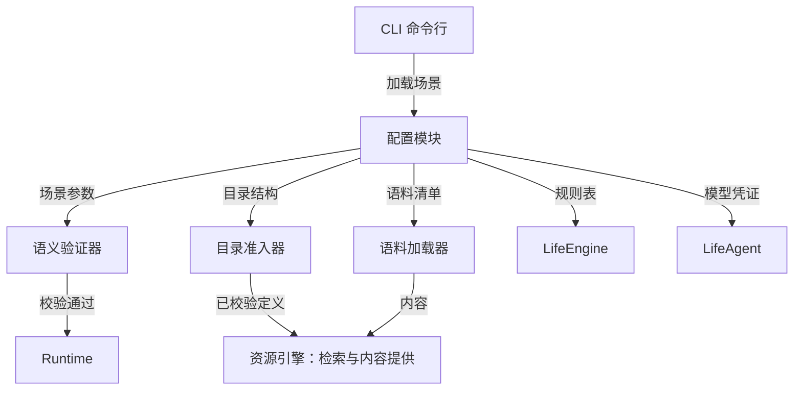

<a name="configuration-worldmock-产品设计说明书-配置规格"></a>
# WorldMock 产品设计说明书 — 配置规格

> 按[资源与规则引擎简化规格](../dev/SPEC-resource-and-rule-simplification.md#spec-rrs-资源与规则引擎简化开发规格)修订「规则来源与配置边界、资源目录引用、规则配置入口、校验清单、校验报告、错误分类与提示、配置版本与运行绑定、规则维护、配置层级、加载与校验、参数归属、文件位置与合同、地图引用与门店供给初值、语料引用、交互菜单声明、身体资源初值」（阶段 1）。


> **状态**：DRAFT；按人物 Prompt 规格修订，修订部分已实现（证据见[人物 Prompt 验收记录](../archive/persona-prompt/persona-prompt-verification.md)）；按一日运行保真规格同步（一日运行保真 CF1），已实现；按[个人事务与工作安排规格](../dev/SPEC-as2-integration.md#errands-workday-运行修复入库)分阶段同步（[实施计划](../archive/errands-workday/errands-workday-implementation-plan.md) D8 作业），已随代码落地到阶段 1–4<br>
> **日期**：2026-10-07
> **版本**：v1.22\
> **工具交互修订**：地点完整供给、构建价格范围、任务可用类型与请求形状设计已冻结，已实现；本次生产验收单独记录；以[工具交互规格](../dev/SPEC-life-runtime.md#tool-interaction-工具请求)为本次合同。
> **让「等待」成为例外修订**：按[让「等待」成为例外规格](../dev/SPEC-idle-fillers.md#spec-idle-fillers-让等待成为例外开发规格)修订「工作安排声明」（阶段 1）。
> **同时做两件事修订**：按[同时做两件事规格](../dev/SPEC-parallel-activities.md#spec-parallel-activities-同时做两件事开发规格)修订「规则来源与配置边界」的可供性占用声明（阶段 2）。
> **目标读者**：算法工程师、开发工程师、实验设计者

配置文件的编写步骤和可复制示例见[用户配置手册](../manual/README.md#readme-用户配置手册)。本文维护配置职责与设计边界。

具体环境及制作工具按[环境数据归属规格](../dev/SPEC-environment-data-ownership.md)归 WorldMock-Dataset，
正式重制环境路径由 WorldMock-Dataset 发布决定；WorldMock 提供引擎及包内固定通用规则。
本章的 `catalog/`、`corpora/`、`scenarios/` 指外部环境目录，命令以 WorldMock 为当前工作目录并显式传路径。
当前场景结构 7，内容标题来自 `contents.json`，活动效果随环境加载并在启动时冻结；新组合放行另核对实际收据。

<a name="design-08-configuration-共享规则与可重建环境修订"></a>
## 共享规则与可重建环境修订

按[共享规则与可重建环境规格](../dev/SPEC-shared-rules-and-rebuildable-env.md)修订；验收结果独立记录。

环境引导只提供 release/dev、wheelhouse 和显式 uv 安装选择，不增加场景配置层。收据绑定 Python、依赖锁、AS2 与 LabelKit 身份及缺失部件，全部项目路径相对仓库。release 缺 Node 或 LabelKit 失败；dev 可明确跳过相关检查，但不能取得完整放行。


<a name="design-configuration-current-responsibility"></a>
## 冻结输入与可重建测试

运行身份只从场景 JSON 读取人物身份、时间窗和时区，不为生成身份完整装配世界。生产新建与恢复仍执行实际冻结输入校验，不增加生产缓存或运行配置。
测试工厂缓存以实际文件相对路径和真实字节为键，复制可变分支，只共享递归验证的不可变输入；临时场景和修改后的输入不使用正式缓存。场景副本使用相对资源引用，可变工作区通过标准库普通独立 `copy2` 复制资源，不以硬链接共享仓库输入；修改副本不得改变源文件字节，不保存机器绝对路径。

测试运行摘要还绑定实际读取的源码、测试、设计、依赖锁、补丁、场景与语料、根 `.gitattributes`，
以及交付工程 `labelkit-projects` 的配置、hooks 和 schemas；该工程的 data、out 和 `__pycache__`
不纳入输入，自动生成的计时与覆盖报告保留现有排除范围。
收集、worker 选择、完成回执和覆盖数据摘要必须属于同一运行，不能借同输入的旧绿色证据放行。

<a name="configuration-版本历史"></a>
## 版本历史

| 版本 | 日期 | 作者 | 说明 |
| --- | --- | --- | --- |
| v1.0 | 2026-09-20 | Claude | 初版：配置层级、场景文件、目录结构、语料配置、规则配置、凭证管理、校验机制 |
| v1.1 | 2026-09-20 | Codex | 身体初值、资源目录和规则来源对齐实际输入，明确已有实现差异 |
| v1.2 | 2026-09-20 | Codex | 资源、内容和语料设计归入资源引擎；配置仅保留场景引用与初值 |
| v1.3 | 2026-09-20 | Codex | 增加地点类与人物交互菜单声明、失败关闭校验和场景身份边界；删除会被误读为实测收据的固定校验示例 |
| v1.4 | 2026-09-21 | Codex | 接入用户配置手册，对齐模型凭据的实际检查边界，删除过时加载伪代码 |
| v1.5 | 2026-09-21 | Codex | 合并当日目标的双重估间隔及已冻结密钥池合同，统一手册与运行校验边界 |
| v1.6 | 2026-09-24 | Claude | 按时间与能量规格：交互菜单取内部标准动作，人物所选动词与方式映射后判定，途中按出发地菜单解析并由出行方式收窄；同时开始两项须两个名额空闲，按注册表占用与准入事实判定，能量不参与；初始睡眠压力按惯常起床时刻反推 |
| v1.7 | 2026-09-25 | Claude | 世界状态结构版本改为 7（时间与能量规格第九章），旧检查点以版本不符拒绝 |
| v1.8 | 2026-09-25 | Claude | 按时间与能量规格阶段 1：进行中的等待不算在手承诺；新增同刻决策上限 `max_same_moment_decisions`（缺省 3），`activity_feedback_seconds` 下限改为 60；含旧键 `max_consecutive_rejections` 的场景按未知字段拒绝；世界状态保存同刻计数与按人物暂存的呈现留痕 |
| v1.9 | 2026-09-25 | Claude | 按时间与能量规格阶段 3：世界状态保存地点会话与活动的收尾、播报锚点和会话归属 |
| v1.10 | 2026-09-25 | Claude | 按时间与能量规格阶段 5：目标条目只接收必填可空的 `remind_time`（场景本地 `HH:MM`），不接收时长或其他调度参数，当日目标由零点计划生成；世界状态保存当日计划与提醒（`remind_at`、`reminded_at`）及已生成计划的日期 `plan_submitted_dates` |
| v1.11 | 2026-09-27 | Claude | 按人物 Prompt 七层规格（人物 Prompt 台账 E8-1–E8-3，E8-2 为阶段 1、4 同批作业）：文件头注明修订部分待实现；世界状态结构版本改为 8，旧检查点（含版本 7）以版本不符拒绝，另存会话 `opened_by_action_id`、活动 `paused_at` 与开吃份量、订单收货人与请求关联、联系人持有与发件箱；场景联系人可填可空的 `receive_location_id`；「7.2 格式与加载边界」的凭据链接改指接口合同「模型身份」 |
| v1.12 | 2026-09-28 | Claude | 人物 Prompt 七层规格实现后文档：文件头注明修订部分已实现；联系人 `receive_location_id` 须为场景声明的地点，与同世界人物重复的联系人为 `null`；写明同秒续接开关是运行参数（`worldmock run --same-second-continuation on\|off`）而不是场景字段 |
| v1.13 | 2026-09-29 | Claude | 按[一日运行保真规格](../dev/SPEC-life-runtime.md#dayrun-fidelity-身体与需要)同步（一日运行保真 CF1，随阶段 1–3、5 的代码落地，按 `e377669` 核对）：目标条目字段增 `around_time`，世界状态的计划目标增 `around_at`；场景层身体实例字段 `entertainment_relief_preference_floor`（缺省 0.5，取值 (0, 1)）；地图结构 2 与可选 `branch_label`，显示名规则与加载校验（地点 `kind` 属于环境层地点类型表、可见标签唯一，否则加载时拒绝）；场景显式声明的作息字段覆盖卡片抽取值；场景可选钉定手机配置 `phone_simulation_config` 与其摘要，购买渠道由它派生（称呼、成员门店与准入），渠道准入违规在加载时以 `IntegrityError` 拒绝，手机配置核验失败时加载照常、不派生渠道并写 warning 日志；校验清单与错误分类补加载拒绝、渠道准入与运行输入警告；文件头补修订说明，日期改写 |
| v1.14 | 2026-10-01 | Codex | 工具交互设计冻结并已实现：目录5.0、契约与规则绑定3、场景4、地图3，世界8保留；逐店真实供给和定位价格、必填可空预约、原料配方、items活动请求、中文购买偏好、null本人、偏移查询与具体英文错误 |
| v1.15 | 2026-10-03 | Claude | 按[个人事务与工作安排规格](../dev/SPEC-as2-integration.md#errands-workday-运行修复入库)同步（实施计划 D8 作业，阶段 1，按 `a1f680b` 核对）：阶段 1 的四项运行修复不改变任何配置字段与结构版本；顺带更正 3.3 中「场景 `schema_version` 仍为 3」的过时说法，改为指向 3.1 的发布目标表；文件头补同步说明，日期改写；版本表改为末行最新 |
| v1.16 | 2026-10-03 | Claude | 按[个人事务与工作安排规格](../dev/SPEC-as2-integration.md#errands-workday-运行修复入库)同步（实施计划 D8 作业，阶段 2，按 `d09d574` 核对）：发布目标表的世界状态结构改为 9，旧检查点（含版本 8）以版本不符拒绝，另存每个人物的未完成个人事务 `errands`；3.1 写明未完成的个人事务不算在手承诺，不改变重估间隔与闭店预警；阶段 2 不改变任何场景字段与场景结构；文件头阶段号改到阶段 2 |
| v1.17 | 2026-10-03 | Claude | 按[个人事务与工作安排规格](../dev/SPEC-as2-integration.md#errands-workday-运行修复入库)同步（实施计划 D8 作业，阶段 4，阶段 4 与阶段 2 并行开发，在阶段 2 之后并入）：「地图引用与门店供给初值」`query_world` 六键（增 `from`、`available_only`，旧四键请求按缺字段拒绝，`from` 与购买同一解析、写错时给查询参数错误与至多三条完整请求候选），筛选先于切页，返回不再附候选；不新增任何配置字段，场景与世界结构版本不变；文件头状态改为已落地阶段 1、2 与阶段 4 |
| v1.18 | 2026-10-03 | Claude | 按[个人事务与工作安排规格](../dev/SPEC-as2-integration.md#errands-workday-运行修复入库)同步（实施计划 D8 作业，阶段 3，按 `56451b4` 核对）：生活场景结构 5，人物必填可空的 `work_schedule`（新增「工作安排声明」小节，校验清单增「工作安排」行：形状错误由场景模型拒绝，工作地点与场景日历由加载检查核对），可选的下班与到家窗口并入场景作息覆盖（七字段）与顺序约束，新槽冲突时保留卡片值（可为 null）并记 `CARD_FIELD_CONFLICT`；运行输入警告的画像编译一项泛指编译留下的警告；工作安排进入场景身份；发布目标表的世界状态结构照阶段 2 为 9；文件头状态改为已落地阶段 1–4（阶段 3 在自己的分支上开发，在阶段 2、4 之后并入） |
| 共享规则与可重建环境 | 2026-10-05 | | 同步规则归属、源码重建与验收合同 |
| `2026-10-05-layering-and-test-tiers` | 2026-10-05 | | 当前职责对象与依赖方向、五项行为正文归属、固定历史来源和稳定引用；业务与持久合同保持不变 |
| 共享门禁独立复核 | 2026-10-05 | Codex | 冻结真实读取的换行规则与交付工程输入，排除实际输出和缓存，同次证据身份一致 |
| 环境数据归属 | 2026-10-05 | Codex | 按环境数据归属规格同步双仓职责、包内通用规则与显式环境路径；场景结构 6、必填标题和冻结活动效果按正文说明，最终验收另记实际收据 |
| `2026-10-05-idle-fillers-c` | 2026-10-05 | Claude | 按[让「等待」成为例外规格](../dev/SPEC-idle-fillers.md#spec-idle-fillers-让等待成为例外开发规格)阶段 1 同步：「工作安排声明」补班次与休息时段的起止另给清醒的人物各一次决策机会（四个唤醒原因），不结束任何活动、不叫醒睡着的人，唤醒原因不进提示；声明班次因此增加该人物的决策机会，每个当班日由起止直接新增的提供决策的边界至多 2 + 2 × 休息时段数 个，与既有机会同秒的不另计；文件头增该规格修订行，版本改为 v1.20 |
| 环境归属与等待行为整合 | 2026-10-06 | Codex | 保留已实施的班次唤醒、系统层与零点计划文本；现行场景结构 6 与显式数据仓输入，完整日核验实际工件，历史两份证明不改；跨平台方案仍未实施 |
| `2026-10-06-parallel-activities-claims` | 2026-10-06 | Claude | 按[同时做两件事规格](../dev/SPEC-parallel-activities.md#spec-parallel-activities-同时做两件事开发规格)阶段 2 同步：「规则来源与配置边界」补可供性占用声明重列为每种动作占自己的名字（只有同一种动作互斥）后，包资源 `src/worldmock/data/affordances.toml` 的字节与 `tool_schema_sha256` 随之改变，仍带旧占用名副本的外部环境在装配时被拒绝、要由 WorldMock-Dataset 按新占用名重新发布；不新增配置字段，场景结构 6、地图结构 3、品类契约与规则绑定 3、世界结构 9 不变；文件头增该规格修订行，版本改为 v1.21 |
| `2026-10-06-rrs-rules` | 2026-10-07 | HoldThatThgt | 阶段 1：固定规则与 RULES_VERSION、七份环境目录、真实环境命令和五字段运行身份；旧品类合同归档，后续消费者按阶段闭合 |

<a name="configuration-模块概述"></a>
## 1. 模块概述

<a name="configuration-职责与边界"></a>
### 1.1 职责与边界

配置负责定义一次实验的人物、时间、地点类与人物交互菜单、初值、资源与语料版本引用，以及模型凭证。
资源、内容和语料的定义与发布统一见[资源引擎设计](03-resource-engine.md#resource-engine-worldmock-产品设计说明书-资源引擎)。

**职责**：
- 定义场景参数（人物、时间窗口、地点、交互菜单、工作安排、初始状态）
- 绑定资源目录版本与语料清单哈希
- 选择场景参数，并引用资源引擎和交换引擎的规则
- 提供模型凭证的安全存储与加载机制
- 校验配置完整性与一致性

**边界**：
- 不负责运行时状态维护（由 LifeEngine 承担）
- 不负责内容检索与呈现（由资源引擎承担）
- 不负责配置热更新（配置在运行前加载，运行中不可变）

<a name="configuration-与其他模块的关系"></a>
### 1.2 与其他模块的关系



<a name="configuration-核心设计原则"></a>
### 1.3 核心设计原则

| 原则 | 含义 | 体现 |
| --- | --- | --- |
| **显式版本** | 配置文件携带版本号 | 场景使用整数 `schema_version`，具体约束由场景模型定义 |
| **Fail-Closed** | 未识别字段拒绝启动 | 拼写错误不会被静默忽略 |
| **溯源分类** | 参数注明来源 | 分类与字段见[资源引擎的来源分类](03-resource-engine.md#resource-engine-来源分类) |
| **确定性加载** | 相同配置产生相同行为 | 禁止运行时随机化 |
| **凭证隔离** | 敏感信息不进版本控制 | 凭证位于 `~/.config/worldmock/` |

<a name="configuration-配置层级与加载顺序"></a>
## 2. 配置层级与加载顺序

<a name="configuration-配置层级"></a>
### 2.1 配置层级

| 层 | 内容 |
| --- | --- |
| WorldMock 包 | 固定类型、常数、算子和三份通用 TOML |
| 环境目录 | app、地点、食品、内容、工作主题、发布图与清单 |
| 场景结构 7 | 环境钉、时间与种子、所选地点、人物、身体初值、账户、主题、持有与菜单 |
| 运行参数 | 明确场景和新输出目录；已冻结运行身份不可覆盖 |

每层只表达自己的事实，没有规则注册或隐式数据仓搜索。

<a name="configuration-加载与校验"></a>
### 2.2 加载与校验

真实 `load_runtime_scenario` 解析严格场景结构 7，加载目录并调用统一登记，核对环境钉、语料和包资源字节，再编译人物、时间与身体初值。加载失败立即终止；纯 CLI、validation 和 runtime 收集不急切导入完整 LifeEngine 链。
新运行、恢复与重放的完整宿主路径在阶段 5 验证；环境校验已经逐份加载所有场景。

<a name="configuration-参数归属"></a>
### 2.3 参数归属

| 参数 | 所属输入 |
| --- | --- |
| 环境标识和版本 | 场景 `environment` 与目录 `manifest.json` 一致 |
| 时间、时区、反馈与决策节奏、随机种子 | 场景根 |
| 初始身体与余额、节律和工作安排 | 场景人物与身体字段 |
| 初始食品持有 | `agents[].initial_inventory{location_id: {food_id: 份数}}` |
| 工作主题 | 目录 `work_topics.json`；人物 `work_topic_ids` 引用 |
| 地点与菜单 | 场景 `locations[]{location_id}` 和八类型菜单 |
| 价格、摘要和 app 绑定 | 相应目录文件 |
| 身体、食品、出行和配送常数 | WorldMock 包，不能场景覆盖 |

<a name="configuration-场景配置文件"></a>
## 3. 场景配置文件

<a name="configuration-文件位置与合同"></a>
### 3.1 文件位置与合同

环境根下 `catalog/`、`corpora/`、`scenarios/` 并列。场景字段遵循严格结构 7：保留人物画像、节律、工作安排、联系人、日历、消息、账单与工资；新增环境钉、工作主题和按地点食品初值。
删除 `catalog_version`、`map_dataset`、`products/supplies/tasks/contents/games`、`price_changes/product_releases/recipe_output_bindings`、手机配置、检索阈值、技能资格、`attention_prior` 与消息任务引用；`daily_effective_work_seconds` 改为 `daily_work_seconds`。未知旧字段拒绝加载。

<a name="configuration-交互菜单声明"></a>
### 3.2 交互菜单声明

场景必须声明八个 `LocationKind` 的 `interaction_menus_by_location_kind`；每个人物的 `interaction_menu` 必填可为 null。菜单取当前 `START_ACTIVITY_ACTIONS`，非空、无重复，必须包含 wait 和 sleep；app 动作切换在阶段 4 发生。
地点活动环境由 `PLACE_KIND_ENVIRONMENTS` 派生，不要求地点独立声明 `location_kinds`。人物菜单只收窄地点菜单，不新增工具或放宽准入。

<a name="configuration-地图引用与门店供给初值"></a>
### 地图引用与门店供给初值

场景只列所选地点的 `location_id`；发布图由环境 `catalog/map.json` 提供并纳入五字段身份，没有 `map_dataset` 引用或门店供给初值。每个已选食品店铺须有 `merchant:<location_id>` 账户，食品持有从人物的 `initial_inventory` 读取。
图查询和出行消费者在阶段 2 接入；食品购买与交付消费者在阶段 3 接入。

<a name="configuration-身体资源初值"></a>
### 3.3 身体资源初值

场景 `body` 只含 `mass_kg`、`initial_energy_kcal`、`initial_sleep_debt_hours`、`initial_entertainment_need`。身体模型读取 WorldMock `BODY_CONSTANTS`，来源为 `worldmock:<RULES_VERSION>`；`entertainment_relief_preference_floor` 作为旧字段拒绝。
初始食品按地点和食品身份声明，未知地点、食品或非正份数在真实加载时拒绝。

<a name="configuration-人物差异与衍生体感"></a>
### 3.4 人物差异与衍生体感

人物的 `chronotype_midsleep`、`sleep_need_hours`、`lunch_window`、`dinner_window`
分别驱动睡眠节律、睡眠不足累积和饥饿体感的餐时项；完整约束引用
[人物档案合同](../CONTRACTS.md#contracts-人格与卡片字段) 与 `AgentConfig`。
可选的 `leave_work_window`、`arrive_home_window` 与午餐、晚餐窗口同单位同校验，两者都声明时下班起点不晚于到家起点；
它们不驱动身体结算。
场景显式声明的这四个字段与 `bedtime_window`、`leave_work_window`、`arrive_home_window` 也覆盖画像编译从背景故事抽取的卡片值（场景优先，
[一日运行保真规格](../dev/SPEC-life-runtime.md#dayrun-fidelity-身体与需要) 2.1）：人设层、卡片渲染文本与冻结的结构化卡片取覆盖后的值，
身体结算、零点计划与每轮人设层读同一组值；未声明的字段仍取卡片值（下班与到家的卡片值可为 null：故事没写固定时刻时保持
null，不读映射表缺省），AgentConfig 的缺省值不进卡片。
零点计划的人物输入另有「下班时段」「到家时段」，只取场景字段、未声明省略；只来自卡片的下班与到家时刻不进零点计划的结构化输入。
覆盖量化到卡片格点，覆盖后锚点乱序的槽保留卡片值；下班与到家不进五锚点的全序与回绕归一，另有顺序约束：
`leave_work` 非空时出门起点 ≤ 下班起点，两者都非空时下班起点 ≤ 到家起点，`leave_work` 为 null 而 `arrive_home` 非空时
出门起点 ≤ 到家起点，任一非空时其起点 ≤ 归一后的就寝起点，与午餐、晚餐不设先后。
新槽沿用同一规则：场景窗口落下后违反顺序约束，或量化后写不成合法窗口时，该槽保留卡片值（新槽的卡片值可以是 null，
此时 `details.card_value` 为 null）并记 `CARD_FIELD_CONFLICT`；卡片槽为 null 时覆盖与告警照常处理，覆盖结果仍是不动点。
场景声明的五锚点窗口也可能因卡片抽取的下班或到家锚点而成为冲突（例如场景就寝起点早于卡片的到家起点，冲突记在 `bedtime_window` 上），在场景里一并声明
这两个窗口即可避免。每处覆盖与冲突都记运行输入警告
（`CARD_FIELD_OVERRIDDEN`、`CARD_FIELD_CONFLICT`，只扩 `details.field` 的取值，警告码闭集仍为 10，
见[接口合同「运行输入警告」](../CONTRACTS.md#contracts-运行输入警告)）。

初始睡眠压力按惯常起床时刻反推。饥饿与困意由资源、时刻和人物参数派生，
场景不另存可自由改写的饥饿条或疲劳条；身体变化与体感的执行边界见
[模拟引擎](04-simulation-engine.md#simulation-engine-实际区间身体变化与效率)。人物余额使用 `initial_balance_fen`，单位为整数分。

<a name="configuration-工作安排声明"></a>
### 工作安排声明

人物配置必填可空的 `work_schedule`：null 表示这个人物没有任何在岗语义；对象含 `workplace_location_id`、
`weekly`（七天全写，周一为 `"0"`，值为 `{starts, ends, breaks}` 或 null，null 表示当日不当班）与 `exceptions`
（按 ISO 日期覆盖当天）。这三个键与班次的三个键都必填、没有缺省（没有休息时段写 `[]`，没有例外日期写 `{}`），未知键拒绝。
时刻为自当地零点起的分钟，班次同日且 `starts < ends`，休息时段 `breaks` 落在班次内、升序、互不重叠，区间一律半开；
不带时区字段（复用场景唯一的 `timezone`），不从星期、任务分布或人物画像推断。

校验分两处：班次形状错误留在场景模型的校验器（经 `Scenario validation failed` 的异常链给出）；跨引用放在加载检查，
失败为顶层英文明细，写明人物、日期与字段——工作地点是所选地点；与场景日历交叉核对：补班日必须有班次，春节、病假、
事假日必须不当班，加班机会日不要求班次。交叉核对只对落在场景时间窗内的日历日期执行，时间窗外的例外日期不拒绝；
场景日历是场景级的，病假、事假日对所有声明了班次的人物同时生效。

工作安排不参与任务开放时刻的编译，不改变开工、恢复、提交与迟交判定，不延长或缩短任何截止；环境不因它新增任何拒绝，
它只经环境层 `duty` 每轮呈现（字段见[接口合同「七层字段」](../CONTRACTS.md#contracts-seven-layers)），零点计划输入的「上班安排」与它同源、
不含 `status`。
班次与休息时段的起止另给清醒的人物各一次决策机会（唤醒原因 `shift_start`、`shift_end`、`break_start`、`break_end`），
不结束任何活动、不叫醒睡着的人，唤醒原因不进提示；声明班次因此增加该人物的决策机会，每个当班日由起止直接新增的提供决策的边界
至多 2 + 2 × 休息时段数 个，与既有机会同秒的不另计（口径见[生活运行时的决策节律](../dev/SPEC-life-runtime.md#spec-life-runtime-决策节律结算边界与唤醒条件分离)与
[让「等待」成为例外规格](../dev/SPEC-idle-fillers.md#spec-idle-fillers-让等待成为例外开发规格)）。
原三份场景在首次发布该字段时都写 null，班次行为的引擎验收用人工场景变体构造。

以下是 `agents[]` 条目里 `work_schedule` 一个字段的局部片段，只示意形状，不是可独立运行的人物配置；完整声明须覆盖
场景日历里落在时间窗内的全部特殊日：

```json
{
  "work_schedule": {
    "workplace_location_id": "office",
    "weekly": {
      "0": {"starts": 540, "ends": 1080, "breaks": [[720, 810]]},
      "1": {"starts": 540, "ends": 1080, "breaks": [[720, 810]]},
      "2": {"starts": 540, "ends": 1080, "breaks": [[720, 810]]},
      "3": {"starts": 540, "ends": 1080, "breaks": [[720, 810]]},
      "4": {"starts": 540, "ends": 1080, "breaks": [[720, 810]]},
      "5": null,
      "6": null
    },
    "exceptions": {"2026-02-14": {"starts": 540, "ends": 1080, "breaks": []}, "2026-02-17": null}
  }
}
```

<a name="configuration-规则来源与配置边界"></a>
### 3.5 规则来源与配置边界

系统闭集、身体与交换常数来自 `worldmock.exchange`，随 `RULES_VERSION` 发布；三份包 TOML 是活动、动机和人物映射的唯一运行规则来源。环境只登记对象与绑定，场景只选择地点、人物、食品初值、主题和菜单。
不支持环境公式、表达式、迁移、fallback 或旧目录兼容。

<a name="configuration-资源目录引用"></a>
## 4. 资源目录引用

场景结构 `7` 带 `environment{environment_id, environment_version}`，必须等于所加载清单；目录从显式场景位置解析或由调用方明确传入。七份目录 JSON 与三份包 TOML 逐字节核验，文件字段见[环境目录文件](../CONTRACTS.md#contracts-环境目录文件)。

<a name="configuration-语料引用"></a>
## 5. 语料引用

`corpus_root` 与 `corpus_manifest_sha256` 继续绑定生活活动、联系人和邮件语料。内容标题与摘要直接来自 `catalog/contents.json`，无需字幕、音轨、节目标题映射或游戏语料。生活活动效果、活动环境、时间窗与 MET 留在条目自身。

<a name="configuration-规则配置入口"></a>
## 6. 规则配置入口

动机、显式画像编译映射与场景参数是可调整入口。身体常数、食品常数、速度、配送、车费和图生成规则只在 WorldMock 源码修改并升 `RULES_VERSION`；环境中的三份 TOML 仅为包字节副本。规则维护不新增目录配置层。

<a name="configuration-模型凭证"></a>
## 7. 模型凭证

<a name="configuration-凭证文件位置"></a>
### 7.1 凭证文件位置

模型 API 凭证存储在用户主目录，**禁止进入版本控制**：

```
~/.config/worldmock/
└── deepseek.env
```

<a name="configuration-格式与加载边界"></a>
### 7.2 格式与加载边界

当前运行凭据仅允许 `DEEPSEEK_NODE_KEYS`，填写至少一把非空密钥，多把用逗号分隔；
正式接口见[模型凭据合同](../CONTRACTS.md#contracts-model-identity)，
填写示例和权限设置见[运行配置手册](../manual/runtime.md#runtime-填写模型凭据)。

[运行启动器](../../src/worldmock/runtime.py)拒绝缺失文件、符号链接、未知键、空值和空密钥段，
逐段去除首尾空白并按出现顺序去重后，把密钥池交给 LiteLLM Router 分摊请求。
`0600` 是推荐权限，当前加载器没有权限位强制检查，也没有密钥长度大于 20 的检查。
画像抽取与模拟启动的凭据读取顺序不同，详见手册；不在此处保留与实际实现不同的加载伪代码。

<a name="configuration-配置验证"></a>
## 8. 配置验证

<a name="configuration-validate-命令"></a>
### 8.1 validate 命令

下列命令使用[运行配置](../manual/runtime.md#runtime-使用已安装的环境)中已经激活的 WorldMock 环境。

`worldmock validate` 在运行前校验配置完整性：

```bash
worldmock validate --scenario ../WorldMock-Dataset/environment/zhangjiang-baseline/scenarios/single-person.json
```

<a name="configuration-校验清单"></a>
### 8.2 校验清单

| 检查 | 实际入口 |
| --- | --- |
| 目录对象、绑定、图连通性与身份 | `catalog.admission`，由 `load_catalog` 调用 |
| 发布图与种子生成结果逐字节相同 | `worldmock validate --environment` 和 generate-map 的 `--check` |
| 语料清单与三个 TOML 副本 | 环境校验与真实场景加载 |
| 全部场景环境钉、食品持有、卖方账户与工作安排 | 对 `scenarios/` 每份 JSON 执行真实 `load_runtime_scenario` |
| AS2 锁、LabelKit、依赖、阶段身份与 0.8 覆盖率 | 原有 `validate --scenario` 项目检查 |

环境检查不启动完整引擎，完整最小运行在阶段 5 验证。

<a name="configuration-校验报告"></a>
### 8.3 校验报告

`worldmock validate --environment ROOT` 输出 `valid`、环境标识和版本、语料条目数、成功场景，以及每个失败的 `{path, code, reason}`。登记失败码来自 `RegistrationError`，其余真实加载错误保留自身异常分类；原因与错误日志为英文。任何失败返回非零，不能生成通过回执。

<a name="configuration-错误分类与提示"></a>
### 8.4 错误分类与提示

| 错误来源 | 输出与处理 |
| --- | --- |
| 目录或场景登记 | `RegistrationError` 稳定码和英文原因，完整表见[环境目录文件](../CONTRACTS.md#contracts-环境目录文件) |
| 发布图不同 | `MAP_NOT_REGENERATED`，检查模式不改目标 |
| 语料或包资源身份 | 实际 `IntegrityError` 原因，不绕过字节检查 |
| 严格模型 | 拒绝旧字段、未知字段与非法形状 |
| 项目依赖与覆盖率 | 保留既有 AS2、LabelKit、依赖与覆盖率检查失败 |

未知或缺失的数据不得由 warning 降格为可运行输入。

<a name="configuration-配置版本与运行绑定"></a>
## 9. 配置版本与运行绑定

运行清单结构 `3` 使用五字段 `environment_identity{environment_id, environment_version, rules_version, catalog_content_sha256, map_sha256}`。规则版本须等于包 `RULES_VERSION`；恢复继承实际父输入并逐字段核对，差异报 `Runtime environment identity mismatch`。
结构 7 场景、结构 10 世界和结构 3 运行清单拒绝旧版本；不迁移、不双读。阶段模型键收窄在阶段 5 完成。

<a name="configuration-配置最佳实践"></a>
## 10. 配置最佳实践

<a name="configuration-场景设计"></a>
### 10.1 场景设计

| 原则 | 说明 |
| --- | --- |
| **明确实验目标** | `experiment_id` 描述清晰 |
| **固定随机种子** | 保证实验可复现 |
| **合理时间窗口** | 12 周覆盖完整行为模式 |
| **真实初始状态** | 按能量、睡眠不足与需要的实际单位设置初值，满足各自边界并保留实验假设来源 |
| **显式交互菜单** | 每个地点类与人物都按当前合同声明；人物无限制使用显式 `null`，不省略字段 |

<a name="configuration-语料管理"></a>
### 10.2 语料管理

| 原则 | 说明 |
| --- | --- |
| **版本固化** | 语料更新后重新生成 `manifest.json` |
| **哈希校验** | 每次运行前校验语料完整性 |
| **来源追溯** | 记录数据集名称、版本、许可 |
| **禁止运行时修改** | Dataset 发布的冻结语料在运行期间只读 |

<a name="configuration-规则维护"></a>
### 10.3 规则维护

在 WorldMock 唯一定义处修改固定类型、常数或算子，补行为节点与有效变异并升级 `RULES_VERSION`；Dataset 用同一版本重新发布对象目录和包 TOML 副本。旧运行输入保留字节，新实验使用新环境版本。不能在环境目录改另一份身体、交通或交换公式。

<a name="configuration-参考文献"></a>
## 11. 参考文献

1. 语义化版本号：https://semver.org/
2. TOML v1.0.0：https://toml.io/
3. JSON Schema：https://json-schema.org/
4. ISO 8601 时间格式：https://www.iso.org/iso-8601-date-and-time-format.html
5. IANA 时区数据库：https://www.iana.org/time-zones
6. SHA-256 哈希算法：FIPS 180-4
