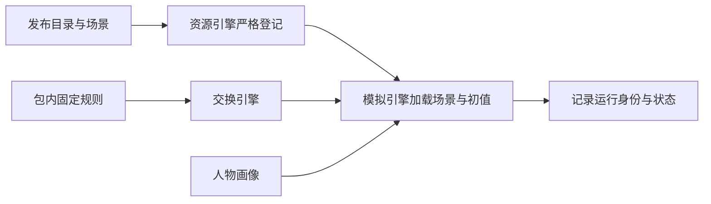

<a name="configuration-worldmock-产品设计说明书-配置规格"></a>
# WorldMock 产品设计说明书 — 配置规格

> **状态**：DRAFT；按人物 Prompt 规格修订，修订部分已实现（证据见[人物 Prompt 验收记录](../archive/persona-prompt/persona-prompt-verification.md)）；按一日运行保真规格同步（一日运行保真 CF1），已实现；按[个人事务与工作安排规格](../dev/SPEC-as2-integration.md#errands-workday-运行修复入库)分阶段同步（[实施计划](../archive/errands-workday/errands-workday-implementation-plan.md) D8 作业），已随代码落地到阶段 1–4<br>
> **日期**：2026-10-07
> **版本**：v1.23\
> **工具交互修订**：地点完整供给、构建价格范围、任务可用类型与请求形状设计已冻结，已实现；本次生产验收单独记录；以[工具交互规格](../dev/SPEC-life-runtime.md#tool-interaction-工具请求)为本次合同。
> **让「等待」成为例外修订**：按[让「等待」成为例外规格](../dev/SPEC-idle-fillers.md#spec-idle-fillers-让等待成为例外开发规格)修订「工作安排声明」（阶段 1）。
> **同时做两件事修订**：按[同时做两件事规格](../dev/SPEC-parallel-activities.md#spec-parallel-activities-同时做两件事开发规格)修订「规则来源与配置边界」的可供性占用声明（阶段 2）。
> **目标读者**：算法工程师、开发工程师、实验设计者

> 2026-10-07：按[资源与规则引擎简化规格](../dev/SPEC-resource-and-rule-simplification.md#spec-rrs-资源与规则引擎简化开发规格)同步阶段 5 的工作安排与主题地点。

> 按[资源与规则引擎简化规格](../dev/SPEC-resource-and-rule-simplification.md#spec-rrs-资源与规则引擎简化开发规格)修订「规则来源与配置边界、资源目录引用、规则配置入口、校验清单、校验报告、错误分类与提示、配置版本与运行绑定、规则维护、配置层级、加载与校验、参数归属、文件位置与合同、地图引用与门店供给初值、语料引用、交互菜单声明、身体资源初值」（阶段 1）；「3.4 人物差异与衍生体感」（阶段 3）。

配置文件的编写步骤和可复制示例见[用户配置手册](../manual/README.md#readme-用户配置手册)。本文维护配置职责与设计边界。

> 按[动作与内容简化规格](../dev/SPEC-action-and-content-simplification.md#spec-acs-动作与内容简化开发规格)修订「固定规则、目录格式与加载边界、收货结算」（阶段 1、2）。

具体环境及制作工具按[环境数据归属规格](../dev/SPEC-environment-data-ownership.md)归 WorldMock-Dataset，
正式重制环境路径由 WorldMock-Dataset 发布决定；WorldMock 提供引擎及包内固定通用规则。
本章的 `catalog/`、`scenarios/` 指外部环境目录，命令以 WorldMock 为当前工作目录并显式传路径。
当前场景结构 8、世界结构 11；类别、使用方式、效果与供给表由 WorldMock 固定，
环境只登记对象、绑定与价格、内容时长、集数三种数；新组合放行另核对实际收据。

<a name="design-08-configuration-共享规则与可重建环境修订"></a>
## 共享规则与可重建环境修订

按[共享规则与可重建环境规格](../dev/SPEC-shared-rules-and-rebuildable-env.md)修订；验收结果独立记录。

环境引导只提供 release/dev、wheelhouse 和显式 uv 安装选择，不增加场景配置层。收据绑定 Python、依赖锁、AS2 身份及缺失部件，全部项目路径相对仓库。release 缺 Node 或中文图表字体失败；dev 可明确跳过相关检查，但不能取得完整放行。


<a name="design-configuration-current-responsibility"></a>
## 冻结输入与可重建测试

冻结测试输入仅绑定 `catalog/` 与 `scenarios/` 的字节身份和环境版本。
人工环境的固定表见[人工环境](../dev/SPEC-action-and-content-simplification.md#spec-acs-人工环境)。
`FrozenInputs` 在测试会话结束核对缓存输入与对象的摘要；配置校验与完整运行各自保留回执，不以其中一项替代另一项。

<a name="configuration-版本历史"></a>
## 版本历史

| 版本 | 日期 | 作者 | 说明 |
| --- | --- | --- | --- |
| v1.0 | 2026-09-20 | Claude | 初版：配置层级、场景文件、目录结构、语料配置、规则配置、凭证管理、校验机制 |
| v1.1 | 2026-09-20 | Codex | 身体初值、资源目录和规则来源对齐实际输入，明确已有实现差异 |
| v1.2 | 2026-09-20 | Codex | 资源、内容和语料设计归入资源引擎；配置仅保留场景引用与初值 |
| v1.3 | 2026-09-20 | Codex | 增加地点类与人物交互菜单声明、失败关闭校验和场景身份边界；删除会被误读为实测收据的固定校验示例 |
| v1.4 | 2026-09-21 | Codex | 接入用户配置手册，对齐模型凭据的实际检查边界，删除过时加载伪代码 |
| v1.5 | 2026-09-21 | Codex | 合并当日目标的双重估间隔及已冻结密钥池合同，统一手册与运行校验边界 |
| v1.6 | 2026-09-24 | Claude | 按时间与能量规格：交互菜单取内部标准动作，人物所选动词与方式映射后判定，途中按出发地菜单解析并由出行方式收窄；同时开始两项须两个名额空闲，按注册表占用与准入事实判定，能量不参与；初始睡眠压力按惯常起床时刻反推 |
| v1.7 | 2026-09-25 | Claude | 世界状态结构版本改为 7（时间与能量规格第九章），旧检查点以版本不符拒绝 |
| v1.8 | 2026-09-25 | Claude | 按时间与能量规格阶段 1：进行中的等待不算在手承诺；新增同刻决策上限 `max_same_moment_decisions`（缺省 3），`activity_feedback_seconds` 下限改为 60；含旧键 `max_consecutive_rejections` 的场景按未知字段拒绝；世界状态保存同刻计数与按人物暂存的呈现留痕 |
| v1.9 | 2026-09-25 | Claude | 按时间与能量规格阶段 3：世界状态保存地点会话与活动的收尾、播报锚点和会话归属 |
| v1.10 | 2026-09-25 | Claude | 按时间与能量规格阶段 5：目标条目只接收必填可空的 `remind_time`（场景本地 `HH:MM`），不接收时长或其他调度参数，当日目标由零点计划生成；世界状态保存当日计划与提醒（`remind_at`、`reminded_at`）及已生成计划的日期 `plan_submitted_dates` |
| v1.11 | 2026-09-27 | Claude | 按人物 Prompt 七层规格（人物 Prompt 台账 E8-1–E8-3，E8-2 为阶段 1、4 同批作业）：文件头注明修订部分待实现；世界状态结构版本改为 8，旧检查点（含版本 7）以版本不符拒绝，另存会话 `opened_by_action_id`、活动 `paused_at` 与开吃份量、订单收货人与请求关联、联系人持有与发件箱；场景联系人可填可空的 `receive_location_id`；「7.2 格式与加载边界」的凭据链接改指接口合同「模型身份」 |
| v1.12 | 2026-09-28 | Claude | 人物 Prompt 七层规格实现后文档：文件头注明修订部分已实现；联系人 `receive_location_id` 须为场景声明的地点，与同世界人物重复的联系人为 `null`；写明同秒续接开关是运行参数（`worldmock run --same-second-continuation on\|off`）而不是场景字段 |
| v1.13 | 2026-09-29 | Claude | 按[一日运行保真规格](../dev/SPEC-life-runtime.md#dayrun-fidelity-身体与需要)同步（一日运行保真 CF1，随阶段 1–3、5 的代码落地，按 `e377669` 核对）：目标条目字段增 `around_time`，世界状态的计划目标增 `around_at`；场景层身体实例字段 `entertainment_relief_preference_floor`（缺省 0.5，取值 (0, 1)）；地图结构 2 与可选 `branch_label`，显示名规则与加载校验（地点 `kind` 属于环境层地点类型表、可见标签唯一，否则加载时拒绝）；场景显式声明的作息字段覆盖卡片抽取值；场景可选钉定手机配置 `phone_simulation_config` 与其摘要，购买渠道由它派生（称呼、成员门店与准入），渠道准入违规在加载时以 `IntegrityError` 拒绝，手机配置核验失败时加载照常、不派生渠道并写 warning 日志；校验清单与错误分类补加载拒绝、渠道准入与运行输入警告；文件头补修订说明，日期改写 |
| v1.14 | 2026-10-01 | Codex | 工具交互设计冻结并已实现：目录5.0、契约与规则绑定3、场景4、地图3，世界8保留；逐店真实供给和定位价格、必填可空预约、原料配方、items活动请求、中文购买偏好、null本人、偏移查询与具体英文错误 |
| v1.15 | 2026-10-03 | Claude | 按[个人事务与工作安排规格](../dev/SPEC-as2-integration.md#errands-workday-运行修复入库)同步（实施计划 D8 作业，阶段 1，按 `a1f680b` 核对）：阶段 1 的四项运行修复不改变任何配置字段与结构版本；顺带更正 3.3 中「场景 `schema_version` 仍为 3」的过时说法，改为指向 3.1 的发布目标表；文件头补同步说明，日期改写；版本表改为末行最新 |
| v1.16 | 2026-10-03 | Claude | 按[个人事务与工作安排规格](../dev/SPEC-as2-integration.md#errands-workday-运行修复入库)同步（实施计划 D8 作业，阶段 2，按 `d09d574` 核对）：发布目标表的世界状态结构改为 9，旧检查点（含版本 8）以版本不符拒绝，另存每个人物的未完成个人事务 `errands`；3.1 写明未完成的个人事务不算在手承诺，不改变重估间隔与闭店预警；阶段 2 不改变任何场景字段与场景结构；文件头阶段号改到阶段 2 |
| v1.17 | 2026-10-03 | Claude | 按[个人事务与工作安排规格](../dev/SPEC-as2-integration.md#errands-workday-运行修复入库)同步（实施计划 D8 作业，阶段 4，阶段 4 与阶段 2 并行开发，在阶段 2 之后并入）：「地图引用与门店供给初值」`query_world` 六键（增 `from`、`available_only`，旧四键请求按缺字段拒绝，`from` 与购买同一解析、写错时给查询参数错误与至多三条完整请求候选），筛选先于切页，返回不再附候选；不新增任何配置字段，场景与世界结构版本不变；文件头状态改为已落地阶段 1、2 与阶段 4 |
| v1.18 | 2026-10-03 | Claude | 按[个人事务与工作安排规格](../dev/SPEC-as2-integration.md#errands-workday-运行修复入库)同步（实施计划 D8 作业，阶段 3，按 `56451b4` 核对）：生活场景结构 5，人物必填可空的 `work_schedule`（新增「工作安排声明」小节，校验清单增「工作安排」行：形状错误由场景模型拒绝，工作地点与场景日历由加载检查核对），可选的下班与到家窗口并入场景作息覆盖（七字段）与顺序约束，新槽冲突时保留卡片值（可为 null）并记 `CARD_FIELD_CONFLICT`；运行输入警告的画像编译一项泛指编译留下的警告；工作安排进入场景身份；发布目标表的世界状态结构照阶段 2 为 9；文件头状态改为已落地阶段 1–4（阶段 3 在自己的分支上开发，在阶段 2、4 之后并入） |
| 共享规则与可重建环境 | 2026-10-05 | | 同步规则归属、源码重建与验收合同 |
| `2026-10-05-layering-and-test-tiers` | 2026-10-05 | | 当前职责对象与依赖方向、五项行为正文归属、固定历史来源和稳定引用；业务与持久合同保持不变 |
| 共享门禁独立复核 | 2026-10-05 | Codex | 冻结真实读取的换行规则与交付工程输入，排除实际输出和缓存，同次证据身份一致 |
| 环境数据归属 | 2026-10-05 | Codex | 按环境数据归属规格同步双仓职责、包内通用规则与显式环境路径；场景结构 6、必填标题和冻结活动效果按正文说明，最终验收另记实际收据 |
| `2026-10-05-idle-fillers-c` | 2026-10-05 | Claude | 按[让「等待」成为例外规格](../dev/SPEC-idle-fillers.md#spec-idle-fillers-让等待成为例外开发规格)阶段 1 同步：「工作安排声明」补班次与休息时段的起止另给清醒的人物各一次决策机会（四个唤醒原因），不结束任何活动、不叫醒睡着的人，唤醒原因不进提示；声明班次因此增加该人物的决策机会，每个当班日由起止直接新增的提供决策的边界至多 2 + 2 × 休息时段数 个，与既有机会同秒的不另计；文件头增该规格修订行，版本改为 v1.20 |
| 环境归属与等待行为整合 | 2026-10-06 | Codex | 保留已实施的班次唤醒、系统层与零点计划文本；现行场景结构 6 与显式数据仓输入，完整日核验实际工件，历史两份证明不改；跨平台方案仍未实施 |
| `2026-10-06-parallel-activities-claims` | 2026-10-06 | Claude | 按[同时做两件事规格](../dev/SPEC-parallel-activities.md#spec-parallel-activities-同时做两件事开发规格)阶段 2 同步：「规则来源与配置边界」补可供性占用声明重列为每种动作占自己的名字（只有同一种动作互斥）后，包资源 `src/worldmock/data/affordances.toml` 的字节与 `tool_schema_sha256` 随之改变，仍带旧占用名副本的外部环境在装配时被拒绝、要由 WorldMock-Dataset 按新占用名重新发布；不新增配置字段，场景结构 6、地图结构 3、品类契约与规则绑定 3、世界结构 9 不变；文件头增该规格修订行，版本改为 v1.21 |
| `2026-10-06-rrs-rules` | 2026-10-07 | HoldThatThgt | 阶段 1：固定规则与 RULES_VERSION、七份环境目录、真实环境命令和五字段运行身份；旧品类合同归档，后续消费者按阶段闭合 |
| `2026-10-06-rrs-store` | 2026-10-07 | HoldThatThgt | 食品、店铺 app 来源、固定价格与单订单结算；类别消费、六个输入警告和目录覆盖率，删除本阶段退役正文 |
| `2026-10-06-rrs-work` | 2026-10-07 | HoldThatThgt | 工作主题从运行开始可见；人物工作安排声明绑定主题地点，旧开放、材料与评审配置退役 |
| `2026-10-07-acs-rules` | 2026-10-07 | Codex | 固定规则版本 2；目录格式 2、场景结构 8、世界结构 11、运行清单 4；环境仅发布目录与场景，规则只从包读取。 |
| `2026-10-07-acs-receipt` | 2026-10-07 | 付款与收货分别留证，收货由唯一函数恰好结算一次，效果与证据归收货人；个人事务七键，用餐目标按本人 meal 收货推进。 | Codex |

<a name="configuration-模块概述"></a>
## 1. 模块概述

<a name="configuration-职责与边界"></a>
### 1.1 职责与边界

配置只选择环境与人物、声明场景节律和初值；分类、类别效果、收货效果与算子由 WorldMock 固定。
数据仓发布 app、地点、商品、动作、内容、图与清单。场景结构 8 引用发布目录，不引用语料，不带规则副本或人物动机参数。
字段与准入要求以[场景合同](../CONTRACTS.md#contracts-冻结地图与场景引用)为准。

<a name="configuration-与其他模块的关系"></a>
### 1.2 与其他模块的关系



<a name="configuration-核心设计原则"></a>
### 1.3 核心设计原则

| 原则 | 含义 | 体现 |
| --- | --- | --- |
| **显式版本** | 配置文件携带版本号 | 场景使用整数 `schema_version`，具体约束由场景模型定义 |
| **Fail-Closed** | 未识别字段拒绝启动 | 拼写错误不会被静默忽略 |
| **溯源分类** | 参数注明来源 | 分类与字段见[资源引擎的来源分类](03-resource-engine.md#resource-engine-来源分类) |
| **确定性加载** | 相同配置产生相同行为 | 禁止运行时随机化 |
| **凭证隔离** | 敏感信息不进版本控制 | 凭证位于 `~/.config/worldmock/` |

<a name="configuration-配置层级与加载顺序"></a>
## 2. 配置层级与加载顺序

<a name="configuration-配置层级"></a>
### 2.1 配置层级

| 输入 | 内容 |
| --- | --- |
| WorldMock 包 | 闭集、类别与使用方式表、固定常数、算子、可供性注册表、人物映射 |
| 环境目录 | app 用途与支付绑定、地点、商品、动作、内容、发布图与清单 |
| 场景结构 8 | 环境钉、人物与工作内容分配、时区与运行时间、账户身体初值、工作安排、菜单、消息与日历 |
| 模型凭证 | 用户指定环境变量文件；凭证不进入足迹 |

人物画像映射与场景节律仍有各自配置入口；它们不能覆盖类别规则或交换公式。

<a name="configuration-加载与校验"></a>
### 2.2 加载与校验

加载先核对目录格式 2、六文件身份与规则版本 2，再严格加载场景结构 8。
目录模型拒绝未知字段，绑定、供给表、内容下限与发布图在登记时校验；场景工作分配执行四个 `WORK_*` 检查。
引擎不读取语料，也不检查环境规则副本。校验通过只证明输入有效，完整运行验收另有证据。

<a name="configuration-参数归属"></a>
### 2.3 参数归属

| 参数 | 归属 |
| --- | --- |
| app、地点、商品、动作、内容与绑定 | WorldMock-Dataset 登记目录 |
| 价格、内容时长、集数 | WorldMock-Dataset；只有这三种目录数值 |
| 类别、使用方式、MET、效果与供给表 | WorldMock 固定规则 |
| 身体初值、账户、运行时间、节律与菜单 | 场景 |
| 工作 | 目录工作与学习内容，加人物 `work_content_ids` 和 `work_schedule` |
| 人物差异、作息覆盖与编译映射 | 人物画像和场景既有合同 |

没有初始商品持有或人物动机配置。

<a name="configuration-场景配置文件"></a>
## 3. 场景配置文件

<a name="configuration-文件位置与合同"></a>
### 3.1 文件位置与合同

环境发布在数据仓决定的目录，根下只有 `catalog/` 与 `scenarios/`。
场景结构 8 保留场景标识、时区、起止时刻、种子、决策与播报节律、候选呈现参数、
`environment`、账户、身体初值、地点选择、交互菜单、人物画像与作息、消息、日历、账单与薪资。
人物工作分配使用 `work_content_ids`；没有 `corpus_root`、`content_manifest_sha256`、
`initial_inventory`、`lifestyle_activities`、`work_topic_ids` 或 `motivation`。
完整字段表见[场景结构 8](../dev/SPEC-action-and-content-simplification.md#spec-acs-场景结构8)。

<a name="configuration-交互菜单声明"></a>
### 3.2 交互菜单声明

`allowed_actions` 只取 `travel_to`、`sleep`、`wait`、`purchase`、`do`，并必须包含保护项 `wait` 与 `sleep`。
地点类型菜单与人物菜单按既有交集求值；未知动作与缺保护项在加载时拒绝。
菜单不新增执行器、类别或占用，也不能覆盖包内规则。

<a name="configuration-地图引用与门店供给初值"></a>
### 地图引用与门店供给初值

场景从已登记地点中选择 `locations[]`，整张发布图仍用于路线查询。
商品菜单由目录绑定与固定供给表生成，同类型店铺同菜单；场景不写门店库存、报价或初始商品持有。
每个已选店铺必须有 `merchant:<location_id>` 账户，否则以 `MERCHANT_ACCOUNT_MISSING` 拒绝。

<a name="configuration-身体资源初值"></a>
### 3.3 身体资源初值

场景保留 `mass_kg`、`initial_energy_kcal`、`initial_sleep_debt_hours`、`initial_entertainment_need`。
身体常数、食品利用曲线、能量上限与类别 MET 由 WorldMock 固定，场景不能覆盖。
人物余额使用正确定义的整数分初值；没有初始食品持有或替代字段。

<a name="configuration-人物差异与衍生体感"></a>
### 3.4 人物差异与衍生体感

人物的 `chronotype_midsleep`、`sleep_need_hours`、`lunch_window`、`dinner_window`
分别驱动睡眠节律、睡眠不足累积和饥饿体感的餐时项；完整约束引用
[人物档案合同](../CONTRACTS.md#contracts-人格与卡片字段) 与 `AgentConfig`。
可选的 `leave_work_window`、`arrive_home_window` 与午餐、晚餐窗口同单位同校验，两者都声明时下班起点不晚于到家起点；
它们不驱动身体结算。
场景显式声明的这四个字段与 `bedtime_window`、`leave_work_window`、`arrive_home_window` 也覆盖画像编译从背景故事抽取的卡片值（场景优先，
[一日运行保真规格](../dev/SPEC-life-runtime.md#dayrun-fidelity-身体与需要) 2.1）：人设层、卡片渲染文本与冻结的结构化卡片取覆盖后的值，
身体结算、零点计划与每轮人设层读同一组值；未声明的字段仍取卡片值（下班与到家的卡片值可为 null：故事没写固定时刻时保持
null，不读映射表缺省），AgentConfig 的缺省值不进卡片。
零点计划的人物输入另有「下班时段」「到家时段」，只取场景字段、未声明省略；只来自卡片的下班与到家时刻不进零点计划的结构化输入。
覆盖量化到卡片格点，覆盖后锚点乱序的槽保留卡片值；下班与到家不进五锚点的全序与回绕归一，另有顺序约束：
`leave_work` 非空时出门起点 ≤ 下班起点，两者都非空时下班起点 ≤ 到家起点，`leave_work` 为 null 而 `arrive_home` 非空时
出门起点 ≤ 到家起点，任一非空时其起点 ≤ 归一后的就寝起点，与午餐、晚餐不设先后。
新槽沿用同一规则：场景窗口落下后违反顺序约束，或量化后写不成合法窗口时，该槽保留卡片值（新槽的卡片值可以是 null，
此时 `details.card_value` 为 null）并记 `CARD_FIELD_CONFLICT`；卡片槽为 null 时覆盖与告警照常处理，覆盖结果仍是不动点。
场景声明的五锚点窗口也可能因卡片抽取的下班或到家锚点而成为冲突（例如场景就寝起点早于卡片的到家起点，冲突记在 `bedtime_window` 上），在场景里一并声明
这两个窗口即可避免。每处覆盖与冲突都记运行输入警告
（`CARD_FIELD_OVERRIDDEN`、`CARD_FIELD_CONFLICT`，只扩 `details.field` 的取值，警告码闭集仍为 10，
见[接口合同「运行输入警告」](../CONTRACTS.md#contracts-运行输入警告)）。

初始睡眠压力按惯常起床时刻反推。饥饿与困意由资源、时刻和人物参数派生，
场景不另存可自由改写的饥饿条或疲劳条；身体变化与体感的执行边界见
[模拟引擎](04-simulation-engine.md#simulation-engine-实际区间身体变化与效率)。人物余额使用 `initial_balance_fen`，单位为整数分。

食品利用效率由 `BODY_CONSTANTS.food_efficiency_curve` 唯一维护，在收货当秒结算时生效。画像口味保留散文，不构成人物参数；作息和身体初值仍按冻结字段与场景覆盖规则读取，不增加缓解下限。

人物不带内部动机评分参数；选择只来自七层请求，体感与作息覆盖保持既有算法。

<a name="configuration-工作安排声明"></a>
### 工作安排声明

人物以 `work_content_ids` 分配 `work_study` 类别的目录内容，引用必须已登记且不得重复。
分配内容的动作不得是 `offline_assisted`；同一工作内容只能分配给一个人物。
有分配内容的人物必须声明 `work_schedule`（`WORK_SCHEDULE_REQUIRED`）；
声明排班的人物至少分配一条内容（`WORK_CONTENT_REQUIRED`）。
分配内容的 `duration_seconds` 之和不得少于运行起止区间内的排班秒数（`WORK_CONTENT_INSUFFICIENT`）；
引用不存在、不是工作与学习类别、重复分配或方式不合要求，以 `WORK_CONTENT_UNKNOWN` 拒绝。
工作地点取 `work_schedule.workplace_location_id`，分配的工作内容只能在该地点进行；从运行开始可做，班次不改变内容可见性。

每周班次、日期例外、休息时段与卡片作息覆盖仍沿用既有 `work_schedule` 合同。

<a name="configuration-规则来源与配置边界"></a>
### 3.5 规则来源与配置边界

分类、类别效果、收货效果、常数与算子只定义在 `worldmock.exchange`。
包内规则文件是版本 2 可供性注册表和人物映射，内部动机规则文件退役；环境没有规则副本。
`runtime_code_sha256` 另外哈希 `src/worldmock/data/` 下每个文件，目录不重复存储规则哈希。

<a name="configuration-资源目录引用"></a>
## 4. 资源目录引用

| 文件 | 内容 |
| --- | --- |
| `manifest.json` | `format_version: 2`、环境标识与版本、`rules_version: 2`、六个文件的路径/哈希/字节数、`catalog_content_sha256` |
| `apps.json` | `app_id`、真实 `name`、`purposes`、`payment_app_ids`；用途与绑定列表去重并排序 |
| `locations.json` | `location_id`、`name`、可选 `branch_label`、`kind`、`app_ids`；仅店铺允许绑定购物 app |
| `goods.json` | `goods_id`、`name`、五个固定类别之一、正整数 `price_fen`、`store_ids` 列表或 `"all"` |
| `actions.json` | `action_id`、`name`、`description`、五个固定类别之一、`app_ids`、必填可空 `manner` |
| `contents.json` | `content_id`、`action_id`、`title`、摘要与来源、`duration_seconds`、`app_ids`、可选 `series` |
| `map.json` | 地图结构 1、种子、生成器规则版本 1、节点与规范无向边 |

内容必须绑定恰好一个动作；动作可以不绑定 app。动作的 `app_ids` 非空时，`manner` 必须是一种固定使用方式，
每条内容的 `app_ids` 是该动作 app 集合的非空子集；动作没有 app 时，`manner` 为 null、内容 app 集合为空。
每个动作及每个动作与 app 的组合至少有一条内容。空集合从不表示全部 app。
内容 `duration_seconds` 是正整数且不小于 60 秒；动作不登记时长、时间窗、场所或效果。
内容不登记分类；环境维护动作名称、说明及其内容。
系列以 `(action_id, series.title)` 识别，各集具有相同动作与 app 集合，集数为唯一的正整数。

商品绑定店铺，店铺绑定购物 app。`GOODS_CATEGORY_STORE_KINDS` 固定类型可供给的类别，
`"all"` 展开到全部可供给该类别的店铺；显式绑定列表去重排序，同类型店铺同菜单。
购物用途存在当且仅当至少一家店铺绑定该 app；支付绑定非空当且仅当有购物用途，
绑定目标具有支付用途，允许绑定自己。导航与支付 app 可以没有内容；app 必须有用途或动作绑定。

<a name="configuration-语料引用"></a>
## 5. 语料引用

场景不引用语料根或语料清单。语料整理、来源记录与目录生成归数据仓，
引擎只加载清单中的目录对象；内容摘要来源见[目录合同](../CONTRACTS.md#contracts-语料内容目录字段)。

<a name="configuration-规则配置入口"></a>
## 6. 规则配置入口

固定规则从包读取。可供性类别、占用与身体数值不是场景可调项，修改须发布 WorldMock 并提高 `RULES_VERSION`。
人物映射继续使用包内 `persona-mapping.toml`，场景保留既有节律、人物与初值字段；内部动机评分没有配置入口。

<a name="configuration-模型凭证"></a>
## 7. 模型凭证

<a name="configuration-凭证文件位置"></a>
### 7.1 凭证文件位置

模型 API 凭证存储在用户主目录，**禁止进入版本控制**：

```
~/.config/worldmock/
└── deepseek.env
```

<a name="configuration-格式与加载边界"></a>
### 7.2 格式与加载边界

当前运行凭据仅允许 `DEEPSEEK_NODE_KEYS`，填写至少一把非空密钥，多把用逗号分隔；
正式接口见[模型凭据合同](../CONTRACTS.md#contracts-model-identity)，
填写示例和权限设置见[运行配置手册](../manual/runtime.md#runtime-填写模型凭据)。

[运行启动器](../../src/worldmock/runtime.py)拒绝缺失文件、符号链接、未知键、空值和空密钥段，
逐段去除首尾空白并按出现顺序去重后，把密钥池交给 LiteLLM Router 分摊请求。
`0600` 是推荐权限，当前加载器没有权限位强制检查，也没有密钥长度大于 20 的检查。
画像抽取与模拟启动的凭据读取顺序不同，详见手册；不在此处保留与实际实现不同的加载伪代码。

<a name="configuration-配置验证"></a>
## 8. 配置验证

<a name="configuration-validate-命令"></a>
### 8.1 validate 命令

```bash
uv run worldmock validate --scenario examples/environment/scenarios/single-person.json --environment-root examples/environment
uv run worldmock validate --environment examples/environment
```

路径是用户明确指定的外部环境。环境校验登记目录、重生成比对地图、加载所有场景；
成功结果为 `{valid, environment_id, environment_version, scenarios}`，不列语料条目数，也不检查规则副本。

<a name="configuration-校验清单"></a>
### 8.2 校验清单

- 目录格式与规则版本、清单六文件集合及字节身份。
- 对象标识排序、名称唯一、用途与支付绑定、动作与内容绑定、最小内容时长。
- 商品类别与店铺供给表、同类型菜单、图连通与重生成一致。
- 场景结构 8、环境钉、人物地点与账户、五项菜单动作及保护项。
- 工作内容引用、唯一分配、工作地点、至少一条内容及排班时长供给。

不校验语料清单、规则副本或初始食品持有。

<a name="configuration-校验报告"></a>
### 8.3 校验报告

`validate --environment` 成功输出 `{valid, environment_id, environment_version, scenarios}`。
`validate --scenario` 输出场景校验结果与运行输入警告，不输出 `corpus_entries`。
错误保留稳定码、英文原因与定位信息，不以跳过对象或替代输入取得成功。

<a name="configuration-错误分类与提示"></a>
### 8.4 错误分类与提示

| 错误类别 | 处理 |
| --- | --- |
| 目录与包资源身份 | 拒绝缺文件、额外文件、哈希漂移、规则版本与环境钉不一致 |
| 对象字段与绑定 | 严格模型和登记码拒绝未知字段、非法数字、用途和绑定关系 |
| 场景与工作内容 | 按场景结构、引用、菜单、账户及四个 `WORK_*` 码拒绝 |
| 模型凭证与服务 | 按既有凭证与服务故障合同记录并传播错误 |

完整登记码见[注册校验与错误](../dev/SPEC-action-and-content-simplification.md#spec-acs-注册校验与错误)。

<a name="configuration-配置版本与运行绑定"></a>
## 9. 配置版本与运行绑定

现行身份是目录格式 2、`RULES_VERSION = 2`、场景结构 8、世界结构 11、运行清单 4。
运行、检查点与恢复使用五字段 `environment_identity`：`environment_id`、`environment_version`、
`rules_version`、`catalog_content_sha256`、`map_sha256`。
规则文件只从引擎包读取，环境不发布副本，也不添加规则哈希；`code_sha256` 额外覆盖 `src/worldmock/data/` 下每个文件。
旧格式与旧结构号直接拒绝，不迁移、不双读。

<a name="configuration-配置最佳实践"></a>
## 10. 配置最佳实践

<a name="configuration-场景设计"></a>
### 10.1 场景设计

| 原则 | 说明 |
| --- | --- |
| **明确实验目标** | `experiment_id` 描述清晰 |
| **固定随机种子** | 保证实验可复现 |
| **合理时间窗口** | 12 周覆盖完整行为模式 |
| **真实初始状态** | 按能量、睡眠不足与需要的实际单位设置初值，满足各自边界并保留实验假设来源 |
| **显式交互菜单** | 每个地点类与人物都按当前合同声明；人物无限制使用显式 `null`，不省略字段 |

<a name="configuration-语料管理"></a>
### 10.2 语料管理

语料整理与来源记录归数据仓；WorldMock 不读取、校验或冻结语料目录。
新增对象与绑定由数据仓重新发布六文件目录，内容真实摘要带 URL、合成摘要带声明。

<a name="configuration-规则维护"></a>
### 10.3 规则维护

对象与绑定更新由数据仓再发布。类别、状态效果、供给表或交换公式变化由 WorldMock 修改并提高 `RULES_VERSION`，不保留旧格式。
包内固定规则和人物映射进入代码身份；规则不复制到环境，也不接受场景覆盖。

<a name="configuration-参考文献"></a>
## 11. 参考文献

1. 语义化版本号：https://semver.org/
2. TOML v1.0.0：https://toml.io/
3. JSON Schema：https://json-schema.org/
4. ISO 8601 时间格式：https://www.iso.org/iso-8601-date-and-time-format.html
5. IANA 时区数据库：https://www.iana.org/time-zones
6. SHA-256 哈希算法：FIPS 180-4
