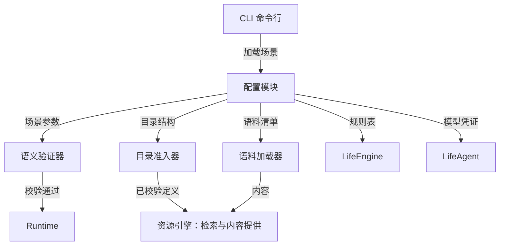
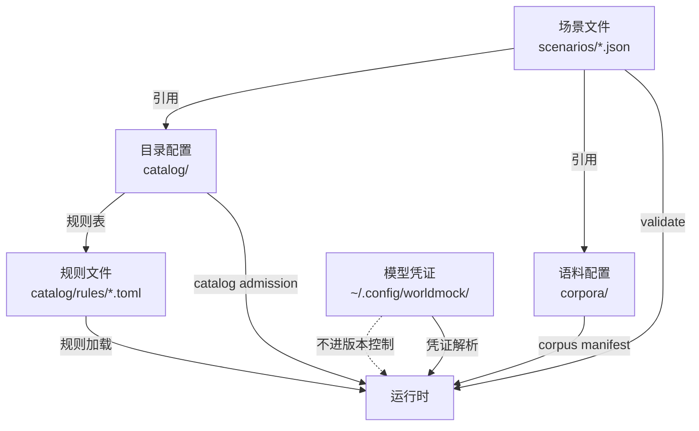
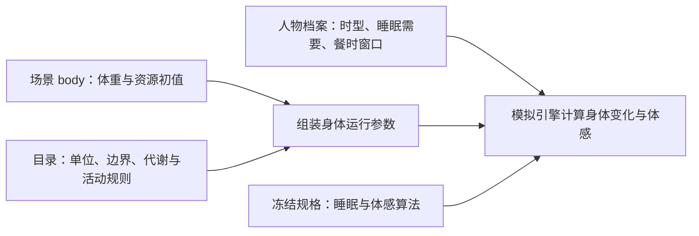

# WorldMock 产品设计说明书 — 配置规格

> **状态**：DRAFT  
> **日期**：2026-09-20  
> **版本**：v1.3\
> **目标读者**：算法工程师、开发工程师、实验设计者

## 版本历史

| 版本 | 日期 | 作者 | 说明 |
| --- | --- | --- | --- |
| v1.0 | 2026-09-20 | Claude | 初版：配置层级、场景文件、目录结构、语料配置、规则配置、凭证管理、校验机制 |
| v1.1 | 2026-09-20 | Codex | 身体初值、资源目录和规则来源对齐实际输入，明确已有实现差异 |
| v1.2 | 2026-09-20 | Codex | 资源、内容和语料设计归入资源引擎；配置仅保留场景引用与初值 |
| v1.3 | 2026-09-20 | Codex | 增加地点类与人物交互菜单声明、失败关闭校验和场景身份边界；删除会被误读为实测收据的固定校验示例 |

## 1. 模块概述

### 1.1 职责与边界

配置负责定义一次实验的人物、时间、地点类与人物交互菜单、初值、资源与语料版本引用，以及模型凭证。
资源、内容和语料的定义与发布统一见[资源引擎设计](03-resource-engine.md)。

**职责**：
- 定义场景参数（人物、时间窗口、地点、交互菜单、初始状态）
- 绑定资源目录版本与语料清单哈希
- 选择场景参数，并引用资源引擎和交换引擎的规则
- 提供模型凭证的安全存储与加载机制
- 校验配置完整性与一致性

**边界**：
- 不负责运行时状态维护（由 LifeEngine 承担）
- 不负责内容检索与呈现（由资源引擎承担）
- 不负责配置热更新（配置在运行前加载，运行中不可变）

### 1.2 与其他模块的关系



### 1.3 核心设计原则

| 原则 | 含义 | 体现 |
| --- | --- | --- |
| **显式版本** | 配置文件携带版本号 | 场景使用整数 `schema_version`，具体约束由场景模型定义 |
| **Fail-Closed** | 未识别字段拒绝启动 | 拼写错误不会被静默忽略 |
| **溯源分类** | 参数注明来源 | 分类与字段见[资源引擎的来源分类](03-resource-engine.md#来源分类) |
| **确定性加载** | 相同配置产生相同行为 | 禁止运行时随机化 |
| **凭证隔离** | 敏感信息不进版本控制 | 凭证位于 `~/.config/worldmock/` |

## 2. 配置层级与加载顺序

### 2.1 配置层级

WorldMock 采用四层配置结构：



### 2.2 加载与校验

场景先通过自身模型与交互菜单闭集校验，再解析固定目录和语料引用；在启动前完成引用、文件身份和品类准入。
实际入口见[场景加载](../../src/worldmock/life/scenario.py)与
[项目校验](../../src/worldmock/validation.py)。目录和语料的加载细节统一见
[资源引擎的准入边界](03-resource-engine.md#准入边界)，本节不另设通用配置装配类。

### 2.3 参数归属

身体资源的配置分为场景实例初值、人物档案常量和目录规则；各自职责见
[场景与身体规则](../dev/SPEC-life-runtime.md#场景与身体规则)。场景不通过一个通用
`constants` 对象覆盖所有身体算法。



## 3. 场景配置文件

### 3.1 文件位置与合同

场景位于 `scenarios/`，完整示例见
[白领场景](../../scenarios/white-collar-12-weeks.json)。当前输入结构由
[LifeScenario、BodyInstanceConfig 与 AgentConfig](../../src/worldmock/life/scenario.py)
校验；资源语义引用 [资源与需求字段](../CONTRACTS.md#资源与需求字段)。

场景使用整数 `schema_version`，人物清单为 `agents`，时间字段为 `start_at`、`end_at`；
身体资源初值放在顶层 `body`，人物档案常量放在各自的 `agents` 条目。
本文不重新定义完整场景 Schema。

| 格式 | 当前版本 | 拒绝边界 |
| --- | --- | --- |
| 地图文件 `schema_version` | 1 | 声明与文件身份、完整路线关系共同校验 |
| 商品目录 `version_major` | 3 | 商品门店、卖方、购买价格和库存旧字段拒绝 |
| 生活场景 `schema_version` | 3 | 地点、商品与供给按身份引用，旧内嵌地点和路线拒绝 |
| 世界状态 `schema_version` | 4 | 旧检查点拒绝，供给报价、库存、营业例外及逐供给可见凭据完整保存 |

目录通过 `scripts/build_catalog.py` 生成，地图通过 `scripts/prepare_map.py` 从显式输入准备与发布。
地图准备的发布流程见[资源引擎](03-resource-engine.md#冻结地图的准备与发布)。不保留旧场景迁移脚本或兼容输入层。

### 3.2 交互菜单声明

场景根对象必须具有 `interaction_menus_by_location_kind`，键集合恰好等于 所选地点经地图解析后的 `kind` 不同值
集合。每个地点类都有一个非空菜单，不接受 `null`、通配键、缺项或额外键。每个 `agents[]` 条目必须
显式具有 `interaction_menu`，取同形菜单或 `null`；`null` 表示人物不在地点菜单之外追加限制，字段缺失
仍是配置错误。

菜单只有 `allowed_tools` 与 `allowed_activity_kinds` 两个必填数组。两个数组均非空、元素无重复且为
非空白字符串，不接受其他字段。工具名只取 `worldmock.life.models.REQUEST_MODELS`，活动类型只取当前
可供性注册表的 `kinds`；必须显式保留休息、睡眠、日程与既有活动控制所需的保护项。完整闭集、
保护集合和 `null` 语义见[交互菜单合同](../CONTRACTS.md#交互菜单声明与有效菜单)。

运行时按人物权威 `location_id` 找到地点的单值 `kind`，再将该地点菜单与人物菜单逐字段求交集。
解析后地点的 `kind` 只用于选择交互菜单，和候选资格的多值 `location_kinds` 不是同一字段；不能以其中一个
代替另一个。菜单是显式准入声明，不从人物画像、偏好、动机或目录 `surface` 推导。

所有版本控制内的正式场景和相应测试输入都使用当前字段。旧文件缺字段时拒绝，不生成缺省全量菜单，
不添加迁移或兼容读取。实现与验收以[冻结特性规格](../dev/SPEC-interaction-menu.md)为准。

### 地图引用与门店供给初值

场景 `map_dataset` 使用 `dataset_id/version/path/sha256` 绑定唯一冻结地图。
`locations` 只写 `location_id`，`products` 只写 `product_id`，`supplies` 写 `supply_id` 及可选 `initial_stock`。
地点名称、坐标、营业、路线和供给定义从固定资料装配，不在场景手抄副本，也不添加额外配置层。
人物 `qualifications` 显式声明；访问与供给资格不能从人物画像推断。

完整运行时场景包含解析后的地图、地点、路线、商品和供给。地图和场景选区共同校验账户、产品、
供给组合和有向路线覆盖。每个端点/方式组合必须有可达、不可达或带来源的未知记录；漏项拒绝。
营业与报价的有效期、核对日期、可信截止日及来源在发布前验证。旧整点营业和旧商品单店字段直接拒绝。
`discover_places` 加入工具闭集；允许发现的正式地点菜单必须显式纳入，人物菜单仍可进一步限制。


### 3.3 身体资源初值

以下是当前白领场景的 `body` 字段摘录，仅展示这一字段，不是可独立运行的完整场景：

```json
{
  "body": {
    "mass_kg": 65,
    "initial_energy_kcal": 1600,
    "initial_sleep_debt_hours": 0,
    "initial_entertainment_need": 0
  }
}
```

| 配置内容 | 含义与运行时去向 |
| --- | --- |
| `mass_kg` | 体重，单位 kg；用于活动额外能量消耗 |
| `initial_energy_kcal` | 可用能量初值，单位 kcal；成为 `BodyState.energy_kcal`，受目录能量上界约束 |
| `initial_sleep_debt_hours` | 当前场景输入使用的键名；其值初始化唯一的睡眠不足账 `BodyState.sleep_deficit_hours`，不新增另一份睡眠状态 |
| `initial_entertainment_need` | 当前场景声明的娱乐需要初值，范围为零到一；见下文实现差异 |

**当前实现差异**：场景准入读取 `initial_entertainment_need`，但运行时初始化仍把娱乐需要设为零，
非零声明尚未接通。上面的摘录使用零值，不将非零初值描述为已生效能力。
依据为 [场景语义组装](../../src/worldmock/life/semantics.py) 与
[身体初始化](../../src/worldmock/life/body.py)。

### 3.4 人物差异与衍生体感

人物的 `chronotype_midsleep`、`sleep_need_hours`、`lunch_window`、`dinner_window`
分别驱动睡眠节律、睡眠不足累积和饥饿体感的餐时项；完整约束引用
[人物档案合同](../CONTRACTS.md#人格与卡片字段) 与 `AgentConfig`。

初始睡眠压力由场景开始时刻和人物睡眠参数计算。饥饿与困意由资源、时刻和人物参数派生，
场景不另存可自由改写的饥饿条或疲劳条；身体变化与体感的执行边界见
[模拟引擎](04-simulation-engine.md#实际区间身体变化与效率)。人物余额使用 `initial_balance_fen`，单位为整数分。

### 3.5 规则来源与配置边界

能量上界、基础代谢、活动 MET、娱乐需要变化规则从冻结目录装配到 `BodyConfig`。
睡眠压力、睡眠不足累积与恢复及食品利用效率由
[睡眠模型实现](../../src/worldmock/life/sleep.py)按冻结规格计算。
工作效率因子从合同对象目录装配到 `work_efficiency_factors`，由身体结算按输入资源曲线计算区间平均；
正式场景的睡眠因子读取 `sleep_deficit_hours`。装配与计算见
[场景语义](../../src/worldmock/life/semantics.py)和[身体结算](../../src/worldmock/life/body.py)。
目录中仍有 `sleep_debt_hours` 标识及旧变化率，不能据此宣称它们能覆盖现行睡眠算法；
目录中的资源标识与属性见[资源引擎的可计量资源定义](03-resource-engine.md#可计量资源定义)。

## 4. 资源目录引用

场景以 `catalog_version.major/minor` 绑定目录版本；场景保存账户、对象、地点等实例与引用，
资源定义、单位、边界、目录结构和发布规则统一见
[资源引擎设计](03-resource-engine.md#4-组织与发布目录)。
交换条件、投入产出与资源约束统一见[交换引擎设计](02-exchange-engine.md)。

## 5. 语料引用

场景通过 `corpus_root` 指定本地语料根目录，通过 `corpus_manifest_sha256` 绑定清单。
清单结构、来源、文件身份、内容品类和准入规则统一见
[资源引擎设计](03-resource-engine.md#2-整理与固化语料)，此处不维护第二份语料 Schema 或示例。

## 6. 规则配置入口

资源目录文件与来源映射见[资源引擎](03-resource-engine.md#文件职责)，
交换条件与投入产出规则见[交换引擎](02-exchange-engine.md)，
活动与身体过程见[模拟引擎](04-simulation-engine.md)。
人物差异的提取与参数编译见[人物画像规格](../dev/SPEC-life-realism.md#画像编译)；
配置加载不另定义一套对象效果、动机规则或画像映射格式。

## 7. 模型凭证

### 7.1 凭证文件位置

模型 API 凭证存储在用户主目录，**禁止进入版本控制**：

```
~/.config/worldmock/
└── deepseek.env
```

### 7.2 deepseek.env 格式

```bash
# DeepSeek API Key (mode 0600)
DEEPSEEK_API_KEY=sk-xxxxxxxxxxxxxxxxxxxxxxxxxxxxxxxx
```

**安全要求**：

| 要求 | 检查点 | 违规处理 |
| --- | --- | --- |
| 文件权限必须 `0600` | 加载前检查 `stat(file).st_mode` | 拒绝启动，输出错误提示 |
| 文件必须存在 | `Path.exists()` | 拒绝启动，输出设置指引 |
| API Key 非空 | 长度 > 20 | 拒绝启动 |
| 禁止进入 Git | `.gitignore` 包含 `deepseek.env` | CI 检查 |

### 7.3 凭证加载流程

```python
def load_credentials(config_dir: Path) -> dict:
    """加载模型凭证
    
    :raises CredentialError: 文件不存在、权限错误、格式错误
    """
    env_file = config_dir / "deepseek.env"
    
    # 检查文件存在
    if not env_file.exists():
        raise CredentialError(
            f"Credential file not found: {env_file}\n"
            f"Please create it with: echo 'DEEPSEEK_API_KEY=sk-xxx' > {env_file}"
        )
    
    # 检查文件权限
    stat_info = env_file.stat()
    if stat_info.st_mode & 0o077:
        raise CredentialError(
            f"Insecure file permissions: {oct(stat_info.st_mode)}\n"
            f"Please run: chmod 0600 {env_file}"
        )
    
    # 解析环境变量
    load_dotenv(env_file)
    api_key = os.getenv("DEEPSEEK_API_KEY")
    
    if not api_key or len(api_key) < 20:
        raise CredentialError("DEEPSEEK_API_KEY is missing or invalid")
    
    return {"deepseek_api_key": api_key}
```

## 8. 配置验证

### 8.1 validate 命令

`worldmock validate` 在运行前校验配置完整性：

```bash
uv run worldmock validate --scenario scenarios/white-collar-12-weeks.json
```

### 8.2 校验清单

| 校验项 | 检查内容 | 失败行为 |
| --- | --- | --- |
| Schema 版本 | 满足当前场景模型的整数版本约束 | 拒绝启动，说明不受支持的版本 |
| 必填字段 | 所有必填字段存在且类型正确 | 拒绝启动，列出缺失字段 |
| 时间窗口 | `end_at > start_at` | 拒绝启动 |
| 初始状态 | 按资源单位与目录边界校验能量、睡眠不足、娱乐需要；运行时继续满足各状态约束 | 拒绝启动 |
| 地点引用 | `agents[].home_location_id` 指向已声明地点 | 拒绝启动 |
| 交互菜单 | 地点类映射完整且无额外键；人物字段显式存在；数组非空无重复；名称来自权威闭集并包含保护项 | 以 `IntegrityError` 拒绝启动，保留英文校验原因 |
| 目录准入 | 满足 `category_requirements` | 拒绝启动，列出缺失品类 |
| 语料哈希 | 文件 SHA-256 与清单一致 | 拒绝启动，列出不匹配文件 |
| 规则完整性 | 所有规则文件存在且可解析 | 拒绝启动 |
| 凭证安全 | 文件权限 `0600` | 拒绝启动，输出修复命令 |

### 8.3 校验报告

交互菜单准入由场景加载完成：`load_scenario` 成功即已通过菜单字段与覆盖检查，失败由
`IntegrityError` 和英文日志给出原因；现有报告不另加独立菜单结果字段。
报告只记录实际结果，不能用固定数量或示例 `passed` 值冒充一次真实校验。可复现的命令、源码身份和精确输出进入
[交互菜单验收记录](../dev/research/interaction-menu-verification.md)。

### 8.4 错误分类与提示

| 错误类型 | 示例 | 用户提示 |
| --- | --- | --- |
| Schema 版本错误 | 不受支持的 `schema_version` | "Unsupported scenario schema version" |
| 字段缺失 | 缺少 `agents` | "Required field 'agents' is missing" |
| 类型错误 | `initial_balance_fen: "invalid"` | "Field 'initial_balance_fen' must be an integer" |
| 引用错误 | `home_location_id: "unknown"` | "Location 'unknown' is not declared" |
| 菜单声明错误 | 地点类缺项、人物字段缺失、未知或重复值、空数组、缺保护项 | `IntegrityError` 与具体英文 Pydantic 原因；不宣称存在统一注册表错误码 |
| 哈希不匹配 | 语料文件被修改 | "Corpus entry identity mismatch"；核对已绑定版本与来源文件后重新发布 |
| 权限错误 | `deepseek.env` 权限 `0644` | "Run: chmod 0600 ~/.config/worldmock/deepseek.env" |

## 9. 配置版本与运行绑定

场景使用当前定义并在运行前校验，资源与可供性的发布边界见
[资源引擎设计](03-resource-engine.md#构建与版本)。
旧字段和失效配置直接删除，不提供格式迁移或兼容层；实验身份与历史证据的保存遵循
[实验定义](../EXPERIMENT.md)。
菜单声明属于场景原始 JSON 字节并进入 `scenario_sha256`。修改地点或人物菜单会产生新的实验身份；
打开已有运行、恢复与反事实分支不得接受不同场景身份，也不新增与场景哈希重复的菜单版本字段。
地图集合身份、版本与文件摘要同时进入运行绑定；变更供给、路线或营业资料须得到新的身份，不能重用旧运行。

## 10. 配置最佳实践

### 10.1 场景设计

| 原则 | 说明 |
| --- | --- |
| **明确实验目标** | `experiment_id` 描述清晰 |
| **固定随机种子** | 保证实验可复现 |
| **合理时间窗口** | 12 周覆盖完整行为模式 |
| **真实初始状态** | 按能量、睡眠不足与需要的实际单位设置初值，满足各自边界并保留实验假设来源 |
| **显式交互菜单** | 每个地点类与人物都按当前合同声明；人物无限制使用显式 `null`，不省略字段 |

### 10.2 语料管理

| 原则 | 说明 |
| --- | --- |
| **版本固化** | 语料更新后重新生成 `manifest.json` |
| **哈希校验** | 每次运行前校验语料完整性 |
| **来源追溯** | 记录数据集名称、版本、许可 |
| **禁止运行时修改** | 语料在 `prepare-corpora` 后只读 |

### 10.3 规则维护

| 原则 | 说明 |
| --- | --- |
| **溯源分类** | 参数注明 fact/assumption/scenario |
| **版本号管理** | 规则文件携带版本号 |
| **代码引用** | 规则文件在代码中显式引用，避免隐式依赖 |
| **单元测试** | 规则变更后运行 `pytest tests/catalog/` |

## 11. 参考文献

1. 语义化版本号：https://semver.org/
2. TOML v1.0.0：https://toml.io/
3. JSON Schema：https://json-schema.org/
4. ISO 8601 时间格式：https://www.iso.org/iso-8601-date-and-time-format.html
5. IANA 时区数据库：https://www.iana.org/time-zones
6. SHA-256 哈希算法：FIPS 180-4
