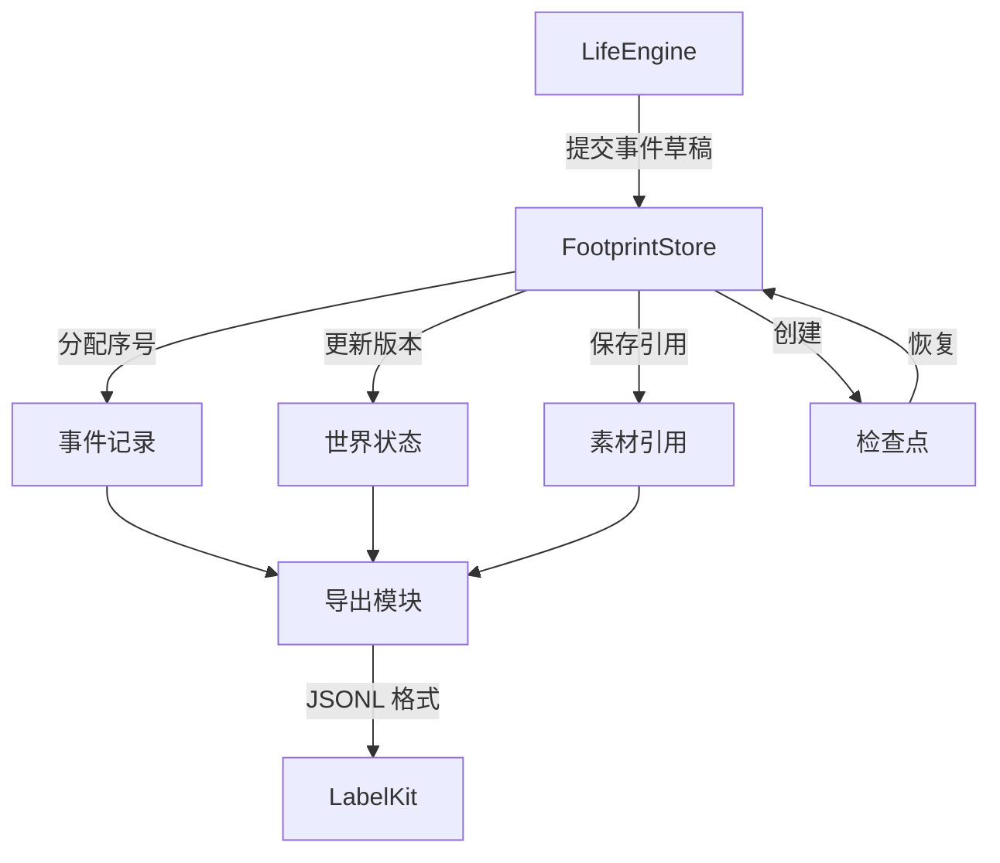

# WorldMock 产品设计说明书 — 输入输出格式

> **状态**：DRAFT  
> **日期**：2026-09-20  
> **版本**：v1.2
> **目标读者**：算法工程师、开发工程师

## 1. 模块概述

### 1.1 职责与边界

本文保留世界与人物状态的格式说明、跨模块的数据格式入口和通用校验说明。
事件、素材、检查点、足迹导出、质量报告与日志的设计统一归[记录引擎](05-recording-engine.md)；
LabelKit 加工后的训练数据归[数据交付](06-delivery.md)。
字段定义以所属合同为准，领域模型负责验证业务规则。

品类树、属性增量、三态配对、闭集交换规则与原生对象格式统一见
[品类接口合同](../CONTRACTS.md#品类契约与目录字段)。`category-contract.json` 与 `exchange-rules.json`
是独立冻结文件；原始对象不得包含运行期编译得到的交换边。场景库存输出绑定及运行内容身份也使用该合同，
不在本文件复制另一套 Schema。

### 1.2 与其他模块的关系



### 1.3 核心设计原则

| 原则 | 含义 | 体现 |
| --- | --- | --- |
| **严格 Schema** | 所有字段必须符合预定义结构 | Pydantic 模型校验，extra="forbid" |
| **版本显式** | 每个格式带明确版本号 | schema_version 字段必填 |
| **序号严格递增** | 事件序号全局唯一且有序 | event_seq 由存储分配，gt=0 |
| **引用完整性** | 素材引用包含哈希与大小 | AssetRef 包含 sha256、size_bytes |
| **确定性编码** | 相同输入产生相同字节 | canonical_json 排序键、排序集合 |

## 记录引擎的数据格式

记录引擎的数据格式与行为在[记录引擎设计](05-recording-engine.md)中统一维护，本文只保留跨模块阅读入口。

| 要解析的数据 | 定义位置 |
| --- | --- |
| 事件、来源与可见性、资源证据 | [数字足迹事件结构](05-recording-engine.md#数字足迹事件结构) |
| 运行目录、素材引用和数据表 | [持久化结构](05-recording-engine.md#持久化结构) |
| 共同检查点与恢复分支 | [保存共同检查点](05-recording-engine.md#保存共同检查点)与[恢复与反事实分支](05-recording-engine.md#恢复与反事实分支) |
| 足迹 JSONL、导出清单与质量报告 | [固定截止导出](05-recording-engine.md#固定截止导出) |
| 状态文件、查询输出与日志 | [运行查询与诊断](05-recording-engine.md#运行查询与诊断) |

## 世界与人物状态格式

### 3.1 WorldState（世界状态）

完整世界状态的 JSON 结构。

| 字段 | 类型 | 必填 | 说明 |
| --- | --- | --- | --- |
| `schema_version` | Literal[3] | 是 | 当前版本 3 |
| `version` | int | 是 | 状态版本号，ge=0 |
| `current_time` | int | 是 | 当前模拟时间，UTC 纪元秒 |
| `end_time` | int | 是 | 实验结束时间 |
| `run_id` | str | 是 | 运行 ID |
| `timezone` | str | 是 | 时区标识 |
| `scenario_sha256` | str | 是 | 场景文件哈希，64 位 |
| `content_manifest_sha256` | str | 是 | 内容清单哈希，64 位 |
| `agents` | dict[int, AgentState] | 是 | 人物状态映射 |
| `accounts` | dict[str, int] | 是 | 账户余额映射，单位：分 |
| `merchant_stock` | dict[str, int] | 是 | 商家库存映射 |
| `activities` | dict[str, ActivityState] | 是 | 活动状态映射 |
| `deliveries` | dict[str, DeliveryState] | 是 | 订单状态映射 |
| `pending_events` | list[ScheduledEvent] | 是 | 预排事件列表 |
| `processed_actions` | dict[str, StoredAction] | 是 | 已处理动作映射 |
| `paid_task_ids` | set[str] | 是 | 已结算任务集合（JSON 编码为排序列表） |
| `presentation_state` | dict[int, dict[str, int]] | 是 | 呈现派生量（人物→对象→时刻） |
| `random_seed` | int | 是 | 随机种子 |
| `random_state` | str | 是 | 随机状态 |

**示例 JSON**：

```json
{
  "schema_version": 3,
  "version": 128,
  "current_time": 1726819200,
  "end_time": 1734595200,
  "run_id": "white-collar-20260920-01",
  "timezone": "Asia/Shanghai",
  "scenario_sha256": "a1b2c3d4...",
  "content_manifest_sha256": "e5f6a7b8...",
  "agents": {
    "1": {
      "agent_id": 1,
      "name": "张伟",
      "location_id": "home_001",
      "balance_account_id": "account_agent_1",
      "body": {
        "energy_kcal": 1800.0,
        "sleep_pressure": 0.3,
        "sleep_deficit_hours": 0.5,
        "social_need": 0.2,
        "entertainment_need": 0.4,
        "mood_valence": 0.1,
        "neuroticism_norm": 0.0,
        "sleep_need_hours": 7.5,
        "chronotype_midsleep": 4.0
      },
      "inventory": {},
      "current_activity_id": "act_work_001"
    }
  },
  "accounts": {
    "account_agent_1": 500000,
    "account_merchant_food": 1000000
  },
  "merchant_stock": {
    "product_rice_meal": 100
  },
  "activities": {},
  "deliveries": {},
  "pending_events": [],
  "processed_actions": {},
  "paid_task_ids": [],
  "presentation_state": {
    "1": {
      "product_rice_meal": 1726819000
    }
  },
  "random_seed": 42,
  "random_state": "..."
}
```

### 3.2 AgentState（人物状态）

| 字段 | 类型 | 必填 | 说明 |
| --- | --- | --- | --- |
| `agent_id` | int | 是 | 人物 ID，gt=0 |
| `name` | str | 是 | 姓名 |
| `location_id` | str | 是 | 当前位置 ID |
| `balance_account_id` | str | 是 | 账户 ID |
| `skill_levels` | dict[str, float] | 是 | 技能等级 |
| `taste_weights` | dict[str, float] | 是 | 口味权重 |
| `body` | BodyState | 是 | 身体状态 |
| `inventory` | dict[str, dict[str, float]] | 是 | 库存 |
| `active_effects` | set[str] | 是 | 活跃效果（JSON 编码为排序列表） |
| `current_activity_id` | str \| None | 否 | 当前活动 ID |
| `next_decision_at` | int | 是 | 下次决策时间 |
| `consecutive_rejections` | int | 是 | 连续拒绝次数 |
| `decision_failed` | bool | 是 | 决策是否失败 |
| `content_progress` | dict[str, ContentProgress] | 是 | 内容进度 |
| `game_sessions` | dict[str, GameProgress] | 是 | 游戏会话 |
| `read_message_ids` | set[str] | 是 | 已读消息 ID 集合 |
| `visible_message_ids` | set[str] | 是 | 可见消息 ID 集合 |
| `visible_task_ids` | set[str] | 是 | 可见任务 ID 集合 |
| `visible_product_ids` | set[str] | 是 | 可见商品 ID 集合 |
| `inbox` | dict[str, Message] | 是 | 收件箱 |
| `day_plan` | DayPlan \| None | 否 | 当日计划 |

### 3.3 BodyState（身体状态）

`BodyState` 汇集身体资源、人物身体常量和体感计算所需状态，并非与“资源”并列的新概念。
下表是 [当前状态模型](../../src/worldmock/life/models.py) 的阅读摘要；
变化规则由 [身体语义规格](../dev/SPEC-life-runtime.md#身体语义两过程睡眠睡眠不足账体感分级)
承载，不在格式文档中重定义。

| 字段 | 类型 | 范围 | 说明 |
| --- | --- | --- | --- |
| `energy_kcal` | float | ≥0，且结算后不超过目录上界 | 可用能量，kcal；进食补充，基础代谢与活动消耗 |
| `sleep_pressure` | float | [0, 1.2] | 睡眠压力，与昼夜阈值共同决定困意 |
| `sleep_deficit_hours` | float | [0, 24] | 睡眠不足账，小时；决定工作和食品利用效率 |
| `sleep_need_hours` | float | [7.0, 9.0] | 睡眠需要，小时 |
| `chronotype_midsleep` | float | [0, 24) | 时型（睡眠中点），小时 |
| `social_need` | float | [0, 1] | 社交需要 |
| `mood_valence` | float | [-1, 1] | 情绪效价 |
| `neuroticism_norm` | float | [-1, 1] | 神经质归一化 |
| `entertainment_need` | float | [0, 1] | 娱乐需要 |

饥饿和困意是派生体感，不另存可自由修改的数值条。观察中的 `body` 也不是把
`BodyState` 原样交给数字人：数值在 `values` 中留作事件证据，提示只获得 `levels` 的分级文本。
人物睡眠常量留在状态与档案中，不进入观察投影。完整投影合同见
[观察投影字段](../CONTRACTS.md#观察投影字段)。

### 3.4 ActivityState（活动状态）

| 字段 | 类型 | 必填 | 说明 |
| --- | --- | --- | --- |
| `activity_id` | str | 是 | 活动 ID |
| `agent_id` | int | 是 | 人物 ID |
| `kind` | ActivityKind | 是 | 活动类型 |
| `status` | ActivityStatus | 是 | 活动状态 |
| `started_at` | int | 是 | 开始时间 |
| `ended_at` | int \| None | 否 | 结束时间（终态必填） |
| `planned_end_at` | int | 是 | 计划结束时间 |
| `last_settled_at` | int | 是 | 上次结算时间 |
| `elapsed_seconds` | int | 是 | 已用时长 |
| `planned_duration_seconds` | int | 是 | 计划时长 |
| `effective_work_seconds` | float | 是 | 有效工作秒数 |
| `media_position_seconds` | float | 是 | 媒体位置 |
| `route_progress_meters` | float | 是 | 路线进度，米 |
| `target_id` | str \| None | 否 | 目标 ID |
| `destination_id` | str \| None | 否 | 目的地 ID |
| `travel_mode` | TravelMode \| None | 否 | 出行方式 |
| `playback_speed` | float | 是 | 播放速度，[0.5, 2] |
| `resource_claims` | set[str] | 是 | 资源占用 |
| `origin_action_id` | str | 是 | 源动作 ID |
| `origin_decision_id` | str | 是 | 源决策 ID |
| `origin_request_event_id` | str | 是 | 源请求事件 ID |
| `boundary_type` | str \| None | 否 | 边界类型 |
| `interruption_reason` | str \| None | 否 | 中断原因 |
| `data` | dict | 是 | 活动数据 |

## LabelKit 交付格式

训练记录、字段字典、来源连通组与规则夹具由[数据交付](06-delivery.md)定义处理流程，
字段和磁盘产物见[LabelKit 训练记录与交付格式](../CONTRACTS.md#labelkit-训练记录与交付格式)。
原始足迹导出和 LabelKit 训练样本分别按所属合同解析，不能把训练字段附会为持久事件字段。

## 通用校验说明

### 9.1 字段类型校验

**Pydantic 模型校验规则**：

| 规则 | 说明 |
| --- | --- |
| `extra="forbid"` | 拒绝未知字段 |
| `allow_inf_nan=False` | 拒绝无穷和 NaN |
| `frozen=True` | 不可变模型 |
| `gt=0` | 大于 0 |
| `ge=0` | 大于等于 0 |
| `pattern=r"^[a-f0-9]{64}$"` | SHA-256 格式 |
| `min_length=1` | 非空字符串 |

### 9.2 业务规则校验

| 规则 | 校验点 | 失败行为 |
| --- | --- | --- |
| 事件序号严格递增 | event_seq | 立即失败 |
| 状态版本连续 | state_version | 立即失败 |
| 活动终态必有结束时间 | ended_at | 立即失败 |
| 资源流水金额为正 | resource_flows.amount | 立即失败 |
| 引用完整性 | artifact_refs | 立即失败 |
| 时间范围合法 | current_time ≤ end_time | 立即失败 |
| 账户余额非负 | accounts | 立即失败 |

### 9.3 确定性编码规则

**canonical_json 函数规范**：

```python
def canonical_json(value: Any) -> bytes:
    """使用唯一 JSON 编码，使哈希与重放身份稳定"""
    return json.dumps(
        value,
        ensure_ascii=False,
        sort_keys=True,
        separators=(",", ":"),
        allow_nan=False
    ).encode()
```

**确定性要求**：
1. 字典键按字母序排序
2. 集合序列化为排序列表
3. 不使用浮点 NaN 或无穷
4. 相同输入产生相同字节

**序列化器示例**：

```python
@field_serializer("active_effects", when_used="json")
def serialize_agent_sets(self, value: set[str]) -> list[str]:
    """按稳定顺序编码人物集合"""
    return sorted(value)
```

## 版本历史

| 版本 | 日期 | 修订内容 |
| --- | --- | --- |
| v1.0 | 2026-09-20 | 初版：事件 Schema、状态快照、导出格式、报告结构、检查点格式、素材引用、日志格式、Schema 验证规则 |
| v1.1 | 2026-09-20 | 对齐身体结算事件、资金事实、资源流水与体感可见性 |
| v1.2 | 2026-09-20 | 事件、检查点、素材、足迹导出、质量报告与日志格式归入记录引擎；保留领域状态与交付格式入口 |
