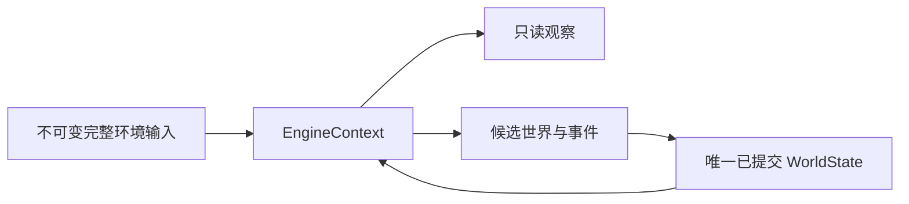

# WorldMock 产品设计说明书 — 状态与序列化

## 单一状态归属

完整环境由不可变输入对象承载，世界由唯一已提交 WorldState 承载。运行状态结构版本为 15，运行清单结构版本为 6；
`persona.toml` 与 `config.toml` 各自的 `schema_version` 写在[配置](08-configuration.md)「人物声明」与「运行配置」的字段表里。
不接受旧结构、兼容字段、迁移和 fallback；所有当前模型拒绝未知字段，原始 JSONL/TOML 输入规则归
[配置](08-configuration.md)与[资源引擎](03-resource-engine.md)。
一个结构号只守一种结构：字段集合、取值闭集或可接受的取值域变了才升号，只有取值变了不升号。
运行清单结构版本不是 6 的运行不能打开、恢复或重放，报 `Runtime environment identity mismatch`；
导出里冻结的运行清单不是 6 时，导出认证报 `Export frozen run manifest or environment identity is invalid`。

## 世界、人物与活动

世界保存完整环境身份、persona_sha256、config_sha256、唯一种子与随机根、天气日期事实、
共同时钟、人物、两个资金账户、活动、订单、调度边界、已处理动作和已提交呈现留痕。
人物保存实际地点、身体、当前槽位活动、内容共享进度、个人事务、日计划、回调状态与每日幂等标记。
人物状态的 `navigation_foreground` 记录导航 app 此刻是否在前台：null 表示不在前台；非空时是
`{activity_id, app_id, opened_at}`，分别是所属的出行活动、这趟出行选定的导航 app 和这一段回到前台的时刻。
非空而所指出行不是该人物进行中的出行、`opened_at` 早于出行开始或晚于当前时刻，或者同时存在进行中的槽位 2 活动，
世界状态在写入和加载检查点时以 `navigation foreground disagrees with active activities` 拒绝。
不保存消息、邮件、闹钟、聊天对象、燃油、自然语言目标自动进展和已删除的情绪参数。

活动种类为 sleep、travel、interact、purchase、query。活动保存原请求身份、当前状态、真实结算区间、
计划时长、暂停和终局，以及相应路径、内容或订单数据；详细生命周期归[模拟引擎](04-simulation-engine.md)。
活动的 `resource_claims` 保存它占的槽位，取值保持 `first`（槽位 1）与 `second`（槽位 2）：
出行、睡眠和地点 interact 占 `first`，购买、查询和内容 app 的 interact 占 `second`，占用与此不符的活动由世界状态拒绝。
睡眠活动的私有数据记录 `declared_duration_seconds`（人物写的时长，600 到 43200 秒）和 `oversleep_seconds`
（多睡的时长，0，或 1200 到 3600 之间 60 的整数倍）；计划时长是两者之和，受理时定下，恢复后不重新抽取。
出行活动保存所用出行方式的 `travel_method_id`（自带的步行是 `walking`，其余是数据集的身份），其他活动为空；出行活动的动作是 `travel`，私有数据的 `exertion` 记录受理时取的代谢当量键。
查询活动的私有数据恰为 `action`（恒为 `query`）、`targets`（认出的各项，按所写次序去重；商品是 `{kind: goods, goods_id}`，类别是 `{kind: category, category}`）、`app_id`（这几分钟所在的 app，可空）、`scoped`（答案是否只列经 `app_id` 能买的）和 `accepted_event_id`；做完的查询另有 `answer`，提前结束和被截断的没有。`answer` 是 `{rows, omitted}`，只有身份、分和纪元秒：`rows` 每行恰为 `{goods_id, route, store_id, app_ids, price_fen, delivery_fee_fen, expected_at, available, reason}`，`route` 取 `pickup`、`delivery`、`station_pickup` 或 null，`reason` 取 `location_closed`、`present_at_seller`、`store_without_app`、`no_open_store`、`no_open_store_on_app`、`not_sold_on_app` 之一或 null；`omitted` 是没列出的商品件数。不存人物所写的 `prefer` 原文。interact 活动的私有数据恒带非空的 `content_id`。
商品履约记录的 pending 状态允许尚未付款，只有实际付款才有 paid_at；已取消的记录永不收货。
商品履约记录的付款字段按订单取值：同一次购买里 `app_id` 相同的记录是一张订单，`payment_app_id`、`payment_duration_seconds`、
`payment_started_at`、`payment_ended_at` 在同一张订单的记录上相同。`payment_app_id` 为 null 表示直付；
`payment_duration_seconds` 是 0 或 10 至 20，只有 `app_id` 与 `payment_app_id` 都为 null 的到店直付为 0，
这时两个付款时刻恒为 null；其余订单在付款段真实开始、真实走完时各写一次。
订单由购买活动的 `data.order_ids` 和记录上的 `app_id` 得出：购买活动列出了世界里没有的记录，
或者同一张订单的记录在这四个付款字段上取值不同，世界状态在写入和恢复时都被拒绝。
`paid_at` 在一次购买的全部记录上同时写入，等于购买完成的时刻；到店记录的 `expected_at` 是购买开始时刻加实际购买时长。
内容共享进度以人物与内容身份保存，报告不新增进度。位置归零、轮数加一有两个来源：内容做到末尾，和在地点做的事被人物结束，规则见[模拟引擎](04-simulation-engine.md)「出行、内容与查询」。

`activities` 与 `processed_actions` 的条目是不可变值：活动或已处理动作的任何变化（包括 `data`、`result`、`receipt`、
`session_ids`、`note_history`、`resource_claims` 等嵌套字段）都换成一个新条目，不原地修改已有条目；同一个条目对象可以
同时属于已提交世界和候选世界。同一个对象不同时挂在条目与世界的其他字段下。

世界状态的 `activities` 在 JSON 里是数组，按活动加入世界的先后排列，每项是一个完整活动对象；读回时按数组先后还原为以
`activity_id` 为键的映射。规范 JSON 只给对象的键排序、不改变数组次序，所以从检查点恢复的世界与不中断的运行有相同的
活动先后，人物在恢复后看到的工具层与进行中活动也是同样的先后。这个字段只接受数组：不是活动对象的数组、或有一项缺少
字符串 `activity_id`，报 `world activities must be an array of activity objects`；两项的 `activity_id` 相同，报
`world activities repeat an activity identity`；写入与加载都拒绝。`worldmock status` 只读已存世界、不复校它，
遇到 `activities` 不是数组的运行目录（由更早的引擎写下）报
`Run directory was written by an older engine: world activities are not an array`。
世界状态里其余以身份为键的集合仍是 JSON 对象。
`processed_actions` 以动作身份为键，保留哪些条目见[模拟引擎](04-simulation-engine.md)「原子性与恢复」。

## 输入与模型身份

五项环境身份是 environment_id、environment_version、rules_version、catalog_content_sha256、map_sha256。
原始两份 TOML 分别保存摘要，生成地图按规范 JSON 加 LF 冻结。
新建运行的清单顶层字段是 `schema_version`、`run_id`、`source_group_id`、`environment_identity`、`environment_assets`、
`persona_sha256`、`config_sha256`、`agent_ids`、`code_sha256`、`git_commit`、`git_dirty`、`model_identity`、
`stage_model_identity`、`model_metadata`、`input_warnings`、`persona_habit_responses` 与 `window`；恢复与重放分支另带分支来源字段。
清单不保存由人物卡片换算出的数值：社交需要每小时增长在冻结的 `persona.toml` 里，世界创建时直接读它。
`code_sha256` 覆盖 `src/` 与 `custom/` 下的全部 Python 源码、根目录的 `pyproject.toml` 与 `uv.lock`，以及实际导入的
AgentSociety2 包；引擎包里没有 Python 源码以外的规则文件，`src/` 下其他类型的文件不进代码身份。
人物卡片的两份派生物（结构化卡片与卡片文本）保存在人物工作区 `AGENT.json` 的 `profile` 里，
`AGENT.json` 的结构号是 1；卡片由 `persona.toml` 直接构造，没有单独的编译产物文件和结构号，见[人物](06-agent.md)。
发布目录可以含声明距离的 map.jsonl，但不含生成的地图；冻结的目录素材跟随目录清单的文件表。
模型身份保存实际服务、请求模型、实际元数据与来源、上下文声明、两种重试预算、反思与日计划两项校验预算、
阶段生成参数与回合上限。api_key_env 只是输入中的凭据变量名称；凭据正文绝不序列化。

## 事件与检查点

事件编码为确定性 UTF-8 JSON，资金只在信封 resource_changes 中记录。运行目录里的 `manifest.json`、`status.json`、`result.json` 和反事实干预文件一律按 UTF-8 读写，不依赖系统默认编码。
回调、时间、天气、提醒和两种停留事件使用当前闭合模型，写入和读取时都校验，旧事件种类立即拒绝。
预排事件的种类闭集含发货通知排程 `order_shipped`，它与到达排程一样保存在世界状态的调度边界里。
检查点与导出字段及认证规则统一归[记录引擎](05-recording-engine.md)，不在状态层维护第二份事件合同。
