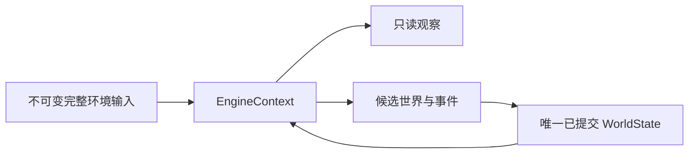

# WorldMock 产品设计说明书 — 状态与序列化

## 单一状态归属

完整环境由不可变输入对象承载，世界由唯一已提交 `WorldState` 承载。运行状态结构版本（`WORLD_SCHEMA_VERSION`）为 17，运行清单结构版本为 7；
`persona.toml` 与 `config.toml` 各自的 `schema_version` 写在[配置](08-configuration.md)「人物声明」与「运行配置」的字段表里。
不接受旧结构、兼容字段、迁移和 fallback；所有当前模型拒绝未知字段，原始 JSONL/TOML 输入规则归
[配置](08-configuration.md)与[资源引擎](03-resource-engine.md)。
一个结构号只守一种结构：字段集合、取值闭集或可接受的取值域变了才升号，只有取值变了不升号。
运行清单结构版本不是 7 的运行不能打开、恢复或重放，报 `Runtime environment identity mismatch`；
导出里冻结的运行清单不是 7 时，导出认证报 `Export frozen run manifest or environment identity is invalid`。



## 世界、人物与活动

世界保存完整环境身份、`persona_sha256`、`config_sha256`、唯一种子与随机根、分城每日天气事实（`WorldState.weather_by_date` 为 `dict[str, dict[str, str]]`，按 `local_date -> {city_id: condition}` 索引）、
共同时钟、人物、两个资金账户、活动、订单、调度边界、已处理动作和已提交呈现留痕。
人物保存实际地点、身体、当前槽位活动、内容共享进度、个人事务、日计划、回调状态、每日幂等标记与已激活商业住宿有效期（`AgentState.lodging_stays` 为 `dict[str, int]`，映射 `location_id -> checkout_epoch`）。
人物状态的 `navigation_foreground` 记录导航 app 此刻是否在前台：null 表示不在前台；非空时是
`{activity_id, app_id, opened_at}`，分别是所属的出行活动、这趟出行选定的导航 app 和这一段回到前台的时刻。
非空而所指出行不是该人物进行中的出行、`opened_at` 早于出行开始或晚于当前时刻，或者同时存在进行中的槽位 2 活动，
世界状态在写入和加载检查点时以 `navigation foreground disagrees with active activities` 拒绝。
不保存消息、邮件、闹钟、聊天对象、燃油、自然语言目标自动进展和已删除的情绪参数。

活动种类为 sleep、travel、interact、purchase、query。活动保存原请求身份、当前状态、真实结算区间、
计划时长、暂停和终局，以及相应路径、内容或订单数据；详细生命周期归[模拟引擎](04-simulation-engine.md)。
活动的 `resource_claims` 保存它占的槽位，取值保持 `first`（槽位 1）与 `second`（槽位 2）：
出行、睡眠和地点 interact 占 `first`，购买、查询和内容 app 的 interact 占 `second`，占用与此不符的活动由世界状态拒绝。
睡眠活动的私有数据记录 `declared_duration_seconds`（人物写的时长，600 到 43200 秒）和 `oversleep_seconds`
（多睡的时长，0，或 1200 到 3600 之间 60 的整数倍）；计划时长是两者之和，受理时定下，恢复后不重新抽取。
出行活动保存所用出行方式的 `travel_method_id`（自带的步行是 `walking`，其余是数据集的身份），其他活动为空；出行活动的动作是 `travel`，私有数据的 `exertion` 记录受理时取的代谢当量键。
查询活动的私有数据恰为 `action`（恒为 `query`）、`targets`（认出的各项，按所写次序去重；商品是 `{kind: goods, goods_id}`，类别是 `{kind: category, category}`）、`app_id`（这几分钟所在的 app，可空）、`scoped`（答案是否只列经 `app_id` 能买的）和 `accepted_event_id`；做完的查询另有 `answer`，提前结束和被截断的没有。`answer` 是 `{rows, omitted}`，只有身份、分和纪元秒：`rows` 每行恰为 `{goods_id, route, store_id, app_ids, price_fen, delivery_fee_fen, expected_at, available, reason}`，`route` 取 `pickup`、`delivery`、`station_pickup`、`instant` 或 null，`reason` 取 `location_closed`、`present_at_seller`、`store_without_app`、`no_open_store`、`no_open_store_on_app`、`not_sold_on_app` 之一或 null；`omitted` 是没列出的商品件数。不存人物所写的 `prefer` 原文。interact 活动的私有数据恒带非空的 `content_id`。
商品履约记录（`DeliveryState`）的履约方式 `FulfillmentKind` 闭集为 `delivery`、`pickup`、`station_pickup`、`instant`；pending 状态允许尚未付款，只有实际付款才有 `paid_at`；已取消的记录永不收货。
商品履约记录的付款字段按订单取值：同一次购买里 `app_id` 相同的记录是一张订单，`payment_app_id`、`payment_duration_seconds`、
`payment_started_at`、`payment_ended_at` 在同一张订单的记录上相同。`payment_app_id` 为 null 表示直付；
`payment_duration_seconds` 是 0 或 10 至 20，只有 `app_id` 与 `payment_app_id` 都为 null 的到店直付为 0，
这时两个付款时刻恒为 null；其余订单在付款段真实开始、真实走完时各写一次。
订单由购买活动的 `data.order_ids` 和记录上的 `app_id` 得出：购买活动列出了世界里没有的记录，
或者同一张订单的记录在这四个付款字段上取值不同，世界状态在写入和恢复时都被拒绝。
`paid_at` 在一次购买的全部记录上同时写入，等于购买完成的时刻；到店（`pickup`）与即时电子履约（`instant`）记录的 `expected_at` 都是购买开始时刻加实际购买时长（其中 `instant` 在付款完成当秒直接结算收货，写 `arrived_at`、`received_at` 与终态 `delivered`）。
外卖的 `expected_at` 是人物看到的预计送达，私有字段 `weather_delay_seconds` 是受理时冻结的天气总延长，单位为秒，取非负整数。
到店、快递与 `instant` 在世界状态上该字段为空。动作结果、活动进度和到达事件里的订单快照都省去该字段。
排程与收货按同一个规则从订单推出实际应送达时刻，见[模拟引擎](04-simulation-engine.md)「购买、付款与收货」。
`arrived_at` 只在实际发生时写入。商品品质保存在收货事件，查询和购买结果里的商铺评分从冻结目录取。
内容共享进度以人物与内容身份保存，报告不新增进度。位置归零、轮数加一有两个来源：内容做到末尾，和在地点做的事被人物结束，规则见[模拟引擎](04-simulation-engine.md)「出行、内容与查询」。

`activities` 与 `processed_actions` 的条目是不可变值：活动或已处理动作的任何变化（包括 `data`、`result`、`receipt`、
`session_ids`、`note_history`、`resource_claims` 等嵌套字段）都换成一个新条目，不原地修改已有条目；同一个条目对象可以
同时属于已提交世界和候选世界。同一个对象不同时挂在条目与世界的其他字段下。

世界状态的 `activities` 在 JSON 里是数组，按活动加入世界的先后排列，每项是一个完整活动对象；读回时按数组先后还原为以
`activity_id` 为键的映射。规范 JSON 只给对象的键排序、不改变数组次序，所以从检查点恢复的世界与不中断的运行有相同的
活动先后，人物在恢复后看到的工具层与进行中活动也是同样的先后。这个字段只接受数组：不是活动对象的数组、或有一项缺少
字符串 `activity_id`，报 `world activities must be an array of activity objects`；两项的 `activity_id` 相同，报
`world activities repeat an activity identity`；写入与加载都拒绝。`worldmock status` 只读已存世界、不复校它，
遇到 `activities` 不是数组的运行目录（由更早的引擎写下）报
`Run directory was written by an older engine: world activities are not an array`。
世界状态里其余以身份为键的集合仍是 JSON 对象。
`processed_actions` 以动作身份为键，保留哪些条目见[模拟引擎](04-simulation-engine.md)「原子性与恢复」。

## 输入与模型身份

五项环境身份是 environment_id、environment_version、rules_version、catalog_content_sha256、map_sha256。
原始两份 TOML 分别保存摘要，生成地图按规范 JSON 加 LF 冻结。
新建运行的清单顶层字段是 `schema_version`、`run_id`、`source_group_id`、`environment_identity`、`environment_assets`、
`persona_sha256`、`config_sha256`、`agent_ids`、`code_sha256`、`git_commit`、`git_dirty`、`model_identity`、
`stage_model_identity`、`model_metadata`、`input_warnings`、`persona_habit_responses`、`window` 与 `lineage`。新建运行的
`lineage` 为空数组；恢复与重放分支另带分支来源字段，`lineage` 是父运行的 `lineage` 加一项父运行这一段，见
[记录引擎](05-recording-engine.md)「冻结输入、检查点与分支」。
清单不保存由人物卡片换算出的数值：社交需要每小时增长在冻结的 `persona.toml` 里，世界创建时直接读它。
`code_sha256` 覆盖 `src/` 下的全部 Python 源码与根目录的 `pyproject.toml`、`uv.lock`；项目根由已导入的 `worldmock` 包位置推出（包目录 `src/worldmock` 往上两级）。
引擎包里没有 Python 源码以外的规则文件，`src/` 下其他类型的文件不进代码身份。
人物卡片的两份派生物（结构化卡片与卡片文本）在每次运行开始时由 `persona.toml` 直接构造，不写进人物工作区，也不另存副本；
没有单独的编译产物文件和结构号，见[人物](06-agent.md)。
发布目录可以含声明距离的 map.jsonl，但不含生成的地图；冻结的目录素材跟随目录清单的文件表。
模型身份保存实际服务、请求模型、实际元数据与来源、上下文声明、两种重试预算、回顾与日计划两项校验预算、
阶段生成参数与回合上限。api_key_env 只是输入中的凭据变量名称；凭据正文绝不序列化。

## 提示层的机器形状

### 记忆层

记忆层的顶层恰为下表四个键，次序固定。
行为与上限见[人物](06-agent.md)「记忆层的形状、上限与兜底」。

| 键 | 形状 |
| --- | --- |
| `layer` | 常量「记忆层」 |
| `可查` | 对象，唯一的键 `最早日期`（`YYYY-MM-DD`）；还没有可查的日期时是空对象 |
| `近三天` | 对象，键是饮食、工作、生活的子集并按此次序，值是格子数组 |
| `今天` | 数组，每项是一条今天条目或一行计数行 |
| 今天条目 | 封闭对象：键 `时刻`（`HH:MM`）、`类别`（类别串），可选 `核验`、`自述`，二者至少有一，各是至少一项的非空字符串数组；渲染时键序为时刻、类别、核验、自述；条目全文另有 `当时查到`，不进提示 |
| 计数行 | 恰为 `{"时刻":"HH:00–HH′:00","类别":<类别串>,"条数":<正整数>}`，HH′ 是 HH+1，23 时写「23:00–24:00」，「–」是 U+2013 |
| 近三天格子 | `近三天` 的键是启用的类别、按饮食、工作、生活的次序，值是至多三格、按日期升序的数组；饮食格、生活格是封闭对象，键依次为 `日期`（YYYY-MM-DD）、`星期`（`WEEKDAY_NAMES` 之一）、`回顾`（1–250 字）；工作格在 `星期` 与 `回顾` 之间另有必有的 `安排`（工作日或休息日）；未整理的格 `回顾` 为 null，末尾带 `未整理: true`；那天这一类没有记录时不写这一格；Schema 是 `_RECENT_CELLS` |

类别串是饮食、工作、生活里互不相同的一到三项，以「、」相连。记忆层经 `render_layer_json` 渲染：键序即构建顺序，中文不转义，`null`、空列表与空对象原样保留；
Schema 是 [prompt_schemas.py](../../src/worldmock/agents/prompt/prompt_schemas.py) 的 `MEMORY_LAYER_SCHEMA`。

### 待办层

待办层的顶层键依次为 `layer`（常量「待办层」）、`paused_activities`、`errands`、`orders`、`day_plan`；`paused_activities`、`errands`、
`day_plan` 的行形状见[人物](06-agent.md)「进度、待办与记忆」与[模拟引擎](04-simulation-engine.md)「唤醒、日计划与个人事务」。
行为见[人物](06-agent.md)「待办层」。

| 键 | 形状 |
| --- | --- |
| `orders` | 数组，至多 7 项：至多 6 行订单行，多出时末尾再接一行合成行 |
| 订单行 | 封闭对象，恰为四个键，次序固定：`order`（订单标签「〈商品名〉 〈份数〉 份（〈购买时刻〉 购买）」，与进度层送达记录的 `order` 同一写法）、`status`（`pending` 或 `ready_for_pickup`）、`destination`（送到的地点的显示名）、`expected_at`（带时区的 ISO 8601 时刻） |
| 合成行 | 恰为 `{"order": "另有 N 笔在途"}`，N 是正整数（十进制，两边各一个半角空格），只出现在 6 行订单行之后 |

Schema 是 [prompt_schemas.py](../../src/worldmock/agents/prompt/prompt_schemas.py) 的 `TODO_LAYER_SCHEMA`。

## 事件与检查点

事件编码为确定性 UTF-8 JSON，资金只在信封 resource_changes 中记录。运行目录里的 `manifest.json`、`status.json`、`heartbeat.json`、`result.json` 和反事实干预文件一律按 UTF-8 读写，不依赖系统默认编码。
`status.json` 与 `heartbeat.json` 是规范 JSON，字段见[运行装配与决策循环](10-runtime.md)「运行与恢复」；其中的时刻都是 UTC 的 ISO 8601 文本。
运行库的观察分件表 `parts` 与观察的存储形式归[记录引擎](05-recording-engine.md)「事件与来源」，编码同样是确定性 UTF-8 JSON。
回调、时间、天气、提醒、两种停留事件和回顾事件 `memory_digest_generated` 使用当前闭合模型，写入和读取时都校验，旧事件种类立即拒绝；字段见[记录引擎](05-recording-engine.md)「事件与来源」。
预排事件的种类闭集含发货通知排程 `order_shipped`，它与到达排程一样保存在世界状态的调度边界里。
检查点与导出字段及认证规则统一归[记录引擎](05-recording-engine.md)，不在状态层维护第二份事件合同。

## 人物工作区

人物 N 的工作区是运行目录下的 `agents/agent_NNNN/`，NNNN 是补足四位的人物编号，例如 `agents/agent_0001/`。新建运行在建引擎之前建出这个空目录，目录已存在时以 `FileExistsError("Agent workspace already exists: <路径>")` 停止。
人物第一次决策的步尾保存之前工作区为空；此后恰有两个普通文件：`MEMORY.md` 与 `memory/episodes.jsonl`，没有别的文件。
两个文件都按 UTF-8 编码、LF 换行直接写字节；新内容的字节与现有文件相同时不写。人物第一次步尾保存时还没有条目，条目文件写成空文件。
工作区随每个共同检查点快照，快照格式与恢复时的校验见[记录引擎](05-recording-engine.md)「冻结输入、检查点与分支」。

`MEMORY.md` 是给人看的已核验视图，恰为下面的模板，不写任何英文模板：

```text
# Memory

## 身份
> 卡片文本去掉首尾空白后的每一行，各加前缀「> 」

## 已核验经历
每条已核验经历一行；没有时恰为「- 暂无已核验经历。」

## 人物自述（未经核验）
> 暂无人物自述。
```

整份视图按 Python `len` 至多 4000 字，超过时以 `ValueError("Verified memory view exceeds its character budget")` 停止；视图在写任何文件之前渲染，所以超过时两个文件都不写。已核验经历一行的写法见 [life_memory.py](../../src/worldmock/agents/memory/life_memory.py) 的 `render_memory_view`。

`memory/episodes.jsonl` 每行一条人物收尾时写下的主观记忆，按编号顺序，每行是 `json.dumps(条目, ensure_ascii=False)`（缺省分隔符）加 `\n`。条目恰为十个键，次序固定：

| 键 | 取值 |
| --- | --- |
| `id` | 第 n 行恰为 `m_` 加六位的 n，从 `m_000001` 起连续；新条目的编号是当前条目数加一，合并不占编号 |
| `agent_id` | 人物编号，整数 |
| `time` | 新建或最近一次合并时那次决策的观察时刻，带偏移的 ISO 8601 文本 |
| `type` | 主观记忆类型，属于 `SUBJECTIVE_TYPES` |
| `importance` | 0 到 1 的数 |
| `keywords` | 字符串列表：每项去掉首尾空白，去掉空串，按首次出现去重 |
| `text` | 正文，连续空白折成一个空格 |
| `source` | 常量 `activity_conclusion` |
| `merge_count` | 至少为 1 的整数，新建为 1，每合并一次加一 |
| `epistemic_status` | 常量 `subjective` |

合并：每条新记忆按输入次序，从最新一条往前找类型相同、新时刻减去条目时刻落在 0 到 24 小时（含两端）、规范化正文相邻字符对的 Jaccard 不小于 0.6 的第一条；找到就把它的 `merge_count` 加一、`time` 改为本次观察时刻，找不到就新建。两个时刻无法相减时按窗口外处理；同一次保存里先新建的条目也参加后面记忆的判定。

恢复与重放严格读回条目文件：按 UTF-8 解码，以 `"\n"` 切行，最后一段为空时丢掉（文件为空或以换行结尾），不按 Unicode 的其他行分隔符切行；每行 `json.loads`，再按下表次序核对，第一条不成立的写英文错误日志并以同文 `ValueError` 拒绝（`{n}` 是从 1 起的行号）：

| 条件 | 错误文字 |
| --- | --- |
| 该行去掉空白后为空 | `Memory episode line {n} is blank` |
| 不是对象，或键集合不是上表十个键 | `Memory episode line {n} has an invalid schema` |
| `id` 不是本行的连续编号 | `Memory episode line {n} has a non-contiguous identity` |
| `agent_id` 不是整数，或不是本人 | `Memory episode line {n} has inconsistent identity` |
| `merge_count` 不是整数，或小于 1 | `Memory episode line {n} has invalid counters` |
| `type` 不是主观记忆类型 | `Memory episode line {n} has an invalid type` |
| `epistemic_status` 不是 `subjective` | `Memory episode line {n} has an invalid epistemic status` |
| `source` 不是 `activity_conclusion` | `Memory episode line {n} has an invalid source` |
| `importance` 是布尔、不是数，或不在 0 到 1 之间 | `Memory episode line {n} has invalid importance` |
| `time` 或 `text` 不是非空字符串 | `Memory episode line {n} has empty text fields` |
| `keywords` 不是列表，或有一项不是字符串 | `Memory episode line {n} has invalid string lists` |

不能按 UTF-8 解码与不是 JSON 的行照原异常拒绝。读回不修复、不补默认值、不跳过任何一行。
