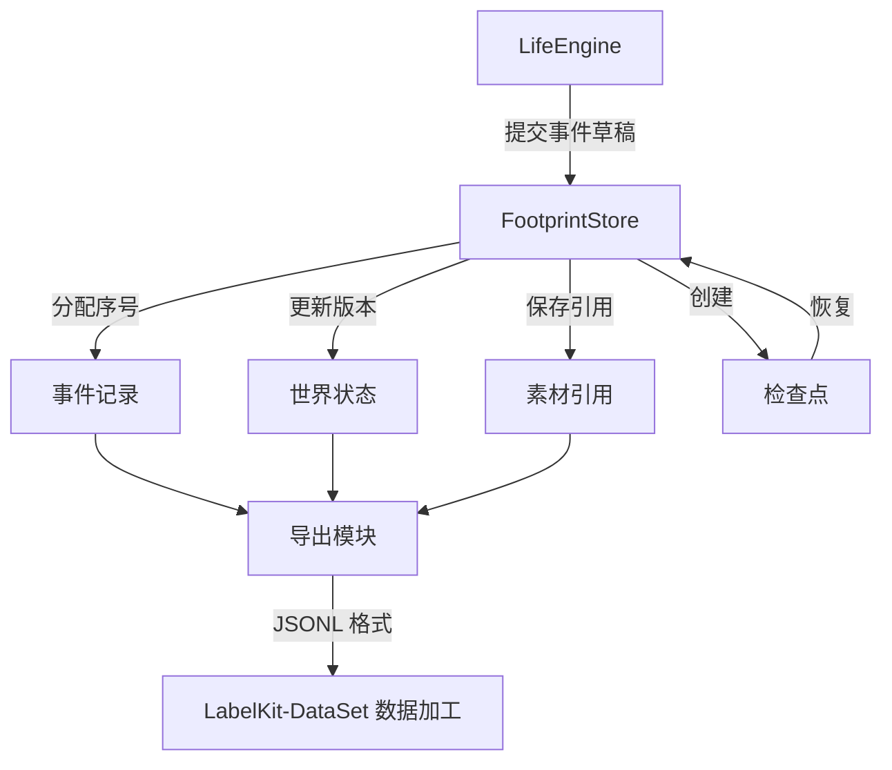

<a name="io-formats"></a>
# WorldMock 产品设计说明书 — 状态与序列化

<a name="io-formats-模块概述"></a>
## 模块概述

<a name="io-formats-职责与边界"></a>
### 职责与边界

本章说明人物、世界、活动、运行身份与工具的输入输出格式；完整字段由生产严格模型与[状态与序列化](09-io-formats.md)校验。
统一环境目录由清单加六个文件组成，规则只从包读取，没有环境副本；场景结构 8、世界结构 11、运行清单 4。

世界状态只有实际订单，不保存商品库存或联系人持有；收货事件与经历使用 goods_id 与商品类别。

<a name="io-formats-与其他模块的关系"></a>
### 与其他模块的关系



<a name="io-formats-核心设计原则"></a>
### 核心设计原则

| 原则 | 含义 | 体现 |
| --- | --- | --- |
| **严格 Schema** | 所有字段必须符合预定义结构 | Pydantic 模型校验，extra="forbid" |
| **版本显式** | 每个格式带明确版本号 | schema_version 字段必填 |
| **序号严格递增** | 事件序号全局唯一且有序 | event_seq 由存储分配，gt=0 |
| **引用完整性** | 素材引用包含哈希与大小 | AssetRef 包含 sha256、size_bytes |
| **确定性编码** | 相同输入产生相同字节 | canonical_json 排序键、排序集合 |

<a name="io-formats-记录引擎的数据格式"></a>
## 记录引擎的数据格式

记录引擎的数据格式与行为在[记录引擎设计](05-recording-engine.md)中统一维护，本文只保留跨模块阅读入口。

| 要解析的数据 | 定义位置 |
| --- | --- |
| 事件、来源与可见性、资源证据 | [数字足迹事件结构](05-recording-engine.md#recording-engine-数字足迹事件结构) |
| 运行目录、素材引用和数据表 | [持久化结构](05-recording-engine.md#recording-engine-持久化结构) |
| 共同检查点与恢复分支 | [保存共同检查点](05-recording-engine.md#recording-engine-保存共同检查点)与[恢复与反事实分支](05-recording-engine.md#recording-engine-恢复与反事实分支) |
| 足迹 JSONL、导出清单与质量报告 | [固定截止导出](05-recording-engine.md#recording-engine-固定截止导出) |
| 状态文件、查询输出与日志 | [运行查询与诊断](05-recording-engine.md#recording-engine-运行查询与诊断) |

场景输入中的 `interaction_menus_by_location_kind` 与 `agents[].interaction_menu` 由
[配置设计](08-configuration.md#configuration-交互菜单声明)及[模拟引擎](04-simulation-engine.md#simulation-engine-交互菜单声明与有效菜单)
定义。每个生活 `observation` 事件的 `data.interaction_menu` 保存排序后的 `allowed_actions`，
表示该人物在该冻结观察中可选的内部标准动作名；人物选择对象与方式，由方式唯一推导内部动作后按它判定，
途中按出发地菜单解析，再由出行方式的准入收窄。它是事件级工具支持
证据，不新增 `WorldState` 或 `AgentState` 字段，也不在 user 消息中复制。菜单声明本身由
`scenario_sha256` 绑定，运行时有效值由观察事件留证。

<a name="io-formats-世界与人物状态格式"></a>
## 世界与人物状态格式

<a name="io-formats-worldstate-世界状态"></a>
### WorldState（世界状态）

下表是世界状态的阅读摘要；构造完整状态须使用当前严格模型或真实检查点，不能把摘要当作缺字段的完整 JSON。

| 字段 | 类型 | 必填 | 说明 |
| --- | --- | --- | --- |
| `schema_version` | Literal[11] | 是 | 世界结构版本；版本不符的旧状态（含版本 10）直接拒绝 |
| `version` | int | 是 | 状态版本号，ge=0 |
| `current_time` | int | 是 | 当前模拟时间，UTC 纪元秒 |
| `end_time` | int | 是 | 实验结束时间 |
| `run_id` | str | 是 | 运行 ID |
| `timezone` | str | 是 | 时区标识 |
| `scenario_sha256` | str | 是 | 场景文件哈希，64 位 |
| `agents` | dict[int, AgentState] | 是 | 人物状态映射 |
| `accounts` | dict[str, int] | 是 | 账户余额映射，单位：分 |
| `activities` | dict[str, ActivityState] | 是 | 活动状态映射 |
| `sessions` | dict[str, SessionState] | 是 | 地点会话映射：一段地点停留或一段路（`kind` 取 `stay`、`transit`），由系统随出发与到达开始和结束；每人至多一个进行中会话 |
| `deliveries` | dict[str, DeliveryState] | 是 | 实际订单，带商品、店铺、app、价格、路径、收货人与消息关联 |
| `pending_events` | list[ScheduledEvent] | 是 | 实际排期列表；一次性闹钟以 `kind=alarm_ring`、到期秒与人物身份保存，不新增独立闹钟状态表 |
| `processed_actions` | dict[str, StoredAction] | 是 | 已处理动作映射 |
| `presentation_state` | dict[int, dict[str, int]] | 是 | 呈现派生量（人物→对象→时刻），承载 `last_presented_at`；工具层的可调用索引 `callable_index` 不是呈现，不写它 |
| `same_moment_presentation` | dict[int, {stamps: dict[str, int]}] | 是 | 按人物暂存本秒真实曝光（对象→时刻）；同秒各轮沿用首轮商品窗口，时钟推进时并入 `presentation_state` 并清空，不保存浏览结果置顶字段 |
| `random_seed` | int | 是 | 随机种子 |
| `random_state` | str | 是 | 随机状态 |

`SessionState`（地点会话）字段如下，随世界结构版本 7：

| 字段 | 类型 | 必填 | 说明 |
| --- | --- | --- | --- |
| `session_id` | str | 是 | 会话身份 |
| `agent_id` | int | 是 | 人物 ID |
| `kind` | str | 是 | `stay`（地点停留）或 `transit`（两地之间的一段路） |
| `location_id` | str \| None | 停留时必填 | 停留地点；路上为空 |
| `origin_id`、`destination_id` | str \| None | 路上时必填 | 这段路的出发地与目的地；停留为空 |
| `status` | str | 是 | `active` 或 `ended`；`ended` 必须带 `ended_at` |
| `started_at` | int | 是 | 开始时刻 |
| `ended_at` | int \| None | 否 | 结束时刻，不早于开始时刻 |
| `activity_ids` | list[str] | 是 | 归入本会话的活动：这段停留或路上开始的活动，以及回到该地点时归入的暂停活动 |
| `name` | str | 是 | 可读名称，结束后不改：停留「<地点>（<M月D日> HH:MM 起）」，路上「去<目的地>的路上（<M月D日> HH:MM 起）」（格式见[模拟引擎](04-simulation-engine.md)「会话与活动的字段」） |
| `opened_by_action_id` | str \| None | 否 | 引起本会话开始的动作（出发、途中结束出行）；运行开始与到达开始的会话为空。进度层的下界据此取该动作结果所在提交的末事件序号，为空时取会话开始时刻首个事件所在提交的末事件序号（运行开始为 0）；随世界结构版本 8 |

运行开始时每人按初始地点开始首个停留会话；出发时结束停留、开始路上；到达（含到达被拒）或途中结束出行时结束路上、在人物所在地点开始停留；实验截止时所有会话结束。会话的开始与结束只写入世界状态，不写事件。

世界状态采用确定性 JSON 编码，完整字段由生产模型校验；这里不再提供缺字段或摘要截断的伪完整示例。
世界状态没有持有物，购买与收货以实际订单关联。
冻结地图引用、时态声明和请求结构统一见 [地图与门店供给合同](09-io-formats.md)，
事件、清单和恢复材料见 [地图与门店供给证据](05-recording-engine.md#recording-engine-地图与门店供给证据)。

世界结构 11 没有供给库存、报价、营业例外或已付款任务集合。SessionState 的 `app_pushes` 以 app 为键，`AppPush` 恰含 `push_id`、`content_id`、`issued_at`、`status` 四字段，状态为 `pending/opened/released`；动作由该内容的 `action_id` 绑定确定，不另存动作字段。已结束会话保留推送历史并核对 app 与内容身份，随检查点保存；完整字段见[持久化当下事实](09-io-formats.md)。

订单 `DeliveryState` 保留订单身份、付款人 `agent_id`、店铺、购物 app、卖方账户、件数、单价、配送费、总价、收货地、履约方式、收货人、关联消息、创建与预计时刻、路径和配送行程；商品用 `goods_id` 与 `category`，另有可空 `payment_app_id`、可空 `received_at`。状态为 pending、ready_for_pickup、delivered；pending 与 ready_for_pickup 的 received_at 为 null，到店收货时等于 created_at。订单数量恒为 1。不保存商品库存或联系人持有。

<a name="io-formats-当前工具请求-查询与错误格式"></a>
### 当前工具请求、查询与错误格式

start_activity 恰为 items 与 answering。items 一至两项，各项 target、way、app、to、pay_app 五键必填；无用途的键显式写 null。方式闭集为步行、驾车、睡觉、等待、购买、进行、领取；人物选择动作、app、对方和支付 app，环境按实际内容决定时长。商品购买一项一件，购物 app 非空时必须配其支持的支付 app；现场购买 app 为 null，支付 app 可空。出行 app 仅为导航，睡觉等待所有路由字段为空。社交动作必须明确 to，其他动作 to 为空。驿站领取只允许地点目标，全部路由字段为空。

query_world 六键为 name、way、category、app、available_only、offset，全部必填；先按完整冻结集合筛选，再稳定分页，布尔和整数必须为实际 JSON 类型。错误返回完整字段位置、所有可独立判断的明细与完整动态合法值；start_activity 候选保留全部五字段和 answering，不代选。

控制工具只接受当前 `items` 对象数组与请求级必填的 `errands` 数组（与 `items` 平级，允许空数组，一次至多 4 条变更）。
每条事务变更是封闭对象，`change`、`name`、`item`、`quantity`、`memo`、`remind_time`、`reason` 七键全部必填：
`change` 取「新增」「更新」「取消」，没有「完成」；`name` 为非空白字符串、至多 30 字符；
新增时 `item`、`quantity`（1 至 9 的整数）非空且 `reason` 为 null，`memo`、`remind_time` 可空；
更新时 `item`、`quantity`、`reason` 为 null，`memo` 与 `remind_time` 为替换语义、null 即清空；取消时 `reason` 非空、其余为 null。
非 null 的 `item`、`memo`、`reason` 须非空白，`memo` 与 `reason` 各至多 120 字符，`remind_time` 为场景本地 `HH:MM`。
同一请求内按取消、更新、新增的次序求值：同一条未完成事务至多被一条更新或取消点名，两条新增不得同名；取消旧事务并以原名新增可在同一请求里完成。
收尾的 `memories`、`views` 显式必填、允许空数组；不读旧平行数组，缺 `errands` 键的请求按缺字段拒绝。
成功结果在 `details.errands` 给回执 `[{errand, change}]`（`errand` 为事务名称：更新与取消写待办层里的名称，新增写所写的名称），
顺序同请求，没有变更时为 `[]`；被拒结果没有该键，请求被拒时同一请求的事务变更一并不生效。

查询工具为 `query_world(name, way, category, app, available_only, offset)`、`recall_task_summary(task_name)` 与三个记忆查询；同批即时返回，不登记世界请求、不推进时间、不计同刻轮数，仍占模型回合预算。
六键全部必填，四个筛选非空白或 null 且至少一个非 null；app 仅登记应用名。所有筛选取交集，available_only 只判实际命中的方式及 app，offset 为严格非负 JSON 整数。完整匹配集合先筛选再稳定分页，返回 `{matches,total_count,next_offset}`，末页 next_offset=null；等于 total_count 允许空末页，超过范围报错。
紧凑公开目标保留 name、kind、phase、state、活动的 last_report、actions、tools，只省略 null 和空集合，保留 false 与零值。查询不公开内部身份、未到期邮件正文或可点名内容；未知 app 与类别等独立错误一次报告，候选只来自该字段的真实公开闭集。

错误顶层为 `{error_code, reason, fix, items, unmet}`，`items[]` 为
`{path, written, error_code, allowed_values, expected, why, candidates}`，不保留旧 `index`、`field`。
`path` 是完整位置数组，从 `tool_calls` 起保留工具下标、`function.arguments` 和所有嵌套字段与下标。
有限枚举完整列于 `allowed_values`；无枚举为 `[]`，英文 `expected` 写类型、范围、格式、组合或世界条件。
候选为完整 `{tool, arguments, note}`，`note` 为英文说明或 `null`，参数严格使用当前接口。
JSON 解析失败定位参数对象、附行列与必要闭集；未知工具定位工具名、列本次实际提供的工具；混批定位 `tool_calls`。
`reason`、`fix`、`message`、`why` 与错误日志均为英文，中文对象名原样保留；合法名称不作为全量枚举塞进错误。
三个控制工具 `errands` 的错误都不带 `candidates`：更新、取消的 `name` 找不到或多于一个时（`NAME_NOT_FOUND`、`NAME_AMBIGUOUS`），
`allowed_values` 列本人全部未完成事务名——它是此刻至多 8 个的有限集合，不属于上句所说的全量名称枚举，也不替换；
新增的 `item` 解析不到唯一商品时，最接近的至多三个商品名写在 `why`，不把全量商品名放进 `allowed_values`；
新增重名、同商品存在未完成事务、同一事务被两条更新或取消点名与新增后超过 8 条都是 `ARGUMENTS_INVALID`，`why` 写明冲突的事务名或上限。
长度、条数等上限随校验原因写在 `why`，`expected` 给类型与格式；`path` 完整到 `errands[j].<键>`。
宿主与环境对同一冻结观察调用同一函数判定；环境复核的失败合并为一次 `ACTION_REQUEST_INVALID`，不新增业务拒绝码。
完整合同见[状态与序列化](09-io-formats.md)与[模拟引擎](04-simulation-engine.md)。

进度层的 `rejected_today` 从本人当天持久化结构化纠错与业务拒绝派生，跨会话保留、跨本地日期清空，
每条恰为 `{written, why, times, last, accepted_as}`，至多八条、每条英文 `why` 至多六十字符；不新增 `WorldState` 或 `AgentState` 检查点字段、不迁入人物记忆。
公开工具层恰为 `{layer, groups, callable_index}`，每组为 `{kind, action, way, shared, targets}`；控制对象 `action/way` 为 `null`。解组按名称合并并逐值恢复全部公开信息，冲突元信息为渲染错误；只省略 `null` 或空集合，保留 `false`、零值与未知原因。冻结观察保留完整 `targets`，私有绑定及可调用索引的结构不变。
`around_time` 显示和请求都只取场景本地 `HH:MM` 或 `null`，不带「约」字。

当前场景结构 8 的工作输入只有目录内容与人物 `work_content_ids`、必填可空的 `work_schedule`；没有工作任务、预约、开放时刻、截止、技能或素材字段。分配内容从运行开始可做，只在本人工作地点合格，邮件与消息不改变内容身份或进度。
场景还保留作息字段与覆盖规则；`duty` 由场景声明和世界时钟逐轮求值，随观察事件保存，不新增持久副本。每个人物必须显式声明 `owns_car` 与 `initial_driving_days`，无车时天数为零；实际驾驶余额和已扣日保存在人物状态。完整作者字段见[场景结构 8](08-configuration.md#configuration-场景字段与分配内容)。
目录内容包含真实标题、摘要来源、时长和动作与 app 绑定，不含分类；动作必须声明可空 `manner`、`communication_mode`，不含时长与效果。运输时长位于地点的必填可空 `shipping_seconds`，不在商品上。旧请求和旧持久化结构直接拒绝。

<a name="io-formats-agentstate-人物状态"></a>
### AgentState（人物状态）

每个人的 `content_progress` 以内容为键，跨 app 共享。记录恰含 `content_id`、`position_seconds`、`completed_rounds`、必填的 `last_consumed_at`；只有正秒消费才创建或更新，推送、展示和零秒暂停不算看过。完成时位置归零、轮数加一，活动 `played` 追加实际消费区间，并释放当前 session 指向该内容的全部推送。

人物还保存账户引用、身体、所在地点、决策时刻、收件箱与发件箱、已到达邮件、当日目标、个人事务、会话与提示状态。汽车状态显式保存必填 `driving_days`（非负严格整数）与必填可空 `last_driving_date`（本地 ISO 日期或 null）；所有权和初始天数来自场景。初始化时日期为 null，实际正秒驾车才更新，不从画像猜测。没有库存、联系人持有或已读邮件状态。

<a name="io-formats-bodystate-身体状态"></a>
### BodyState（身体状态）

`BodyState` 汇集身体资源、人物身体常量和体感计算所需状态，并非与“资源”并列的新概念。
下表是 [当前状态模型](../../src/worldmock/life/models.py) 的阅读摘要；
变化规则由 [交换引擎](02-exchange-engine.md#exchange-engine-身体语义-两过程睡眠-睡眠不足账-体感分级)
承载，不在格式文档中重定义。

| 字段 | 类型 | 范围 | 说明 |
| --- | --- | --- | --- |
| `energy_kcal` | float | ≥0，且结算后不超过固定身体上界 | 可用能量，kcal；食品收货补充，基础代谢与活动消耗 |
| `sleep_pressure` | float | [0, 1.2] | 睡眠压力，与昼夜阈值共同决定困意 |
| `sleep_deficit_hours` | float | [0, 24] | 睡眠不足账，小时；决定食品利用效率并提供体感证据，内容仍按真实秒数推进 |
| `sleep_need_hours` | float | [7.0, 9.0] | 睡眠需要，小时 |
| `chronotype_midsleep` | float | [0, 24) | 时型（睡眠中点），小时 |
| `social_need` | float | [0, 1] | 社交需要：清醒每小时 +0.04，是否清醒按本区间共同身体结算 `body_settlement.activity_ids` 所用的活动集合判定（集合含睡眠即整段不增长，在边界结束的睡眠也一样）；交谈、通话与读消息减少 |
| `mood_valence` | float | [-1, 1] | 情绪效价 |
| `neuroticism_norm` | float | [-1, 1] | 神经质归一化 |
| `entertainment_need` | float | [0, 1] | 娱乐需要 |

饥饿和困意是派生体感，不另存可自由修改的数值条。观察中的 `body` 也不是把
`BodyState` 原样交给数字人：数值在 `values` 中留作事件证据，提示只获得 `levels` 的分级文本。
人物睡眠常量留在状态与档案中，不进入观察投影。完整投影合同见
[观察投影字段](06-agent.md#agent-观察投影字段)。

<a name="io-formats-activitystate活动状态"></a>

<a name="io-formats-activitystate-活动状态"></a>
### ActivityState（活动状态）

活动只有 `wait`、`sleep`、`travel`、`action`。系统动作负责购买、领取、闹钟、出行、睡眠与等待；全部数据集动作使用同一个执行器。选内容不耗时，按实际经过秒数推进身体和内容。`remaining = min(ceil(duration_seconds - position_seconds), 86400)`；开始、换内容和恢复时，计划时长为已做秒数加余量，计划结束为当前时刻加余量。娱乐在同一活动静默接续；其他四类做完一条即完成。暂停不消费，提前结束只留下真实部分，恢复沿用原内容并读取全局最新位置，不重抽。

占用闭集是 `wait`、`travel`、`talk`、`use_app`、`entertainment`、`work_study`、`exercise`、`daily_care`。每个动作占自己的类别，社交占 `talk`；`phone_continuous` 另占 `use_app`，`other_device` 与 `offline_assisted` 不另占。睡眠占全部八个；驾车占除 `talk` 外七个。每人两个活动名额，暂停让出名额，待收尾仍占名额。

`ActivityState` 保存真实身份、所有人、起始地点、种类、状态、起止、经过秒数、计划时长、内容游标、占用、原始动作因果、播报锚点与模型注记。目标身份不再是公共 target_id。action.data 恰为 `{action_id, category, app_id, manner, communication_mode, counterpart, content_id, start_position_seconds, pinned_by_push_id, draw_index, played}`，played 每项恰为 `{content_id, from_position, to_position}`；app_id、manner、communication_mode、counterpart、pinned_by_push_id 可空。任务类型只有 none 与 goal。出行数据保留实际行程身份、路径与米数，可带 navigation_app_id。

<a name="io-formats-通用校验说明"></a>
## 通用校验说明

<a name="io-formats-字段类型校验"></a>
### 字段类型校验

**Pydantic 模型校验规则**：

| 规则 | 说明 |
| --- | --- |
| `extra="forbid"` | 拒绝未知字段 |
| `allow_inf_nan=False` | 拒绝无穷和 NaN |
| `frozen=True` | 不可变模型 |
| `gt=0` | 大于 0 |
| `ge=0` | 大于等于 0 |
| `pattern=r"^[a-f0-9]{64}$"` | SHA-256 格式 |
| `min_length=1` | 非空字符串 |

<a name="io-formats-业务规则校验"></a>
### 业务规则校验

| 规则 | 校验点 | 失败行为 |
| --- | --- | --- |
| 事件序号严格递增 | event_seq | 立即失败 |
| 状态版本连续 | state_version | 立即失败 |
| 活动终态必有结束时间 | ended_at | 立即失败 |
| 资源流水金额为正 | resource_flows.amount | 立即失败 |
| 引用完整性 | artifact_refs | 立即失败 |
| 时间范围合法 | current_time ≤ end_time | 立即失败 |
| 账户余额非负 | accounts | 立即失败 |

<a name="io-formats-确定性编码规则"></a>
### 确定性编码规则

**canonical_json 函数规范**：

```python
def canonical_json(value: Any) -> bytes:
    """使用唯一 JSON 编码，使哈希与重放身份稳定"""
    return json.dumps(
        value,
        ensure_ascii=False,
        sort_keys=True,
        separators=(",", ":"),
        allow_nan=False
    ).encode()
```

**确定性要求**：
- 字典键按字母序排序
- 集合序列化为排序列表
- 不使用浮点 NaN 或无穷
- 相同输入产生相同字节

**序列化器示例**：

```python
@field_serializer("active_effects", when_used="json")
def serialize_agent_sets(self, value: set[str]) -> list[str]:
    """按稳定顺序编码人物集合"""
    return sorted(value)
```

<a name="io-formats-状态归属"></a>
## 状态归属

购买受理当秒付款，不产生提前的商品效果。到店与直送经唯一收货入口结算；超过一天的运输到驿站时只记可取通知，本人在站领取后才收货。提供量、实际效果与事件归真实收货人；系统没有库存、持有、食用或给予。完整状态转换见[请求字段与结算检查](04-simulation-engine.md#simulation-engine-请求字段与结算检查)和[供给结算与事件载荷](09-io-formats.md)。

只有环境明确声明拥有汽车的人物能够驾车；初始可用天数由环境声明。现场在加油站为本人购买燃油恰增加七天，没有库存或身体效果。每个本地日期首次正秒驾车扣一天，不驾车不扣，同日多次不重扣；跨午夜按实际驾驶覆盖的日期计算，恰好停在午夜不扣次日。车费仍在受理出发时支付一次。

<a name="io-formats-资源与需求字段"></a>
## 资源与需求字段

| 量 | 类型 | 单位 | 说明 |
| --- | --- | --- | --- |
| `time` | UTC 整数秒 | seconds | 场景时区，同秒事件有严格序号 |
| `money` | 整数 | 最小货币单位 (分) | 避免浮点累计误差 |
| `available_energy` | 浮点 | kcal | 实验中的可用能量状态；非负；结算以 0 截断，不阻止任何活动 |
| `sleep_deficit` | 浮点 | hours | 与食品能量独立 |
| `entertainment_need` | 浮点 | 归一化 [0,1] | 随生活积累 |
| `work_need` | 复合对象 | - | 场景分配工作内容与工作安排；实际工时来自真实内容消费 |

资源定义与身体常数归 `worldmock.exchange.body`，食品热量按 GoodsCategory 和 GOODS_ENERGY_KCAL 取得；订单、内容进度与会话推送按[持久化当下事实](09-io-formats.md)保存。

<a name="io-formats-生命周期"></a>
## 生命周期

| 接口 | 签名 | 行为 |
| --- | --- | --- |
| `__init__` | `(scenario_path: str \| None = None)` | 仅保存配置路径和建立资源句柄，尚不创建世界 |
| `init` | `(start_datetime: datetime)` | 核验内容目录、规则、初始世界与时间；初始化数据库和事件计划 |
| `step` | `(tick: int, t: int)` | `tick` 为推进秒数，`t` 统一为结束时间；满足 `t = 上次已确认时刻 + tick` |
| `to_workspace` | `(workspace_path: str \| None = None)` | 遵循 AS2 签名；无参时使用已绑定工作区，持久化必要状态与检查点引用；错误必须传播 |
| `restore` | `(workspace_path: str)` | 读取明确指定的有效检查点，核对代码、规则、数据、时间和人物状态版本 |
| `close` | `()` | 关闭数据库等资源，保留运行终态与未完成活动 |

AS2 的环境扫描要求自定义环境类直接定义在 `custom/envs/*.py`；`LifeEnv` 在该文件定义，业务逻辑导入普通模块。正式实例通过现有 AS2 环境参数传入场景路径；`init` 缺少场景时明确失败，不生成默认世界继续运行。无参检查只用于注册与工具 Schema 发现，运行测试必须传入真实场景参数。

<a name="io-formats-领域枚举"></a>
## 领域枚举

活动种类只有 wait、sleep、travel、action，状态为 active、paused、completed、cancelled、failed、truncated；活动控制为 pause、resume、cancel。出行方式为 walking、driving。订单履约方式为 pickup、delivery、station_pickup；订单状态为 pending、ready_for_pickup、delivered。

环境事件队列种类为 mail_arrival、delivery_arrival、calendar_flag、bill_due、payroll、message_arrival、app_push、alarm_ring。世界结构为 11、场景结构为 8、运行清单为 4；旧结构直接拒绝，没有迁移。

ActivityState 的 kind 不表示 app、内容分类或分配内容；动作身份、类别、app、方式、对方与内容都在 action.data 的十一个键中。导航 app 只属于实际出行。ContentProgress 的 last_consumed_at 必填且来自正秒实际消费。DeliveryState 保存 goods_id、category、购物与支付 app、实际收货人、配送地址、目标驿站或直送地址、完整路径、付款及 arrived_at、received_at。

闹钟中断边界与中断原因为 alarm_ring，目标提醒为 plan_reminder，社会对方结束为 partner_ended；这些事实不由人物总结改变。

<a name="io-formats-世界状态"></a>
## 世界状态

世界快照使用 `WORLD_SCHEMA_VERSION = 11`，模型定义位于 `src/worldmock/life/models.py`。
快照保存恢复运行所需的权威状态；观察与自然语言摘要都是其投影，不用于反向重建状态。

| 模型 | 保存内容与约束 |
| --- | --- |
| `WorldState` | 结构与状态版本、共享时钟、运行与场景身份、人物、账户、活动、会话、订单、待处理事件、已处理请求、商品呈现轮转、同刻呈现和随机状态 |
| `AgentState` | 人物与账户关联、当前位置、身体及结算时刻、决策节律、内容进度、消息、当日计划、个人事务；`driving_days` 为非负整数，`last_driving_date` 为本地 ISO 日期或 null |
| `ContentProgress` | `content_id`、`position_seconds`、`completed_rounds`、`last_consumed_at`；最后消费时刻必填，只由正秒实际消费创建或更新 |
| `SessionState` | 停留或路程的起止、地点、活动关联、可读名称与 `app_pushes{app_id: AppPush{push_id, content_id, issued_at, status}}`；推送所属动作由内容绑定得到 |
| `ActivityState` | 生命周期、计划时长、已结算时长、播报边界、会话、收尾与主观注记；`media_position_seconds` 是当前内容运行游标，`route_progress_meters`、`destination_id`、`travel_mode` 只属出行 |
| `ActivityState.data` 的出行载荷 | `trip_id`、`path`、`distance_meters`、`origin_id`、`destination_id`、`travel_payment`、`arrival` 与可空 `navigation_app_id`；导航应用不参与行程完整性比对 |
| `ActivityState.data` 的动作载荷 | `{action_id, category, app_id, manner, communication_mode, counterpart, content_id, start_position_seconds, pinned_by_push_id, draw_index, played[{content_id, from_position, to_position}]}`；`app_id`、`manner`、`communication_mode`、`counterpart`、`pinned_by_push_id` 可空 |
| `DeliveryState` | 订单、付款人、商品和类别、实际商店及账户、购物与支付应用、价格和配送费、收货人、地址、路径、创建与预计到达时刻、`arrived_at`、`received_at`；`quantity` 为严格整数且恒为 1；状态仅有 `pending`、`ready_for_pickup`、`delivered` |
| `PlanGoal` | 目标、登记与提醒时刻、真实推进证据；已推进时 `progress_order_id` 与 `progress_activity_id` 恰有一个非空，未推进时均为空 |
| `ErrandState` | 人物登记的事务与订单匹配条件、真实收货证据、进度、提醒及终态；人物不能自报已完成 |

候选游标身份使用冻结环境清单的 `catalog_content_sha256`。新建与恢复均检查冻结身份。
活动和订单引用的动作、应用、内容、商品、导航与支付应用及对方身份必须存在于冻结环境，否则以 `IntegrityError` 拒绝。
身体字段见本章的状态字段；活动、订单、计划与事务的变化规则统一由[模拟引擎](04-simulation-engine.md)定义。
