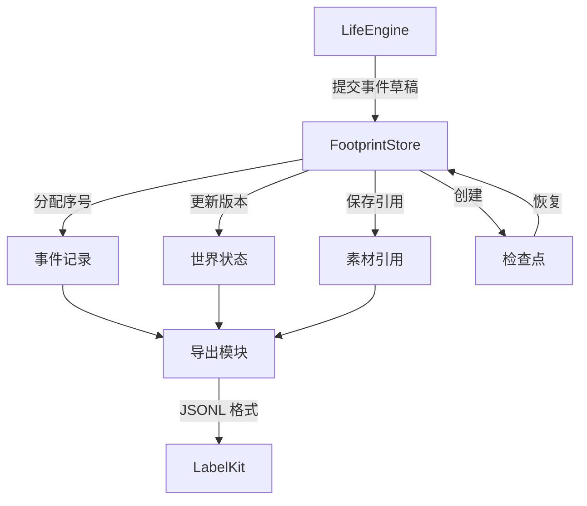

<a name="io-formats-worldmock-产品设计说明书-输入输出格式"></a>
# WorldMock 产品设计说明书 — 输入输出格式

> 按[资源与规则引擎简化规格](../dev/SPEC-resource-and-rule-simplification.md#spec-rrs-资源与规则引擎简化开发规格)修订「WorldState（世界状态）、AgentState（人物状态）、ActivityState（活动状态）、当前工具请求、查询与错误格式、职责与边界」（阶段 1）。


> **状态**：DRAFT；按人物 Prompt 规格修订，修订部分已实现（证据见[人物 Prompt 验收记录](../archive/persona-prompt/persona-prompt-verification.md)）；按一日运行保真规格同步（一日运行保真 IO1），已实现；按[个人事务与工作安排规格](../dev/SPEC-as2-integration.md#errands-workday-运行修复入库)分阶段同步（[实施计划](../archive/errands-workday/errands-workday-implementation-plan.md) D9 作业），已随代码落地到阶段 1–4<br>
> **日期**：2026-10-07
> **版本**：v1.24
> **目标读者**：算法工程师、开发工程师

> 2026-10-01 按[工具交互规格](../dev/SPEC-life-runtime.md#tool-interaction-工具请求)修订当前工具请求、查询与错误合同；本次设计已冻结，生产代码已实现，旧验收证据不覆盖新增条款。

> 本特性首次受影响的发布升级为场景 4、地图 3、目录 5.0、品类与规则绑定 3，世界结构仍为 8。各阶段独立发布；后续格式或内容再次变化时另升相应版本，禁止同目录版本覆盖内容。

> 个人事务与工作安排规格首次受影响的发布：阶段 2 世界结构 9，阶段 3 场景结构 5、卡片结构 3。上一条所说「世界结构仍为 8」只描述工具交互特性发布时的身份。

> 按[让「等待」成为例外规格](../dev/SPEC-idle-fillers.md#spec-idle-fillers-让等待成为例外开发规格)修订「3.2 AgentState（人物状态）」（阶段 1）；班次与休息时段起止的唤醒不新增状态字段，世界结构仍为 9。

> 按[同时做两件事规格](../dev/SPEC-parallel-activities.md#spec-parallel-activities-同时做两件事开发规格)修订「3.2 AgentState（人物状态）」（阶段 1）；暂停的活动不占名额，受限轮阶段闭集不变，世界结构仍为 9；「3.2 AgentState（人物状态）」与「3.4 ActivityState（活动状态）」的占用名（阶段 2）；字段形状不变，世界结构仍为 9，带旧占用名的检查点恢复时与注册表核对不符而拒绝。

具体环境及制作工具按[环境数据归属规格](../dev/SPEC-environment-data-ownership.md)归 WorldMock-Dataset，
正式重制环境路径由 WorldMock-Dataset 发布决定；WorldMock 提供引擎及包内固定通用规则。
本章的 `catalog/`、`corpora/`、`scenarios/` 指外部环境目录，命令以 WorldMock 为当前工作目录并显式传路径。
当前场景结构 7，内容标题来自 `contents.json`，活动效果随环境加载并在启动时冻结；新组合放行另核对实际收据。

<a name="design-09-io-formats-共享规则与可重建环境修订"></a>
## 共享规则与可重建环境修订

按[共享规则与可重建环境规格](../dev/SPEC-shared-rules-and-rebuildable-env.md)修订；验收结果独立记录。

规范 JSON 通过 canonical_json 与 sha256_json 唯一编码，禁止 NaN 和无穷值。结算端点严格为非布尔整数且起点小于终点；曲线采用有限非负数。普通字段冻结与品类递归深度冻结分别定义，不能混成同一种输入语义。安全相对路径和字节原子发布遵守资源与记录引擎合同。

<a name="io-formats-模块概述"></a>
## 1. 模块概述

<a name="io-formats-职责与边界"></a>
### 1.1 职责与边界

世界、人物与活动状态由当前严格模型定义，事件、素材、检查点、导出与质量报告归[记录引擎](05-recording-engine.md#recording-engine-worldmock-产品设计说明书-记录引擎)，LabelKit 产物归[数据交付](06-delivery.md#delivery-worldmock-产品设计说明书-数据交付)。
环境通过统一七份目录与 `environment_identity` 登记对象和绑定。不存在独立品类契约、交换规则 JSON 或原生对象增量接口；分类、资源定义和算子归 `worldmock.exchange`。字段与登记码见[环境目录文件](../CONTRACTS.md#contracts-环境目录文件)。

<a name="io-formats-与其他模块的关系"></a>
### 1.2 与其他模块的关系



<a name="io-formats-核心设计原则"></a>
### 1.3 核心设计原则

| 原则 | 含义 | 体现 |
| --- | --- | --- |
| **严格 Schema** | 所有字段必须符合预定义结构 | Pydantic 模型校验，extra="forbid" |
| **版本显式** | 每个格式带明确版本号 | schema_version 字段必填 |
| **序号严格递增** | 事件序号全局唯一且有序 | event_seq 由存储分配，gt=0 |
| **引用完整性** | 素材引用包含哈希与大小 | AssetRef 包含 sha256、size_bytes |
| **确定性编码** | 相同输入产生相同字节 | canonical_json 排序键、排序集合 |

<a name="io-formats-记录引擎的数据格式"></a>
## 记录引擎的数据格式

记录引擎的数据格式与行为在[记录引擎设计](05-recording-engine.md#recording-engine-worldmock-产品设计说明书-记录引擎)中统一维护，本文只保留跨模块阅读入口。

| 要解析的数据 | 定义位置 |
| --- | --- |
| 事件、来源与可见性、资源证据 | [数字足迹事件结构](05-recording-engine.md#recording-engine-数字足迹事件结构) |
| 运行目录、素材引用和数据表 | [持久化结构](05-recording-engine.md#recording-engine-持久化结构) |
| 共同检查点与恢复分支 | [保存共同检查点](05-recording-engine.md#recording-engine-保存共同检查点)与[恢复与反事实分支](05-recording-engine.md#recording-engine-恢复与反事实分支) |
| 足迹 JSONL、导出清单与质量报告 | [固定截止导出](05-recording-engine.md#recording-engine-固定截止导出) |
| 状态文件、查询输出与日志 | [运行查询与诊断](05-recording-engine.md#recording-engine-运行查询与诊断) |

场景输入中的 `interaction_menus_by_location_kind` 与 `agents[].interaction_menu` 由
[配置设计](08-configuration.md#configuration-交互菜单声明)及[接口合同](../CONTRACTS.md#contracts-交互菜单声明与有效菜单)
定义。每个生活 `observation` 事件的 `data.interaction_menu` 保存排序后的 `allowed_actions`，
表示该人物在该冻结观察中可选的内部标准动作名；人物选择对象与方式，由方式唯一推导内部动作后按它判定，
途中按出发地菜单解析，再由出行方式的准入收窄。它是事件级工具支持
证据，不新增 `WorldState` 或 `AgentState` 字段，也不在 user 消息中复制。菜单声明本身由
`scenario_sha256` 绑定，运行时有效值由观察事件留证。

<a name="io-formats-世界与人物状态格式"></a>
## 世界与人物状态格式

<a name="io-formats-worldstate世界状态"></a>
### 3.1 WorldState（世界状态）

完整世界状态的 JSON 结构。

| 字段 | 类型 | 必填 | 说明 |
| --- | --- | --- | --- |
| `schema_version` | Literal[10] | 是 | 世界结构版本；版本不符的旧状态（含版本 9）直接拒绝 |
| `version` | int | 是 | 状态版本号，ge=0 |
| `current_time` | int | 是 | 当前模拟时间，UTC 纪元秒 |
| `end_time` | int | 是 | 实验结束时间 |
| `run_id` | str | 是 | 运行 ID |
| `timezone` | str | 是 | 时区标识 |
| `scenario_sha256` | str | 是 | 场景文件哈希，64 位 |
| `content_manifest_sha256` | str | 是 | 内容清单哈希，64 位 |
| `agents` | dict[int, AgentState] | 是 | 人物状态映射 |
| `accounts` | dict[str, int] | 是 | 账户余额映射，单位：分 |
| `activities` | dict[str, ActivityState] | 是 | 活动状态映射 |
| `sessions` | dict[str, SessionState] | 是 | 地点会话映射：一段地点停留或一段路（`kind` 取 `stay`、`transit`），由系统随出发与到达开始和结束；每人至多一个进行中会话 |
| `deliveries` | dict[str, DeliveryState] | 是 | 实际订单，带食品、店铺、app、价格、路径、收货人与消息关联；运行消费者阶段 3 接入 |
| `contact_holdings` | dict[str, dict[str, float]] | 是 | 联系人实际食品持有，来自已提交送达与给予 |
| `pending_events` | list[ScheduledEvent] | 是 | 预排事件列表 |
| `processed_actions` | dict[str, StoredAction] | 是 | 已处理动作映射 |
| `presentation_state` | dict[int, dict[str, int]] | 是 | 呈现派生量（人物→对象→时刻），承载 `last_presented_at`；工具层的可调用索引 `callable_index` 不是呈现，不写它 |
| `same_moment_presentation` | dict[int, {stamps: dict[str, int], pinned_supply_ids: list[str]}] | 是 | 按人物暂存的本秒呈现留痕（对象→时刻）；同一秒各轮沿用该秒首轮的呈现窗口，本秒首轮置顶的浏览结果（`pinned_supply_ids`）随暂存保存；时钟推进时由 `flush_presentation` 逐人并入 `presentation_state` 并清空；随世界结构版本 7 |
| `random_seed` | int | 是 | 随机种子 |
| `random_state` | str | 是 | 随机状态 |

`SessionState`（地点会话）字段如下，随世界结构版本 7：

| 字段 | 类型 | 必填 | 说明 |
| --- | --- | --- | --- |
| `session_id` | str | 是 | 会话身份 |
| `agent_id` | int | 是 | 人物 ID |
| `kind` | str | 是 | `stay`（地点停留）或 `transit`（两地之间的一段路） |
| `location_id` | str \| None | 停留时必填 | 停留地点；路上为空 |
| `origin_id`、`destination_id` | str \| None | 路上时必填 | 这段路的出发地与目的地；停留为空 |
| `status` | str | 是 | `active` 或 `ended`；`ended` 必须带 `ended_at` |
| `started_at` | int | 是 | 开始时刻 |
| `ended_at` | int \| None | 否 | 结束时刻，不早于开始时刻 |
| `activity_ids` | list[str] | 是 | 归入本会话的活动：这段停留或路上开始的活动，以及回到该地点时归入的暂停活动 |
| `name` | str | 是 | 可读名称，结束后不改：停留「<地点>（<M月D日> HH:MM 起）」，路上「去<目的地>的路上（<M月D日> HH:MM 起）」（格式见[时间与能量规格](../dev/SPEC-life-runtime.md#time-and-energy-决策不耗时时间只在做事时流动)第七章「会话与活动的字段」） |
| `opened_by_action_id` | str \| None | 否 | 引起本会话开始的动作（出发、途中结束出行）；运行开始与到达开始的会话为空。进度层的下界据此取该动作结果所在提交的末事件序号，为空时取会话开始时刻首个事件所在提交的末事件序号（运行开始为 0）；随世界结构版本 8 |

运行开始时每人按初始地点开始首个停留会话；出发时结束停留、开始路上；到达（含到达被拒）或途中结束出行时结束路上、在人物所在地点开始停留；实验截止时所有会话结束。会话的开始与结束只写入世界状态，不写事件。

世界状态采用确定性 JSON 编码，完整字段由生产模型校验；这里不再提供缺字段或摘要截断的伪完整示例。
人物持有物仍是地点到商品数量的嵌套映射，购买呈现身份则是供给。
冻结地图引用、时态声明和请求结构统一见 [地图与门店供给合同](../CONTRACTS.md#contracts-地图与门店供给合同)，
事件、清单和恢复材料见 [地图与门店供给证据](05-recording-engine.md#recording-engine-地图与门店供给证据)。

`SupplyQuoteState` 保存 `price_fen`、`price_version`、UTC 秒制的半开 `effective_from/effective_to` 与 `source`。
来源按 `DataSource` 全字段校验，不能用空字典代替真实资料或场景假设声明。
`opening_exceptions` 的日期键保存不重叠的分钟区间并保留声明顺序，空列表是明确闭店；恢复不能丢弃这些世界覆盖。
公开观察的 `data.products` 保存商品使用定义，`data.supplies` 保存已知供给；实际呈现的供给在模型请求中是工具层的商品目标，
名称为「<门店>出售的<商品>」：目标的 `state` 写每份热量等可读状态，各动作的 `price`、`duration`、`quantity`、`note` 写人读的价格、
时长、数量与配送送达时刻，不给原始配送秒数或以分为单位的整数；第一个动作的 `note` 另写供给声明的来源标记
（类型、来源引用与事实截止日），每个目标一次。
`data.supplies` 的供给行保存原始 `price_fen/price_version/quote`、`purchase_pairing_state`、`purchase_coefficient` 和一份的 `purchase_price_fen`；
非定义配对保留原始报价，系数及实际金额为空且不允许购买；报价未知时价格字段也保留 `null`。订单行 `total_price_fen` 按原价、数量、系数的整行乘积取整，整单同名字段保存各行合计，
不能由已取整的一份金额乘数量。商品的使用定义继承 `InventoryItemConfig`，保留 `category_id/inventory_unit`，
已持有但未上架的物品仍可按使用合同消费或转换，不要求补造供给。
展示不是资格上限：工具层的目标只是本轮展示的对象，工具层另附只列名称的可调用索引 `callable_index`（此地此刻可做的生活活动名称，
内容与商品按品类的计数与至多 3 个示例名；另有第四键 `query_categories`，列查询权限内的公开品类标签与完整对象计数 `[{category, count}]`，
`query_world` 的 `category` 取值来自它，查询筛选不改变其计数口径；不是目标，不带动作与条件），全部目录类对象都可以按名称调用（本轮未展示的生活活动、内容与游戏取观察
私有的 `catalog_bindings`，没有列出路线的地点取观察私有的地点表 `locations`，`obtain` 可以按名称购买本轮未展示但存在的商品，按当前报价结算：
`from` 是可选约束，写 null、地点显示名（含「家」「住处」）或渠道称呼（App 名，该渠道的成员门店），方式可写由系统定到店或远程下单的「购买」，多家都能服务时按
请求级 `prefer` 选定一家）；名称找不到时只返回同类相近的至多三个完整 `{tool, arguments, note}` 候选且不替换，
候选此刻可行的在前，形状为可以照填的请求 `{tool, arguments, note}`（`note` 为英文说明或 `null`，例如 `Estimated duration: 20 minutes`），受理时的名称归一
写进 `details.resolved`（`[{written, as}]`），由 `from`、`to` 的 null 推导的本人方向说明与指名购买所选的门店、「购买」定下的方式写进 `details.notes`。
同次发现或浏览结果优先占用共同呈现窗口；浏览得到的供给只作为工具层商品目标出现一次，浏览调用的结果（进度层
`details.browse_items`）只列名称，写完整标签「<门店>出售的<商品>」、不标可得性（一日运行保真规格 5.3），
不用 `based_on_action_id/changes` 引用结果；完成的浏览另在记忆层 `settled` 的活动句末写浏览到的完整标签。
这种公开格式不裁剪原始观察、动作和结算中的完整证据；窗口外身份也不会因此获得可见凭据，可见凭据只管展示与比较。

世界结构 10 没有供给库存、报价、营业例外或已付款任务集合。`same_moment_presentation` 不再保存 `pinned_supply_ids`。SessionState 新增 `app_pushes{app_id: AppPush{push_id, content_id, issued_at, status}}`，默认空，状态 `pending/opened/released`；已结束会话保留历史并核对 app 和内容身份。该字段运行消费者在阶段 4 生效。

<a name="io-formats-当前工具请求查询与错误格式"></a>
### 当前工具请求、查询与错误格式

当前 `start_activity` 只接受必填 `items[{target, way, from, to}]` 一至两项与必填可空的 `answering`、`prefer`，
每项四键必填，方式唯一推导内部五类动词；旧平行数组和 `actions` 直接拒绝。`prefer` 显式必填可空：只要含「购买」「到店」或「远程下单」项，就必须写「最快拿到」或「到手价最低」；没有购买项时必须为 `null`。`null` 不再默认最快，不接受旧英文或短名。
不做旧英文、空串、引号或字符串 `null` 的兼容归一。食用、使用与制作两端为 `null`，本人方向由环境推导；
给予来源为 `null`、去向为人物；购买去向 `null` 表示本人，只有他人写真实人物名称。
`from=null` 在购买时表示不额外限定卖方或渠道，完整商品标签仍限定标签门店；其他方式的来源由引擎推导，只允许 `null`。
`to=null` 始终表示本人，购买收货地沿用当前地点规则，不等于本人住处；只有购买或给予给他人时写真实人物名称。
食用、使用、制作及其他方式的 `to` 只允许 `null`；给予必须写他人，不能给予本人。
不接受在 `to` 填「自己」或本人姓名的旧写法；出行目的地由 `target` 与方式确定，`from/to` 不承载路线起止地点。

控制工具只接受当前 `items` 对象数组与请求级必填的 `errands` 数组（与 `items` 平级，允许空数组，一次至多 4 条变更）。
每条事务变更是封闭对象，`change`、`name`、`outcome`、`item`、`quantity`、`memo`、`remind_time`、`reason` 八键全部必填：
`change` 取「新增」「更新」「取消」，没有「完成」；`name` 为非空白字符串、至多 30 字符；
新增时 `outcome`（「取得」或「吃掉」）、`item`、`quantity`（1 至 9 的整数）非空且 `reason` 为 null，`memo`、`remind_time` 可空；
更新时 `outcome`、`item`、`quantity`、`reason` 为 null，`memo` 与 `remind_time` 为替换语义、null 即清空；取消时 `reason` 非空、其余为 null。
非 null 的 `item`、`memo`、`reason` 须非空白，`memo` 与 `reason` 各至多 120 字符，`remind_time` 为场景本地 `HH:MM`。
同一请求内按取消、更新、新增的次序求值：同一条未完成事务至多被一条更新或取消点名，两条新增不得同名；取消旧事务并以原名新增可在同一请求里完成。
收尾的 `memories`、`views` 显式必填、允许空数组；不读旧平行数组，缺 `errands` 键的请求按缺字段拒绝。
成功结果在 `details.errands` 给回执 `[{errand, change}]`（`errand` 为事务名称：更新与取消写待办层里的名称，新增写所写的名称），
顺序同请求，没有变更时为 `[]`；被拒结果没有该键，请求被拒时同一请求的事务变更一并不生效。

查询工具为 `query_world(name, way, category, from, available_only, offset)`、`recall_task_summary(task_name)` 与三个记忆查询；
它们在生活决策中可同批即时返回，不登记世界请求、不推进时间、不计同刻轮数，仍占实际模型回合预算。
`query_world` 六键 `name`、`way`、`category`、`from`、`available_only`、`offset` 均必填、无缺省，旧四键请求按缺字段拒绝；`name`、`way`、`category`、`from` 可为 null 且至少一个非 null（四者全空时在四个位置各报一条；非 null 的 `name`、`way`、`category` 不得为空白，空白的 `from` 与其余无法解析的来源同按来源错误纠正），`from` 写购买来源（地点显示名，含「家」「住处」，或渠道称呼），与 `start_activity` 购买项的 `from` 经同一纯函数解析、只匹配供给条目；`available_only` 为严格布尔（拒绝字符串、数字与 null），true 只留已确认此刻可执行的条目（报价未知、营业未知的也被滤掉），不单独构成查询条件；`way` 写「购买」等同于同时写「到店」与「远程下单」；`category` 匹配公开 `callable_index` 的品类标签（`query_categories`，筛选不改变其计数口径），`offset` 为严格非负 JSON 整数（拒绝布尔值、数字字符串及浮点数），首批显式写 `0`。返回恒为 `{matches, total_count, next_offset}`，`next_offset` 必填可空；筛选在排序与切页之前施加，`total_count` 是全部筛选交集后的完整匹配数；每批沿用现有 `candidate_presentation_limit=20`，还有匹配时返回下一偏移，否则为 `null`。除两种查询参数错误（`from` 既不是地点显示名也不是渠道称呼；`from` 为 null、`name` 按对象名称无任何匹配且其写法恰是一个渠道称呼）外，任何筛选组合无匹配时返回 `matches=[]`、`total_count=0`、`next_offset=null`，不报错、不自动放宽、不换来源。每项是冻结目标的无损紧凑投影（`name, kind, phase, state, contract, actions, tools`，紧凑规则复用工具层分组的实现），只省略 null 与空集合，不再逐项附 `candidates`，候选只出现在错误合同里。同一冻结观察内可遍历完整权限内匹配集合，不公开超权限信息，不替代耗时浏览。外部只读问答仍只开放记忆与 `finish`。
世界查询不读取未读邮件正文或超权限供给。

错误顶层为 `{error_code, reason, fix, items, unmet}`，`items[]` 为
`{path, written, error_code, allowed_values, expected, why, candidates}`，不保留旧 `index`、`field`。
`path` 是完整位置数组，从 `tool_calls` 起保留工具下标、`function.arguments` 和所有嵌套字段与下标。
有限枚举完整列于 `allowed_values`；无枚举为 `[]`，英文 `expected` 写类型、范围、格式、组合或世界条件。
`prefer` 的错误枚举按已合法的方式判定：含购买项返回 `["最快拿到", "到手价最低"]`，
没有购买项返回 `[null]`；尚不能判明方式时列声明的三值并说明跨字段约束，不猜购买类型。
候选为完整 `{tool, arguments, note}`，`note` 为英文说明或 `null`，参数严格使用当前接口。
JSON 解析失败定位参数对象、附行列与必要闭集；未知工具定位工具名、列本次实际提供的工具；混批定位 `tool_calls`。
`reason`、`fix`、`message`、`why` 与错误日志均为英文，中文对象名原样保留；合法名称不作为全量枚举塞进错误。
三个控制工具 `errands` 的错误都不带 `candidates`：更新、取消的 `name` 找不到或多于一个时（`NAME_NOT_FOUND`、`NAME_AMBIGUOUS`），
`allowed_values` 列本人全部未完成事务名——它是此刻至多 8 个的有限集合，不属于上句所说的全量名称枚举，也不替换；
新增的 `item` 解析不到唯一商品时，最接近的至多三个商品名写在 `why`，不把全量商品名放进 `allowed_values`；
新增重名、同结果种类同商品、同一事务被两条更新或取消点名与新增后超过 8 条都是 `ARGUMENTS_INVALID`，`why` 写明冲突的事务名或上限。
长度、条数等上限随校验原因写在 `why`，`expected` 给类型与格式；`path` 完整到 `errands[j].<键>`。
宿主与环境对同一冻结观察调用同一函数判定；环境复核的失败合并为一次 `ACTION_REQUEST_INVALID`，不新增业务拒绝码。
完整合同见[接口合同](../CONTRACTS.md#contracts-worldmock-接口合同)与[工具交互规格](../dev/SPEC-life-runtime.md#tool-interaction-工具请求)。

进度层的 `rejected_today` 从本人当天持久化结构化纠错与业务拒绝派生，跨会话保留、跨本地日期清空，
每条恰为 `{written, why, times, last, accepted_as}`，至多八条、每条英文 `why` 至多六十字符；不新增 `WorldState` 或 `AgentState` 检查点字段、不迁入人物记忆。
公开工具层恰为 `{layer, groups, callable_index}`，每组为 `{kind, action, way, shared, targets}`；控制对象 `action/way` 为 `null`。解组按名称合并并逐值恢复全部公开信息，冲突元信息为渲染错误；只省略 `null` 或空集合，保留 `false`、零值与未知原因。冻结观察保留完整 `targets`，私有绑定及可调用索引的结构不变。
`around_time` 显示和请求都只取场景本地 `HH:MM` 或 `null`，不带「约」字。

工作场景输入只保留显式必填的 `appointment`：普通工作写 `null`，真实预约写 `{starts_at, reason}`；
删除输入 `available_at`、`availability_kind`、`appointment_reason`。内部 `RuntimeWorkTask.available_at`
由最早发给本人且关联该任务的邮件 `sent_at` 或预约 `starts_at` 派生，不写回输入、不增加检查点字段。
普通工作收到通知后，在地点及既有截止、技能、素材条件满足时即可开始；任务的 `contract.opens` 使用同一派生时刻。
每封 `related_task_id` 非空的邮件都必须关联已存在的任务，且收件人必须是该任务受派人；另外，每个任务都至少有一封本人关联邮件。
预约只要求最早本人关联通知的 `sent_at <= appointment.starts_at`，后续合法提醒可晚于预约开始，不改变内部 `available_at`。
邮件到达不公开正文；阅读结果保留实际所读正文，仅不重复任务合同时间、地点或验收答案。

场景结构 5 起人物配置另有必填可空的 `work_schedule`（对象或 null）与可选的 `leave_work_window`、`arrive_home_window`，
格式见[配置设计](08-configuration.md#configuration-工作安排声明)与接口合同。工作安排只随场景原始字节进入 `scenario_sha256`；
环境层的 `duty` 每轮由场景与世界时钟求值、随观察事件的 `environment_layer` 原样保存，不新增 `WorldState` 或
`AgentState` 字段，也不参与 `RuntimeWorkTask.available_at` 的派生。

当前场景结构 6 在 `contents[]` 中要求非空 `title`，由引擎直接投影为标题；来源元数据提取由 Dataset 制作阶段完成。
生活活动条目的 `effects` 为必填对象，键恰为 `entertainment`、`social`、`health`，值为有限数值 0–1，加载后不可变。
启动生活活动时复制到既有 `ActivityState.data["effects"]`，后续推进、暂停恢复及检查点恢复只读该冻结副本。
缺失效果记录错误并拒绝，不按活动身份查全局表或补零。

新目录内部身份与状态按[资源与规则引擎简化规格](../dev/SPEC-resource-and-rule-simplification.md#spec-rrs-状态事件检查点与导出)绑定。订单与持有改为食品、店铺与 app，内容进度按内容身份保存，工作只记主题和真实工时；新的运行消费者与工具请求分别在阶段 3、4、5 切换，本阶段不提前变更当前工具面。

<a name="io-formats-agentstate人物状态"></a>
### 3.2 AgentState（人物状态）

下表是[当前状态模型](../../src/worldmock/life/models.py)的阅读摘要，未逐一列出 `last_decision_time`、`felt_bands_at_last_decision`、
`people_at_last_decision`、`mood_updated_at`、`discomfort_started_at`、`discomfort_pulse_hours`
这些节律、体感与素材揭示的内部字段；完整字段由生产模型校验。

| 字段 | 类型 | 必填 | 说明 |
| --- | --- | --- | --- |
| `agent_id` | int | 是 | 人物 ID，gt=0 |
| `name` | str | 是 | 姓名 |
| `location_id` | str | 是 | 当前位置 ID；出行中仍为出发地（路线身份与菜单解析用），现场资格按进行中的出行判定为途中 |
| `balance_account_id` | str | 是 | 账户 ID |
| `body` | BodyState | 是 | 身体状态 |
| `inventory` | dict[location_id, dict[food_id, float]] | 是 | 各地点实际食品份数；食用开吃、给予与送达按已提交事实更新 |
| `active_effects` | set[str] | 是 | 活跃效果（JSON 编码为排序列表） |
| `body_settled_at` | int | 是 | 本人身体已结算到的共同世界时刻 |
| `delivered_warning_signatures` | set[str] | 是 | 当前持续威胁中已实际交付的签名 |
| `next_decision_at` | int | 是 | 下次决策时间；等于当前时刻即同一秒再决策 |
| `consecutive_rejections` | int | 是 | 连续业务拒绝次数，受理即归零；只作动机层挫败感的输入，不参与唤醒与冷却 |
| `same_moment_rounds` | int | 是 | 本秒已进行的决策轮数，ge=0；受理、业务拒绝与重放各加一，名称类拒绝每人每秒前两次不加（第 3 次起照加，一日运行保真规格 3.4），时钟推进归零 |
| `same_moment_stage` | str | 是 | 受限轮阶段：`open`、`conclude_pending`、`start_or_resume`、`resume_or_conclude`、`conclude_only`（世界结构版本 8 删去 `wait_only`；`resume_or_conclude` 与 `conclude_only` 只留在闭集中，现行阶梯不再进入它们：到达同刻上限时有待收尾进入 `conclude_pending`，没有进行中也没有待收尾时进入 `start_or_resume`，开始或恢复被拒后留在原阶段，世界结构为 10）；时钟推进复位为 `open` |
| `pending_wake_reasons` | list[str] | 是 | 本轮唤醒原因，成员属唤醒闭集；同刻轮次替换为本轮原因：没有进行中活动记 `no_active_activity`，业务拒绝之后记 `rejection_feedback`，二者同时成立按枚举顺序记两项；交谈对方同秒结束且本人仍有其他进行中活动时记 `planned_end`；人物消息送达而获得同刻机会时记 `message_arrival`；上一轮原因不带入；个人事务的提醒到点记 `errand_reminder_due`，它不在睡眠允许的原因之内，睡眠中不交付也不消耗，睡眠期间到点的在人物醒来的那个边界一并交付；班次与休息时段的起止恰在边界时记对应成员 `shift_start`、`shift_end`、`break_start` 或 `break_end`（同一秒重合的各记一次，按枚举顺序），只对清醒人物，由场景工作安排与世界时钟求值、不另存状态，睡过的起止醒来后不补；已判定而尚未决策的成员照常留在本字段随检查点恢复，不重复、不补发 |
| `content_progress` | dict[str, ContentProgress] | 是 | 内容进度 |
| `read_message_ids` | set[str] | 是 | 已读邮件 ID 集合：只由阅读动作在读完时写入，睡眠中不写 |
| `visible_message_ids` | set[str] | 是 | 可见消息 ID 集合 |
| `inbox` | dict[str, Message] | 是 | 收件箱；直接消息与交谈邀请以全文进入进度层（不截断，交谈邀请另接回应方式「，对<发起人>选择交谈即接受」），全文已呈现（在进度层或记忆层）即在决策轮提交时记为已读；受限轮与轮前有待收尾活动的轮次、重放的动作不记已读；邮件正文须阅读后才可知 |
| `read_inbox_ids` | set[str] | 是 | 收件箱已读消息 ID 集合：决策轮提交时写入本轮观察全文呈现过的，结算边界在唤醒判定之后写入其余未读的，每条使社交需要 −0.05、情绪 +0.1；人物在睡时（轮前在睡的决策轮、判定时仍在睡的边界）都不写，睡眠中送达的消息在醒来后的第一个边界才写入 |
| `outbox` | dict[str, Message] | 是 | 发给场景联系人的消息，按消息身份存放，缺省为空；联系人回复请求据此与收件箱组装双方往来；随世界结构版本 8 |
| `day_plan` | DayPlan \| None | 否 | 当日目标 `{day_end, goals}`，由零点计划生成，人物可修订；空清单仍为已提交，条目含环境推进证据、提醒 `remind_at`、`reminded_at`（`int \| None`：提醒的当日绝对时刻与触发时刻，只触发一次）与大致时刻 `around_at`（`int \| None`：`around_time` 换算出的当日绝对时刻，只用于推进判定，为空不限时刻），人物写下的 `progress_note` 照存但不呈现，旧段形状拒绝；详见 [目标请求](../CONTRACTS.md#contracts-day-goal-request) |
| `plan_submitted_dates` | set[str] | 是 | 已生成当日计划的场景本地日期（ISO 日期，JSON 编码为排序列表）；零点计划 `plan_day` 的幂等键，既有字段；恢复、重放与反事实分支据此不重复生成 |
| `errands` | dict[str, ErrandState] | 是 | 未完成的个人事务，按事务身份存放，缺省为空；每人至多 8 条（由请求校验执行）；只保存未完成事务，办成或取消即移出，终态、原因与证据只在同一提交的事件里；不放进 `DayPlan`，零点置空与计划修订都不波及；随世界结构版本 9 |

`ErrandState`（一条未完成的个人事务）字段如下，随世界结构版本 9：

| 字段 | 类型 | 说明 |
| --- | --- | --- |
| `errand_id` | str | 由来源动作身份与新增条目在请求中的序号确定性生成（`<动作身份>:errand:<序号>`），只存状态与事件，不进提示 |
| `name` | str | 人物起的名称，非空白，记下后不可改，至多 30 字符（请求校验执行）；终结后名称可以再用 |
| `outcome` | `obtain` 或 `eat` | 结果种类；请求里写「取得」「吃掉」；记下后不可改 |
| `product_id` | str | 记下时由商品名解析到的唯一商品；记下后不可改 |
| `quantity` | int | 要办成的份数，1 至 9 |
| `progress` | float | 已累计量，按九位小数保存，恒小于数量；累计到数量减 1e-9 即办成并移出 |
| `memo` | str \| None | 人物写的备注，至多 120 字符（请求校验执行）；只用于呈现，不参与结算与完成判定 |
| `registered_at` | int | 记下的时刻 |
| `remind_at` | int \| None | 提醒的绝对时刻：该钟点在受理时刻所在本地日的时刻严格晚于受理时刻取它，否则取下一本地日的同一钟点 |
| `reminded_at` | int \| None | 已交付提醒的时刻；只提醒一次，更新时按新写的 `remind_time` 重新换算并清空，重新计一次；非空时须有 `remind_at` 且不早于它 |
| `origin_action_id`、`origin_event_id` | str | 来源动作与请求事件 |

事务不占活动名额，不经 `task_kind` 关联活动。

可见身份集合与两份逐供给记录的键完全一致；呈现时间不得晚于世界当前时刻，呈现地点必须是场景中的合法地点。
活动身份只存在于 `WorldState.activities`，人物不另存当前活动槽或活动身份列表。每人两个名额：进行中与待收尾（`completed`、`failed` 或 `cancelled` 而 `concluded_at` 为空；`truncated` 不收尾）的活动各占一个，暂停的不占，`pause_activity` 让出名额，`conclude_activity` 之后释放；名额由活动集合派生，不另存。
观察 `active_activities` 是按开始时间和身份排序的完整 ACTIVE 控制行集合，`pending_conclusions` 是待收尾活动的控制行；
每项独立控制。`occupied_resources` 是这些活动显式资源声明的排序并集，仅为观察派生量；占用名按[时间与能量规格](../dev/SPEC-life-runtime.md#time-and-energy-决策不耗时时间只在做事时流动)
第五章「并行准入」重列为 `wait`、`work`、`watch`、`screen`、`play_game`、`read_mail`、`browse`、`consume`、`lifestyle`、`talk`、`travel`，
每种动作占自己的名字，只有同一种动作互斥（[同时做两件事规格](../dev/SPEC-parallel-activities.md#spec-parallel-activities-占用声明)）。
私有证据窗口 `verified_experiences` 由截止前已提交事件确定，只用于记忆来源核对，不进人物提示；记录格式与共同身体结算引用由
[记录引擎](05-recording-engine.md#recording-engine-worldmock-产品设计说明书-记录引擎)定义，人物自述不得写入该窗口。记忆层的 `settled` 另有来源：由已提交结果与世界事件生成的确定性句子。
超过 1800 秒或人物位置改变则该凭据不可用；呈现另一供给不续期。直接下钻与有时长浏览均以实际返回窗口更新，
后者使用完成时的世界时刻。恢复和分支保留这些字段以及 `presentation_state`，不能重建为全目录可见。

阶段 4 新增 `content_progress{content_id: ContentProgress}`：每条内容全局位置和完成轮次跨 app、活动、暂停与恢复共用。没有 `work_progress`，工时由真实活动推导。未知退役字段在结构 10 严格拒绝。

<a name="io-formats-bodystate身体状态"></a>
### 3.3 BodyState（身体状态）

`BodyState` 汇集身体资源、人物身体常量和体感计算所需状态，并非与“资源”并列的新概念。
下表是 [当前状态模型](../../src/worldmock/life/models.py) 的阅读摘要；
变化规则由 [身体语义规格](../dev/SPEC-life-runtime.md#spec-life-runtime-身体语义两过程睡眠睡眠不足账体感分级)
承载，不在格式文档中重定义。

| 字段 | 类型 | 范围 | 说明 |
| --- | --- | --- | --- |
| `energy_kcal` | float | ≥0，且结算后不超过目录上界 | 可用能量，kcal；进食补充，基础代谢与活动消耗 |
| `sleep_pressure` | float | [0, 1.2] | 睡眠压力，与昼夜阈值共同决定困意 |
| `sleep_deficit_hours` | float | [0, 24] | 睡眠不足账，小时；决定工作和食品利用效率 |
| `sleep_need_hours` | float | [7.0, 9.0] | 睡眠需要，小时 |
| `chronotype_midsleep` | float | [0, 24) | 时型（睡眠中点），小时 |
| `social_need` | float | [0, 1] | 社交需要：清醒每小时 +0.04，是否清醒按本区间共同身体结算 `body_settlement.activity_ids` 所用的活动集合判定（集合含睡眠即整段不增长，在边界结束的睡眠也一样）；交谈、通话、共同用餐与读消息减少 |
| `mood_valence` | float | [-1, 1] | 情绪效价 |
| `neuroticism_norm` | float | [-1, 1] | 神经质归一化 |
| `entertainment_need` | float | [0, 1] | 娱乐需要 |

饥饿和困意是派生体感，不另存可自由修改的数值条。观察中的 `body` 也不是把
`BodyState` 原样交给数字人：数值在 `values` 中留作事件证据，提示只获得 `levels` 的分级文本。
人物睡眠常量留在状态与档案中，不进入观察投影。完整投影合同见
[观察投影字段](../CONTRACTS.md#contracts-观察投影字段)。

<a name="io-formats-activitystate活动状态"></a>
### 3.4 ActivityState（活动状态）

| 字段 | 类型 | 必填 | 说明 |
| --- | --- | --- | --- |
| `activity_id` | str | 是 | 活动 ID |
| `agent_id` | int | 是 | 人物 ID |
| `location_id` | str | 是 | 开始地点（出行为出发地）；结算不覆盖，到达地点见 `data.arrival.location_id` |
| `kind` | ActivityKind | 是 | 活动类型 |
| `status` | ActivityStatus | 是 | 活动状态 |
| `started_at` | int | 是 | 开始时间 |
| `ended_at` | int \| None | 否 | 结束时间（终态必填） |
| `planned_end_at` | int | 是 | 计划结束时间 |
| `last_settled_at` | int | 是 | 上次结算时间 |
| `elapsed_seconds` | int | 是 | 已用时长 |
| `planned_duration_seconds` | int | 是 | 计划时长 |
| `media_position_seconds` | float | 是 | 媒体位置 |
| `route_progress_meters` | float | 是 | 路线进度，米 |
| `target_id` | str \| None | 否 | 目标 ID |
| `destination_id` | str \| None | 否 | 目的地 ID |
| `travel_mode` | TravelMode \| None | 否 | 出行方式 |
| `resource_claims` | set[str] | 是 | 资源占用，取第五章占用名（`wait`、`work`、`watch`、`screen`、`play_game`、`read_mail`、`browse`、`consume`、`lifestyle`、`talk`、`travel`）；观看另按 `data.content_kind`（播客只占 `watch`，其余内容另占 `screen`），恢复时按注册表核对，旧占用名不符即拒绝 |
| `origin_action_id` | str | 是 | 源动作 ID |
| `origin_decision_id` | str | 是 | 源决策 ID |
| `origin_request_event_id` | str | 是 | 源请求事件 ID |
| `boundary_type` | str \| None | 否 | 边界类型：`planned_end`、`feedback`、`game_feedback`、`paused`、`cancelled`、`experiment_end`、`counterfactual_replay`、`route_ended`、`partner_ended`、`plan_reminder`（当日目标提醒结束睡眠；与计划结束同秒时记 `planned_end`） |
| `interruption_reason` | str \| None | 否 | 中断原因：`agent_cancelled`、`experiment_end`、`LOCATION_ACCESS_DENIED`、`route_ended`、`partner_ended`（交谈对方结束，本人交谈同秒结束）、`plan_reminder` |
| `next_interaction_at` | int \| None | 否 | 下一次交互边界（游戏回合与社交活动使用） |
| `data` | dict | 是 | 活动数据；生活活动含开始时冻结的 `effects`；进食（使用方式为食用）另带开吃份量 `opened`（dict[str, float]，商品→开吃份数），摄入只按它与实际进度计算，暂停保留剩余，结束时写 `discarded`（开吃份量减已吃，商品→丢弃份数）且不补算摄入；`opened` 随世界结构版本 8 |
| `concluded_at` | int \| None | 否 | 收尾时刻：只属于 `completed`、`failed`、`cancelled`，不早于 `ended_at`；终态而为空即待收尾，`truncated` 不收尾 |
| `report_anchor_at` | int \| None | 否 | 播报锚点：开始、恢复以及对该活动播报时写入当前时刻 |
| `paused_at` | int \| None | 否 | 暂停时刻：暂停时写入，恢复时清空；待办层的暂停活动按它从老到新排列；随世界结构版本 8 |
| `session_ids` | list[str] | 是 | 先后所属的地点会话 |
| `name` | str | 是 | 可读名称「<做什么><对象>（<M月D日> HH:MM 起）」，结束后不改 |
| `task_kind`、`task_ref`、`plan_goal_intent_kind` | str、str \| None、str \| None | 是 | 从原会话移来：活动服务的任务（`goal`、`work_task` 或 `none`）及引用，`goal` 时意图等于引用 |
| `progress_note`、`note_updated_at`、`note_history` | str、int \| None、list | 是 | 从原会话移来的人物自述：`report_status`、`pause_activity`、`conclude_activity` 的 `summary` 写入 `progress_note`（至多 500 字符），前一条推入 `note_history`；提示中的 summary 在本 session 内是进度层对应调用的参数，session 结束后是记忆层的 `self_notes`（只取 pause、conclude） |

`elapsed_seconds`、`effective_work_seconds`、`media_position_seconds` 等进度随每次结算累加；工具层活动目标的 `state` 写的客观进度从这些字段与任务累计读取。

`ActivityChange` 为 `pause/resume/cancel`。活动 `data` 的目标字段如下，实际消费者随对应阶段生效：

| 活动 | 数据 | 生效阶段 |
| --- | --- | --- |
| travel | `trip_id, path, distance_meters, travel_payment, arrival` | 阶段 2 |
| consume | `request, consumed, opened, discarded, food_energy_kcal_per_hour` | 阶段 3 |
| use_app | `app_id, content_id, content_kind, summary, start_position_seconds, pinned_by_push_id, draw_index, played`，位置是运行快照，恢复按全局进度覆盖 | 阶段 4 |
| work | `topic_id, worked_before_seconds` | 阶段 5 |
| lifestyle | `effects`，开始时冻结条目效果 | 保留 |

本阶段活动种类与边界运行闭集仍保持当前值；阶段 4 再删除 game_feedback 和旧观看、游戏、浏览活动。

<a name="io-formats-labelkit-交付格式"></a>
## LabelKit 交付格式

训练记录、字段字典、来源连通组与规则夹具由[数据交付](06-delivery.md#delivery-worldmock-产品设计说明书-数据交付)定义处理流程，
字段和磁盘产物见[LabelKit 训练记录与交付格式](../CONTRACTS.md#contracts-labelkit-训练记录与交付格式)。
原始足迹导出和 LabelKit 训练样本分别按所属合同解析，不能把训练字段附会为持久事件字段。

<a name="io-formats-通用校验说明"></a>
## 通用校验说明

<a name="io-formats-字段类型校验"></a>
### 9.1 字段类型校验

**Pydantic 模型校验规则**：

| 规则 | 说明 |
| --- | --- |
| `extra="forbid"` | 拒绝未知字段 |
| `allow_inf_nan=False` | 拒绝无穷和 NaN |
| `frozen=True` | 不可变模型 |
| `gt=0` | 大于 0 |
| `ge=0` | 大于等于 0 |
| `pattern=r"^[a-f0-9]{64}$"` | SHA-256 格式 |
| `min_length=1` | 非空字符串 |

<a name="io-formats-业务规则校验"></a>
### 9.2 业务规则校验

| 规则 | 校验点 | 失败行为 |
| --- | --- | --- |
| 事件序号严格递增 | event_seq | 立即失败 |
| 状态版本连续 | state_version | 立即失败 |
| 活动终态必有结束时间 | ended_at | 立即失败 |
| 资源流水金额为正 | resource_flows.amount | 立即失败 |
| 引用完整性 | artifact_refs | 立即失败 |
| 时间范围合法 | current_time ≤ end_time | 立即失败 |
| 账户余额非负 | accounts | 立即失败 |

<a name="io-formats-确定性编码规则"></a>
### 9.3 确定性编码规则

**canonical_json 函数规范**：

```python
def canonical_json(value: Any) -> bytes:
    """使用唯一 JSON 编码，使哈希与重放身份稳定"""
    return json.dumps(
        value,
        ensure_ascii=False,
        sort_keys=True,
        separators=(",", ":"),
        allow_nan=False
    ).encode()
```

**确定性要求**：
1. 字典键按字母序排序
2. 集合序列化为排序列表
3. 不使用浮点 NaN 或无穷
4. 相同输入产生相同字节

**序列化器示例**：

```python
@field_serializer("active_effects", when_used="json")
def serialize_agent_sets(self, value: set[str]) -> list[str]:
    """按稳定顺序编码人物集合"""
    return sorted(value)
```


<a name="design-io-formats-current-responsibility"></a>
## 职责搬移后的格式与身份

本次分层没有新增事件、世界状态、检查点、运行清单、人物工具或交付字段。当前结构版本仍按本章各格式的冻结定义；历史首次受影响版本保留在归档证据，不作为当前发布身份。
持久路径使用仓库或工件相对引用；相同输入保持相同身份。测试侧固定随机身份和壁钟只服务行为不变验证，不改变生产运行身份算法。

<a name="io-formats-版本历史"></a>
## 版本历史

以下记录保留当时的变更与验证证据；当前接口约束以正文和各特性规格为准。

| 版本 | 日期 | 修订内容 |
| --- | --- | --- |
| v1.0 | 2026-09-20 | 初版：事件 Schema、状态快照、导出格式、报告结构、检查点格式、素材引用、日志格式、Schema 验证规则 |
| v1.1 | 2026-09-20 | 对齐身体结算事件、资金事实、资源流水与体感可见性 |
| v1.2 | 2026-09-20 | 事件、检查点、素材、足迹导出、质量报告与日志格式归入记录引擎；保留领域状态与交付格式入口 |
| v1.3 | 2026-09-20 | 增加场景交互菜单与观察事件有效菜单的格式导航，明确它们不新增世界或人物状态字段 |
| v1.4 | 2026-09-24 | 按时间与能量规格：观察留证的 `allowed_actions` 为内部标准动作名，人物所选动词与方式映射后判定，途中按出发地菜单解析并由出行方式收窄 |
| v1.5 | 2026-09-25 | 按时间与能量规格第九章：世界结构版本 7；ActivityState 补 `location_id`（开始地点，结算不覆盖） |
| v1.6 | 2026-09-25 | 按时间与能量规格阶段 1：AgentState 的 `next_decision_at` 注明等于当前时刻即同一秒再决策，`consecutive_rejections` 只作挫败感输入；增 `same_moment_rounds`、`same_moment_stage` 与 `pending_wake_reasons`（同刻轮次按本轮替换；交谈对方同秒结束且本人仍有其他进行中活动时记 `planned_end`）；WorldState 增按人物暂存的本秒呈现留痕 `same_moment_presentation`（同一秒沿用首轮窗口，时钟推进时并入 `presentation_state`） |
| v1.7 | 2026-09-25 | 按时间与能量规格阶段 2（第二章与第八章「呈现」）：`facts.products` 按可读名称公开，食品带每份热量 `energy`，配送写人读送达时刻 `delivery_eta` |
| v1.8 | 2026-09-25 | 按时间与能量规格阶段 3：WorldState 增 `sessions` 与 `SessionState` 字段表（地点停留或一段路，系统随出发与到达开始和结束）；AgentState 注明每人两个名额（进行中、暂停与待收尾各占一个）与待收尾控制行；ActivityState 补 `next_interaction_at`、`concluded_at`、`report_anchor_at`、`session_ids`、`name` 与从会话移来的任务关联和自述字段，`boundary_type`、`interruption_reason` 列出取值（加 `route_ended`），注明进度随结算累加 |
| v1.9 | 2026-09-25 | 按时间与能量规格阶段 4：AgentState 的 `location_id` 注明出行中仍为出发地、现场资格按途中判定；`occupied_resources` 与 ActivityState 的 `resource_claims` 取第五章重列的占用名（观看按内容品类）；`boundary_type`、`interruption_reason` 加 `partner_ended` |
| v1.10 | 2026-09-25 | 按时间与能量规格阶段 5：AgentState 的 `day_plan` 注明由零点计划生成，目标带提醒 `remind_at`、`reminded_at`，增 `plan_submitted_dates` 行（零点计划的幂等键，既有字段）；ActivityState 的 `boundary_type`、`interruption_reason` 加 `plan_reminder`；供给行改为提示不用增量引用，有变化时写完整行 |
| v1.11 | 2026-09-26 | 时间与能量规格阶段 7 文档一致性核对：AgentState 名额说明中的待收尾限定为 `completed`、`failed`、`cancelled` 且未收尾，`truncated` 不收尾、不占名额 |
| v1.12 | 2026-09-27 | 按人物 Prompt 七层规格（人物 Prompt 台账 E9-1–E9-7，E9-3 为阶段 1、4，E9-4 为阶段 4 同批作业）：文件头注明修订部分待实现；`facts.products` 改为工具层的商品目标，展示不是购买资格上限，浏览结果只列名称；世界结构版本 8：SessionState 增 `opened_by_action_id`，`DeliveryState` 带收货人 `recipient_id` 与请求关联 `request_message_id`，WorldState 增 `contact_holdings`，AgentState 增 `outbox`，ActivityState 增 `paused_at`，进食活动数据带开吃份量 `opened`，受限轮阶段删 `wait_only`；直接消息全文进入进度层，全文已呈现即记为已读；目标的 `progress_note` 照存不呈现；`verified_experiences` 只作私有证据、不进提示，`settled` 另有来源；summary 在本 session 内是进度层调用参数、之后是记忆层 `self_notes`；客观进度改为工具层活动目标的 `state` |
| v1.13 | 2026-09-28 | 人物 Prompt 七层规格实现后文档：按最终代码核对，`same_moment_stage` 注明 `conclude_only` 只留在闭集中，`inbox` 写明已读的范围（进度层或记忆层全文呈现、受限轮与待收尾轮次和重放不记已读）与交谈邀请的回应方式，活动 `data` 写明 `opened` 只在食用时出现、结束写 `discarded`；文件头注明修订部分已实现 |
| v1.14 | 2026-09-28 | 人物 Prompt 七层规格最后一批代码与规格出入的修复（见[人物 Prompt 验收记录](../archive/persona-prompt/persona-prompt-verification.md)）：门店商品目标第一个动作的 `note` 另写供给声明的来源标记（类型、来源引用与事实截止日），每个目标一次 |
| v1.15 | 2026-09-29 | 按[一日运行保真规格](../dev/SPEC-life-runtime.md#dayrun-fidelity-身体与需要)同步（一日运行保真 IO1，随阶段 1、3、4 的代码落地，按 `e377669` 核对）：「WorldState」候选写成可照填的 `{target, action, way, from, to}`，工具层另附只列名称的可调用索引 `callable_index`，全部目录类对象按名称调用（未展示的生活活动、内容与游戏取 `catalog_bindings`，没有列出路线的地点取观察私有的地点表），`obtain` 的 `from` 可写门店名或渠道称呼、方式可写「购买」、多家都能服务时按请求级 `prefer` 选定，浏览结果列完整标签、完成的浏览在记忆层写浏览到的完整标签，`DeliveryState` 不带 `channel_id`（只在 `orders[]` 与 `purchases.jsonl`，世界结构仍为 8），`presentation_state` 承载 `last_presented_at`、可调用索引不写它；「AgentState」`same_moment_rounds` 名称类拒绝每人每秒前两次不加，`read_message_ids` 只由阅读动作写入、睡眠中不写，增 `read_inbox_ids` 行（睡眠中不记已读，醒来后的第一个边界再读），`day_plan` 目标增 `around_at`；「BodyState」社交需要的清醒按本区间 `body_settlement.activity_ids` 判定；文件头补修订说明，日期改写 |
| v1.16 | 2026-10-01 | 按工具交互规格直接修订当前条款：逐项对象请求、方式推导、严格中文购买枚举与完整错误定位、即时只读查询、当天操作备忘及紧凑呈现；合同已实现，验收证据另列，历史验收不证明新增功能。 |
| `2026-10-01-tool-interaction-review` | 2026-10-01 | 按附件复核定稿：开始活动改逐项对象、购买偏好用精确中文枚举且非购买为 null、to=null 统一本人、查询四键与二十项分页；合同已实现，验收证据另列，错误语言仍待澄清且暂维持英文。 |
| v1.17 | 2026-10-03 | 按[个人事务与工作安排规格](../dev/SPEC-as2-integration.md#errands-workday-运行修复入库)同步（实施计划 D9 作业，阶段 1，按 `a1f680b` 核对）：阶段 1 的四项运行修复不改变任何状态字段与结构版本；「AgentState」表前注明该表是当前状态模型的阅读摘要，列出表中未收的节律、体感与素材揭示内部字段；版本历史前的说明句改为以正文和各特性规格为准；文件头补同步说明，日期改写 |
| v1.18 | 2026-10-03 | 按[个人事务与工作安排规格](../dev/SPEC-as2-integration.md#errands-workday-运行修复入库)同步（实施计划 D9 作业，阶段 2，按 `d09d574` 核对）：世界结构版本 9（「WorldState」的 `schema_version` 行已随 `5bd75d6` 的代码改写），文件头补本规格首次受影响的发布说明；「AgentState」增 `errands` 行与 `ErrandState` 字段表，事务不占活动名额；`pending_wake_reasons` 注明 `errand_reminder_due` 不在睡眠允许的原因之内、睡眠中不交付也不消耗；「当前工具请求、查询与错误格式」写明控制工具请求级必填 `errands` 的字段面、交叉约束与上限、同一请求的求值次序与成功回执 `details.errands`，以及事务错误不带候选、事务名列入 `allowed_values`、商品名近似只写在 `why`；文件头阶段号改到阶段 2 |
| v1.19 | 2026-10-03 | 按[个人事务与工作安排规格](../dev/SPEC-as2-integration.md#errands-workday-运行修复入库)同步（实施计划 D9 作业，阶段 4，阶段 4 与阶段 2 并行开发，在阶段 2 之后并入）：「当前工具请求、查询与错误格式」`query_world` 六键与返回不再附候选（与记录引擎设计同句逐字一致）；「WorldState」可调用索引补第四键 `query_categories`，购买 `from` 的写法由门店名更正为地点显示名（含「家」「住处」）；不新增状态字段；文件头状态改为已落地阶段 1、2 与阶段 4 |
| v1.20 | 2026-10-03 | 按[个人事务与工作安排规格](../dev/SPEC-as2-integration.md#errands-workday-运行修复入库)同步（实施计划 D9 作业，阶段 3，按 `56451b4` 核对）：场景输入（场景结构 5）的 `work_schedule` 与下班、到家窗口；环境层 `duty` 由场景与世界时钟求值、随观察事件保存，不新增状态字段，也不参与任务开放时刻的派生；文件头该规格首次受影响发布的引用块在阶段 2 之后补阶段 3 的场景结构 5、卡片结构 3，状态改为已落地阶段 1–4（阶段 3 在自己的分支上开发，在阶段 2、4 之后并入） |
| 环境数据归属 | 2026-10-05 | 按环境数据归属规格同步双仓职责、包内通用规则与显式环境路径；场景结构 6、必填标题和冻结活动效果按正文说明，最终验收另记实际收据 |
| `2026-10-05-layering-and-test-tiers` | 2026-10-05 | 当前职责对象与依赖方向、五项行为正文归属、固定历史来源和稳定引用；业务与持久合同保持不变 |
| 共享规则与可重建环境 | 2026-10-05 | 同步规则归属、源码重建与验收合同 |
| `2026-10-05-idle-fillers-c` | 2026-10-05 | 按[让「等待」成为例外规格](../dev/SPEC-idle-fillers.md#spec-idle-fillers-让等待成为例外开发规格)阶段 1 同步：「3.2 AgentState」的 `pending_wake_reasons` 补班次与休息时段的起止恰在边界时记 `shift_start`、`shift_end`、`break_start` 或 `break_end`（同秒重合的各记一次、按枚举顺序），只对清醒人物，由场景工作安排与世界时钟求值、不另存状态，睡过的不补，已判定未决策的成员随检查点恢复；不新增状态字段，世界结构仍为 9；版本表去掉隔开末两行的空行；文件头增该规格修订说明，版本改为 v1.22 |
| 环境归属与等待行为整合 | 2026-10-06 | 保留已实施的班次唤醒、系统层与零点计划文本；现行场景结构 6 与显式数据仓输入，完整日核验实际工件，历史两份证明不改；跨平台方案仍未实施 |
| `2026-10-06-parallel-activities-slots` | 2026-10-06 | 按[同时做两件事规格](../dev/SPEC-parallel-activities.md#spec-parallel-activities-同时做两件事开发规格)阶段 1 同步：「3.2 AgentState」的 `same_moment_stage` 注明 `resume_or_conclude` 与 `conclude_only` 只留在闭集中、现行阶梯不再进入（到达上限时有待收尾进入 `conclude_pending`，没有进行中也没有待收尾时进入 `start_or_resume`）；名额说明改为进行中与待收尾的活动各占一个，暂停的不占，`pause_activity` 让出名额；不新增状态字段，世界结构仍为 9；文件头增该规格修订说明，版本改为 v1.23 |
| `2026-10-06-parallel-activities-claims` | 2026-10-06 | 按[同时做两件事规格](../dev/SPEC-parallel-activities.md#spec-parallel-activities-同时做两件事开发规格)阶段 2 同步：「3.2 AgentState」的 `occupied_resources` 与「3.4 ActivityState」的 `resource_claims` 占用名改为 `wait`、`work`、`watch`、`screen`、`play_game`、`read_mail`、`browse`、`consume`、`lifestyle`、`talk`、`travel`（播客只占 `watch`，其余观看另占 `screen`）；字段形状不变，世界结构仍为 9，带旧占用名的检查点恢复时与注册表核对不符而拒绝 |
| `2026-10-06-rrs-rules` | 2026-10-07 | 阶段 1：固定规则与 RULES_VERSION、七份环境目录、真实环境命令和五字段运行身份；旧品类合同归档，后续消费者按阶段闭合 |