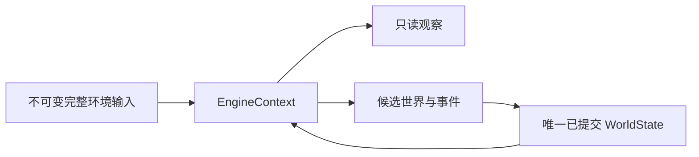

# WorldMock 产品设计说明书 — 状态与序列化

## 单一状态归属

完整环境由不可变输入对象承载，世界由唯一已提交 WorldState 承载。运行状态结构版本为 13，运行清单结构版本为 5。
不接受旧结构、兼容字段、迁移和 fallback；所有当前模型拒绝未知字段，原始 JSONL/TOML 输入规则归
[配置](08-configuration.md)与[资源引擎](03-resource-engine.md)。

## 世界、人物与活动

世界保存完整环境身份、persona_sha256、config_sha256、唯一种子与随机根、天气日期事实、
共同时钟、人物、两个资金账户、活动、订单、调度边界和已提交呈现留痕。
人物保存实际地点、身体、当前槽位活动、内容共享进度、个人事务、日计划、回调状态与每日幂等标记。
不保存消息、邮件、闹钟、聊天对象、燃油、自然语言目标自动进展和已删除的情绪参数。

活动种类为 sleep、travel、interact、purchase。活动保存原请求身份、当前状态、真实结算区间、
计划时长、暂停和终局，以及相应路径、内容或订单数据；详细生命周期归[模拟引擎](04-simulation-engine.md)。
活动的 `resource_claims` 保存它占的槽位，取值保持 `first`（槽位 1）与 `second`（槽位 2）：
出行、睡眠和地点 interact 占 `first`，购买和内容 app 的 interact 占 `second`，占用与此不符的活动由世界状态拒绝。
睡眠活动的私有数据记录 `declared_duration_seconds`（人物写的时长，600 到 43200 秒）和 `oversleep_seconds`。
购买订单的 pending 状态允许尚未付款，只有实际付款才有 paid_at；取消订单永不收货。
内容共享进度以人物与内容身份保存，报告不新增进度。

## 输入与模型身份

五项环境身份是 environment_id、environment_version、rules_version、catalog_content_sha256、map_sha256。
原始两份 TOML 分别保存摘要，生成地图按规范 JSON 加 LF 冻结。
发布目录可以含声明距离的 map.jsonl，但不含生成的地图；冻结的目录素材跟随目录清单的文件表。
模型身份保存实际服务、请求模型、实际元数据与来源、上下文声明、两种重试预算、校验预算、
阶段生成参数与回合上限。api_key_env 只是输入中的凭据变量名称；凭据正文绝不序列化。

## 事件与检查点

事件编码为确定性 UTF-8 JSON，资金只在信封 resource_changes 中记录。
回调、时间、天气和提醒使用当前闭合模型，旧事件种类立即拒绝。
检查点与导出字段及认证规则统一归[记录引擎](05-recording-engine.md)，不在状态层维护第二份事件合同。
