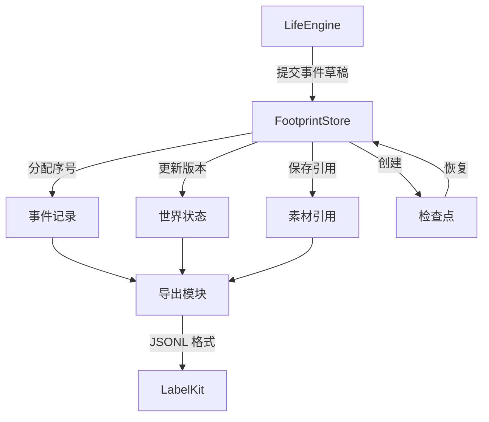

# WorldMock 产品设计说明书 — 输入输出格式

> **状态**：DRAFT；按人物 Prompt 规格修订，修订部分已实现（证据见[人物 Prompt 验收记录](../dev/persona-prompt-verification.md)）  
> **日期**：2026-09-28  
> **版本**：v1.14
> **目标读者**：算法工程师、开发工程师

## 1. 模块概述

### 1.1 职责与边界

本文保留世界与人物状态的格式说明、跨模块的数据格式入口和通用校验说明。
事件、素材、检查点、足迹导出、质量报告与日志的设计统一归[记录引擎](05-recording-engine.md)；
LabelKit 加工后的训练数据归[数据交付](06-delivery.md)。
字段定义以所属合同为准，领域模型负责验证业务规则。

品类树、属性增量、三态配对、闭集交换规则与原生对象格式统一见
[品类接口合同](../CONTRACTS.md#品类契约与目录字段)。`category-contract.json` 与 `exchange-rules.json`
是独立冻结文件；原始对象不得包含运行期编译得到的交换边。场景库存输出绑定及运行内容身份也使用该合同，
不在本文件复制另一套 Schema。

### 1.2 与其他模块的关系



### 1.3 核心设计原则

| 原则 | 含义 | 体现 |
| --- | --- | --- |
| **严格 Schema** | 所有字段必须符合预定义结构 | Pydantic 模型校验，extra="forbid" |
| **版本显式** | 每个格式带明确版本号 | schema_version 字段必填 |
| **序号严格递增** | 事件序号全局唯一且有序 | event_seq 由存储分配，gt=0 |
| **引用完整性** | 素材引用包含哈希与大小 | AssetRef 包含 sha256、size_bytes |
| **确定性编码** | 相同输入产生相同字节 | canonical_json 排序键、排序集合 |

## 记录引擎的数据格式

记录引擎的数据格式与行为在[记录引擎设计](05-recording-engine.md)中统一维护，本文只保留跨模块阅读入口。

| 要解析的数据 | 定义位置 |
| --- | --- |
| 事件、来源与可见性、资源证据 | [数字足迹事件结构](05-recording-engine.md#数字足迹事件结构) |
| 运行目录、素材引用和数据表 | [持久化结构](05-recording-engine.md#持久化结构) |
| 共同检查点与恢复分支 | [保存共同检查点](05-recording-engine.md#保存共同检查点)与[恢复与反事实分支](05-recording-engine.md#恢复与反事实分支) |
| 足迹 JSONL、导出清单与质量报告 | [固定截止导出](05-recording-engine.md#固定截止导出) |
| 状态文件、查询输出与日志 | [运行查询与诊断](05-recording-engine.md#运行查询与诊断) |

场景输入中的 `interaction_menus_by_location_kind` 与 `agents[].interaction_menu` 由
[配置设计](08-configuration.md#32-交互菜单声明)及[接口合同](../CONTRACTS.md#交互菜单声明与有效菜单)
定义。每个生活 `observation` 事件的 `data.interaction_menu` 保存排序后的 `allowed_actions`，
表示该人物在该冻结观察中可选的内部标准动作名；人物所选（对象，动词，方式）映射为内部动作后按它判定，
途中按出发地菜单解析，再由出行方式的准入收窄。它是事件级工具支持
证据，不新增 `WorldState` 或 `AgentState` 字段，也不在 user 消息中复制。菜单声明本身由
`scenario_sha256` 绑定，运行时有效值由观察事件留证。

## 世界与人物状态格式

### 3.1 WorldState（世界状态）

完整世界状态的 JSON 结构。

| 字段 | 类型 | 必填 | 说明 |
| --- | --- | --- | --- |
| `schema_version` | Literal[8] | 是 | 世界结构版本；版本不符的旧状态（含版本 7）直接拒绝 |
| `version` | int | 是 | 状态版本号，ge=0 |
| `current_time` | int | 是 | 当前模拟时间，UTC 纪元秒 |
| `end_time` | int | 是 | 实验结束时间 |
| `run_id` | str | 是 | 运行 ID |
| `timezone` | str | 是 | 时区标识 |
| `scenario_sha256` | str | 是 | 场景文件哈希，64 位 |
| `content_manifest_sha256` | str | 是 | 内容清单哈希，64 位 |
| `agents` | dict[int, AgentState] | 是 | 人物状态映射 |
| `accounts` | dict[str, int] | 是 | 账户余额映射，单位：分 |
| `supply_stock` | dict[str, int] | 是 | 供给身份到非负库存，不能按商品共用 |
| `supply_quotes` | dict[str, quote 或 null] | 是 | 供给身份到当前报价；未知为空，恢复不重载初值 |
| `opening_exceptions` | 地点到日期区间映射 | 是 | 世界营业覆盖；空日期区间明确闭店 |
| `activities` | dict[str, ActivityState] | 是 | 活动状态映射 |
| `sessions` | dict[str, SessionState] | 是 | 地点会话映射：一段地点停留或一段路（`kind` 取 `stay`、`transit`），由系统随出发与到达开始和结束；每人至多一个进行中会话 |
| `deliveries` | dict[str, DeliveryState] | 是 | 订单状态映射；`DeliveryState` 带唯一收货人 `recipient_id`（`agent:<id>` 或联系人身份，送达只入其持有；付款人仍是下单人物）与所回应的直接消息 `request_message_id`（`str \| None`），随世界结构版本 8 |
| `contact_holdings` | dict[str, dict[str, float]] | 是 | 场景联系人持有（联系人→商品→数量），缺省为空；送达联系人的订单与给联系人的物品记入这里；随世界结构版本 8 |
| `pending_events` | list[ScheduledEvent] | 是 | 预排事件列表 |
| `processed_actions` | dict[str, StoredAction] | 是 | 已处理动作映射 |
| `paid_task_ids` | set[str] | 是 | 已结算任务集合（JSON 编码为排序列表） |
| `presentation_state` | dict[int, dict[str, int]] | 是 | 呈现派生量（人物→对象→时刻） |
| `same_moment_presentation` | dict[int, {stamps: dict[str, int], pinned_supply_ids: list[str]}] | 是 | 按人物暂存的本秒呈现留痕（对象→时刻）；同一秒各轮沿用该秒首轮的呈现窗口，本秒首轮置顶的浏览结果（`pinned_supply_ids`）随暂存保存；时钟推进时由 `flush_presentation` 逐人并入 `presentation_state` 并清空；随世界结构版本 7 |
| `random_seed` | int | 是 | 随机种子 |
| `random_state` | str | 是 | 随机状态 |

`SessionState`（地点会话）字段如下，随世界结构版本 7：

| 字段 | 类型 | 必填 | 说明 |
| --- | --- | --- | --- |
| `session_id` | str | 是 | 会话身份 |
| `agent_id` | int | 是 | 人物 ID |
| `kind` | str | 是 | `stay`（地点停留）或 `transit`（两地之间的一段路） |
| `location_id` | str \| None | 停留时必填 | 停留地点；路上为空 |
| `origin_id`、`destination_id` | str \| None | 路上时必填 | 这段路的出发地与目的地；停留为空 |
| `status` | str | 是 | `active` 或 `ended`；`ended` 必须带 `ended_at` |
| `started_at` | int | 是 | 开始时刻 |
| `ended_at` | int \| None | 否 | 结束时刻，不早于开始时刻 |
| `activity_ids` | list[str] | 是 | 归入本会话的活动：这段停留或路上开始的活动，以及回到该地点时归入的暂停活动 |
| `name` | str | 是 | 可读名称，结束后不改：停留「<地点>（<M月D日> HH:MM 起）」，路上「去<目的地>的路上（<M月D日> HH:MM 起）」（格式见[时间与能量规格](../dev/SPEC-time-and-energy.md)第七章「会话与活动的字段」） |
| `opened_by_action_id` | str \| None | 否 | 引起本会话开始的动作（出发、途中结束出行）；运行开始与到达开始的会话为空。进度层的下界据此取该动作结果所在提交的末事件序号，为空时取会话开始时刻首个事件所在提交的末事件序号（运行开始为 0）；随世界结构版本 8 |

运行开始时每人按初始地点开始首个停留会话；出发时结束停留、开始路上；到达（含到达被拒）或途中结束出行时结束路上、在人物所在地点开始停留；实验截止时所有会话结束。会话的开始与结束只写入世界状态，不写事件。

世界状态采用确定性 JSON 编码，完整字段由生产模型校验；这里不再提供缺字段或摘要截断的伪完整示例。
人物持有物仍是地点到商品数量的嵌套映射，购买呈现身份则是供给。
冻结地图引用、时态声明和请求结构统一见 [地图与门店供给合同](../CONTRACTS.md#地图与门店供给合同)，
事件、清单和恢复材料见 [地图与门店供给证据](05-recording-engine.md#地图与门店供给证据)。

`SupplyQuoteState` 保存 `price_fen`、`price_version`、UTC 秒制的半开 `effective_from/effective_to` 与 `source`。
来源按 `DataSource` 全字段校验，不能用空字典代替真实资料或场景假设声明。
`opening_exceptions` 的日期键保存不重叠的分钟区间并保留声明顺序，空列表是明确闭店；恢复不能丢弃这些世界覆盖。
公开观察的 `data.products` 保存商品使用定义，`data.supplies` 保存已知供给；实际呈现的供给在模型请求中是工具层的商品目标，
名称为「<门店>出售的<商品>」：目标的 `state` 写每份热量等可读状态，各动作的 `price`、`duration`、`quantity`、`note` 写人读的价格、
时长、数量与配送送达时刻，不给原始配送秒数或以分为单位的整数；第一个动作的 `note` 另写供给声明的来源标记
（类型、来源引用与事实截止日），每个目标一次。
`data.supplies` 的供给行保存原始 `price_fen/price_version/quote`、`purchase_pairing_state`、`purchase_coefficient` 和一份的 `purchase_price_fen`；
非定义配对保留原始报价，系数及实际金额为空且不允许购买；报价未知时价格字段也保留 `null`。订单行 `total_price_fen` 按原价、数量、系数的整行乘积取整，整单同名字段保存各行合计，
不能由已取整的一份金额乘数量。商品的使用定义继承 `InventoryItemConfig`，保留 `category_id/inventory_unit`，
已持有但未上架的物品仍可按使用合同消费或转换，不要求补造供给。
展示不是资格上限：工具层的目标只是本轮展示的对象，全部目录类对象都可以按名称调用（本轮未展示的生活活动、内容与游戏取观察
私有的 `catalog_bindings`，`obtain` 可以按名称购买本轮未展示但存在的商品，按当前报价结算）；名称找不到时返回至多 3 个候选且不替换，
候选此刻可行的在前，形状为可以照填的请求 `{target, action, way, from, to}`（可另带 `note`，如「约 20 分钟」），受理时的名称归一
写进 `details.resolved`（`[{written, as}]`），冗余的 `from`、`to` 的说明写进 `details.notes`。
同次发现或浏览结果优先占用共同呈现窗口；浏览得到的供给只作为工具层商品目标出现一次，浏览调用的结果（进度层
`details.browse_items`）只列名称，写完整标签「<门店>出售的<商品>」、不标可得性（一日运行保真规格 5.3），
不用 `based_on_action_id/changes` 引用结果；完成的浏览另在记忆层 `settled` 的活动句末写浏览到的完整标签。
这种公开格式不裁剪原始观察、动作和结算中的完整证据；窗口外身份也不会因此获得可见凭据，可见凭据只管展示与比较。

### 3.2 AgentState（人物状态）

| 字段 | 类型 | 必填 | 说明 |
| --- | --- | --- | --- |
| `agent_id` | int | 是 | 人物 ID，gt=0 |
| `name` | str | 是 | 姓名 |
| `location_id` | str | 是 | 当前位置 ID；出行中仍为出发地（路线身份与菜单解析用），现场资格按进行中的出行判定为途中 |
| `balance_account_id` | str | 是 | 账户 ID |
| `skill_levels` | dict[str, float] | 是 | 技能等级 |
| `taste_weights` | dict[str, float] | 是 | 口味权重 |
| `body` | BodyState | 是 | 身体状态 |
| `inventory` | dict[str, dict[str, float]] | 是 | 库存；开始进食时每件取 min(1, 手边持有) 移入该活动数据的 `opened`，此后不再从库存扣减；给予从本人手边移出、记入对方持有 |
| `active_effects` | set[str] | 是 | 活跃效果（JSON 编码为排序列表） |
| `body_settled_at` | int | 是 | 本人身体已结算到的共同世界时刻 |
| `delivered_warning_signatures` | set[str] | 是 | 当前持续威胁中已实际交付的签名 |
| `next_decision_at` | int | 是 | 下次决策时间；等于当前时刻即同一秒再决策 |
| `consecutive_rejections` | int | 是 | 连续业务拒绝次数，受理即归零；只作动机层挫败感的输入，不参与唤醒与冷却 |
| `same_moment_rounds` | int | 是 | 本秒已进行的决策轮数，ge=0；受理、业务拒绝与重放各加一，名称类拒绝每人每秒前两次不加（第 3 次起照加，一日运行保真规格 3.4），时钟推进归零 |
| `same_moment_stage` | str | 是 | 受限轮阶段：`open`、`conclude_pending`、`start_or_resume`、`resume_or_conclude`、`conclude_only`（世界结构版本 8 删去 `wait_only`；开始或恢复被拒后留在原阶段，现行阶梯不再进入 `conclude_only`，它只留在闭集中）；时钟推进复位为 `open` |
| `pending_wake_reasons` | list[str] | 是 | 本轮唤醒原因，成员属唤醒闭集；同刻轮次替换为本轮原因：没有进行中活动记 `no_active_activity`，业务拒绝之后记 `rejection_feedback`，二者同时成立按枚举顺序记两项；交谈对方同秒结束且本人仍有其他进行中活动时记 `planned_end`；人物消息送达而获得同刻机会时记 `message_arrival`；上一轮原因不带入 |
| `content_progress` | dict[str, ContentProgress] | 是 | 内容进度 |
| `read_message_ids` | set[str] | 是 | 已读邮件 ID 集合：只由阅读动作在读完时写入，睡眠中不写 |
| `visible_message_ids` | set[str] | 是 | 可见消息 ID 集合 |
| `visible_task_ids` | set[str] | 是 | 可见任务 ID 集合 |
| `qualifications` | tuple[str, ...] | 是 | 显式资格集合 |
| `visible_supply_ids` | set[str] | 是 | 实际呈现所授予的供给身份；使用时再按逐供给时刻与地点判定有效性 |
| `supply_browsed_at` | 供给到时刻映射 | 是 | 各供给实际呈现时刻 |
| `supply_browsed_location` | 供给到地点映射 | 是 | 各供给实际呈现地点 |
| `inbox` | dict[str, Message] | 是 | 收件箱；直接消息与交谈邀请以全文进入进度层（不截断，交谈邀请另接回应方式「，对<发起人>选择交谈即接受」），全文已呈现（在进度层或记忆层）即在决策轮提交时记为已读；受限轮与轮前有待收尾活动的轮次、重放的动作不记已读；邮件正文须阅读后才可知 |
| `read_inbox_ids` | set[str] | 是 | 收件箱已读消息 ID 集合：决策轮提交时写入本轮观察全文呈现过的，结算边界在唤醒判定之后写入其余未读的，每条使社交需要 −0.05、情绪 +0.1；人物在睡时（轮前在睡的决策轮、判定时仍在睡的边界）都不写，睡眠中送达的消息在醒来后的第一个边界才写入 |
| `outbox` | dict[str, Message] | 是 | 发给场景联系人的消息，按消息身份存放，缺省为空；联系人回复请求据此与收件箱组装双方往来；随世界结构版本 8 |
| `day_plan` | DayPlan \| None | 否 | 当日目标 `{day_end, goals}`，由零点计划生成，人物可修订；空清单仍为已提交，条目含环境推进证据与提醒 `remind_at`、`reminded_at`（`int \| None`：提醒的当日绝对时刻与触发时刻，只触发一次），人物写下的 `progress_note` 照存但不呈现，旧段形状拒绝；详见 [目标请求](../CONTRACTS.md#当日目标请求) |
| `plan_submitted_dates` | set[str] | 是 | 已生成当日计划的场景本地日期（ISO 日期，JSON 编码为排序列表）；零点计划 `plan_day` 的幂等键，既有字段；恢复、重放与反事实分支据此不重复生成 |

可见身份集合与两份逐供给记录的键完全一致；呈现时间不得晚于世界当前时刻，呈现地点必须是场景中的合法地点。
活动身份只存在于 `WorldState.activities`，人物不另存当前活动槽或活动身份列表。每人两个名额：进行中、暂停中与待收尾（`completed`、`failed` 或 `cancelled` 而 `concluded_at` 为空；`truncated` 不收尾）的活动各占一个，`conclude_activity` 之后释放；名额由活动集合派生，不另存。
观察 `active_activities` 是按开始时间和身份排序的完整 ACTIVE 控制行集合，`pending_conclusions` 是待收尾活动的控制行；
每项独立控制。`occupied_resources` 是这些活动显式资源声明的排序并集，仅为观察派生量；占用名按[时间与能量规格](../dev/SPEC-time-and-energy.md)
第五章「并行准入」重列为 `idle`、`travel`、`eyes`、`ears`、`hands`、`voice`、`work`。
私有证据窗口 `verified_experiences` 由截止前已提交事件确定，只用于记忆来源核对，不进人物提示；记录格式与共同身体结算引用由
[记录引擎](05-recording-engine.md)定义，人物自述不得写入该窗口。记忆层的 `settled` 另有来源：由已提交结果与世界事件生成的确定性句子。
超过 1800 秒或人物位置改变则该凭据不可用；呈现另一供给不续期。直接下钻与有时长浏览均以实际返回窗口更新，
后者使用完成时的世界时刻。恢复和分支保留这些字段以及 `presentation_state`，不能重建为全目录可见。

### 3.3 BodyState（身体状态）

`BodyState` 汇集身体资源、人物身体常量和体感计算所需状态，并非与“资源”并列的新概念。
下表是 [当前状态模型](../../src/worldmock/life/models.py) 的阅读摘要；
变化规则由 [身体语义规格](../dev/SPEC-life-runtime.md#身体语义两过程睡眠睡眠不足账体感分级)
承载，不在格式文档中重定义。

| 字段 | 类型 | 范围 | 说明 |
| --- | --- | --- | --- |
| `energy_kcal` | float | ≥0，且结算后不超过目录上界 | 可用能量，kcal；进食补充，基础代谢与活动消耗 |
| `sleep_pressure` | float | [0, 1.2] | 睡眠压力，与昼夜阈值共同决定困意 |
| `sleep_deficit_hours` | float | [0, 24] | 睡眠不足账，小时；决定工作和食品利用效率 |
| `sleep_need_hours` | float | [7.0, 9.0] | 睡眠需要，小时 |
| `chronotype_midsleep` | float | [0, 24) | 时型（睡眠中点），小时 |
| `social_need` | float | [0, 1] | 社交需要：清醒每小时 +0.04，是否清醒按本区间共同身体结算 `body_settlement.activity_ids` 所用的活动集合判定（集合含睡眠即整段不增长，在边界结束的睡眠也一样）；交谈、通话、共同用餐与读消息减少 |
| `mood_valence` | float | [-1, 1] | 情绪效价 |
| `neuroticism_norm` | float | [-1, 1] | 神经质归一化 |
| `entertainment_need` | float | [0, 1] | 娱乐需要 |

饥饿和困意是派生体感，不另存可自由修改的数值条。观察中的 `body` 也不是把
`BodyState` 原样交给数字人：数值在 `values` 中留作事件证据，提示只获得 `levels` 的分级文本。
人物睡眠常量留在状态与档案中，不进入观察投影。完整投影合同见
[观察投影字段](../CONTRACTS.md#观察投影字段)。

### 3.4 ActivityState（活动状态）

| 字段 | 类型 | 必填 | 说明 |
| --- | --- | --- | --- |
| `activity_id` | str | 是 | 活动 ID |
| `agent_id` | int | 是 | 人物 ID |
| `location_id` | str | 是 | 开始地点（出行为出发地）；结算不覆盖，到达地点见 `data.arrival.location_id` |
| `kind` | ActivityKind | 是 | 活动类型 |
| `status` | ActivityStatus | 是 | 活动状态 |
| `started_at` | int | 是 | 开始时间 |
| `ended_at` | int \| None | 否 | 结束时间（终态必填） |
| `planned_end_at` | int | 是 | 计划结束时间 |
| `last_settled_at` | int | 是 | 上次结算时间 |
| `elapsed_seconds` | int | 是 | 已用时长 |
| `planned_duration_seconds` | int | 是 | 计划时长 |
| `effective_work_seconds` | float | 是 | 有效工作秒数 |
| `media_position_seconds` | float | 是 | 媒体位置 |
| `route_progress_meters` | float | 是 | 路线进度，米 |
| `target_id` | str \| None | 否 | 目标 ID |
| `destination_id` | str \| None | 否 | 目的地 ID |
| `travel_mode` | TravelMode \| None | 否 | 出行方式 |
| `playback_speed` | float | 是 | 播放速度，[0.5, 2] |
| `resource_claims` | set[str] | 是 | 资源占用，取第五章占用名（`idle`、`travel`、`eyes`、`ears`、`hands`、`voice`、`work`）；观看另按 `data.content_kind`（播客只占 `ears`），恢复时按注册表核对 |
| `origin_action_id` | str | 是 | 源动作 ID |
| `origin_decision_id` | str | 是 | 源决策 ID |
| `origin_request_event_id` | str | 是 | 源请求事件 ID |
| `boundary_type` | str \| None | 否 | 边界类型：`planned_end`、`feedback`、`game_feedback`、`paused`、`cancelled`、`experiment_end`、`counterfactual_replay`、`route_ended`、`partner_ended`、`plan_reminder`（当日目标提醒结束睡眠；与计划结束同秒时记 `planned_end`） |
| `interruption_reason` | str \| None | 否 | 中断原因：`agent_cancelled`、`experiment_end`、`LOCATION_ACCESS_DENIED`、`route_ended`、`partner_ended`（交谈对方结束，本人交谈同秒结束）、`plan_reminder` |
| `next_interaction_at` | int \| None | 否 | 下一次交互边界（游戏回合与社交活动使用） |
| `data` | dict | 是 | 活动数据；进食（使用方式为食用）另带开吃份量 `opened`（dict[str, float]，商品→开吃份数），摄入只按它与实际进度计算，暂停保留剩余，结束时写 `discarded`（开吃份量减已吃，商品→丢弃份数）且不补算摄入；随世界结构版本 8 |
| `concluded_at` | int \| None | 否 | 收尾时刻：只属于 `completed`、`failed`、`cancelled`，不早于 `ended_at`；终态而为空即待收尾，`truncated` 不收尾 |
| `report_anchor_at` | int \| None | 否 | 播报锚点：开始、恢复以及对该活动播报时写入当前时刻 |
| `paused_at` | int \| None | 否 | 暂停时刻：暂停时写入，恢复时清空；待办层的暂停活动按它从老到新排列；随世界结构版本 8 |
| `session_ids` | list[str] | 是 | 先后所属的地点会话 |
| `name` | str | 是 | 可读名称「<做什么><对象>（<M月D日> HH:MM 起）」，结束后不改 |
| `task_kind`、`task_ref`、`plan_goal_intent_kind` | str、str \| None、str \| None | 是 | 从原会话移来：活动服务的任务（`goal`、`work_task` 或 `none`）及引用，`goal` 时意图等于引用 |
| `progress_note`、`note_updated_at`、`note_history` | str、int \| None、list | 是 | 从原会话移来的人物自述：`report_status`、`pause_activity`、`conclude_activity` 的 `summary` 写入 `progress_note`（至多 500 字符），前一条推入 `note_history`；提示中的 summary 在本 session 内是进度层对应调用的参数，session 结束后是记忆层的 `self_notes`（只取 pause、conclude） |

`elapsed_seconds`、`effective_work_seconds`、`media_position_seconds` 等进度随每次结算累加；工具层活动目标的 `state` 写的客观进度从这些字段与任务累计读取。

## LabelKit 交付格式

训练记录、字段字典、来源连通组与规则夹具由[数据交付](06-delivery.md)定义处理流程，
字段和磁盘产物见[LabelKit 训练记录与交付格式](../CONTRACTS.md#labelkit-训练记录与交付格式)。
原始足迹导出和 LabelKit 训练样本分别按所属合同解析，不能把训练字段附会为持久事件字段。

## 通用校验说明

### 9.1 字段类型校验

**Pydantic 模型校验规则**：

| 规则 | 说明 |
| --- | --- |
| `extra="forbid"` | 拒绝未知字段 |
| `allow_inf_nan=False` | 拒绝无穷和 NaN |
| `frozen=True` | 不可变模型 |
| `gt=0` | 大于 0 |
| `ge=0` | 大于等于 0 |
| `pattern=r"^[a-f0-9]{64}$"` | SHA-256 格式 |
| `min_length=1` | 非空字符串 |

### 9.2 业务规则校验

| 规则 | 校验点 | 失败行为 |
| --- | --- | --- |
| 事件序号严格递增 | event_seq | 立即失败 |
| 状态版本连续 | state_version | 立即失败 |
| 活动终态必有结束时间 | ended_at | 立即失败 |
| 资源流水金额为正 | resource_flows.amount | 立即失败 |
| 引用完整性 | artifact_refs | 立即失败 |
| 时间范围合法 | current_time ≤ end_time | 立即失败 |
| 账户余额非负 | accounts | 立即失败 |

### 9.3 确定性编码规则

**canonical_json 函数规范**：

```python
def canonical_json(value: Any) -> bytes:
    """使用唯一 JSON 编码，使哈希与重放身份稳定"""
    return json.dumps(
        value,
        ensure_ascii=False,
        sort_keys=True,
        separators=(",", ":"),
        allow_nan=False
    ).encode()
```

**确定性要求**：
1. 字典键按字母序排序
2. 集合序列化为排序列表
3. 不使用浮点 NaN 或无穷
4. 相同输入产生相同字节

**序列化器示例**：

```python
@field_serializer("active_effects", when_used="json")
def serialize_agent_sets(self, value: set[str]) -> list[str]:
    """按稳定顺序编码人物集合"""
    return sorted(value)
```

## 版本历史

| 版本 | 日期 | 修订内容 |
| --- | --- | --- |
| v1.0 | 2026-09-20 | 初版：事件 Schema、状态快照、导出格式、报告结构、检查点格式、素材引用、日志格式、Schema 验证规则 |
| v1.1 | 2026-09-20 | 对齐身体结算事件、资金事实、资源流水与体感可见性 |
| v1.2 | 2026-09-20 | 事件、检查点、素材、足迹导出、质量报告与日志格式归入记录引擎；保留领域状态与交付格式入口 |
| v1.3 | 2026-09-20 | 增加场景交互菜单与观察事件有效菜单的格式导航，明确它们不新增世界或人物状态字段 |
| v1.4 | 2026-09-24 | 按时间与能量规格：观察留证的 `allowed_actions` 为内部标准动作名，人物所选动词与方式映射后判定，途中按出发地菜单解析并由出行方式收窄 |
| v1.5 | 2026-09-25 | 按时间与能量规格第九章：世界结构版本 7；ActivityState 补 `location_id`（开始地点，结算不覆盖） |
| v1.6 | 2026-09-25 | 按时间与能量规格阶段 1：AgentState 的 `next_decision_at` 注明等于当前时刻即同一秒再决策，`consecutive_rejections` 只作挫败感输入；增 `same_moment_rounds`、`same_moment_stage` 与 `pending_wake_reasons`（同刻轮次按本轮替换；交谈对方同秒结束且本人仍有其他进行中活动时记 `planned_end`）；WorldState 增按人物暂存的本秒呈现留痕 `same_moment_presentation`（同一秒沿用首轮窗口，时钟推进时并入 `presentation_state`） |
| v1.7 | 2026-09-25 | 按时间与能量规格阶段 2（第二章与第八章「呈现」）：`facts.products` 按可读名称公开，食品带每份热量 `energy`，配送写人读送达时刻 `delivery_eta` |
| v1.8 | 2026-09-25 | 按时间与能量规格阶段 3：WorldState 增 `sessions` 与 `SessionState` 字段表（地点停留或一段路，系统随出发与到达开始和结束）；AgentState 注明每人两个名额（进行中、暂停与待收尾各占一个）与待收尾控制行；ActivityState 补 `next_interaction_at`、`concluded_at`、`report_anchor_at`、`session_ids`、`name` 与从会话移来的任务关联和自述字段，`boundary_type`、`interruption_reason` 列出取值（加 `route_ended`），注明进度随结算累加 |
| v1.9 | 2026-09-25 | 按时间与能量规格阶段 4：AgentState 的 `location_id` 注明出行中仍为出发地、现场资格按途中判定；`occupied_resources` 与 ActivityState 的 `resource_claims` 取第五章重列的占用名（观看按内容品类）；`boundary_type`、`interruption_reason` 加 `partner_ended` |
| v1.10 | 2026-09-25 | 按时间与能量规格阶段 5：AgentState 的 `day_plan` 注明由零点计划生成，目标带提醒 `remind_at`、`reminded_at`，增 `plan_submitted_dates` 行（零点计划的幂等键，既有字段）；ActivityState 的 `boundary_type`、`interruption_reason` 加 `plan_reminder`；供给行改为提示不用增量引用，有变化时写完整行 |
| v1.11 | 2026-09-26 | 时间与能量规格阶段 7 文档一致性核对：AgentState 名额说明中的待收尾限定为 `completed`、`failed`、`cancelled` 且未收尾，`truncated` 不收尾、不占名额 |
| v1.12 | 2026-09-27 | 按人物 Prompt 七层规格（人物 Prompt 台账 E9-1–E9-7，E9-3 为阶段 1、4，E9-4 为阶段 4 同批作业）：文件头注明修订部分待实现；`facts.products` 改为工具层的商品目标，展示不是购买资格上限，浏览结果只列名称；世界结构版本 8：SessionState 增 `opened_by_action_id`，`DeliveryState` 带收货人 `recipient_id` 与请求关联 `request_message_id`，WorldState 增 `contact_holdings`，AgentState 增 `outbox`，ActivityState 增 `paused_at`，进食活动数据带开吃份量 `opened`，受限轮阶段删 `wait_only`；直接消息全文进入进度层，全文已呈现即记为已读；目标的 `progress_note` 照存不呈现；`verified_experiences` 只作私有证据、不进提示，`settled` 另有来源；summary 在本 session 内是进度层调用参数、之后是记忆层 `self_notes`；客观进度改为工具层活动目标的 `state` |
| v1.13 | 2026-09-28 | 人物 Prompt 七层规格实现后文档：按最终代码核对，`same_moment_stage` 注明 `conclude_only` 只留在闭集中，`inbox` 写明已读的范围（进度层或记忆层全文呈现、受限轮与待收尾轮次和重放不记已读）与交谈邀请的回应方式，活动 `data` 写明 `opened` 只在食用时出现、结束写 `discarded`；文件头注明修订部分已实现 |
| v1.14 | 2026-09-28 | 人物 Prompt 七层规格最后一批代码与规格出入的修复（见[人物 Prompt 验收记录](../dev/persona-prompt-verification.md#代码与规格的出入)）：门店商品目标第一个动作的 `note` 另写供给声明的来源标记（类型、来源引用与事实截止日），每个目标一次 |
