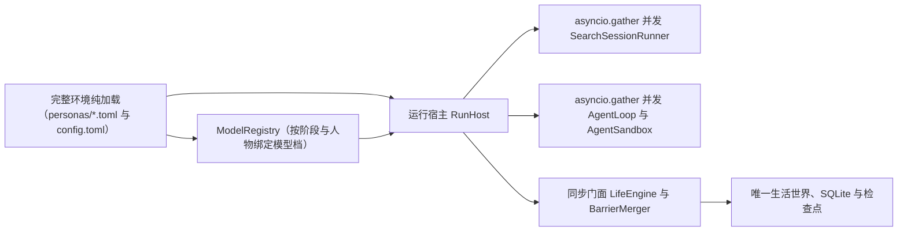
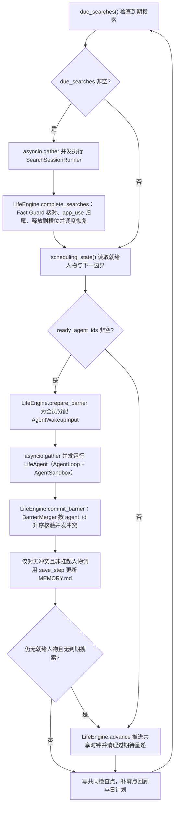

# WorldMock 产品设计说明书 — 运行装配与决策循环

## 运行装配

WorldMock 自有的并发屏障与搜索子会话架构驱动整次运行：runner 负责环境纯加载、身份冻结与分支恢复；运行宿主 `RunHost` 驱动全局离散时钟屏障并调度多数字人并发唤醒与搜索子会话；每个就绪人物通过 `LifeAgent`、`AgentLoop` 与个人沙盒 `AgentSandbox` 请求模型并累积草稿；`SearchSessionRunner` 并发运行隔离的 `LLM Search Session`；主线程上同步门面 `LifeEngine` 及其 `BarrierMerger` 担任唯一世界状态与事件存储写入者。
完整环境纯加载先核对 `personas/*.toml`、`config.toml`、目录与每个引用模型档的实际服务元数据（新运行读实际服务，恢复与重放读父运行清单 `model_identity.profiles` 冻结的那一份）；运行资产只能在这些核验通过后创建。
模型通道通过 `ModelRegistry`（[configuration/model/model_registry.py](../../src/worldmock/configuration/model)）按阶段与人物编号绑定 `[models.*]` 与 `[model_routing]` 声明的服务与模型档，凭据按各模型档的 `api_key_env` 从进程环境变量读取，不能换到其他未冻结的模型或端点。
运行装配不写进程环境变量，也不改导入路径。命令可以在任何目录启动，只需要引用到的模型档对应的凭据环境变量；恢复先打开父运行、取到检查点并校验检查点世界，然后才加载环境、读取凭据和复制任何文件，凭据缺失时不建分支目录；父运行的数据库、清单或检查点不对时不访问网络、不建分支目录。
运行宿主建立或打开引擎时，用 runner 已加载的那份完整环境，不再读第二遍。

每个生效模型档的 `metadata_url` 必须与实际 `base_url` 属于同一服务，模型唯一匹配且容量满足声明。
多模型档配置、路由表、重试预算、实际元数据、思考开关、回合上限与代码身份共同冻结于清单 v8 的 `model_identity`；恢复逐项核对，不用静态容量估计。
主唤醒、搜索子会话、零点日计划与零点回顾统一经 `ModelRegistry.resolve(stage, agent_id)` 复用按网关与重试策略共享的 `ModelClient` 连接池，输出纠错是独立逻辑请求。
模型客户端、模型注册表、停放与单次发送整次期限的规则，以及两种服务失败预算的详细合同，归[配置](08-configuration.md)。

## 时钟屏障与并发唤醒循环

### 一个进程，一个事件循环，同步核心写面

一次 `worldmock run`、`resume` 或 `replay` 只有一个进程、一个事件循环：命令行的 `asyncio.run` 驱动整次运行，`ModelRegistry` 管理的网络请求、并发 `AgentLoop`、并发 `SearchSessionRunner` 与零点任务协程都在这个事件循环里执行；同步 `LifeEngine` 门面只在主线程屏障汇聚点顺序调用。
运行不另起子进程、进程池、线程池或嵌套的事件循环；进程里唯一的后台线程是驱动心跳。
运行宿主是 [run_host.py](../../src/worldmock/runtime/lifecycle/run_host.py) 的 `RunHost`，三种启动、步进、整次运行与关闭都是它的协程。

唯一写入者与严格模块边界由程序结构共同保证：
- `LifeEngine`（[engine.py](../../src/worldmock/simulation_engine/engine.py)）全部公共方法均为**同步 `def`**（绝不使用 `async def`），内部绝不直接原地修改已提交 `self.context.state`，而是经由不可变复制或 `BarrierMerger` 事务替换。
- 包导入拓扑单向闭环：`worldmock.simulation_engine` 绝不导入 `agents` 或 `runtime`；`worldmock.agents` 绝不导入 `runtime` 或 `simulation_engine`；全仓库仅 `runtime.lifecycle.run_host` 导入 `simulation_engine.engine`。
- 并发执行期间，每个人物拥有独立的深拷贝沙盒 `WorldState` 与私密证据草稿缓冲（`AgentSandbox`，实现 `agents/protocol/engine_handle.py` 定义的 `SandboxHandle` 协议），搜索子会话仅持只读 `SearchCatalogView`；所有网络模型调用通过 `asyncio.gather` 并发完成，待全部退出后回到主线程依次完成 `complete_searches` 或 `commit_barrier` 确定性提交，零数据库并发写锁。

运行宿主与模拟引擎按固定步序循环推进：

### 三种启动顺序

| 启动 | 依次 |
| --- | --- |
| 新建（`run`） | 为全员人物依次建出工作区目录（`agents/agent_NNNN/`，此时为空，已存在即失败，见[状态与序列化](09-io-formats.md)「人物工作区」）；建引擎；核对配置的起始时刻与引擎时钟相同，不同时先关闭引擎，再以 `ProtocolError("Run host start time disagrees with the engine")` 停止，不登记运行故障；写初始检查点；补全员回顾、零点计划 |
| 普通恢复（`resume`） | 打开引擎；在首次唤醒之前补全员回顾、零点计划；不写检查点 |
| 反事实（`replay`） | 打开引擎；施加干预（`apply_counterfactual` 清除全部人物 `suspended_loop = None`）；核对收据的干预摘要与干预文件的摘要相同、模拟时间不变、世界版本恰好加一，不成立时分别以 `RuntimeError("Environment confirmed a different counterfactual identity")`、`RuntimeError("Counterfactual intervention changed simulation time")`、`RuntimeError("Counterfactual intervention did not advance one world version")` 停止；写干预检查点；补全员回顾、零点计划 |

### 步序、搜索完结与同刻再唤醒

运行宿主的一步依次执行：

| 序 | 动作 |
| --- | --- |
| 1 | 调用 `LifeEngine.scheduling_state()` 读取当前时钟、就绪人物 `ready_agent_ids` 与到期 BOUNDARY 信息 |
| 2 | 调用 `LifeEngine.due_searches()` 检查是否存在 `ended_at <= current_time` 且 `status == ACTIVE` 的搜索活动；若非空，并发执行 `SearchSessionRunner`（通过 `ModelRegistry.resolve("search", agent_id)` 绑定搜索模型档），随后主线程调用 `LifeEngine.complete_searches(outcomes)` 完成 `Fact Guard` 二次核对与 `app_use` 归属结算、写入搜索结束与恢复载荷、释放副槽位并重新查询调度状态 |
| 3 | 若 `ready_agent_ids` 非空：调度状态里有未知人物编号时，先以 `RuntimeError("Environment returned unknown ready agents: [<人物编号>, …]")` 停止；否则主线程调用 `LifeEngine.prepare_barrier(ready_agent_ids)` 校验恰好包含当前全部就绪人物并生成只读 `AgentWakeupInput`（按是否持有 `suspended_loop` 与 `search_result_payload` 区分 `"regular"` 与 `"resume_search"`） |
| 4 | 通过 `asyncio.gather` 按每个 `AgentWakeupInput` 并发实例化 `LifeAgent`（`AgentLoop` + `AgentSandbox` + `ModelRegistry.resolve("action", agent_id)`）并执行单次唤醒多回合循环，收集全部 `SandboxOutcome` |
| 5 | 主线程调用 `LifeEngine.commit_barrier(outcomes)`：委托 `BarrierMerger` 按 `agent_id` 升序核验跨人物共享资源冲突（例如争抢互斥营业名额等），对 `committed_agent_ids` 单事务原子落盘并随后执行 `save_step` 更新 `MEMORY.md` 与 `memory_updated`；对 `search_world` 挂起分支仅原子落盘挂起状态 `SuspendedLoopState`（不做 `save_step`）；对冲突人物整分支回滚重置 `next_decision_at = current_time`（不落盘草稿也不写 `MEMORY.md`），留待下一步同刻屏障重算 |
| 6 | 若既无到期搜索亦无就绪人物且存在下一事件边界，调用 `LifeEngine.advance(tick, target)` 推进共享时钟并清理过期待呈递候选 |
| 7 | 步数加一；写一个共同检查点（封存全员工作区与最新 `WorldState`），随后在主时钟推进后补做零点日/月/年回顾与零点日计划 |

搜索完成在同刻即刻恢复唤醒并沿用挂起 `wakeup_id`，共享资源冲突回滚后不推进模拟时钟、在下一步屏障重算并随推进后的世界版本产生新 `wakeup_id`。

### 共同检查点

每一步恰好写一个共同检查点，只推进不决策的步也写；新建运行另有初始检查点，反事实分支另有干预检查点，普通恢复启动时不写。
写检查点时取全员每个人物工作区 `agents/agent_NNNN/` 的快照，连同引擎状态（含 `AgentState.suspended_loop`）交给引擎提交；人物集合由引擎核对。快照与检查点的格式归[记录引擎](05-recording-engine.md)「冻结输入、检查点与分支」。

### 推进与结束

推进的目标只取引擎给出的下一个事件边界，推进量是它与当前时刻之差；边界与推进量由引擎核对。
运行宿主只有一个时钟：它不保存当前时刻，每次从引擎读；`result.json` 的 `current_time` 与运维日志 `RUN_ENDED` 的模拟时刻取引擎时钟，`RUN_CRASHED` 在引擎打开时也取它、引擎没有打开时取准备阶段定下的起始时刻（新建是配置的开始时刻，恢复与重放是检查点的时刻）；`step_count` 是这个进程里运行宿主完成的步数，启动不计。
引擎时钟到达结束时刻时运行结束；结束时刻本来就在引擎的边界候选里，运行宿主不另核边界是否越过它。

### 身份

唤醒身份、动作身份与模型调用身份按以下确定性格式生成，彻底移除旧 `round_id`、`round_order` 与 `decision_id`：

| 身份 | 格式与作用范围 |
| --- | --- |
| `wakeup_id` | `f"{run_id}:wake:{current_time}:v{state.version}:a{agent_id}"`：`prepare_barrier` 在屏障起点为每位就绪人物分配的唯一确定性身份；因 `search_world` 挂起后再恢复沿用同一 `wakeup_id`；因冲突回滚并在下一次同刻屏障重试时因已提交兄弟人物推高了 `state.version` 而获得新 `wakeup_id` |
| `action_id` | 人物唤醒沙盒内为每次世界动作请求分配的确定性动作身份，关联 `StoredAction`、`ActivityState.origin_wakeup_id` 以及随机键 `search-duration:{action_id}` / `search-app:{action_id}` 等 |
| 主唤醒 `call_id` | `f"{wakeup_id}:model:{t:04d}:attempt:1"`（`t` 从 1 起连续递增，含截断重试与协议纠错回合） |
| 搜索子会话证据归属 | 子会话内部模型交互不占用主唤醒 `wakeup_id` 轮次计费归类：事件信封设置 `EventDraft.activity_id = search_activity_id` 与 `data.purpose = "search_session"` |

动作请求、观察、结果与记忆更新等全部决策事件均记录 `wakeup_id`。具体构造见[人物](06-agent.md)「提示与工具」与[人物](06-agent.md#agent-回合协议)「回合协议」。

### 零点任务的触发点

| 时机 | 依次 |
| --- | --- |
| 每个共同检查点提交之后：新建运行的初始检查点、反事实分支的干预检查点与每一步的检查点 | 按 `agent_id` 升序分别为全员执行日、月、年回顾（`ModelRegistry.resolve("digest", agent_id)`），再做零点计划（`ModelRegistry.resolve("plan_day", agent_id)`） |
| 零点边界的推进提交之后 | 依次日、月、年回顾、零点计划，再判定这一秒的唤醒 |
| 普通恢复启动时、首次唤醒之前 | 日、月、年回顾，零点计划；不写检查点 |
| 并发唤醒或搜索子会话执行中 | 从不 |

没有待办（运行已到终点、没有待生成的期次、没有缺当日计划的人物）时，零点任务不调用模型客户端，不写请求证据与调用运维日志。
新登记的回顾与计划由下一个共同检查点封存。回顾与计划的内容归[人物](06-agent.md)「日、月、年回顾」与「零点计划」。

### 中止与停止

并发人物循环或搜索子会话抛出的异常（含 `ProtocolError` 或网络服务错误）原样到达 `RunHost`，不包装、不改类型；由于沙盒分支与草稿尚未由 `commit_barrier` 或 `complete_searches` 落盘，不会污染已提交的 `WorldState`。
在中止运行之前，若异常发生在 `AgentLoop` 内部且沙盒 `EvidenceBuffer` 已收集部分 `model_request`、`model_response` 或失败证据草稿，`RunHost` 调用同步方法 `LifeEngine.record_failed_evidence(agent_id, wakeup_id, drafts)` 将现场证据补写落库。
随后（以及取调度状态、推进、共同检查点、零点任务、反事实干预、关闭引擎出错时）主线程调用 `LifeEngine.fail_run` 登记 `run_failed`，原因为原异常的 `repr`（库里已有 `run_failed` 时不再写），再把原异常原样传出；引擎尚未建立或已经关闭时不登记。
补写或登记失败时保留复合异常 `ExceptionGroup("Run and failure recording both failed", …)`。
`KeyboardInterrupt` 与任务取消不登记 `run_failed`，原样传出。

### 状态阶段

运行宿主用 `status.json` 的 `phase` 写四个阶段：开屏障并发唤醒或执行搜索之前写 `deciding`，进入 `commit_barrier` 或 `complete_searches` 提交之前写 `resolving`，每次写共同检查点之前（含初始与干预检查点）写 `checkpointing`，每次推进之前写 `advancing`。
零点任务不另写阶段；普通恢复启动时的零点任务不写任何阶段。`completed`、`failed`、`interrupted` 由命令行写。

### 关闭与模型注册表的寿命

runner 在运行的事件循环里、驱动心跳之内，从运行清单冻结的 `model_identity`（v8）与各档凭据环境变量构造唯一 `ModelRegistry`，交给 `RunHost`；全部人物的主唤醒、`SearchSessionRunner`、零点日计划与零点回顾均经 `ModelRegistry.resolve(stage, agent_id)` 取用共享连接池的 `ModelClient`。
运行结束时（正常、故障或中断），运行宿主在同一个事件循环里先关闭引擎 `engine.close()`，再异步关闭模型注册表 `await registry.close()`，各一次；引擎没有建立时也关闭模型注册表。关闭引擎失败时先登记运行故障。
两步都失败时两项异常保留在 `ExceptionGroup("Run host close failed", …)` 里；运行本身已经失败而关闭又失败时，这两项异常均保留在 `WorldMock run and cleanup failed` 异常组里。

## 运行与恢复

`run` 按全员 `personas/*.toml` 创建多人物世界与 `N+1` 账本及工作区，按「时钟屏障与并发唤醒循环」的新建顺序启动，再由运行宿主推进实际时钟边界。
每位人物卡片由对应 `personas/*.toml` 直接构造，新建运行不为它发任何模型请求。
`resume` 从父共同检查点恢复到新分支，复制全员人物快照（含 `suspended_loop`）及冻结环境，保留活动选择、进度、订单和回调幂等标记。
`replay` 从同一认证检查点构造干预分支，清除 `suspended_loop` 并沿用冻结模型与输入身份；只读历史查询不访问生成服务。
`run`、`resume`、`replay` 启动命令已彻底删除废弃的 `--same-second-continuation` 参数；成功后写 `result.json`，其中 `token_stats` 是数组，每个模型一行 `{model, responses, responses_with_usage, input_tokens, output_tokens, total_tokens}`，由已落盘的模型响应累计，与 `worldmock status` 的 `observed_model_usage` 是同一个函数的结果，含零点的日计划、回顾与搜索子会话；恢复与重放的数字覆盖分支库的整段历史，含继承自父运行的响应。

运行中可以执行 `worldmock status`、`scripts/inspect_run.py` 与 `scripts/render_day.py`：它们不开长读事务（各类事件条数
走类型表达式索引，墙钟时间取第一条与最后一条事件，`inspect_run.py` 按事件序号窗口分页），最长的一条语句是 `status`
的模型用量合计，只读经类型索引找到的模型响应。引擎的足迹库连接遇到读者持锁时最多等 120 秒再提交，而不是 5 秒后失败；
日志模式仍是回滚日志，运行结束后运行库是一个自足的文件。
恢复与重放怎样复制父库见[记录引擎](05-recording-engine.md)「冻结输入、检查点与分支」。

失败诊断：运行目录的 `status.json` 恰含 `status`、`phase`、`error_type` 与 `error_message`，是规范 JSON。`error_type` 是使运行停下、原样传到命令行的异常的类名；
`error_message` 是一行可读的失败原因：异常组逐项以「 | 」连接，其余为「类型名: 文本」，连续空白折成一个空格，不截断。运行宿主写阶段时与成功结束时这两项为 `null`。

心跳：驱动进程在 `run`、`resume`、`replay` 运行期间先写一次、之后每 60 秒原子重写 `heartbeat.json`，是规范 JSON，恰含
`heartbeat_at`、`pid`、`started_at`（UTC 的 ISO 8601 文本）。写失败记 `Driver heartbeat write failed` 并继续；运行结束
文件保留。

`worldmock status` 另报告：
- `heartbeat`：心跳文件三项加距今秒数 `age_seconds`，没有文件为 `null`；内容不是 JSON 对象或 `heartbeat_at` 不带时区时报
  `Run heartbeat is invalid`；
- `liveness`：没有 `status.json` 为 `null`；不是 `running` 为 `stopped`；`running` 而心跳缺失或超过 180 秒为 `stale`，表示驱动
  进程已不在，不表示世界停在哪里；最后一条事件是模型请求为 `waiting_for_model`，即停放或长思考；其余为 `running`；
- `waiting_for_model_since`：最后一条事件是模型请求时它的落盘时刻，否则为 `null`；
- `wall_time.last_event_age_seconds`：最后一条事件距今秒数。

墙钟在 `running` 与 `waiting_for_model` 时止于此刻，失联时止于最后一次心跳，其余止于最后一条事件。首末事件按主键读取。
心跳新鲜而最后一条事件很旧，表示驱动还在、环境或模型调用很慢；零点计划与回顾的请求与响应一起落盘，它们的停放显示为 `running`。
判断只看心跳的新旧，`pid` 只作参考：Windows 上探测进程会结束它。

写文件：原子写在 Windows 上遇到拒绝访问（同步或杀毒软件短暂占用目标）按 0.05 秒起倍增的八个间隔重试，共约 13 秒，
第九次仍被拒绝才失败（issue #7）；其他平台与其他错误立即失败。状态、心跳、检查点素材、工作区快照与导出都经它写。

运维日志：`logs/ops-*.jsonl` 只用于定位长运行问题，不参与审计：屏障提交、检查点与工作区记忆保存分别记录 `BARRIER_COMMITTED`、`CHECKPOINT_COMMITTED` 与 `MEMORY_UPDATED`；
模型传输重发记录 `MODEL_TRANSPORT_WAIT`（失败发送数、累计等待毫秒数与最后的错误链）；零点计划与回顾调用分别记录 `PLAN_DAY_CALL` 与 `MEMORY_DIGEST_CALL`（携带耗时 `call_ms`）；
运行起止与故障另记 `RUN_STARTED`、`RUN_RESUMED`、`RUN_ENDED`、`RUN_FAILED` 与 `RUN_CRASHED`。

用户通过 `--environment` 显式指定完整环境根，删除 `--scenario` 生活运行输入和地图生成命令。
环境验证、导出和状态查询使用原有公开入口；独立行为分析由仓库工具读取事实。
命令是 `validate`、`run`、`resume`、`replay`、`status`、`export`，没有 `profile` 子命令：
人物卡片没有编译、一致性检查或覆盖率检查这几步，`worldmock validate` 按 `agent_id` 升序检查 `personas/*.toml` 中每份人物表的全部字段，
也检查各自构造的卡片文本不超过 600 汉字，见[人物](06-agent.md)；通过 `validate` 的人设表不会在 `run` 构造卡片时被拒绝。
失败记录英文诊断，实际存在的输出目录才写失败状态；输入拒绝不能留下假的运行资产或成功回执。

## 原生模型与工具

主唤醒循环的九个原生工具（六个核心世界动作 `start_main_activity`、`start_side_activity`、`report_status`、`pause_activity`、`conclude_activity`、`revise_day_plan`、搜索工具 `search_world` 与只读工具 `recall_task_summary`、`search_memory`）、七层提示、最后回合工具收窄、原生 `tool_calls` 纠错与截断纠正，以及搜索子会话 `LLM Search Session` 使用的四个内部严格工具（`search_goods`、`inspect_goods_offers`、`search_places`、`submit_search_results`）均归[人物](06-agent.md)；主要开始与搜索工具的参数与受理归[模拟引擎](04-simulation-engine.md)。
工具定义指纹在 `ModelIdentity.tool_schema_sha256s` 中按 `"action"` 与 `"search"` 两阶段分别冻结。

单次唤醒期间，人物沙盒 `AgentSandbox` 经由 `SandboxHandle`（`agents/protocol/engine_handle.py`）封装全部工具分发（已彻底移除旧式 `LifeEngine.read_query`）：只读工具（`recall_task_summary` 与 `search_memory`）直接在 `LifeEngine.read_task_summary` / `LifeEngine.search_memory` 上读取冻结观察 `event_seq` 及以前的事件与状态并返回深拷贝（不写事件、不推进时间、不消耗随机流）；控制工具与业务拒绝在沙盒世界副本上求值并返回含 `changes` 的消息推进 `AgentLoop` 下一回合；持续开始动作或 `search_world` 则冻结结果退出（或挂起保存 `SuspendedLoopState`），已有进行中活动且无待收尾与未解拒绝时允许经 `can_finish_idle` 无工具调用结束唤醒；步尾记忆写入点经 `FootprintStore.read_wakeup_events` 按同一 `wakeup_id` 全程（含搜索挂起前片段）的已提交请求核对。全部请求模型分别由共享的 `REQUEST_MODELS`（`state/interaction/requests.py`）与 `SEARCH_SESSION_MODELS`（`state/interaction/search_requests.py`）提供并由单元测试强核对一致。

模型服务也可以是开发工具在本机起的录音应答服务（`scripts/recorded_response_run.py`）。它从运行冻结的输入素材复原一份输入，把 `config.toml` 中全部 `[models.*]` 配置段的 `base_url` 与 `metadata_url` 改到 127.0.0.1，各凭据变量给占位值，真实密钥不进入子进程；运行代码不为它留任何入口或开关。

## 安装与工程放行

使用仓库锁定 Python 与依赖，先核对已有库实际能力，再决定新增组件。
`python -m pytest tests` 是统一完整放行入口，不允许用 skip 或 xfail 满足验收。
验证保持模块边界、生产代码风格、当前文档链接、分支覆盖率及有效源码变异检查。
测试与覆盖率执行报告、安装回执和设计 HTML 放在 .work；当前测试只消费 tests 中的输入、期望和必要基线。
