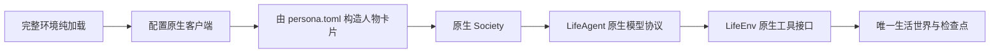

# WorldMock 产品设计说明书 — 运行与框架集成

## 实际框架边界

WorldMock 使用锁定并维护的 AgentSociety2 原生 Society、LifeAgent 与 LifeEnv。
完整环境纯加载先核对人设、运行配置、目录与实际模型元数据；运行资产只能在这些核验通过后创建。
进程配置使用 config.toml 声明的服务与模型，凭据从声明的环境变量读取，不能换到另一个模型或端点。
新建、恢复和重放都在读完完整环境之后、读取模型身份与代码身份之前配置进程：写入原生客户端需要的环境变量，并把项目根放进本进程和工作进程的导入路径。命令可以在任何目录启动，不要求预设任何 `AGENTSOCIETY_*` 变量，只需要 `model.api_key_env` 指的那个变量；恢复时父运行的数据库或检查点不存在，仍然先于进程配置报出。`validate` 不导入 `custom` 与 AgentSociety2，也不配置进程。

模型服务的 metadata_url 必须与实际 base_url 属于同一服务，模型唯一匹配且容量满足声明。
模型、预算、实际元数据、阶段参数与框架源码身份共同冻结；恢复逐项核对，不用静态容量估计。
生成请求与后台日计划、反思共用相同 dispatcher 和冻结身份，输出纠错是独立逻辑请求。
两种服务失败预算的详细合同归[配置](08-configuration.md)。

## 运行与恢复

run 创建单人世界与人物工作区，初始化原生时钟、环境与人物卡片后推进实际决策边界。
人物卡片由 persona.toml 直接构造，新建运行不为它发任何模型请求。
resume 从父共同检查点恢复到新分支，复制完整人物快照及冻结环境，保留活动选择、进度、订单和回调幂等标记。
replay 从同一认证检查点构造干预分支，沿用冻结模型与输入身份；只读历史查询不访问生成服务。
run、resume、replay 成功后写 `result.json`，其中 `token_stats` 是数组，每个模型一行 `{model, responses, responses_with_usage, input_tokens, output_tokens, total_tokens}`，由已落盘的模型响应累计，与 `worldmock status` 的 `observed_model_usage` 是同一个函数的结果，含环境一侧的零点日计划；恢复与重放的数字覆盖分支库的整段历史，含继承自父运行的响应。

用户通过 `--environment` 显式指定完整环境根，删除 `--scenario` 生活运行输入和地图生成命令。
环境验证、导出、状态查询与评估分别使用所属公开入口；评估自己的 scenario 配置文件与生活运行输入无关。
命令是 `validate`、`run`、`resume`、`replay`、`status`、`export`、`evaluate`，没有 `profile` 子命令：
人物卡片没有编译、一致性检查或覆盖率检查这几步，`worldmock validate` 检查 persona.toml 的每个字段，
也检查由它构造的卡片文本不超过 600 汉字，见[人物](06-agent.md)；通过 `validate` 的人设表不会在 run 构造卡片时被拒绝。
失败记录英文诊断，实际存在的输出目录才写失败状态；输入拒绝不能留下假的运行资产或成功回执。

## 原生模型与工具

十个原生工具的清单、批次形状、七层提示、最后回合只读查询控制、原生 tool_calls 纠错和截断纠正归[人物](06-agent.md)，
两个开始工具 start_main_activity、start_side_activity 的参数与受理归[模拟引擎](04-simulation-engine.md)。
工具定义指纹覆盖全部十个原生工具。
LifeEnv 再次核验请求、人物身份、已提交版本和观察时刻。环境为每条开始调用登记一条动作，一个决策至多两条，
两条结果都落库；AgentSociety2 的决策轮核对要求环境对每个人物恰好返回一条结果，
所以环境只向框架返回该决策第一条动作的结果，AS2 补丁不改。原生 Society 的当前时钟接口与生活绝对时钟一致，
只读查询不代替模型活动、不消耗世界随机流。

Life 扩展通道在锁定的 AgentSociety2 之上只加只读方法，环境代理、环境 actor 子类、LifeEnv 与生活引擎各有一个同名的薄转发，
AS2 补丁不改。通道上有两个方法：`read_query` 回答回看任务（`recall_task_summary`）；`due_reflection` 以本次决策的上下文为参，
先做上下文校验并要求决策轮已开启，返回空或 `{"date": "YYYY-MM-DD", "sleep_activity_id": "..."}`，
不写事件、不改世界。AS2 的人物步骤是先跑决策循环、后做记忆收尾；「先反思、再做当天第一次决策」在宿主一侧实现：
LifeAgent 在取观察之前调用 `due_reflection`，判定与登记见[人物](06-agent.md)和[记录引擎](05-recording-engine.md)。

## 安装与工程放行

使用仓库锁定 Python、依赖及 AS2 补丁，先核对已有库实际能力，再决定新增组件。
`python -m pytest tests` 是统一完整放行入口，不允许用 skip 或 xfail 满足验收。
验证保持模块边界、生产代码风格、当前文档链接、分支覆盖率及有效源码变异检查。
测试与覆盖率执行报告、安装回执和设计 HTML 放在 .work；当前测试只消费 tests 中的输入、期望和必要基线。
