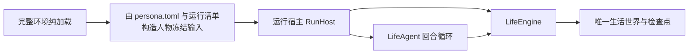

# WorldMock 产品设计说明书 — 运行装配与决策循环

## 运行装配

WorldMock 自有的决策循环驱动整次运行：runner 负责准入、身份冻结与分支恢复，运行宿主 `RunHost` 驱动决策轮，每个决策新建的 `LifeAgent` 经模型客户端请求模型，`LifeEngine` 是唯一写入者。
完整环境纯加载先核对人设、运行配置、目录与模型元数据（新运行读实际服务，恢复与重放读父运行清单冻结的那一份）；运行资产只能在这些核验通过后创建。
模型客户端使用 config.toml 声明的服务与模型，凭据从声明的环境变量读取，不能换到另一个模型或端点。
运行装配不写进程环境变量，也不改导入路径。命令可以在任何目录启动，只需要 `model.api_key_env` 指的那个变量；恢复先打开父运行、取到检查点并校验检查点世界，然后才加载环境、读取凭据和复制任何文件，凭据缺失时不建分支目录；父运行的数据库、清单或检查点不对时不访问网络、不建分支目录。
运行宿主建立或打开引擎时，用 runner 已加载的那份完整环境，不再读第二遍。

模型服务的 metadata_url 必须与实际 base_url 属于同一服务，模型唯一匹配且容量满足声明。
模型、预算、实际元数据、阶段参数与代码身份共同冻结；恢复逐项核对，不用静态容量估计。
生成请求与零点的日计划、回顾共用整次运行唯一的模型客户端和冻结身份，输出纠错是独立逻辑请求。
模型客户端、停放与单次发送整次期限的规则，以及两种服务失败预算的详细合同，归[配置](08-configuration.md)。

## 决策循环

### 一个进程，一个事件循环

一次 `worldmock run`、`resume` 或 `replay` 只有一个进程、一个事件循环：命令行的 `asyncio.run` 驱动整次运行，`LifeEngine`、每个 `LifeAgent`、模型客户端与零点任务都在这个事件循环里执行。
运行不另起子进程、进程池、线程池或嵌套的事件循环；进程里唯一的后台线程是驱动心跳。
运行宿主是 `src/worldmock/runtime/lifecycle/run_host.py` 的 `RunHost`，三种启动、步进、整次运行与关闭都是它的协程。

唯一写入者由程序结构保证，不加锁：引擎的公开方法全部同步执行；运行宿主逐个等待；零点任务只在引擎没有开着的决策轮时由运行宿主调用。
一轮里有几个人物就绪，就按引擎给出的就绪顺序逐个决定：前一个人物决定完，才新建下一个人物，所以事件序号可复现。v1.0 只有一个人物。
需要多人物并发时，要先设计按决策缓冲证据、提交时按序落库，再改这一节。
每个决策恰好执行一次，出错不重跑。

运行宿主为每个决策新建一个 `LifeAgent`，决定完就丢弃；跨决策共享的只有引擎、模型客户端、每个人物的记忆存储和运行开始时建好的人物冻结输入，见[人物](06-agent.md#agent-回合协议)「回合协议」。
人物拿到的环境句柄就是 `LifeEngine` 本身，只用 `observe`、`submit_action`、`read_query`、`record_model_exchange`、`record_memory_update` 五个同步方法；人物模块不导入引擎，`src/worldmock` 里只有运行宿主导入引擎门面。
`observe` 与 `read_query` 返回深拷贝，人物改动返回值不影响引擎；引擎在调用之内把交给它的对象转成副本或写进 SQLite，之后不持有它们的引用。

### 三种启动顺序

| 启动 | 依次 |
| --- | --- |
| 新建（run） | 建每个人物的工作区目录，此时为空，已存在即失败（见[状态与序列化](09-io-formats.md)「人物工作区」）；建引擎；核对配置的起始时刻与引擎时钟相同，不同时先关闭引擎，再以 `ProtocolError("Run host start time disagrees with the engine")` 停止，不登记运行故障；写初始检查点；补回顾、零点计划 |
| 普通恢复（resume） | 打开引擎；在首次决策之前补回顾、零点计划；不写检查点 |
| 反事实（replay） | 打开引擎；施加干预；核对收据的干预摘要与干预文件的摘要相同、模拟时间不变、世界版本恰好加一，不成立时分别以 `RuntimeError("Environment confirmed a different counterfactual identity")`、`RuntimeError("Counterfactual intervention changed simulation time")`、`RuntimeError("Counterfactual intervention did not advance one world version")` 停止；写干预检查点；补回顾、零点计划 |

### 步序与同秒再决策

运行宿主的一步依次：

| 序 | 动作 |
| --- | --- |
| 1 | 取调度状态 |
| 2 | 有人物就绪时执行一个决策轮：由调度状态形成决策上下文，开轮，按就绪顺序逐个新建人物并等它决定，原子提交；提交返回本轮全部结算结果，运行宿主不读 |
| 3 | 再取一次调度状态 |
| 4 | 没有人物就绪、且引擎给出了下一个事件边界时，把时钟推进到这个边界 |
| 5 | 步数加一 |
| 6 | 写一个共同检查点，随后补回顾、零点计划 |

决策不耗模拟时间。提交之后仍有人物就绪时不推进，直接写检查点，下一步在同一秒再开一轮；新一轮的世界版本已加一，决策轮身份与上一轮不同。
调度状态里有运行宿主没有冻结输入的人物时，在开轮之前以 `RuntimeError("Environment returned unknown ready agents: [<人物编号>, …]")` 停止。

### 共同检查点

每一步恰好写一个共同检查点，只推进不决策的步也写；新建运行另有初始检查点，反事实分支另有干预检查点，普通恢复启动时不写。
写检查点时取每个人物工作区的快照，连同引擎状态交给引擎提交；人物集合由引擎核对。快照与检查点的格式归[记录引擎](05-recording-engine.md)「冻结输入、检查点与分支」。

### 推进与结束

推进的目标只取引擎给出的下一个事件边界，推进量是它与当前时刻之差；边界与推进量由引擎核对。
运行宿主只有一个时钟：它不保存当前时刻，每次从引擎读；`result.json` 的 `current_time` 与运维日志 `RUN_ENDED` 的模拟时刻取引擎时钟，`RUN_CRASHED` 在引擎打开时也取它、引擎没有打开时取准备阶段定下的起始时刻（新建是配置的开始时刻，恢复与重放是检查点的时刻）；`step_count` 是这个进程里运行宿主完成的步数，启动不计。
引擎时钟到达结束时刻时运行结束；结束时刻本来就在引擎的边界候选里，运行宿主不另核边界是否越过它。

### 身份

决策轮身份与决策身份由运行宿主形成：

| 身份 | 格式 |
| --- | --- |
| `round_id` | `{run_id}:round:{epoch}:{world_state_version}`：`run_id` 是本运行的身份（恢复与重放分支是子运行的身份），`epoch` 是调度状态当前时刻的 UTC 秒，`world_state_version` 是调度状态的世界版本 |
| `decision_id` | `{round_id}:agent:{agent_id}:order:{order}`，`order` 是人物在就绪顺序里的下标，从 0 起 |

`round_id` 与人物在轮内的次序写在 `decision_started` 里，`decision_id` 写在全部决策事件里。决策上下文的观察时刻就是调度状态的当前时刻（场景时区）。
动作身份与模型调用身份由人物一侧形成，见[人物](06-agent.md)「提示与工具」与[人物](06-agent.md#agent-回合协议)「回合协议」。

### 零点任务的触发点

| 时机 | 依次 |
| --- | --- |
| 每个共同检查点提交之后：新建运行的初始检查点、反事实分支的干预检查点与每一步的检查点 | 日、月、年回顾，零点计划 |
| 零点边界的推进提交之后 | 日、月、年回顾，零点计划，再判定这一秒的唤醒 |
| 普通恢复启动时、首次决策之前 | 日、月、年回顾，零点计划；不写检查点 |
| 决策轮开着时 | 从不 |

没有待办（运行已到终点、没有待生成的期次、没有缺当日计划的人物）时，零点任务不调用模型客户端，不写请求证据与调用运维日志。
新登记的回顾与计划由下一个共同检查点封存。回顾与计划的内容归[人物](06-agent.md)「日、月、年回顾」与「零点计划」。

### 中止与停止

人物一侧的异常（含新建人物时抛出的）原样到达运行宿主，不包装、不改类型。
开轮、人物决策与提交三处任一抛出时，运行宿主只在引擎的决策轮仍开着时中止这一轮：中止的决策轮不执行请求，中止原因是原异常的 `repr`，写进中止产生的每条 `action_result` 的 `message`、`decision_round_aborted` 的 `error` 与 `run_failed` 的 `error`。
开轮之前就失败，或提交已经关闭本轮之后才抛出时，不中止。后者只发生在同秒决策次数用完时：提交在同一事务里写下 `decision_budget_exhausted` 与 `run_failed`，再抛 `ProtocolError("decision_budget_exhausted")`；之后不再写任何事件，运行以这个 `ProtocolError` 停下。
其余故障（取调度状态、推进、共同检查点、零点任务、反事实干预、开轮之前的失败、关闭引擎）登记 `run_failed`，原因同为原异常的 `repr`，库里已有 `run_failed` 时不再写；登记之后把原异常原样传出。引擎尚未建立或已经关闭时不登记。
中止或登记本身失败时，两项异常都保留：`ExceptionGroup("Decision round and abort both failed", …)` 或 `ExceptionGroup("Run and failure recording both failed", …)`。
`KeyboardInterrupt` 与取消不中止、不登记，原样传出。

### 状态阶段

运行宿主用 `status.json` 的 `phase` 写四个阶段：开轮之前写 `deciding`，提交之前写 `resolving`，每次写共同检查点之前（含初始与干预检查点）写 `checkpointing`，每次推进之前写 `advancing`。
零点任务不另写阶段；普通恢复启动时的零点任务不写任何阶段。`completed`、`failed`、`interrupted` 由命令行写。

### 关闭与模型客户端的寿命

整次运行恰有一个模型客户端：runner 在运行的事件循环里、驱动心跳之内，用运行清单冻结的 `stage_model_identity` 与读到的凭据构造它，交给运行宿主；人物的每个模型回合、零点计划与回顾都经它发送，没有按角色另建的客户端。
运行结束时（正常、故障或中断），运行宿主在同一个事件循环里先关闭引擎，再关闭模型客户端，各一次；引擎没有建立时也关闭模型客户端。关闭引擎失败时先登记运行故障。
两步都失败时两项异常保留在 `ExceptionGroup("Run host close failed", …)` 里；运行本身已经失败而关闭又失败时，两者保留在 `WorldMock run and cleanup failed` 异常组里。

## 运行与恢复

run 创建单人世界与人物工作区，按「决策循环」的新建顺序启动，再由运行宿主推进实际决策边界。
人物卡片由 persona.toml 直接构造，新建运行不为它发任何模型请求。
resume 从父共同检查点恢复到新分支，复制完整人物快照及冻结环境，保留活动选择、进度、订单和回调幂等标记。
replay 从同一认证检查点构造干预分支，沿用冻结模型与输入身份；只读历史查询不访问生成服务。
run、resume、replay 成功后写 `result.json`，其中 `token_stats` 是数组，每个模型一行 `{model, responses, responses_with_usage, input_tokens, output_tokens, total_tokens}`，由已落盘的模型响应累计，与 `worldmock status` 的 `observed_model_usage` 是同一个函数的结果，含零点的日计划与回顾；恢复与重放的数字覆盖分支库的整段历史，含继承自父运行的响应。

运行中可以执行 `worldmock status`、`scripts/inspect_run.py` 与 `scripts/render_day.py`：它们不开长读事务（各类事件条数
走类型表达式索引，墙钟时间取第一条与最后一条事件，`inspect_run.py` 按事件序号窗口分页），最长的一条语句是 `status`
的模型用量合计，只读经类型索引找到的模型响应。引擎的足迹库连接遇到读者持锁时最多等 120 秒再提交，而不是 5 秒后失败；
日志模式仍是回滚日志，运行结束后运行库是一个自足的文件。
恢复与重放怎样复制父库见[记录引擎](05-recording-engine.md)「冻结输入、检查点与分支」。

失败诊断：运行目录的 `status.json` 恰含 `status`、`phase`、`error_type` 与 `error_message`，是规范 JSON。`error_type` 是使运行停下、原样传到命令行的异常的类名；
`error_message` 是一行可读的失败原因：异常组逐项以「 | 」连接，其余为「类型名: 文本」，连续空白折成一个空格，不截断。运行宿主写阶段时与成功结束时这两项为 null。

心跳：驱动进程在 run、resume、replay 运行期间先写一次、之后每 60 秒原子重写 `heartbeat.json`，是规范 JSON，恰含
`heartbeat_at`、`pid`、`started_at`（UTC 的 ISO 8601 文本）。写失败记 `Driver heartbeat write failed` 并继续；运行结束
文件保留。

`worldmock status` 另报告：
- `heartbeat`：心跳文件三项加距今秒数 `age_seconds`，没有文件为 null；内容不是 JSON 对象或 `heartbeat_at` 不带时区时报
  `Run heartbeat is invalid`；
- `liveness`：没有 `status.json` 为 null；不是 running 为 `stopped`；running 而心跳缺失或超过 180 秒为 `stale`，表示驱动
  进程已不在，不表示世界停在哪里；最后一条事件是模型请求为 `waiting_for_model`，即停放或长思考；其余为 `running`；
- `waiting_for_model_since`：最后一条事件是模型请求时它的落盘时刻，否则为 null；
- `wall_time.last_event_age_seconds`：最后一条事件距今秒数。

墙钟在 `running` 与 `waiting_for_model` 时止于此刻，失联时止于最后一次心跳，其余止于最后一条事件。首末事件按主键读取。
心跳新鲜而最后一条事件很旧，表示驱动还在、环境或模型调用很慢；零点计划与回顾的请求与响应一起落盘，它们的停放显示为 running。
判断只看心跳的新旧，`pid` 只作参考：Windows 上探测进程会结束它。

写文件：原子写在 Windows 上遇到拒绝访问（同步或杀毒软件短暂占用目标）按 0.05 秒起倍增的八个间隔重试，共约 13 秒，
第九次仍被拒绝才失败（issue #7）；其他平台与其他错误立即失败。状态、心跳、检查点素材、工作区快照与导出都经它写。

运维日志：`logs/ops-*.jsonl` 只用于定位长运行问题，不参与审计：模型往来记录 `MODEL_EXCHANGE` 带证据写入耗时 `commit_ms`；
另有传输等待 `MODEL_TRANSPORT_WAIT`（失败发送数、累计等待毫秒数与最后的错误链）、协议拒绝 `MODEL_PROTOCOL_REJECTED`（响应
阶段带协议纠错时的错误码）与零点计划调用耗时 `PLAN_DAY_CALL`、回顾调用耗时 `MEMORY_DIGEST_CALL`。

用户通过 `--environment` 显式指定完整环境根，删除 `--scenario` 生活运行输入和地图生成命令。
环境验证、导出和状态查询使用原有公开入口；独立行为分析由仓库工具读取事实。
命令是 `validate`、`run`、`resume`、`replay`、`status`、`export`，没有 `profile` 子命令：
人物卡片没有编译、一致性检查或覆盖率检查这几步，`worldmock validate` 检查 persona.toml 的每个字段，
也检查由它构造的卡片文本不超过 600 汉字，见[人物](06-agent.md)；通过 `validate` 的人设表不会在 run 构造卡片时被拒绝。
失败记录英文诊断，实际存在的输出目录才写失败状态；输入拒绝不能留下假的运行资产或成功回执。

## 原生模型与工具

八个原生工具的清单、批次形状、七层提示、最后回合只读查询控制、原生 tool_calls 纠错和截断纠正归[人物](06-agent.md)，
两个开始工具 start_main_activity、start_side_activity 的参数与受理归[模拟引擎](04-simulation-engine.md)。
工具定义指纹覆盖全部八个原生工具。
`LifeEngine` 再次核验请求、人物身份、已提交版本和观察时刻。环境为每条开始调用登记一条动作，一个决策至多两条，
两条结果都落库；提交按结算次序返回本轮全部结果，开始组的两条都返回。
只读查询不代替模型活动、不消耗世界随机流。

只读查询是引擎方法 `LifeEngine.read_query`，人物直接调用。它只接受回看任务（`recall_task_summary`）与检索记忆（`search_memory`）两个工具名与各自的请求类型，别的组合是协议错误；依次核对决策上下文、本轮仍开着、工具名与请求类型、本次决策恰有一份冻结观察，哪一步不过就以协议错误停止；业务拒绝以 `error_code`、`reason`、`fix`、`items`、`unmet` 五个字段返回。回答只读本次决策冻结观察所在事件序号及以前的事件，不写事件、不改世界。人物侧与引擎侧的工具集合用同一份 `REQUEST_MODELS`，二者一致由单元测试核对，运行时不核对。

模型服务也可以是开发工具在本机起的录音应答服务（`scripts/recorded_response_run.py`）。它从运行冻结的输入素材复原一份输入，只把 config.toml 的 `base_url` 与 `metadata_url` 改到 127.0.0.1，凭据变量给占位值，真实密钥不进入子进程；运行代码不为它留任何入口或开关。

## 安装与工程放行

使用仓库锁定 Python 与依赖，先核对已有库实际能力，再决定新增组件。
`python -m pytest tests` 是统一完整放行入口，不允许用 skip 或 xfail 满足验收。
验证保持模块边界、生产代码风格、当前文档链接、分支覆盖率及有效源码变异检查。
测试与覆盖率执行报告、安装回执和设计 HTML 放在 .work；当前测试只消费 tests 中的输入、期望和必要基线。
