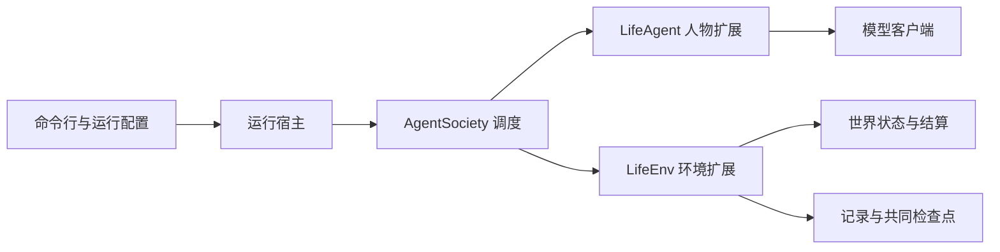
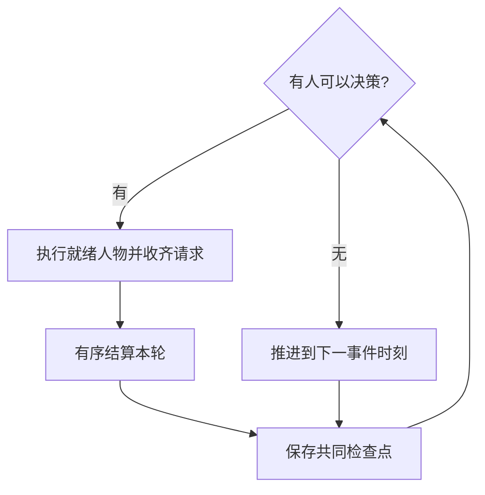

<a name="runtime"></a>
# WorldMock 产品设计说明书 — 运行与框架集成

<a name="runtime-职责与边界"></a>
## 职责与边界

运行模块负责安装身份、模型配置、AgentSociety 装配、命令行、启动、恢复和故障传播。
AgentSociety 负责人物调度、模型调用、记忆基础能力和人物工作区；WorldMock 负责共享模拟时钟、
权威世界状态、人物业务规则和证据提交。固定依赖以 `.python-version`、`pyproject.toml`、锁文件与补丁清单为准。



<a name="runtime-框架与扩展边界"></a>
## 框架与扩展边界

| 组件 | 职责 |
| --- | --- |
| AgentSociety | 环境注册、人物与模型调度、基础记忆存储、工作区保存与恢复 |
| `LifeAgent` | 七层请求、生活工具、协议校验、同秒续接、记忆业务规则 |
| `LifeEnv` | 观察、请求登记、活动推进、后台事件、权威状态与足迹提交 |
| `LifeEnvActor` / `LifeEnvProxy` | 继承锁定框架的直接环境 actor 与代理，提供只读 `read_query` 入口 |
| 运行宿主 | 装配依赖、绑定身份、启动与恢复、后台计划和联系人模型调用、状态与故障输出 |

环境 actor 固定 `max_concurrency=1`，世界只有一个写入进程。
资金由实际活动与合同结算，不使用框架按日结算的 `EconomySpace`；社交状态进入足迹事务，不使用 `SimpleSocialSpace`。
人物记忆与观察属于 WorldMock 扩展，框架补丁仅承担通用调度、确定性工具、失败传播、恢复和客户端生命周期。
`patches/agentsociety2/SERIES` 保存实际补丁清单；本章不另列补丁登记表。

<a name="runtime-决策调度"></a>
## 决策调度

Society 读取环境 `scheduling_state()`，只执行就绪人物的 batch；收齐请求后，由环境按确定顺序结算。
结算后重新查询，就绪人物仍存在时在同一秒继续；没有就绪人物才推进到下一时间边界。
每个决策轮或推进边界形成共同检查点。



`step(tick, t)` 的 `tick` 是推进秒数，`t` 是推进后的结束时刻；结束时刻与上次确认时刻之差必须等于推进量。
AS2 路由、Society 与 LifeEnv 使用同一时间约定，调度不得跨过较早到期事件。
唤醒条件与同秒限制见[模拟引擎](04-simulation-engine.md#simulation-engine-决策节律-结算边界与唤醒条件分离)。

<a name="runtime-工具与只读查询"></a>
## 工具与只读查询

宿主绑定 `agent_id`、`decision_id`、`action_id` 和冻结观察身份，模型工具参数不能更换调用者。
工具结果直接进入规定的返回通道，不由另一个模型改写。
世界请求登记后即结束人物决策，不向模型追加登记确认；真实结果由环境结算后进入进度层。
工具字段与受理规则见[模拟引擎](04-simulation-engine.md#simulation-engine-人物工具与管理接口)，
模型请求协议见[人物](06-agent.md#agent-工具返回通道)。

`query_world` 在宿主的冻结观察上求值；`recall_task_summary` 通过
`LifeEnvProxy.read_query(context, tool, request)` 等待环境 actor 返回真实结果。
环境侧 `query_world` 是同一组纯函数的第二入口，两处应答逐值相等。
只读调用不写事件、不改世界版本和时钟、不计同刻轮数；请求类型不符或找不到唯一观察属于协议违约。

<a name="runtime-人物运行时"></a>
## 人物运行时

`LifeAgent` 继承 `PersonAgent`，保留框架模型客户端、ReAct 执行和记忆检索。
同秒续接在 `prepare_react_loop` 之后注入上一决策的完整消息；
框架仅在消息为空时构造初始请求。续接和思考回传条件由[人物设计](06-agent.md#agent-思考回传)定义。

每次决策只读取一次观察，`_observation_record` 只保存结构化 `data`。
续接所需的上一决策消息通过观察返回体的私有字段交给宿主，不进入观察事件或导出。
人物业务记忆经 `_new_memory_runtime` 装配，负责来源、合并、浓缩与主观视图；
框架保留模型调度、基础存储和检查点恢复。记忆字段、严格反思工具和校验重试见[人物设计](06-agent.md#agent-记忆合同)。

零点计划与联系人回复由运行宿主提供客户端，由环境在规定结算边界调用，不更改人物工作区。
两类调用的请求、触发与幂等规则分别见[零点计划](04-simulation-engine.md#simulation-engine-零点计划与计划提醒)
和[联系人回复](04-simulation-engine.md#simulation-engine-联系人回复)。

<a name="runtime-失败与客户端生命周期"></a>
## 失败与客户端生命周期

必要观察、人物执行、记忆校验与保存、数据库提交或工作区保存失败均向上报告并停止运行。
不生成合成成功结果，不把持久化故障当成普通业务拒绝；决策预算内没有登记世界请求，或只读问答没有有效 `finish`，均失败。
`finish` 不能与其他工具同批提交。严格反思和零点计划采用各自有界协议校验重试，耗尽后停止；
传输重试与协议校验重试分开计数。

`LifeAgent.step` 写带完整异常链的英文错误日志后原样上抛；工具分发失败写日志并按 `TOOL_SERVICE_FAILED` 传播。
每个 Ray worker 任务通过 `finally` 关闭模型客户端，正常返回、异常和取消都经过同一清理路径。
`ServiceProxy` 关闭任务客户端；`LLMClient` 调用 `Router.discard()` 移除全局回调，再释放运行时引用。

<a name="runtime-恢复与检查点"></a>
## 恢复与检查点

恢复入口接收父运行共同检查点和新目标目录，完整核对世界、人物、时钟与冻结身份后再启动。
任何必需快照缺失或恢复失败即终止，父目录保持不变。
记录引擎提供[分支存储与恢复材料](05-recording-engine.md#recording-engine-恢复与反事实分支)，
模拟引擎负责[参与者恢复与启动编排](04-simulation-engine.md#simulation-engine-恢复与反事实运行编排)。

<a name="runtime-cli-命令接口"></a>
## CLI 命令接口

对外命令统一使用 `worldmock`。命令失败返回非零状态并记录英文错误，不能创建看似成功的 manifest。

| 命令 | 参数 | 行为 |
| --- | --- | --- |
| `validate --scenario` | `--scenario PATH` | 校验场景、登记目录、依赖、固定规则和目标数据合同，不启动人物；结果的 `input_warnings` 列出与新建运行同一组运行输入警告（见「运行输入警告」），并逐条写到标准错误流，覆盖率低于 0.8 失败时也先写出 |
| `run` | `scenario_path`, `output_dir`，可选 `--same-second-continuation on\|off`（缺省 `on`） | 从明确场景新建运行目录，经 AS2 执行到场景终点；已存在的运行目录不能被覆盖；同秒续接开关冻结进清单 `stages.action.same_second_continuation` 与人物配置（见「思考回传」），`resume`、`replay` 不接受该参数，继承父清单的值 |
| `resume` | `parent_checkpoint`, `output_dir` | 指定父运行和完整检查点，在新的运行目录恢复；不允许隐式新建 |
| `replay` | `parent_checkpoint`, `intervention`, `output_dir` | 指定父运行、共同检查点及一次余额条件干预，在新反事实分支实际执行 |
| `status` | `run_dir` | 只读显示已确认模拟时间、阶段、人物活动与调用统计 |
| `export` | `run_dir`, `cutoff_event`, `output_dir` | 固定截止事件和活动边界，形成完整证据 JSONL、来源索引与哈希 |
| `evaluate` | `baseline_dir`, `experiment_dir`, `output_dir` | 核对两套数据身份与可比范围，产出机器报告、图表和中文结论 |
| `profile compile` | `text`, `runs`, `out` | 编译指定文本的人物卡片、大五与世界层动力学，输出卡片、卡片渲染文本（`render_card`，不再进入模型请求；进入请求的是人设层 JSON）与溯源 |
| `profile check` | `text`, `runs` | 重复编译并断言卡片一致性与大五众数稳定 |
| `profile validate` | `scenario_path`, `coverage_out` | 校验场景人物卡片的世界可执行覆盖并写 `persona_coverage.json`；与 `validate` 共用覆盖率校验，同样把运行输入警告逐条写到标准错误流 |

| 环境命令 | 参数与行为 |
| --- | --- |
| `environment generate-map` | `--locations PATH --seed INT --output PATH` 读取地点并写规范 LF 地图；`--check` 不写文件、逐字节比对，失配报 `MAP_NOT_REGENERATED` |
| `validate --environment` | `--environment ROOT` 校验目录登记、重生成地图并用真实加载器校验全部场景；每个失败输出稳定码与英文原因，任一失败非零退出 |

`validate --scenario` 与 `validate --environment` 二选一。项目校验继续执行 AS2 锁定、依赖、阶段身份和覆盖率 0.8 检查；环境校验不启动完整引擎。

`validate --scenario` 不输出 `corpus_entries`；`validate --environment` 成功结果为 `{valid, environment_id, environment_version, scenarios}`，不读取语料或检查规则副本。

<a name="runtime-运行状态枚举"></a>
### 运行状态枚举

运行生命周期由模拟引擎的运行编排维护；记录引擎只读呈现已确认的状态。

```python
RunStatus = Literal[
    "created",      # 已创建
    "running",      # 运行中
    "completed",    # 完成
    "failed",       # 失败
    "interrupted"   # 中断
]

RunPhase = Literal[
    "deciding",     # 决策中
    "resolving",    # 结算中
    "advancing",    # 推进中
    "checkpointing",# 检查点中
    "stopped"       # 已停止
]
```

运行状态使用 `created`、`running`、`completed`、`failed`、`interrupted`；运行阶段使用 `deciding`、`resolving`、`advancing`、`checkpointing`、`stopped`，正常睡眠属于活动状态。不得把已提交请求序号作为已完成活动或支付的证明。

<a name="runtime-运行诊断输出"></a>
### 运行诊断输出

运行宿主与各模块负责自身日志埋点，公共输出约定如下。

持久足迹是审计事实；运行日志帮助定位问题，两者不能互相充当完成证据。

| 输出 | 当前格式与用途 |
| --- | --- |
| 标准错误流 | Python 标准 logging 输出英文运行错误及诊断信息；日志级别用于排查问题；`validate` 与 `profile validate` 以 warning 级逐条写运行输入警告，格式为 `Input warning <警告码> (agent <人物编号>): <message>`（场景级警告的人物编号为 `None`）；`LifeAgent.step` 在决策失败时写一条带完整异常链的 error 级英文日志后原样上抛（异常对象与类型不变），工具分发失败先写日志、再以失败阶段码 `TOOL_SERVICE_FAILED` 抛出（见「工具返回通道」）；这些日志不是持久证据，不新增事件与操作日志码，不改变失败分类 |
| `logs/ops-YYYYMMDD.jsonl` | 按场景时区的模拟日追加操作日志，字段为 `at`、`sim_time`、`component`、`level`、`code`、`detail` 及可用关联键 |
| `status.json` | 运行边界写入的 `status`、`phase`、`error_type`，不是世界状态快照 |
| `worldmock status` | 从已提交数据库汇总 `run_id`、`state_version`、`current_time`、`active_activities`、`event_counts`、`recent_checkpoints`、`runtime`、`token_stats`、`observed_model_usage`、`people` 与 `wall_time` |

操作日志的 `at` 为程序 UTC 时刻；模拟时间戳按场景时区显示，datetime 输入保留其自身时区。
现有组件常量为 `engine`、`agent_runtime`、`memory`、`commerce`、`travel`、`push`、`checkpoint`、`runtime`；
级别常量为 `info`、`warn`、`error`。当前 `OpsLogger` 不在运行时验证组件或事件码闭集，不能把示例码当成强制 Schema。
实际埋点包括 `DECISION_ROUND_COMMITTED`、`ACTION_ACCEPTED`、`ACTION_REJECTED`、`FUNDS_CHANGED`、
`MODEL_EXCHANGE`、`MEMORY_UPDATED` 与 `CHECKPOINT_COMMITTED`，它们和持久事件类型是不同字段。
新建运行冻结的每条运行输入警告另写一条组件 `runtime`、级别 `warn` 的记录，`code` 取警告码闭集（见「运行输入警告」），
关联键为 `message`、`details` 与人物级警告的 `agent_id`（场景级警告的 `agent_id` 为 null，不落盘）。

操作日志逐条 flush，未作逐条 fsync；写入或关闭失败只报告到 stderr，属于当前诊断输出行为。
必要模型留证、记忆或数据库写入失败仍按[模拟引擎的失败处理](04-simulation-engine.md#simulation-engine-失败处理)停止运行，不因诊断日志的处理方式而放宽。

<a name="runtime-可重建环境"></a>
## 可重建环境

<a name="runtime-源码与换行身份"></a>
### 源码与换行身份

根 `.gitattributes` 固定 Python、TOML 与依赖锁的文本换行为 LF；补丁和源制品按原始字节保存。
运行身份绑定实际生产文件和依赖锁，不在摘要函数中转换换行。

`patches/agentsociety2/SERIES` 是 AgentSociety 上游地址、固定提交、制品摘要、有序补丁和重建结果身份的唯一声明。
引导通过标准 Git apply 应用补丁并核对重建结果。上游许可与修改说明随补丁保存。
WorldMock 专用人物与记忆规则由安装包维护，框架扫描入口为 `custom/agents/life_agent.py` 和 `custom/envs/life_env.py`。
环境注册验证完整方法合同，不按类名放行；不增加第二套注册方式或兼容格式。
框架只保留调度、失败传播、恢复、直接环境、工具请求和模型生命周期所需的修改。
LabelKit 安装和数据加工由 LabelKit-DataSet 管理。

<a name="runtime-环境引导与收据"></a>
### 环境引导与收据

`scripts/bootstrap.py` 只用标准库，参数为 `--profile release|dev`、`--wheelhouse`、`--use-uv`。
明确选择 Python 3.12，当前解释器符合时直接使用；Windows 用 `py -3.12`，其它系统用 `python3.12`。
不可用时用英文报错，不能选择不符合版本的 Python。

创建根 `.venv`，用 `python -m pip install --require-hashes` 安装 `requirements/lock.txt`；
锁由 `uv.lock` 导出，排除本地 editable 来源，包含固定构建后端；安装源码使用 `--no-deps --no-build-isolation`。
wheelhouse 明确使用 `--no-index --find-links` 和固定源制品，不访问网络，不静默改成在线下载。
`--use-uv` 仅是用户显式选择的同一锁安装入口，uv 缺失必须报错。

引导先恢复并核对固定源码，再安装 editable AS2 与 WorldMock。
有效既有源码要核对身份；错误源码不能被引导静默覆盖成正确结果。
收据包含 Python 版本、各依赖锁摘要、AS2 摘要、Node 版本、profile 和缺失部件，
只使用相对项目路径，不含机器身份、密钥或私有凭据。

<a name="runtime-门禁-可选部件与操作系统"></a>
### 门禁、可选部件与操作系统

测试使用标准 pytest 目录层次，覆盖率采集和报告校验见[工程验证](01-architecture.md#architecture-工程验证)。
正式环境测试显式提供 `--environment-root <环境根>`，不搜索隐式相邻仓库或使用旧根目录数据。

release 配置缺少 Node 或中文图表字体即失败；dev 配置如实记录缺失，对应检查被跳过时不能宣称完整放行。
每个平台独立执行重建和真实边界测试，不以另一个平台的结果推断本平台成功。

可变测试工作区使用标准库普通独立复制，不以硬链接共享仓库输入；修改副本不改变源文件。
测试输入的缓存只能共享不可变部分，可变状态每次独立创建。

<a name="runtime-新机器检查"></a>
### 新机器检查

`scripts/fresh_check.py` 在临时目录检出指定提交，执行环境引导、源码身份核对与实际测试。
不初始化子模块、不配置模型密钥；源码与依赖必须能够由声明的公开地址、锁文件和补丁重建。
任一命令失败即停止并保留英文错误说明，成功结果明确记录平台、解释器和实际执行的检查。
跨平台结论由各平台真实结果共同支持。
