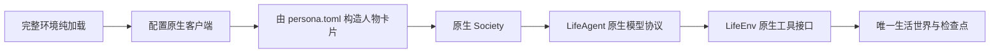

# WorldMock 产品设计说明书 — 运行与框架集成

## 实际框架边界

WorldMock 使用锁定并维护的 AgentSociety2 原生 Society、LifeAgent 与 LifeEnv。
完整环境纯加载先核对人设、运行配置、目录与模型元数据（新运行读实际服务，恢复与重放读父运行清单冻结的那一份）；运行资产只能在这些核验通过后创建。
进程配置使用 config.toml 声明的服务与模型，凭据从声明的环境变量读取，不能换到另一个模型或端点。
新建、恢复和重放都在读完完整环境之后、读取模型身份与代码身份之前配置进程：写入原生客户端需要的环境变量，并把项目根放进本进程和工作进程的导入路径。命令可以在任何目录启动，不要求预设任何 `AGENTSOCIETY_*` 变量，只需要 `model.api_key_env` 指的那个变量；恢复先打开父运行、取到检查点并校验检查点世界，然后才加载环境、配置进程和复制任何文件；父运行的数据库、清单或检查点不对时不访问网络、不建分支目录。`validate` 不导入 `custom` 与 AgentSociety2，也不配置进程。

模型服务的 metadata_url 必须与实际 base_url 属于同一服务，模型唯一匹配且容量满足声明。
模型、预算、实际元数据、阶段参数与框架源码身份共同冻结；恢复逐项核对，不用静态容量估计。
生成请求与后台日计划、反思共用相同 dispatcher 和冻结身份，输出纠错是独立逻辑请求。
停放与单次发送整次期限的规则归[配置](08-configuration.md)。
AgentSociety2 worker 任务在自己的事件循环结束之前，关闭并移出本循环在 LiteLLM 客户端缓存里的异步客户端；环境 actor 在 LifeEnv
关闭时做同样的事，在 Ray 结束 actor 之前完成。
两种服务失败预算的详细合同归[配置](08-configuration.md)。

## 运行与恢复

run 创建单人世界与人物工作区，初始化原生时钟、环境与人物卡片后推进实际决策边界。
人物卡片由 persona.toml 直接构造，新建运行不为它发任何模型请求。
resume 从父共同检查点恢复到新分支，复制完整人物快照及冻结环境，保留活动选择、进度、订单和回调幂等标记。
replay 从同一认证检查点构造干预分支，沿用冻结模型与输入身份；只读历史查询不访问生成服务。
run、resume、replay 成功后写 `result.json`，其中 `token_stats` 是数组，每个模型一行 `{model, responses, responses_with_usage, input_tokens, output_tokens, total_tokens}`，由已落盘的模型响应累计，与 `worldmock status` 的 `observed_model_usage` 是同一个函数的结果，含环境一侧的零点日计划；恢复与重放的数字覆盖分支库的整段历史，含继承自父运行的响应。

运行中可以执行 `worldmock status`、`scripts/inspect_run.py` 与 `scripts/render_day.py`：它们不开长读事务（各类事件条数
走类型表达式索引，墙钟时间取第一条与最后一条事件，`inspect_run.py` 按事件序号窗口分页），最长的一条语句是 `status`
的模型用量合计，只读经类型索引找到的模型响应。引擎的足迹库连接遇到读者持锁时最多等 120 秒再提交，而不是 5 秒后失败；
日志模式仍是回滚日志，运行结束后运行库是一个自足的文件。
恢复与重放怎样复制父库见[记录引擎](05-recording-engine.md)「冻结输入、检查点与分支」。

失败诊断：运行目录的 `status.json` 恰含 `status`、`phase`、`error_type` 与 `error_message`，是规范 JSON。`error_message`
是一行可读的失败原因：异常组逐项以「 | 」连接，Ray 任务错误取其原始异常，其余为「类型名: 文本」，去掉终端颜色序列、
连续空白折成一个空格，不截断；环境 actor 的阶段写入与成功结束时为 null。环境里的输入错误、前置条件错误与登记错误能完整
穿过 Ray（按构造参数重建并带回实例字典），所以这里写的是原始错误，不是 `UnserializableException`。

心跳：驱动进程在 run、resume、replay 运行期间先写一次、之后每 60 秒原子重写 `heartbeat.json`，是规范 JSON，恰含
`heartbeat_at`、`pid`、`started_at`（UTC 的 ISO 8601 文本）。写失败记 `Driver heartbeat write failed` 并继续；运行结束
文件保留。

`worldmock status` 另报告：
- `heartbeat`：心跳文件三项加距今秒数 `age_seconds`，没有文件为 null；内容不是 JSON 对象或 `heartbeat_at` 不带时区时报
  `Run heartbeat is invalid`；
- `liveness`：没有 `status.json` 为 null；不是 running 为 `stopped`；running 而心跳缺失或超过 180 秒为 `stale`，表示驱动
  进程已不在，不表示世界停在哪里；最后一条事件是模型请求为 `waiting_for_model`，即停放或长思考；其余为 `running`；
- `waiting_for_model_since`：最后一条事件是模型请求时它的落盘时刻，否则为 null；
- `wall_time.last_event_age_seconds`：最后一条事件距今秒数。

墙钟在 `running` 与 `waiting_for_model` 时止于此刻，失联时止于最后一次心跳，其余止于最后一条事件。首末事件按主键读取。
心跳新鲜而最后一条事件很旧，表示驱动还在、环境或模型调用很慢；零点计划的请求与响应一起落盘，它的停放显示为 running。
判断只看心跳的新旧，`pid` 只作参考：Windows 上探测进程会结束它。

写文件：原子写在 Windows 上遇到拒绝访问（同步或杀毒软件短暂占用目标）按 0.05 秒起倍增的八个间隔重试，共约 13 秒，
第九次仍被拒绝才失败（issue #7）；其他平台与其他错误立即失败。状态、心跳、检查点素材、工作区快照与导出都经它写。

运维日志：`logs/ops-*.jsonl` 只用于定位长运行问题，不参与审计：模型往来记录 `MODEL_EXCHANGE` 带证据写入耗时 `commit_ms`；
另有传输等待 `MODEL_TRANSPORT_WAIT`（失败发送数、累计等待毫秒数与最后的错误链）、协议拒绝 `MODEL_PROTOCOL_REJECTED`（响应
阶段带协议纠错时的错误码）与零点计划调用耗时 `PLAN_DAY_CALL`。

用户通过 `--environment` 显式指定完整环境根，删除 `--scenario` 生活运行输入和地图生成命令。
环境验证、导出、状态查询与评估分别使用所属公开入口；评估自己的 scenario 配置文件与生活运行输入无关。
命令是 `validate`、`run`、`resume`、`replay`、`status`、`export`、`evaluate`，没有 `profile` 子命令：
人物卡片没有编译、一致性检查或覆盖率检查这几步，`worldmock validate` 检查 persona.toml 的每个字段，
也检查由它构造的卡片文本不超过 600 汉字，见[人物](06-agent.md)；通过 `validate` 的人设表不会在 run 构造卡片时被拒绝。
失败记录英文诊断，实际存在的输出目录才写失败状态；输入拒绝不能留下假的运行资产或成功回执。

## 原生模型与工具

十个原生工具的清单、批次形状、七层提示、最后回合只读查询控制、原生 tool_calls 纠错和截断纠正归[人物](06-agent.md)，
两个开始工具 start_main_activity、start_side_activity 的参数与受理归[模拟引擎](04-simulation-engine.md)。
工具定义指纹覆盖全部十个原生工具。
LifeEnv 再次核验请求、人物身份、已提交版本和观察时刻。环境为每条开始调用登记一条动作，一个决策至多两条，
两条结果都落库；AgentSociety2 的决策轮核对要求环境对每个人物恰好返回一条结果，
所以环境只向框架返回该决策第一条动作的结果，AS2 补丁不改。原生 Society 的当前时钟接口与生活绝对时钟一致，
只读查询不代替模型活动、不消耗世界随机流。

Life 扩展通道在锁定的 AgentSociety2 之上只加只读方法，环境代理、环境 actor 子类、LifeEnv 与生活引擎各有一个同名的薄转发，
AS2 补丁不改。通道上有两个方法：`read_query` 回答回看任务（`recall_task_summary`）；`due_reflection` 以本次决策的上下文为参，
先做上下文校验并要求决策轮已开启，返回空或 `{"date": "YYYY-MM-DD", "sleep_activity_id": "..."}`，
不写事件、不改世界。AS2 的人物步骤是先跑决策循环、后做记忆收尾；「先反思、再做当天第一次决策」在宿主一侧实现：
LifeAgent 在取观察之前调用 `due_reflection`，判定与登记见[人物](06-agent.md)和[记录引擎](05-recording-engine.md)。

模型服务也可以是开发工具在本机起的录音应答服务（`scripts/recorded_response_run.py`）。它从运行冻结的输入素材复原一份输入，只把 config.toml 的 `base_url` 与 `metadata_url` 改到 127.0.0.1，凭据变量给占位值，真实密钥不进入子进程；运行代码不为它留任何入口或开关。

## 安装与工程放行

使用仓库锁定 Python、依赖及 AS2 补丁，先核对已有库实际能力，再决定新增组件。
`python -m pytest tests` 是统一完整放行入口，不允许用 skip 或 xfail 满足验收。
验证保持模块边界、生产代码风格、当前文档链接、分支覆盖率及有效源码变异检查。
测试与覆盖率执行报告、安装回执和设计 HTML 放在 .work；当前测试只消费 tests 中的输入、期望和必要基线。
