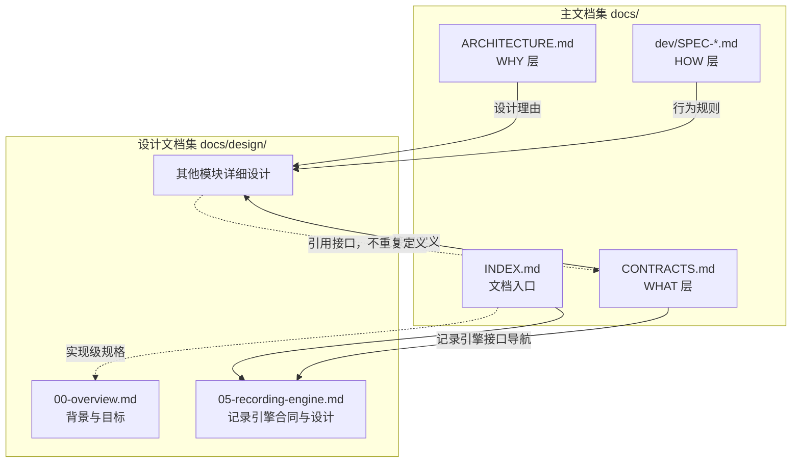

<a name="readme-worldmock-设计文档集"></a>
# WorldMock 设计文档集

> 状态：设计文档集入口
> 日期：2026-10-06
> 范围：产品设计说明书的组织结构与阅读指引


<a name="readme-共享规则与可重建环境修订"></a>
## 共享规则与可重建环境修订

按[共享规则与可重建环境规格](../dev/SPEC-shared-rules-and-rebuildable-env.md)修订；验收结果独立记录。

共享规则、依赖源码补丁、环境引导和跨平台验收同步到各所属章节。改动章节与接口合同后重新生成汇编版，并执行 build_design_doc.py --check；规格冻结和测试通过分别记录。

<a name="readme-工具交互设计同步"></a>
## 工具交互设计同步

[工具交互规格](../dev/SPEC-life-runtime.md#tool-interaction-工具请求)是本次最终特性合同；逐项活动、品类分页查询、完整错误、
类别供给、冻结范围价、通知到达与工作开放已经同步各设计职责。
本次设计冻结不表示生产功能已实现。各章节具体修改和行为/变异验收责任见该规格文件清单。
发布身份目标为场景4、地图3、目录5.0、品类与规则绑定3；世界状态沿用8。


<a name="readme-个人事务与工作安排设计同步"></a>
## 个人事务与工作安排设计同步

[个人事务与工作安排规格](../dev/SPEC-as2-integration.md#errands-workday-运行修复入库)是本次特性合同。设计章节不在冻结时预写，随各阶段的代码同步：
阶段 1 运行修复（就寝反思严格工具、只读查询转发、计划重复意图定位、异常日志），阶段 2 个人事务与提示信息分工，
阶段 3 作息补全与工作安排，阶段 4 查询筛选与返回精简；逐章作业见[实施计划](../archive/errands-workday/errands-workday-implementation-plan.md)，
每章改了什么见该章版本表，各章文件头注明该规格修订的状态。
发布身份为世界状态 9、质量报告 4（阶段 2），场景 5、卡片 3 与 `card-v3`（阶段 3）；
当时地图 3、目录 5.3、品类与规则绑定 3、导出清单 2、运行清单 2 不变。
当前目录按[共享规则与可重建环境规格](../dev/SPEC-shared-rules-and-rebuildable-env.md)发布为 5.4；其它上述格式版本不变。
该规格已实现；逐条证据、源码变异审查与门禁结果见[个人事务与工作安排验收记录](../archive/errands-workday/errands-workday-verification.md)，
实现状态见[实现状态](../dev/implementation-status.md#implementation-status-worldmock-实现状态)。证据是离线测试；规格阶段 6 的配对全天复跑是计费的真实运行，
只在用户要求时启动，未执行。


<a name="readme-让等待成为例外修订"></a>
## 让「等待」成为例外修订

[让「等待」成为例外规格](../dev/SPEC-idle-fillers.md#spec-idle-fillers-让等待成为例外开发规格)是本次特性合同，设计章节随各阶段的代码原位改写；
各章文件头注明按该规格修订的节与阶段，每章改了什么见该章版本表。
阶段 1 班次与休息时段起止的唤醒：清醒的人物在班次与休息时段的起止那一秒各得到一次决策机会，进行中的活动照常继续，
不写事件，不叫醒睡着的人，睡过的起止不补；只变代码身份，世界结构 9、质量报告结构 4、场景结构 5 不变。受影响章节：
[总体架构](01-architecture.md#architecture-worldmock-产品设计说明书-总体架构)（时间推进的边界、分阶段身份）、
[模拟引擎](04-simulation-engine.md#simulation-engine-worldmock-产品设计说明书-模拟引擎)（一轮运行、结算边界与决策机会、当前实现边界、验收重点）、
[记录引擎](05-recording-engine.md#recording-engine-worldmock-产品设计说明书-记录引擎)（四个唤醒成员的登记、环境事件、查看器标签）、
[数据交付](06-delivery.md#delivery-worldmock-产品设计说明书-数据交付)（分阶段身份）、
[行为评估](07-evaluation.md#evaluation-worldmock-产品设计说明书-行为评估)（静默边界门禁的失败含义、作息偏离容差的定义）、
[配置规格](08-configuration.md#configuration-worldmock-产品设计说明书-配置规格)（工作安排声明）与
[输入输出格式](09-io-formats.md#io-formats-worldmock-产品设计说明书-输入输出格式)（人物状态的 `pending_wake_reasons`）。
阶段 2 系统层第 7、14、15、16 条原位改写（仍为十八条）：系统层告诉人物何时会再请他决策、哪些事到点会请他决策而手上的活动照常进行，
作息与今日计划里的钟点只是大概，空下来照自己的习惯做点别的，等待只留给几分钟内就有事请他决策的时候；环境不设等待上限，也不替人物选择内容。
`prompt_sha256` 与代码身份随之变化，`tool_schema_sha256`、世界结构 9、质量报告结构 4、场景结构 5 不变。受影响章节：
[总体架构](01-architecture.md#architecture-worldmock-产品设计说明书-总体架构)（分阶段身份）、
[模拟引擎](04-simulation-engine.md#simulation-engine-worldmock-产品设计说明书-模拟引擎)（当前实现边界）与
[数据交付](06-delivery.md#delivery-worldmock-产品设计说明书-数据交付)（分阶段身份）。
阶段 3 零点计划模板第三、五、六条改写：零点计划只写今天与平常不同的安排、要办的事和要按时起床、出门的提醒（要按时起床的填起床的时刻，出门去上班、上课、接人、赴约这类要按时到的事填该出门的时刻，几点去睡不设提醒），
天天如此的作息与消遣不写成目标，目标文字只给和人约好的事写钟点，大致时刻只表示大概在那前后；校验器与目标字段不变，只变代码身份。受影响章节：
[总体架构](01-architecture.md#architecture-worldmock-产品设计说明书-总体架构)（分阶段身份）、
[模拟引擎](04-simulation-engine.md#simulation-engine-worldmock-产品设计说明书-模拟引擎)（接收当日目标并记录实际推进、当前实现边界）与
[数据交付](06-delivery.md#delivery-worldmock-产品设计说明书-数据交付)（分阶段身份）。


<a name="readme-同时做两件事修订"></a>
## 同时做两件事修订

[同时做两件事规格](../dev/SPEC-parallel-activities.md#spec-parallel-activities-同时做两件事开发规格)是本次修复合同，设计章节随各阶段原位改写；
各章文件头注明按该规格修订的节与阶段，每章改了什么见该章版本表。
阶段 1 暂停的活动不占名额：两个名额只由进行中与待收尾的活动各占一个，`pause_activity` 让出名额，开始、出行与恢复暂停的活动都要有空名额，
只有暂停的活动时可以出发；同刻上限后的受限轮不再按名额分流，`resume_or_conclude` 与 `conclude_only` 留在阶段闭集中、不再被进入；
只变代码身份，世界结构 9、质量报告结构 4、场景结构 5 与目录不变。受影响章节：
[总体架构](01-architecture.md#architecture-worldmock-产品设计说明书-总体架构)（状态归属与写入边界、分阶段身份）、
[交换引擎](02-exchange-engine.md#exchange-engine-worldmock-产品设计说明书-交换引擎)（可供性与活动声明）、
[模拟引擎](04-simulation-engine.md#simulation-engine-worldmock-产品设计说明书-模拟引擎)（发现与比较门店供给、校验与占用安排、活动生命周期、验收重点）与
[输入输出格式](09-io-formats.md#io-formats-worldmock-产品设计说明书-输入输出格式)（人物状态的受限轮阶段与名额）。


<a name="readme-这是什么"></a>
## 这是什么

本目录按模块整理 WorldMock 的设计说明。
[记录引擎](05-recording-engine.md#recording-engine-worldmock-产品设计说明书-记录引擎)集中维护该模块的接口、行为、格式与诊断，承接原已冻结约束，待实现项单独标明。
其余设计章节仍为草稿，引用[接口合同](../CONTRACTS.md#contracts-worldmock-接口合同)与 `docs/dev/SPEC-*.md` 的冻结规则。
权威归属见[文档入口](../INDEX.md#index-worldmock-文档入口)「权威层级」。

- **主文档集**（`docs/` 根目录）：架构理由、跨模块接口合同与导航、实验身份、验收门禁
- **特性规格**（`docs/dev/`）：尚未合入模块设计的行为与算法约定
- **设计文档集**（本目录）：模块设计；记录引擎的接口与行为在所属文档唯一维护
- **汇编版**：`worldmock-design.html` 是本目录十章加接口合同摘录（附录 A）汇编成的单文件设计说明书，先看这一份，再按需要跳到章节源、合同与规格

<a name="readme-汇编版设计说明书"></a>
## 汇编版设计说明书

`worldmock-design.html` 由 `scripts/build_design_doc.py` 从 `00-overview.md` … `09-io-formats.md` 汇编生成：封面与章节一览
（各章的版本、日期、状态取自章节文件头）、修订历史（各章版本表的最新一行）、目录（章与二级标题）、十章正文与附录 A；mermaid 图在联网打开时
由页内脚本渲染，离线时显示图源。附录 A「接口合同摘录：人物工具、模型请求与命令行」在汇编时从 `../CONTRACTS.md` 逐字摘录
「人物工具与管理接口」「当日目标请求」「请求字段与结算检查」「请求模型的闭集与字面边界」「动作状态与动作结果」「社交拒绝错误码」
「七层字段」「七层 Schema」「请求组成」「工具返回通道」「回合预算」「生成参数」「模型身份」「思考回传」「CLI 命令接口」十五节：
人物能调用的工具、请求与拒绝码、人物看到的七层输入、生成参数与命令行都在同一份文件里查得到；合同仍是唯一权威，改合同即改附录，
合同节改名时同步 `scripts/build_design_doc.py` 的摘录清单。它是生成物，勿直接编辑：修改任一章节或合同后运行

```sh
python scripts/build_design_doc.py
```

并与章节一并提交；`python scripts/build_design_doc.py --check` 比对已提交的汇编文件与源是否一致，是工程门禁的一部分
（`tests/test_design_doc_build.py`）。`--pdf` 另用本机 Chrome 打印 PDF，不入库。汇编版不另立权威：接口与字段仍以 `../CONTRACTS.md`、
行为规则仍以 `../dev/SPEC-*.md` 为准。

<a name="readme-文档清单"></a>
## 文档清单

| 文档 | 职责 | 状态 |
| --- | --- | --- |
| `00-overview.md` | 概述：背景、目标、术语、设计原则、需求映射 | DRAFT |
| `01-architecture.md` | 总体架构：系统定位、数字人与四引擎职责、协作数据流、配置与接口导航 | DRAFT |
| `02-exchange-engine.md` | 交换引擎：维护交换规则、查询适用规则、校验交换条件、计算投入产出、校验资源分录与返回规则结果 | DRAFT |
| `03-resource-engine.md` | 资源引擎：资源定义、内容、语料、目录发布与检索提供 | DRAFT |
| `04-simulation-engine.md` | 模拟引擎：初始化、冻结观察与交互菜单、七层人物提示与同秒续接、动作受理与同刻再决策、共享时间、活动名额与地点会话、共同身体结算、零点计划与计划提醒、个人事务的受理、结算确认与事务提醒、环境层上班安排的呈现、班次与休息时段起止的唤醒、威胁唤醒和恢复编排 | DRAFT |
| `05-recording-engine.md` | 记录引擎：事件、素材、事务、检查点、分支、导出与诊断 | 已整合，承接冻结约束 |
| `06-delivery.md` | 数据交付：LabelKit 接口、证据窗口、发布协议 | DRAFT |
| `07-evaluation.md` | 行为评估：指标定义、对比协议、结论边界 | DRAFT |
| `08-configuration.md` | 配置规格：场景、交互菜单、版本引用、初值与模型凭证 | DRAFT |
| `09-io-formats.md` | 输入输出格式：领域状态、观察菜单证据与跨模块格式导航 | DRAFT |

<a name="readme-与主文档集的关系"></a>
## 与主文档集的关系



<a name="readme-阅读路径"></a>
## 阅读路径

<a name="readme-按角色读"></a>
### 按角色读

| 角色 | 从这里读 | 接着读 |
| --- | --- | --- |
| 产品经理 | `00-overview.md` | `01-architecture.md` → 主文档 `ARCHITECTURE.md` |
| 算法工程师 | `04-simulation-engine.md` | `02-exchange-engine.md` → `03-resource-engine.md` → `docs/dev/SPEC-life-runtime.md#spec-life-runtime-特性规格lifeenv-运行时行为与结算规则` |
| 数据工程师 | `05-recording-engine.md` | `06-delivery.md` → `docs/dev/SPEC-labelkit-delivery.md#spec-labelkit-delivery-特性规格数字足迹接入-labelkit` |
| 测试工程师 | `07-evaluation.md` | `05-recording-engine.md` → `VERIFICATION.md` |
| 实施工程师 | `08-configuration.md` | `09-io-formats.md` → `EXPERIMENT.md` |

<a name="readme-按任务读"></a>
### 按任务读

| 你想做的事 | 从这里读 | 接着读 |
| --- | --- | --- |
| 理解资源、内容与语料如何统一管理 | [资源引擎设计](03-resource-engine.md#resource-engine-worldmock-产品设计说明书-资源引擎) | 资源定义、来源、版本、检索与实际接触均在同一文档 |
| 理解模拟引擎如何组织并推进实际运行 | [模拟引擎设计](04-simulation-engine.md#simulation-engine-worldmock-产品设计说明书-模拟引擎) | 初始化、观察与动作受理、时钟与活动、结算、唤醒和恢复编排 |
| 理解交换引擎 | [交换引擎设计](02-exchange-engine.md#exchange-engine-worldmock-产品设计说明书-交换引擎) | 维护交换规则、查询适用规则、校验交换条件、计算投入产出、校验资源分录与返回规则结果 |
| 了解系统整体设计 | `00-overview.md` + `01-architecture.md` | 主文档 `ARCHITECTURE.md` |
| 理解资源如何影响体感和活动效率 | [模拟引擎的身体变化与效率](04-simulation-engine.md#simulation-engine-实际区间身体变化与效率) | [运行时规格](../dev/SPEC-life-runtime.md#spec-life-runtime-特性规格lifeenv-运行时行为与结算规则)「身体语义：两过程睡眠、睡眠不足账、体感分级」「消费、生产与需求模型」→ [时间与能量规格](../dev/SPEC-life-runtime.md#time-and-energy-决策不耗时时间只在做事时流动)第二、三章 → [接口合同](../CONTRACTS.md#contracts-worldmock-接口合同)「资源与需求字段」 |
| 理解时间如何流动、何时决策、能量如何影响人物 | [时间与能量规格](../dev/SPEC-life-runtime.md#time-and-energy-决策不耗时时间只在做事时流动) | [模拟引擎](04-simulation-engine.md#simulation-engine-worldmock-产品设计说明书-模拟引擎)「推进共享时钟」「判断唤醒条件」→ [运行时规格](../dev/SPEC-life-runtime.md#spec-life-runtime-特性规格lifeenv-运行时行为与结算规则)「决策节律：结算边界与唤醒条件分离」 |
| 理解人物提示七层、记忆层与同秒续接 | [人物 Prompt 规格](../dev/SPEC-life-realism.md#persona-prompt-七层请求) | [模拟引擎](04-simulation-engine.md#simulation-engine-人物所见与可做之事)「人物所见与可做之事」「调用并等待人物决策」→ [记录引擎](05-recording-engine.md#recording-engine-事件正文与资源证据)「事件正文与资源证据」→ [接口合同](../CONTRACTS.md#contracts-人物决策提示与生成参数)「人物决策提示与生成参数」 |
| 理解个人事务怎样记下、跨日保留与办结 | [个人事务与工作安排规格](../dev/SPEC-as2-integration.md#errands-workday-运行修复入库)第二、三章 | [模拟引擎](04-simulation-engine.md#simulation-engine-人物所见与可做之事)「人物所见与可做之事」「依规则落实结算」「判断唤醒条件」→ [接口合同](../CONTRACTS.md#contracts-人物决策提示与生成参数)「人物决策提示与生成参数」 |
| 理解下班与到家作息、场景工作安排与环境层上班安排 | [个人事务与工作安排规格](../dev/SPEC-as2-integration.md#errands-workday-运行修复入库)第四章 | [模拟引擎](04-simulation-engine.md#simulation-engine-人物所见与可做之事)「初始化运行世界」「人物所见与可做之事」「接收当日目标并记录实际推进」→ [配置设计](08-configuration.md#configuration-工作安排声明) → [行为评估](07-evaluation.md#evaluation-worldmock-产品设计说明书-行为评估) |
| 接入新的内容语料 | `03-resource-engine.md` | `docs/dev/SPEC-life-realism.md#spec-life-realism-特性规格人物决策与画像` → `catalog/README.md` |
| 编译人物画像 | [人物画像规格](../dev/SPEC-life-realism.md#spec-life-realism-画像编译) | [人物与卡片合同](../CONTRACTS.md#contracts-人格与卡片字段) |
| 理解记录、存储与恢复 | [记录引擎设计](05-recording-engine.md#recording-engine-worldmock-产品设计说明书-记录引擎) | 事件、接口、分支、导出、诊断与验收均在同一文档 |
| 对接 LabelKit | `06-delivery.md` | `docs/dev/SPEC-labelkit-delivery.md#spec-labelkit-delivery-特性规格数字足迹接入-labelkit` → LabelKit 文档 |
| 设计评估指标 | `07-evaluation.md` | `VERIFICATION.md` → `EXPERIMENT.md` |
| 配置实验场景 | `08-configuration.md` | `scenarios/` 示例 → `EXPERIMENT.md` |
| 配置地点类与人物交互菜单 | [交互菜单规格](../dev/SPEC-interaction-menu.md#spec-interaction-menu-特性规格交互菜单) | `08-configuration.md` → `04-simulation-engine.md` → `05-recording-engine.md` |
| 解析输出数据 | `09-io-formats.md` | 记录引擎的事件与导出格式 → 数据交付格式 |
| 追踪运行问题 | `05-recording-engine.md` | `scripts/inspect_run.py` |

<a name="readme-设计文档的特点"></a>
## 设计文档的特点

参考 LabelKit 设计文档的组织方式，WorldMock 设计文档集具有以下特点：

- **规格承接**：详细设计引用冻结规格，发现差异时核对来源，不另立行为合同
- **依据与假设**：区分已有研究依据、工程约束与待校准的仿真假设
- **需求映射**：原始需求逐条映射到承载章节
- **决策记录**：多方案设计点记录对齐结论
- **模块详设**：每个模块包含职责、边界、输入输出、算法流程、配置项
- **数据结构**：核心数据结构与 API 的字段级定义
- **配置规格**：配置文件的完整字段规格与验证规则
- **格式规范**：输入输出格式的逐字段定义
- **可观测性**：日志体系、事件目录、错误分类码

<a name="readme-地图与门店供给的一致性"></a>
## 地图与门店供给的一致性

地图地点、商品和门店供给分别定义；资源引擎负责固定资料与只读查询，交换引擎判断营业、资格和订单，
模拟引擎保存当前报价/库存并按事件推进，记录引擎保存实际比较、执行与恢复证据。
配置只选择身份及初值，输入输出格式采用供给状态；交付保留来源，评估区分商品与门店选择。
[开发规格](../dev/SPEC-map-and-storefront.md#spec-map-and-storefront-地图数据集合与门店供给开发规格) 是行为合同，[业界核验](../dev/research/map-and-storefront-feasibility.md)
说明采纳边界。文档同步不表示实现或路线真实性已经验收；实际结果按源码身份登记。


<a name="readme-文档状态说明"></a>
## 文档状态说明

| 状态 | 含义 |
| --- | --- |
| `DRAFT` | 草稿，内容尚未完整 |
| `REVIEW` | 评审中，等待对齐 |
| `FROZEN` | 已冻结，是当前实现合同 |
| `DEPRECATED` | 已废弃，正文删除并更新引用；历史变更由 Git 保存 |

<a name="readme-主题展开约定"></a>
## 主题展开约定

各引擎设计先用「项目框架映射」说明它在 overview 解决方案中的位置，随后按引擎内部的功能框展开正文。

- 每个内部功能框对应一个正文主题，二级章节名称与图中功能名称保持一致。
- 功能框只列本引擎负责的内容；上游决定和下游加工只在交接边界引用，不写成本引擎的规则或实现差距。
- 职责按实际决定与输出划分，不按代码目录归属推导；跨引擎规则在负责方唯一维护。
- 按功能的输入、处理过程、输出与协作关系说明设计，相关接口、数据结构、规则和失败边界归入所属主题。
- 实现差距与验收要求跟随所属主题，便于在同一处判断设计是否落地。
- 功能边界调整时同步修改框架图、正文与引用，保持图文一一对应。

记录引擎的主题为「记录生活全过程」「保存与关联证据」「一致性保存与校验」「保存共同检查点」
「恢复与反事实分支」「固定截止导出」「运行查询与诊断」。

<a name="readme-更新约定"></a>
## 更新约定

- 新增模块设计时，在本 README 的文档清单登记一行，并加入 `scripts/build_design_doc.py` 的装配顺序
- 修改任一章节或接口合同后重新汇编 `worldmock-design.html` 并一并提交；`--check` 不通过即门禁失败
- 接口在所属合同文档唯一维护；记录引擎修改本模块文档，其他接口修改 `CONTRACTS.md`，同步更新导航
- 设计文档冻结前，标记为 `DRAFT` 或 `REVIEW`；冻结后标记为 `FROZEN`
- 重大修订需要更新文件头的日期与版本，并在该文档的版本表记录修订内容；记录引擎设计沿用以特性标识命名的版本行，版本号不变。新版本行一律追加在版本表末行：汇编脚本取版本表最后一行作为该章「修订历史」的最新一行（`scripts/build_design_doc.py` 的 `latest_revision`）

<a name="readme-版本"></a>
## 版本

| 版本 | 日期 | 修订内容 |
| --- | --- | --- |
| 1.0 | 2026-09-20 | 创建设计文档集入口，定义文档清单与阅读路径 |
| 1.1 | 2026-09-20 | 明确冻结规格的权威归属，补齐资源、身体模型、体感与效率的阅读路径 |
| 1.2 | 2026-09-20 | 资源定义、内容与语料统一到资源引擎，交换规则集中到交换引擎 |
| 1.3 | 2026-09-20 | 记录引擎的接口、行为、格式与诊断合并为单一文档，更新权威归属与阅读路径 |
| 1.4 | 2026-09-20 | 统一人物画像、决策调度与 Dreaming 到模拟引擎，记录与恢复细节引用记录引擎 |
| 1.5 | 2026-09-20 | 引擎设计按框架图内部功能框展开主题，接口、差距与验收跟随所属主题 |
| 1.6 | 2026-09-24 | 同步时间与能量规格：模拟引擎职责补同刻再决策、活动名额与地点会话、零点计划与计划提醒；按任务读增时间、决策与能量一行，身体与效率一行补该规格第二、三章；更新约定改为更新文件头并在该文档的版本表记录，记录引擎沿用特性标识版本行 |
| 1.7 | 2026-09-27 | 同步人物 Prompt 七层规格（人物 Prompt 台账 ER1–ER3）：模拟引擎职责补七层人物提示与同秒续接；按任务读增人物提示七层、记忆层与同秒续接一行 |
| 1.8 | 2026-09-29 | 新增汇编版设计说明书 `worldmock-design.html`（`scripts/build_design_doc.py` 生成，`--check` 入工程门禁）及其说明与更新约定；附录 A 从接口合同逐字摘录人物工具、模型请求与命令行十五节 |
| 1.9 | 2026-10-01 | 补记：新增「工具交互设计同步」节（当时只改了文件头日期，未入本表） |
| 1.10 | 2026-10-03 | 同步个人事务与工作安排规格阶段 1（实施计划 E0-01、E0-02）：新增「个人事务与工作安排设计同步」节；更新约定写明新版本行追加在表末 |
| 1.11 | 2026-10-03 | 同步个人事务与工作安排规格阶段 2（实施计划 E0-03、E0-05，按 `d09d574` 的代码核对）：模拟引擎职责补个人事务的受理、结算确认与事务提醒；按任务读增个人事务一行 |
| 1.12 | 2026-10-03 | 同步个人事务与工作安排规格阶段 3（实施计划 E0-04、E0-06）：模拟引擎职责补环境层上班安排的呈现；按任务读增作息与工作安排一行 |
| 1.13 | 2026-10-04 | 个人事务与工作安排规格实现后文档（实施计划 E0-07、E0-12）：设计同步节注明该规格已实现并链接个人事务与工作安排验收记录，写明证据是离线测试、规格阶段 6 的配对全天复跑未执行；同节两句随之改写：各章文件头注明的是该规格修订的状态（原写已同步到哪个阶段），发布身份由目标改写为已发布的事实 |
| 共享规则与可重建环境 | 2026-10-05 | 同步规则归属、源码重建与验收合同；区分个人事务特性当时的目录 5.3 与当前目录 5.4 |
| `2026-10-05-idle-fillers-c` | 2026-10-05 | 按[让「等待」成为例外规格](../dev/SPEC-idle-fillers.md#spec-idle-fillers-让等待成为例外开发规格)阶段 1 同步：文档清单的模拟引擎职责补班次与休息时段起止的唤醒；新增「让「等待」成为例外修订」一节，链接该规格并列出阶段 1 受影响的章节（总体架构、模拟引擎、记录引擎、数据交付、行为评估、配置规格、输入输出格式）：清醒的人物在班次与休息时段起止那一秒各得到一次决策机会，活动照常继续，不写事件，不叫醒睡着的人，只变代码身份 |
| `2026-10-05-idle-fillers-a` | 2026-10-05 | 按[让「等待」成为例外规格](../dev/SPEC-idle-fillers.md#spec-idle-fillers-让等待成为例外开发规格)阶段 2 同步：「让「等待」成为例外修订」一节补阶段 2：系统层第 7、14、15、16 条原位改写（仍为十八条），告诉人物何时会再请他决策、哪些事到点会请他决策而手上的活动照常进行，作息与今日计划里的钟点只是大概，空下来照自己的习惯做点别的，等待只留给几分钟内就有事请他决策的时候，环境不设等待上限、不替人物选择内容；`prompt_sha256` 与代码身份随之变化，`tool_schema_sha256`、世界结构 9、质量报告结构 4、场景结构 5 不变；列出阶段 2 受影响的章节（总体架构与数据交付的分阶段身份、模拟引擎的当前实现边界） |
| `2026-10-05-idle-fillers-b` | 2026-10-05 | 按[让「等待」成为例外规格](../dev/SPEC-idle-fillers.md#spec-idle-fillers-让等待成为例外开发规格)阶段 3 同步：「让「等待」成为例外修订」一节补阶段 3：零点计划模板第三、五、六条改写，零点计划只写今天与平常不同的安排、要办的事和要按时起床、出门的提醒（要按时起床的填起床的时刻，出门去上班、上课、接人、赴约这类要按时到的事填该出门的时刻，几点去睡不设提醒），天天如此的作息与消遣不写成目标，目标文字只给和人约好的事写钟点，大致时刻只表示大概在那前后；校验器与目标字段不变，只变代码身份；列出阶段 3 受影响的章节（总体架构与数据交付的分阶段身份、模拟引擎的接收当日目标并记录实际推进与当前实现边界） |
| `2026-10-06-parallel-activities-slots` | 2026-10-06 | 按[同时做两件事规格](../dev/SPEC-parallel-activities.md#spec-parallel-activities-同时做两件事开发规格)阶段 1 同步：新增「同时做两件事修订」一节，链接该规格，写明暂停的活动不占名额、开始、出行与恢复暂停的活动都要有空名额、受限轮不再按名额分流且只变代码身份，并列出阶段 1 受影响的章节（总体架构、交换引擎、模拟引擎、输入输出格式）；日期改为 2026-10-06 |
