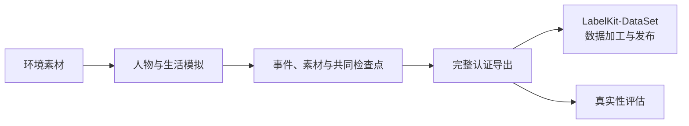

<a name="readme-worldmock-设计文档集"></a>
# WorldMock 设计文档集

> 状态：当前设计入口；行为验收按实际源码、环境和平台回执分别登记
> 日期：2026-10-08
> 范围：模拟、记录、完整导出、真实性评估及其安装与接口
> 动作与内容简化：阶段 1–6 修订条款已实现；阶段 7 的正式环境与下游回执未执行

<a name="readme-这是什么"></a>
## 这是什么

WorldMock 模拟数字人的长期生活并制造合理、连续、可追溯的数字足迹。
环境素材由 WorldMock-Dataset 发布，完整认证导出交给 LabelKit-DataSet 做数据加工与数据集发布。
运行期主观记忆和就寝反思由人物模块维护；离线模型任务、训练格式和规则测试数据由数据集仓库维护。



<a name="readme-汇编版设计说明书"></a>
## 汇编版设计说明书

[worldmock-design.html](worldmock-design.html)汇编当前章节和接口合同摘录。
章节保留现有文件名，数据加工章节移交后不重新编号其余文件。
修改设计或合同后，在仓库根目录执行：

```sh
python scripts/build_design_doc.py
python scripts/build_design_doc.py --check
```

<a name="readme-文档清单"></a>
## 文档清单

| 设计 | 内容 |
| --- | --- |
| [概述](00-overview.md#overview-worldmock-产品设计说明书-概述) | 项目目标、用户需求与设计原则 |
| [总体架构](01-architecture.md#architecture-worldmock-产品设计说明书-总体架构) | 模块职责、数据流与写入边界 |
| [交换引擎](02-exchange-engine.md#exchange-engine-worldmock-产品设计说明书-交换引擎) | 固定类型、常数与资源交换公式 |
| [资源引擎](03-resource-engine.md#resource-engine-worldmock-产品设计说明书-资源引擎) | 冻结环境目录、对象、图与素材 |
| [模拟引擎](04-simulation-engine.md#simulation-engine-worldmock-产品设计说明书-模拟引擎) | 观察、行动、时间、生活规则与恢复执行 |
| [记录引擎](05-recording-engine.md#recording-engine-worldmock-产品设计说明书-记录引擎) | 事件、素材、事务、检查点、导出与诊断的唯一合同 |
| [行为评估](07-evaluation.md#evaluation-worldmock-产品设计说明书-行为评估) | 因果核对、固定统计、盲评与真实性结论 |
| [配置规格](08-configuration.md#configuration-worldmock-产品设计说明书-配置规格) | 人物、环境、模型、安装和评估配置 |
| [输入输出格式](09-io-formats.md#io-formats-worldmock-产品设计说明书-输入输出格式) | 当前世界与人物状态；记录格式引用记录引擎合同 |

<a name="readme-与主文档集的关系"></a>
## 与主文档集的关系

[文档入口](../INDEX.md#index-worldmock-文档入口)说明权威层级。
[接口合同](../CONTRACTS.md#contracts-worldmock-接口合同)提供跨模块公共接口，
[现行特性规格](../INDEX.md#index-特性规格与提案)定义行为，
[验收标准](../VERIFICATION.md#verification-worldmock-验收标准)定义证明要求，
[实现状态](../dev/implementation-status.md#implementation-status-worldmock-实现状态)登记实际执行结果。
设计章节承接这些合同；历史提案、归档和验收报告保留其当时提交身份，不作为当前行为定义。

<a name="readme-文档状态说明"></a>
## 文档状态说明

当前场景结构为 8，世界状态结构为 11，运行清单与导出清单结构为 4，质量报告结构为 6。
正式环境身份、长期模型运行、平台回执和下游消费验收分别核对。
LabelKit-DataSet 已接收来源快照并核对摘要，新消费者的整合与正式验收尚未取得证明。

<a name="readme-更新约定"></a>
## 更新约定

按职责在唯一合同中修改行为与字段，同时同步实现、测试及文档引用，重建汇编版。
设计章节的特性说明行放在带键引用块之后。
旧接口直接删除；当前文档不提供兼容入口或迁移方案。历史证据使用原提交和原字节定位。

<a name="readme-版本"></a>
## 版本表

| 版本 | 日期 | 变更 |
| --- | --- | --- |
| `2026-10-07-repository-ownership` | 2026-10-07 | 删除下游数据加工章节的当前导航，按三仓职责组织设计；保留其余文件名与历史证据身份 |
| `2026-10-07-acs-close` | 2026-10-07 | 动作与内容简化阶段 1–6 收口；设计章节身份统一为场景 8、世界 11、运行清单 4、导出 4 与质量 6 |
