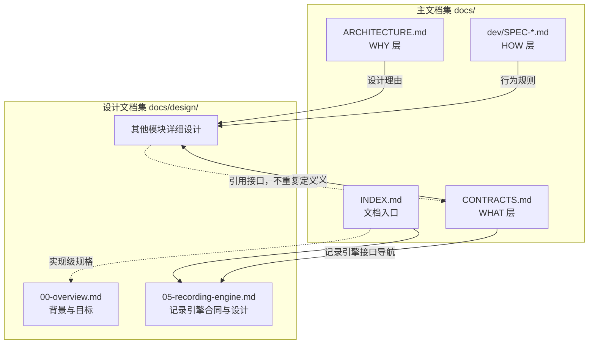

# WorldMock 设计文档集

> 状态：设计文档集入口
> 日期：2026-09-20
> 范围：产品设计说明书的组织结构与阅读指引

## 这是什么

本目录按模块整理 WorldMock 的设计说明。
[记录引擎](05-recording-engine.md)集中维护该模块的接口、行为、格式与诊断，承接原已冻结约束，待实现项单独标明。
其余设计章节仍为草稿，引用[接口合同](../CONTRACTS.md)与 `docs/dev/SPEC-*.md` 的冻结规则。
权威归属见[文档入口](../INDEX.md)「权威层级」。

- **主文档集**（`docs/` 根目录）：架构理由、跨模块接口合同与导航、实验身份、验收门禁
- **特性规格**（`docs/dev/`）：尚未合入模块设计的行为与算法约定
- **设计文档集**（本目录）：模块设计；记录引擎的接口与行为在所属文档唯一维护

## 文档清单

| 文档 | 职责 | 状态 |
| --- | --- | --- |
| `00-overview.md` | 概述：背景、目标、术语、设计原则、需求映射 | DRAFT |
| `01-architecture.md` | 总体架构：系统定位、模块清单、数据流、CLI 规格 | DRAFT |
| `02-exchange-engine.md` | 交换引擎：维护交换规则、查询适用规则、校验交换条件、计算投入产出、校验资源分录与返回规则结果 | DRAFT |
| `03-resource-engine.md` | 资源引擎：资源定义、内容、语料、目录发布与检索提供 | DRAFT |
| `04-simulation-engine.md` | 模拟引擎：初始化、观察与动作受理、时间与活动推进、结算、唤醒和恢复编排 | DRAFT |
| `05-recording-engine.md` | 记录引擎：事件、素材、事务、检查点、分支、导出与诊断 | 已整合，承接冻结约束 |
| `06-delivery.md` | 数据交付：LabelKit 接口、证据窗口、发布协议 | DRAFT |
| `07-evaluation.md` | 行为评估：指标定义、对比协议、结论边界 | DRAFT |
| `08-configuration.md` | 配置规格：场景、版本引用、初值与模型凭证 | DRAFT |
| `09-io-formats.md` | 输入输出格式：领域状态与跨模块格式导航 | DRAFT |

## 与主文档集的关系

## 阅读路径

### 按角色读

| 角色 | 从这里读 | 接着读 |
| --- | --- | --- |
| 产品经理 | `00-overview.md` | `01-architecture.md` → 主文档 `ARCHITECTURE.md` |
| 算法工程师 | `04-simulation-engine.md` | `02-exchange-engine.md` → `03-resource-engine.md` → `SPEC-life-runtime.md` |
| 数据工程师 | `05-recording-engine.md` | `06-delivery.md` → `SPEC-labelkit-delivery.md` |
| 测试工程师 | `07-evaluation.md` | `05-recording-engine.md` → `VERIFICATION.md` |
| 实施工程师 | `08-configuration.md` | `09-io-formats.md` → `EXPERIMENT.md` |

### 按任务读

| 你想做的事 | 从这里读 | 接着读 |
| --- | --- | --- |
| 理解资源、内容与语料如何统一管理 | [资源引擎设计](03-resource-engine.md) | 资源定义、来源、版本、检索与实际接触均在同一文档 |
| 理解模拟引擎如何组织并推进实际运行 | [模拟引擎设计](04-simulation-engine.md) | 初始化、观察与动作受理、时钟与活动、结算、唤醒和恢复编排 |
| 理解交换引擎 | [交换引擎设计](02-exchange-engine.md) | 维护交换规则、查询适用规则、校验交换条件、计算投入产出、校验资源分录与返回规则结果 |
| 了解系统整体设计 | `00-overview.md` + `01-architecture.md` | 主文档 `ARCHITECTURE.md` |
| 理解资源如何影响体感和活动效率 | [模拟引擎的身体变化与效率](04-simulation-engine.md#实际区间身体变化与效率) | [运行时规格](../dev/SPEC-life-runtime.md)「身体语义」「消费、生产与需求模型」→ [接口合同](../CONTRACTS.md)「资源与需求字段」 |
| 接入新的内容语料 | `03-resource-engine.md` | `SPEC-life-realism.md` → `catalog/README.md` |
| 编译人物画像 | [人物画像规格](../dev/SPEC-life-realism.md#画像编译) | [人物与卡片合同](../CONTRACTS.md#人格与卡片字段) |
| 理解记录、存储与恢复 | [记录引擎设计](05-recording-engine.md) | 事件、接口、分支、导出、诊断与验收均在同一文档 |
| 对接 LabelKit | `06-delivery.md` | `SPEC-labelkit-delivery.md` → LabelKit 文档 |
| 设计评估指标 | `07-evaluation.md` | `VERIFICATION.md` → `EXPERIMENT.md` |
| 配置实验场景 | `08-configuration.md` | `scenarios/` 示例 → `EXPERIMENT.md` |
| 解析输出数据 | `09-io-formats.md` | 记录引擎的事件与导出格式 → 数据交付格式 |
| 追踪运行问题 | `05-recording-engine.md` | `scripts/inspect_run.py` |

## 设计文档的特点

参考 LabelKit 设计文档的组织方式，WorldMock 设计文档集具有以下特点：

- **规格承接**：详细设计引用冻结规格，发现差异时核对来源，不另立行为合同
- **依据与假设**：区分已有研究依据、工程约束与待校准的仿真假设
- **需求映射**：原始需求逐条映射到承载章节
- **决策记录**：多方案设计点记录对齐结论
- **模块详设**：每个模块包含职责、边界、输入输出、算法流程、配置项
- **数据结构**：核心数据结构与 API 的字段级定义
- **配置规格**：配置文件的完整字段规格与验证规则
- **格式规范**：输入输出格式的逐字段定义
- **可观测性**：日志体系、事件目录、错误分类码

## 文档状态说明

| 状态 | 含义 |
| --- | --- |
| `DRAFT` | 草稿，内容尚未完整 |
| `REVIEW` | 评审中，等待对齐 |
| `FROZEN` | 已冻结，是当前实现合同 |
| `DEPRECATED` | 已废弃，正文删除并更新引用；历史变更由 Git 保存 |

## 主题展开约定

各引擎设计先用「项目框架映射」说明它在 overview 解决方案中的位置，随后按引擎内部的功能框展开正文。

- 每个内部功能框对应一个正文主题，二级章节名称与图中功能名称保持一致。
- 功能框只列本引擎负责的内容；上游决定和下游加工只在交接边界引用，不写成本引擎的规则或实现差距。
- 职责按实际决定与输出划分，不按代码目录归属推导；跨引擎规则在负责方唯一维护。
- 按功能的输入、处理过程、输出与协作关系说明设计，相关接口、数据结构、规则和失败边界归入所属主题。
- 实现差距与验收要求跟随所属主题，便于在同一处判断设计是否落地。
- 功能边界调整时同步修改框架图、正文与引用，保持图文一一对应。

记录引擎的主题为「记录生活全过程」「保存与关联证据」「一致性保存与校验」「保存共同检查点」
「恢复与反事实分支」「固定截止导出」「运行查询与诊断」。

## 更新约定

- 新增模块设计时，在本 README 的文档清单登记一行
- 接口在所属合同文档唯一维护；记录引擎修改本模块文档，其他接口修改 `CONTRACTS.md`，同步更新导航
- 设计文档冻结前，标记为 `DRAFT` 或 `REVIEW`；冻结后标记为 `FROZEN`
- 重大修订需要在文档开头的版本表记录修订内容

## 版本

| 版本 | 日期 | 修订内容 |
| --- | --- | --- |
| 1.0 | 2026-09-20 | 创建设计文档集入口，定义文档清单与阅读路径 |
| 1.1 | 2026-09-20 | 明确冻结规格的权威归属，补齐资源、身体模型、体感与效率的阅读路径 |
| 1.2 | 2026-09-20 | 资源定义、内容与语料统一到资源引擎，交换规则集中到交换引擎 |
| 1.3 | 2026-09-20 | 记录引擎的接口、行为、格式与诊断合并为单一文档，更新权威归属与阅读路径 |
| 1.4 | 2026-09-20 | 统一人物画像、决策调度与 Dreaming 到模拟引擎，记录与恢复细节引用记录引擎 |
| 1.5 | 2026-09-20 | 引擎设计按框架图内部功能框展开主题，接口、差距与验收跟随所属主题 |
