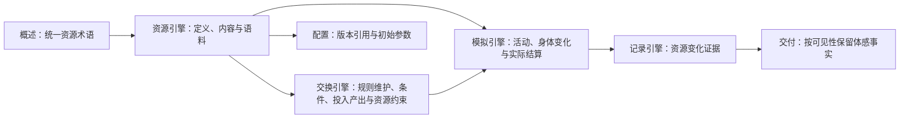

<a name="summary-worldmock-设计文档集-创建总结"></a>
# WorldMock 设计文档集 — 创建总结

> **日期**：2026-10-06
> **状态**：设计草稿已创建；资源与身体模型相关章节已修订，文档集整体尚未冻结


具体环境及制作工具按[环境数据归属规格](../dev/SPEC-environment-data-ownership.md)归 WorldMock-Dataset；
WorldMock 提供引擎、包内固定规则和用于行为验收的人工环境。当前运行合同使用场景结构 7、世界状态结构 10 和五字段环境身份。
正式环境的结构 7 发布及跨平台回执属于资源与规则引擎简化阶段 9，数据仓未发布前不写成已验证输入。

<a name="summary-共享规则与可重建环境修订"></a>
## 共享规则与可重建环境修订

按[共享规则与可重建环境规格](../dev/SPEC-shared-rules-and-rebuildable-env.md)修订；验收结果独立记录。

共享规则与可重建环境的设计同步分布在总体架构、交换、资源、模拟、记录、交付、评估、配置与格式章节；当前特性行为由同名冻结规格统一约束。

<a name="summary-工具交互设计同步"></a>
## 工具交互设计同步

[生活运行时规格](../dev/SPEC-life-runtime.md#tool-interaction-工具请求)保留稳定工具请求、错误和同秒续接合同；旧品类分页、目录浏览、
供给时态、工作开放和任务评审由资源与规则引擎简化规格取代。当前人物从固定菜单选择生活动作、食品、app 与工作主题，
app 始终列出，内容由 app 抽取，购买按固定菜单和名称执行，`query_world` 只读。生产与定向证据位置见下节；阶段 8 的完整日双跑、
第三基线、最终门禁和独立源码变异审查只按实际回执更新。

<a name="summary-资源与规则引擎简化修订"></a>
## 资源与规则引擎简化修订

[冻结规格](../dev/SPEC-resource-and-rule-simplification.md#spec-rrs-现行文档原位改写)把设计改写分配到真实实现阶段：

| 阶段 | 受影响章节 |
| --- | --- |
| 阶段 1：固定规则与目录 | 交换引擎、资源引擎、数据交付、配置规格、输入输出格式 |
| 阶段 2：随机地图 | 概述、总体架构、资源引擎、模拟引擎、记录引擎 |
| 阶段 3：食品与店铺 | 概述、总体架构、交换引擎、资源引擎、模拟引擎、行为评估、配置规格、输入输出格式 |
| 阶段 4：app 与内容 | 概述、资源引擎、模拟引擎、记录引擎 |
| 阶段 5：工作主题 | 概述、模拟引擎、记录引擎、行为评估、配置规格、输入输出格式 |
| 阶段 6：提示与查看器 | 总体架构、模拟引擎、数据交付 |
| 阶段 7：记录、交付与评估 | 记录引擎、数据交付、行为评估、输入输出格式 |
| 阶段 8：文档与验收收口 | 本总结、设计入口与生成的 `worldmock-design.html`；完整日、第三基线与最终门禁结论等待阶段 8 实际回执 |


<a name="summary-个人事务与工作安排设计同步"></a>
## 个人事务与工作安排设计同步

[个人事务与工作安排规格](../dev/SPEC-as2-integration.md#errands-workday-运行修复入库)是本次特性合同。设计章节不在冻结时预写，随各阶段的代码同步：
阶段 1 运行修复（就寝反思严格工具、只读查询转发、计划重复意图定位、异常日志），阶段 2 个人事务与提示信息分工，
阶段 3 作息补全与工作安排，阶段 4 查询筛选与返回精简；逐章作业见[实施计划](../archive/errands-workday/errands-workday-implementation-plan.md)，
每章改了什么见该章版本表，各章文件头注明该规格修订的状态。
发布身份为世界状态 9、质量报告 4（阶段 2），场景 5、卡片 3 与 `card-v3`（阶段 3）；
当时地图 3、目录 5.3、品类与规则绑定 3、导出清单 2、运行清单 2 不变。
共享规则特性曾发布目录 5.4；当前场景结构为 6，具体环境及目录身份由 Dataset 发布清单绑定。
该规格已实现；逐条证据、源码变异审查与门禁结果见[个人事务与工作安排验收记录](../archive/errands-workday/errands-workday-verification.md)，
实现状态见[实现状态](../dev/implementation-status.md#implementation-status-worldmock-实现状态)。证据是离线测试；规格阶段 6 的配对全天复跑是计费的真实运行，
只在用户要求时启动，未执行。


<a name="summary-完成状态"></a>
## 完成状态

<a name="summary-已创建的文档"></a>
### ✅ 已创建的文档

| 文档 | 大小 | 状态 | 主要内容 |
| --- | --- | --- | --- |
| [README.md](README.md#readme-worldmock-设计文档集) | 5.4K | ✅ | 文档集入口、阅读路径、与主文档集的关系 |
| [00-overview.md](00-overview.md#overview-worldmock-产品设计说明书-概述) | 12K | ✅ | 背景目标、术语、需求映射、背书总表、对齐决策 |
| [01-architecture.md](01-architecture.md#architecture-worldmock-产品设计说明书-总体架构) | 14K | ✅ | 五层架构、19 模块清单、数据流、CLI 命令 |
| [02-exchange-engine.md](02-exchange-engine.md#exchange-engine-worldmock-产品设计说明书-交换引擎) | — | DRAFT | 维护交换规则、查询适用规则、校验交换条件、计算投入产出、校验资源分录与返回规则结果 |
| [03-resource-engine.md](03-resource-engine.md#resource-engine-worldmock-产品设计说明书-资源引擎) | — | DRAFT | 资源定义、内容与语料、目录发布、检索和提供 |
| [04-simulation-engine.md](04-simulation-engine.md#simulation-engine-worldmock-产品设计说明书-模拟引擎) | — | DRAFT | 初始化、观察与动作受理、时间与活动推进、结算、唤醒和恢复编排 |
| [05-recording-engine.md](05-recording-engine.md#recording-engine-worldmock-产品设计说明书-记录引擎) | — | 已整合 | 事件、素材、事务、检查点、分支、导出、质量与诊断；承接冻结约束 |
| [06-delivery.md](06-delivery.md#delivery-worldmock-产品设计说明书-数据交付) | 29K | ✅ | LabelKit 接口、证据窗口、多任务编排 |
| [07-evaluation.md](07-evaluation.md#evaluation-worldmock-产品设计说明书-行为评估) | 23K | ✅ | 行为指标、对比协议、盲审流程、结论边界 |
| [08-configuration.md](08-configuration.md#configuration-worldmock-产品设计说明书-配置规格) | 22K | ✅ | 场景文件、目录规则、语料配置、凭证管理 |
| [09-io-formats.md](09-io-formats.md#io-formats-worldmock-产品设计说明书-输入输出格式) | 26K | ✅ | 输入输出格式、Schema 定义、来源标记 |
| **范围** | — | **DRAFT** | **文档创建状态不代表设计冻结或实现验收** |

<a name="summary-资源与身体模型修订"></a>
## 资源与身体模型修订

身体相关资源与金钱统一称为资源；资源的变化、计量与校验规则按类别展开。
详细规则来自 [LifeEnv 运行时规格](../dev/SPEC-life-runtime.md#spec-life-runtime-特性规格lifeenv-运行时行为与结算规则)，
领域接口来自[接口合同](../CONTRACTS.md#contracts-worldmock-接口合同)，记录与证据约束统一见[记录引擎](05-recording-engine.md#recording-engine-worldmock-产品设计说明书-记录引擎)。



身体模型不再使用四项百分制状态或固定点数恢复，不根据困意直接强制睡眠，也不以能量阻断或停止活动。
金钱双边转账、能量与娱乐需要流水、睡眠模型演化、共享时钟推进分别核验。
食品利用效率与睡眠不足的关联保留为仿真假设。

<a name="summary-文档特点"></a>
## 文档特点

<a name="summary-参考-labelkit-的组织方式"></a>
### 1. 参考 LabelKit 的组织方式

从 `Project/LabelKit/docs/design/` 学习的格式：

<a name="summary-已采用的元素"></a>
#### ✅ 已采用的元素
- 封面与元信息（版本、日期、状态、目标读者）
- 修订历史表
- 术语与缩写表
- 设计原则
- 需求映射表（需求 → 承载章节）
- 算法与工程背书总表（功能 → 学术/工业背书）
- 已对齐的设计决策（多方案对比）
- 模块详细设计（职责、边界、算法、配置）
- 核心数据结构与 API
- 丰富的图表（Mermaid）与表格

<a name="summary-适配-worldmock-的差异"></a>
#### 🔄 适配 WorldMock 的差异
- **格式**：Markdown 而非 HTML（版本控制友好）
- **组织**：模块化多文件而非单一大文件（便于维护）
- **文档分工**：主文档集定义架构与接口，特性规格定义行为，本目录按模块解释
- **引用不重复**：记录引擎合同在本模块设计唯一维护，其余接口引用 CONTRACTS.md

<a name="summary-文档结构"></a>
### 2. 文档结构

```
docs/design/
├── README.md                    # 入口：文档清单与阅读路径
├── 00-overview.md              # 概述：背景、目标、术语、需求映射
├── 01-architecture.md          # 总体架构：系统定位、模块清单、数据流
├── 02-exchange-engine.md           # 交换引擎：规则维护与查询、条件校验、投入产出、分录校验与结果
├── 03-resource-engine.md     # 资源引擎：资源定义、内容、语料与提供
├── 04-simulation-engine.md    # 模拟引擎：初始化、观察、动作、时间、活动、结算、唤醒与恢复
├── 05-recording-engine.md      # 记录引擎：事件、存储、恢复、导出与诊断
├── 06-delivery.md              # 数据交付：LabelKit、证据窗口、编排
├── 07-evaluation.md            # 行为评估：指标、对比、盲审、结论
├── 08-configuration.md         # 配置规格：场景、语料、凭证与规则入口
├── 09-io-formats.md            # 输入输出：Schema、字段、来源标记
└── SUMMARY.md                  # 本文件：创建总结
```

<a name="summary-与主文档集的关系"></a>
### 3. 与主文档集的关系

| 文档集 | 定位 | 关键问题 | 典型文档 |
| --- | --- | --- | --- |
| **主文档集** (`docs/`) | 架构与合同 | 为什么这样设计？接口是什么？ | ARCHITECTURE.md、CONTRACTS.md、EXPERIMENT.md |
| **特性规格** (`docs/dev/`) | 行为与算法 | 如何结算、推进与验证？ | SPEC-life-runtime.md、SPEC-labelkit-delivery.md |
| **设计文档集** (`docs/design/`) | 模块说明 | 如何理解和组合这些规则？ | 02-exchange-engine.md、05-recording-engine.md、08-configuration.md |

**协同关系**：
- 主文档集定义**接口契约**，特性规格定义**行为规则**，设计文档集描述**模块流程**
- 记录引擎集中维护接口与行为，其余设计文档引用对应合同
- 设计文档包含**算法伪代码**、**配置示例**、**数据流图**

<a name="summary-文档内容亮点"></a>
## 文档内容亮点

<a name="summary-overviewmd"></a>
### 00-overview.md
- 问题定义与解决方案
- 10 个核心设计原则（人物自主性、确定性结算、唯一写入者等）
- 15 条需求映射（需求 → 承载章节）
- 10 个功能点的学术/工业背书
- 10 个已对齐的设计决策（多方案对比）

<a name="summary-architecturemd"></a>
### 01-architecture.md
- 五层分层架构图（CLI → Runtime → Agent/Env → Life/Footprints → Storage）
- 19 个模块清单与状态
- 三阶段端到端数据流（准备 → 运行 → 交付）
- 12 个 CLI 命令与执行顺序
- 核心数据结构（WorldState、AgentState、BodyState 等）
- v1.0 → v2.0 → v3.0 演进路线

<a name="summary-exchange-enginemd"></a>
### 02-exchange-engine.md
- 固定类型、食品常数、移动与配送常数、app 使用时长和内容缓解率
- 身体与动机规则、纯交换算子及 `RULES_VERSION`
- 根据当前状态计算资源变化，由模拟引擎提交；不读取环境供给或维护对象目录
- 规则来源、调用边界和资源分录约束

<a name="summary-resource-enginemd"></a>
### 03-resource-engine.md
- 登记并校验地点、地图、食品、店铺、app、内容、工作主题和可供性
- 发布目录逐文件身份、地图摘要与只读派生关系
- 校验 app 到内容、店铺到 app、食品到店铺和人物到工作主题的引用闭合
- 资源数值和固定结算规则引用交换引擎；实际活动、持有和进度由模拟与记录引擎维护

<a name="summary-simulation-enginemd"></a>
### 04-simulation-engine.md
- 初始化运行世界，绑定人物、场景、资源与规则
- 组织观察与决策机会，收齐并有序受理动作
- 推进共享时钟与同人活动集合，每人共同时间只结算一次；按新事实交付威胁提醒
- 与记录引擎协作保存检查点，编排恢复与实际反事实运行
- 决策不耗时，没有进行中活动或有待收尾活动的人物同一秒再决策，受同刻上限约束
- 场景本地零点由运行时后台任务生成当日计划，目标可带提醒，提醒可结束睡眠
- 人物在播报、暂停、收尾时把以后要买到、拿到或吃掉的具体东西记成个人事务：跨零点留在待办层，办成只由环境按结算证据确认并在进度层留一条记录；清醒时事务提醒精确到点、只给一次决策机会，不结束睡眠
- 地点会话随出发与到达切换，每人两个活动名额：进行中与待收尾的活动各占一个，暂停的不占，恢复要有空名额
- 人物请求为系统层与六层 JSON，每项信息只出现一次；一次决策就是一个世界请求，同一秒的连续决策续接原生消息，时间推进后思考丢弃
- 场景按人物声明工作安排，环境层每轮写明今天的上班安排 `duty`；今日计划改不了它，环境不因此拒绝请求，班内离岗由行为评估度量
- 班次与休息时段的起止给清醒的人物各一次决策机会，不结束活动、不写事件、不叫醒睡着的人
- 人物算法、资源检索、存储与离线 Dreaming 由所属模块维护


<a name="summary-recording-enginemd"></a>
### 05-recording-engine.md

- 事件、来源与可见性、素材及持久化接口
- 记忆层分列系统写的 `settled` 与人物写的 `self_notes`，从已提交事件与世界状态派生；主观记忆与反思独立留证
- 事务与状态连续性、资金对账、共同检查点与恢复分支
- 反事实来源、固定截止导出、认证与质量报告
- 状态查询、日志、诊断工具、已知差距与验收要求

<a name="summary-deliverymd"></a>
### 06-delivery.md
- LabelKit 接口规范（4 个任务类型）
- 证据窗口（时间窗口、内容窗口、记忆窗口）
- 多任务编排（训练数据 + 规则测试 + 质量报告）
- 反事实分支（replay 认证）

<a name="summary-evaluationmd"></a>
### 07-evaluation.md
- 8 个行为指标（时间分布、消费、社交、地点、身体、资源、长期、异常）
- 对比协议（synthetic vs synthetic，无人类基准）
- 盲审流程（生成 → 盲审 → 解盲 → 结论）
- 结论边界（comparative_plausibility_only）
- 行为评估报告另有工作负荷 `workload` 与作息偏离 `routine_deviation` 两个只报告项，输入是一个可选的打包对象（各人物的班次、任务的预约与要求地点、住处、覆盖后的作息窗口与播报间隔），由 `scripts/inspect_run.py` 的只读子命令 `workday --scenario <场景文件>` 产出；报告结构标识 `behavior-metrics-1` 不变

<a name="summary-configurationmd"></a>
### 08-configuration.md
- 场景结构 7 显式引用一个环境目录；人工环境供当前行为与完整日验收，正式环境由 WorldMock-Dataset 阶段 9 发布
- 环境清单固定环境标识、环境版本、`RULES_VERSION`、目录内容摘要和地图摘要；同版本异内容拒绝
- 目录声明人物地点、账户、工作安排和工作主题绑定，固定身体与交换规则不从场景覆盖
- 模型凭证由运行配置读取，不进入场景、运行身份或导出
- `validate --environment` 对目录文件、引用闭合、图连通、可供性和语料身份失败关闭

<a name="summary-io-formatsmd"></a>
### 09-io-formats.md

- 世界与人物状态的格式说明
- 记录引擎与 LabelKit 数据格式的阅读入口
- 通用编码与验证规则


<a name="summary-地图与门店供给修订"></a>
## 地图与门店供给修订

旧地图与门店供给分支的验收记录保留为历史证据；现行行为由
[资源与规则引擎简化规格](../dev/SPEC-resource-and-rule-simplification.md#spec-rrs-资源与规则引擎简化开发规格)取代。
资源引擎登记确定性连通加权图、地点、固定食品、店铺和店铺 app；没有营业、报价、库存或浏览可见期状态。
出行按图的最短距离与固定方式常数报价，到店购买直接增加当地食品持有；通过店铺 app 下单只付款一次并按订单送达。
运行清单和检查点绑定五字段环境身份，出行事件用 `trip_id` 关联路径和到达事实。现行生产入口在 `src/worldmock/catalog/`、
`src/worldmock/life/travel.py` 与 `src/worldmock/life/commerce.py`，定向证据在 `tests/catalog/`、`tests/life/test_travel_graph.py`、
`tests/life/test_commerce.py` 和 `tests/integration/test_environment_identity.py`；最终执行结论取阶段 8 回执。

<a name="summary-时间与能量修订"></a>
## 时间与能量修订

[时间与能量规格](../dev/SPEC-life-runtime.md#time-and-energy-决策不耗时时间只在做事时流动)冻结时，概述、总体架构、交换引擎、模拟引擎、记录引擎、数据交付、行为评估、
配置、输入输出格式、本目录入口与本文按该规格同步：决策不耗时与同刻再决策、能量不阻断活动、零点计划与计划提醒、
五个动词与并行准入、地点会话与两个活动名额、`finish` 并入 `conclude_activity`、提示不含内部身份。
资源引擎的版本事实，以及由代码或测试互锁的名称，随对应代码同步，
见[实施计划](../archive/time-and-energy/time-and-energy-implementation-plan.md)「文档同步作业」。
文档同步不等于已实现，实测结果见[实现状态](../dev/implementation-status.md#implementation-status-worldmock-实现状态)。

<a name="summary-人物-prompt-七层修订"></a>
## 人物 Prompt 七层修订

[人物 Prompt 规格](../dev/SPEC-life-realism.md#persona-prompt-七层请求)冻结时，概述、总体架构、交换引擎、资源引擎、模拟引擎、记录引擎、数据交付、行为评估、
配置、输入输出格式、本目录入口与本文按该规格同步：人物请求为系统层与工具、人设、记忆、待办、环境、进度六层 JSON，每项信息只出现一次；
删除决策自述阶段，一次决策就是一个世界请求，回复正文可有可无；同一秒的连续决策续接原生消息，时间推进后思考丢弃；
记忆层按 session 派生、零点分区，关系与偏好在人设层原地更新；`obtain`、`consume` 增 `from`、`to`，给予只转移，进食按开吃份量结算，
指名购买不受轮转限制；受限轮用完写跨决策预算耗尽事件；世界结构版本 8。
其中由代码或测试锁定的闭集、事件字段、版本与导出格式属于各代码阶段的同批作业，见[实施计划](../archive/persona-prompt/persona-prompt-implementation-plan.md)「文档同步作业」。
该规格已实现，实现后各文档按最终代码核对并注明修订部分已实现；逐条证据、语义突变审查与门禁结果见[人物 Prompt 验收记录](../archive/persona-prompt/persona-prompt-verification.md)，实现状态见[实现状态](../dev/implementation-status.md#implementation-status-worldmock-实现状态)。

<a name="summary-个人事务与工作安排修订"></a>
## 个人事务与工作安排修订

[个人事务与工作安排规格](../dev/SPEC-as2-integration.md#errands-workday-运行修复入库)分四个代码阶段实现，各设计章节、本目录入口与本文随各阶段的代码同步：
就寝反思经唯一严格工具 `submit_reflection` 提交并核验引用，回看任务经环境 actor 转发，计划重复意图逐条定位，
决策失败与工具分发失败先写带异常链的英文日志再上抛；
个人事务由三个控制请求的 `errands` 新增、更新与取消，随人物状态跨日保留并显示在待办层，办成只由结算证据确认，事务提醒不结束睡眠；
作息补下班与到家两个可空锚点，场景按人物声明 `work_schedule`，环境层 `duty` 每轮写明今天的上班安排；
`query_world` 为六键请求，增购买来源与只看此刻能做的两个筛选，结果不再逐项附候选；
当前世界结构 9、场景结构 6、卡片结构 3、质量报告结构 4；本次环境归属验收另记实际收据。
该规格已实现；逐条证据、源码变异审查与门禁结果见[个人事务与工作安排验收记录](../archive/errands-workday/errands-workday-verification.md)，
实现状态见[实现状态](../dev/implementation-status.md#implementation-status-worldmock-实现状态)。证据是离线测试；规格阶段 6 的配对全天复跑是计费的真实运行，
只在用户要求时启动，未执行；项目级十二周真实运行、三次隔离盲评和完整自然日交付仍未完成。

<a name="summary-让等待成为例外修订"></a>
## 让「等待」成为例外修订

[让「等待」成为例外规格](../dev/SPEC-idle-fillers.md#spec-idle-fillers-让等待成为例外开发规格)分阶段实现，各设计章节、本目录入口与本文随各阶段的代码原位改写：
班次与休息时段的起止给清醒的人物各一次决策机会，不结束活动、不写事件、不叫醒睡着的人（阶段 1，只变代码身份，世界结构 9、质量报告结构 4、当前场景结构 6 不变）。
系统层告诉人物何时会再请他决策、哪些事到点会请他决策而手上的活动照常进行，作息与今日计划里的钟点只是大概：差不多到了就做，
非准点不可的事靠目标的提醒时刻（阶段 2，系统层第 7、14、15、16 条原位改写，`prompt_sha256` 与代码身份变化，`tool_schema_sha256` 与各结构版本不变）。
零点计划只写与平常不同的事、要办的事和要按时起床、出门的提醒，天天如此的作息与消遣不写成目标，目标文字只给和人约好的事写钟点（阶段 3，零点计划模板第三、五、六条改写，只变代码身份）。


<a name="summary-同时做两件事修订"></a>
## 同时做两件事修订

[同时做两件事规格](../dev/SPEC-parallel-activities.md#spec-parallel-activities-同时做两件事开发规格)分阶段实现，各设计章节、本目录入口与本文随各阶段原位改写：
暂停的活动不占名额，两个名额只由进行中与待收尾的活动占，开始、出行与恢复暂停的活动都要有空名额，同刻上限后的受限轮不再按名额分流
（阶段 1，只变代码身份，世界结构 9、质量报告结构 4、场景结构 6 与目录不变）。
只有同一种动作互斥，每种动作占自己的名字，睡眠与一切互斥，驾车只能再听播客或和人说话（阶段 2，引擎包资源 `src/worldmock/data/affordances.toml` 里的占用声明重列，`tool_schema_sha256` 与代码身份变化，`prompt_sha256` 与各结构版本不变；仍带旧占用名副本的外部发布环境在装配时被拒绝，要由 WorldMock-Dataset 按新占用名重新发布）。


<a name="summary-后续维护建议"></a>
## 后续维护建议

<a name="summary-与代码同步"></a>
### 1. 与代码同步
- 接口变更时更新所属合同，记录引擎统一修改模块设计，并同步导航
- 新增功能时，补充设计文档的相应章节
- 废弃功能时，在文档中标注状态

<a name="summary-版本管理"></a>
### 2. 版本管理
- 每个设计文档携带版本号与修订历史表
- 重大设计变更时，更新版本号
- 保留历史版本记录

<a name="summary-文档评审"></a>
### 3. 文档评审
- 新增设计文档时，评审其完整性与一致性
- 定期检查文档与代码的对齐程度
- 收集开发者反馈，改进文档可读性

<a name="summary-工具支持"></a>
### 4. 工具支持
- 考虑使用 MkDocs 或类似工具生成静态站点
- 添加文档内部链接与交叉引用
- 提供 PDF 导出功能（参考 LabelKit）

<a name="summary-参考资料"></a>
## 参考资料

1. LabelKit 设计文档：`/Users/atishoo/Project/LabelKit/docs/design/`
2. WorldMock 主文档集：`docs/INDEX.md#index-worldmock-文档入口`
3. WorldMock 开发规范：`CLAUDE.md`
