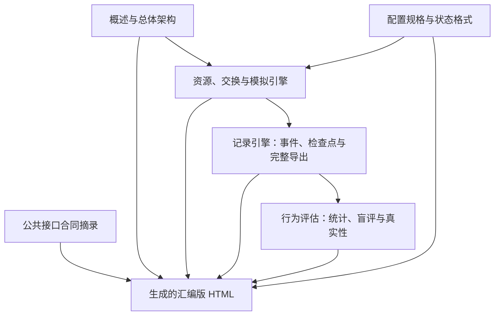

# WorldMock 设计文档集 — 创建总结

> 日期：2026-10-07
> 状态：当前文档组织已按三仓职责调整；功能与平台验收分别按实际回执登记

## 完成状态

当前设计覆盖人物与生活模拟、资源与交换规则、足迹记录、完整导出、真实性评估、配置和格式。
详细内容与阅读路径见[设计入口](README.md#readme-worldmock-设计文档集)。
下游 LabelKit 模型任务、训练数据加载和规则测试数据归 LabelKit-DataSet，环境素材归 WorldMock-Dataset。

## 文档结构

## 与主文档集的关系

设计不另建字段合同。记录、素材、检查点、导出和诊断统一在[记录引擎设计](05-recording-engine.md#recording-engine-worldmock-产品设计说明书-记录引擎)定义。
其余公共接口在[接口合同](../CONTRACTS.md#contracts-worldmock-接口合同)维护，特性行为与验收分别由所属规格和
[验收标准](../VERIFICATION.md#verification-worldmock-验收标准)约束。

## 维护与证据

`build_design_doc.py` 装配当前章节和合同摘录，不装配已移交的数据加工说明。
当前现行文档、实现与测试必须一致；历史资料按原提交读取，不能把过去通过或来源快照接收当成新版本验收。

LabelKit-DataSet 已保存本次来源快照并核对摘要，新消费者整合与正式消费验收仍待所属会话完成。
当前目录整理不证明十二周模型运行、隔离盲评或未执行平台通过。

## 版本表

| 版本 | 日期 | 变更 |
| --- | --- | --- |
| `2026-10-07-repository-ownership` | 2026-10-07 | 收敛为当前设计的组织说明，删除下游数据加工职责，明确快照交接与消费验收的区别 |
