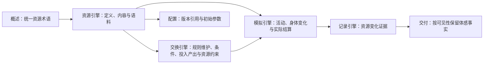

# WorldMock 设计文档集 — 创建总结

> **日期**：2026-09-20  
> **状态**：设计草稿已创建；资源与身体模型相关章节已修订，文档集整体尚未冻结

## 完成状态

### ✅ 已创建的文档

| 文档 | 大小 | 状态 | 主要内容 |
| --- | --- | --- | --- |
| [README.md](README.md) | 5.4K | ✅ | 文档集入口、阅读路径、与主文档集的关系 |
| [00-overview.md](00-overview.md) | 12K | ✅ | 背景目标、术语、需求映射、背书总表、对齐决策 |
| [01-architecture.md](01-architecture.md) | 14K | ✅ | 五层架构、19 模块清单、数据流、CLI 命令 |
| [02-exchange-engine.md](02-exchange-engine.md) | — | DRAFT | 维护交换规则、查询适用规则、校验交换条件、计算投入产出、校验资源分录与返回规则结果 |
| [03-resource-engine.md](03-resource-engine.md) | — | DRAFT | 资源定义、内容与语料、目录发布、检索和提供 |
| [04-simulation-engine.md](04-simulation-engine.md) | — | DRAFT | 初始化、观察与动作受理、时间与活动推进、结算、唤醒和恢复编排 |
| [05-recording-engine.md](05-recording-engine.md) | — | 已整合 | 事件、素材、事务、检查点、分支、导出、质量与诊断；承接冻结约束 |
| [06-delivery.md](06-delivery.md) | 29K | ✅ | LabelKit 接口、证据窗口、多任务编排 |
| [07-evaluation.md](07-evaluation.md) | 23K | ✅ | 行为指标、对比协议、盲审流程、结论边界 |
| [08-configuration.md](08-configuration.md) | 22K | ✅ | 场景文件、目录规则、语料配置、凭证管理 |
| [09-io-formats.md](09-io-formats.md) | 26K | ✅ | 输入输出格式、Schema 定义、来源标记 |
| **范围** | — | **DRAFT** | **文档创建状态不代表设计冻结或实现验收** |

## 资源与身体模型修订

身体相关资源与金钱统一称为资源；资源的变化、计量与校验规则按类别展开。
详细规则来自 [LifeEnv 运行时规格](../dev/SPEC-life-runtime.md)，
领域接口来自[接口合同](../CONTRACTS.md)，记录与证据约束统一见[记录引擎](05-recording-engine.md)。



身体模型不再使用四项百分制状态或固定点数恢复，也不根据困意直接强制睡眠。
金钱双边转账、能量与娱乐需要流水、睡眠模型演化、共享时钟推进分别核验。
食品利用效率与睡眠不足的关联保留为仿真假设。

## 文档特点

### 1. 参考 LabelKit 的组织方式

从 `Project/LabelKit/docs/design/` 学习的格式：

#### ✅ 已采用的元素
- 封面与元信息（版本、日期、状态、目标读者）
- 修订历史表
- 术语与缩写表
- 设计原则
- 需求映射表（需求 → 承载章节）
- 算法与工程背书总表（功能 → 学术/工业背书）
- 已对齐的设计决策（多方案对比）
- 模块详细设计（职责、边界、算法、配置）
- 核心数据结构与 API
- 丰富的图表（Mermaid）与表格

#### 🔄 适配 WorldMock 的差异
- **格式**：Markdown 而非 HTML（版本控制友好）
- **组织**：模块化多文件而非单一大文件（便于维护）
- **文档分工**：主文档集定义架构与接口，特性规格定义行为，本目录按模块解释
- **引用不重复**：记录引擎合同在本模块设计唯一维护，其余接口引用 CONTRACTS.md

### 2. 文档结构

```
docs/design/
├── README.md                    # 入口：文档清单与阅读路径
├── 00-overview.md              # 概述：背景、目标、术语、需求映射
├── 01-architecture.md          # 总体架构：系统定位、模块清单、数据流
├── 02-exchange-engine.md           # 交换引擎：规则维护与查询、条件校验、投入产出、分录校验与结果
├── 03-resource-engine.md     # 资源引擎：资源定义、内容、语料与提供
├── 04-simulation-engine.md    # 模拟引擎：初始化、观察、动作、时间、活动、结算、唤醒与恢复
├── 05-recording-engine.md      # 记录引擎：事件、存储、恢复、导出与诊断
├── 06-delivery.md              # 数据交付：LabelKit、证据窗口、编排
├── 07-evaluation.md            # 行为评估：指标、对比、盲审、结论
├── 08-configuration.md         # 配置规格：场景、语料、凭证与规则入口
├── 09-io-formats.md            # 输入输出：Schema、字段、来源标记
└── SUMMARY.md                  # 本文件：创建总结
```

### 3. 与主文档集的关系

| 文档集 | 定位 | 关键问题 | 典型文档 |
| --- | --- | --- | --- |
| **主文档集** (`docs/`) | 架构与合同 | 为什么这样设计？接口是什么？ | ARCHITECTURE.md、CONTRACTS.md、EXPERIMENT.md |
| **特性规格** (`docs/dev/`) | 行为与算法 | 如何结算、推进与验证？ | SPEC-life-runtime.md、SPEC-labelkit-delivery.md |
| **设计文档集** (`docs/design/`) | 模块说明 | 如何理解和组合这些规则？ | 02-exchange-engine.md、05-recording-engine.md、08-configuration.md |

**协同关系**：
- 主文档集定义**接口契约**，特性规格定义**行为规则**，设计文档集描述**模块流程**
- 记录引擎集中维护接口与行为，其余设计文档引用对应合同
- 设计文档包含**算法伪代码**、**配置示例**、**数据流图**

## 文档内容亮点

### 00-overview.md
- 问题定义与解决方案
- 10 个核心设计原则（人物自主性、确定性结算、唯一写入者等）
- 15 条需求映射（需求 → 承载章节）
- 10 个功能点的学术/工业背书
- 10 个已对齐的设计决策（多方案对比）

### 01-architecture.md
- 五层分层架构图（CLI → Runtime → Agent/Env → Life/Footprints → Storage）
- 19 个模块清单与状态
- 三阶段端到端数据流（准备 → 运行 → 交付）
- 12 个 CLI 命令与执行顺序
- 核心数据结构（WorldState、AgentState、BodyState 等）
- v1.0 → v2.0 → v3.0 演进路线

### 02-exchange-engine.md
- 维护注册表中的交换规则，说明资源、对象与语料增删改的衔接
- 查询适用规则，校验当前交换条件
- 计算投入产出，校验资源分录
- 返回规则结果，由模拟引擎落实实际变化
- 当前规则调用入口、实现差距与验收条件

### 03-resource-engine.md
- 统一可计量资源、内容条目和来源语料的设计归属
- 资源单位与边界、来源分类、目录发布和语料文件身份
- 检索、候选轮转、实际接触区间与素材证据
- 区分当前实现与目标，明确倒排检索尚未接入运行浏览

### 04-simulation-engine.md
- 初始化运行世界，绑定人物、场景、资源与规则
- 组织观察与决策机会，收齐并有序受理动作
- 推进共享时钟与实际活动，依规则落实结算，判断唤醒条件
- 与记录引擎协作保存检查点，编排恢复与实际反事实运行
- 人物算法、资源检索、存储与离线 Dreaming 由所属模块维护


### 05-recording-engine.md

- 事件、来源与可见性、素材及持久化接口
- 事务与状态连续性、资金对账、共同检查点与恢复分支
- 反事实来源、固定截止导出、认证与质量报告
- 状态查询、日志、诊断工具、已知差距与验收要求

### 06-delivery.md
- LabelKit 接口规范（4 个任务类型）
- 证据窗口（时间窗口、内容窗口、记忆窗口）
- 多任务编排（训练数据 + 规则测试 + 质量报告）
- 反事实分支（replay 认证）

### 07-evaluation.md
- 8 个行为指标（时间分布、消费、社交、地点、身体、资源、长期、异常）
- 对比协议（synthetic vs synthetic，无人类基准）
- 盲审流程（生成 → 盲审 → 解盲 → 结论）
- 结论边界（comparative_plausibility_only）

### 08-configuration.md
- 场景配置文件（scenarios/*.json，Schema v3；地点、商品和供给以身份引用）
- 场景绑定目录版本与语料清单哈希，详细设计引用资源引擎
- 交换条件与投入产出引用交换引擎，活动与身体变化引用模拟引擎
- 模型凭证（~/.config/worldmock/deepseek.env，权限 0600）
- 配置验证（validate 命令、9 项校验清单）

### 09-io-formats.md

- 世界与人物状态的格式说明
- 记录引擎与 LabelKit 数据格式的阅读入口
- 通用编码与验证规则


## 地图与门店供给修订

地图特性设计将地点目录与场景初值分开、商品规格与门店供给分开，并将供给报价、库存和营业例外归入世界状态。
发现查询走既有生活动作及后轮结果，人物用实际返回的道路、营业和价格事实选择，环境在到达与购买时重验。
四个引擎及配置、输入输出、交付、评估设计均承接这些边界；记录合同定义历史比较证据与检查点恢复。

全部十二份设计文档已与 [地图与门店供给规格](../dev/SPEC-map-and-storefront.md) 同步。
原一百零四份步行来源混用响应已更正，全部二百二十条路线通过身份及方式核验。
独立地图分支完整范围的行为测试、完整门禁与独立变异审查见 [验收记录](../dev/research/map-and-storefront-verification.md)。
本次与品类主线组合保留原生品类契约、库存使用与转换、交互菜单，并以供给当前报价进入品类购买算子，
按整行数量与系数取整、按所选卖方结算。组合目录为 `4.0`、品类契约与规则绑定版本为 `2`，旧分支 `3.0` 仅作历史证据。
组合验收须独立记录，不能继承任一分支的通过数字；各特性通过也不改变文档集其他设计的冻结状态，不宣称项目级真实长跑完成。


## 后续维护建议

### 1. 与代码同步
- 接口变更时更新所属合同，记录引擎统一修改模块设计，并同步导航
- 新增功能时，补充设计文档的相应章节
- 废弃功能时，在文档中标注状态

### 2. 版本管理
- 每个设计文档携带版本号与修订历史表
- 重大设计变更时，更新版本号
- 保留历史版本记录

### 3. 文档评审
- 新增设计文档时，评审其完整性与一致性
- 定期检查文档与代码的对齐程度
- 收集开发者反馈，改进文档可读性

### 4. 工具支持
- 考虑使用 MkDocs 或类似工具生成静态站点
- 添加文档内部链接与交叉引用
- 提供 PDF 导出功能（参考 LabelKit）

## 参考资料

1. LabelKit 设计文档：`/Users/atishoo/Project/LabelKit/docs/design/`
2. WorldMock 主文档集：`docs/INDEX.md`
3. WorldMock 开发规范：`CLAUDE.md`
