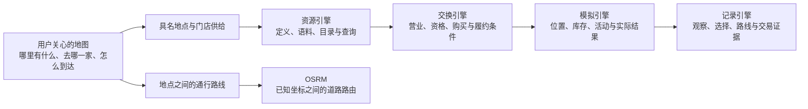
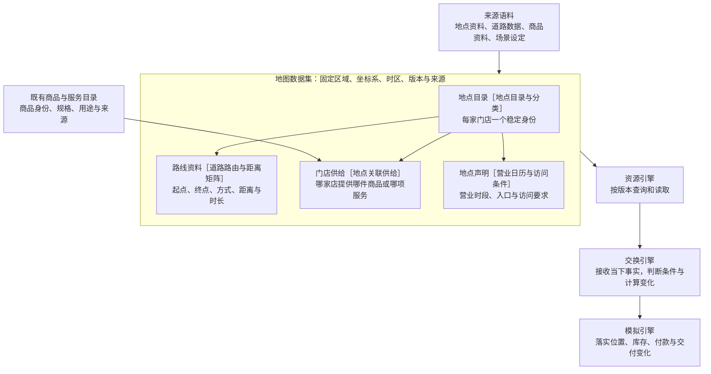
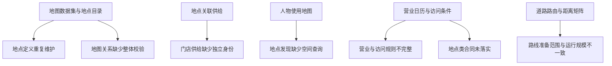

# 地图、地点与门店供给设计分析

> 状态：分析草案，待讨论；不改变现行运行合同。
> 日期：2026-09-20

## 第一章　心智模型与项目框架的映射

### 用户原话

> 我们的系统里虽然有OSRM，但是没有地图的这个概念，比如超市只有market一个地点，而不像现实中有711，costco，target，microcenter各式各样的超市，分析看看“地图”这个概念应该如何补充到语料对象中？或者它是否应该定义为一个新的资源引擎中的对象？它应该如何构建规则？

### 项目框架映射

**建议把地图作为资源引擎中的版本化数据集合，把具体地点作为独立目录对象；门店通过供给关联商品与服务。**
地图负责描述空间关系与可达条件，现有各引擎继续承担查询、规则判断、状态变化和记录职责。

当前已经有具名地点和通行路线。所核对的三份场景都包含十一个地点、二百二十条路线；
地点语料中的八个具名外部地点已进入运行场景。
但每份场景的一百五十九件商品全部归属 `market`，地点定义也分别保存在语料和场景中。
因此，具名地点存在与可比较的门店供给存在，是两项不同能力。

### 转述确认

你的意思是，数字人生活的世界应该有各式各样的具体商店，
能够知道它们在哪里、有什么区别，再据此选择去哪一家；
你想明确这些信息在语料和资源引擎里怎样表达，以及需要哪些规则，对吗？

## 第二章　提升后的心智模型

### 业界方案概览

| 成熟机制 | 适用的问题 | 不能由它证明的事情 |
| --- | --- | --- |
| 地点目录与分类 | 具体地点身份、名称、位置、业态、品牌与来源 | 一家店此刻有某商品、库存充足 |
| 地点关联供给 | 同一商品由不同门店销售，供给分别关联卖方、价格与履约条件 | 人物已经付款、商品已经交付 |
| 道路路由与距离矩阵 | 已知起终点及出行方式，计算道路距离和预计时长 | 商店目录、真实营业状态、实时交通 |
| 营业日历与访问条件 | 描述开放时段、休息日、例外日期和资格要求 | 人物必然会选择此处，或到达时条件仍然相同 |

### 提升后的设计

#### 地图、地点、品牌和供给分别是什么

这里的“地图数据集”直接复用已有语料清单及文件身份机制，表达一组相互关联的地点和路线；
不需要另建地图服务、地图引擎或第二套文件版本管理。
“地点”是资源引擎管理的一类对象，具有身份和属性；
它没有金钱或能量那样的计量守恒含义，也不应为进入目录而伪装成商品、服务或合同。
地点目录也包含住宅、办公室、公园等非经营地点；门店是其中的经营地点，
“业态”专指其经营类型，非经营地点不需要硬套门店供给。

| 概念 | 应表达的内容 | 例子与边界 |
| --- | --- | --- |
| 地点 | 稳定身份、名称、位置、地址、业态、可用入口、来源 | “某街道的某家门店”；名称相同不能自动合并 |
| 品牌 | 地点的可选属性；有来源时关联稳定品牌标识 | 同一品牌可有很多地点；无品牌的独立商店仍是有效地点 |
| 业态 | 地点提供哪一类经营服务 | 便利店、仓储式卖场、综合零售店、电脑与电子产品专卖店 |
| 地点类 | 沿用当前活动适用条件的封闭词表 | 说明活动能在什么环境开展，不把品牌扩展成地点类 |
| 门店供给 | 稳定身份、地点、商品或服务、卖方账户、销售单位、价格依据、履约与资格要求 | 同一商品可以关联多条门店供给，分别报价和扣库存 |
| 路线 | 起终点与入口、出行方式、道路数据与路由配置身份、距离、时长、几何和计算结果 | 必须区分已验证不可达和没有准备路线数据 |

用户举出的 7-Eleven、Costco、Target、Micro Center，应作为不同零售业态的例子理解，
不能统统编码成同一种“超市”。品牌和具体分店也必须区分。
这些名称不意味着张江地图实际包含它们；本地场景使用核实过的本地地点，
需要这些品牌时另选相应区域或明确建立合成场景。

商品事实与门店供给事实分开留来源：商品资料能说明包装与营养，
不能证明某家店销售它，更不能证明当下价格与库存。
缺少真实供给资料时，可以采用显式场景设定；设定在运行前固定，并保留假设依据。
同一标准商品只保留一份商品定义；不同包装规格仍是不同商品，比较时说明计价单位。

#### 谁维护定义，谁维护变化

| 负责方 | 持有或处理的内容 |
| --- | --- |
| 资源引擎 | 地点、路线、供给定义及规则声明的版本、来源与只读查询 |
| 交换引擎 | 解释声明，判断营业、访问、购买、费用与履约条件，返回结果或原因 |
| 场景配置 | 选择地图版本与地点范围，声明人物住址、卖方账户、库存初值及有依据的场景设定 |
| 模拟引擎 | 当前位置、营业例外、有效报价、门店库存、访问资格与已经启用的服务状态；应用规则结果 |
| 记录引擎 | 保存查询与实际展示、决定、规则结果、状态变化以及对应的数据与规则版本 |

库存按门店供给分别维护，人物取得商品后仍按商品身份与所在地点持有。
同一经营者可以拥有多家门店、共用已有卖方账户，但各店库存不能因此共用。
品牌名称既不能替代卖方账户，也不能凭空赋予人物会员资格。

#### 数字人怎样使用地图

人物可以发现当前关门的商店并计划稍后前往；发现地点不要求人物已经站在店内。
实际观察只提供这次查询或在场观察允许知道的信息，地图目录不等于人物已经知道所有地点。
精确库存、未公布价格、隐藏的配送完成时刻不应仅因引擎持有数据就自动进入人物观察。
记录引擎保存实际返回过的信息，后续记忆只能引用真实接触。

“附近”允许按真实道路路程或预计时长筛选；直线距离最多用于查询的粗筛，不能冒充可达时间。
同条件查询按固定的排序规则与稳定身份消除并列歧义。
地点查询属于新增查询能力；既有娱乐内容按题材、语言和时长检索的合同保持其原本职责。
地点类仍用于活动可行性，不把地点当成所有内容的检索分区。

#### 规则应如何构建

规则以明确字段和有类型的条件表达，参数来自地点与供给定义，运行时输入来自模拟引擎。
先定义清楚下面各类判断，不按品牌名写分支，不为地图另造通用规则语言。

| 规则 | 输入与判断 | 结果与必须保留的边界 |
| --- | --- | --- |
| 资料准入 | 地点身份、坐标系、来源、地图范围、供给及路线引用是否一致 | 必需字段或关系不完整则拒绝发布；缺失信息不能默认为全天营业或全品类供货 |
| 地点发现 | 人物允许查询的范围、业态或商品需求、公开信息、距离条件 | 返回具体地点及已知状态；未知与不存在分开，不强制只返回当前能购买的店 |
| 通行 | 起终点、入口、出行方式、已固定路由与当下适用时间参数 | 返回有依据的路程或不可达；未计算的路径是资料不完整，不伪装成道路不通 |
| 营业 | 当地时区、每周开放区间、例外日期和模拟时间 | 支持分段营业、跨午夜与全天营业；保留原始声明及其来源，未知时不推断为开放 |
| 访问与服务 | 门店要求、人物资格、所需服务是否支持 | 返回可进入、可使用或明确原因；会员、预约等只在场景实际需要时启用 |
| 购买 | 具体门店供给、有效报价、数量、可用库存、余额与履约条件 | 整单通过或拒绝，按供给扣库存、按卖方记账；同商品在不同门店互不混淆 |
| 履约 | 自提的在场条件，或配送支持范围与运输路径 | 自提与配送分别判断；到店、付款、交付、消费是不同事实 |
| 时间变化 | 出发前预计条件与执行时实际条件 | 到达后、购买时重新校验；预计可买不保证执行成功，失败保留具体原因 |

每个营业区间用包含开始、不包含结束的语义；例外日期优先于每周声明。
购买必须在受理时满足营业要求；需要持续服务的活动，检查必要服务区间与该服务的结束规则。
一次订单建议限定一个门店，多门店购物形成分别结算的订单，避免第一版引入跨店履约协调。
排队与容量在声明了对应服务时才有状态和规则，不给所有商店默认制造一个排队系统。

同一版本的定义、规则和同一运行状态应得到相同判断。
随机服务时间若确有需要，固定模型与种子并记录本次抽样；库存和价格变化通过有记录的事件发生。
查询排序可以影响人物看见候选的顺序，不能由系统直接替人物决定去“最优门店”。

#### 门店差异怎样产生行为差异

下面是一组纯合成的规则验收数据，不代表任何真实品牌或门店。
“远近、价格、种类、资格”分别进入模型，才能验证地图是否真的改变生活选择。

| 合成门店 | 提供什么 | 从家出发的准备数据 | 供给与服务设定 | 可能形成的选择 |
| --- | --- | --- | --- | --- |
| 街角便利店 | 某品牌单份面包 | 步行六分钟 | 每份八元，当日营业到二十三点 | 时间紧时购买一份 |
| 社区超市 | 同一商品定义的单份面包 | 步行十八分钟 | 每份六元，当日营业到二十一点 | 时间充裕时比较总花费 |
| 仓储式卖场 | 另一规格的整箱食品 | 驾车二十五分钟 | 整箱起售，会员条件由场景声明 | 有补货需求且具备资格时考虑 |
| 电脑专卖店 | 键盘、配件与相关服务 | 步行十二分钟 | 未声明食品供给 | 能被地点查询发现，不成为面包购买选项 |

便利店并非必然更贵，仓储式卖场也并非必然更远；这些关系是有来源的门店数据或显式场景设定，
不是业态名称自动触发的定律。业态模板可以在准备阶段帮助生成合成供给，
最终必须发布具体商品、规格、价格、营业与资格声明，不能在运行中临时随机补齐。

#### 数据怎样构建

场景只选择地点及其初值，不再手抄另一份名称、坐标与营业定义。
地图资料与模拟日期的差异必须可见：近期采集不能冒充实验日期的历史事实。
道路、地点与供给可以有不同来源时间，发布时明确各自依据及适用限制。
来自不同坐标系的资料必须在准备时明确转换，不能把偏移坐标混进路由。

对当前小区域，准备场景所有允许起终点与出行方式的路线即可。
扩大区域时，先区分可查询地点范围和可行动范围：可行动范围内的移动请求必须有完整结果覆盖；
范围外地点应明确标为本场景未支持出行，不能被呈现成可直接前往的目标。
距离矩阵可加速离线准备，但不能替代真实移动所需的路线几何。
不在运行时临时抓取或补算外部路线，也不把未经验证的路线拼接当作真实道路路由。

已有语料清单、严格数据校验、路由素材与事件结算可以复用。
既有规则表达式库已经用于交付侧，是否用于运行规则应按所需语义单独验证，
不能仅因已安装就宣称营业日历或空间查询能力已经具备。
如需解析完整外部营业时间语法，优先使用维护中的成熟解析器在准备阶段归一化，
无需为本项目重写全部语法；小规模确定性地点查询不需要先引入地理数据库。

### 设计决策点

以下是建议及其取舍，不代表这些选项已经成为现行合同。

| 决策 | 选项 | 收益与代价 |
| --- | --- | --- |
| 世界的真实性 | **建议：真实地点加明确标记的供给假设** | 空间有依据，能控制门店差异；交易结论只适用于所声明的假设 |
| 世界的真实性 | 完全合成地图与门店 | 可精确覆盖规则边界；不能声称复现真实地区消费行为 |
| 世界的真实性 | 真实地点加真实门店供给快照 | 更适合零售现实评估；商品、价格、库存的获取和时效成本高 |
| 第一版的空间范围 | **建议：已有张江区域** | 可复用当前地点和路线，较快验证行为差异；不包含用户列举的全部品牌 |
| 第一版的空间范围 | 另选包含所需品牌的区域 | 能直接比较这些品牌门店；必须重新准备地点、商品与路线资料 |
| 第一版的行为范围 | **建议：门店发现、比较、出行与购买履约** | 覆盖本次核心需求；沿用现有物品留在取得地点的语义 |
| 第一版的行为范围 | 同时引入搬运、会员购买、预约与排队 | 可表达更丰富生活；需要扩大状态、动作和验收范围 |

尤其要单独决定“买菜带回家”：当前合同明确没有背包或携带动作，
到店购买不会自动把物品转移回家。
第一版可用到店购买后当场使用，或配送到家验证完整流程；
若要购物带回家，必须显式扩展物品搬运规则，不能随地图功能隐含加入。

## 第三章　当前实现的差距

### 差距归属图

### 差距明细表

| 差距名称 | 对应设计点 | 性质 | 当前状态与需要补充的能力 | 阶段 |
| --- | --- | --- | --- | --- |
| 地点定义重复维护 | 地图数据集与地点目录 | 缺失 | 地点已经进入场景，但语料与场景分别维护定义；需要统一地点身份和版本引用 | 最小完整流程 |
| 门店供给缺少独立身份 | 地点关联供给 | 缺失 | 全部商品归属 `market`，商品身份兼任供给身份；需要同商品多门店及独立报价库存 | 最小完整流程 |
| 地点发现缺少空间查询 | 人物使用地图 | 缺失 | 已有地点与路线观察；需要按业态、需求和道路范围查询，并保留发现证据 | 最小完整流程 |
| 营业与访问规则不完整 | 营业日历与访问条件 | 缺失 | 已有整点开闭店判断；需明确跨日、分段和日期例外，按实际需求扩展访问资格 | 最小完整流程 |
| 地点类合同未落实 | 资料准入 | 名实不符 | 合同要求显式地点类，现有运行地点与语料缺该声明；须落实声明与严格校验 | 合同与数据校准 |
| 路线准备范围与运行规模不一致 | 道路路由与距离矩阵 | 缺失 | 已有场景路线可用，但准备入口仍固定少量锚点；需按选定地点集与方式完整准备 | 最小完整流程 |
| 地图关系缺少整体校验 | 资料准入 | 缺失 | 已有文件哈希与引用校验；仍需核验地点事实、路线端点、供给与地图发布的一致性 | 最小完整流程 |

“缺失”指相对于本次建议设计缺少的能力，不意味着现行合同已承诺全部能力。
“地点类合同未落实”是当前实现与既有合同的差异，应与新增地图能力区分处理。

### 分阶段路线图

先用已有区域中的多个门店跑通最小完整流程，至少让同一商品出现在两家门店，
并给出有依据或显式假设的路程、价格、营业差异。
新数据结构与消费者一起切换，删除被替代的硬编码和旧声明，不并行维护两套格式。
只改店名、只增加地点数量、只通过文件校验，都不足以验收地图能力。

| 验收场景 | 应观察到的结果 |
| --- | --- |
| 同一商品在两家门店销售 | 商品定义相同，供给身份不同；价格、卖方和库存变化定位到所选门店 |
| 近店较贵、远店较便宜 | 人物实际看到可比较的路程与费用，选择及依据有记录；不预设必选哪一家 |
| 出发前可买，到达后关门或售罄 | 保留真实到达与失败结果，不把之前的预计条件当作成功凭证 |
| 地点存在但该方式无路可达 | 地点仍可发现，出行动作得到明确不可达；未准备的数据不能冒充该结论 |
| 从家中订购配送或远程请求自提 | 配送按范围与运输路径校验；即时自提仍须在所选门店 |
| 某字段来自场景假设 | 观察、事件与来源关联可追踪该假设，不标成真实商店事实 |
| 规则故意忽略门店身份、营业或库存 | 新功能的 Uncle Bob 突变审查必须发现这些行为破坏；普通通过测试不足以证明约束有效 |

本次交付是设计分析，不是功能实现或真实门店数据采集。
源码现状、具体引用、官方参考与独立复核保存在配套证据文件；
当前主报告不修改已有合同，也不声称上述新能力已通过运行验收。
