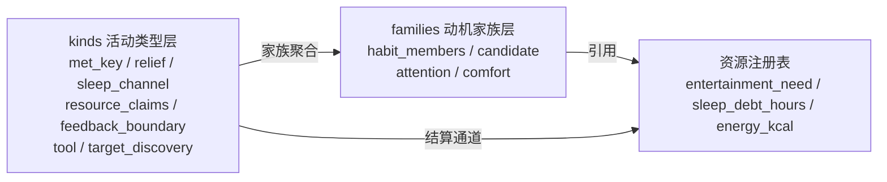
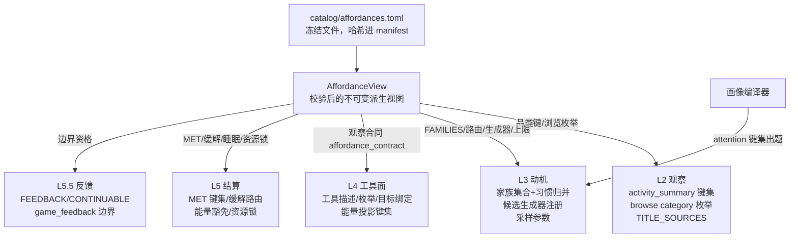

<!-- worldmock-doc: {"authority":"proposal","canonical_path":"docs/dev/PROPOSAL-affordance-registry.md","implementation_state":"NOT-COMPLETE","kind":"PROPOSAL","owner":"WorldMock maintainers","replaces":[],"schema":"worldmock.document.metadata.v1","status":"PROPOSAL","superseded_by":null,"version":"2026-09-16"} -->
**Status: PROPOSAL**

# 可供性注册表设计（提案）

状态：提案，未冻结。与 `docs/dev/PROPOSAL-resource-registry.md`（资源注册表）是同一哲学的两个实例；裁决后逐节并入总设计。
日期：2026-09-16。作者：ZCode 规范起草代理（自代码现状独立起草，基线 HEAD=7909826、全量 968 passed；业界方案调研另行合并）。

---

## 零、心智模型（先读这节，六条人话）

1. **资源注册表管名词，可供性注册表管动词**。资源 = 世界里被计量的事物（钱/体力/睡眠债/娱乐欲）；可供性（affordance）= 世界里允许发生的行为类别（吃/睡/看/玩/通勤/听播客）。前者回答"有哪些账"，后者回答"有哪些事可做、做完怎么记账"。
2. **今天新增一件事要改七个地方**。动机家族闭集（`src/worldmock/life/motivation.py:57`）、习惯归类路由（`motivation.py:160-181`）、工具类型枚举（`custom/agents/life_agent.py:254-255`）、能量投影键（`life_agent.py:251-252`）、反馈边界集合（`src/worldmock/life/activities.py:47-55`）、缓解路由键（`src/worldmock/life/semantics.py:84`）、MET 键集（`semantics.py:79-82`）是七个各自手写、彼此靠人肉保持一致的闭集。注册表把这七个闭集变成**同一份数据的七个投影**。
3. **一个家族条目回答五个问题**：怎么被看见（L2 观察层品类键）、怎么被想起（L3 候选生成器 + 注意力键）、怎么被叫（L4 工具语法与目标绑定）、做完怎么算账（L5 结算通道：MET/缓解/睡眠/资源锁）、做久了怎么被打断（L5.5 反馈/继续资格）。
4. **可供性引用资源，不定义资源**。缓解注哪个池（`entertainment_need`）、清哪本账（`sleep_debt_hours`）——池子的定义归资源注册表管；家族条目只声明"往哪个池、走哪条通道"，引用完整性由准入校验保证。
5. **缺声明即拒绝加载**。画像注意力键缺失、场景引用未注册品类、MET/缓解表键不齐——一律 IntegrityError，不静默 0、不静默降级。现状反例：`scenarios/multi-person.json` 的 contents 含 80 条 `game_session` 与 1 条 `subtitle_experience`，而画像 `attention_prior` 只锁 5 个内容键（`src/worldmock/profile/models.py:151-158`），这两类在 `motivation.py:795-798` 被 `.get(kind, 0)` 静默采零、永远进不了娱乐候选——这个"排除"可能是有意的，但代码里没有任何声明表达这个意图。
6. **新家族 = 一条配置**。只要复用已有候选生成器原型（菜单采样/目录可见性/清债/最廉可行…），新增"通勤听播客"这类家族 = 写一个 kind 条目 + 一个 family 条目 + 一份语料；只有全新的枚举语义才需要写代码（新原型），且那是引擎能力升级，不是家族接入。

以下章节是这六条的技术展开（Schema、五层派生、迁移、校验、分期、路径）。

---

## 一、目标与非目标

**目标**

1. 把散落五层（L2 观察 / L3 动机 / L4 工具面 / L5 结算 / L5.5 反馈）的手写闭集收编为**一份声明式注册表**（`catalog/affordances.toml`），全层派生、单一事实源。
2. 新增行为家族的成本从"改 5-7 个文件、人人对齐"降到"1 处配置 + 1 份语料、0 处引擎代码"（复用现有生成器原型时，验收见 §十）。
3. **注意力缺省显式化**：画像 `attention_prior` 键集与注册表键集强一致校验，消灭 `.get(kind, 0)` 式静默采零（`motivation.py:795`、`engine.py:1909-1912` 两处同病）。
4. **意图显式化**：`game_session` 不参与动机采样这类"藏在代码分支里的决定"变成 `attention_required = false` 的显式条目，可审计、可推翻。
5. 与资源注册表**同版本轴、同准入纪律**：场景钉 `catalog_version`，可供性文件哈希进目录 manifest，历史运行永远可复现。

**非目标**

- 不做运行期动态注册——注册表是冻结文件，运行期零变更；世界修订协议是独立提案（与资源注册表 §一同一立场）。
- 不开放模型自创 activity_type——闭集哲学保留。注册表**扩大**闭集，但不把闭集变成自由文本。
- 不把 TextWorld 游戏命令闭集并入——会话命令（`admissible_commands`）是运行态，不是静态可供性；注册表只登记 `play_game` 这一个活动类型与家族成员关系。
- 不做图灵完备的候选生成 DSL——生成器是**带参数的原型库**；新枚举语义 = 新原型（Python 代码），不把逻辑塞进 TOML。
- v1 不做并行活动——"边走路边听播客"的并行资源锁调度不做；单主活动槽不变（`activities.py:63-64` 的 RESOURCE_CONFLICT 守卫原样保留），听播客建模为独立活动。

---

## 二、注册表 Schema（TOML 草案）

文件位置：`catalog/affordances.toml`——目录顶层的一等注册表，与 `resources.jsonl`/`objects.jsonl` 平级；`rules/` 继续只放推导规则与映射。TOML 而非 JSONL 的理由：条目是**人写的**（个位数到十位数），需要注释、分组与可 diff 性；机器生成的大批量条目（如未来的生活活动家族扩展）仍走 JSONL + 导入器的既有分工。

两级结构：**kinds**（引擎活动类型，结算与受理的最小单元，对齐 `ActivityKind`）× **families**（动机家族，习惯归并键 + 候选生成器 + 注意力）。一个家族可跨多个 kind（entertainment = watch + play_game）；一个 kind 可以不属于任何家族（read_mail——今天它就不参与习惯份额，`motivation.py:170-178` 返回 None）。



### 2.1 kinds 层字段（引擎侧投影的唯一来源）

```toml
version = 1

# ---------- 活动类型层 ----------

[kinds.sleep]
met_key = "sleep"                 # MET 查表键；缺省 = kind 名。参数化键写模板：
                                  #   travel 用 "travel:{mode}"，lifestyle 用 "lifestyle:{item_id}"
energy_floor_exempt = true        # 派生 ENERGY_RECOVERY_ACTIVITY_KINDS（body.py:27）
                                  #   = 能量投影可穿透下界（sleep/wait/consume）
sleep_channel = "recovery"        # recovery = 清债 | awake = 累积（body 结算分支）
relief = { channel = "none" }     # 娱乐缓解通道，四选一：
                                  #   none             不缓解
                                  #   intrinsic        wait：目录费率直读，不乘偏好（边等边刷）
                                  #   preference_rate  play_game：偏好 x 目录费率
                                  #   content_rate     watch：条目费率 x 偏好 / 接触次数
resource_claims = []              # 派生 resource_claims（activities.py:163-173）：
                                  #   position 恒占；attention/device/hands/vehicle 按声明
feedback_boundary = false         # 派生 FEEDBACK_ACTIVITY_KINDS（activities.py:47）
                                  #   与 _CONTINUABLE_ACTIVITY_KINDS（life_agent.py:277）
game_boundary = false             # play_game 专用 game_feedback 边界（真值时 feedback_boundary 必须为假）
tool = { surface = "basic" }      # L4 投影：basic | targeted | travel | commerce | game | none
target_discovery = "none"         # 观察目录直读 catalog_field | 下钻结果 browse_result | none
```

参数化资源锁（仅 travel 需要）：

```toml
[kinds.travel]
met_key = "travel:{mode}"
relief = { channel = "none" }
sleep_channel = "awake"
resource_claims = { base = [],
                    conditional = [{ when = "mode:driving",
                                     add = ["attention", "hands", "vehicle"] }] }
feedback_boundary = true
tool = { surface = "travel" }     # start_travel：目标绑定走路线三元组，不走 target_id
target_discovery = "none"
```

全部九个现有 kind 的完整迁入条目（现行值逐字段对齐代码，迁移零行为变化）：

| kind | met_key | floor_exempt | sleep_channel | relief | claims | feedback | tool surface | target_discovery |
| --- | --- | --- | --- | --- | --- | --- | --- | --- |
| wait | wait | true | awake | intrinsic | [] | true | basic | none |
| sleep | sleep | true | recovery | none | [] | false | basic | none |
| work | work | false | awake | none | attention,device,hands | true | targeted | catalog_field(tasks.task_id) |
| watch | watch | false | awake | content_rate | attention,device | true | targeted | browse_result |
| play_game | play_game | false | awake | preference_rate | attention,device,hands | false（game_boundary） | game | catalog_field(game_catalog.game_id) |
| travel | travel:{mode} | false | awake | none | 条件（driving 加三锁） | true | travel | none |
| read_mail | read_mail | false | awake | none | attention,device | true | targeted | catalog_field(messages.message_id) |
| browse | browse | false | awake | none | attention,device | true | targeted | catalog_field(browse_targets) |
| consume | consume | true | awake | none | hands | true | commerce | none |
| lifestyle | lifestyle:{item_id} | false | awake | none | [] | false | basic（type_pattern） | browse_result |

`target_discovery = "browse_result"` 是对现有 watch 目标发现机制的一般化：目标闭集来自（一）browse_activities 下钻结果、（二）content_progress 已开始条目（`life_agent.py:682-692`）。lifestyle 今天也走同一条路——明细由下钻揭示（`engine.py:739-748`），受理键为 `lifestyle:<activity_id>`（`models.py:100`、`engine.py:1085`）。

### 2.2 families 层字段（动机侧投影的唯一来源）

```toml
# ---------- 动机家族层 ----------

[families.sleep]
kinds = ["sleep"]
attention = { kind = "none" }            # 该家族不按内容品类采样
habit_members = [
  { tool = "start_basic_activity", activity_type = "sleep" },
]
candidate = { generator = "clear_backlog",   # 命名原型 + 参数（见 2.3）
              resource = "sleep_debt_hours", cap_seconds = 28800,
              fallback_seconds = 3600, min_session_seconds = 60 }
comfort = true                           # 情绪分量 comfort_type（motivation.py:386）
enumeration_rank = 20                    # 候选池枚举序（见 2.4 优先级表）
```

习惯归并路由由全家族的 `habit_members` 展开生成（替换 `classify_action_event` 的手写 if 链，`motivation.py:160-181`）。两个现状细节必须显式保留：

- `start_basic_activity` 的缺省归类：非 sleep 一律归 continue——即 **lifestyle 动作今天的习惯键是 continue**（`motivation.py:166`）。迁入后在 families.continue 的 habit_members 里写 `{ tool = "start_basic_activity", activity_type = "lifestyle:*", family = "continue" }` 模式条目，让这个决定从隐式分支变成显式声明。
- 无家族 kind（read_mail、未列 targeted 类型）归 None：由"该 activity_type 不出现在任何 habit_members"自然导出，并在校验里要求**必须存在一个显式 `unclassified = true` 声明**（防拼写错误静默漏网）。

### 2.3 候选生成器原型库（v1 八个，全部来自现行 `_enumerate_candidates` 的逐字提炼）

| 原型名 | 参数 | 现行实现 | 使用家族 |
| --- | --- | --- | --- |
| `clear_backlog` | resource, cap_seconds, fallback_seconds | `_sleep_candidate`（motivation.py:473） | sleep |
| `cheapest_feasible_meal` | （无参数，可行性口径内建） | `_eat_candidate`（motivation.py:511） | eat |
| `continue_current` | （读当前活动剩余） | `_continue_candidate`（motivation.py:592） | continue |
| `cheapest_route` | destination = home \| task_location | `_travel_candidate` + `_work_candidates` 的出行腿（motivation.py:688/721） | travel |
| `catalog_visibility` | probe_duration_seconds = 600 | `_browse_candidate`（motivation.py:445） | browse |
| `content_menu` | per_kind, pool_cap, slot_policy = two_segments | `_entertainment_candidates`（motivation.py:779） | entertainment；新家族复用 |
| `task_slot` | max_tasks = 2 | `_work_candidates`（motivation.py:721） | work |
| `none` | —— | lifestyle / read_mail / play_game 现状：不生成动机候选 | lifestyle 等 |

原型库是**唯一的代码扩展点**：注册一个使用既有原型的家族 = 0 代码；需要新枚举语义 = 写一个新原型函数并登记原型名（引擎升级，走正常代码评审）。TOML 里引用未登记的原型名 → 准入即拒。

### 2.4 attention 子模式（内容品类键 + 标题来源 + 采样上限）

```toml
[families.entertainment]
kinds = ["watch", "play_game"]
attention = { kind = "content_kind",
              sampling = "per_kind_top_n", per_kind = 2,   # 派生 ENTERTAINMENT_PER_KIND（motivation.py:67）
              pool_cap = 14 }                              # 参与全局 MAX_CANDIDATES=22 的家族配额
habit_members = [
  { tool = "start_targeted_activity", activity_type = "watch" },
  { tool = "start_targeted_activity", activity_type = "play_game" },
]
candidate = { generator = "content_menu", min_session_seconds = 600,
              cap_seconds = 14400 }
comfort = true
enumeration_rank = 70                    # 娱乐排池尾（截断从队尾开始，motivation.py:437-441）

# 内容品类子表：画像注意力键 + 标题来源（派生 TITLE_SOURCES，content.py:86-91）
[families.entertainment.content_kinds.feature_film]
attention_required = true                          # 画像必须声明该键，缺失 = 准入拒绝
title_source = { corpus_path = "movies/items.json", id_key = "item_id" }
[families.entertainment.content_kinds.drama_series]
attention_required = true
title_source = { corpus_path = "drama/items.json", id_key = "item_id" }
[families.entertainment.content_kinds.webnovel_excerpt]
attention_required = true
title_source = { corpus_path = "novels/items.json", id_key = "item_id" }
[families.entertainment.content_kinds.subtitle_experience]
attention_required = false                         # 显式声明：不参与动机采样（现状静默 0 的显式化）
title_source = { corpus_path = "sintel/media-identity.json" }
[families.entertainment.content_kinds.news_feed]
attention_required = true
title_source = "self_label"                        # experience_label 自带身份
[families.entertainment.content_kinds.joke_feed]
attention_required = true
title_source = "self_label"
[families.entertainment.content_kinds.game_session]
attention_required = false                         # 游戏走 game_catalog 独立面（engine.py:690），
title_source = "self_label"                        # 不进注意力采样——从隐式变显式
```

`attention_required` 的三值语义（取代静默 0）：

| 声明 | 画像行为 | 缺键行为 |
| --- | --- | --- |
| `attention_required = true` | 画像必须给键，格点 [0,1] 归一照旧 | **准入抛错**（不是 0） |
| `attention_required = false` | 画像禁止给键 | 采样权重恒 0，但这是**声明的 0**，写在校验报告里 |
| 注册表新增品类 | 画像编译器按新键集重新出题 | 老画像对不齐新键集 → 拒绝加载，逼重新编译 |

### 2.5 lifestyle 家族与 namespace 模式

```toml
[kinds.lifestyle]
met_key = "lifestyle:{item_id}"          # 开放键集：前缀模板（semantics.py:640-655 已支持）
relief = { channel = "none" }
sleep_channel = "awake"
resource_claims = []
feedback_boundary = false
tool = { surface = "basic", type_pattern = "lifestyle:{item_id}" }
target_discovery = "browse_result"
target_corpus = "lifestyle/items.json"   # 183 条、9 品类；与 MET 生活方式键一一对应
                                          # （content.py:42-79 的 fail-closed 身份核对原样保留）

[families.lifestyle]
kinds = ["lifestyle"]
attention = { kind = "none" }
habit_members = []                        # v1 保持现状：不生成动机候选、习惯归 continue。
candidate = { generator = "none" }        # 后续若要动机候选：generator 改 content_menu + attention
enumeration_rank = null                   #         给 content_kind 子表——仍是配置变更，0 代码
unclassified = true                       # 家族本身不收习惯事件（事件归 continue，显式声明）
```

---

## 三、五层派生规则

注册表加载后产出一个不可变 `AffordanceView`（`src/worldmock/catalog/affordances.py`），`assemble_semantics`（`semantics.py:212`）把它挂进 `ScenarioSemantics` 并投影到各层。派生链全图：



### L2 观察层

- **activity_summary 品类键**（`engine.py:684-699`）：键集 = 注册表内容品类 ∪ 启用生活活动的目标语料品类 ∪ 显式声明的固定键（`foods`）。新增内容品类自动获得摘要键与下钻目录（`engine.py:710-754` 的三分支按 `target_discovery`/语料声明派生，不再按内容 kind 硬编码猜分支）。
- **browse 的 category 枚举**：观察合同携带合法键集，LifeAgent 侧 `_visible_browse_categories`（`life_agent.py:1066-1077`）与 `_bind_browse_categories`（`life_agent.py:1080-1092`）原样工作——本层已经基本是派生的，缺的只是键集来自注册表而非"contents 里出现过什么"。
- **标题来源**：`content.py:86-91` 的 `TITLE_SOURCES` 字典删除，改由 `families.*.content_kinds.*.title_source` 生成。

### L3 动机层

- **FAMILIES**（`motivation.py:49-60`）：= families 表键集，字面常量删除。
- **习惯归并路由**（`classify_action_event`，`motivation.py:160-181`）：= 全部 `habit_members` 展开的 `(tool, activity_type|pattern)` → family 查找表；未命中且 kind 声明 `unclassified = true` → None；未命中且无声明 → **数据错误**（准入期发现，不是运行期 None）。
- **候选生成器注册**：`_enumerate_candidates`（`motivation.py:420-442`）的固定调用序列改为按 `enumeration_rank` 排序遍历家族、逐家族调用其原型的已注册函数；`MAX_CANDIDATES = 22`（`motivation.py:63`）保留为全局池上限，家族侧新增 `pool_cap` 配额（娱乐 14 + 生存位 8 的现行账目显式化）。
- **注意力采样**：`_entertainment_candidates` 与 `_sample_contents`（`engine.py:1906-1917`）的 `.get(kind, 0)` 全部替换为 AffordanceView 提供的键集访问——键不在集内即准入期已拒，运行期不再有缺省。
- **画像联动**：画像编译器的 `AttentionPrior` 从固定 5 键（`profile/models.py:151-158`）改为**注册表键集驱动的动态模型**——格点 0.01、[0,1]、总和 1.00 的校验不变（`models.py:160-168`），键集从注册表注入；`textgen` 的排序提示（`textgen.py:154`）随键集动态生成，prompt_version 同步升级。场景侧 `MotivationProfile.attention_prior`（`scenario.py:99`）本来就是自由 dict——补上"键集 == 注册表 attention_required=true 键集"的准入校验即可闭环。

### L4 工具面（经观察合同下发，agent 侧零硬编码）

引擎在观察中新增一个冻结块 `affordance_contract`（随场景组装一次性生成，运行期不变），声明每个 kind 的 surface / target_discovery / 目标字段 / 能量投影资格 / 边界资格。LifeAgent 的四个手写常量删除，改读合同：

| 现有常量 | 位置 | 派生规则 |
| --- | --- | --- |
| `_TARGETED_ACTIVITY_KINDS`（5 元组序） | `life_agent.py:254-255` | 合同中 surface = targeted 的 kinds（按注册表声明序） |
| `_TARGET_CATALOG_FIELDS`（4 映射） | `life_agent.py:244-249` | target_discovery = catalog_field 的 kinds 的字段声明 |
| `_ENERGY_LIMIT_KINDS`（5 键） | `life_agent.py:251-252` | 合同中 energy_projection = true 的 kinds；引擎投影器（`engine.py:1878-1886`）与 agent 校验器（`life_agent.py:637-646`）从**同一份合同**取键集——生产者与校验者共享单一事实源 |
| `_CONTINUABLE_ACTIVITY_KINDS`（7 键） | `life_agent.py:277-285` | feedback_boundary ∨ game_boundary 的 kinds |

- **工具描述生成**：`_TOOL_DESCRIPTIONS`（`life_agent.py:204-240`）中与家族相关的文案（start_basic_activity / start_targeted_activity / browse_activities）改为模板 + 注册表的动词短语与品类清单；每决策动态绑定的枚举注入（`_bind_targeted_activity_catalogs` 等，`life_agent.py:1119-1146`）机制不变。
- **Schema 指纹**：`life_tool_schema_sha256`（`life_agent.py:1276-1280`）的输入加入注册表摘要——注册表变则工具面变则指纹变，审计链闭合。

### L5 结算层

- **MET 键集**：`ENGINE_ACTIVITY_MET_KEYS`（`semantics.py:79-82`）基键 + namespace 前缀键（travel:/lifestyle:）全部由 kinds 的 `met_key` 声明生成；`_activity_met_map` 的"基键封闭 + 前缀开放"校验（`semantics.py:640-655`）改为对照派生键集。新增 kind（如 podcast）自动要求 MET 表补键——缺键即拒，不会静默 KeyError。
- **缓解路由**：`ENGINE_RELIEF_KEYS`（`semantics.py:84`，现行 {watch, play_game, wait}）= relief.channel ≠ none 的 kinds；`_closed_map` 键集校验（`semantics.py:627-633`）对照派生集。三条结算分支（`activities.py:186-200` 的 `_entertainment_relief` 与 `body.py` 的 wait 分支）按 channel 四值路由，if 链变查表。
- **MET 查表**：`_activity_met`（`activities.py:231-240`）的前缀特判由 `met_key` 模板统一：模板无占位符 → 直接键；有 `{mode}`/`{item_id}` → 运行期代入。
- **能量豁免与资源锁**：`ENERGY_RECOVERY_ACTIVITY_KINDS`（`body.py:27`）与 `resource_claims`（`activities.py:163-173`）按 kinds 声明生成；travel 的条件锁（driving 加 attention/hands/vehicle）由 `conditional` 子句表达。
- **偏好缺省**：`entertainment_preferences.get(target_id, 0)`（`activities.py:179`）与内容偏好缺省 0.5（`motivation.py:796`）的口径差异保持现状，但在家族条目加 `preference_default` 字段使其显式（0 还是 0.5 从代码常量变成声明值）。

### L5.5 反馈层

- **FEEDBACK_ACTIVITY_KINDS**（`activities.py:47-55`）= feedback_boundary = true 的 kinds；`schedule_feedback`（`activities.py:123-129`）与 `_require_feedback_boundary`（`activities.py:299-305`）改查派生集。
- **边界类型命名**：`_advanced_activity` 的 `game_feedback` vs `feedback` 二分（`activities.py:258`）由 `game_boundary` 声明派生。

### 闭集映射总表（自查用：每个现有闭集都有派生规则）

| 现有闭集 | 代码位置 | 注册表字段 | 章节 |
| --- | --- | --- | --- |
| `FAMILIES`（7 家族） | motivation.py:49-60 | `[families.*]` 键集 | L3 |
| `classify_action_event` 路由 | motivation.py:160-181 | `families.*.habit_members` 展开 | L3 |
| `ENGINE_ACTIVITY_MET_KEYS`（9 基键） | semantics.py:79-82 | `kinds.*.met_key`（无占位符者） | L5 |
| `ENGINE_RELIEF_KEYS`（3 键） | semantics.py:84 | `kinds.*.relief.channel ≠ none` | L5 |
| `ENERGY_RECOVERY_ACTIVITY_KINDS` | body.py:27 | `kinds.*.energy_floor_exempt` | L5 |
| `FEEDBACK_ACTIVITY_KINDS`（7） | activities.py:47-55 | `kinds.*.feedback_boundary` | L5.5 |
| `_CONTINUABLE_ACTIVITY_KINDS`（7） | life_agent.py:277-285 | 同上（经观察合同下发） | L4 |
| `_TARGETED_ACTIVITY_KINDS`（5） | life_agent.py:254-255 | `kinds.*.tool.surface = targeted` | L4 |
| `_TARGET_CATALOG_FIELDS`（4） | life_agent.py:244-249 | `kinds.*.target_discovery = catalog_field` | L4 |
| `_ENERGY_LIMIT_KINDS`（5） | life_agent.py:251-252 | `kinds.*` 加 `energy_projection = true` | L4 |
| `attention_prior` 固定 5 键 | profile/models.py:151-158 | `content_kinds.*.attention_required = true` 键集 | L3 |
| `TITLE_SOURCES`（4 映射） | content.py:86-91 | `content_kinds.*.title_source` | L2 |
| `resource_claims` 三条 if | activities.py:163-173 | `kinds.*.resource_claims` | L5 |
| `ENTERTAINMENT_PER_KIND = 2` / 采样 | motivation.py:67 / engine.py:1906 | `families.*.attention.per_kind / pool_cap` | L3 |
| browse 品类键 / activity_summary 键 | engine.py:684-699 | 内容品类 ∪ 语料品类 ∪ 固定键 | L2 |
| `play_game` 边界二分 | activities.py:258 / 310-316 | `kinds.*.game_boundary` | L5.5 |

---

## 四、迁移策略（现有 7 家族 + lifestyle）

原则：**影子先行、派生替换、逐层切换、每步全量测试**。基线 HEAD=7909826 全量 968 passed，每步以此为门槛。

| 步 | 内容 | 行为变化 | 测试保障 |
| --- | --- | --- | --- |
| M0 影子注册表 | 写 `catalog/affordances.toml` 覆盖全部 10 kinds + 7 家族 + lifestyle；实现 loader 与 AffordanceView；**不改任何消费方** | 零 | 新增影子等价测试：派生集逐一 == 现有常量（FAMILIES、ENGINE_RELIEF_KEYS、FEEDBACK、MET 基键、claims……）；全量 968 不动 |
| M1 引擎侧派生 | motivation/semantics/activities/body/body 相关常量改读 AffordanceView，字面常量删除 | 零（影子已证等价） | 影子测试反转为"常量已删、派生即事实"；动机/结算/反馈既有单测全绿；全量绿 |
| M2 观察合同 + agent 侧 | 观察加 `affordance_contract`；LifeAgent 四常量改读合同；`_TOOL_DESCRIPTIONS` 家族段改模板 | 工具 Schema 指纹变化（枚举来源变、内容不变则枚举值不变） | `life_tool_schema_sha256` 更新并在测试中钉新值；agent 校验单测（枚举/目标绑定/能量上限）全绿 |
| M3 画像动态键 | profile `AttentionPrior` 5 键 → 注册表键集；场景准入加"画像键集 == 注册表键集"校验；game_session/subtitle_experience 显式 `attention_required = false` | 老画像（5 键）在新注册表下仍合法——键集恰好相等；**新增内容品类才会触发拒绝** | 画像编译器重跑 round-trip；准入拒绝测试（缺键/多键/格点）；全量绿 |
| M4 lifestyle 迁入 + 新家族试点 | lifestyle 按namespace 模式迁入；验收试点"通勤听播客"（§十） | 新家族全链路可用 | 新家族端到端测试：观察摘要可见、browse 可下钻、工具枚举含新 kind、动机候选出现、结算走 content_rate 缓解、习惯份额可累计 |

迁移顺序的理由：M0/M1 只动引擎自己（风险最低、影子可证）；M2 才触碰 vendor 侧 custom/agents（观察合同是新增块，agent 老逻辑不受影响）；M3 动画像编译链（涉及 prompt 与档案重编译，独立成步）；M4 是验收步——用一个真实新家族证明"0 代码"承诺。

---

## 五、fail-closed 校验（注册表加载与场景准入，全部 IntegrityError）

注册表自身（加载期）：

1. **完整性**：每个 kind 条目必填 met_key（或可缺省）、sleep_channel、relief.channel、resource_claims、feedback_boundary/game_boundary、tool.surface、target_discovery；每个家族必填 kinds、habit_members、attention、candidate.generator。缺字段即拒。
2. **引用完整性**：家族引用的 kind 必须存在；`clear_backlog.resource` 等引用的资源 id 必须在资源注册表中；`target_corpus` 指向的语料文件必须存在且通过 manifest 哈希。
3. **原型登记**：`candidate.generator` 必须是已登记原型名；参数形状按原型 schema 校验（未知参数即拒，防拼写静默失效）。
4. **互斥不变量**：game_boundary 与 feedback_boundary 互斥；relief.channel = content_rate 的 kind 其 target_discovery 必须 ∈ {browse_result, catalog_field}（要有条目级费率来源）；attention.kind = content_kind 的家族必须声明非空 content_kinds 子表。
5. **习惯覆盖完备**：每个 surface ∈ {basic, targeted, travel, commerce, game} 的工具 × 其合法 activity_type 空间，必须被 habit_members 或某个 `unclassified = true` 声明覆盖——**没有默认桶**。

场景准入（`assemble_semantics` 内，现行七条资源册规则之后追加）：

6. **画像注意力键集 == 注册表 attention_required=true 键集**：多、少都拒绝。取代 `.get(kind, 0)` 静默缺省（现状病灶：`motivation.py:795`、`engine.py:1909`）。
7. **场景引用的品类必须已注册**：contents[].kind、agents[].lifestyle_activities、games（`_check_lifestyle_declarations` 的推广，`semantics.py:658-668` 从"只查生活活动"扩为"查全部家族目标"）。未注册家族/品类出现在场景中 → 拒绝加载。
8. **目录表键集 == 派生键集**：MET 表基键 + 前缀键、缓解表键，与 AffordanceView 派生集精确相等（现行 `_closed_map`/`_activity_met_map` 硬编码期望集的注册表化）。
9. **版本钉扎**：affordances.toml 的 SHA-256 进 `catalog/manifest.json`；场景钉的 `catalog_version` 覆盖资源 + 可供性两个文件，老场景永远按当时注册表解读。

---

## 六、与资源注册表的关系

**同一哲学的两个实例，不合并 schema，合并在同一目录与版本轴。**

| 维度 | 资源注册表 | 可供性注册表 |
| --- | --- | --- |
| 管什么 | 名词：被计量的事物（池/账户/边） | 动词：可发生的行为类别（家族/通道） |
| 文件 | catalog/resources.jsonl、objects.jsonl | catalog/affordances.toml |
| 条目量 | 机器生成为主（映射规则流水线） | 人写为主（个位数家族，十位数 kind/品类） |
| 变更节奏 | 随语料与经济学调整 | 随行为面扩展（新活动类别） |
| 相遇点 | 被引用 | 引用方：结算通道引用 resource_id |

合流规则：可供性条目的每个结算通道（relief → entertainment_need、sleep_channel → sleep_debt_hours、met_key → energy_kcal 的 drain 规则）都引用资源注册表的 resource_id，准入校验保证引用存在且方向合法（level 池只接受 source/drain 语义，account 域不接受）。**两者共享 catalog_version 与 manifest 哈希**——一次目录发布原子地包含名词与动词两个面，杜绝"资源 v7 配可供性 v3"的错配空间。

不合并成一个 schema 的理由：作者不同（资源=数据管道+锚定档案，可供性=行为设计）、审阅焦点不同（资源审数值溯源，可供性审行为语义）、爆炸半径不同（资源条目错 → 数值错；可供性条目错 → 全五层投影错，需要独立的影子等价测试面）。

---

## 七、实施分期

| 期 | 内容 | 对应迁移步 | 风险 |
| --- | --- | --- | --- |
| **P0 注册表与影子** | affordances.toml + loader + AffordanceView + 影子等价测试 | M0 | 低——零行为变化 |
| **P1 引擎派生** | 五层引擎侧常量全部派生化，字面常量删除 | M1 | 中——动机/结算路径身份变化，分支链相关测试适配 |
| **P2 观察合同与工具面** | affordance_contract 下发、agent 侧常量派生、工具描述模板化、schema 指纹重钉 | M2 | 中——工具面是模型可见面，需一次真实 DeepSeek 冒烟运行对照 |
| **P3 画像动态键** | AttentionPrior 动态化、准入校验、隐式排除显式化 | M3 | 中低——画像重编译与 prompt_version 升级 |
| **P4 新家族试点** | lifestyle 迁入 + 通勤听播客验收 | M4 | 低——纯配置 + 语料 |

P4 完成即具备"新行为类别零代码挂载"能力；建议 P2 前冻结一版基线运行（与资源册 §十一同法），P4 后并跑对比。

---

## 八、路径架构变更

数据流：`affordances.toml →(loader/校验)→ AffordanceView →(语义组装)→ 五层派生 + 观察合同`。

```text
WorldMock/
├── src/worldmock/
│   ├── catalog/
│   │   ├── ...（资源册既有：loader/admission/objects...）
│   │   └── affordances.py            # 新增：TOML 解析、校验、AffordanceView、原型登记表
│   ├── life/
│   │   ├── motivation.py             # FAMILIES/classify/采样常量 → 派生；生成器原型注册
│   │   ├── activities.py             # FEEDBACK/claims/relief 路由 → 派生
│   │   ├── semantics.py              # MET/relief 键集校验 → 派生；准入规则 6-9
│   │   ├── body.py                   # ENERGY_RECOVERY → 派生
│   │   └── engine.py                 # activity_summary/browse/观察合同发射
│   └── profile/
│       └── models.py                 # AttentionPrior 固定 5 键 → 注册表键集
├── catalog/
│   ├── affordances.toml              # 新增：可供性注册表（人写，冻结，哈希进 manifest）
│   └── manifest.json                 # 摘要扩一列
├── custom/agents/life_agent.py       # 四常量 → 观察合同派生；描述模板化
├── corpora/
│   ├── lifestyle/items.json          # 不动（183 条照旧）
│   └── podcast/items.json            # P4 试点新增语料
└── tests/                            # 影子等价/准入拒绝/端到端新家族 三组新测试
```

---

## 九、明确不做什么（设计立场）

1. **注册表是冻结文件，不是服务**——运行期零 IO、零变更；变更只发生在运行之间，随 catalog_version 发布。
2. **闭集哲学不退让**——模型永远只能从观察合同派生的枚举里选；注册表让闭集**可配置**，不让它**开放**。
3. **生成器是原型库，不是 DSL**——TOML 里只有原型名 + 参数；新枚举语义走 Python 原型 + 评审，杜绝在配置里发明语言。
4. **不吞并游戏命令闭集与商品目录闭集**——运行态闭集（admissible_commands、可见商品/路线）继续由引擎按观察即时冻结；注册表只管静态行为类别。
5. **v1 不做并行活动与跨家族组合**——"边通勤边听"的资源锁并行调度是后续提案；本设计只保证听播客作为独立家族完整可用。
6. **不自动迁移老场景**——场景按钉定版本解读（与资源册同法），迁移 = 重新生成场景文件，不做兼容层。

---

## 十、注册新家族验收（自查）

**自查一：每个现有闭集都有派生规则吗？** 有——§三末尾的映射总表逐行覆盖了任务书列出的全部闭集：FAMILIES、ENGINE_RELIEF_KEYS、FEEDBACK_ACTIVITY_KINDS、_TARGETED_ACTIVITY_KINDS、_ENERGY_LIMIT_KINDS、_CONTINUABLE_ACTIVITY_KINDS、attention_prior 5 键、TITLE_SOURCES，另加 ENGINE_ACTIVITY_MET_KEYS、ENERGY_RECOVERY_ACTIVITY_KINDS、resource_claims、习惯路由、采样上限、browse 品类键共 16 项，每项给出现位置（file:line）与注册表字段。

**自查二：注册"通勤听播客"（commute_entertainment）要改几处代码？** 目标达成：**0 处代码、1 处配置、1 份语料、场景引用**。前提是 P0-P3 已完成（原型库与观察合同在场）：

```toml
# catalog/affordances.toml 追加（唯一的配置变更）：
[kinds.podcast]
met_key = "podcast"                       # MET 表在 catalog 资源 drain_rules 补 podcast 键（数据，非代码）
energy_floor_exempt = false
sleep_channel = "awake"
relief = { channel = "content_rate" }     # 复用 watch 的缓解通道：条目费率 x 偏好 / 接触次数
resource_claims = ["attention"]           # 听觉占用注意力，不占手
feedback_boundary = true
tool = { surface = "targeted", activity_type = "podcast" }
target_discovery = "browse_result"        # 复用 watch 的下钻目标发现（life_agent.py:682-692 机制）

[families.commute_entertainment]
kinds = ["podcast"]
attention = { kind = "content_kind", sampling = "per_kind_top_n", per_kind = 2, pool_cap = 4 }
habit_members = [{ tool = "start_targeted_activity", activity_type = "podcast" }]
candidate = { generator = "content_menu", min_session_seconds = 600, cap_seconds = 7200 }
comfort = true
enumeration_rank = 60

[families.commute_entertainment.content_kinds.podcast_episode]
attention_required = true                 # 画像编译器自动为新键出题；老画像准入被拒、需重编译（故意的）
title_source = { corpus_path = "podcast/items.json", id_key = "item_id" }
```

加上 `corpora/podcast/items.json`（条目带 duration/relief_rate/时间轴哈希）与场景 contents 引用，五层自动到位：L2 摘要出现 podcast_episode 品类键、browse 可下钻；L3 候选按注意力采样、习惯键 commute_entertainment 可累计；L4 工具枚举含 podcast、目标绑定走 browse 结果；L5 结算查 podcast MET 键、缓解走 content_rate；L5.5 反馈边界激活。"边通勤边听"的并行执行不在 v1 范围（§一非目标、§九立场 5）。

若某新家族需要现有原型表达不了的枚举语义（如"按社交关系选通话对象"），那才触发代码——新增一个原型函数并登记，属于引擎能力升级，仍不触碰五个消费层。
