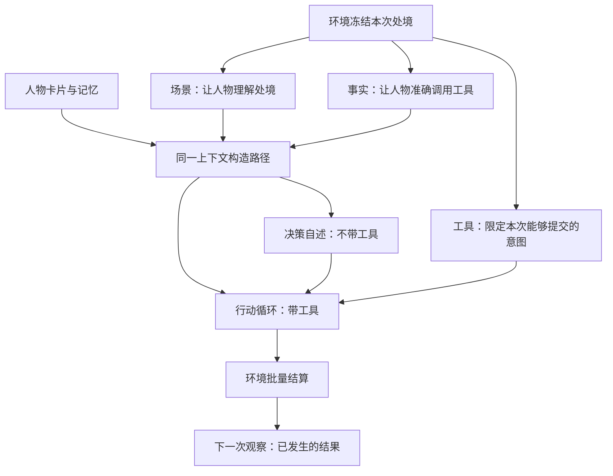
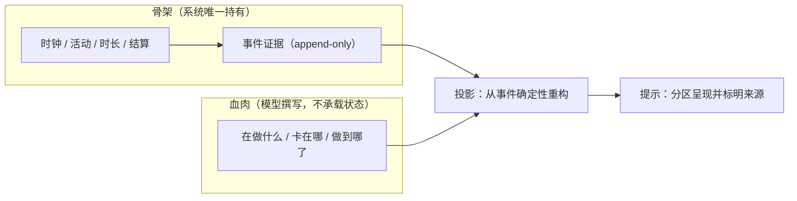
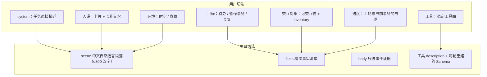
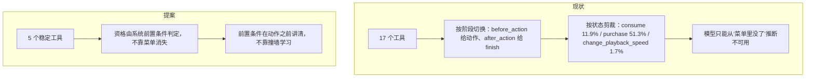
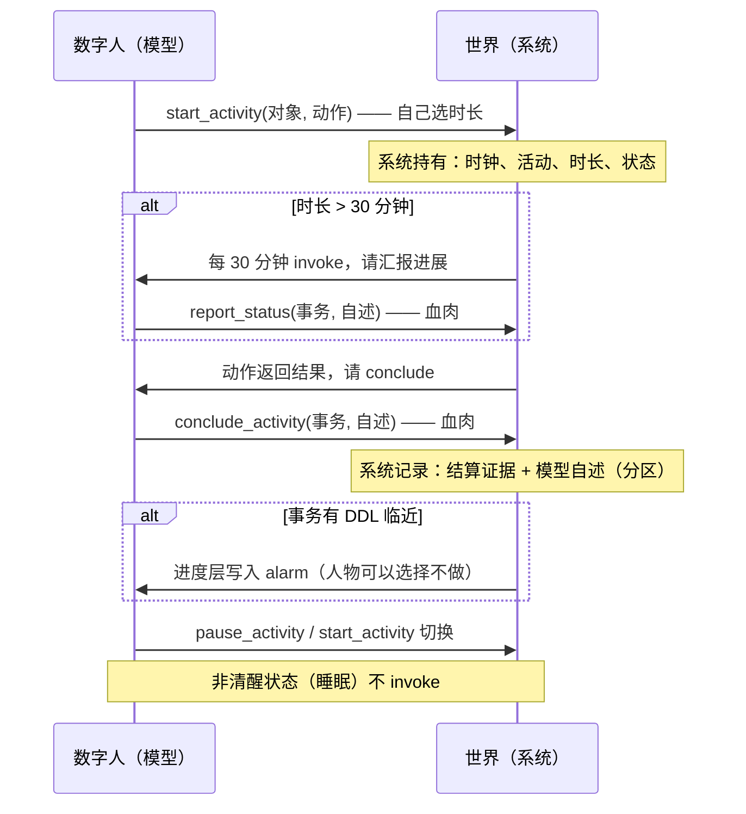
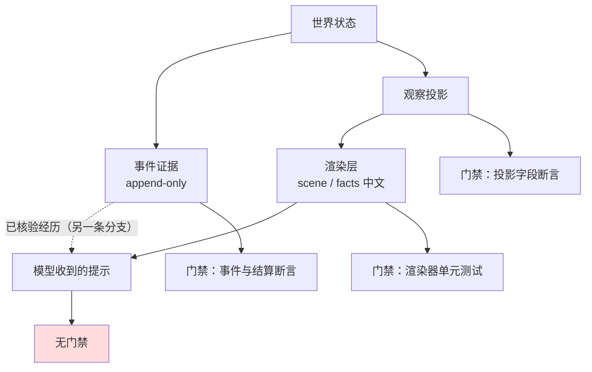
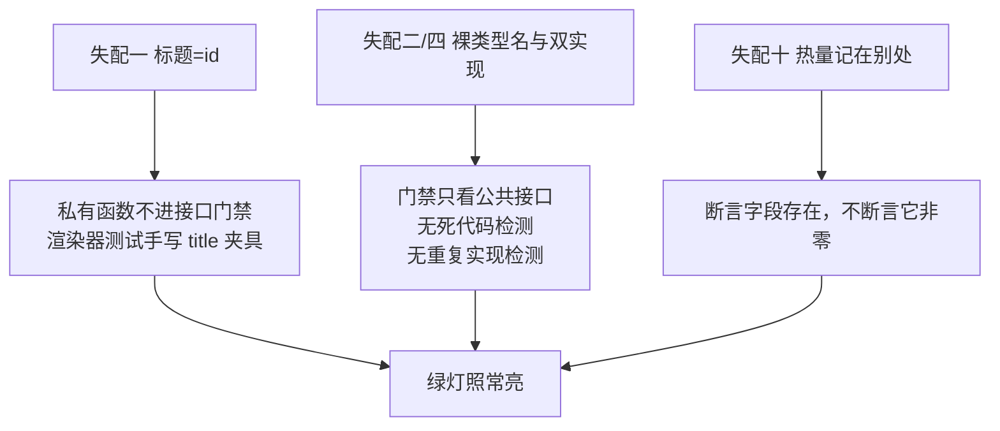
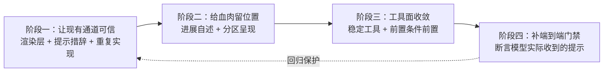
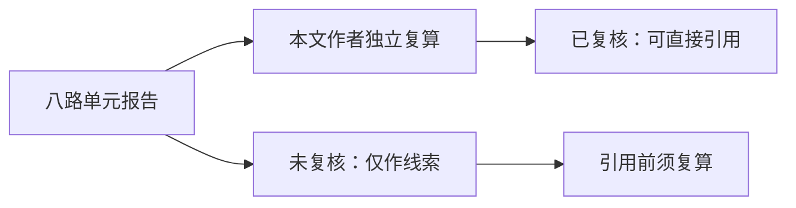

> 历史记录：本文件保存提交 `72f004b0087efa1b6f6d662ac6a143e087e4e21c` 时的过程与判断，不再定义当前系统。
> 当前设计见 [文档入口](../INDEX.md)；正文中的路径、规则和结果按当时上下文理解。

# 数字人交互方案

> 引用出处：`src/worldmock/life/map_models.py::LocationConfig` @ `55e6a0f4c6ed6a015e334b01513767eefc227880`

> 状态：**已裁决并冻结（FROZEN）**，2026-09-22。行为定义已收敛到 [数字人交互特性规格](SPEC-agent-interaction.md#spec-agent-interaction-特性规格数字人交互会话层上下文分层与稳定工具面)；
> 本文件保留心智模型、逐条对账与取舍依据，不再承载实现要求。
> **注意**：该规格已于 2026-09-22 **提交冻结（FROZEN）**，行为定义以该规格为准。原先阻断冻结的 3 项已全部裁决，其显式修订的四条既有冻结条款随本次冻结生效。
> 证据来源：一日双人运行数据库 `deepseek-day-main/footprints.sqlite`（743 次模型调用、154 次决策、370 次真实工具调用）；该运行产物在兄弟 worktree `WorldMock-dayrun-main/runs/` 下，本仓 `runs/` 无此目录。
> + 八路只读分面源码审计（工作与任务、活动与进度、交互菜单、决策协议、社交与在场、身体与环境、调度与截止、投影层）。
> 关联文档：[人物真实性规格](SPEC-life-realism.md#spec-life-realism-特性规格人物决策与画像)、[决策上下文规格](SPEC-decision-context.md#spec-decision-context-特性规格决策上下文与工具结果)、[交互菜单规格](SPEC-interaction-menu.md#spec-interaction-menu-特性规格交互菜单)

---

## 一、要解决的问题

### 用户原话

> “给我的感觉是我们的agent交互没有设计好”

> “这个设计的本意不是让模型接管一切，而是填充骨架的血肉，让一件事情更像是人做的，而这个事情持续了多久，当前究竟是什么状态应该仍然由系统决定”

> “模型看到的就不是work001，前进30mins”

> “总觉得心智模型都对得上，然后一跑到处都是‘没表达出来’，有bug”

### 症结

**“状态归系统、血肉归模型”这句话是对的，而当前实现两头都缺。**

系统侧的骨架是完备的：时钟、活动时长、有效工作量、合同剩余秒数、截止时刻，全部有确定性结算与事件证据。
但这些骨架**几乎没有血肉**：模型看到的工作是 `backend-hourly-2026-01-05` 加一个剩余秒数，
没有一句“在做什么、做到哪了”。反过来，模型唯一能写血肉的通道（`submit_work` 的会议纪要）
只在任务**结束后**开一次，且它写下的东西**不回灌**到后续决策。

而用户说的第二句话——“到处都是没表达出来”——在本轮审计中得到了**逐条证实**：
已查实 **17 类**“数据里有、模型看不到”或“同一事实两种表示”的失配（见第四章）。
此外，用户给出的心智模型已按 24 个要素逐条对账（见 2.2），其中 **7 项完全缺失**、**6 项半有**、**2 项与冻结契约冲突**。

---

## 二、用户心智模型与项目框架的映射

### 2.1 用户心智模型（原文逐字）

> 本节逐字保留用户给出的心智模型，作为本提案的设计意图来源；方向以 **未冻结提案** 状态记录，本节不构成行为合同。

**上下文与预算**

> 在我的心智模型中，我们应该至少选择上下文不小于 256k，输出 token 不大于 32768

**上下文分层**

> context 中应该如此分层：
> - **system prompt**：类似于 harness 的 system prompt，这里放的是这个任务的直接描述，可以参考 AS2
> - **人设层**：即该数字人的人设设定，以及高度抽象的长期记忆在这里维护
> - **目标层**：数字人各类待办，暂停事务的目标描述和一句话进展，DDL 等信息
> - **环境层**：数字人的时空，环境，身体信息
> - **交互对象层**：该环境下数字人可交互的各种对象，包括数字人持有物（inventory）
> - **进度层**：
>   - 由 agent 自己总结的上一轮 occupied 事务的完成情况
>   - 由 agent 自己总结的当前正在进行事务的完成情况，根据当前数字人 occupied 的事务进行切换（所有事务的总体进展在人设层中提供）
>   - 系统发现有其他事务临近 ddl 的时候发送的 alarm 也在这里存放
> - **工具层**：提供以下工具

**工具层**

> 永恒可见：
> - `start_activity(object/task[]， action[])` —— 选择至多 2 个目标/对象进行交互
> - `recall_task_summary(task)` —— 回看任何一个 task 的进度，task 的列表在目标层展示
>
> 当数字人有 occupied 的事务时：
> - `report_status(task[]，summary[])` = 对当前正在进行的事务进行进度汇报，并继续该事务
> - `pause_activity(task[]，summary[])` = 对当前正在进行的事务进行进度汇报，并暂停该事务
> - `conclude_activity(task[]，summary[])` = 对当前已完成的事务进行汇报，并结束该事务

**每一个 “session” 的循环**

> `start_activity`：数字人选择某个目标/对象进行交互，由数字人选择交互的时长，之后系统在以下几种情况 invoke 数字人：
> - 当数字人选择的交互时长大于 30mins 时，从 `start_activity` 时间节点开始，每 30mins 需要数字人对当前事务的进展进行播报（由数字人自己撰写，进入到下一个进度层的 prompt 中）
> - 数字人选择的交互动作并返回了结果，需要数字人 `conclude_activity`，进入下一个循环
> - 某件事情的 ddl 临近，进入进度层并提醒数字人（但数字人可以选择不做）
>
> 数字人可以 `pause_activity` & `start_activity` 切换动作，也可以 `report_status` 继续当前动作。
> 数字人非清醒状态是无法 invoke 的，比如睡眠。

**容量与浓缩**

> 每天 0 点，需要模型对每个 task 的进度进行总结浓缩，保证每个事务的进度层 prompt 不超过 4000 字符，目标层的单句总结更新，单句总结不超过 500 字符。
> 已经结束的事务总结进入人设层的长期记忆，让总结模型自行选择遗忘的内容，长期记忆不超过 8000 字符。

**前置条件与并发**

> 每个 task/目标，可能有前置条件（时空限制），需要数字人先满足时空条件才能够 start 该 task。
> 数字人最多同时进行两个 activity。

**完整例子（原文逐字）**

> 数字人在家里，想要加班工作，工作的时空条件 24 小时都可以工作，地点需要在公司（某些工作可以 work from home，这里举例必须到公司的工作），那么他选择 `start work`，会报错，因为数字人的地理位置不满足，他必须先 `start travel` 这个动作，对象是公司，到达公司之后系统会 invoke 数字人，让数字人 `conclude` 到公司的这个动作（即我 travel 到公司是为了完成 xxx 工作，这个 conclude 带到进度层中），然后数字人可以 `start work`，并且选择看剧作为 side activity，每 30mins 系统会 invoke 数字人 `report_status`，数字人会总结当前的工作和看剧看到了什么，如果数字人发现自己已经很困了，那么他可以选择 `pause_activity`（总结就是通过 pause 接口发出，而不是 report_status），然后 `start travel` 回家。

### 2.2 逐条对账：设计要素 → 当前实现 → 判定

把 2.1 拆成 23 个可判定的要素，逐条对改造前的实现。判定分五类：
**已有一致** / **已有但口径不同** / **半有**（能力在，粒度或参数不符）/ **缺** / **与冻结契约冲突**。

| # | 设计要素 | 改造前实现 | 判定 |
| --- | --- | --- | --- |
| 1 | 上下文 ≥256k、输出 ≤32768 | 全仓**未声明**任何模型窗口常量；实测 prompt 最大 **33,652** tokens（占 256k 的 **12.8%**）、输出最大 **19,504**（占 32768 的 **59.5%**）；`max_tokens` 固定 8000 | **独立结论**：预算远未用满，不是瓶颈；但输出上限无任何声明，只靠 `max_tokens=8000` 硬限 |
| 2 | system prompt 参考 AS2 | AS2 的 `PREAMBLE_TEMPLATE`**：约 3500 字符 XML 结构完全没有被使用**；`LifeAgent.build_react_messages`（`custom/agents/life_agent.py::LifeAgent.build_react_messages`）整体覆盖父类，换成约 300–400 字中文前言 | **独立结论**：有意替换；若要按提案"参考 AS2"，需先裁决取它的哪一部分 |
| 3 | 人设层（卡片 + 高度抽象的长期记忆） | 卡片 ≤600 汉字进提示；`MEMORY.md` ≤4000 字符（[改造前源码对账](https://github.com/HoldThatThgt/WorldMock/blob/2cf230115f4084aef2376e9d77bc976efbed43ea/docs/dev/PROPOSAL-agent-interaction.md)） | **已有但口径不同**：两处上限都比提案小 |
| 4 | 目标层（待办 / 暂停事务 / 一句话进展 / DDL） | `PlanGoal` 只有 `intent_kind` + `goal`(≤300 字符) + 推进证据；**无"暂停"状态**、**无"一句话进展"字段**；DDL 仅工作任务的 `due_at` | **半有**：清单在，暂停态与进展字段缺 |
| 5 | 环境层（时空 / 环境 / 身体） | `scene`(≤800 汉字) + `facts`；身体**只给分级不给数值** | **已有一致**：数值不给是有意的 |
| 6 | 交互对象层（可交互物 + inventory） | `facts.inventory` + `facts.products` + 每轮重建的实体枚举 | **已有一致** |
| 7 | **进度层**（模型自写的上轮/当前事务进展 + 系统 alarm） | **不存在**。最接近的是主观归纳 `subjective_summary`，但它**不按事务切分**、不分"上一轮/当前"、由 episode 累积触发而非定时 | **缺**：本提案核心新增 |
| 8 | `start_activity(object/task[], action[])` | `start_parallel_activities` 最接近（原子启动 ≥2 项），但**不接受"对象+动作"**；菜单出现率 39.8%，全天 **0 次调用** | **缺** |
| 9 | `recall_task_summary(task)` | 六个 `memory_*` 查询在，但**无按 task 聚合的进度查询**；episode id **只在内存查询被调用时才进提示**（实测 4 条 `memory_recent` 回执携带 `m_*` id，另有 65 条出现在无工具轮的记忆归纳载荷里），而全天只调了 3 次 `memory_recent` + 1 次 `memory_search`、**`memory_read` 0 次** | **缺** |
| 10 | `report_status(task[], summary[])` | `continue_activity(activity_id)` —— **只收 activity_id，不收 summary**。全仓**没有任何工具接受模型写的进展文本**（`send_message.text` 是唯一自由文本字段） | **缺**：本提案核心新增 |
| 11 | `pause_activity(task[], summary[])` | `set_activity_state(operation=pause)` 在（且属受保护工具），但**不收 summary** | **半有**：动作在，自述参数缺 |
| 12 | `conclude_activity(task[], summary[])` | 活动结束由系统按 `planned_end` 自动完成；`submit_work` 只在**任务提交**时收结构化交付物 | **缺**：没有"结束并自述"这一步 |
| 13 | 每 30 分钟播报 | `WakeReason` 是**冻结词表，成员不可增删**；最接近的 `reconsideration_interval` 默认 **5400 秒**、空闲 **10800 秒**；结算粒度 `activity_feedback_seconds=900` | **与冻结契约冲突**：需新增唤醒原因成员或改场景参数 |
| 14 | 动作返回结果 → conclude | **机制已有**：travel 完成即 invoke（实测 8/8 次 **+0 分钟**，`wake_reasons` 为 `planned_end`）；但**没有 conclude 这一步**，"我去公司是为了干 X"不带进任何层 | **半有**：机制在，语义缺 |
| 15 | DDL 临近 → 进度层 alarm（可拒绝） | `task_due_soon` + `commitment_threatened` 各触发 **2 次**（截止前 30 分钟），文案进 `todos_summary` 与 `drive_summary` | **已有但口径不同**：进的是 scene，不是独立进度层；且**过期无任何告知** |
| 16 | pause / start 切换 | `set_activity_state` 的 pause + 新 start 可做到，但要**两个回合**（一次决策恰好一个动作） | **半有**：能力在，粒度不匹配 |
| 17 | 睡眠不 invoke | `SLEEP_ALLOWED_REASONS` 只放行 `planned_end` / `wake_from_sleep` / `run_start` | **已有一致** |
| 18 | 每天 0 点浓缩 | **不存在**。`day_end_seconds` 只用于睡眠边界；记忆巩固由 importance 累计 / 待巩固条数 / 入睡边界三选一触发 | **缺** |
| 19 | 进度层 ≤4000 字符 | `context_max_chars = 4000`（[改造前源码对账](https://github.com/HoldThatThgt/WorldMock/blob/2cf230115f4084aef2376e9d77bc976efbed43ea/docs/dev/PROPOSAL-agent-interaction.md)） | **已有但口径不同**：数值巧合一致，但语义是整份 MEMORY.md，不是单事务进度 |
| 20 | 目标单句 ≤500 字符 | `PLAN_GOAL_MAX_CHARS = 300`（`src/worldmock/life/schedule.py`）；`MAX_PLAN_GOALS = 8` | **已有但口径不同**：比提案更严 |
| 21 | 长期记忆 ≤8000 字符，模型自选遗忘 | `subjective_summary` 截断 **4000**（`custom/agents/life_memory.py`）；`episodes.jsonl` **无上限** | **与冻结契约冲突**：检查点恢复校验 `episode_counter == len(records)` 与 `episodes_sha256`，销毁式遗忘会破坏恢复 |
| 22 | 时空前置条件先满足 | `validate_work_start` 抛 `WORK_LOCATION_REQUIRED`（全天 **4 次**）；`WorkTaskConfig` 的 **16 个字段里有 14 个在 743 条 prompt 中零次出现**——其中 4 个是黑名单有意挡的（`input_path`/`oracle_path`/两个 `_sha256`），**另外 10 个是无记录地漏掉的**，含 `required_location_id`、`required_skill`、`minimum_skill`、`maximum_duration_seconds`、`pay_fen` 等 | **缺**：规则在，模型**撞墙才知道** —— 正是用户举的那个例子 |
| 23 | 最多两个 activity | 并发由 `position/attention/device/hands/vehicle` 的**占用交集**判定，非硬上限；实测**峰值并发 1** | **半有**：能力在，上限口径不同 |
| 24 | **所有事务的总体进展在人设层中提供** | 人设层现由三段构成：身份（人物卡 ≤600 汉字）、已核验经历（环境投影，最近 5 条）、人物自述（`subjective_summary` ≤4000 字符）。**没有任何"总体进展"位置**——最接近的 `subjective_summary` 恰好是**不分事务的整体自述**，但它按 episode 累积触发、与"事务"无关 | **半有**：载体在（整体自述），但既不按事务聚合、也不表达"进展" |

**小计（逐行重数，共 24 项）**：**已有一致 3 项**（5/6/17）、**已有但口径不同 4 项**（3/15/19/20）、**半有 6 项**（4/11/14/16/23/24）、**缺 7 项**（7/8/9/10/12/18/22）、**与冻结契约冲突 2 项**（13/21）、**独立结论 2 项**（1 预算未用满、2 system prompt 来源）。

其中 **7 项「缺」全部是同一个形状**：能力或规则已经存在于系统里，但没有一条通道把它送到模型面前。

**最值得注意的一条**：用户的例子——"在家 start work 会报错，必须先 travel 到公司"——**引擎的规则与用户的心智模型完全一致**（`WORK_LOCATION_REQUIRED` 真实存在且当天触发 4 次），
但**规则的输入字段一个都没进提示**：`WorkTaskConfig` 的 16 个字段中 **14 个零次出现**，除 4 个黑名单字段外，`required_location_id`、`required_skill`、`minimum_skill` 等 **10 个是漏掉的**。
所以模型不是"不知道要先去公司"，而是**必须撞上去才知道**。这正是用户说的"心智模型对得上、一跑就没表达出来"。

### 2.3 预算对账

| 层级 | 用户设计 | 当前实现 | 差距 |
| --- | --- | --- | --- |
| 上下文窗口 | ≥256k | 未声明；实测峰值 33,652 tokens | 用量仅 12.8%，不是约束 |
| 输出上限 | ≤32768 | 未声明；决策自述 `max_tokens=8000` | 实测峰值 19,504（59.5%） |
| 进度层 | ≤4000 字符 | `context_max_chars = 4000` | 数值相同，语义不同 |
| 目标单句 | ≤500 字符 | `PLAN_GOAL_MAX_CHARS = 300` | 比提案更严 |
| 长期记忆 | ≤8000 字符 | `subjective_summary` ≤4000；片段库无上限 | 提案是现状 2 倍 |
| user 消息整条 | 未指定 | **40000 字符**（超限抛错、不截断） | 这才是真正的硬约束 |
| system 消息 | 未指定 | **3000 字符** | 已贴着上限用（回合预算 JSON 在内） |

**结论**：真正的约束不是上下文窗口，而是**按字符计的硬墙**（user 40000 / system 3000），超限直接抛错杀掉整个决策。
用户的三个上限（4000/500/8000）都在这个硬墙之内，可行。

### 2.4 项目框架映射

当前框架把**状态**与**表达**压在同一条链上：环境同时决定状态变化与提示文本。提案要把这两件事分开：

---

## 三、提案建议

> 第二章已把用户心智模型逐条对账完。本章只讲**建议怎么做**，不再复述用户的设计。

### 上下文分层的落地方式

用户的分层与项目现存的**三层观察投影**（`scene` 进提示、`facts` 进提示、`body` 只进事件证据）
是**同一个意图的两种切法**：用户按“信息属于谁”切，项目按“信息进哪个通道”切。
落地时**不新增通道**，而是在现有两段投影内**划出分节**：

**需要裁决的分歧**：用户把“进度”当作**独立一层**；项目现在把进度拆在两处——
客观进展在 `facts`（秒数），主观理解在记忆段（`主观归纳` + `最近的人物自述`）。
两者**同屏但不分区**，模型无从判断哪个算数。按本文口径复算：461 份非空思维块中，**81 份（17.6%）**出现“冲突/矛盾/不一致/对不上”一类措辞，58 份明确提到记忆。

### 工具面

用户设计 5 个稳定工具（`start_activity` / `recall_task_summary` / `report_status` / `pause_activity` / `conclude_activity`）。
现状是 **17 个工具、按阶段与状态每轮浮动（实测 11–17 个）**。

**支撑这条方向的实测**：370 次真实工具调用里 **212 次（57.3%）是 schema 校验失败**，
而世界侧的业务拒绝只有 **7 次（4.5%）**。摩擦来源是接口表达，不是世界规则。
（同一批失败按错误字段归因：`epistemic_status` 120 次、时长不匹配 81 次、其他 11 次。）

### 事务循环与骨架/血肉

**骨架与血肉的边界（提案的核心约束）**：

| 内容 | 归属 | 判据 |
| --- | --- | --- |
| 现在几点、推进了多久 | 系统 | 时钟 |
| 正在做哪一件事 | 系统 | 活动表 |
| 这件事做了多少（秒数、进度） | 系统 | 结算证据 |
| 这件事的**状态转移**（进行→暂停→结束） | 系统 | 只能由系统字段单独推出 |
| 这件事**做到了什么**（自然语言） | 模型 | 不承载状态，只改变“人物怎么理解” |
| 事务的时空前置条件是否满足 | 系统 | 由系统判定并**在动作前**告知 |

**用户举的例子与现有引擎一致**：`WORK_LOCATION_REQUIRED` 这个业务拒绝码真实存在（`src/worldmock/life/work.py`），
全天触发 4 次——正是“想在家干活但工作必须在公司”。差别在于模型**不是被告知**这个前提，而是**撞上去才知道**。

---

## 四、当前实现的差距：这套机制在代码里到底 work 不 work

### 4.1 结论先行

**状态层是 work 的，表达层不是。** 两者之间的失配不是偶发 bug，而是结构性的：
**没有任何一条门禁检查“模型实际收到的那段文字”。**

现有三层门禁各自只看自己那一段：事件有事件测试、投影有投影测试、渲染器有渲染器测试。
**但没有一条测试走完“真实引擎状态 → 模型实际收到的提示全文”。**

### 4.2 已查实的十七类失配

每条给出「数据里有什么 / 模型看到什么 / 判定 / 运行证据」。

#### 失配一：任务的标题恒等于任务 id

| | 内容 |
| --- | --- |
| 数据里 | `WorkTaskConfig` **没有 title 字段**（[改造前源码对账](https://github.com/HoldThatThgt/WorldMock/blob/2cf230115f4084aef2376e9d77bc976efbed43ea/docs/dev/PROPOSAL-agent-interaction.md)）；场景侧任务声明也没有标题 |
| 代码 | `title = self.rules.content_titles.get(task_id)`（`src/worldmock/life/observe.py`） |
| 真相 | `content_titles` 的键是**内容条目 id**（`src/worldmock/life/content.py`：`titles[item.item_id] = title`），与任务 id **键空间不相交**（已核实交集为空） |
| 模型看到 | `{"task_id":"backend-hourly-2026-01-05","title":"backend-hourly-2026-01-05"}` |
| 运行证据 | **321 条** prompt 正文里出现裸任务 id |
| 判定 | **意外丢失**。同文件 `src/worldmock/life/observe.py` 用 `item_id` 查同一张表是**正确的**——同一注册表，一处用对一处用错 |

用户说的“模型看到的不是 work001”**不是假设，就是当前实现**。

#### 失配二：活动类型名落进中文书名号

| | 内容 |
| --- | --- |
| 代码 | `current.append({"title": title or item.kind.value, ...})`（`src/worldmock/life/observe.py`） |
| 渲染 | `src/worldmock/life/narration.py`：`你正在{verb}《{current['title']}》{progress}` |
| 真相 | `_activity_title`（`src/worldmock/life/engine.py`）对 `WAIT/SLEEP/WORK/TRAVEL/READ_MAIL/BROWSE/CONSUME/CHAT/CALL` **一律返回 None** |
| 模型看到 | `你正在进行《travel》，还剩约20分钟` |
| 运行证据 | 全天出现过的 title 值共 9 种，**8 种是裸 snake_case**（`wait/travel/read_mail/work/consume/chat/watch/call`），只有 1 种是真标题 |
| 判定 | **意外丢失** |

#### 失配三：活动结束句没有宾语

| | 内容 |
| --- | --- |
| 代码 | `_activity_terminal_result`（`src/worldmock/life/action_evidence.py::_activity_terminal_result`）只给 `"Activity completed"` / `"Activity cancelled"` |
| 投影 | `src/worldmock/life/projection.py` 只取 `row["message"]`；`src/worldmock/life/result_projection.py` 的 `ACTION_RESULT_FIELDS` 不含 `data.activity` |
| 真相 | **事件 payload 里带着完整活动快照**（kind、target_id、时长、已执行秒数） |
| 运行证据 | 50 条终止事件全部走到固定字符串；模型事后只能猜“刚才做完的是什么” |
| 判定 | **意外丢失**。信息在事件里，是投影层丢掉的 |

#### 失配四：同一函数名，两份实现，测试断言的是没人调用的那一份

| | 内容 |
| --- | --- |
| 函数 | `_activity_progress_phrase` |
| 实现 A | `src/worldmock/life/engine.py` —— **生产零调用者** |
| 实现 B | `src/worldmock/life/observe.py` —— 真正进 prompt（被 `src/worldmock/life/observe.py` 调用） |
| 两份是否相同 | **逐字相同**（已比对） |
| 测试 | `tests/life/test_engine_branch_coverage.py` 从 `engine` 导入，中的断言见[改造前源码对账](https://github.com/HoldThatThgt/WorldMock/blob/2cf230115f4084aef2376e9d77bc976efbed43ea/docs/dev/PROPOSAL-agent-interaction.md) |
| 判定 | **测试证明的是“渲染器能处理进度”，不是“进 prompt 的那份是对的”** |

**同类更危险的一条**：`_task_due_soon` **同名两义**。
`src/worldmock/life/schedule.py` 是 **30 分钟**窗口（唤醒判定），`src/worldmock/life/projection.py` 是 **2 小时**窗口（场景提示）。
两条都活着、都被调用、语义不同——这不是重复，是**语义碰撞**。

#### 失配五：路线时长两种表示，可提交的那一种不可见

| | 内容 |
| --- | --- |
| facts | `"minutes": round(row["duration_seconds"] / 60)`（`src/worldmock/life/observe.py`），**取整丢失** |
| 校验 | `start_travel` 要求精确秒，不等即 `ROUTE_DURATION_MISMATCH`（`src/worldmock/life/engine.py`） |
| 真相 | 精确秒只出现在事件级工具支持（`src/worldmock/life/observe.py`）与 `discover_places` 结果里 |
| 运行证据 | 例：facts 显示 18 分钟，真值 1092 秒；按 `18×60` 反算得 1080，**必被拒** |
| 判定 | facts 取整**是有意的**（`ROUTE_ALLOWED_FIELDS`），但**同一事实两种精度且未标注该用哪个** |

#### 失配六：`consume` 的时长 schema 看起来自由，实际是单值

| | 内容 |
| --- | --- |
| schema | `duration_seconds: int = Field(ge=60, le=14_400)`，**没有 description**（[改造前源码对账](https://github.com/HoldThatThgt/WorldMock/blob/2cf230115f4084aef2376e9d77bc976efbed43ea/docs/dev/PROPOSAL-agent-interaction.md)） |
| 校验 | 必须等于目录时长：`PRODUCT_USE_DURATION_MISMATCH` / `MEAL_DURATION_MUST_BE_LONGEST`（`src/worldmock/life/basket.py`） |
| 模型看到 | 一个 60–14400 的自由整数 |
| 判定 | **意外**。类 docstring 写了合同，但没有进 JSON Schema 的 description |

#### 失配七：`epistemic_status` 的措辞与取值冲突

| | 内容 |
| --- | --- |
| Schema | `{"const": "subjective", "type": "string"}` —— 取值逐字写在 schema 里 |
| description | 「Every episode is **subjective** self-report」—— 同一个词在这里是**形容词** |
| 运行证据 | 120 次校验失败**全部**是这一个字段；被拒取值 22 种以上：`inferred`(141) `intended`(40) `felt`(40) `planned`(36) `committed`(11) … |
| 代价 | 120 / 743 = **16.2% 的模型调用**；占全部模型级错误的 56.3% |
| 判定 | **意外，且修法与直觉相反**。模型理解了这个字段要什么，只是不接受它只有一个合法值。**按“补一个 enum”去修会修错地方** |

#### 失配八：工具菜单的变化没有任何告知

| | 内容 |
| --- | --- |
| 运行证据 | 菜单在 11–17 个之间浮动：`consume` 11.9%、`purchase` 51.3%、`change_playback_speed` 1.7%、`game_action` 0% |
| 代码 | `interaction_menu` 在**禁止进提示的键**清单里（`src/worldmock/life/narration.py`） |
| 模型收到 | 唯一信号是「这个工具不在数组里了」 |
| 判定 | **有意为之**，但模型只能从 schema 差异推断可用性——对 LLM 是弱信号 |

**附带一条**：场景声明的**九个地点类菜单逐字完全相同**（已按签名哈希核实，九者同签名）。
也就是说地点侧剪裁在这个场景里**根本没起作用**，菜单浮动**全部**来自运行时状态。

#### 失配九：已声明但从不触发的提示

| | 内容 |
| --- | --- |
| 常量 | `_LOW_BUDGET_SENTENCE`（`custom/agents/life_agent.py`） |
| 触发条件 | `remaining_model_turns_including_current <= 2` |
| 运行证据 | 全天剩余回合最小值为 **7**，**0 次触发** |
| 判定 | 机制存在、**也有测试覆盖**（`tests/integration/test_life_agent_protocol.py` 断言了该句的出现与不出现），但在真实运行中**从未触发**——测试与实跑覆盖的是不同分支 |

#### 失配十：热量记在别处，标注字段恒为 0

| | 内容 |
| --- | --- |
| 字段 | `BodySettlement.food_energy_kcal`（`src/worldmock/life/body.py::BodySettlement.food_energy_kcal`），由 `_body_settlement_data` 写进事件（`src/worldmock/life/world_ops.py::_body_settlement_data`） |
| 运行证据 | 全库出现 294 次，**全部为 0** |
| 真相 | 真实路径是 `apply_meal_progress → _apply_item_delta → apply_food`（`src/worldmock/life/basket.py`），它**直接改 `agent.body`**，产出的 `BodySettlement` 只取 `.after` 后丢弃 |
| 热量实际在哪 | `resource_flows` 的 `cause=food:intake` 分录里（**24 条**，实测 166.3 / 186.5 / 137.2 kcal） |
| 判定 | **意外**。数据没丢，但**标着“食物热量”的字段与真正记录热量的字段不是同一个**——按字段名去找会得出“全为 0”的错结论 |

#### 失配十一：`accepted` 恒为 false，且没有“接受”这个动作

| | 内容 |
| --- | --- |
| 写入 | 创建时硬编码 `False`（`src/worldmock/life/social_actions.py`） |
| 判定 | `chat_accepted`（`src/worldmock/life/social_actions.py`）要求对方存在一条以我为伙伴的 ACTIVE 会话 |
| 真相 | **没有任何工具让对方创建它**；邀请只以一条 `chat_invite` 消息进对方收件箱 |
| 运行证据 | 6 次对话，`accepted` 全为 `false`；对方一侧零对称记录；某次对话在对方正 `wait` 时照常跑完 15 分钟 |
| 会话内容 | **完全不记录**——不产生任何对话文本，事后无法回答“他们聊了什么” |
| 判定 | `accepted` 不可见是**意外**；无接受工具是**规格有意留白**（规格说“对方若在其下一次决策开始与发起方的交谈即为接受”），但**没有任何提示告诉对方这是正确的回应方式** |

#### 失配十二：行进中的人仍挂在出发地

| | 内容 |
| --- | --- |
| 代码 | `update_travel` 只在行程比例 ≥1 时改 `location_id`（`src/worldmock/life/travel.py::update_travel`） |
| 投影 | `other_presences` 直接读 `other.location_id`（`src/worldmock/life/projection.py::other_presences`） |
| 运行证据 | 行进期仍挂在出发地的最大时长 = **32.5 分钟**（定义：已完成行程的最大计划时长；agent1 1950s、agent2 1718s）。期间出现“对着已经出门 10 分钟的室友说话” |
| 判定 | **意外**。规格未声明行进期应在场名单如何表现 |

#### 失配十三：地点营业时段不进提示，无法提前规划

| | 内容 |
| --- | --- |
| 场景数据 | `opening_calendars`、`required_qualifications`、`brand`、`affordances` 都在 `LocationConfig` 里（`src/worldmock/life/map_models.py::LocationConfig`） |
| 投影 | `_location_catalog` 只取 7 个字段（`src/worldmock/life/observe.py::_location_catalog`），以上四项**从不投影** |
| 模型看到 | 只有 `opening_status`（营业中/未营业/未知）这一个派生值 |
| 判定 | 状态值是**有意投影**的；但**时段本身不可见**意味着模型无法推理“几点前赶到” |

#### 失配十四：截止时刻在 scene 与 facts 里是两种格式

| | 内容 |
| --- | --- |
| scene | `现在是 2026 年 1 月 5 日星期一 00:00（Unix epoch：当前 1767542400）` |
| facts | `"due_at": 1767614400` —— **只有整数** |
| 模型要做 | 拿 epoch 整数减另一个 epoch 整数，才能知道“还剩多久到截止” |
| 判定 | **意外**。同一份时间，一处给人读，一处只给机器读 |

#### 失配十五：决定任务能否完成的那个量不进 facts

| | 内容 |
| --- | --- |
| facts 任务行 | 只有 `remaining_contract_seconds`（**墙钟**预算） |
| 事件级工具支持 | 另有 `effective_seconds`（**有效产出**），以及判定门槛 `required_effective_seconds`（`src/worldmock/life/observe.py`） |
| 真相 | 任务完成与否由**有效产出**决定，不由墙钟决定 |
| 判定 | **意外**。模型拿墙钟预算判断“快做完了”，而系统按有效产出判定——两边算的不是同一个量 |

#### 失配十六：七个字段只写进观察事件，从不进提示

| | 内容 |
| --- | --- |
| 写法 | 这些字段都在 `observe.py` 里被写进观察事件：`data["wake_reasons"]`(:75)、`occupied_resources`(:69-70)、`work_progress`(:104)、`market_summary`(:119)、`pending_deliveries`(:125-127)、`calendar_context`(:139) |
| 投影 | `scene` / `facts` / `narration` 三处**都不含**它们（已逐字段 grep，命中数 0） |
| 运行证据 | 743 条 `model_request` 里，这七个字段名**出现 0 次**；`category_matches`（购买结果里的品类配对）同样 0 次 |
| 规格 | **七个全部不在禁止进提示的键清单里**（`src/worldmock/life/narration.py`），规格对多数也沉默——也就是说它们不是被有意挡住的 |
| 判定 | **意外丢失**。其中 `wake_reasons` 尤其反讽：**系统认真算出了“为什么叫醒这个人”，却忘了告诉他** |

#### 失配十七：同一套工具里，时长有两种单位

| | 内容 |
| --- | --- |
| 多数工具 | `planned_duration_seconds`，单位**秒**，下限 60 秒（[改造前源码对账](https://github.com/HoldThatThgt/WorldMock/blob/2cf230115f4084aef2376e9d77bc976efbed43ea/docs/dev/PROPOSAL-agent-interaction.md)） |
| 社交工具 | `duration_minutes`，单位**分钟**，取值 1–120（[改造前源码对账](https://github.com/HoldThatThgt/WorldMock/blob/2cf230115f4084aef2376e9d77bc976efbed43ea/docs/dev/PROPOSAL-agent-interaction.md)） |
| 运行证据 | `duration_minutes` 字样在 50 条 prompt 中出现（工具 schema 携带） |
| 判定 | **意外**。同一套动作集里要模型切换时间单位；且社交工具是唯一一个**下限为 1 分钟**而其他为 60 秒的——两条边界其实等价，但表示不同 |

### 4.3 门禁为什么没拦住这些

这是本次探索最值得记下的一条。

| 机制 | 证据 |
| --- | --- |
| **接口门禁显式排除私有函数** | `scripts/coverage_gate.py`：`if not node.name.startswith("_")` —— 下划线开头一律不计。两份 `_activity_progress_phrase` 都不受约束 |
| **接口门禁只查“行被执行”，不查“被生产调用”** | `judge_gate` 的判据是函数体行是否出现在 coverage 的 `missing_lines`；由测试调用即可满足。`body_observation` 生产零调用、仅测试调用，门禁照样通过 |
| **无死代码检测** | `pyproject.toml` 无 ruff / vulture 配置 |
| **风格门禁只查四项** | `tests/test_style_gate.py` 只查行宽、函数长度、参数个数、docstring 语言；**不查重复实现** |
| **测试夹具手写生产产不出的值** | 4 处夹具写 `{"task_id":"task-visible","title":"整理会议纪要"}`。真实管线**永远产不出**这个 title。测试证明的是“渲染器能渲染标题”，而**标题是否存在**从未被断言 |
| **规格覆盖矩阵测的是映射** | `ANALYSIS-spec-coverage.md` 报 435/435 全覆盖，口径是“每条规格条款映射到至少一个测试函数”，**不是“模型实际收到了那段文字”** |
| **有端到端测试，但只覆盖它顺带断言到的字段** | `tests/life/test_decision_context_projection.py` 与 `tests/life/test_grounded_observation.py` 都走真实 `engine.observe()` 并断言 `render_facts` / `render_scene` 的输出。所以“从真实引擎状态到渲染文本”这条链**是通的、也在被测**——但它只断言了作者顺手检查的那几个字段（epoch、未读提示、长原因保留），**恰好没有一个断言落在本轮查出的失配上**（标题兜底、活动完成句、时长表示、`epistemic_status` 措辞） |

**一句话**：门禁与测试验证的是**结构与个别字段**，不是**这一轮模型实际收到的那整段话**。
链是通的、测试也在跑，但**没有任何一条断言盯在“这句话说得对不对”上**——所以“心智模型对得上”与“一跑没表达出来”可以同时成立。

### 4.4 差距明细表

> 计数口径：4.2 按**失配小节**计（17 个）；下表按**可独立修复的差距**计（19 行），其中失配四拆为“双实现”与“同名两义”两行。

| # | 差距 | 归属 | 类型 | 是否可独立修复 |
| --- | --- | --- | --- | --- |
| 1 | 任务标题恒等于 id | 表达层 | 意外丢失 | 需先加数据源 |
| 2 | 活动类型名进《》 | 表达层 | 意外丢失 | 是 |
| 3 | 活动结束句无宾语 | 投影层 | 意外丢失 | 是 |
| 4 | `_activity_progress_phrase` 双实现 | 门禁 | 意外 | 是（删死副本 + 改测试导入） |
| 5 | `_task_due_soon` 同名两义 | 表达层 | 语义碰撞 | 是（改名区分两个窗口） |
| 6 | 路线时长两种精度 | 表达层 | 部分有意 | 需裁决 |
| 7 | `consume` 单值时长未进 description | 提示 | 意外 | 是 |
| 8 | `epistemic_status` 措辞冲突 | 提示 | 意外 | 是（改一句 description，**不动 schema**） |
| 9 | 菜单变化无告知 | 表达层 | 有意 | 需裁决 |
| 10 | 低预算提示实跑从不触发（测试已覆盖） | 提示 | 配置不可达 | 需裁决是否保留 |
| 11 | `food_energy_kcal` 与真实热量字段不一致 | 记录 | 意外 | 是（让热量走被记录的结算，或改名） |
| 12 | `accepted` 恒 false / 无接受工具 / 无对话内容 | 社交 | 意外 + 规格留白 | 需裁决 |
| 13 | 行进期在场名单滞后 | 社交 | 意外 | 是 |
| 14 | 营业时段不可见 | 表达层 | 部分有意 | 需裁决 |
| 15 | 无“模型实际收到什么”的端到端门禁 | 门禁 | **结构性缺口** | 是，且应优先 |
| 16 | `due_at` 在 scene 与 facts 里格式不同 | 表达层 | 意外 | 是 |
| 17 | `effective_seconds` 与 `required_effective_seconds` 不进 facts | 表达层 | 意外 | 是 |
| 18 | 七个字段只进事件不进提示（含 `wake_reasons`） | 表达层 | 意外 | 是 |
| 19 | 时长单位在工具间分裂（秒 vs 分钟） | 提示 | 意外 | 是 |

---

## 五、分阶段路线图（提案建议，非裁决）

**阶段一的依据**：只要模型自述与事件脱钩、只要提示里有措辞冲突，后面所有重构都会继承同一个病。
**阶段四不可省**：本轮所有失配都是靠“读源码 + 翻库”手工发现的，**没有任何一条是靠跑门禁发现的**。

---

## 六、待裁决

1. **进度层的归属**：客观进展（秒数）与主观理解（自述）是否分屏呈现并标明来源？还是合并成一层？
2. **事务的粒度**：用户所说的“一件事”落在现有的**持续活动**、**当日目标**、**工作任务**三者中的哪一个？
   现有规格里**目标只有未推进 / 已推进 / 丢弃三态**，暂停与结束是**活动**层能力——两者生命周期不同，不能混成一层。
3. **30 分钟汇报节律**：唤醒原因是**冻结词表，成员不可增删**（`SPEC-life-runtime.md:93`）。
   30 分钟播报需要新成员、或改用场景参数 `reconsideration_interval_seconds`（默认 5400 秒）。
   注意实测决策间隔中位数已是 **7.4 / 13.6 分钟**，比 30 分钟**更密**——问题不是太稀，是唤醒理由太碎
   （`felt_band_change` 是最高频唤醒原因，全天 **74 次**，占 154 次决策的 48%）。
4. **最多两个 activity**：现有并发由 `position/attention/device/hands/vehicle` 的**占用交集**判定，不是硬上限。
   实测全天**峰值并发只有 1**（`start_parallel_activities` 在 39.8% 的菜单里，一次没用过）。
5. **遗忘机制**：模型自行选择遗忘**不能是销毁式改写**。检查点恢复校验 `episode_counter == len(records)` 与
   `episodes_sha256`，`memory_updated` 事件还引用具体 episode id。遗忘只能实现为**派生视图**。
6. **交付物形状**：`SubmitWorkRequest.deliverable` 硬编码为 `MeetingMinutes`（[改造前源码对账](https://github.com/HoldThatThgt/WorldMock/blob/2cf230115f4084aef2376e9d77bc976efbed43ea/docs/dev/PROPOSAL-agent-interaction.md)），
   而日跑场景有 `required_skill=backend_engineering` 的任务。是否按技能区分交付物 Schema？

---

## 附录一、覆盖边界（本分析未覆盖什么）

本文件的结论只适用于**决策与表达链**。以下模块**本轮完全没有读码**，因此本文件对它们**没有任何结论**，
也不应被引用来推断它们的状态：

| 模块 | 内容 | 本轮状态 |
| --- | --- | --- |
| `src/worldmock/evaluation/` | 两阶段评估、盲审、结论状态 | **未读** |
| `src/worldmock/delivery/` | LabelKit 边界、发布完整性 | **未读** |
| `src/worldmock/profile/` | 画像编译、大五分数、卡片文本生成 | **未读** |
| `src/worldmock/corpora/` | 语料构建与清单哈希 | **未读** |
| `src/worldmock/categories/` | 品类契约与交换算子 | **未读** |
| `src/worldmock/resources/` | 纯函数账本与守恒 | **未读** |

已读范围：`life/`（主战场）、`scheduling/`、`footprints/`（事件模型与已核验经历投影）、`catalog/`（可供性注册表与对象）、
以及 `custom/agents/`、`custom/envs/` 两个 AS2 薄适配层。

**因此**：本文件里出现的"结算侧是自洽的"这类判断，指的是 `life/` 与 `footprints/` 这一层；
账本守恒、语料准入、交付完整性等由各自规格与门禁覆盖，不在本次结论范围内。

---

## 附录二、证据位置

| 内容 | 位置 |
| --- | --- |
| 一日双人运行数据库 | `WorldMock-dayrun-main/runs/deepseek-day-main/footprints.sqlite`（兄弟 worktree；本仓无此目录） |
| 双人真实性与摩擦评估 | [评估结论](research/dayrun-two-agent-realism-and-friction.md) |
| 工具箱与模拟系统设计层审计 | [设计层审计](research/dayrun-toolbox-design-audit.md) |
| 任务与工作表达 | `life/observe.py`、`life/work.py`、`life/work_review.py` |
| 活动与进度表达 | `life/observe.py`、`life/narration.py`、`life/action_evidence.py` |
| 交互菜单与剪裁 | `life/interaction_menu.py`、`custom/agents/life_agent.py` |
| 社交与在场 | `life/social.py`、`life/social_actions.py`、`life/travel.py` |
| 调度与截止 | `life/schedule.py`、`scheduling/compile.py`、`scheduling/effects.py` |
| 门禁 | `scripts/coverage_gate.py`、`tests/test_style_gate.py`、`coverage-baseline.md` |

---

## 附录三、证据可信度分级

本轮的失配清单来自**八路只读单元报告**，其中关键数字由本文作者**独立复算**过。分级如下，避免把单元报告当既成事实引用。

| 关键结论 | 来源 | 本文是否独立复算 |
| --- | --- | --- |
| 370 次工具调用、212 次 schema 失败（57.3%） | 单元报告 | **已复算**（按 `tool_call_id` 全局去重） |
| `epistemic_status` 120 次失败、占模型调用 16.2% | 单元报告 | **已复算**（失败回执逐条归因） |
| 任务标题恒等于 task_id、321 条 prompt 出现裸 id | 单元报告 | **已复算**（库内正则提取实际任务行） |
| `WorkTaskConfig` 16 字段中 14 个零次进提示 | 单元报告 | **已复算**（743 条 prompt 逐字段 grep） |
| 七个字段零次进 prompt 且不在黑名单 | 单元报告 | **已复算**（黑名单全集逐项比对） |
| 唤醒原因分布（`felt_band_change` 74 次等） | 单元报告 | **已复算**（`decision_started.wake_reasons`） |
| 17 个唤醒原因中 3 个从未触发 | 单元报告 | **已复算**（全表枚举比对） |
| `food_energy_kcal` 294 次全为 0；热量实记在 `food:intake` 流（24 条） | 单元报告 | **已复算**（逐字段遍历全库） |
| `_activity_progress_phrase` 双实现、`engine.py` 那份零调用者 | 单元报告 | **已复算**（AST 定义/调用点对照） |
| `_task_due_soon` 同名两义（30 分钟 / 2 小时） | 单元报告 | **已复算**（读两处实现与调用者） |
| 九个地点类菜单逐字相同 | 单元报告 | **已复算**（签名哈希，九者同签名） |
| 行进期在场滞后最大 32.5 分钟 | 单元报告 | **已复算**（已完成行程最大计划时长） |
| `chat accepted` 恒 false、无接受工具 | 单元报告 | **已复算**（写入点 + 判定函数 + 全库扫描） |
| 30 分钟节律与冻结唤醒词表冲突 | 单元报告 | **已核对规格原文**（「成员不可增删」） |
| `task_expired` 不在 `_SCHEDULED_WAKE_FLAGS`、效果为纯透传 | 单元报告 | **已复算**（读映射表与 effects 分支） |
| 低预算提示全天 0 次触发（37 个请求剩余 ≤10） | 单元报告 | **已复算**；**但该分支有测试覆盖**（`tests/integration/test_life_agent_protocol.py`） |
| `work_notes` 加成可达性 | 两个单元**结论相反** | **已裁决**：商品在场景内、在 80 条 prompt 中出现过 → **可达，模型未购买** |
| 思维块主题占比（如「读数与记忆冲突」） | 两份文档 | **未能复现原口径**；本文改用自定口径（81/461 = 17.6%）并标明 |
| 门禁为何未拦住的机制链 | 本文分析 | **部分推断**：门禁排除私有函数、无死代码检测属事实；「因此绿灯照常亮」是推论 |
| 逐工具菜单出现率（100% / 80.5% / … / 1.7%） | 单元报告 | **已复算**（before_action 236 条请求逐工具计数，逐项吻合） |
| `browse/discover` 与时间线空档相关 | 单元假设 | **已复算**（陈曦 19/19、李凡 8/9 落在活动覆盖之外） |

**已复算、且原报告只当假设的**：`browse_activities` / `discover_places` 这类**零模拟时间**的瞬时查询与时间线空档强相关——陈曦 19 次**全部**落在活动覆盖区间之外，李凡 9 次里 8 次在外；全库去重后两者各被调用 16 / 14 次。

**仍未复核的**：八路单元报告中另有若干次要断言（例如各工具菜单出现率背后的逐条资格归因、评分器内部如何决定候选），本文**未逐条复算**，引用时按线索对待。

---
