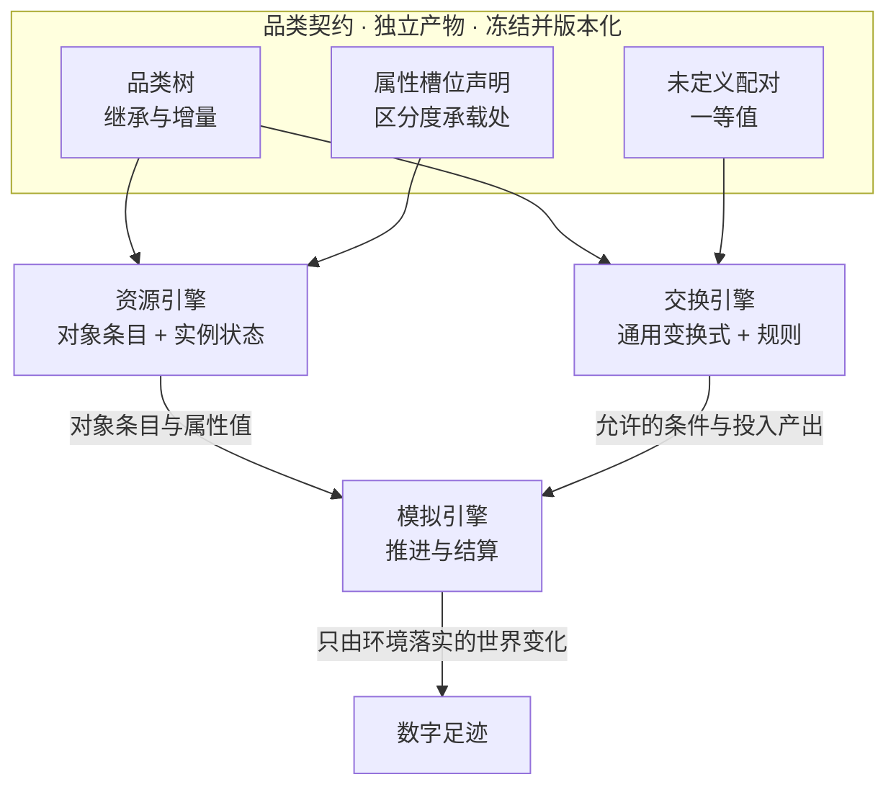
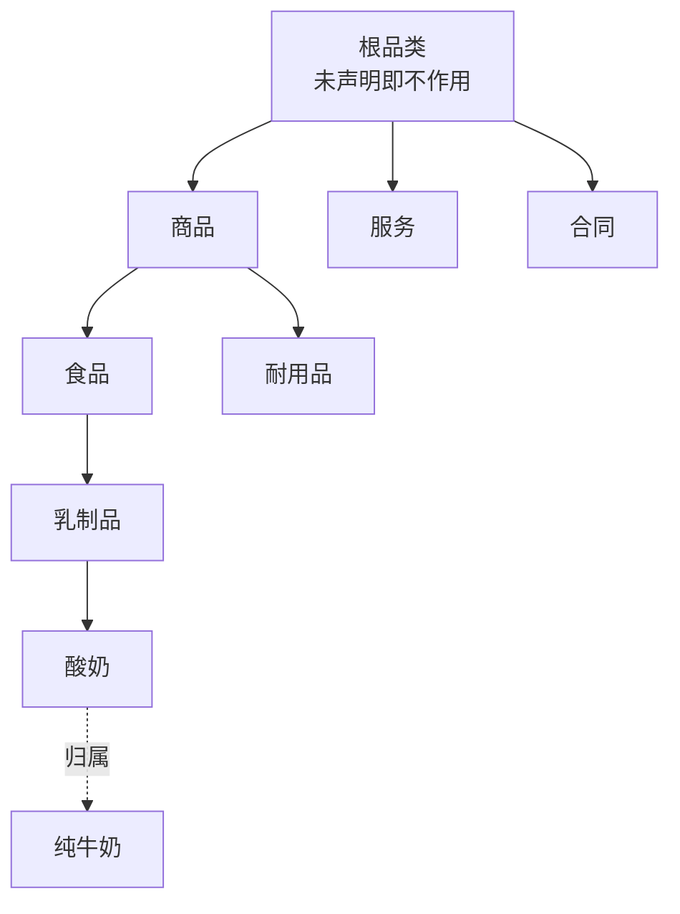
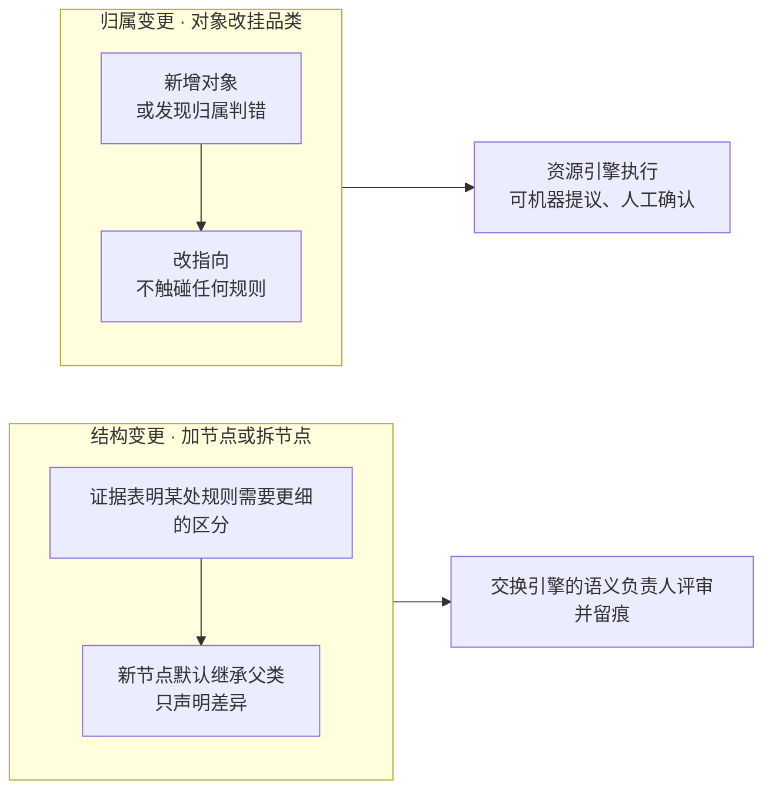
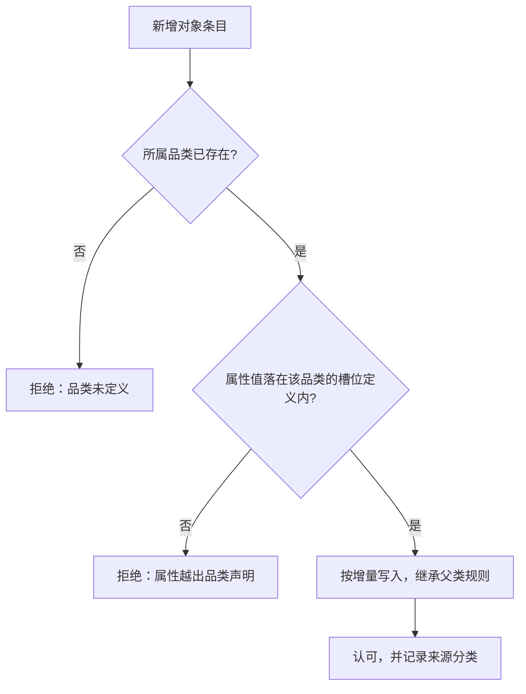
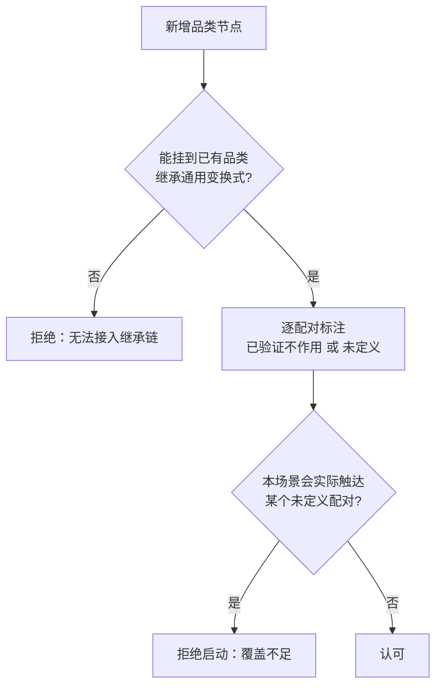
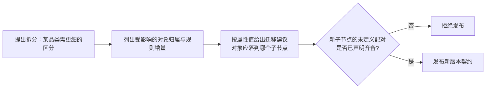

# 设计提案：品类契约与交换规则分层

> 状态：提案，未裁决。本文不构成规范，任何合同、代码、测试与验收结论在本文被单独裁决为冻结以前不得依赖其内容
> 日期：2026-09-20
> 范围：品类契约的定义与归属、规则在品类与对象之间的分层方式、新增与细化品类时的行为要求、静态数值的来源分类与模型可承担的范围
> 依据：本次架构讨论的心智模型推导，以及 `docs/design/02-exchange-engine.md`「当前差距」中尚未闭合的规则维护流程
> 关系：本文提出的是资源引擎与交换引擎之间第三方冻结产物的设计，涉及接口与字段的部分需在裁决后补入 `docs/CONTRACTS.md`

## 产品行为

人物在这个世界里能做什么，由环境判定；环境判定一件事能不能做、要付出什么、能得到什么，靠的是规则。
规则不可能逐条写死在每个商品上——同一个品类下的商品，可做的事和代价是同一套。
所以真正需要的结构是：**一个商品归属于某个品类，规则写在品类上，商品只在确实不同的地方覆盖它。**

品类同时承担两件事：它是对商品的分类，也是规则的挂载点。
这两件事的寿命和归属并不相同——分类会随认识变化而调整，规则只在有证据时才该动。
把它们压成同一个东西，就会立刻遇到两个死结：规则要么写不完（每个商品一套），要么写不准（所有商品共用一套无法区分的规则）。
第三个死结随之而来：如果规则必须逐对品类声明，那么每加一个品类都要面对"和已有的全部品类分别是什么关系"这个问题，而绝大多数品类对**确实没有相互作用**。

本提案的解法是把品类做成**一份独立的冻结契约**，让两个引擎都对着它校验，并让规则挂在这棵树的可继承节点上。

## 与相邻文档的边界

本文只定义品类契约与规则分层。以下内容已由其他文档定义，本文引用而不重写。

| 内容 | 归属 |
| --- | --- |
| 交换引擎的职责边界、规则维护与运行时调用的分工 | `docs/design/02-exchange-engine.md` |
| 资源定义、对象属性、目录发布与语料校验的职责 | `docs/design/03-resource-engine.md` |
| 资源的守恒域、账本分录与账户归属 | `docs/CONTRACTS.md` |
| 世界素材品类准入的阈值与失败关闭约定 | `docs/dev/SPEC-life-realism.md`「世界素材品类要求」 |
| 状态归属、身体语义与活动结算 | `docs/dev/SPEC-life-runtime.md` |
| 接口、字段、枚举与 Schema | `docs/CONTRACTS.md` |
| 验收门禁与结论边界 | `docs/VERIFICATION.md` |
| 系统分层与职责边界的理由 | `docs/ARCHITECTURE.md` |

## 概念词表

一个概念只用一个词是本提案的前置约束，品类这一层的词必须先钉死，否则契约没有共同语言。

| 采用 | 含义 | 淘汰的写法 |
| --- | --- | --- |
| 品类 | 品类树上的一个节点，既是分类单位也是规则挂载点 | 类别、分类、类型、category |
| 品类契约 | 品类树、属性槽位与未定义配对的整体，是冻结产物 | 品类注册表、品类目录 |
| 属性槽位 | 品类声明的、对象必须填或可覆盖的一项属性 | 属性字段、规格项 |
| 未定义配对 | 两个品类之间尚未有证据的相互作用，与"已验证不作用"不同 | 缺失规则、空规则 |
| 已验证不作用 | 有据可依地确认两个品类之间没有相互作用 | 无作用、零规则 |

## 品类契约的内容

品类契约回答"有哪些品类、每个品类在哪一层、哪些属性用于区分、哪些配对还没定义"。它不含任何结算公式。

图里实线是品类之间的从属，虚线是对象到品类的归属。规则可以挂在这棵树的任意节点上，深层覆盖浅层。

### 继承与增量

新品类声明的是**它相对父类的差异**，不是它的全部。加一个品类，只需要写它和父类不同的地方；没写的部分从父类继承。
这条要求来自一个具体的失败：父类的规则调整时，逐条复制出来的子类不会跟着变，于是同一规则出现多个版本。
参照游戏数据工程里成熟的做法（`copy-from` 加相对增量与比例增量），子类可以写"比父类多多少"或"等于父类的几倍"，这样父类变化时这个关系仍然成立。

### 属性槽位

品类声明的属性槽位是区分度的承载处。同一个槽位在不同品类下有不同取值，落到对象上就是具体数值。
**被压到对象里的数值，如果它其实是品类级的，就应该留在品类上**——密度窗这类"该品类的可信取值范围"是典型例子，它是品类属性，不是某个商品的属性。

### 未定义配对

未定义必须是**一等值**，和"已验证不作用"分开存。
这个区分不是洁癖：如果两者都写成"零"，那么没人能回答"哪些组合已经审过"，而审过的和没审过的在系统里长得一模一样，这个仓库赖以立身的可审计性就没有了。

静态检查只报告未定义配对，不因为存在未定义就拒绝。**拒绝发生在场景真的会触达某个未定义配对的时候。**
把逐对品类的静态覆盖检查换成运行时可触达检查，成本降低若干量级，而且抓到的恰好是重要的那些格子。

## 规则如何挂在品类上

交换引擎的规则分三类，分别落到不同层：通用变换式落在品类树的子树或根上，配对系数是稀疏参数，变换配方是品类到品类的原子变换。
规则**只感知品类**，不感知具体对象；对象只在确实不同的地方覆盖。

### 通用变换式必须是闭集算子

规则文件里不能写任意公式，否则一条规则就能凭空造出价值，账本的守恒不变量立刻破掉。
通用变换式是**闭集算子**，每个算子声明它在哪个账本域上守恒，这个声明在准入时被机械校验。
这是"只有环境可以改变世界状态"这条原则在规则层的直接推论，不是格式要求。

## 维护职责的切分

同一份契约上有两种性质完全不同的修改，归属和审批分量都不同。它们共用一个产物与一套版本，但不共用一个审批口。

结构变更由交换引擎的语义负责人驱动，因为触发它的一定是规则需要；归属变更由资源引擎驱动，它不动规则。
运行绑定一个品类契约版本，规则按该版本解析，因此规则变更不会悄悄改写已经跑过的运行。

### 新增对象

新增对象**不写任何规则**。它只写身份、所属品类，以及相对品类的差异数值。

### 新增品类

新增品类**不要求**声明它与所有其他品类的关系。它要求能接入继承链，以及把尚未有证据的配对标成未定义。
强制逐对声明的写法会让加品类变成高危操作，并且逼人写下一堆没有信息的零。

### 细化品类

细化是**一等操作**，不是"改名加一串手工修改"。它要给出受影响的对象与规则增量，让拆分这件事有指引、可回滚。

粒度不是一个全局旋钮，是**逐节点决定的**：在哪条规则上确实需要区分，就在那里加深一层，其余全部继承。
太粗不该靠预判，它会有可观测的表现——某个节点被频繁触达却只有一条不加区分的规则，这是该拆的信号。
所以先保持浅层，有数据再加深。

## 数值来源与模型边界

品类契约与规则里的每个静态数值都必须带来源分类，沿用现有的四类：`fact`、`anchored`、`assumption`、`scenario`。

模型的边界划在**可验证性**上，不划在题目上。

| 模型可以承担 | 为什么可以 | 产出落到哪一类 |
| --- | --- | --- |
| 从已有对象清单反推品类结构草稿 | 产出可人工审，且能从对象反查一致性 | `assumption` |
| 从真实数据源抽取属性值与取值范围 | 是归一化，可对照原源验证 | `anchored` |
| 起草品类之间的规则供人审 | 人审后留痕即可升级，是摊薄配对成本的唯一办法 | `assumption` |

**模型不得在规则缺失时自动补一条。** 它把"数据缺失"这个可发现、可修复的错误变成"静默编造"，
而后者会让足迹偏离世界、顺着交付流进训练数据，恰好摧毁这个项目存在的理由。
结构性约束比纪律可靠：**规则解析必须命中一个已声明的品类节点**，任何规则想生效就只能写进冻结产物，写进去就必然带来源标记。

## 落地与验收判据

本节的判据用于裁决后验收，不依赖任何尚未存在的实现。逐条都能用反例证伪。

| 判据 | 反例即失败 |
| --- | --- |
| 新增对象不需要编写任何规则 | 新增一个同品类对象时出现规则文件改动 |
| 对象只写相对品类的增量 | 出现逐对象复制的品类型数值 |
| 未定义与已验证不作用在存储上可区分 | 两者落入同一取值，无法查询哪些组合已审 |
| 未定义配对在静态检查中只报告不拒绝 | 只要存在未定义配对就无法加载目录 |
| 未定义配对在场景触达时拒绝启动 | 场景实际触达未定义配对仍能启动 |
| 通用变换式是闭集算子且声明守恒域 | 规则文件可写任意公式，或算子无需声明守恒域 |
| 拆分品类给出受影响清单与迁移建议 | 拆分只能靠人工逐条查找受影响对象 |
| 模型产出无法直接成为 `fact` | 存在一条让模型产出不经复核即升级的来源分类路径 |
| 运行绑定固定的品类契约版本 | 契约变更影响已完成的运行或已发布的导出 |

## 参考

品类与规则分层的做法在多个成熟领域已经收敛，本提案的设计取向取自它们验证过的部分。

| 领域 | 做法 | 取用它什么 |
| --- | --- | --- |
| 产品分类标准（GPC、eCl@ss） | 类上只挂很小的属性集，产品细节由属性值表达；标准比较报告记录过一个类加一个属性加取值表即可覆盖另一体系里上百个类的情形 | 粗品类加细属性，比细分品类便宜一个量级，表达能力不差 |
| 游戏数据工程（物品与材料系统） | 条目继承父类只写差异，数值可写相对或比例增量，理由是父类变化时关系仍成立 | 对象是品类上的增量，加一个对象是常数条字段 |
| 药物相互作用知识库（RxNorm 与 RxClass 一类） | 相互作用断言挂在成分或成分类级别，多个分类体系只作检索索引；新增一个成分只需改动它直属类别节点 | 规则挂共享节点，分类体系退化为路由；新条目零规则 |
| 投入产出分析 | 技术系数矩阵加列昂惕夫逆阵，同一套分类按不同分辨率发布，系数从观测到的交易数据推算 | 配对系数是稀疏参数格，有历史后应变成事件流上的派生视图 |
| 实体组件系统架构 | 组件是纯数据，系统是作用在组件集上的规则；新增组件类型若无系统处理则对模拟无影响 | 品类即属性集合；没有任何规则引用的品类是死重，可被机械发现 |

要留神投入产出分析的已知失效模式：固定比例、不允许替代。配对系数适合参与可行性判定与成本计算，不适合决定结果，否则会与"只有环境结算"这条原则打乱。

## 明确不做

- **不做运行中的品类契约变更。** 契约在世界初始化时绑定，变更只能发布新版本，不修改运行中的世界。
- **不做动态定价与自动配平。** 那是人的决策，系统只留证据链。
- **不追求分类标准的完备性。** 品类树服务于规则挂载，不以覆盖现实商品分类全集为目标。
- **不把品类树变成对象的多标签体系。** 一个对象归属一个品类，区分度交给属性槽位。
- **不让模型产出绕过来源分类。** 任何规则生效都必须经过冻结产物，没有旁路。

## 版本表

| 版本 | 日期 | 修订内容 |
| --- | --- | --- |
| 1 | 2026-09-20 | 从架构讨论整理为提案：确立品类契约作为资源引擎与交换引擎之间的第三方冻结产物，规则挂在可继承的品类树上，未定义配对为一等值并以运行时可触达检查取代逐对静态覆盖，明确结构变更与归属变更的归属切分、细化品类的一等操作地位与模型能力的可验证边界 |
