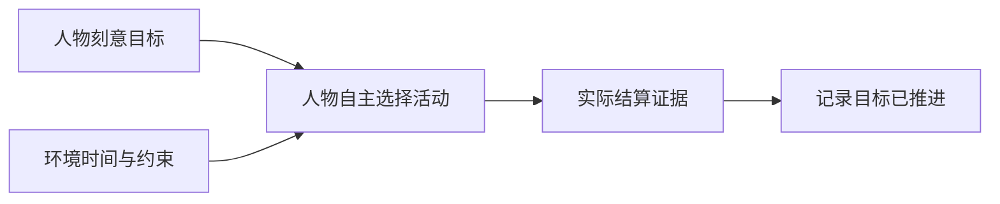

> 历史记录：本文件保存提交 `72f004b0087efa1b6f6d662ac6a143e087e4e21c` 时的过程与判断，不再定义当前系统。
> 当前设计见 [文档入口](../INDEX.md)；正文中的路径、规则和结果按当时上下文理解。

> 归档基线：2cf230115f4084aef2376e9d77bc976efbed43ea
> 原始路径：`docs/dev/PROPOSAL-day-plan-goals.md`
> 归档说明：此提交仅定位归档原文快照，不是审查执行证明；原始执行记录与未执行事实按原文保留。

# 当日计划语义改造的裁决记录

> 状态：已裁决的研究与取舍依据，非现行行为规范。日期：2026-09-21。
> 完整实现与验收以 [当日目标特性规格](SPEC-day-plan-goals.md) 为准。

人物描述「今天想推进什么」，环境负责「什么时候可以做」。用户已选择以实际活动家族证据记录
已推进，保留 `plan_day` 命名；不引入自然语言目标完成判定器。

| 原待裁决事项 | 最终裁决 |
| --- | --- |
| 目标范围 | 只表示刻意目标，允许空清单；不生成全天轮廓 |
| 目标形状 | 有序意图与文字，家族证据只证明推进，不能证明文字目标完成 |
| 命名 | 保留工具与容器名，删除全部旧时段形状 |
| 唤醒 | 复用现有任务、营业和活动可行性事件，不新增预约系统 |
| 度量 | 习惯、外部结构和刻意目标分开；受阻门禁不把正确拒绝说成引擎缺陷 |
| 修订 | 不能抹除已推进证据；丢弃目标仍保留统计分母 |
| 上限 | 延续提示容量八条上限，取消覆盖全天带来的下限 |

代码核查纠正了原提案的现状判断：常规重估间隔已经是场景参数，新增空闲间隔沿用该配置入口。
当日最后一个结算区间必须先保存目标推进，再清空过期目标。原就寝后隐藏计划的行为删除，
避免模型误以为当日尚未提交。

成熟方案的可复用机制：Todoist 区分任务意图、优先级与日期属性；Temporal 通过持久事件更新状态，
条件满足才继续执行。本项目采用这种职责分离，不新增依赖。
参见 [Todoist 官方术语表](https://www.todoist.com/help/todoist/get-started/todoist-glossary-cA60laWMH)
与 [Temporal 官方消息传递文档](https://docs.temporal.io/develop/python/message-passing)。

学科研究和核实限制保留在 [语义调研](research/day-plan-semantics.md)，未核实量级不进入规格。
本次不接入外部参考数据、不创建兼容层、不迁移旧状态；既有设计文档按模块责任同步，
完整文件清单和逐条验收统一在最终规格与本次验收记录中维护。
