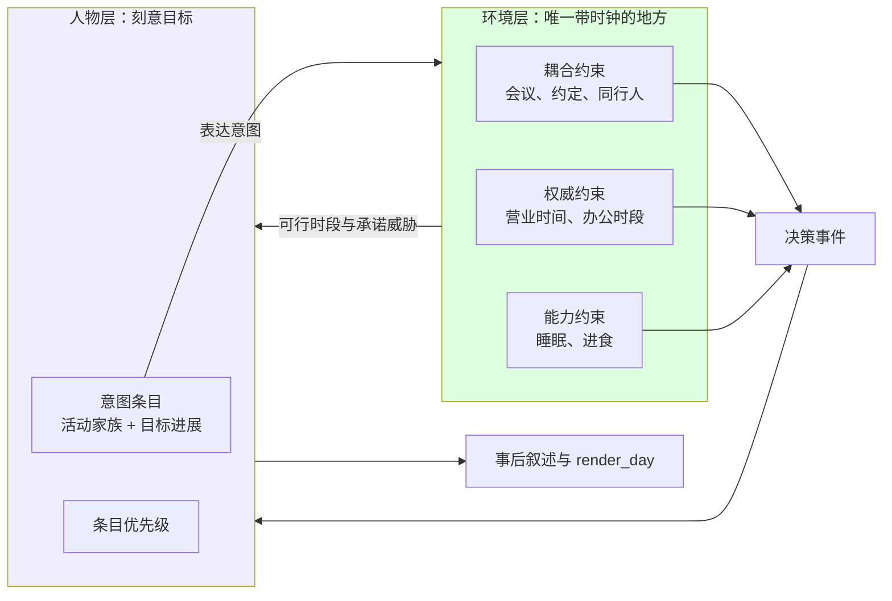
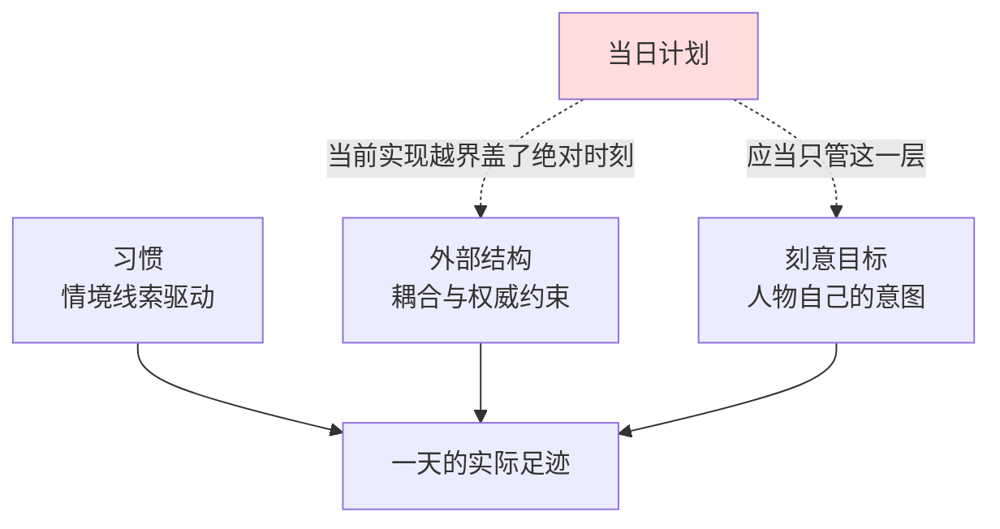
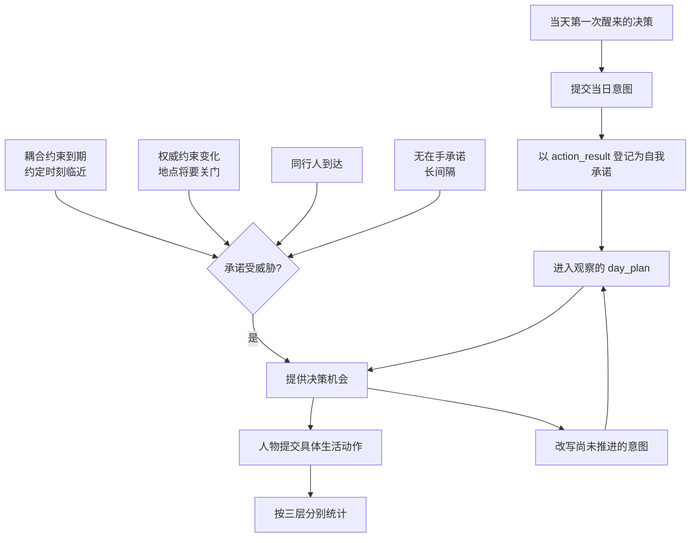
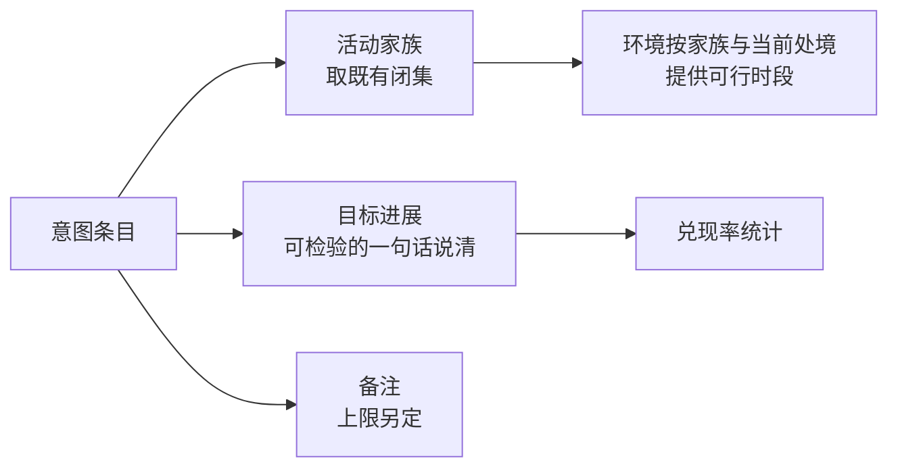
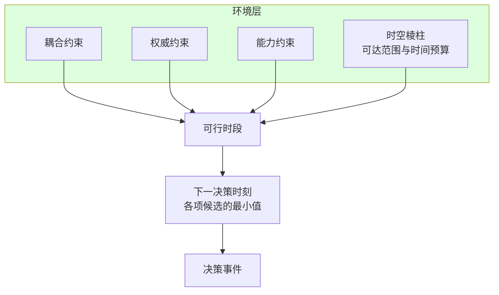

# 当日计划的语义改造提案：从时段表到刻意目标

> 状态：待裁决｜ 日期：2026-09-21
> 本文提出 `plan_day` 的语义改造方向，解释心智模型、业界依据与影响范围，需用户裁决后才转为规格。
> 学科依据与核实状态见 [语义调研](research/day-plan-semantics.md)。行为定义目前仍由
> [人生真实性规格](SPEC-life-realism.md)「日程骨架」与 [接口合同](../CONTRACTS.md)「日程骨架请求」承载。

## 摘要

`plan_day` 不该删。它的价值在**目标卸载与承诺**，不在行为预测；而当前实现把它同时当作目标层与时刻表，让最不可靠的一层承担了最可靠两层的职责。

自写计划解释行为的方差约一成三（意图改变 d = 0.66，行为改变仅 d = 0.36），而约四成五的日常行为由情境线索重复、绝大部分清醒时间由外部时间结构决定。与此同时，为未完成的目标做一份具体计划能消除它对注意力的损害，且**不需要真的执行**——这是计划最硬的一条功能证据。

改造方向：`DayPlan` 从「几点做什么」改为「今天想推进什么」，时序约束全部回到环境层，唤醒条件从「计划段起点」改为「承诺受威胁」。

## 用户诉求的落实

本次讨论从三个反问答成结论，逐条对应到设计：

| 用户提出的问题 | 结论 |
| --- | --- |
| `plan_day` 真的有必要吗？已有待办和暂停事务 | 有必要。三者分工不重叠：待办与暂停事务是响应式的、未完成状态，只有当日计划是人物自己的意图。意图是唯一由人物输出影响「何时再提供决策机会」的机制 |
| 为什么需要人物自己写下的承诺做对照？ | 这条我说错了。拿实际偏离计划当指标测的是模型遵守自己刚说过的话，属指令遵循能力。对照应当对外部真实分布，不对人物自己的叙述 |
| 人一般是目标驱动的，细化到几点通常是有预约的时候 | 接受，且这是改造的核心。时序锚点属于环境，人物只表达意图 |
| 没有它时钟会退化成九十分钟轮询 | 部分接受。轮询分档可行，但依据应是「事件驱动而非周期」，且分档键是承诺是否受威胁，不是有无在手活儿 |

## 心智模型与项目框架的映射

人物的清醒时间由三种控制模式共同决定，当日计划只描述其中最不可靠的一层。

这解释了一个反直觉之处：**删掉计划会让人物更不像人，不是因为失去连续性，而是因为失去目标卸载。** 未计划的目标持续产生侵入性念头并损害无关任务的表现，而做一份具体计划就消除这种损害，即使目标仍未完成。人物的待办和暂停事务是环境给出的未完成状态，不承担这个功能。

同时这也是一个下限警告：把当天每一段都写死成时段表，产出的日子会比任何日记研究观察到的都整齐。观察研究测得的真实工作日在三到十二分钟的尺度上就碎片化。

## 业界机制

| 传统 | 目标层 | 时序层 | 采用的部分 | 不适用的部分 |
| --- | --- | --- | --- | --- |
| 时间地理 | 项目要达成什么 | `capability` / `coupling` / `authority` 三约束 | 时序约束天然分层，且只有耦合与权威约束自带时钟 | 三约束的分类是理论性的，不能当作经验量级使用 |
| 交通行为学 | `activity program`（做什么、优先级） | `activity schedule`（何时、何序、何地） | 两层分开建模是这一领域的标准做法，可直接借用命名 | 它的时长模型依赖统计估计，本项目当前没有标定数据 |
| BDI | `desires` → `intentions` | 事件队列与承诺策略 | 唤醒由事件驱动而非周期；承诺策略是显式参数 | `single-minded` 最优的结论未能在原文核实，不能当设计依据 |
| 认知科学 | `themes` → `goals` → `plans` | 剧本的时序是序数的，没有时长槽位 | 意图保留有序结构、去掉绝对时刻有直接先例 | 剧本理论针对熟悉情境的理解，不描述跨天规划 |
| Generative Agents | 无目标树，目标隐在自然语言里 | 三元组递归分解到五到十五分钟 | 决策循环按人物各自推进，共享时钟只负责排序 | 它的计划表示是时间锚定调度，不是目标层次 |
| 行为心理学 | 目标意图（前提） | 实施意图的线索-反应联结 | 时间锚点是真实机制，但需有外部后果才咬得住 | 现场效果远弱于实验室，不能按 d = 0.65 预期 |

其中一条对当前实现是直接批评：Generative Agents 的粗块之所以够用，是因为下面有递归细化机制接着。本项目的规格明确写了不做递归分解到五到十五分钟，等于借了它的段数结构却砍掉了让它能落地的那一半。当前的 `PlanSegment` 既要粗块语义又要细化后的精度，两边都不占。

## 裁决后的设计

### 当日计划的语义

`DayPlan` 表示人物当天想推进什么，不表示几点做什么。

与当前实现的三处差别：

- **意图条目不再携带绝对起止秒。** 时间要求只在确实存在耦合约束时由环境下发。
- **唤醒条件从「计划段起点」改为「承诺受威胁」。** `plan_block_boundary` 这个唤醒原因退役。
- **保留意图的有序结构与优先级。** 去掉的是时长和绝对时刻，不是意图。

### 意图条目的形状

条目描述「想做什么」和「想推进到什么程度」，后者需要能被环境检验，否则无法统计兑现。

条目之间只要求优先级，不要求覆盖到就寝、不要求不重叠、不要求越过当日结束——这些约束是为时段表设计的，目标集不需要。相应地，五到八段这个下限需要重新论证：目标集没有「覆盖一天」的义务，下限可能不再成立。

### 时钟归属

环境的 `next_decision_time` 本来就在取各项候选的最小值，门禁、通知、配送、地点营业变化都在其中。计划段起点只是其中一个候选源，去掉它之后由「承诺受威胁」接替，不需要新的调度机制。

关于轮询分档，文献给的依据是事件驱动而非周期，因此分档键应当是威胁而非有无在手活儿：

| 情形 | 决策时机 |
| --- | --- |
| 未完成承诺受事件威胁 | 立即 |
| 有可推进的承诺但无威胁 | 常规间隔 |
| 没有任何在手承诺 | 长间隔 |

现在 `reconsideration_interval_seconds` 硬编码在 `src/worldmock/life/schedule.py`，是隐式后果的形态。分档后它应成为显式参数。

### 度量拆三层

段级对照现在算出一个单一偏离数，这个数混了三种控制模式，读不出来。按模式拆开：

| 层 | 度量对象 | 归属 |
| --- | --- | --- |
| 习惯 | 同一情境线索下的行为一致率 | 报告项，不需要计划参与 |
| 外部结构 | 耦合与权威约束的遵守率 | 被拒绝、地点不可达造成的偏离全归这里，算缺陷、进质量门禁 |
| 刻意目标 | 意图条目的兑现率 | 只在这一层算，以外部分布为对照 |

两条校准预期值得写进口径说明：失败条目倾向于**被丢弃而不是重排**；**优先级越低的条目兑现率越低**。

## 影响范围

| 面 | 需要改动的东西 |
| --- | --- |
| 接口合同 | [接口合同](../CONTRACTS.md)「日程骨架请求」整节重写：字段表、约束表、单位披露合同、边界披露合同、提交条件、拒绝错误码 |
| 行为规格 | [人生真实性规格](SPEC-life-realism.md)「日程骨架」整节重写；唤醒条件语义连带 [人生运行时规格](SPEC-life-runtime.md)「决策节律：结算边界与唤醒条件分离」 |
| 请求模型 | `PlanSegmentInput`、`PlanDayRequest`、`ReviseDayPlanRequest` 的字段面 |
| 领域模型 | `schedule.PlanSegment`、`schedule.DayPlan`、`initial_day_plan`、`revise_day_plan`、`_validate_skeleton` |
| 唤醒判定 | `WakeReason.PLAN_BLOCK_BOUNDARY` 退役；`is_plan_block_boundary`、`next_segment_start`、`current_segment` 随之作废 |
| 照做判定 | `segment_followed` 与「意图到家族闭集」映射表：没有段区间就没有判定窗口，这一组需要重新设计或退役 |
| 观察投影 | `_plan_row`、`_plan_fact` 的字段面；`day_start_epoch` / `day_end_epoch` / `bedtime_epoch` 是否还需要向提示披露 |
| 提示 | `custom/agents/life_agent.py` 里关于 epoch 秒与四个时间锚点的工具说明整段作废 |
| 评估 | `evaluation/behavior_metrics.py` 的 `_plan_day_entry`、`_plan_family`、`_plan_actual_deviation` 按三层重写 |
| 文档一致性 | [规格覆盖分析](ANALYSIS-spec-coverage.md) 的条款到测试映射矩阵需同步；受影响条款目前全部映射到测试，重写后要重新映射 |
| 测试 | `tests/life/test_day_plan.py`、`test_revision_contract.py`、`test_wake_reasons.py`、`test_engine_round.py`、`tests/integration/test_observation_agent_seam.py` 等直接构造段序列的用例 |

有一处顺带发现：`is_plan_block_boundary` 只被测试调用，生产路径走的是 `evaluate_wake_reasons`。这个函数在这次改动中可以一并清掉，但要同时处理测试侧对它的依赖。

## 本次明确不做的事

**不接入参考数据集。** 按调研结论，把参考日程作为示例放进提示会教模型抄并抹平人物之间的差异，而计划本身就不预测行为，拿它对齐全天分布没有意义。参考数据的合理位置是环境侧先验与评估层外部对照，属于独立的数据扩容决策，等语义改造落地后再单独排。本次不为它预留接口。

**不做兼容层。** 按项目工程原则，过时的段语义直接删除，不保留 `DayPlan` 的旧形状，不写迁移。

## 风险与待裁决

需要用户判断的三处：

**当日计划该管辖多大范围。** 本次改造的一个张力是：规格要求计划「覆盖到就寝」，这是全天日程的形状；而调研结论是计划只应描述刻意目标层。若 `DayPlan` 只管刻意目标，习惯层与外部结构层就完全没有表示——人物早晨醒来看到的处境里没有「今天大致怎么过」的任何东西，这会不会让行为比现在更抖，需要决定。可选的做法是让环境按人物卡片的时间锚点生成一份默认轮廓，人物在其上标注意图；但那等于把骨架生成移进环境，是另一个量级的改动。

**条目形状怎么定。** 「目标进展」要能被环境检验才能统计兑现，但检验方式没有先例可循。取活动家族加一句话，检验退化成「这个家族今天是否发生过」；要真正检验进展就得给出可判定的谓词，那是新机制。倾向取前者并明确它的限度。需要用户裁决。

**命名是否一并改。** `day_plan` 这个词自带时段表含义，交通行为学里这一层叫 `activity program`，目标清单与目标时刻表是分开的两个量。按项目风格过时概念不该留别名，但改名要动接口合同、领域模型、观察字段、工具名与一批测试。改还是不改、与语义改造一起做还是分开做，需要用户决定。

标注为未核实、不能进规格的条目：Kinny & Georgeff 的 `single-minded` 最优结论、`schedule` 框架与 `goal` 框架的对照命名、时间型线索是否元分析意义上劣于事件型线索、以及一个人同时持有多少活跃目标的基率。全部记录在 [语义调研](research/day-plan-semantics.md) 的疑点表中。

## 下一步

裁决本文后：把裁决结果落到 [人生真实性规格](SPEC-life-realism.md) 与 [接口合同](../CONTRACTS.md)，出完整的文件修改清单，再做一次独立一致性审查，然后进入实现。按前几个特性的做法，实现阶段要求不允许 defer 任何待实现内容，由测试用例保证。
