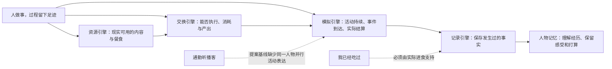
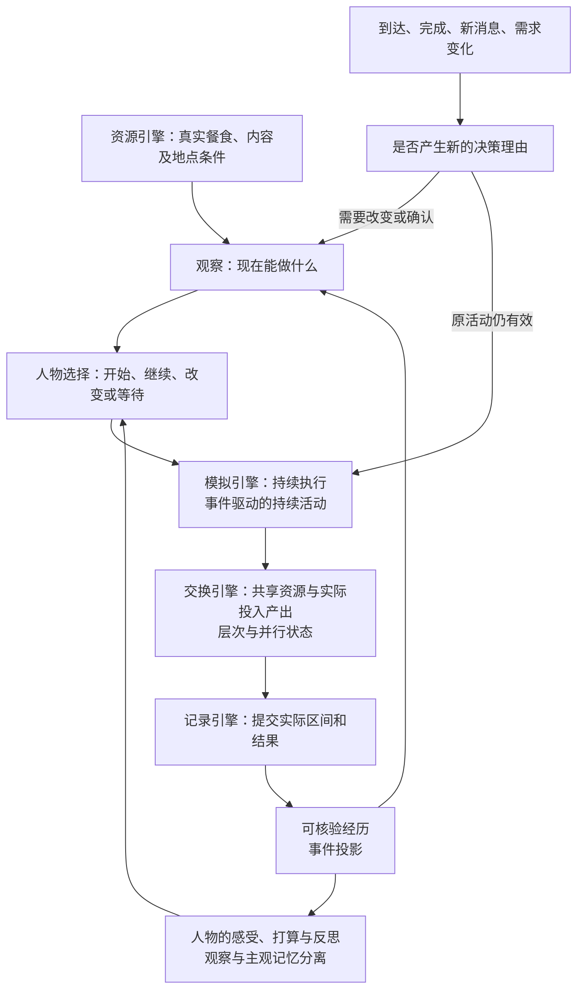
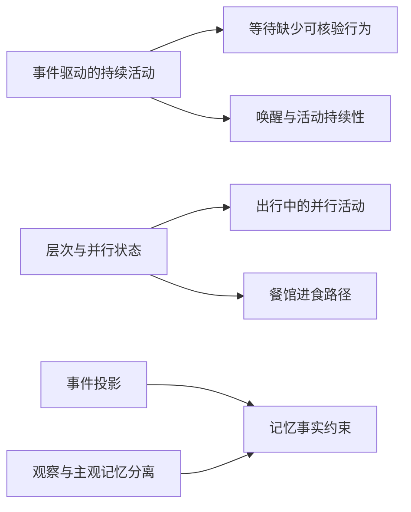

> 历史记录：本文件保存提交 `72f004b0087efa1b6f6d662ac6a143e087e4e21c` 时的过程与判断，不再定义当前系统。
> 当前设计见 [文档入口](../INDEX.md)；正文中的路径、规则和结果按当时上下文理解。

> 归档基线：2cf230115f4084aef2376e9d77bc976efbed43ea
> 原始路径：`docs/dev/PROPOSAL-dayrun-behavior.md`
> 归档说明：此提交仅定位归档原文快照，不是审查执行证明；原始执行记录与未执行事实按原文保留。

# 一日运行：从能跑完到行为可信

> 状态：已裁决的设计记录；用户已授权完整开发，实施与验收以 [特性规格](SPEC-dayrun-behavior.md) 为准。崩溃修复的整合和验证另见
> [核查与验收](research/dayrun-reconciliation/verification.md)。
> 依据：[行为证据](research/dayrun-reconciliation/behavior-evidence.md)、
> [业界参考](research/dayrun-reconciliation/industry-references.md)。

## 第一章　心智模型与项目框架的映射

### 用户原话

“原测试全绿但真跑必炸”。

附件诊断中的问题表述是：“记忆里有晚饭，事件里没有。”

用户对三个交付选项的回复是：“1+2+3”。

### 项目框架映射

人物不需要每个时刻都产生数字内容。安静等待可以是真实生活；系统应准确表达它，
并提供能实际执行的其他选择。不能为了填满时间线，把等待润色成刷手机或吃饭。

现有引擎已经把结算与决策分开，也已经允许不同人物和配送并行。
需要补的是同一人物的并行活动、可执行供给、重复唤醒控制和记忆的事实约束。

### 采纳的用户目标

你的意思是：先把真实模型能触发的崩溃收口，再让人物看得到可执行的生活选择，
能把事情持续做下去；足迹和记忆中的“做过”，必须与实际发生的行为对得上。

这里不预设“等待越少越好”，也不把旧时间段日程重新带回主线。

## 第二章　提升后的心智模型

### 业界方案概览

| 机制 | 适用 | 不适用 |
| --- | --- | --- |
| 事件驱动的持续活动 | 一件事持续到完成、中断或新情况需要决定；结算照常进行 | 每次结算重新要求模型选择相同动作 |
| 层次与并行状态 | 出行与随行内容各自有进度，共享资源约束；吃饭过程可分解 | 为所有活动无条件开放并行，或替换整个引擎 |
| 事件投影 | 从实际消费、移动和播放生成可追溯的完成事实 | 从人物自述反推世界中发生了什么 |
| 观察与主观记忆分离 | 事实保留依据，感受、意图和反思保留人物视角 | 把来源身份有效等同于叙述内容属实 |

### 提升后的设计

**事情能够持续。** 保留现有静默续行。截止预警在首次出现或相关事实改变时提醒，
同一条件持续为真不应反复制造相同决策。等待记录实际时段与已知原因；
选择播放或浏览后，才记录具体内容接触。

**通勤可以带着内容。** 步行和播客分别记录真实进度，同时由既有资源占用规则判断能否并行。
身体时间只结算一次，内容进度按实际重叠区间计算；暂停内容不自动取消出行。
这需要补同一人物活动生命周期，不能只改资源声明或人物提示。

**去餐馆之后能吃到。** 先保证用于进食的餐馆真的有可购餐食，并在到店观察中呈现。
复用现有购买、交付、进食结算，明确何时付钱、拿到食物、开始吃。
菜单为空时如实表达，不凭地点名称生成餐食，也不把到店算成进食。
是否把这段过程收成一次人物操作，是独立的交互选择。

**记忆有事实来源，也有人物视角。** 已吃、已到、已播放等完成事实由已结算事件提供，
人物可以补充感受和打算。建议巩固分别保留已核验事实和主观内容，事实保留其来源；
主观解释不能在转述后变成新的世界事实。
仅检查引用是否存在无法完成这项工作，也不应再靠一段提示词宣称已经解决。

上述机制复用现有事件队列、资源规则和记录事务。此次不引入新的模拟框架、
通用工作流平台、历史格式兼容层或替代模型，也不让模型直接修改世界账本。

### 设计决策点

下列推荐方向已采纳；精确资源、事实来源、接口及验收边界由特性规格冻结。

| 决策 | 推荐选择及利弊 | 另一选择及利弊 |
| --- | --- | --- |
| 记忆事实约束 | 完成事实由事件生成，人物写感受和意图；依据清楚，但需调整记忆输入 | 人物自由写后逐条语义审查；表达自由，但增加调用成本和误判 |
| 出行中的并行活动 | 同一套活动生命周期支持资源允许的组合；长期一致，但需同步更新结算与恢复 | 把播放作为出行内部状态；首个组合较小，但会产生两套播放生命周期，不推荐 |
| 餐馆进食路径 | 先补供给与到店可见性，沿用购买和进食；职责清楚，但仍需多次选择 | 提供一次“在此用餐”操作；表达直接，但必须定义付款后中断和剩余食物 |
| 等待的真实性 | 允许真实等待，要求不编造内容，并统计原因；保留行为差异，但不保证时间线密集 | 为等待占比设上限；便于筛选，但会把评估阈值变成人物偏好，当前无依据 |

## 第三章　提案基线的实现差距

以下现状判断均指提案调研基线，现行实现与验收以冻结规格和实施台账为准。

### 差距归属图

### 差距明细表

| 差距名称 | 对应设计点 | 性质 | 阶段 |
| --- | --- | --- | --- |
| 等待缺少可核验行为 | 准确表达等待与内容接触 | 名实不符 | 事实一致性 |
| 出行中的并行活动 | 同一人物按资源约束推进多个活动 | 缺失 | 并行活动 |
| 餐馆进食路径 | 可购餐食与到店呈现 | 缺失 | 生活路径 |
| 记忆事实约束 | 已结算事实与主观解释分离 | 缺失 | 事实一致性 |
| 唤醒与活动持续性 | 持续条件只在必要时再次提醒 | 缺陷 | 生活路径 |

**等待缺少可核验行为。** 等待已有起止、进度和身体结算，缺的是对“边等边刷”等解释的实际内容证据。
应保留真实空白，具体数字行为只随实际操作记录。

**出行中的并行活动。** 提案基线中同一人物只有一个主活动，启动另一个会暂停前者。
需要一致的并行生命周期，不能把不同人物可并行当作此能力已存在。

**餐馆进食路径。** 已有购买到进食的链条，旧运行所去餐馆却没有餐食供给。
先补可执行输入和呈现，再以完整进食链验收；旧运行不能证明堂食必须新增动作。

**记忆事实约束。** 提案基线中核验来源身份，尚未约束记忆命题与来源内容相符。
没有消费事件的晚餐不能进入已完成经历，巩固后也不能改变性质。

**唤醒与活动持续性。** 提案基线中已有静默续行；截止预警仍可能在整个窗口反复触发。
应核验首次提醒与后续相关变化，主线还没有新的完整一日行为结果。

### 分阶段路线图

每个阶段先跑通最小完整路径，再补组合与中断。验收分别看“运行是否结束”与“行为是否可信”：
必须核对实际进食、内容接触、重复唤醒、守恒和记忆事实；单次跑完不构成真实性或完备性证明。
