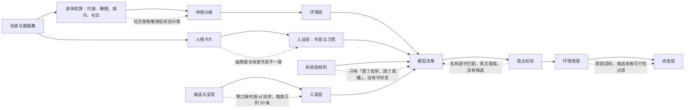

# 一日运行保真：作息、需要与按名调用修复方案

> 状态：**已裁决**。本方案已收敛为冻结的开发规格[一日运行保真特性规格](SPEC-dayrun-fidelity.md)（2026-09-29 FROZEN），实施依据为该规格；本文只保留设计背景、运行证据与取舍依据，与规格不一致处以规格为准。
> 本文的 D1–D14 与规格补入的 D15–D19 已在规格「裁决记录」中定稿：用户 2026-09-29 指示实施该规格、不延后任何尚未完成的工作并采纳规格的全部推荐（多项的规格推荐或用户裁定与本文的建议不同，以规格「裁决记录」为准）。本文正文与决策表保持提出时的原文。
>
> 依据：
> - WorldMock-Dataset 仓库 `RUN_REPORT_2026-09-29.md` 对应的两次全天运行：白领林悦、商务赵铭；代码 `4a5b0e6`，模型 `deepseek-flash`，模拟日 2026-09-28。使用的材料是逐决策的模型请求与回复、世界事件和冻结输入。
> - 对 `4a5b0e6` 源码的只读核对，以及用仓库函数做的离线复算。
> - 文献与业界资料，2026-09-28 核对，见文末参考文献。
>
> 数据集侧的问题（路线、供给、命名、题材词表、活动池、预跑校验）见 WorldMock-Dataset 仓库的 `PROPOSAL_2026-09-29_DATASET_FIXES.md`，下称「数据集方案」。数据集方案第五章列出需要系统配合的事项，本文「核查更正与数据集方案对应」一节逐项对应。
>
> 下文 WC 指白领运行，BIZ 指商务运行；行号均以 `4a5b0e6` 为准。

## 一、心智模型与项目框架的映射

### 用户原话

> "the persona's action doesn't quite follow the spec's requirements and doesn't feel "human-like" as well, I haven't look into the data deeply yet so I can't say what goes wrong, can you help me find the problem?"

诊断之后的裁决与追问：

> "dataset should provide genre vocabulary, not system's job, a floor relief is ok, but the system should warn when injecting env data"
>
> "although social needs should not grow as the persona is in sleep, but the hunger, stamina should grow/decrease, so metabolism won't stop during sleep, how can we separate them?"
>
> "The model then fell into a trap … an error message fault?"
>
> "should we link app to the store that deliver the goods? Or simpler persona could order directly from app and set a default deliver time for app-order?"
>
> "I specifically asked to return the closest result if the naming is inaccurate and let the LLMs to decide the recommendation is what it wants"
>
> "we should probably apply call-by-name mechanism to the whole system"
>
> "Body urges override the routine - more like a system prompt problem if what you are describing is precise."
>
> "Day-plan shape … why is this an issue?"；"conclude_activity … better solution with the same behaviour?"；"where's this 8000 token limit comes from?"；"nap is not necessary"

### 症结

人物不按规格、也不像人，主因不是模型任性，而是系统把它推到了那里。

| 现象（WC/BIZ） | 直接原因 | 本文 |
| --- | --- | --- |
| 晚上连看 6 部短剧，一直「很想放松」 | 口味词「B站视频」对不上题材「剧情/都市情感」，口味权重全为 0，观看缓解 = 速率 × 0 | G2 |
| 一醒来就「想和人说说话」，周一晚上连打三通电话 | 在边界结束的睡眠被当成清醒计入社交需要，一醒来就 +0.30 | G1 |
| 10:00 点午饭，14:53 再吃一顿，22:45 就睡 | 系统层写着「饿了趁早弄吃的」「困了就去睡」，却没有一句要人守作息；「困」比该人物的入睡点早约 2.4 小时出现 | G3、G4 |
| 不做饭，不洗碗，不洗漱，没喝上咖啡 | 工具层每类只列 20 条，零口味时按对象 id 字母序排；做饭、洗碗、冰美式从没进过窗口；自造的名称一律被拒 | G7、G11、G12 |
| 番茄、鸡蛋明明能送到家，却被告知「没有找到这个名字的商品」 | `from=盒马App` 在「查无此物」之前就把商品过滤掉了；照抄候选又撞上「完整标签带 from」的规则 | G8、G9 |
| BIZ 在两地之间往返 17 段，最后睡在餐馆 | 以数据集为主（见数据集方案）；系统侧：浏览结果不带店名，提示不看可达性 | G12 |
| BIZ 的纪要 6 次提交都没被接受 | 中文逐字摘录永远通不过核对，其中 4 次评审模型已判接受 | G14 |
| 同事说「马上到」「到门口了」，人物就在工位干等 | 联系人回复不知道自己只是远程联系人 | G16 |
| 协议错误：WC 181 次回复里 63 次；BIZ 606 次里 390 次 | 收尾参数的形状与模型的自然写法相反；名称必须逐字照抄；思考耗尽 8000 输出上限 | G13、G7、G15 |

### 项目框架映射



### 转述确认

你的意思是：

- 数据集负责提供「有什么、叫什么」。
- 系统负责三件事：
  - 身体账算对，不把睡眠算成清醒，不把不喜欢的内容算成零缓解；
  - 让人物按自己的作息生活，身体信号只在够强时才改写日程；
  - 名称写得不准时，给出最接近的可行候选，由模型自己决定，并把这套按名调用推广到所有动作。
- 注入的数据与人物对不上时，系统要警告，而不是静默地算成零。

## 二、提升后的心智模型

### 业界方案概览

| 机制 | 依据 | 适用 | 不适用 |
| --- | --- | --- | --- |
| 作息为默认，需要越过强档才打断 | 习惯由情境与时刻线索触发，对短期动机不敏感（Wood 与 Rünger 2016；Neal 等 2011）；进餐时刻主要由时刻决定，只有大的能量缺口才会覆盖（Woods 2009）；同类模拟都以计划为默认、需要越过阈值才中断：Humanoid Agents 在需要 ≤3/10 时才改计划，AgentSociety 的阈值为 0.2/0.3 且只有更高优先级才能打断，CoPB 的消融显示作息锚点不可或缺 | 系统层规则；体感分级的用法 | 照搬 AgentSociety 睡眠期间需要照常衰减的写法；D2A 以「最小化不满足」为目标，会诱导人物一饿就吃 |
| 饥饿随惯常饭点校准 | 饭前的 ghrelin 上升会随固定的进餐时刻校准（Cummings 等 2001；Drazen 等 2006；Frecka 与 Mattes 2008）；惯常不吃早饭的人，午饭前并不更饿（Thomas 等 2015） | 饥饿第二步：饭前爬坡、餐次记录、跳餐门控 | 把文献里的数值当成常数（爬坡时长、门控系数都是实验假设） |
| 困意按主观量表标定 | 就寝前 4 小时 KSS 约 4，入睡时约 7，近似线性上升（Shochat 等 2021）；惯常就寝前 1–3 小时最难入睡（Lavie 1986；Strogatz 等 1987；Dijk 等 1999）；这段时间主观困意并不下降（Shekleton 等 2013；de Zeeuw 等 2018） | 体感档界重新标定 | 在体感上加清醒维持区抑制项；改动 S/C 常数（另议） |
| 偏好调节幅度，恢复不以偏好为前提 | 随机指派、非本人偏好的片段也比不看媒体带来更多恢复（Rieger 等 2017；Reinecke 等 2011）；享受会放大效果（Rieger 等 2014）；恢复体验的结构（Sonnentag 与 Fritz 2007） | 下限缓解 | 「偏好为零即毫无恢复」 |
| 社交需要只在清醒独处时累积 | 清醒隔离 10 小时后孤独感中等程度上升（Tomova 等 2020）；社交需要在一天之内调节（Hall 与 Davis 2017）；整夜能耗与基础代谢相当（Seale 与 Conway 1999） | 社交账与代谢账分开结算 | 按睡眠时长累积社交需要 |
| 按名调用，给最近的候选，不自动替换 | CPython 3.10 的 NameError 建议、rustc、Clang 都只在唯一最佳候选时才更正，距离上限约为名称长度的三分之一；difflib；UAX #29 指出中日文词之间没有空格；De-Hallucinator 用候选重新落地 | 统一名称解析；中文摘录核对 | 相似度高就自动替换（违反裁决 #19） |
| 错误信息要能照着改 | SWE-agent 的 ACI：反馈要充分而简洁，编辑一旦失败过一次，最终成功率从 90.5% 降到 57.2%；RFC 9457 的问题详情格式；Anthropic、OpenAI 的工具指南（错误可行动、让无效状态无法表示）；Canedo 与 Chethan 2026（预印本：结构化建议优于冗长文字） | 统一错误合同 | 把预印本里的百分比当作 WorldMock 的预期收益 |
| 一项一个对象，让无效状态无法表示 | OpenAI 函数调用指南；Google AIP-144（重复字段）；JSONSchemaBench（受约束解码存在欠约束，本地校验必须保留） | 控制工具改形 | 用 strict 代替本地校验 |
| App 是门店的入口 | 盒马店仓一体，按地址指定门店，3 公里、30 分钟（阿里巴巴 Freshippo 资料）；叮咚、瑞幸按地址或门店能力分派（20-F）；美团平台承诺不早于 30 分钟，平均实际 29.6 分钟，93.8% 在 4 公里内（Wang 等 2025 美团数据集） | App 名解析为成员门店 | 没有门店的 App 订单，固定的默认送达时长 |
| 思考预算与分析瘫痪 | 代理任务里过度思考（分析瘫痪）越重，表现越差（Cuadron 等 2025）；测试时算力加大反而可能变差（Gema 等 2025）；DeepSeek 思考模式的 `max_tokens` 同时覆盖思考与输出 | 截断处理，输出上限 | 用加大上限代替去掉观察里的死胡同 |

### 提升后的设计

1. **作息为锚，需要分级升级。**
   - 人设层的作息与习惯是默认日程。
   - 身体信号只在较强一档时才改写既定安排：饥饿到「很饿」、困意到「很困」；「饿」只允许在平常饭点前一小时内提前。
   - 体感档界按主观量表标定，不按模型内部量纲的等分切。
2. **区间事实只有一个来源。**
   - 一段结算区间里有哪些活动，代谢账、社交账和共同用餐都以共同身体结算所用的活动集合为准，不在推进后重新推断。
3. **偏好只调幅度，不决定有无。**
   - 口味权重决定排序，也调节缓解幅度。
   - 不喜欢的内容仍有一个下限缓解。
4. **注入即核对。**
   - 人物口味与内容题材对不上、权重全为 0、没有内容却有观看习惯、场景作息与卡片抽取不一致时，都发出警告。
   - 警告冻结进运行清单与质量报告，不让运行失败。
5. **结构化字段优先。** 场景显式声明的作息字段覆盖 LLM 抽取值。
6. **按名调用，全系统一致。**
   - 所有目录类对象都可以直接写名称。
   - 无损归一后唯一就受理。
   - 相似度只用来给候选，永不自动替换（沿用 `SPEC-persona-prompt.md` 裁决 #19）。
   - 候选按「此刻可行」过滤，并写成可以照填的请求。
   - 名称类拒绝不消耗同刻轮数。
7. **错误要可以照着改。**
   - 宿主和环境共用一个错误结构：原因、改法、逐项明细、候选。
   - 用中文写，不带内部转储。
8. **参数形状贴合模型的写法。** 结束、播报、暂停三种控制工具，改为一项活动一个对象。
9. **呈现是提示，不是门槛。**
   - 先施加地点类资格，再按相关度排序，给例行事务留名额。
   - 另给一份只列名称的可调用索引。

### 设计决策点

| # | 决策 | 推荐 | 另一选项及后果 | 状态 |
| --- | --- | --- | --- | --- |
| D1 | 题材词表归属 | 数据集提供；系统只做精确匹配，加下限缓解和注入警告 | 系统内置题材同义映射：数据集不必对齐，但系统要维护一套语言知识，而且对错无从核验 | **用户已定** |
| D2 | 社交账与代谢分开 | 方案 A：社交账从本区间的 `body_settlement` 取活动集合（不改 Schema） | 方案 B：清醒社交增长并入 `settle_shared_body`；`body_settlement.after` 的语义要改，交谈缓解要去掉重复的清醒计时 | 待裁决 |
| D3 | 下限缓解的数值、口径与存放位置 | 先统一口径：有缓解的活动进行时不再累积娱乐需要；再取有效偏好 `f + (1−f)·w`，f = 0.5（敏感区间 0.3–0.7）；常数放进目录资源规则并注明来源 | 保持引擎现在的「累积减缓解」：f 要取到约 0.7 才有同样效果，而且单活动与并行两条路径口径仍不一致（G2） | 待裁决 |
| D4 | `validate` 在覆盖率低于 80% 时 | 运行路径只警告；`validate` 继续失败（沿用现行合同） | 两处都只警告：不会再挡住准备流程，但失去一道门槛 | 待裁决 |
| D5 | 困意档界 | 只改档界：0.80 / 0.93 / 1.07 / 1.18，不改 S/C 动力学 | 加入清醒维持区抑制项：文献显示这段时间主观困意并不下降，而且单靠它修不好（G3） | 待裁决 |
| D6 | 作息与身体信号的关系 | 系统层写明「照作息，只有较强一档才改」（G4 给出措辞） | 让饥饿随惯常用餐时刻起伏（改身体模型）：更贴近生理，但改动大，可以作为第二步 | 待裁决 |
| D7 | 名称类拒绝 | 不计同刻轮数，不施加情绪脉冲，每人每秒至多 2 次 | 照常计轮：与现状一致，但 WC 18:15 那样的轮数耗尽还会发生 | 待裁决 |
| D8 | App 名写在 `from` | 把 App 挂到门店：数据集声明「购买渠道」（App 名与别名→成员门店、由谁挑门店），`from=<App>` 解析为成员门店的供给；送达时刻仍由供给的备货时长与路线决定；App 级默认时长只用于数据集构建与质检（G9）。`SPEC-life-runtime.md:933` 的「不新增渠道对象」改为「渠道只是门店集合的称呼，不带交付语义」 | 人物直接向 App 下单、用默认送达时长：要为 App 另建报价、库存、卖家账户与送达事件；送达与距离、备货脱钩；与「从不替换」冲突。实际并不比前者简单 | 待裁决 |
| D9 | 控制工具的参数形状 | 结束、播报、暂停改为 `items:[{activity_name, summary, memories, views}]`：看法与偏好单独放进 `views`，普通记忆不再有 `subject` 字段；`start_activity` 保持裁决 #22 的等长数组 | 只把 `subject` 由拒绝改为归一：能去掉一类错误，但一维与二维的混淆仍在 | 待裁决 |
| D10 | 输出上限 | 截断时丢弃截断回合，给专门的中文「立即决定」纠错，并以 `reasoning_effort=low` 重试一次；质量报告记录截断次数与思考 token；有数据后再决定是否提高上限（例如 16000） | 直接提高上限：每次思考螺旋的花费成倍增加，根因还在 | 待裁决 |
| D11 | 联系人回复 | 改提示，补齐请求事实，加一道后验守卫并允许重试一次 | 只改提示：成本低，但对「马上到」一类说法没有保证 | 待裁决 |
| D12 | 当日目标推进 | 忽略目标登记之前就已开始的活动 | 给目标加时间窗：能处理「睡前」这类时段，但要改工具 Schema | 待裁决（低优先） |
| D13 | 工作材料正文 | 另立规格（沿用 `SPEC-persona-prompt.md:533` 的范围外登记） | 本方案一并处理：范围过大 | 登记 |
| D14 | strict 端点 | 先用探针确认主站是否执行 strict；若不执行，切换到 `/beta`，并在启动时自检（G22） | 去掉 `strict` 声明，只靠本地校验：诚实，但失去受约束解码 | 待裁决 |
| D15 | 睡眠中的消息 | 睡眠中不读，醒来时再读（G5） | 维持现状：睡眠中「阅读」并得到缓解，与阅读语义不符 | 待裁决 |
| D16 | 卡片作息与场景不一致 | 场景显式声明的字段优先（G6） | 以卡片为准（调研稿意见）：身体与零点计划已按场景值结算，三处仍不一致 | 待裁决 |
| D17 | 商品可见性 | 放宽「不只绑定在浏览地点」（G12）；开发规格推荐不放宽 | 不放宽：沿用地图与门店供给提案「只授权实际窗口」的裁决，离开后凭完整标签的浏览结果按名下单 | 待裁决 |
| D18 | 英文外泄 | 系统层加一句，质量报告先计数，仍泄漏再强制（G17） | 立即强制：多一类协议错误 | 待裁决 |
| D19 | 同名地点与显示名 | 加载时拒绝带坐标的显示名，同名由 `branch_label` 消歧（G20）；开发规格推荐只警告 | 只发输入警告：数据集不必先改名才能跑 | 待裁决 |

## 三、当前实现的差距

### 差距归属图

```mermaid
flowchart TB
    subgraph 身体与需要
      G1[G1 睡眠结束区间被计为清醒]
      G2[G2 零口味即零缓解，无注入警告]
      G3[G3 困意档界偏早约两小时]
      G5[G5 不适脉冲不触发，睡眠中读消息]
    end
    subgraph 人设与规则
      G4[G4 系统层没有守作息]
      G6[G6 卡片作息与场景不一致]
    end
    subgraph 工具面
      G7[G7 按名调用]
      G8[G8 指名购买的判定顺序与规则]
      G9[G9 App 与门店]
      G10[G10 错误合同]
      G11[G11 呈现排序与地点类资格]
      G12[G12 浏览与提示不看可达性]
      G13[G13 控制工具参数形状]
    end
    subgraph 评审、调用与叙述
      G14[G14 中文摘录]
      G15[G15 输出上限与思考螺旋]
      G16[G16 联系人回复虚构到场]
      G17[G17 英文外泄]
      G18[G18 时间线外泄内部名称]
      G19[G19 当日目标推进]
      G20[G20 场景加载校验]
      G21[G21 工作材料正文]
      G22[G22 strict 很可能未生效]
    end
    G22 --> G13
    G3 --> G4
    G7 --> G8 --> G9
    G7 --> G10
    G7 --> G11
```

### 3.1 身体与需要

#### G1 睡眠结束的区间被计为清醒（附：代谢与社交怎样分开）

**证据。**

| 运行 | 区间 | 能量 | 睡眠压力 | 两次结算之间社交需要的变化 |
| --- | --- | --- | --- | --- |
| WC | 00:00→00:30，睡眠仍在进行 | 1600→1567.5 | 0.607→0.539 | +0.000 |
| WC | 00:30→08:00，睡眠在 08:00 按计划结束 | 1567.5→1080，每小时 65.0 kcal | 0.539→0.090 | **+0.300** |
| BIZ | 00:30→07:00，睡眠在 07:00 按计划结束 | 1567.5→1145，每小时 65.0 kcal | 0.561→0.119 | **+0.260** |

- 整天只有醒来这一次跳变。
- WC 刚醒就处在「想和人说说话」这一档（阈值 0.3）。

**代谢与社交本来就是两本账。**

- **代谢账**：
  - `engine._advance_activities`（`engine.py:1455-1489`）先取**推进前**进行中的活动集合，再调用 `settle_shared_body`（`body.py:189-218`）。
  - 基础代谢与额外代谢不分清醒还是睡眠，照常扣除（`:200-205`）；集合里有没有睡眠，决定睡眠压力与不足账走哪一个过程（`:206-211`）；睡眠中娱乐需要不增长（`:229-230`）。
  - 本区间的活动集合写在 `body_settlement` 事件的 `activity_ids` 里（`:1468-1477`）。
  - 表中每小时 65.0 kcal 正是目录里的基础代谢：睡眠时照常消耗能量，饥饿随之上升。
- **社交账**：
  - 在推进**之后**的节律结算里执行（`rhythm.py:252-268`），用 `active_activities(推进后状态)` 判断此刻是否在睡。
  - 在边界结束的睡眠此时已是 COMPLETED，所以整个区间都按清醒、每小时 +0.04 计。
- 所以代谢从来不停，只有社交账（以及同一写法的共同用餐判断，`rhythm.py:285-290`）用错了口径。

**区间里不会出现「睡了一半」。**

- `_next_epoch`（`engine.py:1655-1671`）把每个活动的计划结束、未触发的提醒和预排事件都当作边界，所以一段区间内的活动集合恒定。
- 取消、暂停、开始都发生在决策轮，也就是下一段的起点。

**修复（D2 方案 A，不改 Schema）。**

- `RhythmInputs.progress_data` 已经带着本边界的 `body_settlement` 草稿（`rhythm.py:573-581`，零点路径也经过这里）。
- 新增 `_interval_activities(agent, inputs)`：从草稿的 `activity_ids` 取本区间的活动集合；没有草稿时（直接调用或单测），兜底为「ACTIVE，或 COMPLETED 且 `ended_at == now`」。
- 社交账的「是否在睡」、交谈与通话的覆盖判断、`_shared_meal`，都改用这个集合。
- 口径与 `_woke_from_sleep`（`rhythm.py:506-513`）已采用的 `ended_at == now` 一致。

**规格与测试。**

- 规格：`SPEC-life-runtime.md:323-328`、`:608-610` 补一句口径：「按本区间共同身体结算所用的活动集合判定清醒与共同用餐」。
- 测试：
  - 睡眠在边界完成：社交不变，能量按基础代谢乘小时数下降，睡眠压力下降；
  - 睡眠被提醒提前结束：同上；
  - 醒后第一段清醒区间：社交增加 0.04×0.25；
  - 社交账的分类与共同身体结算一致（性质测试）；
  - 在边界吃完的一餐，仍算共同用餐；
  - 没有草稿时走 `ended_at == now` 兜底。

**可选的第二步（实验假设，默认关闭）。**

- 每小时 0.04 的累积速率适合「完全独处」：按这个速率，清醒独处 10 小时升到 0.40，与 Tomova 等 2020 在 10 小时隔离后观察到的孤独感中等上升相符。
- 但办公室里有同事在场，不应按独处计。可以给「有人在场」的区间乘以 0.25：9 小时工作日只累积约 0.09。
  - 依据：弱关系互动也能满足归属需要（Sandstrom 与 Dunn 2014）。
  - 两份场景的同事都是模型联系人，`_people_here` 看不到他们，所以需要由数据集给地点标注「有同事在场」。
- 醒来时社交需要减半（Hall 与 Davis 2017：社交在一天之内调节），只作消融开关。

#### G2 零口味就是零缓解，而且没有任何警告

**证据。**

- WC 卡片的口味是 `["B站视频"]`，20 部短剧的题材都是 `["剧情","都市情感"]`：
  - `compute_taste_weights`（`profile/taste.py:14-29`）按精确交集计算，20 部短剧的权重全部为 0；
  - 观看缓解等于「速率 × 口味权重 ÷ 接触次数」（`activities.py:298-318`），也是 0。
- WC 看剧共 2.49 小时，没有产生任何缓解分录。看剧期间娱乐需要反而净增 0.098，晚间一直停在上限 1.000，体感一直是「很想放松」。
- 游戏从来没有计算过口味权重（`runtime.py:1083-1095` 只算内容），所以游戏缓解恒为 0。
- 抽取提示只要求「最多 6 个内容题材词」（`profile/extractor.py:80`），没有给出场景的题材表，所以抽出了平台名。

**为什么没人发现。**

- `validate_coverage`（`profile/coverage.py:60-99`）只由 `validate` 命令调用，运行路径不调用；运行路径的 `_compile_persona` 还丢掉了编译警告（`runtime.py:1114-1120`）。
- 即便调用了，「B站视频」也会作为应用名「B站」的子串被判为覆盖（`coverage.py:71-74`）：WC 覆盖率算出来是 0.92，实际权重却全是 0。

**修复。**

1. **下限缓解**：有效偏好取 `relief_preference(w, f) = f + (1 − f)·w`，对 `w` 严格单调，`w = 1` 时不变。
   - 只作用于实际缓解（`activities._entertainment_relief`）和评分器里口径相同的缓解预演（`motivation.py:806-821`、`:992`）。
   - 所有排序仍用原始权重，零权重照旧排在最后（`candidates.py:233-241`）。
   - 不用 `max(w, f)`：低于 `f` 的权重会被拉成并列。
2. **先统一两条结算路径的口径**：
   - 单活动路径（`body._entertainment_entries`，由 `activities.advance_activity` 调用）在有缓解时不累积。
   - 共同区间路径（`body._shared_entries`）是「累积减缓解」。引擎推进实际走的是这一条（`engine.py:1466` 的 `settle_shared_body` 与 `:1511` 的 `advance_activity_shared`）；单活动路径只有测试在用。
   - 两条路径对同一部剧给出不同的净效果。
   - 建议统一为「有缓解的活动进行时不再累积」：人在放松的时候，不会越放松越闷。
3. **f 的取值**：清醒时娱乐需要每小时累积 0.08；本次短剧的基础缓解速率是每小时 0.30（语料中多数条目为 0.35）。下表按 R = 0.30 计算，从 1.0 降到「很想放松」以下（< 0.6）所需的时间：

   | f | 不喜欢的内容的缓解（每小时） | 统一口径后 | 现行「累积减缓解」口径 |
   | --- | --- | --- | --- |
   | 0.3 | 0.09 | 4.4 小时 | 40 小时 |
   | **0.5** | **0.15** | **2.7 小时** | 5.7 小时 |
   | 0.7 | 0.21 | 1.9 小时 | 3.1 小时 |
   | 1（喜欢的内容） | 0.30 | 1.3 小时 | 1.8 小时 |

   - 文献只能确定 0 < f < 1：下限为正（Rieger 等 2017；Reinecke 等 2011），偏好会放大效果（Rieger 等 2014）。具体数值是由 WorldMock 自身速率反推的实验假设，登记进 `EXPERIMENT.md`。
   - 取 0.5 时，喜欢的内容仍比不喜欢的快一倍，口味差异得以保留。
   - 如果不统一口径，0.5 在现行引擎下要看 5.7 小时，一整晚仍会连看。
   - 两份调研稿各自推荐 0.5，但计算口径不同，所以这里把口径与数值一起裁决。
4. **存放位置**（D3）：推荐在 `catalog/resources.jsonl` 的 entertainment_need 消耗规则里新增 `entertainment_relief_preference_floor` 并注明来源，经 `semantics._assemble_body`（`:370-405`）装进 `BodyConfig`。代价是目录小版本升级，场景要重新钉定版本，数据集要重新冻结。
5. **注入警告**：
   - 新建纯函数模块 `profile/injection.py`，在创建运行时计算（`runtime.py:754-764`）。
   - 结果冻结进运行清单（`engine.py:1741-1755` 增加 `input_warnings` 键），逐条写一条 ops 警告，并写进 `quality.json` 的 `input_warnings` 一节；`validate` 同时打印。
   - 运行路径永不因警告失败；`validate` 在覆盖率低于 80% 时继续失败（D4）。
   - 警告里同时列出卡片的 `content_genres` 与 `media`，以及语料中最常见的几个题材，由数据集决定是改卡片还是补题材标签。
     `runtime._card_taste_weights` 只用 `content_genres` 参与匹配；「B站视频」这类平台词无论写在哪个字段，都对不上题材。
   - 警告码闭集：

     | 码 | 条件 | WC | BIZ |
     | --- | --- | --- | --- |
     | `TASTE_GENRES_UNMATCHED` | 人物口味与场景内容题材没有交集 | 命中 | — |
     | `CONTENT_WEIGHTS_ALL_ZERO` | 有内容，但权重全为 0 | 命中 | — |
     | `CONTENT_EMPTY_WITH_MEDIA_TASTES` | 没有内容，但卡片或习惯里有看、刷、听 | — | 命中 |
     | `GAMES_WITHOUT_TASTE_WEIGHTS` | 有游戏，但没有算口味权重 | — | — |
     | `COVERAGE_BELOW_THRESHOLD` | 复用覆盖率，并改为不允许用 App 名子串算命中 | 1 项 | 8 项，0.27 |
     | `CARD_FIELD_OVERRIDDEN` / `CARD_FIELD_CONFLICT` | 见 G6 | 3 项 | 3 项 |
     | `PERSONA_AGREEMENT_LOW` | 透传画像编译的警告 | — | — |

**规格与测试。**

- 规格：`SPEC-life-runtime.md:410-414`、`:608-609` 改为有效偏好；`SPEC-life-realism.md:383-384` 与 `CONTRACTS.md:891`、`:1429` 写「口味权重只供内部评分器与浏览排序」，`SPEC-life-runtime.md:410-414`、`:608` 与 `EXPERIMENT.md:187` 写「实际缓解乘以偏好」，两边统一口径；`EXPERIMENT.md` 登记下限假设；新增「运行输入警告」小节。
- 测试：
  - 不喜欢的内容按下限缓解；
  - 缓解随口味权重单调；
  - 游戏走下限；
  - 评分器预演与引擎一致；
  - 零权重仍排在最后；
  - 每个警告码各一例；
  - 警告冻结进清单并计入质量报告；
  - 警告不会让创建失败。

#### G3 困意档界偏早约两小时

**证据。**

- 困意 `f = (S − L(t))/(H(t) − L(t)) = 1 + 2(S − H(t))`（`sleep.py:96-101`）；`f = 1` 就是模型的入睡条件。
- 晚上 `f` 每小时约升 0.10，所以现行首档（有点乏）0.25 宽对应约 2.5 小时（「困」宽 0.15，「很困」宽 0.10）。
- 「困」（0.75）出现在模型自身入睡点之前约 2.4 小时：WC 21:45，BIZ 20:56。「撑不住」恰好落在惯常就寝时刻。
- WC 21:48 进入「困」，22:45 上床。模型在思考里写：the sim likely wants me to sleep when sleepy。
- 文献：
  - 惯常就寝前 1–3 小时是一天中最难入睡的时段（清醒维持区；Lavie 1986；Strogatz 等 1987；Dijk 等 1999）；
  - 日常实测里，就寝前 4 小时 KSS 约 4，前半小时约 6.8，入睡时约 7（Shochat 等 2021）；
  - 现行分级在每一档都把困意说重了约 1–2 个 KSS 分。

**修复（D5，只改映射，不改 S/C 动力学）。**

- 按 KSS 等价刻度 `K = 7 + 7.6·(f − 1)`：斜率由 Shochat 等 2021 的两个锚点对三个人物的工作日稳态拟合，得 7.47–7.81，取 7.6。
- 在 K = 5.5、6.5、7.5、8.4 处切档，得到新档界：
  - 有点乏 **0.80**
  - 困 **0.93**
  - 很困 **1.07**
  - 撑不住 **1.18**（留 0.02 余量，不与截断上界 1.2 重合）

各档的起点（工作日稳态，从惯常起床一直醒着）：

| 人物 | 惯常就寝 | 有点乏 | 困 | 很困 | 撑不住 |
| --- | --- | --- | --- | --- | --- |
| WC（现行） | 00:10 | 19:17 | 21:45 | 23:09 | 00:07 |
| WC（提议） | 00:10 | 22:13 | 23:26 | 00:51 | 02:09 |
| BIZ（现行） | 00:00 | 18:15 | 20:56 | 22:23 | 23:21 |
| BIZ（提议） | 00:00 | 21:25 | 22:40 | 00:04 | 01:18 |

- **不采用清醒维持区抑制项**：Shekleton 等 2013 与 de Zeeuw 等 2018 都显示，这段时间主观困意并不下降；而且单加这一项时，「有点乏」仍在 19:17，「撑不住」仍在 00:10。
- **已知局限**：两过程常数的周期解本身约睡 7.9 小时。需要量越短，模型入睡点越早，所以 BIZ（7 小时）的「困」在新档界下仍比就寝早 1:20。这要靠改 S/C 标定来解决，本次不做，由 G4 的提示兜底。
- **早晨不受影响**：醒来只由「睡够」或提醒触发；所有正常早晨 f < 0.4，两套映射都是「清醒」。

**规格与测试。**

- 档界的两份常数（`felt.py:57-66`、`sleep.py:41-46`，后者只有测试在用）同步修改，并加一条两者一致的测试。
- 规格改 `SPEC-life-runtime.md:252`、`:261-272`（示例要重算）；`felt.py:57-58` 注明「修订合同冻结」，需要随之改。
- 受影响的测试：`test_felt_states.py:286-302`，`test_sleep_two_process.py:192-252`、`:528-547`。
- 裁决 #10「沿用现有五项体感分级」不受影响：档的名称和个数都不变。

#### G5 相邻缺陷：不适脉冲从不触发，睡眠中读消息

- **不适脉冲从不触发**：
  - `rhythm.py:216-221` 每个边界只把新增的计费小时数（通常 0.25 小时）传给 `apply_discomfort_pulse`，而 `felt.discomfort_pulse`（`felt.py:350-356`）在不足 2 小时时一律返回 0。已复核：0.25 小时→0，2 小时→−0.2。
  - 所以「连续饿、困满 2 小时后按小时扣情绪」这条规则实际上从未生效。
  - 修复：幅度直接取 `MOOD_PULSES["discomfort_hourly"] × new_charge`。
- **睡眠中读消息**：
  - 判定段对每个边界无条件调用 `read_new_messages`（`rhythm.py:131`）。睡眠中送达的消息照样被标为已读，社交需要 −0.05，情绪 +0.1。
  - 这与 `SPEC-life-runtime.md:327`「阅读」的语义以及 `SPEC-time-and-energy.md:182-184` 不符。
  - 建议：睡眠中不读，醒来时再读。待裁决。

### 3.2 人设与规则

#### G4 系统层没有「守作息」：饥饿与困意直接改写日程

**证据。** 模型在每个关键时刻都权衡过习惯与体感，每次都选了体感，因为规则就是这么写的（`life_prompt.py:44-46`）：

- **10:00**，体感「有点想吃」，工具层写着「预计 10:20 送到」。思考："the habit says lunch 12:00-13:00. Yet being [a bit hungry]…"，随即下单。
- **14:33**，体感「饿」。思考："I'm hungry and it's been a while since the late breakfast/lunch"，于是第二次吃午饭。
- **22:45**，体感「困」。思考："the plan says 00:10 … the sim likely wants me to sleep when sleepy"。
- 规格本来就没有早餐（08:00 起床，只有 09:05 一杯咖啡），在现行能量模型下 08:15 就是「有点想吃」，10:11 已经是「饿」。

**修复（D6）。**

1. **系统层**：新增一条作息默认规则，并改写第 14 条（饥饿）与第 15 条（困意）。档位名必须与 `felt.py` 的分级文本逐字一致。

   > 人设层的作息和习惯是你平常的过法：到了平常的钟点、在平常的地方，就照平常做；身体的感觉没到更强的一档，就不为它改作息。人设层没写作息，或者今天不在平常的环境里，就按身体的感觉来。

   > 你会饿、会困、会累，饿着或困着做事会慢，走路比坐车更费力。只是「有点想吃」时，等平常的饭点再吃正餐，离饭点还早可以喝点东西或吃点手边的零食；到了「饿」，离平常饭点一小时以内可以提前准备或下单，更早就先垫一点；到了「很饿」或更饿，别等饭点，马上弄吃的。手边的、在路上的、这里能买的、能送到这里的都算；下单后要等送到，拿到手才能吃。每个饭点的正餐只吃一次，提前吃过的那顿就算吃过了。

   > 晚上照人设层作息里的就寝时间去睡（没写就寝时间，就困了再睡）：有点乏、困是睡前的常态，不必因此提早上床；很困或撑不住了可以提前，精神还好也可以晚些。想在某个时刻起来，就给今日计划的目标写上提醒时刻；睡着时只有提醒或睡够了才会醒，早睡也就早醒。

   依据：
   - 仲裁档位：饥饿取「很饿」（≥ 0.6），困意取「很困」。这与 Humanoid Agents「需要 ≤3/10 才改计划」、AgentSociety「满足度 ≤0.2 才触发」同属「只在明显缺口时中断」。
   - 「饿」时允许提前一小时，这一小时覆盖外卖 20–40 分钟的送达；它是实验假设，敏感区间 30–120 分钟。
   - 「每个饭点的正餐只吃一次」针对的是 Generative Agents 记录过的「连吃三次午饭」这类失败，也就是本次 10:20 和 14:53 吃了两顿「午饭」。
   - 困意那一句的依据见 G3。
   - 系统层文案在规格里逐字定稿（`SPEC-persona-prompt.md` 第一章），改动时 `prompt_sha256` 随之变化。
2. **零点计划**：建议给就寝目标写 `remind_time`，取惯常就寝时刻。在新档界下，「困」与「很困」之间可能没有体感唤醒，提醒能在就寝点给一次决策机会。
3. **第二步（可选）：让饥饿随惯常饭点起伏。**
   - 现行餐窗项在窗口内是一个 +0.15 的阶跃，窗口外为 0，没有早餐窗，也没有「这一餐已经吃过」的概念。
   - 改为以下四处：
     - **饭前爬坡**：从惯常饭点前 60 分钟起线性升到 +0.15；
     - **吃过即撤**：在饭点前后出现一次正餐量的进食，就撤去当天这一餐的加成；
     - **跳餐门控**：人物卡声明惯常不吃早饭时，第一个餐窗之前能量项乘 0.5，在爬坡段内线性回到 1；
     - **环境层写出餐次**：例如「今天午饭：还没吃（平常 11:50–12:20，还有约 1 小时 40 分）」，吃过之后写「今天午饭：已吃（10:20，外卖）」。
   - 依据：饭前 ghrelin 随固定饭点被校准（Cummings 等 2001；Drazen 等 2006；Frecka 与 Mattes 2008）；惯常不吃早饭的人，不吃早饭时午饭前并不更饿（Thomas 等 2015）。
   - 调研稿按现行公式推算：爬坡加门控后，WC 进入「饿」的时刻从 10:11 推迟到约 11:10；若再把基础代谢按人物设为每小时 51 kcal（中国成年女性实测，Mao 等 2020；现行是世界级常数每小时 65 kcal），推迟到约 11:30。这样人物会在 11:10–11:30 下单，外卖约 11:40–11:50 送到，与规格的午饭时段一致。
   - 爬坡时长、门控系数都是实验假设。
4. **数据集侧的配合**：见数据集方案 3.8，包括声明「惯常不吃早饭」、身体参数按人设设定、晨间饮品。

#### G6 卡片作息与场景字段不一致

同一次运行里有三套作息：

| 字段 | WC 卡片 | WC 场景 | BIZ 卡片 | BIZ 场景 |
| --- | --- | --- | --- | --- |
| 睡眠中点 | 4.0 | **4.75** | 4.0 | **4.5** |
| 午餐 | 12–13 | **12–12.5** | 12–13 | **12–13.5** |
| 晚餐 | 18–19 | **18.5–19.5** | 18–19.5 | **19.5–20.5** |

- 身体按场景值结算（`engine.py:1729-1730`）；零点计划读场景值（`day_plan_inputs.py:103-109`）；每轮的人设层却读卡片值（`custom/agents/life_persona.py:95-102`，WC 实际显示「12点到13点、18点到19点、4点」）。
- 卡片的 4.0 等于 `persona-mapping.toml:99-101` 的缺省值：故事里没提到中点时，由缺省补齐。
- `CONTRACTS.md:891` 写人物身体常量「驱动世界层结算……人设层 `rhythm` 以可读短语写睡眠中点与睡眠需要」，现行实现里人设层写的是卡片值。

**修复。**

- 在 `runtime._agent_specs` 渲染卡片之前（`:1091-1095`）调用 `apply_scenario_rhythm(card, agent)`：
  - 只覆盖场景显式声明的字段，即 `agent.model_fields_set` 与五个作息字段的交集；
  - 按格点量化；
  - 重建锚点顺序，出现冲突的那一槽保留卡片值；
  - 每处覆盖与冲突记为 G2 的注入警告。
- `validate` 路径调用同一个函数。
- `prompt_sha256` 不受影响。
- 调研稿中另有「不一致时以卡片为准」的意见。本方案取场景优先，理由如下：
  - 场景字段是数据集按规格显式声明的，身体与零点计划已经按它结算；
  - 卡片是 LLM 从散文里抽取的，缺省时还会补默认值。

### 3.3 工具面

#### G7 按名调用推广到全部动作

**现状。**

- 名称检查分散在约 9 处：
  - 宿主：`custom/agents/life_agent.py:597-642`；
  - 路由：`routing.py:63-143`；
  - 交互菜单：`interaction_menu.py:132-160`；
  - 环境：`session_actions.py:133-159`、`:254-270`、`:482-490`、`:547-559`。
- 每一处都是逐字匹配，报错是英文，不给候选，而且遇到第一个错误就停。
- 只有商品有指名购买，而且只在 `obtain` 且方式恰好是「到店」或「远程下单」时才放行（`:633-640`）。

**规模与后果。**

- 名称与组合类协议错误：WC 26 次；BIZ 216 次（其中目标不可见 130 次）。
- WC 两次给「沈昊」发消息，都因为没写「联系人：」前缀被拒，人物随即放弃联络。
- WC 五次自造「收拾厨房」一类的目标，都被拒；目录里的「洗碗」从没呈现过，模型在思考里写："There's no cooking/cleaning lifestyle"。
- BIZ 34 次回家全部被拒：家的名字对不上，路线也不可达（后者属数据集问题）。

**设计。** 新建纯函数模块 `life/name_resolution.py`，由宿主和环境共用（与 `routing.py` 同一模式）。

1. **精确匹配。**
2. **无损归一**，结果唯一就受理，并写进 `details.resolved`：
   - 统一全半角与括号；
   - 增补或去掉「地点：」「联系人：」「活动：」「内容：」「持有物：」「工作：」等前缀，按方式决定用哪一个；
   - 去掉活动名里的「（9月28日 08:25 起）」（与 `memory_layer.py:52-53` 用同一正则）和邮件时间戳；
   - 比对时忽略「（模拟）」；
   - 「家」「住处」→ `home_location_id`，场景可选声明地点别名；
   - 由方式推出动词：每个方式只属于一个动词，见 `WAYS`（`interaction_menu.py:24-35`）；
   - 方式同义用闭集表，只有在目标列出的方式里恰好命中一个时才受理；
   - 与标签或当前位置一致的冗余 `from`/`to` 照样受理，并附说明。
3. **相似度永不自动替换**（裁决 #19）。
   - 跨类别计算单字加二字的 Dice 相似度（把 `named_purchase.near_candidates` 移进本模块）。
   - 可行的在前，至多给 3 个候选。
   - 每个候选都写成可以照填的 `{target, action, way, from, to}`。
4. **分工**：
   - 私有绑定和已冻结的地点表由宿主判定，重试不花钱；
   - 存在但没列出的对象（未呈现的供给、生活活动、内容，以及没有路线的地点）由环境判定。
   - 按「动词加方式」推出的类别，把 `is_named_purchase` 泛化为 `named_kind`。
5. **报告全部失败项**：宿主逐项收集；环境逐项解析后合并成一次拒绝。
6. **同刻预算**（D7）：名称类拒绝码不计同刻轮数，不施加 `service_refused` 情绪脉冲（`engine.py:980-994`、`same_moment.py:215-221`），每人每秒至多 2 次。

**预估**：在两次运行的真实失败项上做离线模拟。

| 运行 | 自动受理 | 交给环境解析 | 需要给候选 |
| --- | --- | --- | --- |
| WC | 约 55% | 约 10% | 约 35% |
| BIZ | 约 38% | 约 33% | 约 22% |

BIZ 需要给候选的 22% 里约 8% 是「只有一个方式的目标写了自由文本方式」，只能给候选。不可达的地点和不存在的门店，归一解决不了，只能变成更清楚的拒绝，根本修复在数据集方案。

**规格与测试。**

- 规格：
  - 系统层第 12 条（`SPEC-persona-prompt.md:173`）改为：商品、生活活动、内容、地点都可以直接写名称；
  - `CONTRACTS.md:55-57`、`:226-228`、`:287-301`、`SPEC-interaction-menu.md:108-109` 推广到全部目录类；
  - `CONTRACTS.md:212`、`SPEC-persona-prompt.md:326`、`:474-475` 写入名称类拒绝不计轮。
- 测试：新增 `tests/life/test_name_resolution.py`，另加性质测试：宿主判为可受理的，环境在同一冻结观察下也必须受理。

#### G8 指名购买：不只是报错文字的问题

回答用户的问题「an error message fault?」：**不只是。** 指名购买（裁决 #19）已实现并给候选；本次失败在 `from` 与标签的规则和判定顺序。

先看 WC 18:15 与 19:18 时模型看到了什么。当时番茄、鸡蛋、上海青都在「模拟生鲜出货点」，只能远程下单，都能送到家，人物就在家。事件号是 WC 事件链的 `event_seq`，写成「模型回复 → 世界拒绝」。

| 事件 | 请求 | 模型看到的结果 |
| --- | --- | --- |
| #882 → #884（第 2 轮） | 番茄、鸡蛋，`from:"盒马App"` | `SUPPLY_NOT_FOUND`「没有找到这个名字的商品」，候选第一个就是「模拟生鲜出货点出售的番茄」。能送到的番茄被 `from` 过滤掉，于是被说成不存在；鸡蛋根本没检查 |
| #890 → #892（第 3 轮） | 照抄候选标签，并写 `from:"模拟生鲜出货点"`，与标签一致 | 裸 `ACTION_REQUEST_INVALID`，原因是默认句「所选的对象或方式不在这一轮列出的范围内」（`named_purchase.py:44-46` → `guidance.py:21`） |
| #898 起 | 同刻受限轮，购买关闭（`same_moment.py:36`） | 人物写道 "grocery ordering is blocked … eating when not hungry is a bit off"，在不饿的时候吃掉了一份素炒什锦 |
| #994 → #996（19:18） | 番茄标签，`from:"盒马App"` | 与 #890 相同的裸错 |
| #1002 | — | 思考："those aren't available"，改买了鸡胸肉和法文名的鸡蛋面。三样能送到家的菜全天都没买成 |

另一种待遇作对照：对**列出的**标签写 `from` 时，宿主给出免费的纠错（"from is null when the target already names its store"），模型每次都立刻改对（WC 10:00、19:55、20:10）。

**问题有四层**：

1. **规则过严**：`from` 与标签一致时，请求毫无歧义，#890 本该受理。
2. **判定顺序把原因混在一起**：`named_purchase.py:47-53` 先按 `from` 与能否服务过滤，再判断「没有这个商品」，于是「没有这件商品」「这家店不卖」「送不到这里」都变成同一个 `SUPPLY_NOT_FOUND`。
3. **结构不对称**：列出的标签走宿主（免费，说得清）；没列出的走环境（消耗一轮同刻预算，外加一次情绪脉冲，原因还是错的）；而且只报第一个失败项。18:15 的第 3 轮一用完，就算原因写得再好也已经买不了了。
4. **候选没做可行性过滤**：BIZ 三次照候选下单，三次都是「暂时送不到这里」。

**设计。**

- **(a) 放宽门槛**：用 G7 的 `named_kind` 加方式同义表。例如「点冰美式」「下单购买」只要方式能映射到「到店」或「远程下单」，就按 `obtain` 处理。
- **(b) `from` 当作约束，而不是语法**：

  | 写法 | 处理 |
  | --- | --- |
  | 完整标签，`from` 是同一家店 | 受理，并说明 `from` 可以写 null |
  | 完整标签，`from` 是另一家已知门店 | `SUPPLY_SOURCE_MISMATCH`，候选就是这个标签 |
  | 商品名，`from` 是已知门店但它不卖 | `SUPPLY_NOT_AT_STORE`；该店完全没有供给时，说「这里没有可买的商品」 |
  | `from` 不是任何门店的名字（如 App 名） | 见 G9 |

- **(c) 分段匹配**（替换 `named_purchase.py:43-61`）：
  1. M0 按名称匹配，为空才报 `SUPPLY_NOT_FOUND`（这时它才真的表示「没有这件商品」）；
  2. M1 = M0 ∩ `from`，为空报 `SUPPLY_NOT_AT_STORE`；
  3. M2 = M1 ∩ 所选方式，为空报 `FULFILLMENT_NOT_SUPPORTED`，并说明原因（例如「只能远程下单」）；
  4. M3 = M2 ∩ 能服务，为空时说明要去哪里，或者哪家送不到哪里，并附上能送到的同名候选；
  5. M3 多于一个时给完整标签作为候选；恰好一个就受理。
- **(d) 多件购买**：逐项解析，逐项报错；受理仍然整组原子。

按此设计，#882、#890、#994 都会被受理。

#### G9 App 与门店：把 App 连到门店，还是给 App 订单默认配送时长

回答用户的问题：**把 App 连到门店（D8）。** 不建议「直接向 App 下单，再给一个默认送达时长」。

**现实里的 App 订单都落在一家具体门店上。**

| 渠道类型 | 代表 | 谁决定由哪家店履约 | 送达承诺 |
| --- | --- | --- | --- |
| 平台型外卖（顾客自选商家） | 美团外卖、淘宝闪购 | 顾客在能送到的商家里挑 | 下单前展示预计送达；美团承诺不早于 30 分钟，平均承诺 37.8 分钟、平均实际 29.6 分钟，93.8% 在 4 公里内（Wang 等 2025） |
| 店仓一体 | 盒马 | App 按收货地址指定服务门店，App 库存就是该门店的库存 | 3 公里、30 分钟（阿里巴巴 Freshippo 资料） |
| 前置仓 | 叮咚买菜、朴朴 | 按地址分到最近的前置仓 | 1–3 公里、30 分钟目标（叮咚 20-F） |
| 品牌自营 App | 瑞幸、星巴克专星送 | 按距离、门店处理能力和库存分到最合适的门店 | 星巴克承诺付款后 30 分钟内送达，售罄或营业时间外不承诺（星巴克中国专星送须知；瑞幸 20-F） |

**两个方案怎么比。**

- WorldMock 的送达时刻本来就是「最慢备货 + 冻结驾车时长」（`basket.py:166-180`），与平台的履约链同构。
- 「App 加默认时长」反而要为 App 另建报价、库存、卖家账户与送达事件；送达与距离、备货脱钩（14 公里和 0.4 公里一样快）；还与「从不替换」相冲突。
- 所以它并不比挂门店简单。

**数据形状**：场景新增可选字段 `purchase_channels`，缺省为空。

```json
"purchase_channels": [
  {"channel_id": "hema", "names": ["盒马App", "盒马", "盒马鲜生"], "store_choice": "platform",
   "store_location_ids": ["grocery"], "source": {"kind": "scenario", "notice": "盒马 App 按收货地址指定服务门店，场景以模拟生鲜出货点代表"}},
  {"channel_id": "meituan-takeaway", "names": ["美团外卖", "美团"], "store_choice": "customer",
   "store_location_ids": ["lunch", "merchant-sim-01", "supermarket-sim-meituan"], "source": {"kind": "scenario"}}
]
```

- `channel_id` 与数据集手机配置 `app_display_names` 的键一致。数据集的构建脚本里已经有「卖家→App」的映射，只是目前只在手机后处理中使用。
- 不设服务范围与 SLA 字段：服务范围就是成员供给的可配送目的地，时长就是备货加路线。

**解析规则**（`named_purchase.resolve_named_supply` 及其调用处）：

1. **`from` 决定来源范围**，依次判断：
   - 为空：全部门店；
   - 等于门店名：该门店；
   - 等于渠道称呼（去掉空白、不分大小写，其余逐字比较）：该渠道的成员门店，并记下 `channel_id`；
   - 都不是：新码 `SOURCE_NOT_FOUND`，候选为最相近的门店名与 App 称呼，属于 D7 的名称类拒绝，不计同刻轮数。
2. **目标是完整标签**：`from` 为空、等于该门店，或是包含该门店的渠道时照常受理，否则按 G8 处理。
3. **目标是商品名**：在来源范围内按 G8 的分段匹配。多家成员门店都卖时：
   - 平台派单型：确定性地选一家，依次比较能否成交、预计送达最早、到手价最低、门店标识；
   - 顾客自选型：返回按预计送达排序的完整标签候选，不替人物挑商家（与裁决 #19 一致）。
4. **记录渠道**：订单记录 `channel_id`，手机合成优先用它，卖家映射作为回退。

**场景准入**：

- `names` 在渠道之间不重复，也不等于任何地点的名称；
- 成员门店必须是场景里选入的地点，并且至少有一条供给。

**用 WC 18:15 走一遍**：

- 请求是「番茄、鸡蛋」，`from=盒马App`。
- 「盒马App」命中 `hema`，范围是模拟生鲜出货点；两样商品各自唯一，都能送到家，合成一单，`channel_id=hema`。
- 预计约 18:46 送到。手机上得到盒马前台、支付宝付款与「支付成功」，以及约 18:46 的「订单已送达」。现在的手机轨迹却是两段美团外卖前台，与「用盒马买菜」恰好相反。

**先行的小修（不依赖渠道）**：

- 完整标签加上一致的 `from` 照常受理；
- 写了不存在的门店或 App 时，候选给门店名与 App 称呼，而不是商品标签。

这两处约 20 行，能先解开 WC 18:15 的第二次尝试。数据集侧的对应工作见数据集方案 3.4。

#### G10 错误合同

**现状。**

- 宿主返回 `{"ok":false, "error_type":"protocol_validation_error", "error":"<英文>", "instruction":"Submit a new response using only the current tools and schemas."}`（AS2 `agent_runtime.py:809-822`）。形状错误时，`error` 是 Pydantic 的原文转储，带 `input_value` 和网址（`life_agent.py:344-345`）。
- 环境的 `message` 拼接英文链式原因。
- 67 个会被抛出的码没有中文默认原因，都退回到「这件事现在做不了」。

**统一结构**（键名英文，值用中文，不含内部身份）：

```json
{"error_code": "NAME_NOT_FOUND",
 "reason": "第 2 项「家务：收拾碗筷与厨房」不是可以操作的对象，「收拾」也不是方式",
 "fix": "第 2 项改用下面的候选，或者去掉这一项",
 "items": [{"index": 1, "field": "targets", "written": "家务：收拾碗筷与厨房", "error_code": "NAME_NOT_FOUND",
            "candidates": [{"target": "活动：洗碗", "action": "interact", "way": "进行", "from": null, "to": null, "note": "约 20 分钟"},
                           {"target": "活动：打扫房间", "action": "interact", "way": "进行", "from": null, "to": null}]}],
 "unmet": []}
```

- 这是 WC 19:18 #992 按新合同的样子。原来的回复只有 "start_activity target is not a visible interactive object"，而错的其实是第二项。
- 受理时，归一的结果写进 `details.resolved`（例如 `[{"written":"沈昊","as":"联系人：沈昊"}]`），说明写进 `details.notes`。
- **宿主**：LifeAgent 覆写 `_protocol_feedback_content`。它在 AS2 里只是静态方法，覆写不动锁定提交。
  - 宿主错误码闭集：`ARGUMENTS_INVALID`、`TOO_MANY_TARGETS`、`NAME_NOT_FOUND`、`NAME_AMBIGUOUS`、`WAY_NOT_OFFERED`、`ROUTE_FIELDS_INVALID`、`SUPPLY_SOURCE_MISMATCH`、`SUBJECT_NOT_KNOWN`、`TOOL_CALL_REQUIRED`、`ARGUMENTS_NOT_JSON` 等。
  - `instruction` 改为「本次没有登记到世界；按 fix 修改后重新提交」。
- **环境**：
  - `Refusal`（`guidance.py:70-90`）增加 `fix` 和 `items`；
  - 公开透传的键（`guidance.py:67`、`result_projection.py:34`）增加 `items`、`resolved`、`notes`；
  - `message` 不再拼接英文；
  - 补全所有码的中文默认原因。

**依据。**

- SWE-agent 的 ACI 研究要求环境反馈充分而简洁，用护栏阻断错误传播；编辑一旦失败过一次，最终成功率从 90.5% 降到 57.2%。所以既要靠 Schema 与归一防止首次出错，也要让首次出错之后的反馈能直接照着改。
- 结构参照 RFC 9457（HTTP API 的问题详情）：稳定的码、面向人的原因、逐项明细。
- Clang 的 fix-it 提示只在修改唯一且确定时才给出字面补丁。
- Anthropic 与 OpenAI 的工具指南都要求错误信息指向可以采取的行动，而不是抛出堆栈或转储。
- Canedo 与 Chethan 2026（预印本，未经同行评审）报告：泛泛的错误信息只能让 10–20% 的失败恢复，结构化建议能达到 63–97%。这里只取其方向，不取其数值。

#### G11 呈现：生活活动漏了地点类资格，零口味时退化为字母序

**证据。**

- **地点类资格没有施加**：生活活动窗口以 `moment=False` 取候选（`observe.py:191-210`），`local_hour` 为空，于是 `candidates._location_reason`（`:405-408`）提前返回。这与 `presentation.py:480-482` 的说明和 `SPEC-life-runtime.md:817`、`:832` 都不一致。
  - 工具层随后给其中的大部分标上「这里不适合做这件事」：WC 2080 行里有 1201 行（58%），BIZ 43%。
  - 在办公室，这类行占 67%。
- **零口味时按 id 排序**：排序键是（非零口味、−口味×注意力、对象标识）（`candidates.py:233-241`），零口味时就是字母序。
  - WC 104 次观察里有 17 条始终固定：3D打印、业余无线电、射箭……
  - 183 项里有 40 项从没出现，包括洗碗和家常做饭。
- **轮转本身按设计工作，但太慢**：WC 只有 42 个不同窗口，17 + 42 × 3 = 143，正好等于出现过的条目数。要约 56 个窗口才能走完一圈，一天走不完。
- **游标在分区之间共享**（`observe.py:513-519`），`⌈N÷k⌉` 的覆盖上界（`SPEC-life-runtime.md:878`、`:882`）只在单分区时成立。

**设计。**

1. 施加地点类资格，排除项记 `ELIGIBILITY_LOCATION_KIND_MISMATCH`。这是世界事实，不是软偏好；被排除的条目仍可按名调用（G7）。
2. 相关度层：排序键改为（非零口味，−口味×注意力，−相关度，哈希）。
   - 相关度：
     - 目录 `time_window` 覆盖此刻：+2；
     - 属于当日未推进目标的活动家族：+2；
     - 人设习惯文本命中条目名或品类：+1；
     - 在家时的家务与自理类：+1；
     - 今天已经做过：−1。
   - 决胜键改为 `sha256(场景|人物|日期|对象)`，不再用对象标识。
   - `order_key_version` 升到 2（`CONTRACTS.md:966-974`）。
3. 例行名额：20 条里至多留 4 条，给「此地可做、在时间窗内」的家务与自理类。
4. 每个分区各自一个游标。
5. 工具层新增只列名称的可调用索引：此地可做的生活活动，家中共 107 条、415 字。内容和商品只给品类计数与示例。

与数据集方案 3.6 的关系：数据集收窄池子，系统保证排序不退化。两边都做。

#### G12 浏览与提示不看可达性

**证据**（BIZ 午餐往返 17 段的系统侧原因）：

- **浏览是全局的**（`rules.py:63-66`、`observe.py:487-502`），每次都是 56 条供给里的 20 条，其中 17 条全天在任何地方都买不到。
- **进度层只列菜名，不带店名**（`result_projection.py:78-81`）。模型在思考里把全局目录当成了大米先生的菜单："The food options there include 虾仁春卷、炒面…"。
- **商品可见性绑定在浏览的地点**（`projection.py:68-74`，有效期 1800 秒）。人一离开，商品就从工具层消失。
- **下一步提示只看供给声明的目的地，不看可达性**：到店用 `_place_refusal`（`admission.py:184-194`），配送用 `_delivery_refusal`（`admission.py:207-212`）。
  - 「去万科城市花园（七宝）再下单」出现 4 次，按提示走要 3 跳、约 50 分钟，到了照样下不了单。
  - 「去上海老站（碧云）」出现在没有直达路线的大米先生，之后 13 次直驶被拒。
- **「暂时送不到这里」同时覆盖 4 种原因**（`guidance.py:29-32`）。
- **反证**：14:59 在满松科技园浏览时，商品和「地点：上海老站（碧云）」同时出现在工具层，模型 5 分钟内就完成了购买。

**修复。**

- 浏览结果带店名，并标注此刻能否取得。
- 商品可见性不只绑定在浏览地点。
- 下一步提示先检查可达性与配送路线；不可达时说明经由哪里可以到（例如「可经满松科技园前往」）。
- 把「送达地不对」和「配送路线缺失」分成两个原因。

**规格与测试。**

- 规格：地图与门店供给规格里「实际可见性」一节（可见性不只按浏览地点授权），以及人物 Prompt 规格进度层的浏览结果形状。
- 测试：
  - 浏览结果带店名与可得性；
  - 离开浏览地点后，同名商品仍可按名下单（G7）；
  - 下一步提示只指向从当前地点可达的地点。
- 需要与既有裁决一并看：地图与门店供给提案把「直接下钻和有时长浏览只授权实际窗口」定为已裁决范围，放宽可见性要回到那条裁决。

#### G13 结束、播报、暂停改为一项一个对象（回答「有没有行为不变的更好形状」）

**证据。**

- 现行 `conclude_activity` 用三组平行数组：`task[]`、`summary[]`、`memories[][]`（`models.py:1133-1166`）。`subject` 在类型不是 relationship 或 preference 时必须为 null，否则拒绝（`:1118-1120`）。但字段说明写的是「这条记忆关于的人或事物」，等于在邀请模型填写。
- 协议错误：BIZ 138 次（其中 112 次校验失败，26 次 JSON 解析失败），WC 23 次。
  - 把记忆写成一维列表：BIZ 97 行，WC 14 行；
  - 违反 `subject` 规则：BIZ 87 行，WC 6 行；
  - `summary` 写成裸字符串，导致 JSON 非法。
- BIZ 69 次收尾里有 60 次首发失败，平均要 3.3 次才成功。
- `start_activity` 的等长数组（裁决 #22）很少出错。出问题的是二维的 `memories`。

**新形状**（D9；行为不变：1–2 项活动，记忆合计 ≤ 8 条，关系与偏好必须写对象）：

```json
{"items": [{"activity_name": "食用牛肉炒面（9月28日 10:20 起）",
            "summary": "10:20–10:45 在工位把一份牛肉炒面吃完…",
            "memories": [{"type": "routine", "text": "…", "importance": 0.4, "keywords": ["午饭"]}],
            "views": [{"type": "relationship", "about": "王磊", "text": "…", "importance": 0.6, "keywords": ["同事"]}]}]}
```

- **一项活动一个对象**，不再靠下标对齐三组数组（Google AIP-144 的重复字段规则）。
- **看法与偏好单独放进 `views`**，用 `about` 写对象；普通记忆的 `type` 只取另外 7 类，也没有 `subject` 字段。
  - 这样「一维与二维混淆」和「subject 误填」两类错误在结构上无法写出，即「让无效状态无法表示」（OpenAI 函数调用指南）。
  - 宿主把 `views` 转回现行的 `subject` 再写入记忆，存储形状不变。
- **字段名 `activity_name` 取代 `task`**，避免与工作任务（「工作：…」）混淆（Anthropic 工具指南：参数名要无歧义）。
- **每个字段写一句「格式与来源」说明**，例如「照待办层或进度层原样抄写，包括『（9月28日 12:05 起）』这样的开始时刻」。现行 Schema 只有用途、没有字段说明（`models.py` 的 `purpose_only_schema`）。
- report_status、pause_activity 也改为 `{"items":[{"activity_name","summary"}]}`。
- 外层键用 `items`，不用 `activities`：后者在提示字段黑名单里（`narration.py:34`）。
- 嵌套对象要内联，因为 `test_activity_schema.py:91` 禁止 `$ref`。
- 数量与长度上限继续在本地校验。DeepSeek strict 不支持 `minItems`/`maxItems`/`maxLength`，而且受约束解码的实现可能存在欠约束（JSONSchemaBench），本地校验仍是最终权威。

**预期**：配合 G22 与 G7，调研按 BIZ 的错误类别估算，可以消除 390 次协议错误中约 166 次所属的类别（约 43%）。

**迁移风险在读者一侧。** 以下读者遇到新形状会静默失败：

- `progress_layer.py:148-155`：关系与偏好类记忆会漏进进度层；
- `delivery/windows.py:221-223`：记忆会进入交付窗口；
- `footprints/quality.py:451-460`；
- `tools/run-viewer.html:599-652`；
- 数据集的 `prepare_labelkit_input.py:64-75`：只裁掉顶层的 `memories`，而数据集的审计用的是同一规则，所以泄漏时照样会通过。

**迁移顺序**：

1. 新增一个同时读新旧形状的归一函数 `control_items(tool, request)`（数据集里已经有三代形状），所有读者都改用它；
2. 再改模型、宿主和测试助手；
3. 最后改文档。

`tool_schema_sha256` 会自动变化；恢复运行本来就会因 `code_sha256` 不同而被拒（`runtime.py:435-449`），不新增断点。测试涉及 64 个文件共 511 处，大部分经共享助手（`tests/life/conftest.py:274-279`）。

**与裁决 #22 的关系**：

- #22 为 `start_activity` 选了等长数组，并记下「改为逐项对象要重写多处合同」的代价。本方案不改 `start_activity`：它的数组是一维的，本次运行里很少因形状出错。
- 本方案只改三个控制工具，它们的问题出在二维的 `memories` 与依赖 `type` 的 `subject` 上。

### 3.4 评审、模型调用与叙述

#### G14 中文逐字摘录永远通不过评审

**证据。**

- `_excerpt_in_source`（`work_review.py:345-355`）要求每段摘录按空格切分后至少 3 个词。中文整句只算 1 个词。
- 已复核：`_excerpt_in_source('我们下周三之前把报价单发过来', '张总：我们下周三之前把报价单发过来…')` 返回 False。

**修复。**

- 先做 NFKC 和大小写归一，把非词字符换成空格，再删除与汉字、假名相邻的空格。
- 有效长度 = 字母数字串个数 + 汉字与假名字数 ÷ 2，至少为 3。纯英文时行为逐位不变。
- 边界：5 个汉字仍然拒绝，6 个汉字通过；改动一个字就不匹配。
- Unicode 文本分词标准（UAX #29）也指出，中日文词与词之间没有空格，不能按空格切词。

**在 BIZ 的评审记录上重算**：

| 提交 | 评审模型判定 | 新规则逐项结果 | 原规则 | 新规则 |
| --- | --- | --- | --- | --- |
| 1（seq 620） | 否 | 0/18 | 拒 | 拒 |
| 2（seq 630，11:15） | 是 | 17/17 | 拒 | **接受** |
| 3（seq 684） | 是 | 17/17 | 拒 | **接受** |
| 4（seq 694） | 是 | 17/17 | 拒 | **接受** |
| 5（seq 735） | 否 | 14/19 | 拒 | 拒 |
| 6（seq 769） | 是 | 18/18 | 拒 | **接受** |

运行报告写「前五次返工，最后一次因同刻轮数被拒」，与评审事件（6 次都经评审）不符，以事件为准。

- 采用新规则后，BIZ 的纪要在 11:15 就会通过，也就不会有后面的 5 次返工。
- WC 的英文评审结果不变。

#### G15 输出上限与思考螺旋（回答「8000 从哪来」）

**来源。**

- `ACTION_MAX_TOKENS = 8000`（`custom/agents/life_agent.py:50`）限制的是**每次回复的输出**。行动阶段开启了思考，思考 token 也算在内。
- 「达到 85% 就浓缩」（`life/prompt_capacity.py:24`，对 100 万上下文）管的是**输入**，两者无关。
- 演变：`CONTRACTS.md:1807-1810` 记录了 400→2000→8000 的调整和 OpenRouter 的思考软上限；`:1823` 改用 DeepSeek 直连后，删除了思考上限一列，行动阶段定为 8000。

**证据。**

| 运行 | 被截断的回复 | 浪费的输出 token | 占决策输出的比例 | 最长连续截断 | 单次决策最多用掉的回合 |
| --- | --- | --- | --- | --- | --- |
| WC | 3/177 | 24,001 | 10.4% | 1 | — |
| BIZ | 26/599 | 208,000 | 23.3% | 4 | 13/16 |

- 被截断的回复都把 8000 上限用在思考上（WC 一次为 8001），正文和工具调用都为空；回复数只计行动决策（不含零点计划与评审调用），所以分母是 177 与 599。
- 它们集中出现在世界陷阱前：回不去的家、没有「拜访」动作、没有菜单的餐馆。思考内容是在犹豫，例如 "I keep going back and forth… Let me just commit"。
- BIZ 全部回复的输出中位数是 654 token，p90 约 4263。

**现行处理。**

- 截断且正文为空时，AS2 只追加一条通用纠错 "native tool_calls are required"，并丢弃思考（`agent_runtime.py:1086-1106`）。每次截断占用 16 个回合中的一个。
- 连续截断会叠加相同的纠错：seq 852 的请求末尾有 4 条一模一样的消息。

**修复（D10）。**

1. 在 LifeAgent 覆写 `_parse_react_responses`。
   - 截断时丢弃截断的回合，改发专门的中文纠错：「输出在思考阶段用尽，尚未调用工具；请简短思考后只调用一个工具」。
   - 重试一次时带 `reasoning_effort=low`，这是 DeepSeek 文档化的参数。
   - 相同的纠错替换，不叠加。
   - 「在思考里预填『立即决定』」没有文档依据，不采用。
2. 在质量报告里记截断次数和浪费的 token。
3. 有了数据再决定是否提高上限。提高上限会牵动阶段身份、测试和文档（`runtime.py:360-376`、`CONTRACTS.md:1215-1216`、`SPEC-persona-prompt.md:287`），而且每次螺旋的花费会成倍增加。
4. 根本的修复是去掉那些让模型犹豫的陷阱（G7、G12，以及数据集方案）。
   - 调研还指出一处：`projection.py:283-291` 会把不可达的路线静默丢掉。建议照常列出这些路线，标 `available=false` 并写明原因，让模型知道「那里去不了」，而不是反复猜名称。

**依据。**

- DeepSeek 文档：`max_tokens` 的取值范围是 1–384K；不设时，思考模式默认 64K，`reasoning_effort=max` 时默认 128K。思考用量单列在 `usage.completion_tokens_details.reasoning_tokens` 中。
  - 文档没有逐字写「上限包含思考」，但三点指向同一结论：默认值随思考放大 8 倍；用量单列；本次 26 次全部 8000/8000 用在思考上。
  - 8000 是思考模式默认值的八分之一。
- Cuadron 等 2025 在 4,018 条代理轨迹上归纳出分析瘫痪、越权行动、过早放弃三类过度思考。过度思考越重，表现越差；推理模型比非推理模型更容易过度思考。「I keep going back and forth」正是分析瘫痪。
- Gema 等 2025：测试时算力加大，表现可能反而变差。这是「有了数据再提上限」的理由。

#### G16 联系人回复虚构到场与分工

**证据。** WC 的王磊一共回了 6 条消息，其中 5 条越界：

- 替对方分工：「数据核对和归纳我来」；
- 约当面：「三点半我去找你」；
- 声称已完成并赶来：「已经弄完，我这就过去」；
- 声称在路上：「马上到，三分钟」；
- 声称到场并保证结果：「到门口了…17:30 前肯定能交」。

人物因此：

- 工时达标后迟迟不提交，15:30–16:38 在工位干等；
- 在播报里写下「王磊到了工位门口」；
- 写了一条重要度 0.8 的承诺记忆；
- 第一次提交写了「以王磊归纳的版本为准」，被要求返工。

BIZ 的刘洋说「我9点到公司」，人物从 07:48 等到 09:30。

**原因。**

- 联系人回复的提示（`runtime.py:60-63`）没有说「你只通过消息来往」。
- 请求已带双方往来 `history` 与 `received`（裁决 #24），但 `_contact_profile`（`:909-919`）丢掉了 `receive_location_id` 与 `reply_policy`，请求里也没有本次来信的发件人姓名、当前时间和「对方在远程」这一事实。第一条回复就把「林悦」写成了「林月」。

**修复（D11）。**

- **提示**：写明联系人只通过消息来往；不说自己在赶来或已到场，不约当面；不说已替对方做完什么，也不揽下对方的活；打算只写成打算。
- **请求**：补上 `sender_name`、`now`、`presence:"remote"`、收货地名。
- **后验守卫**：四类正则（到达或在路上、已完成或带来、揽活、保证结果），命中就重试一次，仍命中则用固定兜底句。所有尝试都写进事件。
  - 在真实回复上：命中 WC 5 条中的 5 条和 BIZ 1 条，放过 7 条无害样本。
  - 这会改变现行的「联系人回复不重试」规则（`SPEC-time-and-energy.md:396`）。
- **人物侧**：
  - 规则 4 补一句：「消息只核验了对方这样说过，说已经做了、正在赶来，都不等于发生了」；
  - 规则 17 补一句：「联系人只能发消息或通话，不会来到你身边」。
- `SPEC-life-realism.md:468` 要求同事映射到真实人物，而两份场景都把同事写成了模型联系人，由数据集决定是否改正。

#### G17 英文外泄

- WC 实际记为 self_note 的 10 条里有 5 条是英文，全部进入了 LabelKit 输入；BIZ 18 条里有 2 条。
- 生活决策没有任何语言要求。其他调用点都要求中文：联系人回复、零点计划、记忆归纳、画像抽取、交付生成。
- 英文 self_note 都出现在英文正文和 AS2 英文纠错之后。
- 修复：
  - 系统层第 5 条（`life_prompt.py:33`）补一句：「回复正文和工具参数里你自己写的文字都用简体中文；名称、品牌与引用的原文照原样写」；
  - 配合 G10 把纠错改成中文；
  - 先在质量报告里计数（连续 4 个以上的英文词），仍然泄漏再强制。
- 不要求思考用中文：思考只保留在私有证据里。

#### G18 时间线外泄内部名称

唯一的渲染器是 `scripts/render_day.py`：

- 通话显示成英文 `call`：`_PLAIN_KIND_LABELS`（`:26`）只收录了 wait、sleep、work；
- 工作显示成「工作（task-zhaoming-client-a）」：`_short_ref`（`:148-153`）只折叠 16 位以上的十六进制串。

修复：

- 渲染器建名称索引，把中文种类表收到 `life/readable.py` 作为单一来源；
- 引擎给工作、通话、交谈也生成标题；
- 质量报告增加时间线标签检查。

坐标后缀是数据集为了避开重名校验加进地名的：系统应负责同名地点消歧，并在加载时拒绝带坐标的显示名（G20）。

#### G19 当日目标推进按意图家族误判（回答「为什么算问题」）

**实话说，这是低优先级。** 它对行为的直接影响有限：人物照样吃了晚饭、睡了觉。它的代价主要在两点：

- 当日计划不再起「晚间待办」的作用；
- 质量报告里「7 类目标 5 类有进展」的指标被高估。

**证据。**

- 推进只看意图家族，以及活动结束是否晚于目标登记（`schedule.py:417-439`）。
- WC 零点登记的「睡眠｜按零点十分左右的作息入睡」，在 00:30 就被 00:00 开始的那段睡眠推进了；22:45 模型写道："the plan sleep goal progressed=true (already)"。
- 「娱乐｜睡前刷会儿B站放松」被 08:40 的一次浏览商品目录推进。
- BIZ 的「工作（含途中加油）」在 10:45 被判为已推进，18:18 模型据此放弃了加油。

**修复（D12）**：活动开始时刻不晚于目标登记时刻的，不算推进。「睡前」这类文字时段需要给目标加时间窗才能处理，要改工具 Schema，暂不做。

**更正**：会话中曾说「10:20 的午饭让用餐目标完成，晚饭因此没有目标」。这不对，晚饭写在家务目标里。

#### G20 场景加载时就该拒绝的问题

- **地点类别越界**：运行时只认 9 类（`environment_layer.py:21-23`），其他类别要等人物停留时才抛 `IntegrityError`（`:56-58`）。WC 有 15 个可到达地点越界，本次没去，所以没触发。
- **重名**：BIZ 的 r2 分支运行到一半，因 `labels must be unique` 崩溃。
- **配送路线**：BIZ 的咖啡和晚餐供给声明了配送，但门店到目的地的路线是 unknown，全天送不了。
- 修复：
  - `load_runtime_scenario` 在加载时一并检查：地点类别属于闭集；可见标签唯一，显示名不带坐标或 id 形态；每条配送供给到每个目的地都有唯一且可达的驾车路线。不满足就直接拒绝，并写明原因。
  - 同名地点由系统消歧，例如可选字段 `LocationConfig.branch_label`。

#### G21 工作材料正文不进提示（范围外登记）

- WC 在 09:00–17:00 一直在「工作」，但会议材料的正文在 17:00 的评审请求里才第一次出现（seq 741）。
- 第一次提交是根据虚构的分工写的。第二次是照评审反馈里的 `source_excerpt` 重写的，然后被接受并付款 600 元。
- 这是已登记的范围外事项（`SPEC-persona-prompt.md:533`；D13）。它让「工作通过」的数据实际由评审反馈决定，建议另立规格时优先处理。

#### G22 strict 声明很可能没有生效

**证据。**

- DeepSeek 的 Tool Calls 文档写明：strict 是 Beta 功能，要把 `base_url` 设为 `https://api.deepseek.com/beta`；服务端会校验 Schema，不合规时返回错误；思考与非思考模式都支持。
- WorldMock 自 2026-09-24（提交 `eee89fc`）起使用主站端点 `https://api.deepseek.com`（`model_endpoint.py:4`），每个函数却仍声明 `strict: true`（`custom/agents/life_agent.py:666`）。
- 本次 BIZ 有 26 次、WC 有 5 次把 `summary` 写成不带引号的裸字符串，JSON 不合法。在受约束解码下，这类错误不应出现。

**判断**：更可能的原因是端点没有打开 strict，而不是思考模式不执行 strict。尚未用真实调用确认。

**修复（D14）。**

1. **探针**：同一个带 `strict: true` 的函数，在 Schema 里故意放一个文档不支持的关键字（例如数组上的 `minItems`），分别发到主站与 `/beta`。
   - `/beta` 按文档应返回校验错误；主站若照常返回 200，就说明主站没有做 strict 校验。
   - 再在 `/beta` 的思考模式下连发 50 次收尾场景，统计非法 JSON 与形状错误。
2. **切换**：探针成立后，把 `DEEPSEEK_BASE_URL` 改为 `/beta`，同步 `CONTRACTS.md` 的模型身份与相关测试。
3. **启动自检**：运行启动时发送一个故意不合规的 Schema，期望收到 400；没收到就中止运行，避免再次「声明了 strict，实际没开」。
4. **本地校验不变**（`life_agent.py:453-456`）：strict 只是第一道防线。

### 核查更正与数据集方案对应

2026-09-29 六路只读核查（身体与人设、工具面、评审与模型调用、冻结规格与合同、设计文档影响、跨文档一致性）对本文的更正；开发规格 `docs/dev/SPEC-dayrun-fidelity.md` 已按更正后的事实写成，本节只登记与原文不同之处。

- **G2**：矛盾的两边写错了位置。`SPEC-life-realism.md:383-384`、`CONTRACTS.md:891`、`:1429`（不是 `:1428`）都写「只供内部评分器与浏览排序」，写「实际缓解乘以偏好」的是 `SPEC-life-runtime.md:410-414`、`:608` 与 `EXPERIMENT.md:187`。生产路径只有共同区间一条（`engine.py:1466` 的 `settle_shared_body` 与 `:1511` 的 `advance_activity_shared`，经 `body._shared_entries`），单活动路径 `_entertainment_entries` 只有测试在用，统一口径改一处即可。游戏也按偏好乘缓解（`activities.py:317-318`），下限要一并覆盖。目录新键还要改 `catalog/models.py` 的 `DrainRules`；开发规格推荐改放场景层 `BodyInstanceConfig`，不动目录。`validate_coverage` 由 `validate` 与 `profile validate` 两个子命令调用。
- **G3**：现行只有首档「有点乏」宽 0.25（「困」0.15、「很困」0.10）。`felt.py:57` 的注释把输入写成原始压力值，实际是归一后的 `f`。`SPEC-life-runtime.md:268` 的示例本来就与公式不符（`test_sleep_two_process.py:239-241` 已注明 22:00 是「困」），`:211-252` 的锚点轨迹在新档界下变为清醒、清醒、有点乏、困，要改写而不只是换阈值。「睡够」指睡眠活动的固定计划时长，不由压力触发。
- **G4**：系统层全文逐字登记在 `CONTRACTS.md:1102-1130`，`tests/integration/test_seven_layer_request.py:145` 断言恰为 17 条，三处要同批改；改写「饿了趁早弄吃的」同时改写时间与能量规格裁决 #4 与「让人物趁早吃」第 3 条。就寝目标的 `remind_time` 受 `require_remind_window`（`schedule.py:260-266`）限制在当日零点之前，WC 00:10、BIZ 00:00 的就寝在当日计划里写不成，次日零点后的由次日计划写。
- **G5**：`rhythm.py:216` 已经减去 2 小时门槛，`felt.discomfort_pulse` 又对传入的小时数施加一次，门槛算了两次；`:221` 在脉冲为 0 时也消耗计费小时。「从未生效」限于边界间隔不超过 2 小时的运行。睡眠中不读消息也是恢复对 `CONTRACTS.md:749`「已读指全文已呈现」的符合。
- **G6**：`CONTRACTS.md:891` 的原话是身体常量「驱动世界层结算……人设层 `rhythm` 以可读短语写睡眠中点与睡眠需要」；场景优先要改写 `SPEC-life-realism.md:374`、`:535`、`CONTRACTS.md:1414`、`:1457` 与 `SPEC-persona-prompt.md:219`（作息由卡片承载、`render_card` 不变）。卡片有 7 个作息子字段，场景只有 5 个。
- **G7**：环境侧的名称检查在 `session_actions.py:121-159`（`_offered_selection` 与 `_named_selection`）；环境拒绝已有中文 `reason`，英文的是 `message`；`routing.combination_error`（`:72-77`）算出了全部逐项错误却只返回一个，`CONTRACTS.md:226`「多条不成立时报第一条」要改写。「由方式推出动词」会替模型改字段，开发规格改为不一致时报 `WAY_NOT_OFFERED` 并给（动词，方式）候选；「场景可选声明地点别名」与 `CONTRACTS.md:418-420`、地图与门店规格 :41（场景不复制地点名称）相抵，不采用。D7 改写的冻结条款是 `CONTRACTS.md:212`、`:342`、时间与能量规格第一章规则 3、裁决 #2、:206 与 `SPEC-life-runtime.md:346`。
- **G8**：指名购买（裁决 #19）已实现并给候选，本次失败在 `from` 与标签的规则；#890 的拒绝正是 `SPEC-persona-prompt.md:422`、`CONTRACTS.md:311`、`:278-279` 所规定的，放宽即改写该表；`SUPPLY_NAME_AMBIGUOUS` 的定义（`SPEC-persona-prompt.md:450-456`）随分段匹配改为「可服务的匹配多于一个」；`_serves`（`named_purchase.py:96-102`）把另一家店的到店商品也报成 `SUPPLY_NOT_FOUND`。先行小修在 `named_purchase.py:44-46` 与宿主 `routing.py:119-120` 两处。
- **G9**：WorldMock 已加载手机配置的投影 `PhoneSimulationCoverage`（`profile/coverage_apps.py:17-28`：卖家→App、App→称呼）并核验卖家有在售供给，不只在数据集后处理中使用；开发规格推荐由它派生渠道，不新增场景字段。送达是最慢备货加出发时刻的计划驾车时长（`basket.py:177-179`）。「平台派单型确定性地选一家」替人物选择门店，与地图与门店规格 :11、`CONTRACTS.md:321` 相抵，开发规格改为给候选。`channel_id` 若进 `DeliveryState` 要升世界结构版本，开发规格只记在订单载荷与导出。
- **G10**：宿主纠错形状另含 `"executed": false`；`guidance.py:20-53` 有 32 个码的默认原因，源码抛出的 99 个码中 67 个没有，其中约 62 个会实际退回到「这件事现在做不了」；`VERIFICATION.md:266`「代码、日志与报错文本使用英文」要补面向模型文本的豁免；`SPEC-persona-prompt.md:534`「`message` 的语言本规格不改」被重新打开。
- **G11**：工具层现用 `refusal_for_code("ELIGIBILITY_LOCATION_KIND_MISMATCH")`（`tool_layer.py:217-223`）标「这里不适合做这件事」，条目占名额却不能做；不进窗口要与 `SPEC-persona-prompt.md:199`「照常列出并标原因」划清边界。`order_key_version` 只是 `candidates.ORDER_KEY_VERSION`（`:85`），只参与游标身份，不在运行清单里。「每个分区各自游标」与 `CONTRACTS.md:1013-1016`「不按检索分区记游标」相抵，冻结条款要求按对象的 `last_presented_at` 轮转，现行的共享偏移量本身是实现偏差；「今天已经做过 −1」以互动记录排序，与 `SPEC-life-runtime.md:884` 相抵；例行名额与 0.15 的换新名额竞争。只列名称的索引要改写单次呈现上限只约束目标条目。WC 是 42 个不同窗口。
- **G12**：地图与门店规格没有「实际可见性」一节，裁决在地图与门店供给提案 :75，条款在地图与门店规格 :86-90 与 `CONTRACTS.md:897`；`VERIFICATION.md:89` 也写「只授权实际呈现供给」。在场门店的供给不经浏览就进入商品池（`observe.py:523-525`）。浏览结果带店名可用完整标签实现，不违反唯一出现原则；「标注可得性」与工具层的 `available` 重复。
- **G13**：形状由时间与能量规格裁决 #10 与修订 #18 定下，改写要点名。字段级 `description` 现在就能写（`purpose_only_schema` 只替换对象级说明）。`$ref` 与 `$defs` 的禁止在 `tests/integration/test_activity_schema.py:91`；严格 Schema 也禁止 `default`，新字段须必填可空。读者清单漏了 `memory_layer.py:158`、`:338-341`、`memory_evidence.py:19-22`、`day_plan_inputs.py:182`（KeyError）、`custom/agents/life_agent.py:509-519`、`custom/agents/life_memory.py:69`。构造控制工具参数的测试约 57 个文件、396 处（按工具名 62 文件/441 行）。
- **G14**：本地核对覆盖评审模型的判定（`work_review.py:191-197`），也决定 `source_excerpt` 是否回给人物；运行报告写「前五次返工，最后一次因同刻轮数被拒」，与事件（6 次都经评审）不符，以事件为准。
- **G15**：`max_tokens` 作为预留输出计入 85% 预算（`prompt_capacity.py:67`、`:156`），两者相关；AS2 没有截断专用路径，思考在 `_append_react_protocol_feedback`（`:754-777`）丢弃，「替换不叠加」要一并覆写它；`reasoning_effort=low` 与 `CONTRACTS.md:1250`「不发送」、`validation.py:191-192` 与 `test_life_agent_protocol.py:607` 相抵，要改写；不可达路线不列是 `SPEC-persona-prompt.md:199` 的规定，开发规格不改它。3/177、26/599 的分母只计行动决策；WC 一次截断为 8001；中位数 654、p90 4263 是 BIZ 的数字。
- **G16**：请求已带双方往来 `history` 与 `received`（裁决 #24）；缺的是本次来信的发件人姓名、当前时刻与「对方在远程」；`_contact_profile` 也丢掉 `reply_policy`。守卫重试须在同一次结算内完成，仍只写一条 `model_npc_reply`（幂等），事件另加 `attempts[]`。
- **G17**：LabelKit 交付生成的提示没有显式语言要求；`self_note` 英文计数按回复正文计。
- **G18**：`life/readable.py` 已存在（时刻、时长、金额、份量短语），是扩展而不是新建；可合并的中文表还有 `environment_layer.py:21-28`、`interaction_menu` 的 `TRAVEL_WAYS` 与 `render_day` 的 `BROWSE_LABELS`。
- **G19**：`schedule.py:432` 比较的是结算区间起点，不是活动开始时刻；修法是比较活动快照的 `started_at` 与 `goal.registered_at`。
- **G20**：`LocationConfig.kind` 是自由字符串，闭集在 `environment_layer.PLACE_TYPES`（与 `location_kinds` 不是同一概念）；崩溃信息是 `projection.py:242` 的 "interactive object labels must be unique"（投影时）；`unknown`、`unreachable` 是地图的合法状态（地图与门店规格 :82、一日行为规格 :150-151），开发规格把配送路线缺失与可疑显示名改为输入警告，越界类别与重名仍拒绝；`branch_label` 是地图字段，随地图文件结构版本升级。
- **G21**：`SPEC-persona-prompt.md:533` 所引的 `projection.py:690` 字数字段已删除，材料正文仍不进提示。
- **G22**：`DEEPSEEK_BASE_URL` 是 `model_endpoint.py:4` 的代码常量（不是环境变量），画像抽取也用它；探针要绕过本地的 `deepseek_strict_schema`；每次运行的在线自检要发一条目的外的模型请求，开发规格改为只做离线探针并切换常量。
- **验收口径**：协议错误的分母含零点计划与评审调用，截断的分母只计行动决策；BIZ 首次「困」距惯常就寝为 −3:04。

数据集方案第五章向系统提出的事项与本文的对应：

| 数据集方案 | 本文 |
| --- | --- |
| 1 呈现排序 | G11 |
| 2 按名调用与 App | G7、G9 |
| 3 注入警告 | G2 |
| 4 联系人节律字段 `contact_rhythm` | 不做：联系人往来由消息驱动，节律写在背景故事与习惯签名里 |
| 5 地点类别扩到 school、canteen 等 | 不做：本次只在加载时拒绝越界（G20）；扩类要改环境层与交互菜单，另立规格 |
| 6 内容 `platform` 字段与短视频类型 | 不做：平台词与题材的匹配属于数据集题材词表（D1） |
| 7 抽取采用场景作息；题材闭集约束口味抽取 | 前者 G6；后者不做，D1 已定系统只做精确匹配，登记为可选后续 |
| 8 饥饿随用餐习惯校准；车辆油量 | 前者为 G4 第二步；后者不做 |
| 9 通用 `validate` | 不做：本次只加 G2 的警告与 G20 的加载校验 |

### 分阶段路线图

| 阶段 | 内容 | 依赖 | 预期效果 |
| --- | --- | --- | --- |
| 1 程序错误与探针 | G1 睡眠计费、G5 不适脉冲、G14 中文摘录、G20 加载校验；G22 的 strict 探针 | 无 | 醒来不再「想和人说说话」；BIZ 纪要 11:15 通过；场景问题在运行前暴露；确认 strict 是否生效 |
| 2 身体与规则 | G2 下限缓解与注入警告、G3 困意档界、G4 守作息的系统层规则、G6 卡片作息让位场景 | 数据集方案的题材词表（D1） | 不再连看短剧；午饭回到 12 点前后；就寝回到惯常时刻 |
| 3 按名调用 | G7 名称解析、G8 指名购买、G9 App 与门店、G10 错误合同 | 数据集方案 3.4 | 名称类协议错误与误导性拒绝大幅下降 |
| 4 呈现与浏览 | G11 呈现排序、G12 浏览与提示 | 阶段 3 | 做饭、洗碗、咖啡可见；不再被引向回不去的地方 |
| 5 协议与叙述 | G22 切换端点与启动自检、G13 控制工具改形、G15 截断处理、G16 联系人回复、G17 语言、G18 时间线 | 阶段 1 的探针结论；阶段 3 的错误合同 | 收尾错误、非法 JSON 与截断回合下降；不再有虚构到场 |
| 6 低优先与另立规格 | G19 目标推进；G21 工作材料正文 | — | — |

各阶段都要按 `docs/VERIFICATION.md` 的门禁合入，并在复跑中验证。

## 四、验收口径

用同一份模型身份和修复后的数据集，复跑 WC 与 BIZ 全天，逐项核对：

| 指标 | 本次 WC | 本次 BIZ | 目标 |
| --- | --- | --- | --- |
| 醒来时的社交需要 | 0.30 | 0.26 | ≈ 0 |
| 晚间「很想放松」持续时长 | 15:30 起直到入睡 | — | 看内容后能回落 |
| 首次进入「困」距惯常就寝 | −2:25 | −3:04 | 约 −0:45 |
| 午饭开始时刻 | 10:20 | 15:19 | 在规格窗口 ±30 分钟内 |
| 就寝时刻 | 22:45 | 21:13（餐馆） | 惯常就寝 ±45 分钟，在家 |
| 协议错误 / 回复 | 63 / 181 | 390 / 606 | 显著下降（收尾形状类、名称类分别计数；分母含零点计划与评审调用） |
| 输出截断 / 回复 | 3 / 177 | 26 / 599 | 下降，并由质量报告计数（分母只计行动决策的回复） |
| 规格消费成交 | 咖啡 0、食材 0 | 咖啡 0、加油 0、到家外卖 0 | 在数据集方案修复后全部可成交 |
| 联系人回复越界 | 5 / 6 | 1 | 0 |
| self_note 英文（按回复正文计） | 5 / 10 | 2 / 18 | 0 |

## 参考文献

一手来源于 2026-09-28 在线核对（PubMed/PMC、Crossref、出版方页面、arXiv 全文、厂商官方文档）。标「预印本」的未经同行评审；文中凡未注明文献出处的数值，都是按 WorldMock 现行公式推算的实验假设。

**作息、习惯与饥饿**

1. Wood W, Rünger D. Psychology of Habit. *Annual Review of Psychology* 67:289–314, 2016. DOI: [10.1146/annurev-psych-122414-033417](https://doi.org/10.1146/annurev-psych-122414-033417)
2. Neal DT, Wood W, Wu M, Kurlander D. The Pull of the Past: When Do Habits Persist Despite Conflict With Motives? *Personality and Social Psychology Bulletin* 37(11):1428–1437, 2011. DOI: [10.1177/0146167211419863](https://doi.org/10.1177/0146167211419863)
3. Woods SC. The control of food intake: behavioral versus molecular perspectives. *Cell Metabolism* 9(6):489–498, 2009. DOI: [10.1016/j.cmet.2009.04.007](https://doi.org/10.1016/j.cmet.2009.04.007)
4. Cummings DE 等. A preprandial rise in plasma ghrelin levels suggests a role in meal initiation in humans. *Diabetes* 50(8):1714–1719, 2001. DOI: [10.2337/diabetes.50.8.1714](https://doi.org/10.2337/diabetes.50.8.1714)
5. Drazen DL 等. Effects of a fixed meal pattern on ghrelin secretion: evidence for a learned response independent of nutrient status. *Endocrinology* 147(1):23–30, 2006. DOI: [10.1210/en.2005-0973](https://doi.org/10.1210/en.2005-0973)
6. Frecka JM, Mattes RD. Possible entrainment of ghrelin to habitual meal patterns in humans. *Am J Physiol Gastrointest Liver Physiol* 294(3):G699–G707, 2008. DOI: [10.1152/ajpgi.00448.2007](https://doi.org/10.1152/ajpgi.00448.2007)
7. Thomas EA 等. Usual breakfast eating habits affect response to breakfast skipping in overweight women. *Obesity* 23(4):750–759, 2015. DOI: [10.1002/oby.21049](https://doi.org/10.1002/oby.21049)
8. Mao Q 等. Basal Energy Expenditure of Chinese Healthy Adults: Comparison of Measured and Predicted Values. *Biomedical and Environmental Sciences* 33(8):566–572, 2020. DOI: [10.3967/bes2020.075](https://doi.org/10.3967/bes2020.075)
9. Seale JL, Conway JM. Relationship between overnight energy expenditure and BMR measured in a room-sized calorimeter. *European Journal of Clinical Nutrition* 53(2):107–111, 1999. DOI: [10.1038/sj.ejcn.1600685](https://doi.org/10.1038/sj.ejcn.1600685)

**困意与睡眠**

10. Borbély AA. A two process model of sleep regulation. *Human Neurobiology* 1(3):195–204, 1982. [PubMed 7185792](https://pubmed.ncbi.nlm.nih.gov/7185792/)（该刊无 DOI）
11. Borbély AA, Daan S, Wirz-Justice A, Deboer T. The two-process model of sleep regulation: a reappraisal. *Journal of Sleep Research* 25(2):131–143, 2016. DOI: [10.1111/jsr.12371](https://doi.org/10.1111/jsr.12371)
12. Lavie P. Ultrashort sleep-waking schedule. III. "Gates" and "forbidden zones" for sleep. *Electroencephalography and Clinical Neurophysiology* 63(5):414–425, 1986. DOI: [10.1016/0013-4694(86)90123-9](https://doi.org/10.1016/0013-4694(86)90123-9)
13. Strogatz SH, Kronauer RE, Czeisler CA. Circadian pacemaker interferes with sleep onset at specific times each day: role in insomnia. *American Journal of Physiology* 253(1 Pt 2):R172–R178, 1987. DOI: [10.1152/ajpregu.1987.253.1.R172](https://doi.org/10.1152/ajpregu.1987.253.1.R172)
14. Dijk DJ, Duffy JF, Riel E, Shanahan TL, Czeisler CA. Ageing and the circadian and homeostatic regulation of human sleep during forced desynchrony of rest, melatonin and temperature rhythms. *Journal of Physiology* 516(Pt 2):611–627, 1999. DOI: [10.1111/j.1469-7793.1999.0611v.x](https://doi.org/10.1111/j.1469-7793.1999.0611v.x)
15. Åkerstedt T, Gillberg M. Subjective and objective sleepiness in the active individual. *International Journal of Neuroscience* 52(1–2):29–37, 1990. DOI: [10.3109/00207459008994241](https://doi.org/10.3109/00207459008994241)
16. Shochat T, Santhi N, Herer P, Dijk DJ, Skeldon AC. Sleepiness is a signal to go to bed: data and model simulations. *Sleep* 44(10):zsab123, 2021. DOI: [10.1093/sleep/zsab123](https://doi.org/10.1093/sleep/zsab123)
17. Shekleton JA 等. Improved neurobehavioral performance during the wake maintenance zone. *Journal of Clinical Sleep Medicine* 9(4):353–362, 2013. DOI: [10.5664/jcsm.2588](https://doi.org/10.5664/jcsm.2588)
18. de Zeeuw J 等. The alerting effect of the wake maintenance zone during 40 hours of sleep deprivation. *Scientific Reports* 8:11012, 2018. DOI: [10.1038/s41598-018-29380-z](https://doi.org/10.1038/s41598-018-29380-z)
19. Skeldon AC, Dijk DJ, Derks G. Mathematical models for sleep-wake dynamics: comparison of the two-process model and a mutual inhibition neuronal model. *PLoS ONE* 9(8):e103877, 2014. DOI: [10.1371/journal.pone.0103877](https://doi.org/10.1371/journal.pone.0103877)
20. Roenneberg T, Wirz-Justice A, Merrow M. Life between clocks: daily temporal patterns of human chronotypes. *Journal of Biological Rhythms* 18(1):80–90, 2003. DOI: [10.1177/0748730402239679](https://doi.org/10.1177/0748730402239679)

**社交与娱乐**

21. Tomova L 等. Acute social isolation evokes midbrain craving responses similar to hunger. *Nature Neuroscience* 23(12):1597–1605, 2020. DOI: [10.1038/s41593-020-00742-z](https://doi.org/10.1038/s41593-020-00742-z)
22. Hall JA, Davis DC. Proposing the Communicate Bond Belong Theory. *Communication Theory* 27(1):21–47, 2017. DOI: [10.1111/comt.12106](https://doi.org/10.1111/comt.12106)
23. Sandstrom GM, Dunn EW. Social Interactions and Well-Being: The Surprising Power of Weak Ties. *Personality and Social Psychology Bulletin* 40(7):910–922, 2014. DOI: [10.1177/0146167214529799](https://doi.org/10.1177/0146167214529799)
24. Sonnentag S, Fritz C. The Recovery Experience Questionnaire. *Journal of Occupational Health Psychology* 12(3):204–221, 2007. DOI: [10.1037/1076-8998.12.3.204](https://doi.org/10.1037/1076-8998.12.3.204)
25. Reinecke L, Klatt J, Krämer NC. Entertaining Media Use and the Satisfaction of Recovery Needs. *Media Psychology* 14(2):192–215, 2011. DOI: [10.1080/15213269.2011.573466](https://doi.org/10.1080/15213269.2011.573466)
26. Rieger D, Reinecke L, Frischlich L, Bente G. Media Entertainment and Well-Being. *Journal of Communication* 64(3):456–478, 2014. DOI: [10.1111/jcom.12097](https://doi.org/10.1111/jcom.12097)
27. Rieger D, Reinecke L, Bente G. Media-induced recovery: The effects of positive versus negative media stimuli on recovery experience, cognitive performance, and energetic arousal. *Psychology of Popular Media Culture* 6(2):174–191, 2017. DOI: [10.1037/ppm0000075](https://doi.org/10.1037/ppm0000075)

**LLM 人物模拟**

28. Park JS 等. Generative Agents: Interactive Simulacra of Human Behavior. UIST '23, 2023. DOI: [10.1145/3586183.3606763](https://doi.org/10.1145/3586183.3606763)
29. Wang Z, Chiu YY, Chiu YC. Humanoid Agents: Platform for Simulating Human-like Generative Agents. EMNLP 2023 System Demonstrations, 167–176. DOI: [10.18653/v1/2023.emnlp-demo.15](https://doi.org/10.18653/v1/2023.emnlp-demo.15)
30. Wang J 等. Large Language Models as Urban Residents: An LLM Agent Framework for Personal Mobility Generation. NeurIPS 2024. [arXiv:2402.14744](https://arxiv.org/abs/2402.14744)
31. Piao J 等. AgentSociety: Large-Scale Simulation of LLM-Driven Generative Agents Advances Understanding of Human Behaviors and Society. 预印本, 2025. [arXiv:2502.08691](https://arxiv.org/abs/2502.08691)
32. Shao C 等. Chain-of-Planned-Behaviour Workflow Elicits Few-Shot Mobility Generation in LLMs. 预印本, 2024. [arXiv:2402.09836](https://arxiv.org/abs/2402.09836)
33. Wang Y 等. Simulating Human-like Daily Activities with Desire-driven Autonomy. ICLR 2025. [arXiv:2412.06435](https://arxiv.org/abs/2412.06435)

**工具接口、名称解析与思考预算**

34. Anthropic. Writing effective tools for agents — with agents. 2025. <https://www.anthropic.com/engineering/writing-tools-for-agents>
35. OpenAI. Function calling. <https://developers.openai.com/api/docs/guides/function-calling>
36. Google. AIP-144: Repeated fields. <https://google.aip.dev/144>
37. DeepSeek. Tool Calls；Thinking Mode；Create Chat Completion. <https://api-docs.deepseek.com/guides/tool_calls/>、<https://api-docs.deepseek.com/guides/thinking_mode/>、<https://api-docs.deepseek.com/api/create-chat-completion/>
38. Geng S 等. JSONSchemaBench: A Rigorous Benchmark of Structured Outputs for Language Models. 2025. [arXiv:2501.10868](https://arxiv.org/abs/2501.10868)
39. Yang J 等. SWE-agent: Agent-Computer Interfaces Enable Automated Software Engineering. NeurIPS 2024. DOI: [10.52202/079017-1601](https://doi.org/10.52202/079017-1601)
40. Nottingham M, Wilde E, Dalal S. RFC 9457: Problem Details for HTTP APIs. 2023. DOI: [10.17487/RFC9457](https://doi.org/10.17487/RFC9457)
41. Canedo A, Chethan G. Self-Reflective APIs: Structure Beats Verbosity for AI Agent Recovery. 预印本, 2026. [arXiv:2606.05037](https://arxiv.org/abs/2606.05037)
42. CPython issue #82711（bpo-38530，NameError/AttributeError 建议，随 3.10 发布）. <https://github.com/python/cpython/issues/82711>；rustc `edit_distance.rs`. <https://github.com/rust-lang/rust/blob/master/compiler/rustc_span/src/edit_distance.rs>；Clang Expressive Diagnostics. <https://clang.llvm.org/diagnostics.html>
43. Unicode Consortium. UAX #29: Unicode Text Segmentation. <https://www.unicode.org/reports/tr29/>
44. Eghbali A, Pradel M. De-Hallucinator: Mitigating LLM Hallucinations in Code Generation Tasks via Iterative Grounding. 预印本, 2024. [arXiv:2401.01701](https://arxiv.org/abs/2401.01701)
45. Cuadron A 等. The Danger of Overthinking: Examining the Reasoning-Action Dilemma in Agentic Tasks. 预印本, 2025. [arXiv:2502.08235](https://arxiv.org/abs/2502.08235)
46. Gema AP 等. Inverse Scaling in Test-Time Compute. TMLR, 2025. [arXiv:2507.14417](https://arxiv.org/abs/2507.14417)

**App 与配送**

47. Alibaba Group. Freshippo Factsheet. 2020. <https://alizila.oss-us-west-1.aliyuncs.com/uploads/2020/07/Freshippo-Factsheet.pdf>
48. Wang H 等. Meituan: Operational-Level On-Demand Food Delivery Data for the 2025 INFORMS TSL Data-Driven Research Challenge. 2025. <https://github.com/meituan/Meituan-INFORMS-TSL-Research-Challenge>
49. Dingdong (Cayman) Ltd. Form 20-F（2025 财年）. <https://www.sec.gov/Archives/edgar/data/0001854545/000119312526174971/ddl-20251231.htm>
50. Luckin Coffee Inc. Form 20-F（2025 财年）. <https://www.sec.gov/Archives/edgar/data/1767582/000110465926035712/lk-20251231x20f.htm>
51. 星巴克中国.《专星送X准时达须知》. <https://www.starbucks.com.cn/help/legal/starbucks-delivers-rule/>
52. Zhu L 等. Order Fulfillment Cycle Time Estimation for On-Demand Food Delivery. KDD '20:2571–2580. DOI: [10.1145/3394486.3403307](https://doi.org/10.1145/3394486.3403307)
