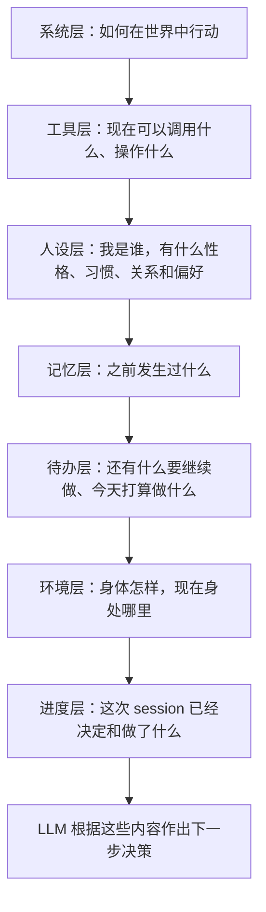
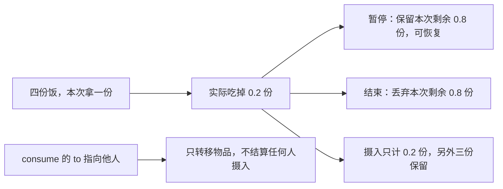
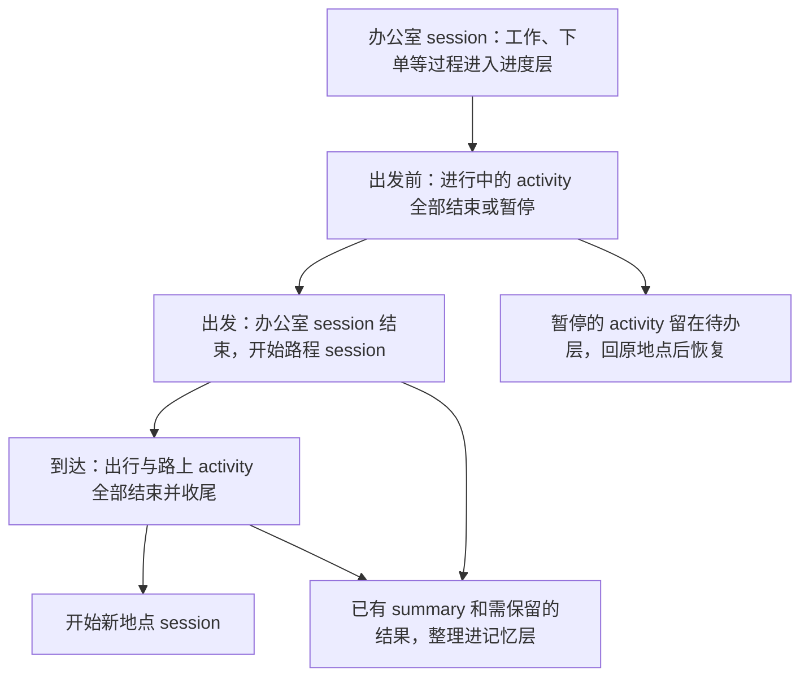
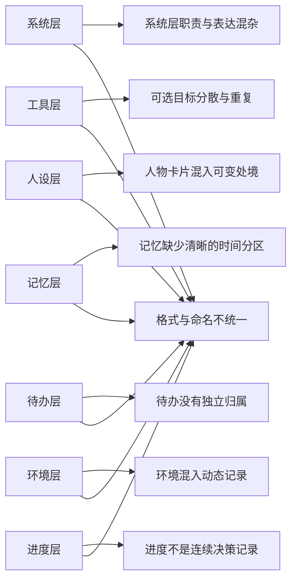

# 人物 Prompt 与交互修复方案

> 设计审阅稿。先完成七层 Prompt 与交互语义的整体方案，再统一修复已登记的程序错误。
> 本文是新方案的唯一入口；[设计细节与来源](research/persona-prompt-seven-layers.md)提供依据。
> [已确认的交互语义](#已确认的交互语义)｜[统一修复的程序错误](#统一修复的程序错误)｜[尚需定稿的实现选择](#尚需定稿的实现选择)
> [交互图示 HTML](research/persona-prompt-framework.html)｜[七层字段设计](#七层-json-字段设计)｜[七层 JSON 示例](research/persona-prompt-schemas/examples.json)

## 心智模型与项目框架的映射

### 用户要求

> 系统层（身份与行为准则）：formal & concise，目的是告诉LLMs这是什么，并且让LLMs知道如何与这个世界交互。
>
> 工具层（工具定义与可选目标）。
>
> 人设层（人物卡片）：人物基础信息和性格习惯。
>
> 记忆层：一部分来自于昨天和更早的记忆总结，另一部分是当日更早session的总结。
>
> 待办层：从老到新罗列之前paused的activity以及今日的day_plan。
>
> 环境层（此刻场景）：仅保留身体状况和所在环境的静态信息。
>
> 进度层：当前session从开始到现在输出的决策（不包括thinking）以及工具调用结果，按时间排序。
>
> 每层应该都使用json格式并且由自己的json schema维护。
>
> 信息截断，工时，工作，消费0.x份食物这些都是纯bug，先记下来，后续整体方案完成后统一修复

后续确认：关系和偏好在人设层原地更新，当日处境不放进去。新消息、配送送达和截止提醒进入进度层。
session 沿用地点停留或路程；进行中的 activity 不能跨出行。记忆保存需要延续的摘要，不建立逐 session 的档案。

本文同时覆盖七层内容组织、此前确认的物品来源与去向及进食语义、已经定位的程序错误。
提示写得更清楚不能代替修复截断、工时、工作截止或小数份消费的执行错误。

### 已确认的方案边界

| 会话中已确认的决定 | 本方案采用的约定 |
| --- | --- |
| 本轮范围与修复顺序 | 先把整体方案、图示和 Schema 留档，方案完成后统一改程序 |
| 名称与格式 | 只保留指定的七层，全部 JSON，每层独立 Schema；Schema 定义字段，不额外引入每次发送前的逐层校验流程 |
| 人设更新 | 关系与偏好原地更新，当日处境不进入人设；不增加“承诺”分类 |
| session 边界 | 沿用地点停留或路程；出发前处理完进行中的 activity，到达时路上 activity 结束并同秒收尾 |
| 记忆更新 | session 结束时整理已有 pause/conclude summary；不新增工具或模型总结请求，不为每个 session 建档 |
| 消息与进度 | 新消息、送达、截止提醒与决策、工具结果共用有序记录，各事件出现一次；thinking 不进入进度 |
| 独立自述与旧内容块 | 删除专门生成并回贴自述的额外阶段，以及不属于七层的独立提示内容块 |

### 七层各自回答什么

每层都填成 JSON。同一条消息、同一份工具说明、同一段历史结果只有一处完整内容。
其他地方可以提到名称，例如待办中的工作名称，不必再复制工作过程。

## 提升后的心智模型

### 业界方案概览

成熟 agent 的上下文组织可借鉴两点：把不同用途的信息分开；当前过程连续保留，较早过程整理为摘要。
本方案按用户指定的七层落实，参考来源与采用范围见[设计细节](research/persona-prompt-seven-layers.md#参考来源)。

### 提升后的设计

| 标准名称 | 填什么 | 怎样更新 |
| --- | --- | --- |
| 系统层（身份与行为准则） | 正式、简洁的执行规则：如何使用工具，怎样区分请求登记和执行结果 | 固定复用；具体人物姓名只在人设层 |
| 工具层（工具定义与可选目标） | 工具定义；每个目标对应的动作、方式、条件、价格、数量、耗时 | 当前可用内容更新后替换旧内容 |
| 人设层（人物卡片） | 基础信息、性格、习惯、关系、偏好 | 关系和偏好发生变化时原地更新；不追加当日经历或工作进度 |
| 记忆层 | 昨天及更早的摘要；当日更早的摘要 | 整理较早内容后加入相应部分；不要求一段 session 对应一份档案 |
| 待办层 | 暂停的 activity；今日 day_plan | 暂停项按暂停时间从老到新；恢复或结束后移出暂停项；计划保持原定顺序 |
| 环境层（此刻场景） | 身体状况、当前地点或路程、场所静态信息 | 替换为当前观察；不放可达地点目录、消息和活动经过 |
| 进度层 | 本 session 的决策、工具调用与结果、来信、送达、提醒 | 按实际发生顺序追加；不包括 thinking；session 结束后整理到记忆层 |

每层自己的 JSON Schema 就是这层的字段说明：字段叫什么、什么类型、可以填写什么。
它的目的在于让格式固定，避免再次混用散文、JSON 和类似 TOML 的文本。

### 已确认的交互语义

下列决定已在[根因研究](research/white-collar-dayrun-root-cause-2026-09-28.md)中记录，统一纳入本方案。
它们是后续实施要满足的要求，当前尚未实现。

| 已确认的决定 | 必须满足的行为 |
| --- | --- |
| `obtain`、`consume` 声明来源与去向 | 增加 `from`、`to`，让人物明确从哪里获得或消耗、交给谁；实际归属和结算必须使用这些信息 |
| 食品 `consume` 指向自己 | 才表示本人进食，按实际吃掉的部分计算摄入 |
| `consume` 指向他人 | 表示给予，只转移物品；给了王磊不等于王磊已经吃掉，也不增加任何人的摄入量 |
| 暂停进食 | 保留本次餐食的剩余部分，之后允许恢复 |
| 结束进食 | 丢弃本次已开吃餐食的剩余部分，不补算摄入，不销毁其他未开吃的份数 |
| 指名购买与轮转 | 环境存在的商品不能因轮转未展示而禁止购买；不存在时返回错误和近似候选，不自动换成别的商品 |

结束时丢弃剩余部分，与“库存不足一份仍应能消费”是两项要求，不能用前者掩盖后者的程序错误。

### 尚需定稿的实现选择

下面保留已有研究中的建议，尚未当作用户已确认的具体实现；整体方案定稿时一并处理。

| 事项 | 已有建议与待定范围 |
| --- | --- |
| `from`、`to` 的具体结构 | 逐个商品表达来源、持有人或收货人及地点；字段如何组织仍需定稿。还要区分直接送给王磊与自己收货后再给予，避免重复转移 |
| 代点请求与订单关联 | 后续决策持续看到商品、收货人、地点和配送结果；建议用原请求关联真实订单，区分重复办理与新增需求，不能全局禁止同商品复购 |
| 失败后强制等待与决策预算 | 建议移除“持续活动启动失败后只准等待”的升级规则，保留其他有效选择和主动等待；有限预算仍需保留，耗尽时报告技术失败，不记成人物主动等待 |
| 联系人往来与实际交付 | 建议让回复看到双方可知的历史；给予还需有真实持有物和收货地点，不能只在人物自述中说“给了对方”。具体状态组织仍需定稿 |

七层 Schema 定义上下文的组织方式；动作参数中的 `from`、`to` 最终形状仍属上表的待定事项。
现有 JSON 示例用于说明七层内容和更新过程，不表示全部动作接口已经定稿。
进度中的 `call_id` 只对应一次工具调用与结果，不能代替原代点请求与订单的关联。
同刻提交轮数包含成功提交，不能理解成连续失败次数；单次模型回合和同刻跨决策的预算需要分别考虑。
已读消息也不等于已经办理，不能用删除已读消息代替订单处理状态。

### 图示留档

[交互图示 HTML](research/persona-prompt-framework.html)与本文一起保存在仓库中，可以直接用浏览器打开。
页面包含“七层与填充”“session 流转”“删除与归属”三种视图；每层都能切换查看 JSON 示例和 JSON Schema。
图示内嵌展示所需的数据，不读取会话目录或本机文件。

七份 Schema 分别维护各层字段，[examples.json](research/persona-prompt-schemas/examples.json)保存按七层顺序排列的
完整示例。字段或示例调整时，同步更新本文和 HTML；这些示例用于审阅设计，不是实际运行记录。

### 七层 JSON 字段设计

所有层都有字符串字段 `layer`，值固定为对应的中文层名。下面逐层记录字段含义，完整类型和允许值由所链接的
Schema 定义。没有内容的列表写 `[]`；允许为空的数量、耗时和提醒时间写 `null`，不填编造的值。

#### 系统层（身份与行为准则）

字段定义：[system.schema.json](research/persona-prompt-schemas/system.schema.json)。

| 字段 | 类型与含义 |
| --- | --- |
| `role` | 字符串，说明人物在模拟世界中的执行职责 |
| `rules` | 字符串列表，正式、简洁的行为规则，例如“动作登记不代表执行完成” |

#### 工具层（工具定义与可选目标）

字段定义：[tools.schema.json](research/persona-prompt-schemas/tools.schema.json)。

| 字段 | 类型与含义 |
| --- | --- |
| `definitions` | 工具定义列表；每项有 `type` 和 `function`，`type` 固定为 `function` |
| `definitions[].function` | `name` 是工具名，`description` 说明用途，`parameters` 定义参数，`strict` 表示是否严格按参数定义输出 |
| `targets` | 可选目标列表；每项有可读名称 `name`、类别 `kind`、对应动作列表 `actions` |
| `targets[].kind` | 地点、商品、人物、活动、内容、任务、自己或消息，使用 Schema 中对应的英文值 |
| `targets[].actions[]` | 一项动作及其方式：`action` 取 `travel/interact/obtain/consume/sleep`，`way` 是目标提供的方式名称 |
| `actions[].available`、`unavailable_reason` | 是否可执行，以及不能执行的原因；可以执行时原因为空 |
| `actions[].requirements` | 条件列表；每项用 `condition` 描述条件，`satisfied` 表示目前是否满足 |
| `actions[].price_fen` | 整数或空，价格，单位为分 |
| `actions[].available_quantity`、`quantity_unit` | 数量或空，以及对应单位；数量允许小数，例如 `0.5` 份 |
| `actions[].estimated_duration_seconds` | 整数或空，预计耗时，单位为秒 |

动作、方式和条件始终跟随所属目标，不能拆成互不对应的名称列表。

#### 人设层（人物卡片）

字段定义：[persona.schema.json](research/persona-prompt-schemas/persona.schema.json)。

| 字段 | 类型与含义 |
| --- | --- |
| `identity` | 基础信息对象：`name` 为姓名，`birth_year` 为出生年份 |
| `background` | 字符串列表，已经形成的背景经历 |
| `traits` | 字符串列表，性格特点 |
| `habits` | 习惯列表，每项有名称 `name` 和习惯描述 `pattern` |
| `relationships` | 关系列表，每项有对方 `person` 和当前关系 `relationship`；关系变化时更新原项 |
| `preferences` | 偏好列表，每项有对象 `subject` 和当前偏好 `preference`；偏好变化时更新原项 |

#### 记忆层

字段定义：[memory.schema.json](research/persona-prompt-schemas/memory.schema.json)。

| 字段 | 类型与含义 |
| --- | --- |
| `earlier_days` | 昨天及更早的摘要列表；每项仅有日期 `date` 和摘要 `summary` |
| `earlier_today` | 当日更早的摘要列表；每项仅有整理时刻 `recorded_at` 和摘要 `summary` |

摘要中直接写清必要事实，例如“已替王磊订一份牛肉炒面，当时等待配送”。不另存 session 状态或活动档案。

#### 待办层

字段定义：[todo.schema.json](research/persona-prompt-schemas/todo.schema.json)。

| 字段 | 类型与含义 |
| --- | --- |
| `paused_activities` | 按暂停时间从老到新排列的 activity 列表 |
| `paused_activities[].name`、`paused_at` | 活动的可读名称与实际暂停时刻 |
| `paused_activities[].resume_conditions` | 字符串列表，恢复这项活动的条件 |
| `paused_activities[].remaining` | `description` 说明剩余事项，`estimated_duration_seconds` 为剩余秒数，未知时为空 |
| `day_plan` | 今日计划对象，包含日期 `date` 和按计划顺序排列的 `goals` |
| `day_plan.goals[]` | `intent_kind` 为意图类型，`goal` 为目标，`progressed` 表示是否已推进，`remind_at` 为提醒时刻或空 |

`progressed` 为真只表示目标已经得到推进，不等同于目标完成。

#### 环境层（此刻场景）

字段定义：[environment.schema.json](research/persona-prompt-schemas/environment.schema.json)。

| 字段 | 类型与含义 |
| --- | --- |
| `observed_at` | 当前观察时刻 |
| `body` | 身体感受：`appetite` 为食欲，`sleepiness` 为困意，`energy` 为体力感受；都使用可读描述 |
| `location` | 当前地点或路程的信息对象 |
| `location.session_kind` | `stay` 表示地点停留，`transit` 表示路程 |
| `location.name`、`place_type` | 当前地点或路程的名称、场所类型 |
| `location.fixed_rules` | 字符串列表，场所的固定规则；动作的执行条件仍只在工具层描述 |

#### 进度层

字段定义：[progress.schema.json](research/persona-prompt-schemas/progress.schema.json)。

| 字段 | 类型与含义 |
| --- | --- |
| `session_started_at` | 当前 session 的开始时刻 |
| `events` | 按实际发生顺序排列的记录列表；同一时刻的记录保留先后顺序 |
| `events[].occurred_at`、`type` | 每条记录都有发生时刻和事件类型；其余字段按下表确定 |

| `type` | 内容字段 | 含义 |
| --- | --- | --- |
| `decision` | `decision` | 模型输出的决策，不含 thinking |
| `tool_call` | `call_id`、`tool_name`、`arguments` | 一次工具调用的名称和完整参数 |
| `registration` | `call_id`、`tool_name`、`status`、`message` | 请求登记信息；`status` 固定为 `registered` |
| `tool_result` | `call_id`、`tool_name`、`result` | 对应调用的公开结果 |
| `message_arrival` | `sender`、`channel`、`message` | 新消息的发送者、渠道和正文 |
| `delivery` | `order`、`recipient`、`delivery_status`、`message` | 订单、收货人及配送进展；状态取 `in_transit/delivered/failed` |
| `deadline` | `task`、`deadline_at`、`deadline_status`、`message` | 哪项事情何时截止；状态取 `due_soon/due/expired` |

`call_id` 用来对应一次调用及其结果。`result` 包含结果时刻 `occurred_at`、状态 `status`、
错误码或空 `error_code`、结果说明 `message` 和公开细节 `details`；工作结果还可以带公开反馈 `work_review`。
公开细节保留商品名称、数量、付款、收货人和送达地点等信息，不放内部身份或资源账户。

### session 结束时怎样整理进度

[原规格](SPEC-time-and-energy.md#三层结构)已经规定：出发前先结束或暂停手上的进行中活动；
到达时，出行和路上开始的活动一起结束，并在同一秒收尾。暂停的活动留在原地点，回去后可以恢复。

这里的 session 结束是**整理记忆的时机**。记忆本身只有“昨天及更早”“当日更早”两部分，
里面放可读摘要，不复制 session 的状态、活动列表和整套运行记录。

整理时使用已有 pause/conclude 的 summary，并保留订单等仍有后续影响的结果，不新增工具或模型总结请求。
例如摘要写清“已替王磊订牛肉炒面，等待送达”；收到送达消息后，进度层记录送达结果。
下一次整理则保留已送达的结果，不能让旧代订请求成为唯一留下的信息。

一次操作被拒绝，就在进度层记录拒绝原因；它本身不会结束 session。

### 删除与去重

| 旧内容 | 处理 |
| --- | --- |
| 系统提示里的具体人物身份、经历与口语化生活劝导 | 身份只在人设层；经历进入记忆或进度；删除生活劝导 |
| 环境里的可达地点、商品、操作目录 | 完整放在工具层，保留目标与动作的对应关系 |
| 人物卡片里的当日处境与工作进展 | 当日已发生的过程放进度层，较早的内容放记忆层 |
| 已核验经历、主观归纳、最近人物自述等独立内容块 | 删除这些独立块，必要内容按时间进入记忆层或进度层 |
| 整包当前事实清单 | 删除；需要的内容分别放进指定的七层 |
| 专门生成再回贴的“刚才形成的自述” | 删除额外阶段，直接保留模型本次输出的决策 |
| 多处重复的消息正文和结果 | 只在进度层出现一次，之后按需整理入记忆 |
| 独立预算附录、调试清单、thinking | 不放进七层正文 |

## 当前实现的差距

### 重复下单需要同时解决什么

运行中，王磊的代点请求只投递一次；林悦在 10:35、10:43:01、10:55:47、11:45:01 四次下单。
最后一次已经能看到库存，仍再次购买。因此仅重写提示或展示库存不能算完成修复。
完整时间线及输入证据见[根因研究](research/white-collar-dayrun-root-cause-2026-09-28.md)。

这是本次运行暴露的解释路径；提示保留、订单归属和请求关联对行为的影响，仍需在实施后分别验证。
验收要看到请求、下单、实际送达或给予、后续决策连起来；不能只看模型说“已办理”或模拟成功跑到午夜。

### 统一修复的程序错误

下列问题已定位，状态均为**待整体方案完成后统一修复**。它们需要修改程序，不能通过提示要求模型自行补救。
本表直接纳入主方案；具体运行证据与模块位置保留在[根因研究](research/white-collar-dayrun-root-cause-2026-09-28.md)。

| 程序错误 | 当前触发与后果 | 修复必须达到的结果 |
| --- | --- | --- |
| 直接消息截断且没有全文入口 | 王磊的回复只显示前四十个字符，后面的工作安排无法读取 | 人物能够取得完整消息，发件人、时间、正文对应；不能把截断后的文本当作完整来信 |
| 工作恢复越过合同截止 | 暂停恢复后，计划结束从 17:10:51 后移到 17:44:21，越过 17:30 截止 | 开始与恢复使用一致的截止约束，截止同秒按合同处理 |
| 有效工时达标与提交状态不一致 | 截止时有效工时约 6.40 小时，要求为四小时；仍在工作使提交就绪状态保持为否 | 分别说明工时达标、活动状态和提交条件，达标后能明确选择收尾并提交；工时足够不等于已提交或已验收 |
| 逾期工作从观察和工具中消失 | 活动结束时任务已过期，任务与提交入口一起消失；本次从未发起提交 | 保留任务状态与逾期原因，提交、验收和付款按合同处理；不擅自新增迟交规则，也不把没有提交说成提交失败 |
| 不足一份的食物无法再次消费 | 库存还有 0.25 份，菜单说可以吃，执行却固定请求一份并拒绝 | 展示与执行都支持实际可消费的小数份量，数量、时长和热量一致；不要求模型补填接口没有的份数或进食时间 |
| 混合动作的购买记录遗漏 | 进食与购买并行，整体回执为 `in_progress`，手机记录漏掉其中已成功的订单与支付 | 根据订单创建事实记录并去重，持续活动的状态不影响已完成购买的导出 |
| 最近主观记忆的零条配置失效 | 配置允许 `recent_memory_limit=0`，读取路径却又采用默认八条 | 零条就不展示最近条目，非零按对应窗口读取；不将此问题当作默认八条运行中重复下单的原因 |

工作问题的三个状态必须分清：

### 其他仍需覆盖的缺口

| 缺口 | 后续方案与验证要求 |
| --- | --- |
| 进食提前结束却只显示“已收尾” | 显示真实完成、提前结束或失败，以及已吃、丢弃、剩余份量；人物写“吃完了”不能覆盖结算结果 |
| 提示菜单与受限工具不一致 | 工具层所列动作与实际可调用范围一致；不能提示可浏览，调用时却因另一套裁剪规则被拒绝 |
| 未完成浏览被写成采购完成 | 浏览、选择商品、创建订单分别记录；未取得浏览结果或没有订单时，不能从总结推断采购成功 |
| 联系人回复缺少双方历史 | 对照双方可知的消息核对；本次四次下单发生在第二条回复到达前，不能归因为对方反复催单 |
| 把没有订单当作没有使用应用 | 手机购买记录只证明实际订单；应用浏览、尝试下单和成功购买分别保留事实口径 |

### 差距归属图

### 差距明细

| 差距名称 | 当前问题 | 目标 |
| --- | --- | --- |
| 系统层职责与表达混杂 | 身份介绍、生活建议和自述要求混在一起 | 只保留正式的执行准则 |
| 可选目标分散与重复 | 场景、事实和工具多次描述目标 | 工具层完整描述一次 |
| 人物卡片混入可变处境 | 卡片混入本周任务和当日处境 | 保留人物信息；关系与偏好原地更新 |
| 记忆缺少清晰的时间分区 | 主观归纳和零散条目混杂 | 明确区分昨天及更早、当日更早 |
| 待办没有独立归属 | 暂停活动和 day_plan 分散 | 独立列出暂停事项与今日计划 |
| 环境混入动态记录 | 场景夹带消息、活动、目标和可达地点 | 只保留身体与当前场所信息 |
| 进度不是连续决策记录 | 过程被活动快照、最近自述与部分结果替代 | 本 session 的决策与结果连续可见 |
| 格式与命名不统一 | 格式和段名混用 | 按七层命名，全部 JSON，各自 Schema |

### 后续顺序

本轮不改模拟运行规则，不把设计示例或既有查看器测试当作新 Prompt 已生效的证明。
修复小数份消费、工作、消息和导出时，分别保留能够复现旧错误的场景；真实运行还需验证重复下单是否改善。
