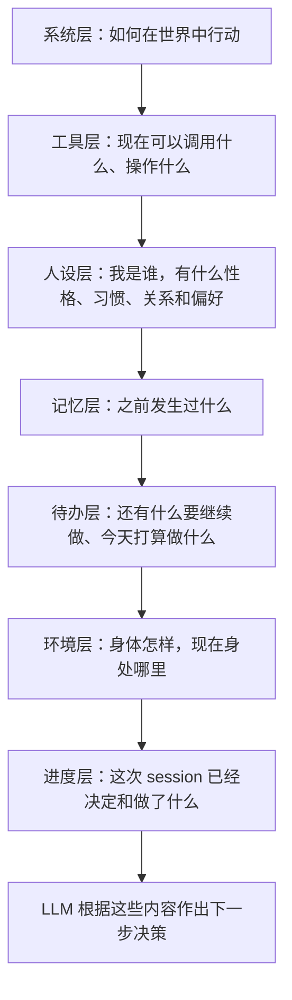
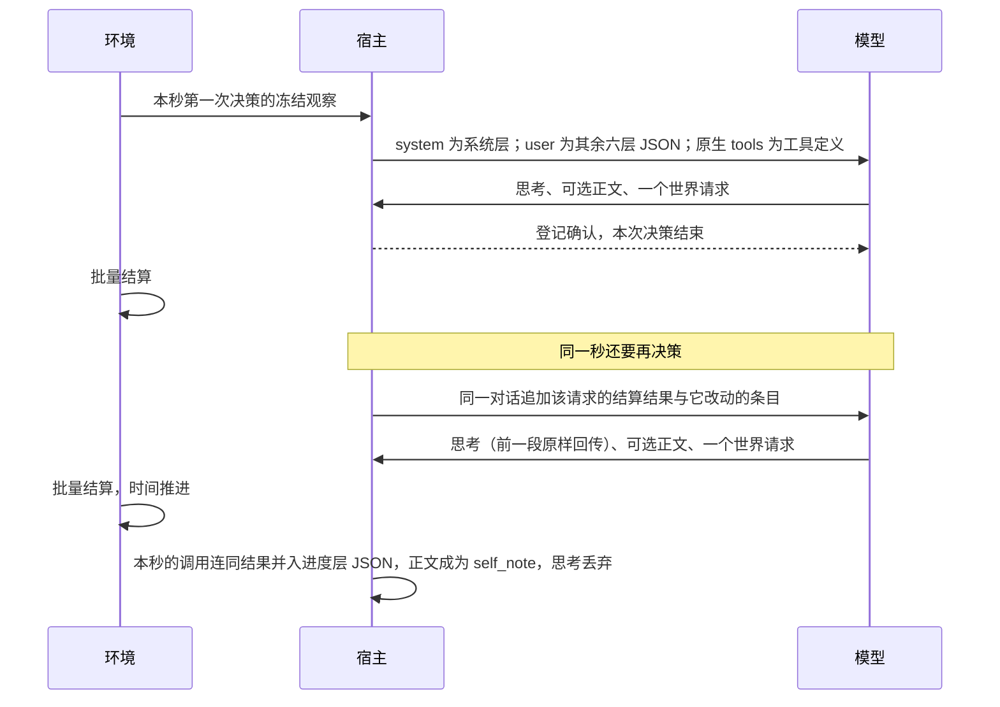
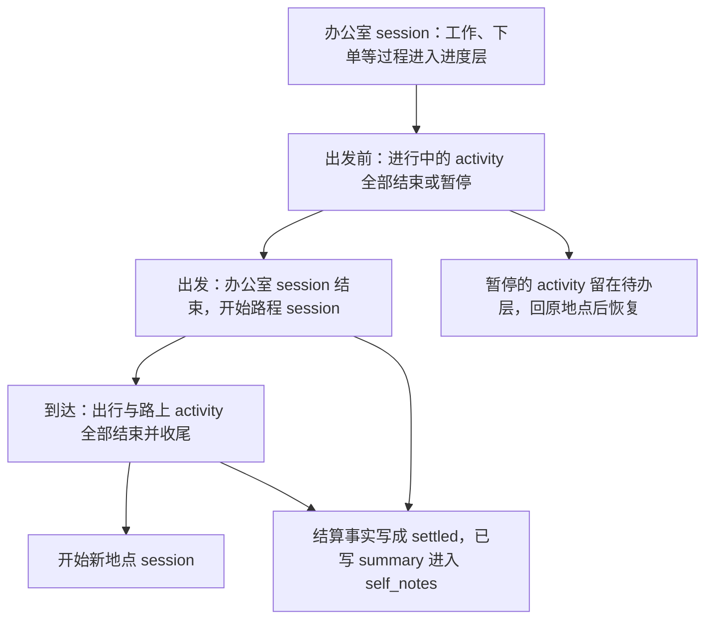
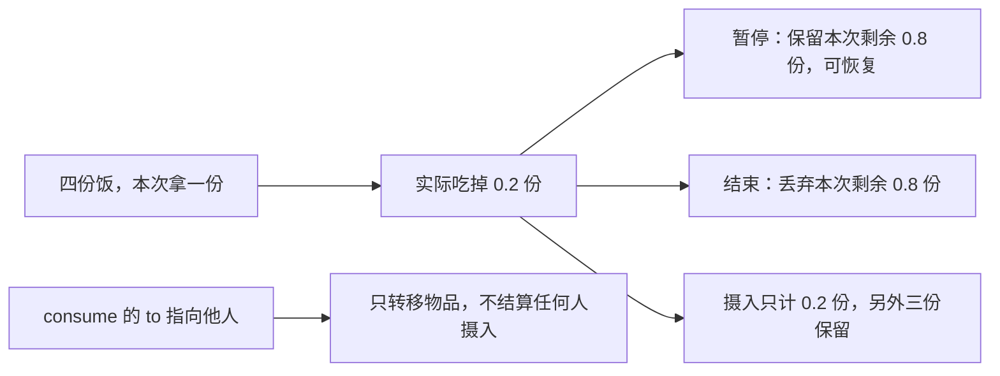
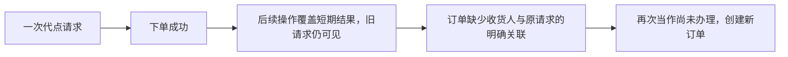
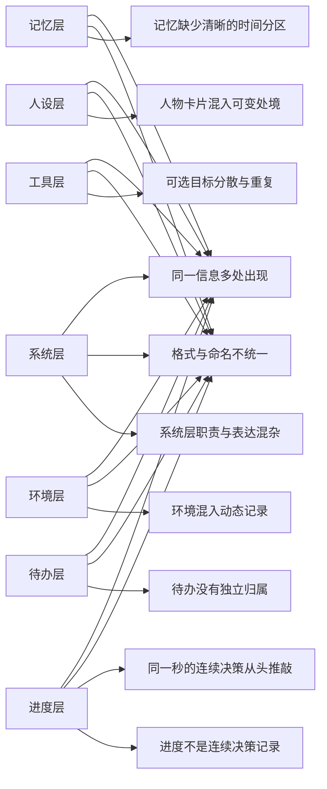
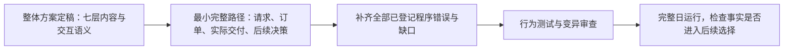

# 人物 Prompt 与交互修复方案

> 设计审阅稿。先完成七层 Prompt 与交互语义的整体方案，再统一修复已登记的程序错误。
> 本文是新方案的唯一入口；[设计细节与来源](research/persona-prompt-seven-layers.md)提供依据。
> 2026-09-20 的决策上下文裁决原文已移至[归档](research/decision-context-proposal-2026-09-20.md)。
> 收敛后的开发规格草稿见[人物 Prompt 七层与交互修复](SPEC-persona-prompt.md)（未冻结）：本文「尚需定稿的实现选择」与核查中发现的矛盾，在其「裁决记录」#21–#38 中给出推荐，待裁定。
> [唯一出现原则](#唯一出现原则)｜[决策、回复正文与思考](#决策回复正文与思考)｜[已确认的交互语义](#已确认的交互语义)｜[统一修复的程序错误](#统一修复的程序错误)｜[尚需定稿的实现选择](#尚需定稿的实现选择)｜[需修订的现行条款](#需修订的现行条款)
> [交互图示 HTML](research/persona-prompt-framework.html)｜[七层字段设计](#七层-json-字段设计)｜[七层 JSON 示例](research/persona-prompt-schemas/examples.json)

## 心智模型与项目框架的映射

### 用户要求

> 系统层（身份与行为准则）：formal & concise，目的是告诉LLMs这是什么，并且让LLMs知道如何与这个世界交互。
>
> 工具层（工具定义与可选目标）。
>
> 人设层（人物卡片）：人物基础信息和性格习惯。
>
> 记忆层：一部分来自于昨天和更早的记忆总结，另一部分是当日更早session的总结。
>
> 待办层：从老到新罗列之前paused的activity以及今日的day_plan。
>
> 环境层（此刻场景）：仅保留身体状况和所在环境的静态信息。
>
> 进度层：当前session从开始到现在输出的决策（不包括thinking）以及工具调用结果，按时间排序。
>
> 每层应该都使用json格式并且由自己的json schema维护。
>
> 信息截断，工时，工作，消费0.x份食物这些都是纯bug，先记下来，后续整体方案完成后统一修复

后续确认：关系和偏好在人设层原地更新，当日处境不放进去。新消息、配送送达和截止提醒进入进度层。
session 沿用地点停留或路程；进行中的 activity 不能跨出行。记忆保存需要延续的摘要，不建立逐 session 的档案。
审阅后又确认：同一信息在整个 prompt 中只出现一次；工作合同放在工具层的 task 目标；
身体状况沿用现有提示已有的体感分级，现有提示没有的不加。
进度层里的“决策”指人物选择的动作，即工具调用；数据集也不需要每次决策一句人物自述。
回复正文可有可无，有就作为该调用的 `self_note` 保留；思考不进入任何一层，只在同一秒的连续决策里回传。

本文同时覆盖七层内容组织、此前确认的物品来源与去向及进食语义、已经定位的程序错误。
提示写得更清楚不能代替修复截断、工时、工作截止或小数份消费的执行错误。

### 已确认的方案边界

| 会话中已确认的决定 | 本方案采用的约定 |
| --- | --- |
| 本轮范围与修复顺序 | 先把整体方案、图示和 Schema 留档，方案完成后统一改程序 |
| 名称与格式 | 只保留指定的七层，全部 JSON，每层独立 Schema；Schema 定义字段，不额外引入每次发送前的逐层校验流程 |
| 人设更新 | 关系与偏好原地更新，当日处境不进入人设；不增加“承诺”分类 |
| session 边界 | 沿用地点停留或路程；出发前处理完进行中的 activity，到达时路上 activity 结束并同秒收尾 |
| 记忆更新 | session 结束时整理已有 pause/conclude summary；不新增工具或模型总结请求，不为每个 session 建档 |
| 消息与进度 | 新消息、送达、截止提醒与决策、工具结果共用有序记录，各事件出现一次；thinking 不进入进度 |
| 独立自述与旧内容块 | 删除专门生成并回贴自述的额外阶段，以及不属于七层的独立提示内容块 |
| 唯一出现 | 同一信息在整个请求中只有一处完整内容，其他位置只引用名称；关系与偏好只在人设层 |
| 工作合同 | 截止、剩余要求与能否按时完成放在工具层 task 目标，待办层不另列 |
| 身体状况 | 沿用现有提示的五项体感分级：饥饿、困意、娱乐需要、社交需要、情绪；不新增分级 |
| 决策 | 进度层的决策就是人物选择的动作（工具调用）；不要求回复正文，数据集不需要每次决策一句自述 |
| 回复正文 | 写了就作为该调用的 `self_note` 保留到 session 结束，标明未经核验；不要求、不重问、不代写，不进入记忆 |
| 思考 | 不进入任何一层；只在同一秒的连续决策里按提供商协议原样回传，时间推进后丢弃；效果待真实运行验证 |

### 七层各自回答什么



每层都填成 JSON。每项信息的唯一位置见[唯一出现原则](#唯一出现原则)。

### 与现行七层上下文的对应

[数字人交互规格「上下文分层」](SPEC-agent-interaction.md#上下文分层)已冻结另一套七层。那套分层落在
`persona_card`、`scene`、`facts` 三段载体之内，其中进度层结构是当时的用户裁决。本方案按用户的新定义替换它。
两套分层中名称相同的层，内容并不相同：

| 现行分层与载体 | 本方案 |
| --- | --- |
| system：身份前言与「怎样过一天」 | 系统层：正式、简洁的交互规则；身份移到人设层 |
| 人设层：人物卡片与记忆段 | 拆成人设层与记忆层 |
| 目标层：`facts.day_plan` | 待办层：今日计划与暂停活动 |
| 环境层：`scene` 全段 | 环境层只留体感分级与所在地点的静态信息 |
| 交互对象层：`facts.interactive_objects` | 并入工具层 `targets` |
| 进度层：全部会话、结果与提醒 | 进度层只含当前 session；更早的 session 进入记忆层 |
| 工具层：工具 Schema | 工具层：原生工具定义与 `targets` |

采纳时按[需修订的现行条款](#需修订的现行条款)逐条修订，不保留两套分层。

## 提升后的心智模型

### 业界方案概览

成熟 agent 的上下文组织可借鉴两点：把不同用途的信息分开；当前过程连续保留，较早过程整理为摘要。
本方案按用户指定的七层落实，参考来源与采用范围见[设计细节](research/persona-prompt-seven-layers.md#参考来源)。

### 唯一出现原则

每项信息在整个模型请求中只有一处完整内容，其他位置只能用名称引用。
原生 `tools` 参数也是请求的一部分，工具定义放在那里就不再写进工具层 JSON。

| 信息 | 唯一位置 | 不再出现的位置 |
| --- | --- | --- |
| 世界交互规则；登记与结果的区别 | 系统层 `rules` | 工具 description、身份前言、「怎样过一天」 |
| 工具名称与参数定义 | 原生 `tools` 参数 | 工具层 JSON |
| 目标、动作、条件、价格、耗时、数量；在场的人；持有物 | 工具层 `targets` | 场景、事实清单、环境层 |
| 工作合同的截止、剩余要求与前景 | 工具层 task 目标的 `contract` | 待办层、截止提醒事件 |
| 进行中与刚结束活动的客观进度 | 工具层 activity 目标的 `state` | 进度层、环境层 |
| 暂停活动的地点与进度 | 待办层 | 工具层、进度层 |
| 今日目标与提醒时刻 | 待办层 `day_plan` | 目标提醒事件只写目标名 |
| 身份、作息、习惯、口味、关系、偏好 | 人设层 | 系统层、记忆层 |
| 体感分级；所在地点的静态信息 | 环境层 | 场景 |
| 本 session 的决策（工具调用）与结果、世界事件 | 进度层 JSON；本秒之内的后续决策在原生消息里 | 记忆层（session 结束后才迁入） |
| 更早 session 与更早日期 | 记忆层 | 进度层 |
| 人物写下的 summary | 本 session 内是进度层该调用的参数；结束后是记忆层 `self_notes` | 待办层、目标行 |
| 回复正文 | 进度层对应调用的 `self_note`，只到本 session 结束 | 记忆层 |
| 思考 | 本秒原生 assistant 消息的 `reasoning_content` | 七层中的任何一层 |
| 邮件正文 | 阅读动作的结果 | 到达事件、工具层 |

### 提升后的设计

| 标准名称 | 填什么 | 怎样更新 |
| --- | --- | --- |
| 系统层（身份与行为准则） | 执行职责；怎样读七层；一次决策一个请求；登记不等于完成；事实与自述的区别；思考与回复正文保留多久 | 固定复用 |
| 工具层（工具定义与可选目标） | 原生工具定义；每个目标的状态、动作、方式、条件、价格、耗时、数量与其他可用工具 | 每次观察按冻结菜单重建 |
| 人设层（人物卡片） | 冻结卡片去掉当下处境后的字段、姓名；关系与偏好的当前看法 | 卡片不变；新看法按对象原地替换 |
| 记忆层 | 今天更早与更早日期；结算事实与人物自述分开 | session 结束时追加；跨过零点并入更早日期 |
| 待办层 | 暂停的 activity；今日 day_plan | 暂停项按暂停时间从老到新；恢复或结束后移出；计划保持原定顺序 |
| 环境层（此刻场景） | 五项体感分级、当前地点或路程的静态信息 | 替换为当前观察 |
| 进度层 | 本 session 的调用连同结果与可选 `self_note`、来信、送达、截止与目标提醒；本秒内的后续决策以原生消息续接 | 按实际发生顺序追加；时间推进时并入本秒原生消息并丢弃思考；session 结束后整理到记忆层 |

每层自己的 JSON Schema 就是这层的字段说明：字段叫什么、什么类型、可以填写什么。
它的目的在于让格式固定，避免再次混用散文、JSON 和类似 TOML 的文本。

### 决策、回复正文与思考

按已确认的决定删除决策自述阶段，每次决策只发一次行动请求。模型的一次回复有三部分，分别处理：

| 部分 | 定位 | 保留多久 |
| --- | --- | --- |
| 工具调用 | 这就是决策 | 本 session 内在进度层；session 结束后按记忆层规则写成 `settled` |
| 回复正文 `content` | 可有可无的人物自己的话；不要求、不重问、不代写 | 有就作为该调用的 `self_note` 保留到 session 结束，不进入记忆 |
| 思考 `reasoning_content` | 模型的草稿，不进入任何一层 | 同一秒的连续决策内原样回传，时间推进后丢弃 |



同一秒续接时，请求依次是：

```
tools        ← 工具定义（原生参数）
system       ← 系统层
user         ← 其余六层 JSON：本秒第一次决策时的快照；进度层 JSON 写到本秒之前
assistant    ← 本秒第 1 次决策：reasoning_content、可选正文、工具调用
tool         ← 结算后的公开结果，以及它改动的待办层、工具层条目
assistant    ← 本秒第 2 次决策
…
```

**思考为什么只在同一秒续接：**

- **思考仍然成立。** 世界时间没动，只有刚结算的结果变了。时间推进后思考描述的是过去的世界，
  例如 09:10 时“这里现在买不到午饭”，到中午就不再成立。
- **协议决定了切分方式。** 请求带 `tools` 时，DeepSeek 要求回传此前每个 assistant 回合的 `reasoning_content`，否则返回 400。
  要丢弃思考，就只能把这些回合移出原生消息、并入进度层 JSON。本秒之内的回合留在原生消息里，每件事仍只出现一次。
- **长度有界。** 同刻上限约束续接次数；白领全天运行中最长的同秒连续决策为 5 次。

**时间推进后，“为什么这样做”靠下面这些保留，而不是思考或正文：**

| 原因的种类 | 保存位置 |
| --- | --- |
| 替谁办、回应哪条请求 | 动作参数与关联：`to`，以及请求与订单的关联（尚需定稿） |
| 服务哪个计划 | 待办层：今日目标与提醒，暂停活动的地点与进度 |
| 活动进展与下一步 | 人物在现有记录点写下的 summary：`report_status`（每 30 分钟）、`pause_activity`、`conclude_activity` |
| 对别人承诺了什么 | 消息原文 |
| 其余 | 由当前状态重新判断：体感、合同、消息 |

白领全天运行的 140 次决策都有决策自述，仍然四次下单，还反复写下已经办过的打算和与结算不符的说法。
叙述出来的理由会漂移，事实和刻意写下的记录不会。若测试发现人物在时间推进后反复改变打算，
最小的补法是给 `start_activity` 加可选 summary，与三个控制工具一致，而不是保留思考。

**依据：** 白领全天运行中，177 次提交世界请求的回复有 97 次正文为空；思考中位约 1,260 token，多为英文并夹带协议用语；
38% 的决策紧跟同一秒的上一次决策，用掉 47% 的思考 token；咖啡在 20 次决策的思考里被反复推敲。
数据与方法见[设计细节](research/persona-prompt-seven-layers.md#决策回复正文与思考的依据)。同秒续接能否减少这些消耗，列入[尚需定稿的实现选择](#尚需定稿的实现选择)。

- **沿用不变的规则：**
  - 一次决策恰好一个世界请求，登记即结束；
  - 批量结算；生活决策没有 `finish`；
  - 宿主用私有绑定解析可读名称，提示中不出现内部身份。
- **只读问答。** 沿用现有路径：系统层换成只读规则，只带人设层、记忆层和外部问题，不写世界或记忆。

### 七层 JSON 字段设计

所有层都有字符串字段 `layer`，值固定为对应的中文层名。下面逐层记录字段含义，完整类型和允许值由所链接的
Schema 定义。数量、价格和时长一律写成人能读懂的短语，例如「约 12 分钟」「32 元」「0.25 份」，
不给原始秒数或以分为单位的整数；时刻用带时区的 ISO 8601。没有内容的列表写 `[]`；允许为空的写 `null`，不填编造的值。
示例均取自同一场景，见 [examples.json](research/persona-prompt-schemas/examples.json)。

#### 系统层（身份与行为准则）

字段定义：[system.schema.json](research/persona-prompt-schemas/system.schema.json)。

| 字段 | 类型与含义 |
| --- | --- |
| `role` | 字符串，说明人物在模拟世界中的执行职责，不含具体姓名 |
| `rules` | 字符串列表，每条交互规则只写一次：怎样读七层；一次决策一个请求；登记不等于完成；`settled` 与 `self_notes`、`self_note` 的区别；回复正文可以留空、写了保留到哪里；思考只在同一时刻保留，之后要记住的写进 summary；出行与收尾；暂停活动在哪里恢复 |

规则只说明机制，不要求人物每次写正文；工具 description 不再重复这些规则。

#### 工具层（工具定义与可选目标）

字段定义：[tools.schema.json](research/persona-prompt-schemas/tools.schema.json)。工具定义只经原生 `tools` 参数发送，
形状见 Schema 的 `$defs.tool_definition`；本层 JSON 只有 `targets`。

| 字段 | 类型与含义 |
| --- | --- |
| `targets[].name`、`kind` | 可读名称与类别：地点、商品、人物、内容、任务、活动、消息或自己 |
| `targets[].state` | 目标此刻的可读状态：营业情况、每份热量、在场的人在做什么、内容剩余、邮件是否已读、活动的客观进度；没有时为 `null` |
| `targets[].contract` | 只有 task 目标有：`deadline`、`remaining`、`outlook`（例如「到截止前做不完」「已过截止」，无时为 `null`） |
| `targets[].actions[]` | `start_activity` 可选的一项动词与方式：`action` 取五个动词，`way` 是目标提供的方式 |
| `actions[].available`、`reason` | 此刻能否执行；不能执行时必须写原因，能执行时原因为 `null` |
| `actions[].price`、`duration`、`quantity`、`note` | 价格、耗时或送达时刻、可用数量（可为小数份）、其他说明（例如路线费力程度） |
| `targets[].tools[]` | 以本目标名称为参数的其他工具：`report_status`、`pause_activity`、`conclude_activity`、`submit_work`、`send_message`，各带 `available` 与 `reason` |

- **进行中与刚结束的活动也是目标。** 它们是控制工具的对象，客观进度写在 `state`，例如「刚结束：已到达资料室，须先收尾」。
  暂停的活动只在待办层。
- **动作与目标始终配对。** 动作、方式、条件和工具可用性都跟随所属目标，不拆成互不对应的名称列表。
  受限轮的限制直接体现在对应的 `available` 与 `reason` 中，不再另写一句说明。
- **展示不是资格上限。** `targets` 是本轮展示的目标。按已确认的指名购买语义，环境中存在但未展示的商品仍可按名称购买。
- **`to` 的候选。** `from`、`to` 的参数形状待定；`to` 的候选就是本层的人物目标与「自己」，不另设列表。

#### 人设层（人物卡片）

字段定义：[persona.schema.json](research/persona-prompt-schemas/persona.schema.json)。

| 字段 | 类型与含义 |
| --- | --- |
| `identity` | `name`、`age`、`occupation`、`living_arrangement` |
| `rhythm` | 起床、出门、午餐、晚餐、就寝窗口与睡眠中点、睡眠需要，均为可读短语 |
| `habits` | 至多五条 `{trigger, response, time_window}` |
| `tastes`、`coping` | 卡片原有的口味与压力时的应对方式 |
| `relationships` | 卡片关系与场景联系人按名称合并，每人一项：`person`、`role`、`closeness`、`channels`、`self_note` |
| `preferences` | 人物写下的偏好 `{subject, preference}`；卡片原有口味只在 `tastes` |

- **字段来源。** 字段直接取自冻结的现有人物卡片，只去掉当下处境 `situation`，加上姓名；
  卡片编译、三次一致性与冻结恢复都不变，600 汉字上限继续约束卡片部分。
- **原地更新。** `self_note` 与 `preferences` 来自人物在现有写入点写下的 relationship、preference 类记忆：
  `conclude_activity.memories` 与就寝反思。为此这两类记忆需带对象名 `subject`。
  同一对象的新看法替换旧看法，且只在人设层出现，不进入记忆层。
- **风险与验收。** [人物规格](SPEC-life-realism.md#设计裁决)曾记录“首次购买被写成偏好记忆后回灌为稳定偏好”。
  偏好只来自人物明确写下的 preference 记忆，购买本身不写偏好；验收须覆盖这一反例。

#### 记忆层

字段定义：[memory.schema.json](research/persona-prompt-schemas/memory.schema.json)。

| 字段 | 类型与含义 |
| --- | --- |
| `earlier_days[]` | `{date, settled, self_notes}`：`settled` 是当日结束时仍未了结的事实，`self_notes` 是当晚就寝反思 |
| `earlier_today[]` | `{recorded_at, settled, self_notes}`：每次 session 结束追加一条，没有可保留的内容就不追加 |
| `settled` | 系统把成功的世界请求与世界事件各写成一句：时刻、发生了什么，以及必要的数量与地点 |
| `self_notes` | pause/conclude 写下的 summary 与记忆原文，按活动名标注；标明未经核验 |

- **结算事实与自述分开。** 现行规格要求已核验经历与人物自述明确分开，所以两类内容分字段存放，不混成一句摘要。
- **瞬时动作靠 `settled` 保留。** 瞬时下单、发消息没有 summary，只能靠 `settled` 这一句保留，例如
  「10:20 远程下单牛肉炒面 1 份，付 32 元，预计 10:35 送到练秋湖研发中心办公室」。
- **不写入记忆的内容。**
  - 失败的请求、记忆查询与回看；
  - 调用上的 `self_note` 与思考；
  - 属于其他层当前状态的内容，例如尚未阅读、还剩多少份。
- **跨过场景本地零点时。** 当天的 `earlier_today` 并成一条 `earlier_days`：`settled` 只留尚未送达或取消的订单，
  以及收到后尚未给发件人回过消息的直接消息；`self_notes` 取当晚就寝反思。
- **呈现窗口。** 沿用长期记忆 8000 字符的装配窗口，只呈现窗口内最近的日期；记录不删除，更早的人物自述仍可用记忆查询取得。

#### 待办层

字段定义：[todo.schema.json](research/persona-prompt-schemas/todo.schema.json)。

| 字段 | 类型与含义 |
| --- | --- |
| `paused_activities[]` | 按暂停时刻从老到新：`name`、`paused_at`、`place`（只能回到这里恢复）、`progress`（客观进度短句） |
| `day_plan` | 零点计划生成前为 `null`；之后为 `{date, goals}`，目标保持计划顺序 |
| `day_plan.goals[]` | `intent_kind` 取现有十一种意图，`goal`，`progressed`，`remind_time`（`HH:MM` 或 `null`，与 `revise_day_plan` 同名） |

`progressed` 为真只表示目标已经得到推进，不等同于目标完成。暂停时写的 summary 与目标行的人物自述不在本层重复。

#### 环境层（此刻场景）

字段定义：[environment.schema.json](research/persona-prompt-schemas/environment.schema.json)。

| 字段 | 类型与含义 |
| --- | --- |
| `observed_at` | 当前观察时刻 |
| `body` | 现有五项体感分级：`appetite`、`sleepiness`、`entertainment`、`social`、`mood`；取值就是现有分级文字，数值不进提示 |
| `location.session_kind` | `stay` 表示地点停留，`transit` 表示路程 |
| `location.name`、`place_type` | 当前地点或路程的名称、场所类型或出行方式 |
| `location.fixed_rules` | 场所的固定规则；动作的执行条件只在工具层 |

#### 进度层

字段定义：[progress.schema.json](research/persona-prompt-schemas/progress.schema.json)。

| 字段 | 类型与含义 |
| --- | --- |
| `session_started_at` | 当前 session 的开始时刻 |
| `events` | 写到本秒第一次决策为止，按实际发生顺序排列；同一时刻保留先后顺序；每条都有 `occurred_at` 和 `type` |

| `type` | 内容字段 | 含义 |
| --- | --- | --- |
| `tool_call` | `tool`、`arguments`、`result`，可选 `self_note` | 人物的一次决策：世界请求或记忆查询，连同它的公开结果；`self_note` 是该回复的正文，有才写 |
| `message_arrival` | `sender`、`kind`，`text` 或 `subject` | 直接消息与交谈邀请带全文；邮件只有主题，正文在阅读结果中 |
| `delivery` | `order`、`status`、`message` | 订单的可读名称与送达进展；`status` 取现有订单状态 `ready/delivered/cancelled` |
| `task_deadline` | `task`、`stage` | 工作临近截止或已过期（`due_soon/expired`）；截止时刻本身只在工具层 |
| `plan_reminder` | `goal` | 当日目标的提醒到时；提醒时刻本身只在待办层 |

`result` 包含结果时刻 `occurred_at`、状态 `status`、错误码或空 `error_code`、结果说明 `message` 和公开细节 `details`；
工作结果还可以带公开反馈 `work_review`。`details` 只放本次新产生的可读事实，例如商品、份数、付款、送达地点与时刻、
计划时长、进食的实际份量，不复述调用参数，也不放内部身份或资源账户。
一次调用与它的结果合为一条记录：不另设登记记录，也不给模型任何调用编号。

进度层由两部分组成：
- **JSON 部分：** 本 session 从开始到本秒第一次决策为止的记录。
- **本秒原生消息：** 同一秒内后续决策的 assistant 与 tool 消息，见[决策、回复正文与思考](#决策回复正文与思考)。
  时间推进后，这些消息并入 JSON 部分：正文写成 `self_note`，思考丢弃。

思考只存在于本秒原生消息中，从不写进 JSON。

### session 结束时怎样整理进度

[原规格](SPEC-time-and-energy.md#三层结构)已经规定：出发前先结束或暂停手上的进行中活动；
到达时，出行和路上开始的活动一起结束，并在同一秒收尾。暂停的活动留在原地点，回去后可以恢复。



这里的 session 结束是**整理记忆的时机**。会话本身仍不写总结；系统只按上节规则追加一条记忆，
不复制 session 的状态、活动列表和整套运行记录，也不新增工具或模型总结请求。

例如代订后出发，记忆写清「10:20 远程下单牛肉炒面 1 份……预计 10:35 送到」；
路上收到送达，进度层记录 `delivery`，路程结束时整理为「10:35 牛肉炒面 1 份已送到练秋湖研发中心办公室」。
旧代订请求因此不会成为唯一留下的信息。

一次操作被拒绝，就在进度层记录拒绝原因；它本身不会结束 session。

### 预算

沿用发送前对整次请求计数与 85% 阈值。达到阈值时只浓缩进度层的 JSON 部分：先去掉较早记录的 `self_note`，
再把本 session 较早、已有结果的记录按记忆层 `settled` 的写法折叠。本秒原生消息不浓缩，它的长度由同刻上限约束。
以下内容照旧完整呈现：

- 工具层的进行中与刚结束活动；
- 待办层的暂停活动；
- 尚未了结的订单；
- 本次新增的结果。

仍达阈值或超出输入额度时，按容量故障停止，不静默删减。记忆层只受 8000 字符装配窗口约束。

### 删除与去重

| 旧内容 | 处理 |
| --- | --- |
| 身份前言与「怎样过一天」的口语化劝导 | 删除；世界交互规则只在系统层写一次，身份只在人设层 |
| 工具 description 中的协议与阶段规则 | 移入系统层；description 只说明用途 |
| 场景与事实清单中的可达地点、路线、商品、库存、在场的人、交互对象 | 只在工具层，保留目标与动作、条件、成本的配对 |
| 事实清单的工作任务与待办一句话 | 工作合同只在工具层 task 目标的 `contract` |
| 人物卡片里的当下处境 | 删除；当天发生的事在进度层或记忆层 |
| 已核验经历、主观归纳、最近自述条目 | 删除独立块；结算事实与人物自述在 session 结束时进入记忆层并分开标注 |
| 场景收件头、事实收件箱、截断的消息正文 | 新消息只在进度层出现一次；邮件正文只在阅读结果中 |
| 专门生成并回贴的「刚才形成的自述」 | 删除额外阶段；决策就是所选动作，回复正文若有则作为 `self_note` 保留到 session 结束 |
| 每次决策从头构造、丢弃上一次的思考 | 同一秒的连续决策续接原生消息并回传思考；时间推进后丢弃思考 |
| 登记确认、`drive_summary`、`local_food_summary`、`same_moment_note` | 删除；登记语义写入系统规则，其余由体感、目标与工具层可用性表达 |
| 独立预算附录、调试清单、thinking | 不放进七层正文 |

### 图示留档

[交互图示 HTML](research/persona-prompt-framework.html)与本文一起保存在仓库中，可以直接用浏览器打开。
页面包含“七层与填充”“session 流转”“删除与归属”三种视图；每层都能切换查看 JSON 示例和 JSON Schema。
图示内嵌展示所需的数据，不读取会话目录或本机文件。

七份 Schema 分别维护各层字段。[examples.json](research/persona-prompt-schemas/examples.json)保存 10:35 路上收到送达时
按七层顺序排列的完整请求。HTML 的 session 流转另有四个时刻：10:20 之后、10:30、10:35、10:38；
其中 10:30 与 10:38 展示同一秒续接的原生消息。
字段或示例调整时，同步更新本文和 HTML；这些示例用于审阅设计，不是实际运行记录。

### 已确认的交互语义

下列决定已在[根因研究](research/white-collar-dayrun-root-cause-2026-09-28.md)中记录，统一纳入本方案。
它们是后续实施要满足的要求，当前尚未实现。

| 已确认的决定 | 必须满足的行为 |
| --- | --- |
| `obtain`、`consume` 声明来源与去向 | 增加 `from`、`to`，让人物明确从哪里获得或消耗、交给谁；实际归属和结算必须使用这些信息 |
| 食品 `consume` 指向自己 | 才表示本人进食，按实际吃掉的部分计算摄入 |
| `consume` 指向他人 | 表示给予，只转移物品；给了王磊不等于王磊已经吃掉，也不增加任何人的摄入量 |
| 暂停进食 | 保留本次餐食的剩余部分，之后允许恢复 |
| 结束进食 | 丢弃本次已开吃餐食的剩余部分，不补算摄入，不销毁其他未开吃的份数 |
| 指名购买与轮转 | 环境存在的商品不能因轮转未展示而禁止购买；不存在时返回错误和近似候选，不自动换成别的商品 |



结束时丢弃剩余部分，与“库存不足一份仍应能消费”是两项要求，不能用前者掩盖后者的程序错误。

这些语义在七层中的落点，不需要新增层或列表：

- **来源与去向。** 来源是工具层的商品或持有物目标，去向候选是人物目标与「自己」。
- **进食结果。** 暂停或结束进食的实际份量，写在对应 `tool_call` 结果的 `details` 中。
  本次剩余的份数随商品目标的 `quantity` 更新。
- **指名购买。** 它改变的是购买资格，不改变工具层的展示方式。

### 尚需定稿的实现选择

下面保留已有研究中的建议，尚未当作用户已确认的具体实现；整体方案定稿时一并处理。

| 事项 | 已有建议与待定范围 |
| --- | --- |
| `from`、`to` 的具体结构 | 逐个商品表达来源、持有人或收货人及地点；字段如何组织仍需定稿。还要区分直接送给王磊与自己收货后再给予，避免重复转移 |
| 代点请求与订单关联 | 后续决策持续看到商品、收货人、地点和配送结果；建议用原请求关联真实订单，区分重复办理与新增需求，不能全局禁止同商品复购 |
| 失败后强制等待与决策预算 | 建议移除“持续活动启动失败后只准等待”的升级规则，保留其他有效选择和主动等待；有限预算仍需保留，耗尽时报告技术失败，不记成人物主动等待 |
| 联系人往来与实际交付 | 建议让回复看到双方可知的历史；给予还需有真实持有物和收货地点，不能只在人物自述中说“给了对方”。具体状态组织仍需定稿 |
| 同秒续接的效果 | 同一场景对比开启与不开启续接，比较跟进决策的思考 token、协议错误、重复推敲（如咖啡）和计入缓存命中后的成本；目前每次请求的缓存命中中位只有 2,688 / 19,620 token |
| 续接时改动条目的写法 | 工具消息除结算结果外，还要写明它改动的待办层、工具层条目，例如新增的暂停活动、变为可选的地点、移除的活动目标；具体结构仍需定稿 |

七层 Schema 定义上下文的组织方式；动作参数中的 `from`、`to` 最终形状仍属上表的待定事项。
现有 JSON 示例用于说明七层内容和更新过程，不表示全部动作接口已经定稿。
进度层不给模型调用编号；调用与结果的对应由同一条记录保证，原代点请求与订单的关联仍需另行定稿。
同刻提交轮数包含成功提交，不能理解成连续失败次数；单次模型回合和同刻跨决策的预算需要分别考虑。
已读消息也不等于已经办理，不能用删除已读消息代替订单处理状态。

## 与现行规格的关系

### 保持不变

- **世界规则。** 地点 session 与活动生命周期、两个活动名额、出发与到达规则、批量结算、同刻上限。
- **请求与协议。** 一次决策一个世界请求，登记即结束；原生 `tool_call_id` 配对与决策内的 `reasoning_content` 回传
  （扩展到同一秒的连续决策，见修订表）；`start_activity` 的三个等长数组与五个动词（`from`、`to` 另行定稿）。
- **工具与数据来源。** 八个人物工具与记忆查询工具；交互菜单的冻结与剪裁；零点计划与 `revise_day_plan`。
- **人物与记忆存储。** 人物卡片编译与冻结；记忆只追加、主观记忆固定为未经核验；
  就寝反思、85% 阈值与 8000 字符记忆窗口。
- **隐私边界。** 私有绑定、提示不含内部身份与数值身体状态；邮件正文须阅读后可知。

### 需修订的现行条款

采纳本方案时逐条修订下列条款，各行只写修订后的语义；行号取 `bda42ee`。

| # | 文档与条款 | 修订后 |
| --- | --- | --- |
| 1 | [数字人交互](SPEC-agent-interaction.md)「上下文分层」:407-452；[生活运行](SPEC-life-runtime.md)观察投影与提示合同 :695-697 | 七层与载体按本方案替换；进度层只含当前 session，取代“所有历史会话都有对应行”(:440-441) |
| 2 | [生活运行](SPEC-life-runtime.md)「系统提示与身份前言」:742-744；[接口合同](../CONTRACTS.md)「请求组成」:835-846 | 系统层正式、简洁，删除身份前言与「怎样过一天」；人物内容不少于 50% 的比例及其测试废止；工具 description 只说明用途 |
| 3 | [决策上下文](SPEC-decision-context.md)「唯一命名」:48-64；[时间与能量](SPEC-time-and-energy.md):779；[人物规格](SPEC-life-realism.md)「两阶段决策」:86-113、:422、:433、:438、:488-489；[接口合同](../CONTRACTS.md):922、:928、:976、:984-985 | 删除决策自述阶段；决策就是所选的工具调用，不要求回复正文。`decision_started` 改按行动请求判定且不再带自述，对应质量计数删除；运行清单阶段去掉 `decision_statement`；dreaming 窗口不再读取自述；回合预算按单一行动阶段重算 |
| 4 | [决策上下文](SPEC-decision-context.md)「登记确认与结算结果」:105-124 | 公开结果在本 session 内持续留在进度层，不再只呈现一次；session 结束后进入记忆层；浓缩单位按本方案「预算」 |
| 5 | [决策上下文](SPEC-decision-context.md)「上下文与阶段相互独立」:77-92、「登记确认与结算结果」:94-104；[时间与能量](SPEC-time-and-energy.md):779-781；[接口合同](../CONTRACTS.md):980 | 同一秒的连续决策续接原生消息：初始 user 不变；上一请求的 tool 消息改为结算后的公开结果与改动的条目；`reasoning_content` 在本秒内完整回传。时间推进后结束续接：调用并入进度层 JSON，正文写成 `self_note`，思考丢弃 |
| 6 | [决策上下文](SPEC-decision-context.md)「场景信息」:126-139；[接口合同](../CONTRACTS.md)「观察投影字段」:554-579 | `scene` 与 `facts` 各字段按唯一出现原则分入七层；删除收件头与未读提示、待办一句话、`drive_summary`、`local_food_summary`、`experiences`、`same_moment_note` |
| 7 | [决策上下文](SPEC-decision-context.md)「预算与失败」:141-148；[数字人交互](SPEC-agent-interaction.md)「发送前 token 计数与进度浓缩」:456-476 | 按本方案「预算」 |
| 8 | [时间与能量](SPEC-time-and-energy.md)「三层结构」:694、:725-726 | 会话仍不写总结；session 结束时系统追加一条记忆，内容为结算事实与已写 summary |
| 9 | [接口合同](../CONTRACTS.md)「人格与卡片字段」:1084-1109；[人物规格](SPEC-life-realism.md)「画像编译」:343-344 | 提示渲染去掉 `situation`，改为人设层 JSON；卡片编译与冻结不变 |
| 10 | [接口合同](../CONTRACTS.md)「记忆字段」:1131-1153；[时间与能量](SPEC-time-and-energy.md):783-791；[人物规格](SPEC-life-realism.md)「记忆合同」:114-146；[一日行为](SPEC-dayrun-behavior.md)「已核验经历与人物自述」:163-211；[数字人交互](SPEC-agent-interaction.md)「午夜浓缩」:481-485 | relationship、preference 记忆带 `subject`，只在人设层呈现；记忆层取代主观归纳与最近条目窗口；已核验经历不再单列 |
| 11 | [接口合同](../CONTRACTS.md)「人物工具」:59、:216、:260；[时间与能量](SPEC-time-and-energy.md)「五类生活动作与并行准入」:454-491；[数字人交互](SPEC-agent-interaction.md):589 | `obtain`、`consume` 增加 `from`、`to`，形状待定；`consume` 指向他人为给予 |
| 12 | [决策上下文](SPEC-decision-context.md):73；[人物规格](SPEC-life-realism.md)「呈现轮转」:311-338 | 轮转只影响浏览与展示，不限制指名购买；不存在时返回错误与近似候选 |
| 13 | [时间与能量](SPEC-time-and-energy.md)「吃饭路径」:661、`conclude_activity` 的效果 :768-769 | 暂停进食保留本次剩余；结束进食丢弃本次剩余，其他份数不变 |
| 14 | [接口合同](../CONTRACTS.md)`facts.day_plan` :575 | 目标行不再显示人物自述；同一段 summary 只在进度层或记忆层 |

## 当前实现的差距

### 重复下单需要同时解决什么

运行中，王磊的代点请求只投递一次；林悦在 10:35、10:43:01、10:55:47、11:45:01 四次下单。
最后一次已经能看到库存，仍再次购买。因此仅重写提示或展示库存不能算完成修复。
完整时间线及输入证据见[根因研究](research/white-collar-dayrun-root-cause-2026-09-28.md)。



这是本次运行暴露的解释路径；提示保留、订单归属和请求关联对行为的影响，仍需在实施后分别验证。
验收要看到请求、下单、实际送达或给予、后续决策连起来；不能只看模型说“已办理”或模拟成功跑到午夜。

七层方案覆盖其中的“短期结果被覆盖”：

- **当前 session 内。** 下单结果与送达留在进度层。
- **session 结束后。** 它们成为记忆层的 `settled`，未送达的订单跨日保留。
- **仍需另行定稿。** 收货人与原请求的关联依赖 `from`、`to` 和上表的关联方案。

### 统一修复的程序错误

下列问题已定位，状态均为**待整体方案完成后统一修复**。它们需要修改程序，不能通过提示要求模型自行补救。
本表直接纳入主方案；具体运行证据与模块位置保留在[根因研究](research/white-collar-dayrun-root-cause-2026-09-28.md)。
最后一列是修复后在七层中的唯一呈现位置。

| 程序错误 | 当前触发与后果 | 修复必须达到的结果 | 七层中的呈现 |
| --- | --- | --- | --- |
| 直接消息截断且没有全文入口 | 王磊的回复只显示前四十个字符，后面的工作安排无法读取 | 人物能够取得完整消息，发件人、时间、正文对应；不能把截断后的文本当作完整来信 | 进度层 `message_arrival.text` 全文；session 结束后在记忆层 `settled` |
| 工作恢复越过合同截止 | 暂停恢复后，计划结束从 17:10:51 后移到 17:44:21，越过 17:30 截止 | 开始与恢复使用一致的截止约束，截止同秒按合同处理 | 工具层 task 目标 `contract.deadline`；恢复结果的计划时长 |
| 有效工时达标与提交状态不一致 | 截止时有效工时约 6.40 小时，要求为四小时；仍在工作使提交就绪状态保持为否 | 分别说明工时达标、活动状态和提交条件，达标后能明确选择收尾并提交；工时足够不等于已提交或已验收 | `contract.remaining`、activity 目标 `state`、`submit_work` 的 `available` 与 `reason` 各说一件事 |
| 逾期工作从观察和工具中消失 | 活动结束时任务已过期，任务与提交入口一起消失；本次从未发起提交 | 保留任务状态与逾期原因，提交、验收和付款按合同处理；不擅自新增迟交规则，也不把没有提交说成提交失败 | task 目标保留，`contract.outlook` 写明已过截止，`submit_work` 写明原因 |
| 不足一份的食物无法再次消费 | 库存还有 0.25 份，菜单说可以吃，执行却固定请求一份并拒绝 | 展示与执行都支持实际可消费的小数份量，数量、时长和热量一致；不要求模型补填接口没有的份数或进食时间 | 商品目标 `consume` 动作的 `quantity`、`duration` |
| 混合动作的购买记录遗漏 | 进食与购买并行，整体回执为 `in_progress`，手机记录漏掉其中已成功的订单与支付 | 根据订单创建事实记录并去重，持续活动的状态不影响已完成购买的导出 | 不在七层；属于导出 |
| 最近主观记忆的零条配置失效 | 配置允许 `recent_memory_limit=0`，读取路径却又采用默认八条 | 零条就不展示最近条目，非零按对应窗口读取；不将此问题当作默认八条运行中重复下单的原因 | 记忆层不再单列最近条目；若该配置保留给记忆查询，零值仍须按零处理 |

工作问题的三个状态必须分清：


### 其他仍需覆盖的缺口

| 缺口 | 后续方案与验证要求 | 七层中的呈现 |
| --- | --- | --- |
| 进食提前结束却只显示“已收尾” | 显示真实完成、提前结束或失败，以及已吃、丢弃、剩余份量；人物写“吃完了”不能覆盖结算结果 | 收尾调用结果的 `details`；人物写的内容只在 `self_notes` |
| 提示菜单与受限工具不一致 | 工具层所列动作与实际可调用范围一致；不能提示可浏览，调用时却因另一套裁剪规则被拒绝 | 工具层的 `available` 与 `reason` 是唯一来源 |
| 未完成浏览被写成采购完成 | 浏览、选择商品、创建订单分别记录；未取得浏览结果或没有订单时，不能从总结推断采购成功 | 浏览结果与订单分别是各自调用的结果；只有订单进入 `settled` 的购买句 |
| 联系人回复缺少双方历史 | 对照双方可知的消息核对；本次四次下单发生在第二条回复到达前，不能归因为对方反复催单 | 不在人物七层；属于联系人回复请求 |
| 把没有订单当作没有使用应用 | 手机购买记录只证明实际订单；应用浏览、尝试下单和成功购买分别保留事实口径 | 不在七层；属于导出 |

### 差距归属图



### 差距明细

| 差距名称 | 当前问题 | 目标 |
| --- | --- | --- |
| 系统层职责与表达混杂 | 身份介绍、生活建议和自述要求混在一起 | 只保留正式的执行准则 |
| 可选目标分散与重复 | 场景、事实和工具多次描述目标 | 工具层完整描述一次 |
| 人物卡片混入可变处境 | 卡片混入本周任务和当日处境 | 保留人物信息；关系与偏好原地更新 |
| 记忆缺少清晰的时间分区 | 主观归纳和零散条目混杂 | 明确区分昨天及更早、当日更早，结算事实与自述分开 |
| 待办没有独立归属 | 暂停活动和 day_plan 分散 | 独立列出暂停事项与今日计划 |
| 环境混入动态记录 | 场景夹带消息、活动、目标和可达地点 | 只保留体感分级与当前场所信息 |
| 进度不是连续决策记录 | 过程被活动快照、最近自述与部分结果替代 | 本 session 的决策与结果连续可见 |
| 同一秒的连续决策从头推敲 | 每次决策重建请求、丢弃上一次的思考；同一秒的跟进决策占 38%，用掉 47% 的思考 token | 同一秒内续接原生消息并回传思考，时间推进后丢弃 |
| 格式与命名不统一 | 格式和段名混用 | 按七层命名，全部 JSON，各自 Schema |
| 同一信息多处出现 | 消息正文、结果、目标、人物自述在场景、事实清单、结果窗口和记忆中重复 | 每项信息只在一层出现一次，其他位置只引用名称 |

### 后续顺序



本轮不改模拟运行规则，不把设计示例或既有查看器测试当作新 Prompt 已生效的证明。
修复小数份消费、工作、消息和导出时，分别保留能够复现旧错误的场景；真实运行还需验证重复下单是否改善。
