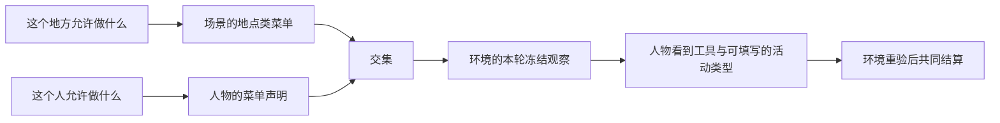
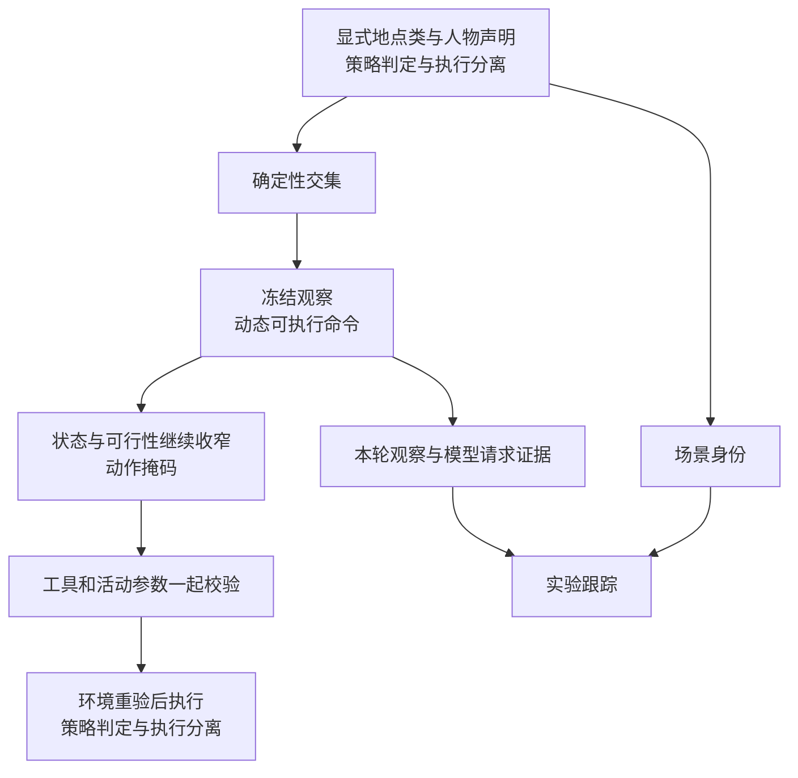
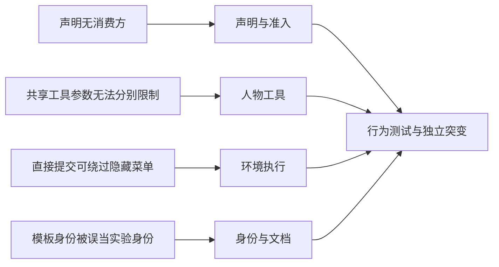

# 交互菜单方案裁决

> 状态：已采纳并由 [交互菜单特性规格](SPEC-interaction-menu.md) 取代行为定义。
> 日期：2026-09-20。本文保留心智模型、方案依据与差距归属，不另立实现合同。
> 业界依据、代码核查与修正记录见 [可行性核查](research/interaction-menu-feasibility.md)。
> 实际交付状态以 [验收记录](research/interaction-menu-verification.md) 为准。

## 心智模型与项目框架的映射

### 用户原话

“并发Fan out subagent，确认PROPOSAL-interaction-menu.md方案细节并且搜索业界方案验证理论可行性和文件修改清单（特别是设计文档），修订最终特性开发spec文档，确认文档一致性”

“并发fan out subagent 实现spec描述功能，不允许defer任何待实现内容（通过测试用例保证），且必须遵循spec要求；”

“可能会有其他会话并发修改开发功能，请知悉”

### 项目框架映射

### 转述确认

本次将原提案建议的地点类与人物交集落实为完整功能：同样的资源存在时，地点和人物声明也能限制
可提交的工具与活动类型；模型看到的选项与环境真正接受的请求必须一致。用户已经明确授权修订
规格并完成实现，必要的接口纠错和验收补全直接纳入本次范围。

## 提升后的心智模型

### 业界方案概览

| 机制名称 | 适用 | 不适用 |
| --- | --- | --- |
| 动态可执行命令 | 保持稳定动词，按当前状态给出有效集合 | 不能直接照搬自由文本命令解析 |
| 动作掩码 | 在选择时缩窄动作与参数 | 不能只隐藏入口而放弃执行端校验 |
| 策略判定与执行分离 | 声明先校验，执行时按权威状态判定 | 当前两个集合无须外部策略引擎 |
| 实验跟踪 | 同时保留配置、源码、模板与实际请求证据 | 不能以一个静态模板哈希代表整个实验 |

### 提升后的设计

可用的是集合交集、严格参数枚举和环境权威校验。不可用的是软偏好代替硬约束、声明损坏时默认
全开放、菜单删掉世界事实，以及为了简单集合判断引入策略语言或网络服务。

### 设计决策点

| 决策名称 | 已采纳选择 | 取舍 |
| --- | --- | --- |
| 地点粒度 | 现有单值地点类 | 可复用；不增加具体地点覆盖和时段规则 |
| 人物约束 | 显式人物声明与地点交集 | 能表达个人限制；人物必须明确写声明或 null |
| 声明对象 | 工具名与活动类型分别引用现有闭集 | 能限制共享启动工具中的游戏；需要同时校验参数 |
| 控制保护 | 计划、等待、睡眠与既有活动控制必须保留 | 避免人物无法继续决策；不开放任意禁止基础控制的配置 |
| 实验身份 | 菜单绑定场景，源码与模板分别留证 | 可审计且恢复拒绝漂移；旧场景不再缺省接受 |

完整接口、失败语义、品类对应关系和全部测试要求只在特性规格维护。

## 当前实现的差距

### 差距归属图

### 差距明细表

下表描述本次开发前的差距；是否完成由验收记录中的实际命令和行为证据判定。

| 差距名称 | 对应设计点 | 性质 | 阶段 |
| --- | --- | --- | --- |
| 声明无消费方 | 地点类与人物交集 | 缺失 | 声明与准入 |
| 共享工具参数无法分别限制 | 工具名与活动类型分别引用现有闭集 | 缺失 | 人物工具 |
| 直接提交可绕过隐藏菜单 | 环境权威执行 | 缺失 | 环境执行 |
| 模板身份被误当实验身份 | 场景、源码与模板分别留证 | 名实不符 | 身份与文档 |

### 分阶段路线图

所有阶段均属于本次开发，不留下待实现项。已有候选地点能力字段与实际地点输入的历史差距另按
现行人物规格如实描述，交互菜单使用现有单值地点类，不替代该能力集合。
