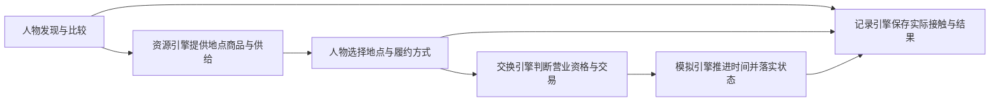
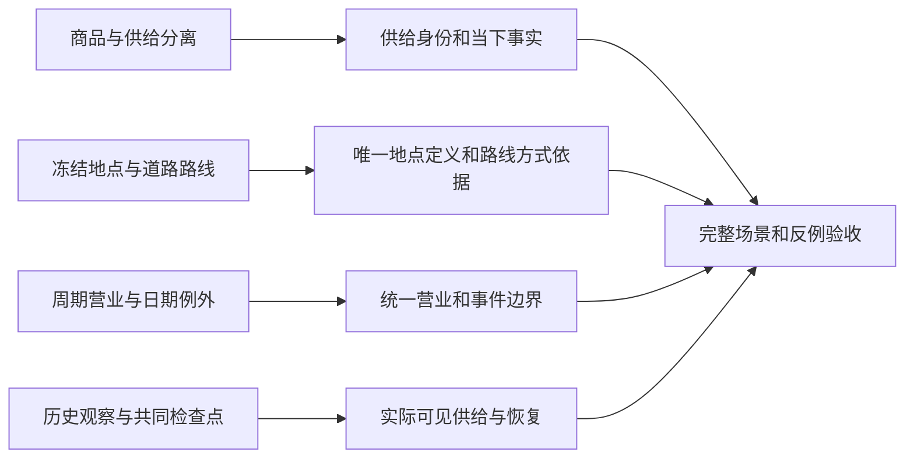

# 地图数据集合、地点目录与门店供给设计说明

> 状态：已裁决的设计说明；完整行为合同由 [开发规格](SPEC-map-and-storefront.md) 承载。
> 日期：2026-09-20。
> 本文解释心智模型、采纳机制和审查基线差距，不宣称实现或验收完成。
> 业界证据见 [可行性核验](research/map-and-storefront-feasibility.md)，文档与测试影响见
> [独立一致性审查](research/map-and-storefront-document-impact.md)。

## 心智模型与项目框架的映射

### 用户原话

> “并发Fan out subagent，确认PROPOSAL-map-and-storefront.md方案细节并且搜索业界方案验证理论可行性和文件修改清单（特别是设计文档），修订最终特性开发spec文档，确认文档一致性”
>
> “并发fan out subagent 实现spec描述功能，不允许defer任何待实现内容（通过测试用例保证），且必须遵循spec要求；”

### 项目框架映射

数字人要知道同一件商品在哪些门店有货、价格如何、什么时候营业、走道路需要多久，自己决定到店或配送。

### 转述确认

本次授权要求把已经讨论的地图与门店供给变成完整可实现、可测试的特性，先纠正理论和现状判断，
再同步规范与实现。选店仍由人物决定，环境提供事实并执行条件；最终规格中的内容全部交付。
现有授权已覆盖这一裁决过程，不因本文格式再次请求确认。

## 提升后的心智模型

### 业界方案概览

| 成熟机制 | 适用 | 不适用 |
| --- | --- | --- |
| 商品与报价分离 | 同商品在多门店有不同价格、库存与卖方 | 不能据此断言所有外部产品体系都不在商品资源放价格 |
| 冻结地点与道路路线 | 固定地点身份、方式依据、路程与来源 | 不能用直线距离或文件名证明道路可达 |
| 周期营业与日期例外 | 分段、跨午夜、有效期、临时闭店 | 未知不是全天营业，早先开放不保证到达后开放 |
| 执行时重验与原子交易 | 拒绝失效报价、库存和履约条件，整单无部分副作用 | 不能替人物选门店 |
| 历史观察与共同检查点 | 恢复当时看见的信息和已发生的报价库存变化 | 不能从当前目录补造过去已见事实 |

### 提升后的设计

```mermaid
flowchart TB
    G[商品身份规格与用途] --> O[门店供给<br/>商品与报价分离]
    L[地点身份坐标与活动环境] --> O
    M[冻结道路与方式依据] --> Q[发现具体地点与供给]
    O --> Q
    T[时态营业与当前库存报价] --> Q
    Q --> A[人物选择]
    A --> V[到达与购买时重验<br/>原子交易]
    V --> D[付款与交付分别发生]
    D --> U[取得地点的商品使用]
    Q & V & D --> E[实际观察与共同检查点]
```

可用的是固定版本资料、独立供给、营业日历、道路事实与执行重验。不采用环境的重力推荐替人物决策，
不在线补资料，不为小规模地图增加服务层，也不把 AS2 的 protobuf 地图接口当作现有 JSON 的直接适配器。
经营业态、活动环境和交互菜单地点类分别声明；品牌可以缺失。

### 已裁决的设计范围

| 决策 | 采用范围 | 取舍 |
| --- | --- | --- |
| 现实依据 | 已有张江真实地点，加明确供给、营业与库存假设 | 可验证条件差异，不宣称复现真实门店零售 |
| 行为范围 | 发现、比较、出行、购买、自提、配送、资格验证、调价补货、恢复与来源 | 不包含会员购买、预约办理、排队或物品搬运动作；取得物留在取得地点 |
| 发现时序 | 一个生活动作，结算后以 `discovery_result` 唤醒下一秒合法决策；游标绑定地图、筛选与起点 | 保持单观察和单动作协议；世界时间推进不打断同一查询分页 |
| 实际可见性 | 直接下钻和有时长浏览只授权实际窗口，逐供给保存时刻与地点 | 新呈现其他供给不延长旧凭据；回灌和当前事实共用窗口，变化以可还原差异表达 |
| 交易身份 | 供给决定地点、卖方、报价与库存；商品决定规格和使用效果，保留品类购买配对 | 同商品多门店独立，整单必须同地点同卖方，实际付款由报价、数量和品类系数求整行金额 |
| 未知资料 | 明确未知并保留地点身份；不允许未知路线出行 | 每个选中端点与方式仍必须有显式记录，真正漏记录拒绝发布 |
| 来源许可 | 逐来源、逐数据关系与使用方式保存说明 | 不能用一个共享条款布尔值判断许可兼容，署名不能替代全部许可义务 |

## 当前实现的差距

### 差距归属图

以下为独立审查基线下的差距；后续实现状态按验收台账更新，不由本文推断。

### 差距明细

| 差距名称 | 对应设计点 | 性质 | 完成条件 |
| --- | --- | --- | --- |
| 供给身份和当下事实 | 商品与供给分离 | 缺失 | 同商品多店独立报价、库存、卖方和恢复状态 |
| 唯一地点定义和路线方式依据 | 冻结地点与道路路线 | 名实不符 | 场景只引用；每种方式都有正确来源或明确未知，不借用驾车材料证明步行 |
| 统一营业和事件边界 | 周期营业与日期例外 | 缺失 | 观察、候选、执行和唤醒使用同一时态解释 |
| 实际可见供给与恢复 | 历史观察与共同检查点 | 缺陷 | 只授权真正呈现供给，调价库存和营业例外恢复不丢失 |
| 完整场景和反例验收 | 执行时重验与原子交易 | 缺失 | 正式数据的发现到履约流程、错误边界和源码突变全部闭合 |

审查基线资料有二百二十份按方式命名的路线响应，其中一百零四份步行材料与同端点驾车材料完全相同，
当时需要修正步行来源；旧“只有十二条冻结路线”和当时“二百二十条都是真实可用路线”的判断都不成立。
后续独立地图特性已修正并验收，证据见 [验收记录](research/map-and-storefront-verification.md)；主线组合另行验证。

### 完整交付顺序

这些阶段是依赖顺序，不能把后续阶段延期。通过结论只来自固定源码和真实命令证据。
